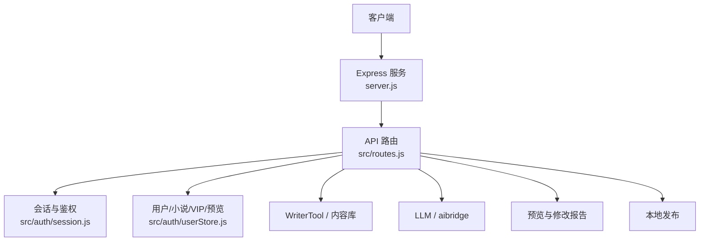
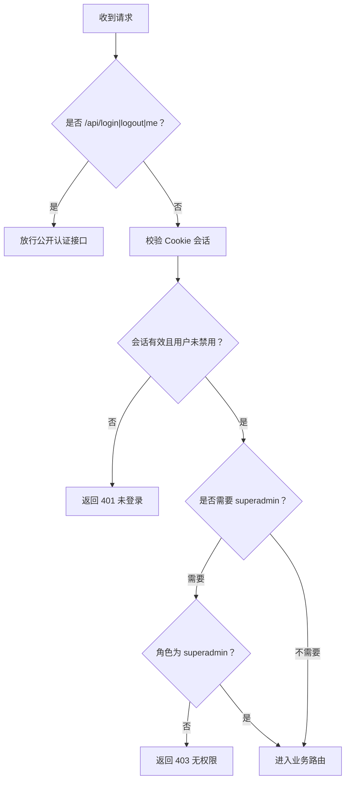
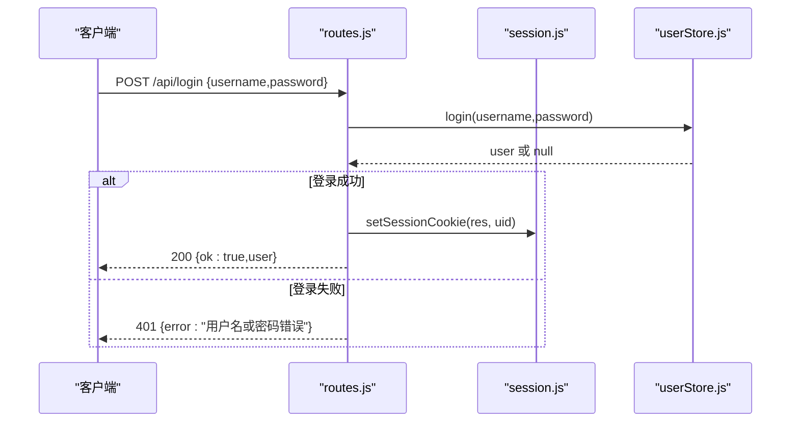
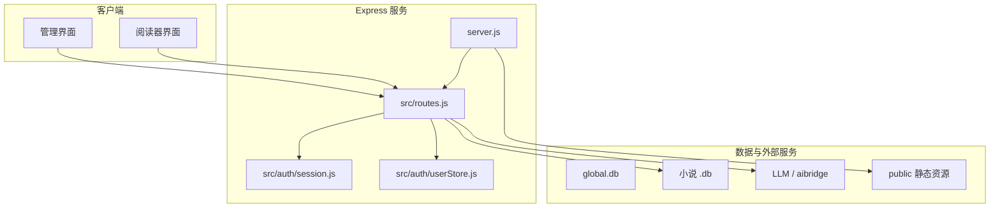

# API 接口文档

<cite>
**本文引用的文件**   
- [server.js](file://server.js)
- [src/routes.js](file://src/routes.js)
- [src/auth/session.js](file://src/auth/session.js)
- [src/auth/userStore.js](file://src/auth/userStore.js)
- [src/base.js](file://src/base.js)
- [src/skills/novelPublisher/publish.js](file://src/skills/novelPublisher/publish.js)
- [README.md](file://README.md)
</cite>

## 更新摘要
**变更内容**   
- 增强了 `/api/catalog` 端点实现，包含全面的目录扫描逻辑、VIP内容访问控制和结构化小说元数据
- 更新了公开书单API的详细规格说明，包括章节计数和VIP状态指示器
- 完善了VIP访问控制机制的文档说明

## 目录
1. [简介](#简介)
2. [项目结构与入口](#项目结构与入口)
3. [认证与权限模型](#认证与权限模型)
4. [通用约定](#通用约定)
5. [认证相关 API](#认证相关-api)
6. [小说管理 API](#小说管理-api)
7. [阅读器与学习 API](#阅读器与学习-api)
8. [TTS 语音合成 API](#tts-语音合成-api)
9. [预览与发布 API](#预览与发布-api)
10. [长任务与进度通道](#长任务与进度通道)
11. [AI 意图与工具执行](#ai-意图与工具执行)
12. [管理员与系统 API](#管理员与系统-api)
13. [错误码与排错指南](#错误码与排错指南)
14. [最佳实践](#最佳实践)
15. [架构总览](#架构总览)

## 简介
本仓库是一个"阅读 + 管理 + 学习"一体化的 AI 小说平台。后端基于 Node.js 与 Express，对外暴露三类能力：
- 认证与会话：用户登录、登出、当前用户信息。
- 小说管理：小说 CRUD、章节增删改、大纲/正文生成、分部、字数治理、一致性检查、分享链接、VIP 属性。
- 阅读器服务：公开可用的测试题、句子讲解、生词标注、单词讲解、问答、反馈、文生图；以及 TTS 朗读音频合成。

服务端默认监听端口 `3400`，可通过环境变量挂载前缀（例如 `/novel`）。所有 REST 接口统一以 `/api` 为路径前缀；部分静态资源与书页通过 `/login`、`/tts`、`/admin`、`/novel` 等路径提供。

**章节来源**
- [server.js:1-64](file://server.js#L1-L64)
- [README.md:18-31](file://README.md#L18-L31)

## 项目结构与入口
- 进程入口：`server.js` 负责初始化 Express、CORS、JSON 解析、BASE_PATH 前缀平移、全局数据库与桥接服务、注册路由、挂载静态资源。
- 路由集中定义：`src/routes.js` 实现全部 `/api/*`、`/novel` 书页闸门、`/admin` SPA 路由。
- 认证中间件：`src/auth/session.js` 提供会话 Cookie 签发、校验、当前用户解析、鉴权守卫。
- 多用户元数据：`src/auth/userStore.js` 维护用户、小说登记、VIP 授权、预览登记。



**图表来源**
- [server.js:9-53](file://server.js#L9-L53)
- [src/routes.js:331-339](file://src/routes.js#L331-L339)

**章节来源**
- [server.js:9-64](file://server.js#L9-L64)
- [src/routes.js:1-34](file://src/routes.js#L1-L34)

## 认证与权限模型
- 会话机制：使用自定义的 httpOnly Cookie `ainovel_session`，内容为 base64url 载荷加 HMAC-SHA256 签名，有效期 7 天，Path 与应用前缀一致。
- 鉴权范围：除 `/api/login`、`/api/logout`、`/api/me` 外，所有 `/api` 请求必须携带有效会话；否则返回未登录错误。
- 角色模型：
  - `user`：普通创作者，可操作自己拥有的小说。
  - `superadmin`：超级管理员，可访问用户管理、VIP 授权、推理服务连接、TTS 音频清理等管理端点。
- 小说归属：所有小说操作通过 `global.db` 中的 `novel` 表定位，并校验当前用户是否为书主或超管；真实 `.db` 文件名对前端不透明，防止路径穿越。
- VIP 访问控制：
  - 小说标记 `vip=true` 表示 VIP 专属。
  - 读者是否可读由 `vip_grant` 名单决定，支持按单本书或全站范围、到期时间、撤销状态。
  - 站点首页与子树在每次请求时实时判定，撤销与过期立即生效。



**图表来源**
- [src/auth/session.js:26-30](file://src/auth/session.js#L26-L30)
- [src/auth/session.js:75-110](file://src/auth/session.js#L75-L110)
- [src/routes.js:341-350](file://src/routes.js#L341-L350)
- [src/routes.js:559-560](file://src/routes.js#L559-L560)

**章节来源**
- [src/auth/session.js:1-118](file://src/auth/session.js#L1-L118)
- [src/auth/userStore.js:1-11](file://src/auth/userStore.js#L1-L11)
- [src/auth/userStore.js:53-102](file://src/auth/userStore.js#L53-L102)
- [src/auth/userStore.js:181-188](file://src/auth/userStore.js#L181-L188)
- [src/auth/userStore.js:235-349](file://src/auth/userStore.js#L235-L349)
- [src/routes.js:97-116](file://src/routes.js#L97-L116)
- [src/routes.js:144-179](file://src/routes.js#L144-L179)

## 通用约定
- 基础路径：
  - 默认根路径下，API 为 `/api/*`。
  - 若配置了 `BASE_PATH`（例如 `/novel`），则对外 URL 为 `${BASE_PATH}/api/*`，但内部路由仍写根级，由服务器层做前缀剥离。
- 请求格式：
  - JSON 请求体：`Content-Type: application/json`。
  - 删除类破坏性操作通常需要二次确认字段 `confirm: "OK"`。
- 响应格式：
  - 成功通常返回 `{ ok: true, ... }` 或 `{ success: true, ... }`。
  - 失败通常返回 `{ error: "..." }`，HTTP 状态码表达语义（400、401、403、404、409、410、429、500、502、503）。
- 限流：
  - 读者侧 AI 接口有独立限流器，频繁请求会返回 429，并带 `Retry-After`。
  - TTS 接口有更宽松的限流额度，但仍可能因批量逐句合成触发限流。
- 安全净化：
  - 多数 `/api` 响应会过滤敏感键（如密钥、路径、密码）和敏感值（内网 IP、外部 URL、服务器地址），避免泄露内部信息。

**章节来源**
- [server.js:25-36](file://server.js#L25-L36)
- [src/routes.js:67-95](file://src/routes.js#L67-L95)
- [src/routes.js:289-306](file://src/routes.js#L289-L306)
- [src/routes.js:331-339](file://src/routes.js#L331-L339)

## 认证相关 API

### POST /api/login
- 用途：用户登录，成功后设置会话 Cookie。
- 认证：无需登录。
- 请求体：
  - `username`：字符串，用户名。
  - `password`：字符串，密码。
- 成功响应：
  - HTTP 200
  - 主体：`{ ok: true, user: { id, username, role, disabled, lastLogin, createdAt, updatedAt } }`
- 失败响应：
  - HTTP 401：`{ error: "用户名或密码错误" }`
- 行为说明：
  - 登录成功后设置 `ainovel_session` Cookie，HttpOnly、SameSite=Lax、Path=应用前缀、Max-Age=7 天。
  - 用户被禁用时登录失败。



**图表来源**
- [src/routes.js:342-348](file://src/routes.js#L342-L348)
- [src/auth/session.js:75-78](file://src/auth/session.js#L75-L78)
- [src/auth/userStore.js:181-188](file://src/auth/userStore.js#L181-L188)

**章节来源**
- [src/routes.js:342-348](file://src/routes.js#L342-L348)
- [src/auth/session.js:75-81](file://src/auth/session.js#L75-L81)
- [src/auth/userStore.js:181-188](file://src/auth/userStore.js#L181-L188)

### POST /api/logout
- 用途：清除会话 Cookie。
- 认证：无需登录。
- 请求体：无。
- 成功响应：
  - HTTP 200
  - 主体：`{ ok: true }`

**章节来源**
- [src/routes.js:349-349](file://src/routes.js#L349-L349)
- [src/auth/session.js:79-81](file://src/auth/session.js#L79-L81)

### GET /api/me
- 用途：获取当前登录用户信息。
- 认证：需要有效会话。
- 请求体：无。
- 成功响应：
  - HTTP 200
  - 主体：`{ ok: true, user: { id, username, role, disabled, lastLogin, createdAt, updatedAt } }`
- 失败响应：
  - HTTP 401：`{ error: "未登录或登录已过期" }`

**章节来源**
- [src/routes.js:350-350](file://src/routes.js#L350-L350)
- [src/auth/session.js:83-102](file://src/auth/session.js#L83-L102)

## 小说管理 API

### GET /api/novels
- 用途：列举当前用户拥有的小说；超管可传 `all=1` 查看全部。
- 认证：需要登录。
- 查询参数：
  - `all`：可选，值为 `"1"` 时超管列出全部小说。
- 成功响应：
  - HTTP 200
  - 主体：`{ novels: [{ id, name, chapterCount, updatedAt, vip }] }`

**章节来源**
- [src/routes.js:639-644](file://src/routes.js#L639-L644)

### POST /api/novels
- 用途：新建小说，分配 UUID 作为内部标识，并在 `data/<user_id>/<uuid>.db` 创建内容库。
- 认证：需要登录。
- 请求体：
  - `title`：必填，书名。
  - `outline`：可选，故事概要。
  - `content`：可选，设定正文。
- 成功响应：
  - HTTP 200
  - 主体：`{ ok: true, novel: { id, name, chapterCount, updatedAt } }`
- 失败响应：
  - HTTP 400：书名缺失或为占位描述。
  - HTTP 500：底层写入失败。

**章节来源**
- [src/routes.js:646-661](file://src/routes.js#L646-L661)

### DELETE /api/novels/:id
- 用途：删除整本小说，包括登记行与 `.db` 文件。
- 认证：需要登录，且必须是书主或超管。
- 路径参数：
  - `id`：小说 ID。
- 请求体：
  - `confirm`：必填，值为 `"OK"` 才允许删除。
- 成功响应：
  - HTTP 200
  - 主体：`{ ok: true, id }`
- 失败响应：
  - HTTP 400：缺少二次确认。
  - HTTP 404：小说不存在或未登记。
  - HTTP 403：无权访问该小说。

**章节来源**
- [src/routes.js:663-676](file://src/routes.js#L663-L676)

### POST /api/novels/reconcile
- 用途：超管对账，将 `data/` 下的小说文件与 `novel` 表互校，补登记或删除悬挂记录。
- 认证：需要 superadmin。
- 成功响应：
  - HTTP 200
  - 主体：`{ ok: true, added, removed }`

**章节来源**
- [src/routes.js:678-684](file://src/routes.js#L678-L684)

### GET /api/novels/:id/chapters
- 用途：获取小说的章节结构化列表，不含正文。
- 认证：需要登录，且必须是书主或超管。
- 路径参数：
  - `id`：小说 ID。
- 成功响应：
  - HTTP 200
  - 主体：
    ```json
    {
      "novel": "书名",
      "chapters": [
        {
          "no": 1,
          "name": "章名",
          "outline": "大纲文本",
          "wordCount": 数字,
          "hasContent": 布尔,
          "partNo": 数字,
          "id": "稳定章节ID"
        }
      ],
      "totalWords": 数字
    }
    ```

**章节来源**
- [src/routes.js:686-708](file://src/routes.js#L686-L708)

### GET /api/novels/:id/chapter/:no
- 用途：获取指定章节正文。
- 认证：需要登录，且必须是书主或超管。
- 路径参数：
  - `id`：小说 ID。
  - `no`：章节号，整数。
- 成功响应：
  - HTTP 200
  - 主体：`{ chapter: { no, name, outline, content, wordCount, outlineCount } }`
- 失败响应：
  - HTTP 400：章节号非整数。
  - HTTP 404：章节不存在。

**章节来源**
- [src/routes.js:710-725](file://src/routes.js#L710-L725)

### GET /api/novels/:id/parts
- 用途：只读查看分部结构，用于预填划分部弹窗。
- 认证：需要登录，且必须是书主或超管。
- 路径参数：
  - `id`：小说 ID。
- 成功响应：
  - HTTP 200
  - 主体：`{ parts: [{ no, name, startNo, endNo, chapters, hasIntro }] }`

**章节来源**
- [src/routes.js:727-745](file://src/routes.js#L727-L745)

### GET /api/novels/:id/settings
- 用途：读取小说基本信息、前言、每章字数生成设定、统计信息。
- 认证：需要登录，且必须是书主或超管。
- 路径参数：
  - `id`：小说 ID。
- 成功响应：
  - HTTP 200
  - 主体包含：
    - `name`、`outline`、`content`、`preface`、`version`、`updatedAt`
    - `genCfg`：每章字数生成设定对象或 null
    - `wordBand`、`wordBandText`：目标区间与人类可读文本
    - `chapterCount`、`outlineCount`、`bodyCount`、`totalWords`

**章节来源**
- [src/routes.js:747-775](file://src/routes.js#L747-L775)

### PUT /api/novels/:id/settings
- 用途：更新小说基本信息、前言、每章字数生成设定。
- 认证：需要登录，且必须是书主或超管。
- 路径参数：
  - `id`：小说 ID。
- 请求体字段（局部补丁语义，未传不改）：
  - `name`：可选，书名。
  - `outline`：可选，故事概要。
  - `content`：可选，设定正文。
  - `preface`：可选，前言。
  - `genCfg`：可选，对象或 null；null 表示清除每章字数设定。
- 成功响应：
  - HTTP 200
  - 主体：`{ ok: true, action, version, genCfg?, wordBand? }`
- 失败响应：
  - HTTP 400：书名空、genCfg 形状非法、越界或保存失败。

**章节来源**
- [src/routes.js:777-823](file://src/routes.js#L777-L823)

### PUT /api/novels/:id/chapter/:no/outline
- 用途：保存单章标题与大纲。
- 认证：需要登录，且必须是书主或超管。
- 路径参数：
  - `id`：小说 ID。
  - `no`：章节号。
- 请求体：
  - `outline`：可选，大纲文本。
  - `name`：可选，标题。
- 成功响应：
  - HTTP 200
  - 主体：`{ ok: true, no }`
- 失败响应：
  - HTTP 404：章节不存在。
  - HTTP 400：更新失败。

**章节来源**
- [src/routes.js:825-841](file://src/routes.js#L825-L841)

### POST /api/novels/:id/chapter/:no/outline-draft
- 用途：根据全书概要与本章构思，调用 LLM 生成"仅草稿"的大纲建议，不写库。
- 认证：需要登录，且必须是书主或超管。
- 路径参数：
  - `id`：小说 ID。
  - `no`：正整数章节号。
- 请求体：
  - `material`：可选，本章构思素材。
- 成功响应：
  - HTTP 200
  - 主体：`{ ok: true, no, outline, name? }`
- 失败响应：
  - HTTP 400：缺少故事概要或章号非法。
  - HTTP 404：章节不存在。
  - HTTP 502：LLM 链路不通或模型未给出可用大纲。

**章节来源**
- [src/routes.js:843-881](file://src/routes.js#L843-L881)

### DELETE /api/novels/:id/chapter/:no
- 用途：删除单章，自动重排后续章节号。
- 认证：需要登录，且必须是书主或超管。
- 路径参数：
  - `id`：小说 ID。
  - `no`：章节号。
- 请求体：
  - `confirm`：必填，值为 `"OK"`。
- 成功响应：
  - HTTP 200
  - 主体：`{ ok: true, no }`
- 失败响应：
  - HTTP 400：缺少二次确认或删除失败。

**章节来源**
- [src/routes.js:883-899](file://src/routes.js#L883-L899)

### POST /api/novels/:id/renumber
- 用途：重排全部章节号。
- 认证：需要登录，且必须是书主或超管。
- 路径参数：
  - `id`：小说 ID。
- 成功响应：
  - HTTP 200
  - 主体：`{ ok: true, shiftedCount }`

**章节来源**
- [src/routes.js:901-912](file://src/routes.js#L901-L912)

### GET /api/novels/:id/share
- 用途：计算已发布的阅读分享链接。
- 认证：需要登录，且必须是书主或超管。
- 路径参数：
  - `id`：小说 ID。
- 成功响应：
  - HTTP 200
  - 主体：`{ url, published, title }`

**章节来源**
- [src/routes.js:1109-1118](file://src/routes.js#L1109-L1118)

### GET /api/novels/:id/vip
- 用途：查看某本书是否 VIP，以及已授权的读者名单。
- 认证：需要登录，且必须是书主或超管。
- 路径参数：
  - `id`：小说 ID。
- 成功响应：
  - HTTP 200
  - 主体：`{ vip, grants: [...] }`

**章节来源**
- [src/routes.js:1186-1191](file://src/routes.js#L1186-L1191)

### PUT /api/novels/:id/vip
- 用途：设置某本书是否为 VIP 专属。
- 认证：需要登录，且必须是书主或超管。
- 路径参数：
  - `id`：小说 ID。
- 请求体：
  - `vip`：布尔值。
- 成功响应：
  - HTTP 200
  - 主体：`{ ok: true, vip }`
- 失败响应：
  - HTTP 410：仍传旧版 `password` 字段会被拒绝。

**章节来源**
- [src/routes.js:1192-1202](file://src/routes.js#L1192-L1202)

### DELETE /api/novels/:id/vip
- 用途：关闭某本书的 VIP 标记。
- 认证：需要登录，且必须是书主或超管。
- 路径参数：
  - `id`：小说 ID。
- 成功响应：
  - HTTP 200
  - 主体：`{ ok: true, vip: false }`

**章节来源**
- [src/routes.js:1203-1210](file://src/routes.js#L1203-L1210)

## 阅读器与学习 API
以下接口注册在 `requireAuth` 之前，因此**未登录读者也可使用**，但受独立限流保护。

### POST /api/reader/quiz
- 用途：生成章节小测试题。
- 认证：无需登录。
- 请求体：
  - `document`：必填，章节正文。
  - `age`：可选，年龄档，默认 9。
  - `force`：可选，true 表示强制换一组新题。
- 成功响应：
  - HTTP 200
  - 主体：`{ ok: true, questions }`

**章节来源**
- [src/routes.js:359-363](file://src/routes.js#L359-L363)

### POST /api/reader/explain
- 用途：对句子进行讲解。
- 认证：无需登录。
- 请求体：
  - `sentence`：必填，待讲解句子。
  - `age`：可选，年龄档，默认 9。
  - `lang`：可选，语言，默认英语。
- 成功响应：
  - HTTP 200
  - 主体：`{ ok: true, explanation }`

**章节来源**
- [src/routes.js:364-367](file://src/routes.js#L364-L367)

### POST /api/reader/vocab
- 用途：从正文中挑选生词。
- 认证：无需登录。
- 请求体：
  - `document`：必填，章节正文。
  - `age`：可选，年龄档，默认 9。
- 成功响应：
  - HTTP 200
  - 主体：`{ ok: true, words }`

**章节来源**
- [src/routes.js:368-372](file://src/routes.js#L368-L372)

### POST /api/reader/explain-word
- 用途：对单个词汇进行讲解，结果持久缓存。
- 认证：无需登录。
- 请求体：
  - `word`：必填，词汇。
  - `age`：可选，年龄档，默认 9。
  - `lang`：可选，语言，默认英语。
  - `context`：可选，上下文原句。
- 成功响应：
  - HTTP 200
  - 主体：`{ ok: true, explanation }`

**章节来源**
- [src/routes.js:373-377](file://src/routes.js#L373-L377)

### POST /api/reader/word-status
- 用途：查询一批词哪些已有讲解缓存。
- 认证：无需登录。
- 请求体：
  - `words`：必填，词汇数组。
  - `age`：可选，年龄档，默认 9。
  - `lang`：可选，语言，默认英语。
- 成功响应：
  - HTTP 200
  - 主体：`{ ok: true, have }`

**章节来源**
- [src/routes.js:378-382](file://src/routes.js#L378-L382)

### POST /api/reader/ask
- 用途：基于章节内容的智能问答。
- 认证：无需登录。
- 请求体：
  - `question`：必填，问题。
  - `document`：必填，章节正文。
- 成功响应：
  - HTTP 200
  - 主体：`{ ok: true, answer }`

**章节来源**
- [src/routes.js:383-386](file://src/routes.js#L383-L386)

### POST /api/reader/feedback
- 用途：对回答或讲解内容进行反馈。
- 认证：无需登录。
- 请求体：
  - `text`：必填，反馈文本。
- 成功响应：
  - HTTP 200
  - 主体：`{ ok: true, feedback }`

**章节来源**
- [src/routes.js:387-390](file://src/routes.js#L387-L390)

### POST /api/reader/image
- 用途：文生图代理，转发到 aibridge 图像生成接口。
- 认证：无需登录。
- 请求体：
  - `prompt`：必填，图片描述。
  - `size`：可选，图片尺寸。
  - `model`：可选，模型名称。
- 成功响应：
  - HTTP 200
  - 主体：`{ ok: true, url, revisedPrompt? }`
- 失败响应：
  - HTTP 400：缺少图片描述。
  - HTTP 502：上游 aibridge 不可用或返回错误。

**章节来源**
- [src/routes.js:399-428](file://src/routes.js#L399-L428)

## TTS 语音合成 API

### POST /api/tts/sentence
- 用途：为章节正文中的句子合成 MP3 音频。
- 认证：无需登录。
- 请求体：
  - `chapterUrl`：必填，章节页面 URL。
  - `text`：必填，要朗读的句子。
  - `voice`：必填，音色 ID，必须在白名单内。
  - `rate`：必填，语速，必须在允许集合内。
- 成功响应：
  - HTTP 200
  - 主体：
    ```json
    {
      "ok": true,
      "hash": "音频哈希",
      "audioPath": "/tts-audio/...mp3",
      "bytes": 数字,
      "tailPadMs": 数字或null
    }
    ```
- 失败响应：
  - HTTP 400：缺少参数、不支持的音色或语速、章节定位失败、章节无正文。
  - HTTP 503：合成失败，返回 `fallback: "browser"`。

**章节来源**
- [src/routes.js:430-488](file://src/routes.js#L430-L488)

### POST /api/tts/explain
- 用途：为讲解文字或 AI 问答结果合成音频。
- 认证：无需登录。
- 请求体：
  - `text`：必填，讲解文本。
  - `voice`：必填，音色 ID。
  - `rate`：必填，语速。
- 成功响应：
  - HTTP 200
  - 主体：同 `/api/tts/sentence`。
- 失败响应：
  - HTTP 400：缺少参数、不支持的音色或语速、文本过长（超过 2000 字）。
  - HTTP 503：合成失败。

**章节来源**
- [src/routes.js:490-513](file://src/routes.js#L490-L513)

### 音色与语速约束
- 支持的音色包括简中、繁中、英文、日文多种 Neural 音色。
- 支持的语速为 `-20%`、`+0%`、`+30%`、`+50%`。
- 音频文件静态托管在 `/tts-audio`，路径由服务端拼接 BASE_PATH，避免线上反向代理误把音频路径交给其他服务。

**章节来源**
- [src/routes.js:434-449](file://src/routes.js#L434-L449)

## 预览与发布 API

### POST /api/novels/:id/preview
- 用途：生成带 token 的暂存预览站，并产出修改报告。
- 认证：需要登录，且必须是书主或超管。
- 路径参数：
  - `id`：小说 ID。
- 请求体：
  - `title`：可选，预览使用的书名。
  - `premakeQuiz`：可选，是否预生成测试题与生词；默认不跑 LLM 预生成。
  - `quizAge`：可选，测试题与生词年龄档。
- 成功响应：
  - HTTP 200
  - 主体：`{ success: true, ... }`，包含预览 token 与报告摘要。

**章节来源**
- [src/routes.js:1120-1138](file://src/routes.js#L1120-L1138)

### GET /api/novels/:id/preview/report
- 用途：获取预览修改报告，可与线上版本或上次暂存站比对。
- 认证：需要登录，且必须是书主或超管。
- 路径参数：
  - `id`：小说 ID。
- 查询参数：
  - `token`：可选，暂存站 token。
  - `ref`：可选，`live` 表示与线上正式目录比对，`preview` 表示与暂存站比对。
  - `title`：可选，预览书名。
- 成功响应：
  - HTTP 200
  - 主体：`{ success: true, report }`

**章节来源**
- [src/routes.js:1140-1157](file://src/routes.js#L1140-L1157)

### GET /api/novels/:id/preview/:token/diff
- 用途：查看单页 diff，对比暂存版与线上版的正文句级差异。
- 认证：需要登录，且必须是书主或超管。
- 路径参数：
  - `id`：小说 ID。
  - `token`：暂存站 token。
- 查询参数：
  - `file`：必填，HTML 文件名，需匹配正则且不能包含 `..`。
- 成功响应：
  - HTTP 200
  - 主体：`{ success: true, ... }`，包含 diff 详情。

**章节来源**
- [src/routes.js:1159-1170](file://src/routes.js#L1159-L1170)

### DELETE /api/novels/:id/preview/:token
- 用途：作废预览，删除暂存目录与登记行。
- 认证：需要登录，且必须是书主或超管。
- 路径参数：
  - `id`：小说 ID。
  - `token`：暂存站 token。
- 成功响应：
  - HTTP 200
  - 主体：`{ ok: true }`
- 失败响应：
  - HTTP 403：该预览不属于本小说。
  - HTTP 400：删除失败。

**章节来源**
- [src/routes.js:1172-1184](file://src/routes.js#L1172-L1184)

### POST /api/novels/:id/publish
- 用途：本地发布，将小说渲染到 `public/novel/<user_id>/<书名>/`。
- 认证：需要登录，且必须是书主或超管。
- 路径参数：
  - `id`：小说 ID。
- 请求体：
  - `title`：可选，发布书名。
  - `premakeQuiz`：可选，是否预生成测试题与生词。
  - `quizAge`：可选，测试题与生词年龄档。
  - `previewToken`：可选，若存在则从预览登记发布，而非直接全量发布。
- 成功响应：
  - HTTP 200
  - 主体：`{ success: true, ... }`，包含发布结果、清理情况、首页刷新状态。

**章节来源**
- [src/routes.js:991-1033](file://src/routes.js#L991-L1033)

## 长任务与进度通道

### POST /api/run
- 用途：通用动作执行入口，复用 WriterTool 的全部 action，如生成正文、生成大纲、修改章节、字数治理等。
- 认证：需要登录。
- 请求体关键字段：
  - `action`：必填，必须在允许列表中。
  - `novelId`：必填，除非是创建类 action。
  - `progressId`：可选，SSE 进度会话 ID，格式为 `run:` 开头。
  - 其他字段随 action 不同而变化，例如 `chapter`、`from`、`to`、`dryRun`、`force`、`modifyInstructions`、`genCfg` 等。
- 成功响应：
  - HTTP 200
  - 主体：`{ success: true, action, novelId, result }`
- 并发限制：
  - 长任务按书互斥，同一本书已有生成任务在跑时，重复提交返回 409。
- 删除保护：
  - 删除类 action 仍需 `confirm: "OK"`。

**章节来源**
- [src/routes.js:914-973](file://src/routes.js#L914-L973)

### GET /api/progress
- 用途：通过 SSE 订阅长任务进度。
- 认证：需要登录。
- 查询参数：
  - `id`：必填，进度 ID，格式为 `run:` 开头，长度 6–64。
- 响应：
  - HTTP 200
  - Content-Type：`text/event-stream; charset=utf-8`
  - 事件体：`data: {"type":"line","text":"...","timestamp":数字}`
- 行为：
  - 连接建立时会先补发近期缓冲进度，再订阅实时事件。
  - 定期发送 ping 心跳。

**章节来源**
- [src/routes.js:573-627](file://src/routes.js#L573-L627)

## AI 意图与工具执行

### POST /api/ai/plan
- 用途：让 LLM 把用户一句话解析为工具选择与参数。
- 认证：需要登录。
- 请求体：
  - `userInput`：必填，用户指令。
  - `novelId`：可选，当前选中小说 ID。
- 成功响应：
  - HTTP 200
  - 主体：`{ ok: true, tool, args, reason }`
- 失败响应：
  - HTTP 400：缺少 userInput。
  - HTTP 502：AI 未返回可解析的工具选择。

**章节来源**
- [src/routes.js:1212-1233](file://src/routes.js#L1212-L1233)

### POST /api/ai/execute
- 用途：执行 AI 解析出的工具，如 `getNovelInfo`、`deleteChapter`、`addChaptersBulk`、`generateChapter`、`publishNovel` 等。
- 认证：需要登录。
- 请求体：
  - `tool`：必填，工具名。
  - `args`：可选，工具参数对象。
- 成功响应：
  - HTTP 200
  - 主体：`{ success: true, tool, result }`
- 失败响应：
  - HTTP 400：缺少 tool 或参数校验失败。
  - HTTP 500：执行异常。

**章节来源**
- [src/routes.js:1235-1248](file://src/routes.js#L1235-L1248)
- [src/routes.js:1371-1432](file://src/routes.js#L1371-L1432)

## 管理员与系统 API

### GET /api/menu
- 用途：获取菜单分组。
- 认证：需要登录。
- 成功响应：`{ groups }`

**章节来源**
- [src/routes.js:562-564](file://src/routes.js#L562-L564)

### GET /api/tools
- 用途：获取 AI 工具清单。
- 认证：需要登录。
- 成功响应：`{ tools }`

**章节来源**
- [src/routes.js:562-564](file://src/routes.js#L562-L564)

### GET /api/llm-status
- 用途：登录后探测 LLM 链路可达性与密钥配置，不计费。
- 认证：需要登录。
- 成功响应：`{ ... }`，包含桥接服务可达性信息。

**章节来源**
- [src/routes.js:566-571](file://src/routes.js#L566-L571)

### GET /api/catalog
- 用途：公开书单，扫描各用户已发布站点，隐藏未授权 VIP 书。
- 认证：无需登录；已登录时可显示本人作品站与已授权 VIP 书。
- 功能特性：
  - **全面目录扫描**：递归扫描 `public/novel/<uid>/` 目录结构，识别已发布的小说站点
  - **VIP内容访问控制**：VIP书籍仅对书主本人或已获得授权的登录读者可见
  - **结构化元数据**：返回包含章节计数、VIP状态、更新时间等完整信息的小说条目
  - **智能排序**：按更新时间倒序排列，优先展示最新发布的小说
- 成功响应：
  - HTTP 200
  - 主体：`{ novels: [{ id, uid, title, chapterCount, vip, url, updatedAt }] }`
  
  其中每个小说条目包含：
  - `id`：小说唯一标识符（VIP书使用数据库ID，非VIP书使用路径标识）
  - `uid`：用户ID（UUID格式）
  - `title`：小说标题（经过目录名规范化处理）
  - `chapterCount`：已发布章节数量（统计 `chapter_*.html` 文件数）
  - `vip`：布尔值，标识是否为VIP专属内容
  - `url`：完整的访问URL（包含BASE_PATH前缀）
  - `updatedAt`：最后更新时间戳（毫秒）

**更新** 此端点现已实现完整的目录扫描逻辑，能够准确统计章节数量并提供VIP状态指示器。

**章节来源**
- [src/routes.js:515-557](file://src/routes.js#L515-L557)

### 用户管理（superadmin）
- `GET /api/admin/users`：列出用户。
- `POST /api/admin/users`：创建用户。
- `PUT /api/admin/users/:id/disable`：启用/禁用用户。
- `PUT /api/admin/users/:id/password`：重置用户密码。

**章节来源**
- [src/routes.js:1250-1264](file://src/routes.js#L1250-L1264)

### VIP 读者授权管理（superadmin）
- `GET /api/admin/vip`：列出授权、VIP 小说、用户、预览 TTL。
- `POST /api/admin/vip/grant`：授予 VIP 权限。
- `DELETE /api/admin/vip/:id`：撤销授权。
- `POST /api/admin/vip/:id/restore`：恢复已撤销授权。

**章节来源**
- [src/routes.js:1266-1294](file://src/routes.js#L1266-L1294)

### 推理服务连接管理（superadmin）
- `GET /api/admin/bridge`：列出桥接 Key 与当前激活项。
- `POST /api/admin/bridge/keys`：新增桥接 Key。
- `PUT /api/admin/bridge/keys/:id/active`：激活或停用某条 Key。
- `POST /api/admin/bridge/keys/:id/test`：测试某条 Key。
- `PUT /api/admin/bridge/keys/:id/name`：重命名 Key。
- `DELETE /api/admin/bridge/keys/:id`：删除 Key。
- `PUT /api/admin/bridge/url`：覆盖桥接服务地址。
- `POST /api/admin/bridge/ping`：探测桥接服务可达性。

**章节来源**
- [src/routes.js:1296-1340](file://src/routes.js#L1296-L1340)

### TTS 音频缓存管理（superadmin）
- `GET /api/admin/tts/audio`：审计 TTS 音频缓存。
- `POST /api/admin/tts/audio/prune`：清理 TTS 音频缓存，默认 dry-run，真删需 `apply: true` 且 `confirm: "OK"`。

**章节来源**
- [src/routes.js:1342-1360](file://src/routes.js#L1342-L1360)

## 错误码与排错指南

### 常见 HTTP 状态码
- 400：请求参数缺失、格式非法、业务校验失败。
- 401：未登录或会话过期。
- 403：权限不足，例如非书主访问他人小说、非 superadmin 访问管理端点。
- 404：小说或章节不存在。
- 409：同一本书已有长任务在运行。
- 410：VIP 密码解锁机制已停用。
- 429：请求过于频繁，应等待 `Retry-After` 秒后重试。
- 500：服务端异常。
- 502：LLM 或上游 aibridge 不可用。
- 503：TTS 合成失败。

### 典型错误场景
- 删除操作未传 `confirm: "OK"`：返回 400，提示需二次确认。
- 非书主访问小说：返回 403，提示无权访问。
- 读者访问 VIP 书页但未授权：返回 401 HTML 无权页。
- 读者侧 AI 接口被限流：返回 429，前端应退避。
- TTS 传入不支持的音色或语速：返回 400。
- 章节 URL 无法定位：返回 400 或 404，提示无效或不存在。
- LLM 链路不通：返回 502，提示链路不可达。

**章节来源**
- [src/routes.js:48-52](file://src/routes.js#L48-L52)
- [src/routes.js:289-306](file://src/routes.js#L289-L306)
- [src/routes.js:456-513](file://src/routes.js#L456-L513)
- [src/routes.js:663-676](file://src/routes.js#L663-L676)
- [src/routes.js:948-959](file://src/routes.js#L948-L959)
- [src/routes.js:1035-1094](file://src/routes.js#L1035-L1094)

## 最佳实践
- 认证流程：
  - 先调用 `/api/login`，保存服务端返回的 Cookie。
  - 后续所有 `/api` 请求自动携带 Cookie。
  - 登出后重新登录。
- 小说管理：
  - 新建小说前先准备书名、概要与设定。
  - 修改章节大纲建议使用"大纲草稿"接口，确认后再保存。
  - 删除整本或单章务必传 `confirm: "OK"`。
  - 发布前先用预览接口查看修改报告，确认无误再发布。
- 阅读器与学习：
  - 读者侧接口无需登录，但应避免高频刷接口，注意 429 限流。
  - 讲解与生词会按正文与年龄缓存，正文变化后缓存键变化，不会拿到过期结果。
- TTS：
  - 使用白名单内的音色与语速。
  - 全章朗读是逐句批量请求，注意限流与上游合成失败时的降级策略。
- 长任务：
  - 使用 `progressId` 与 `/api/progress` 订阅进度。
  - 同一本书不要并发提交生成任务，避免 409。
- 安全：
  - 不要在客户端存储或回显敏感信息。
  - 生产环境配置固定 `SESSION_SECRET`，避免重启后会话失效。

[本节为通用指导，不直接分析具体代码文件]

## 架构总览



**图表来源**
- [server.js:9-53](file://server.js#L9-L53)
- [src/routes.js:331-339](file://src/routes.js#L331-L339)
- [src/auth/session.js:26-30](file://src/auth/session.js#L26-L30)
- [src/auth/userStore.js:47-114](file://src/auth/userStore.js#L47-L114)