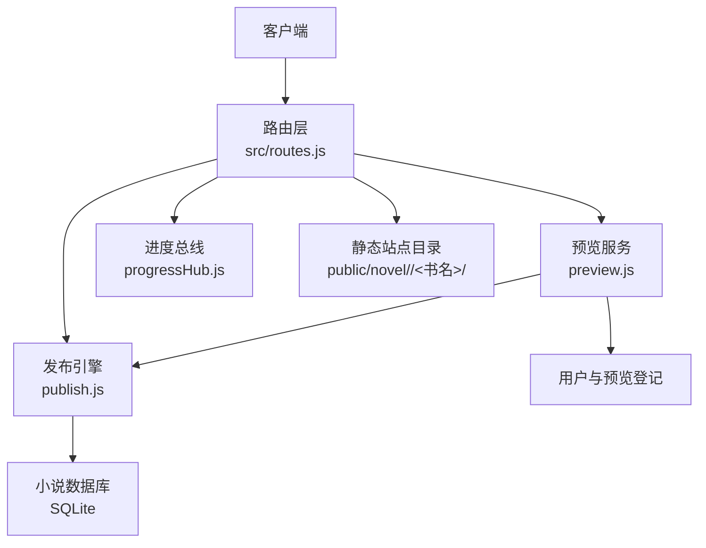
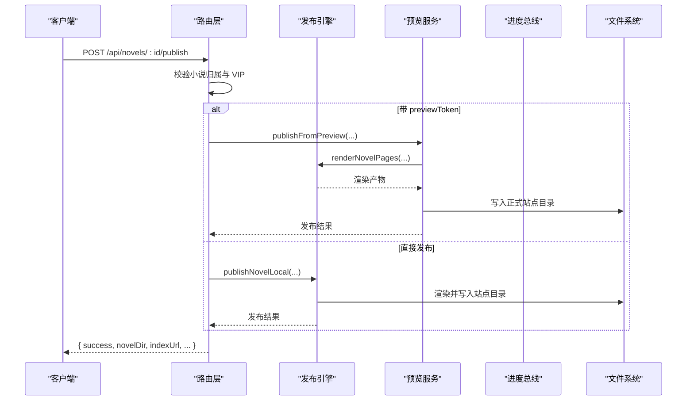
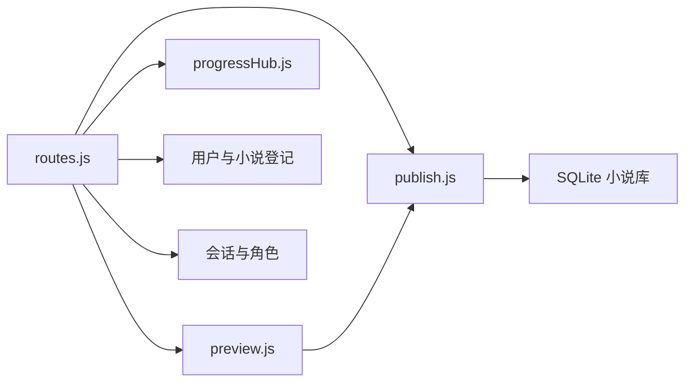

# 内容发布 API

<cite>
**本文引用的文件**   
- [src/routes.js](file://src/routes.js)
- [src/skills/novelPublisher/publish.js](file://src/skills/novelPublisher/publish.js)
- [src/services/preview.js](file://src/services/preview.js)
- [src/services/progressHub.js](file://src/services/progressHub.js)
</cite>

## 目录
1. [简介](#简介)
2. [项目结构与职责划分](#项目结构与职责划分)
3. [核心组件](#核心组件)
4. [架构总览](#架构总览)
5. [详细接口说明](#详细接口说明)
6. [依赖关系分析](#依赖关系分析)
7. [性能与并发特性](#性能与并发特性)
8. [故障排查指南](#故障排查指南)
9. [结论](#结论)

## 简介
本文件面向“内容发布”相关能力，覆盖以下目标：
- 静态站点生成接口：单本小说发布、批量发布（通过通用动作执行）、预览后确认发布。
- 预览机制接口：临时站点生成、预览链接管理、修改报告、单页差异对比、预览清理。
- 发布配置接口：小说设置、生成配置、VIP 开关与读者授权。
- 发布流程与状态管理：进度跟踪、错误处理、任务互斥、结果获取与清理。
- VIP 内容发布控制与访问权限：VIP 标记、读者授权名单、站点首页过滤、章节访问闸门。

## 项目结构与职责划分
本项目的内容发布链路由四层组成：
- 路由层：负责鉴权、参数校验、租户隔离、VIP 闸门、SSE 进度通道、REST 端点注册。
- 发布引擎：负责从小说数据库或章节文件渲染 HTML、生成目录页、处理分部与占位章、清理孤儿页面。
- 预览服务：负责生成带 token 的暂存站、比对线上产物、生成修改报告、支持预览后确认发布。
- 进度总线：负责长任务阶段事件转发，供 SSE 消费。

**图表来源**
- [src/routes.js:331-1107](file://src/routes.js#L331-L1107)
- [src/skills/novelPublisher/publish.js:1513-1599](file://src/skills/novelPublisher/publish.js#L1513-L1599)
- [src/services/preview.js:324-360](file://src/services/preview.js#L324-L360)
- [src/services/progressHub.js:16-58](file://src/services/progressHub.js#L16-L58)

**章节来源**
- [src/routes.js:1-1107](file://src/routes.js#L1-L1107)
- [src/skills/novelPublisher/publish.js:1-2352](file://src/skills/novelPublisher/publish.js#L1-L2352)
- [src/services/preview.js:1-473](file://src/services/preview.js#L1-L473)
- [src/services/progressHub.js:1-59](file://src/services/progressHub.js#L1-L59)

## 核心组件
- 路由层
  - 统一鉴权与会话：除登录、公开书单等少数端点外，所有 `/api` 需有效会话。
  - 小说归属解析：以 `novel.id` 或 `db_file` 定位，并校验当前用户拥有权。
  - VIP 闸门：对 `/novel` 子树进行实时授权判定；未授权返回无权页或隐藏条目。
  - 进度通道：基于 SSE 的 `/api/progress`，按 `run:` 前缀 id 缓冲近期事件。
  - 长任务互斥：按书锁定，防止同一本书并发生成导致正文与章号错乱。
- 发布引擎
  - 章节读取：优先 `chapter_XX.md`，回退到 SQLite 数据库。
  - 占位章：中间缺正文时补“本章尚未完成”，保持章节序列连续。
  - 站点首页：按用户命名空间生成作品列表，排除保留目录如 `tts`。
  - 孤儿清理：删除不再产出的旧章节页与导言页。
- 预览服务
  - 暂存站：写入 `<OUT_ROOT>/<token>/<书名>/`，结构与正式站一致。
  - 修改报告：比较本次渲染与线上或另一份预览的差异，统计新增、修改、删除、连带影响。
  - 预览后发布：以预览为基准重新渲染，校验漂移并落盘正式站点。
- 进度总线
  - 纯事件转发，订阅方异常隔离，不持状态。

**章节来源**
- [src/routes.js:97-188](file://src/routes.js#L97-L188)
- [src/routes.js:573-637](file://src/routes.js#L573-L637)
- [src/skills/novelPublisher/publish.js:43-50](file://src/skills/novelPublisher/publish.js#L43-L50)
- [src/skills/novelPublisher/publish.js:477-581](file://src/skills/novelPublisher/publish.js#L477-L581)
- [src/services/preview.js:24-30](file://src/services/preview.js#L24-L30)
- [src/services/preview.js:117-273](file://src/services/preview.js#L117-L273)
- [src/services/progressHub.js:1-59](file://src/services/progressHub.js#L1-L59)

## 架构总览
内容发布的典型调用链如下：

**图表来源**
- [src/routes.js:991-1033](file://src/routes.js#L991-L1033)
- [src/services/preview.js:423-470](file://src/services/preview.js#L423-L470)
- [src/skills/novelPublisher/publish.js:1513-1599](file://src/skills/novelPublisher/publish.js#L1513-L1599)

## 详细接口说明

### 一、静态站点生成与发布接口

#### 1. 单本小说发布
- 端点：`POST /api/novels/:id/publish`
- 鉴权：需要登录态，且必须拥有该小说。
- 主要行为：
  - 若请求体包含 `previewToken`，走“预览后确认发布”：以预览登记为基准重新渲染，校验正文是否漂移，再写入正式站点。
  - 若无 `previewToken`，直接调用本地发布逻辑，渲染章节、目录页与站点首页。
  - 可开启 LLM 预生成测试题与生词表（`premakeQuiz`），默认开启；可通过 `quizAge` 指定年龄。
  - 同名书冲突检测：若多本小说清洗后的书名相同，会共用发布目录，此时不会清理旧页，避免误删另一本书的章节。
  - 刷新用户站点首页，列出已发布作品。
- 请求体关键字段：
  - `previewToken`：预览 token，用于预览后确认发布。
  - `premakeQuiz`：是否在发布时跑 LLM 预生成。
  - `quizAge`：测试题与生词表年龄。
  - `title`：可选覆盖书名，影响发布目录名。
- 响应关键字段：
  - `success`：布尔。
  - `novelDir`：发布目录名。
  - `indexUrl`：书籍首页 URL。
  - `chapterCount`：章节数。
  - `files`：本次写出的文件名清单。
  - `pruned`：被清理的孤儿页面。
  - `pruneSkipped`：因同名书冲突而跳过清理的原因。
  - `drifted`：预览后确认发布时，发现与预览不一致的文件名。
- 错误处理：
  - 小说不存在或未登记：404。
  - 无权访问：403。
  - 预览不存在或过期：400。
  - 其他内部错误：500。

**章节来源**
- [src/routes.js:991-1033](file://src/routes.js#L991-L1033)
- [src/services/preview.js:423-470](file://src/services/preview.js#L423-L470)

#### 2. 批量发布（通用动作执行）
- 端点：`POST /api/run`
- 作用：复用 WriterTool 的全部 action，包括生成、修改、批量添加章节、字数治理、大纲生成、以及 `publishNovel` 动作。
- 长任务保护：
  - 对生成类 action 按书加锁，防止并发压垮推理服务。
  - 支持 SSE 进度通道，前端通过 `progressId` 关联任务。
- 与发布相关的动作：
  - `publishNovel`：在 AI 工具执行路径中调用本地发布逻辑，适合由 AI 编排触发整站发布。
- 请求体关键字段：
  - `action`：要执行的 action。
  - `novelId`：目标小说。
  - `progressId`：可选，格式为 `run:` 前缀的 id，用于 SSE 进度。
  - 其他字段随 action 不同而变化。
- 响应：
  - `success`、`action`、`novelId`、`result`。

**章节来源**
- [src/routes.js:914-973](file://src/routes.js#L914-L973)
- [src/routes.js:1371-1432](file://src/routes.js#L1371-L1432)

### 二、预览机制接口

#### 1. 生成预览
- 端点：`POST /api/novels/:id/preview`
- 行为：
  - 生成带 token 的暂存站，结构为 `<OUT_ROOT>/<token>/<书名>/`。
  - 同步生成该暂存站的首页。
  - 记录预览登记：token、所属小说、创建者、目录名、过期时间。
  - 返回预览 URL 与修改报告。
- 请求体关键字段：
  - `title`：可选覆盖书名。
  - `premakeQuiz`：是否同时预生成测试题与生词表。
  - `quizAge`：年龄。
- 响应关键字段：
  - `success`
  - `token`
  - `previewUrl`
  - `novelDir`
  - `chapterCount`
  - `report`：修改报告摘要与明细。

**章节来源**
- [src/routes.js:1120-1138](file://src/routes.js#L1120-L1138)
- [src/services/preview.js:324-360](file://src/services/preview.js#L324-L360)

#### 2. 预览修改报告
- 端点：`GET /api/novels/:id/preview/report`
- 行为：
  - 默认与线上正式目录比对，回答“这次发布会改到什么”。
  - 若传 `ref=preview` 与 `token`，则与某份暂存站比对，用于检查预览之后是否又改过。
- 查询参数：
  - `token`：可选，预览 token。
  - `ref`：`live`（默认）或 `preview`。
  - `title`：可选覆盖书名。
- 响应：
  - `success`
  - `report`：包含 `summary`、`notes`、`items`、`indexDiff` 等。

**章节来源**
- [src/routes.js:1140-1157](file://src/routes.js#L1140-L1157)
- [src/services/preview.js:117-273](file://src/services/preview.js#L117-L273)

#### 3. 单页差异对比
- 端点：`GET /api/novels/:id/preview/:token/diff`
- 行为：
  - 对比暂存版与线上版的某个 `.html` 文件。
  - 返回句级 diff、章节标题变化、翻页链接变化、新增/修改/不变状态。
- 查询参数：
  - `file`：必填，HTML 文件名。
- 响应：
  - `success`
  - `file`
  - `state`：`added`、`modified`、`unchanged`。
  - `stats`、`ops`、`old`、`current`。

**章节来源**
- [src/routes.js:1159-1170](file://src/routes.js#L1159-L1170)
- [src/services/preview.js:391-414](file://src/services/preview.js#L391-L414)

#### 4. 作废预览
- 端点：`DELETE /api/novels/:id/preview/:token`
- 行为：
  - 删除对应暂存目录与登记行。
  - 非超管只能删除自己拥有的预览。
- 响应：
  - `ok`。

**章节来源**
- [src/routes.js:1172-1184](file://src/routes.js#L1172-L1184)
- [src/services/preview.js:362-368](file://src/services/preview.js#L362-L368)

#### 5. 预览链接访问控制
- 路径：`/novel/<token>/<书名>/...`
- 规则：
  - 仅创作者本人或超管可访问预览暂存站。
  - 未登录或无权限时返回“预览链接”无权页。
  - 预览站不参与 VIP 判定，仅供创作者查看排版。

**章节来源**
- [src/routes.js:1035-1057](file://src/routes.js#L1035-L1057)
- [src/routes.js:243-261](file://src/routes.js#L243-L261)

### 三、发布配置接口

#### 1. 小说设置
- 读取：`GET /api/novels/:id/settings`
- 更新：`PUT /api/novels/:id/settings`
- 行为：
  - 读取书名、故事概要、正文设定、版本、更新时间、章节统计、生成配置、字数区间。
  - 更新时可分别设置 `name`、`outline`、`content`、`preface`、`genCfg`。
  - `genCfg` 会经规范化校验，失败时返回 400。
- 适用场景：
  - 设置全书生成策略。
  - 维护“本书设定”与分部导言。

**章节来源**
- [src/routes.js:747-823](file://src/routes.js#L747-L823)

#### 2. VIP 开关与授权信息
- 读取：`GET /api/novels/:id/vip`
- 设置：`PUT /api/novels/:id/vip`
- 取消：`DELETE /api/novels/:id/vip`
- 行为：
  - 返回该书是否为 VIP，以及已授权读者名单。
  - 设置 `vip: true/false` 控制该书是否需要读者授权。
  - 旧密码机制已停用，请求 `password` 字段会返回 410。

**章节来源**
- [src/routes.js:1186-1210](file://src/routes.js#L1186-L1210)

#### 3. VIP 读者授权管理（超管）
- 列表：`GET /api/admin/vip`
- 授予：`POST /api/admin/vip/grant`
- 撤销：`DELETE /api/admin/vip/:id`
- 恢复：`POST /api/admin/vip/:id/restore`
- 行为：
  - 支持按用户名或用户 ID 授予某本书的 VIP 访问权。
  - 支持 `days` 或 `expiresAt` 控制到期时间。
  - 返回授权记录、VIP 小说列表、用户列表与预览 TTL。

**章节来源**
- [src/routes.js:1266-1294](file://src/routes.js#L1266-L1294)
- [src/routes.js:190-206](file://src/routes.js#L190-L206)

### 四、发布流程与状态管理

#### 1. 进度跟踪（SSE）
- 端点：`GET /api/progress?id=run:<id>`
- 行为：
  - 建立 Server-Sent Events 连接。
  - 先补发近期缓冲事件，再订阅实时事件。
  - 定期发送心跳，关闭连接时清理监听。
- 限制：
  - id 必须以 `run:` 开头，长度与字符集受正则约束。
  - 只接收属于本路由的 `run:` 前缀事件，忽略 delta 类型事件。
  - 缓冲事件有数量上限与 TTL，防止内存无限增长。

**章节来源**
- [src/routes.js:573-627](file://src/routes.js#L573-L627)
- [src/services/progressHub.js:16-58](file://src/services/progressHub.js#L16-L58)

#### 2. 长任务互斥
- 范围：生成、修改、批量生成大纲、字数治理等长 action。
- 规则：
  - 同一本书同时只允许一个生成任务。
  - 重复提交返回 409，提示已有任务及运行时长。
  - 任务结束后释放锁。

**章节来源**
- [src/routes.js:629-637](file://src/routes.js#L629-L637)
- [src/routes.js:948-959](file://src/routes.js#L948-L959)

#### 3. 错误处理
- 常见错误：
  - 参数缺失或非法：400。
  - 小说不存在：404。
  - 无权访问：403。
  - 任务冲突：409。
  - 上游服务不可用：502。
  - 内部异常：500。
- 特殊防护：
  - 删除操作需二次确认 `confirm:"OK"`。
  - VIP 密码解锁入口返回 410，明确告知机制已停用。

**章节来源**
- [src/routes.js:45-53](file://src/routes.js#L45-L53)
- [src/routes.js:392-397](file://src/routes.js#L392-L397)
- [src/routes.js:983-989](file://src/routes.js#L983-L989)

### 五、发布结果的获取与清理机制

#### 1. 分享链接
- 端点：`GET /api/novels/:id/share`
- 行为：
  - 根据当前书名计算分享 URL。
  - 判断是否已发布。
- 适用场景：
  - 展示阅读入口，但不持久化链接，避免改名后陈旧。

**章节来源**
- [src/routes.js:1109-1118](file://src/routes.js#L1109-L1118)

#### 2. 孤儿页面清理
- 本地清理：
  - 预览后确认发布时，会清理不在本次发布清单中的旧章节页与导言页。
  - 同名书冲突时禁用清理，避免误删另一本书的章节。
- 远程清理（历史 SSH 发布逻辑仍保留实现）：
  - 扫描远程目录，删除匹配 `chapter_*.html` 或 `page_*.html` 但不在本次清单中的文件。
  - 删除后进行目录回读校验，确保孤儿确实消失。

**章节来源**
- [src/services/preview.js:423-470](file://src/services/preview.js#L423-L470)
- [src/skills/novelPublisher/publish.js:1359-1453](file://src/skills/novelPublisher/publish.js#L1359-L1453)

#### 3. 预览清理
- 自动清理：
  - 生成预览时会顺手回收过期暂存站。
  - 服务内提供 `purgeExpiredPreviews` 与 `purgePreviewsOfNovel`。
- 手动清理：
  - 通过作废预览接口删除指定 token 的暂存目录。
  - 删除整本小说前会先清其全部预览。

**章节来源**
- [src/routes.js:1123-1137](file://src/routes.js#L1123-L1137)
- [src/routes.js:663-676](file://src/routes.js#L663-L676)
- [src/services/preview.js:362-389](file://src/services/preview.js#L362-L389)

### 六、VIP 内容的发布控制与访问权限管理

#### 1. VIP 标记
- 每本小说可标记为 VIP。
- VIP 标记决定读者是否需要授权才能访问。
- 站点首页与公开书单会根据授权情况隐藏 VIP 条目。

**章节来源**
- [src/routes.js:144-188](file://src/routes.js#L144-L188)
- [src/routes.js:515-557](file://src/routes.js#L515-L557)

#### 2. 站点首页过滤
- 行为：
  - 扫描各用户已发布站点。
  - 对 VIP 书，只有书主本人或已授权读者可见。
  - 未授权或匿名情况下整条移除，而不是显示锁标。

**章节来源**
- [src/routes.js:515-557](file://src/routes.js#L515-L557)

#### 3. 章节访问闸门
- 行为：
  - 对 `/novel/<uid>/<书名>/...` 子树进行实时授权判定。
  - 未授权读者看到“此内容仅 VIP 用户可读”或“需要登录后阅读”。
  - 书主本人不受自己设定的 VIP 限制。
  - 超管也要显式获得授权，不能隐形绕过。

**章节来源**
- [src/routes.js:1035-1094](file://src/routes.js#L1035-L1094)
- [src/routes.js:208-238](file://src/routes.js#L208-L238)

#### 4. 读者授权生命周期
- 授予：
  - 支持 `days` 或 `expiresAt`。
  - 到期后自动失效。
- 撤销与恢复：
  - 超管可撤销授权，也可恢复已撤销授权。
- 生效时机：
  - 每个书页请求实时校验，撤销与到期当场生效。

**章节来源**
- [src/routes.js:190-206](file://src/routes.js#L190-L206)
- [src/routes.js:1266-1294](file://src/routes.js#L1266-L1294)

## 依赖关系分析

**图表来源**
- [src/routes.js:1-30](file://src/routes.js#L1-L30)
- [src/routes.js:331-1107](file://src/routes.js#L331-L1107)
- [src/services/preview.js:14-21](file://src/services/preview.js#L14-L21)
- [src/skills/novelPublisher/publish.js:12-25](file://src/skills/novelPublisher/publish.js#L12-L25)

**章节来源**
- [src/routes.js:1-30](file://src/routes.js#L1-L30)
- [src/services/preview.js:14-21](file://src/services/preview.js#L14-L21)
- [src/skills/novelPublisher/publish.js:12-25](file://src/skills/novelPublisher/publish.js#L12-L25)

## 性能与并发特性
- 限流：
  - 阅读器相关接口使用定窗限流，按真实 IP 分桶，避免单用户压垮 LLM 或 TTS。
  - 重试头 `Retry-After` 帮助前端退避。
- 并发保护：
  - 长任务按书互斥，避免同一本书并发生成。
  - 进度缓冲限制行数与 TTL，防止 SSE 积压。
- 构建优化：
  - 预览默认不跑 LLM 预生成，减少预览耗时。
  - 发布可选择是否预生成测试题与生词表。
- 资源外链：
  - 阅读模式资源通过站点级 `tts` 目录外链，调整 UI 无需重发所有章节。

**章节来源**
- [src/routes.js:263-306](file://src/routes.js#L263-L306)
- [src/routes.js:573-627](file://src/routes.js#L573-L627)
- [src/routes.js:998-1001](file://src/routes.js#L998-L1001)
- [src/skills/novelPublisher/publish.js:72-90](file://src/skills/novelPublisher/publish.js#L72-L90)

## 故障排查指南
- 发布失败
  - 检查小说是否存在、是否属于当前用户。
  - 检查是否处于同名书冲突状态，必要时先修改书名。
  - 检查预览 token 是否过期或不属于该小说。
- 预览无法访问
  - 确认是否使用创作者账号或超管账号登录。
  - 确认预览未被手动删除或过期清理。
- VIP 无法阅读
  - 确认该书是否标记为 VIP。
  - 确认读者是否已被授予授权且未到期。
  - 注意书主本人可直接阅读自己的 VIP 书。
- 进度不更新
  - 检查 `progressId` 是否符合 `run:` 前缀格式。
  - 检查 SSE 连接是否被关闭或代理缓存了响应。
- 章节 404
  - 检查章节 URL 是否正确解码。
  - 检查是否已发布成功，或是否被孤儿清理逻辑删除。

**章节来源**
- [src/routes.js:991-1033](file://src/routes.js#L991-L1033)
- [src/routes.js:1035-1094](file://src/routes.js#L1035-L1094)
- [src/routes.js:599-627](file://src/routes.js#L599-L627)
- [src/services/preview.js:362-389](file://src/services/preview.js#L362-L389)

## 结论
本项目的内容发布体系围绕“安全、可控、可预览”展开：
- 发布入口清晰：单本发布、预览后确认发布、通用动作批量发布。
- 预览机制完善：暂存站、修改报告、单页 diff、预览清理。
- 权限模型严谨：VIP 标记 + 读者授权 + 站点首页过滤 + 章节访问闸门。
- 状态管理稳健：SSE 进度、长任务互斥、孤儿清理、结果获取。
- 扩展性良好：发布引擎与预览服务解耦，路由层集中处理鉴权与闸门。

对于使用者而言，推荐的标准流程是：
1. 编辑小说内容与设定。
2. 调用预览接口生成暂存站并查看修改报告。
3. 确认无误后携带 `previewToken` 发布。
4. 如需开放给特定读者，通过 VIP 管理接口授予授权。
5. 通过分享接口获取阅读链接，或通过站点首页浏览已发布作品。