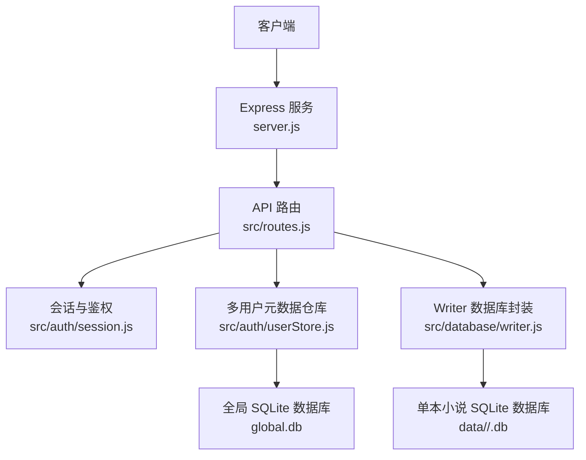
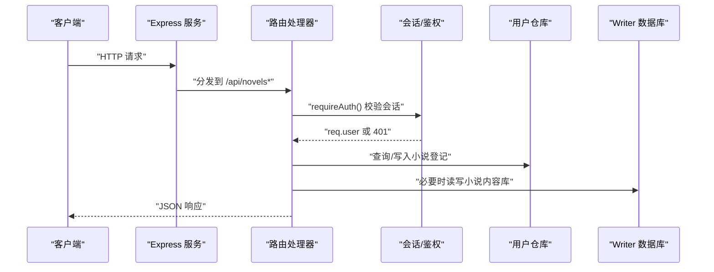
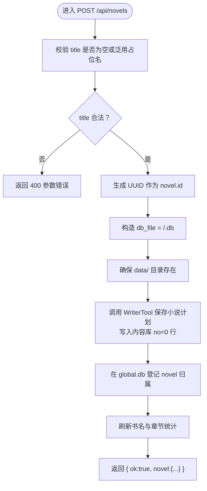
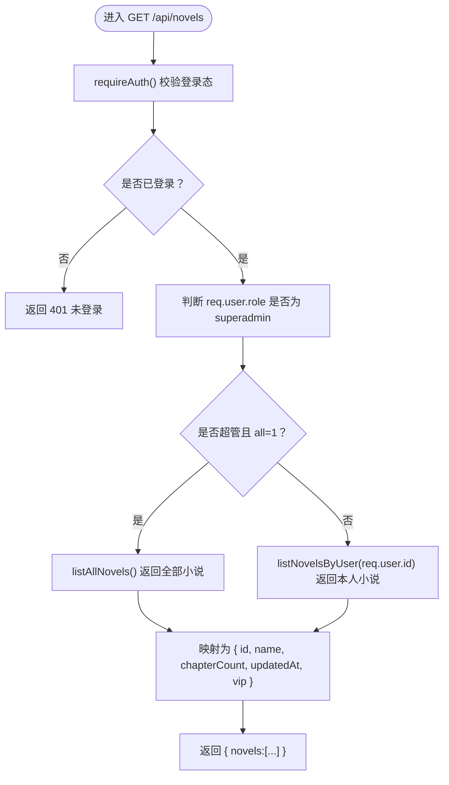
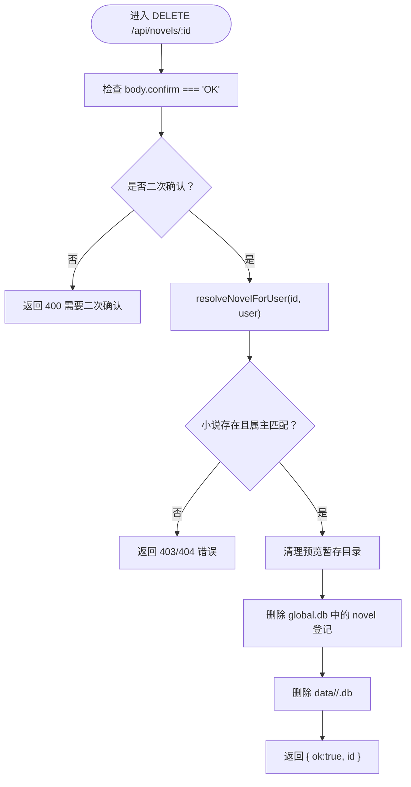
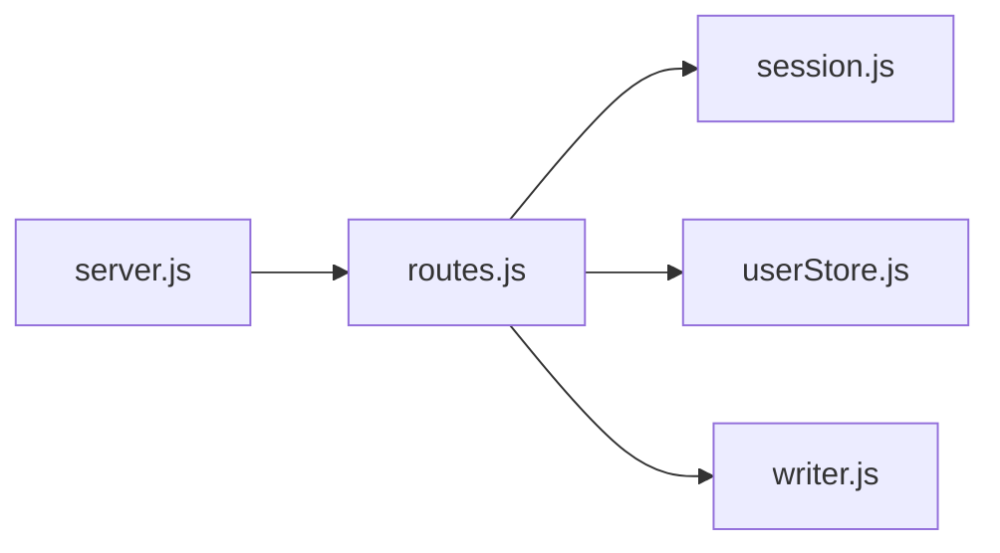

# 小说基础操作

<cite>
**本文引用的文件**   
- [server.js](file://server.js)
- [routes.js](file://src/routes.js)
- [session.js](file://src/auth/session.js)
- [userStore.js](file://src/auth/userStore.js)
- [writer.js](file://src/database/writer.js)
</cite>

## 目录
1. [简介](#简介)
2. [项目结构](#项目结构)
3. [核心组件](#核心组件)
4. [架构总览](#架构总览)
5. [详细接口说明](#详细接口说明)
6. [依赖关系分析](#依赖关系分析)
7. [性能与一致性](#性能与一致性)
8. [故障排查指南](#故障排查指南)
9. [结论](#结论)

## 简介
本文面向“小说基础 CRUD”场景，聚焦以下三个 API：
- POST /api/novels：创建小说
- GET /api/novels：按登录用户列出小说
- DELETE /api/novels/:id：删除整本小说

文档重点包括：
- 请求参数、响应格式、状态码
- 小说 ID 生成机制与数据持久化流程
- 用户隔离与权限控制逻辑
- 删除接口的二次确认与安全策略
- 常见错误处理示例

## 项目结构
本项目的 Express 服务入口负责初始化中间件、注册路由、挂载静态资源；小说相关 API 集中在路由层，鉴权与会话在认证模块实现，元数据（用户、小说登记）由多用户仓库管理，每本小说的内容库通过 Writer 数据库工具访问。



**图表来源**
- [server.js:1-64](file://server.js#L1-L64)
- [routes.js:1-30](file://src/routes.js#L1-L30)
- [session.js:1-118](file://src/auth/session.js#L1-L118)
- [userStore.js:1-114](file://src/auth/userStore.js#L1-L114)
- [writer.js:1-50](file://src/database/writer.js#L1-L50)

**章节来源**
- [server.js:1-64](file://server.js#L1-L64)
- [routes.js:1-30](file://src/routes.js#L1-L30)

## 核心组件
- 服务入口 server.js：加载 CORS、JSON 解析、路径前缀平移、注册路由、挂载静态资源。
- 路由 routes.js：定义所有 /api/* 接口，包含鉴权守卫、租户隔离、限流、进度通道、小说 CRUD、发布、VIP 授权等。
- 会话 session.js：基于 HMAC-SHA256 的 httpOnly Cookie 会话，提供 currentUser、requireAuth、requireSuperadmin。
- 用户仓库 userStore.js：维护 global.db，包含 user、novel、vip_grant、preview 表，提供登录、小说登记、VIP 授权、预览生命周期等方法。
- Writer 数据库 writer.js：封装每本小说的 SQLite 内容库，提供章节、大纲、设定读写能力。

**章节来源**
- [server.js:1-64](file://server.js#L1-L64)
- [routes.js:1-30](file://src/routes.js#L1-L30)
- [session.js:1-118](file://src/auth/session.js#L1-L118)
- [userStore.js:1-114](file://src/auth/userStore.js#L1-L114)
- [writer.js:1-50](file://src/database/writer.js#L1-L50)

## 架构总览
小说基础操作的调用链如下：
- 客户端发起 HTTP 请求到 Express。
- 路由层先执行公共净化与鉴权守卫。
- 业务处理器根据 req.user 进行租户隔离，并调用 userStore 与 Writer 数据库完成数据读写。
- 返回统一 JSON 响应，必要时经过输出净化。



**图表来源**
- [routes.js:331-350](file://src/routes.js#L331-L350)
- [routes.js:639-676](file://src/routes.js#L639-L676)
- [session.js:93-110](file://src/auth/session.js#L93-L110)
- [userStore.js:190-228](file://src/auth/userStore.js#L190-L228)
- [writer.js:16-50](file://src/database/writer.js#L16-L50)

## 详细接口说明

### POST /api/novels：创建小说

#### 接口概览
- 方法：POST
- 路径：/api/novels
- 鉴权：需要有效登录会话
- 用途：为当前登录用户创建一本新小说，分配不透明 ID，并在元数据中登记归属

#### 请求体字段
| 字段 | 类型 | 必填 | 说明 |
| --- | --- | --- | --- |
| title | string | 是 | 书名，不能为空，也不能是泛用占位名 |
| outline | string | 否 | 故事概要/简介 |
| content | string | 否 | 其他信息（角色设定、世界观等） |

#### 成功响应
```json
{
  "ok": true,
  "novel": {
    "id": "<UUID>",
    "name": "<title>",
    "chapterCount": 0,
    "updatedAt": "<时间戳>"
  }
}
```

#### 失败响应
| 状态码 | 含义 | 典型响应体 |
| --- | --- | --- |
| 400 | 参数校验失败 | `{ "error": "书名不能为空" }` 或 `{ "error": "请提供真实书名" }` |
| 500 | 服务端异常 | `{ "error": "<具体错误消息>" }` |

#### 小说 ID 生成机制
- 使用 UUID 作为小说 id，保证唯一且不暴露业务语义。
- 实际存储文件名形如 `<user_id>/<uuid>.db`，避免直接暴露可猜测的序列号。

#### 数据持久化过程
1. 校验 title 是否为空或泛用占位名。
2. 生成 UUID 作为 novel.id。
3. 构造 db_file 为 `<user_id>/<uuid>.db`。
4. 确保 data/<user_id> 目录存在。
5. 调用 WriterTool 保存小说计划，写入内容库 no=0 行（name、outline、content）。
6. 在 global.db 的 novel 表中登记归属映射。
7. 刷新统计信息（书名、正文章数）。
8. 返回 ok 与小说摘要。



**图表来源**
- [routes.js:646-661](file://src/routes.js#L646-L661)
- [userStore.js:203-220](file://src/auth/userStore.js#L203-L220)
- [writer.js:169-202](file://src/database/writer.js#L169-L202)

**章节来源**
- [routes.js:646-661](file://src/routes.js#L646-L661)
- [userStore.js:203-220](file://src/auth/userStore.js#L203-L220)
- [writer.js:169-202](file://src/database/writer.js#L169-L202)

#### 请求示例
```http
POST /api/novels
Content-Type: application/json

{
  "title": "我的奇幻小说",
  "outline": "少年穿越异世界，逐步掌握魔法的故事。",
  "content": "主角性格乐观，擅长观察细节。"
}
```

#### 成功响应示例
```json
{
  "ok": true,
  "novel": {
    "id": "a1b2c3d4-e5f6-7890-abcd-ef1234567890",
    "name": "我的奇幻小说",
    "chapterCount": 0,
    "updatedAt": 1710000000000
  }
}
```

#### 参数验证失败示例
```json
{
  "error": "书名不能为空"
}
```

### GET /api/novels：获取小说列表

#### 接口概览
- 方法：GET
- 路径：/api/novels
- 鉴权：需要有效登录会话
- 用途：返回当前登录用户拥有的小说列表；超管可带 all=1 查看所有小说

#### 用户隔离机制
- 普通用户：只返回其 user_id 对应的小说。
- 超级管理员：当 query 参数 all=1 时，返回全部小说；否则仍按自身 user_id 过滤。
- 列表数据来源：global.db 的 novel 表，按 updated_at 倒序。

#### 成功响应
```json
{
  "novels": [
    {
      "id": "<UUID>",
      "name": "<title>",
      "chapterCount": 0,
      "updatedAt": "<时间戳>",
      "vip": false
    }
  ]
}
```

#### 鉴权失败响应
| 状态码 | 含义 | 典型响应体 |
| --- | --- | --- |
| 401 | 未登录或会话过期 | `{ "error": "未登录或登录已过期" }` |



**图表来源**
- [routes.js:639-644](file://src/routes.js#L639-L644)
- [session.js:93-110](file://src/auth/session.js#L93-L110)
- [userStore.js:191-196](file://src/auth/userStore.js#L191-L196)

**章节来源**
- [routes.js:639-644](file://src/routes.js#L639-L644)
- [session.js:93-110](file://src/auth/session.js#L93-L110)
- [userStore.js:191-196](file://src/auth/userStore.js#L191-L196)

#### 请求示例
```http
GET /api/novels
Cookie: ainovel_session=<token>
```

#### 成功响应示例
```json
{
  "novels": [
    {
      "id": "a1b2c3d4-e5f6-7890-abcd-ef1234567890",
      "name": "我的奇幻小说",
      "chapterCount": 3,
      "updatedAt": 1710000000000,
      "vip": false
    },
    {
      "id": "b2c3d4e5-f6a7-8901-bcde-f12345678901",
      "name": "科幻短篇集",
      "chapterCount": 1,
      "updatedAt": 1709900000000,
      "vip": true
    }
  ]
}
```

#### 未登录示例
```json
{
  "error": "未登录或登录已过期"
}
```

### DELETE /api/novels/:id：删除整本小说

#### 接口概览
- 方法：DELETE
- 路径：/api/novels/:id
- 鉴权：需要有效登录会话
- 用途：删除指定小说的登记信息与内容库文件

#### 二次确认机制
- 请求体必须携带 confirm:"OK"，否则返回 400。
- 该机制用于防止误删，属于“防误删”而非鉴权。

#### 安全与权限控制
- 通过 resolveNovelForUser 校验：
  - 若 id 不存在或未登记，返回 404。
  - 若非超管且 novel.user_id 不等于 req.user.id，返回 403。
  - 若对应 .db 文件缺失，返回 404。
- 删除顺序：
  1. 清理该小说的预览暂存目录。
  2. 从 global.db 删除 novel 登记行。
  3. 删除 data/<user_id>/<uuid>.db 文件。

#### 成功响应
```json
{
  "ok": true,
  "id": "<被删除的小说ID>"
}
```

#### 失败响应
| 状态码 | 含义 | 典型响应体 |
| --- | --- | --- |
| 400 | 缺少二次确认或参数问题 | `{ "error": "删除整本小说需二次确认：请输入 OK" }` |
| 403 | 无权访问该小说 | `{ "error": "无权访问该小说" }` |
| 404 | 小说不存在或文件缺失 | `{ "error": "小说不存在或未登记" }` 或 `{ "error": "小说库文件缺失" }` |



**图表来源**
- [routes.js:663-676](file://src/routes.js#L663-L676)
- [routes.js:97-116](file://src/routes.js#L97-L116)
- [userStore.js:222-228](file://src/auth/userStore.js#L222-L228)

**章节来源**
- [routes.js:663-676](file://src/routes.js#L663-L676)
- [routes.js:97-116](file://src/routes.js#L97-L116)
- [userStore.js:222-228](file://src/auth/userStore.js#L222-L228)

#### 请求示例
```http
DELETE /api/novels/a1b2c3d4-e5f6-7890-abcd-ef1234567890
Content-Type: application/json

{
  "confirm": "OK"
}
```

#### 成功响应示例
```json
{
  "ok": true,
  "id": "a1b2c3d4-e5f6-7890-abcd-ef1234567890"
}
```

#### 缺少二次确认示例
```json
{
  "error": "删除整本小说需二次确认：请输入 OK"
}
```

#### 权限不足示例
```json
{
  "error": "无权访问该小说"
}
```

## 依赖关系分析

### 组件耦合与职责边界
- routes.js 承担对外契约：URL、方法、请求体、响应体、状态码。
- session.js 提供会话解析与守卫，不关心业务数据。
- userStore.js 只维护全局元数据，不直接读写小说正文。
- writer.js 封装单本小说内容库，提供章节、大纲、设定等结构化能力。
- server.js 仅做服务装配与静态资源挂载。



**图表来源**
- [server.js:44-45](file://server.js#L44-L45)
- [routes.js:24-26](file://src/routes.js#L24-L26)
- [routes.js:331-350](file://src/routes.js#L331-L350)

**章节来源**
- [server.js:44-45](file://server.js#L44-L45)
- [routes.js:24-26](file://src/routes.js#L24-L26)
- [routes.js:331-350](file://src/routes.js#L331-L350)

### 外部依赖
- better-sqlite3：用于 global.db 与小说内容库。
- express/cors：HTTP 服务与跨域。
- crypto：UUID、HMAC、scrypt。
- fs/path：文件系统与路径拼接。

**章节来源**
- [routes.js:10-16](file://src/routes.js#L10-L16)
- [session.js:6-11](file://src/auth/session.js#L6-L11)
- [userStore.js:12-16](file://src/auth/userStore.js#L12-L16)
- [writer.js:6-10](file://src/database/writer.js#L6-L10)

## 性能与一致性
- 列表接口 GET /api/novels 直接从 global.db 读取登记行，复杂度接近 O(1) 查询 + 结果映射，不扫描每个小说库。
- 创建接口会调用 WriterTool 写入内容库，属于一次性 IO 成本；后续 refreshStats 会读取内容库统计，但只在创建后触发一次。
- 删除接口涉及预览目录清理、元数据删除、文件删除，属于破坏性操作，应谨慎调用。
- 鉴权与会话解析为轻量 CPU 操作，主要开销在数据库与文件系统。

[本节为通用性能讨论，不直接分析具体代码片段]

## 故障排查指南

### 常见问题与定位建议
- 401 未登录：检查 Cookie 是否携带 ainovel_session，以及 SESSION_SECRET 配置是否稳定。
- 400 参数错误：检查 title 是否为空、是否传入泛用占位名；删除接口是否携带 confirm:"OK"。
- 403 无权访问：确认当前用户是否为小说 owner，或是否为 superadmin。
- 404 小说不存在：检查 id 是否正确、db_file 是否存在、是否已被删除。
- 500 服务端错误：查看后端日志，关注 WriterTool 写入、global.db 写入、文件系统操作抛出的异常。

**章节来源**
- [session.js:32-36](file://src/auth/session.js#L32-L36)
- [routes.js:646-661](file://src/routes.js#L646-L661)
- [routes.js:663-676](file://src/routes.js#L663-L676)

### 错误处理示例汇总
| 场景 | 状态码 | 响应体 |
| --- | --- | --- |
| 创建小说时 title 为空 | 400 | `{ "error": "书名不能为空" }` |
| 创建小说时 title 为泛用占位名 | 400 | `{ "error": "请提供真实书名" }` |
| 创建小说时内部异常 | 500 | `{ "error": "<具体错误消息>" }` |
| 获取列表未登录 | 401 | `{ "error": "未登录或登录已过期" }` |
| 删除小说未传 confirm | 400 | `{ "error": "删除整本小说需二次确认：请输入 OK" }` |
| 删除小说无权限 | 403 | `{ "error": "无权访问该小说" }` |
| 删除小说不存在 | 404 | `{ "error": "小说不存在或未登记" }` |
| 删除小说文件缺失 | 404 | `{ "error": "小说库文件缺失" }` |

**章节来源**
- [routes.js:646-676](file://src/routes.js#L646-L676)
- [session.js:93-110](file://src/auth/session.js#L93-L110)

## 结论
- POST /api/novels 通过 UUID 生成稳定且不透明的小说 ID，并将小说计划写入内容库、将归属登记写入 global.db。
- GET /api/novels 以登录用户为维度返回列表，超管可通过 all=1 查看全部。
- DELETE /api/novels/:id 要求 confirm:"OK" 二次确认，并通过拥有权校验防止越权删除。
- 权限控制贯穿会话、用户角色与小说归属三层，确保用户只能访问和操作自己的小说。
- 错误处理覆盖参数校验、权限不足、资源不存在与服务端异常等常见场景。