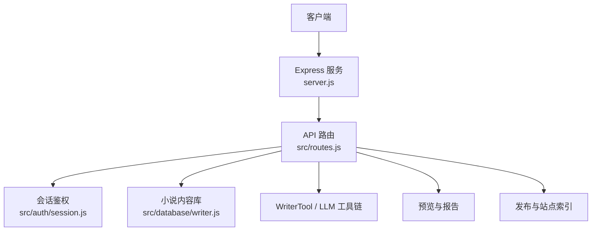
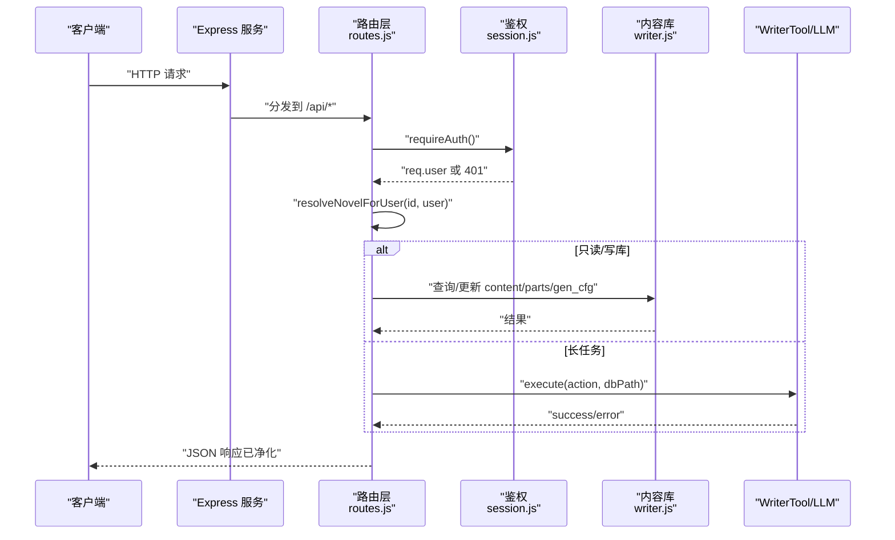

# 小说管理 API

<cite>
**本文引用的文件**   
- [server.js](file://server.js)
- [routes.js](file://src/routes.js)
- [session.js](file://src/auth/session.js)
- [writer.js](file://src/database/writer.js)
- [README.md](file://README.md)
</cite>

## 目录
1. [简介](#简介)
2. [项目结构与入口](#项目结构与入口)
3. [核心组件与职责](#核心组件与职责)
4. [架构总览](#架构总览)
5. [通用鉴权与安全](#通用鉴权与安全)
6. [数据模型与字段含义](#数据模型与字段含义)
7. [小说管理接口](#小说管理接口)
8. [章节管理接口](#章节管理接口)
9. [小说设置与字数目标接口](#小说设置与字数目标接口)
10. [发布、预览与分享接口](#发布预览与分享接口)
11. [长任务与进度通道](#长任务与进度通道)
12. [错误处理与异常场景](#错误处理与异常场景)
13. [性能与扩展建议](#性能与扩展建议)
14. [常见问题排查](#常见问题排查)
15. [结论](#结论)

## 简介
本 API 文档面向“AI 小说平台”的小说管理与章节管理能力，覆盖以下范围：
- 小说的创建、列举、删除、归属校验。
- 章节列表获取、单章内容获取、章节大纲更新、章节删除与重排。
- 小说元数据与生成配置读取/更新，包括每章字数目标、容差、拆章线等。
- 发布前预览、正式本地发布、公开书单与分享链接。
- VIP 读者授权与书页访问控制。
- 权限控制：用户只能访问自己的小说；超管可跨租户操作。
- 错误处理：参数校验、无权限、资源不存在、并发互斥、二次确认失败等。

该平台的后端基于 Express，API 路由集中在 `src/routes.js`，会话鉴权在 `src/auth/session.js`，小说内容库通过 SQLite（better-sqlite3）由 `src/database/writer.js` 管理。

**章节来源**
- [README.md:1-202](file://README.md#L1-L202)

## 项目结构与入口
服务启动入口为 `server.js`，负责：
- 初始化全局数据库与多用户元数据。
- 注册 API 路由。
- 挂载静态资源（登录页、管理页、阅读器、TTS、已发布书页）。
- 对外暴露统一的前缀路径（默认 `/novel`），内部路由按命名空间剥离前缀。



**图表来源**
- [server.js:1-64](file://server.js#L1-L64)
- [routes.js:331-350](file://src/routes.js#L331-L350)

**章节来源**
- [server.js:1-64](file://server.js#L1-L64)

## 核心组件与职责
| 组件 | 职责 | 关键行为 |
| --- | --- | --- |
| `server.js` | 应用启动、中间件、静态资源、前缀平移 | 解析 `BASE_PATH`，剥离命名空间前缀，挂载 `/api`、`/login`、`/tts`、`/admin`、`/novel` |
| `routes.js` | 全部 API 路由、鉴权守卫、租户隔离、VIP 闸门、发布逻辑 | 定义小说、章节、设置、发布、预览、分享、进度、AI 工具执行等端点 |
| `session.js` | 会话 Cookie 签名、登录态解析、角色判断 | `requireAuth`、`requireSuperadmin`、`currentUser` |
| `writer.js` | 小说内容库 Schema、章节增删改查、批量加章、分部结构、生成配置存储 | `content`、`parts`、`chapter_revision` 表及对应方法 |
| `README.md` | 功能说明、部署入口、章节编辑与字数治理说明 | 提供业务上下文与使用约束 |

**章节来源**
- [server.js:1-64](file://server.js#L1-L64)
- [routes.js:1-45](file://src/routes.js#L1-L45)
- [session.js:1-118](file://src/auth/session.js#L1-L118)
- [writer.js:1-137](file://src/database/writer.js#L1-L137)
- [README.md:1-202](file://README.md#L1-L202)

## 架构总览
小说管理的请求通常经过以下阶段：
1. 客户端发起 HTTP 请求。
2. 若路径以 `/api` 开头且非白名单，进入 `requireAuth` 鉴权。
3. 对小说相关接口，调用 `resolveNovelForUser` 做“小说标识 → 登记行 → 拥有权 → 物理路径”映射。
4. 根据 action 选择直接写库（如章节列表、设置）、调用 WriterTool（如生成正文、补大纲）、或触发发布/预览。
5. 响应体经净化器过滤敏感字段后返回。



**图表来源**
- [routes.js:331-350](file://src/routes.js#L331-L350)
- [routes.js:97-116](file://src/routes.js#L97-L116)
- [routes.js:639-676](file://src/routes.js#L639-L676)
- [routes.js:914-973](file://src/routes.js#L914-L973)

## 通用鉴权与安全
### 会话与角色
- 登录成功后服务端下发 `ainovel_session` Cookie，有效期 7 天，HttpOnly、SameSite=Lax，Path 为站点前缀。
- 未登录访问受保护接口返回 401。
- 普通用户只能访问自己拥有的小说；超管可查看所有小说或执行管理端操作。

### 鉴权守卫
| 守卫 | 条件 | 失败响应 |
| --- | --- | --- |
| `requireAuth` | 存在有效 Cookie 且用户未被禁用 | 401 `未登录或登录已过期` |
| `requireSuperadmin` | 当前用户角色为 `superadmin` | 403 `需要超级管理员权限` |

### 租户隔离
- 所有小说操作都通过 `resolveNovelForUser` 校验：
  - 支持按 `novel.id` 或 `db_file` 定位。
  - 非超管时要求 `novel.user_id === req.user.id`。
  - 找不到登记行或物理库缺失会返回 404。
  - 无权访问返回 403。

**章节来源**
- [session.js:26-91](file://src/auth/session.js#L26-L91)
- [session.js:93-110](file://src/auth/session.js#L93-L110)
- [routes.js:97-116](file://src/routes.js#L97-L116)

## 数据模型与字段含义
### 小说元数据（`content` 表 no=0）
| 字段 | 含义 | 说明 |
| --- | --- | --- |
| `no` | 记录编号 | `0` 表示小说概要/全书设定 |
| `type` | 记录类型 | `novel` 或 `chapter` |
| `name` | 书名 | 必须非空 |
| `outline` | 故事概要 | 用于 AI 构思章节大纲 |
| `content` | 其他信息 | 角色、世界观等设定正文 |
| `version` | 版本号 | 每次保存概要递增 |
| `id` | 稳定 ID | 用于发布文件名等稳定引用 |
| `created_at` | 创建时间 | |
| `updated_at` | 更新时间 | |
| `preface` | 本书序言 | 新增列，供阅读侧展示 |
| `gen_cfg` | 生成配置 | JSON，包含每章字数目标与区间换算 |

### 章节（`content` 表 no≥1）
| 字段 | 含义 | 说明 |
| --- | --- | --- |
| `no` | 章节号 | 从 1 开始，连续 |
| `type` | 固定为 `chapter` | |
| `name` | 章节标题 | URL 不变，依赖稳定 `id` |
| `outline` | 章节大纲 | 生成正文的重要输入 |
| `content` | 章节正文 | 发布时渲染正文 |
| `part_no` | 所属部序号 | 0 表示未划分部 |
| `id` | 稳定章节 ID | 不随重排变化 |
| `contentLength` | 正文字符数 | 接口常以 `LENGTH(content)` 返回 |

### 分部（`parts` 表）
| 字段 | 含义 | 说明 |
| --- | --- | --- |
| `no` | 部序号 | 1,2,3… |
| `id` | 稳定部 ID | 导言页文件名依据 |
| `name` | 部名 | 可为空 |
| `summary` | 本部导言正文 | 发布后读者可见 |

### 生成配置 `gen_cfg`
| 字段 | 含义 | 合法范围 | 默认值 |
| --- | --- | --- | --- |
| `targetWords` | 每章目标字数 | `0` 表示不限；否则 300–20000 | `0` |
| `tolerancePct` | 合格带容差百分比 | 5–50 | `20` |
| `splitPct` | 拆章线比例 | 20–300 | `60` |

合格带 = `target × (1 ± tolerance%)`；拆章线 = `max(合格上限, target × (1 + splitPct/100))`。

**章节来源**
- [writer.js:55-137](file://src/database/writer.js#L55-L137)
- [writer.js:169-228](file://src/database/writer.js#L169-L228)
- [writer.js:355-401](file://src/database/writer.js#L355-L401)
- [routes.js:747-823](file://src/routes.js#L747-L823)
- [README.md:89-107](file://README.md#L89-L107)

## 小说管理接口
### 列出小说
- **方法**: `GET`
- **路径**: `/api/novels`
- **鉴权**: 需要登录
- **查询参数**:
  - `all=1`：仅超管可用，返回全站小说。
- **成功响应**:
  ```json
  {
    "novels": [
      {
        "id": "uuid",
        "name": "书名",
        "chapterCount": 10,
        "updatedAt": 1710000000000,
        "vip": false
      }
    ]
  }
  ```
- **失败场景**:
  - 未登录：401。
  - 超管传 `all=1` 但实际不是超管：403。

**章节来源**
- [routes.js:639-644](file://src/routes.js#L639-L644)

### 创建小说
- **方法**: `POST`
- **路径**: `/api/novels`
- **鉴权**: 需要登录
- **请求体**:
  | 字段 | 类型 | 必填 | 说明 |
  | --- | --- | --- | --- |
  | `title` | 字符串 | 是 | 真实书名，不能是泛用占位名 |
  | `outline` | 字符串 | 否 | 初始故事概要 |
  | `content` | 字符串 | 否 | 初始角色/世界观等正文 |
- **成功响应**:
  ```json
  {
    "ok": true,
    "novel": {
      "id": "uuid",
      "name": "书名",
      "chapterCount": 0,
      "updatedAt": 1710000000000
    }
  }
  ```
- **失败场景**:
  - 书名为空或泛用占位名：400。
  - WriterTool 创建失败：500。

**章节来源**
- [routes.js:646-661](file://src/routes.js#L646-L661)

### 删除小说
- **方法**: `DELETE`
- **路径**: `/api/novels/:id`
- **鉴权**: 需要登录
- **路径参数**:
  - `id`：小说登记 ID。
- **请求体**:
  | 字段 | 类型 | 必填 | 说明 |
  | --- | --- | --- | --- |
  | `confirm` | 字符串 | 是 | 必须为 `OK`（去空白后匹配） |
- **成功响应**:
  ```json
  {
    "ok": true,
    "id": "uuid"
  }
  ```
- **失败场景**:
  - 未传 `confirm` 或不为 `OK`：400。
  - 小说不存在或未登记：404。
  - 无权访问：403。
  - 物理库缺失：404。

**章节来源**
- [routes.js:663-676](file://src/routes.js#L663-L676)

### 对账（超管）
- **方法**: `POST`
- **路径**: `/api/novels/reconcile`
- **鉴权**: 需要超管
- **用途**: 扫描 `data/` 下小说库与 `novel` 登记表，补登记悬挂项或删除无物理文件的登记。
- **成功响应**:
  ```json
  {
    "ok": true,
    "added": 2,
    "removed": 1
  }
  ```

**章节来源**
- [routes.js:678-684](file://src/routes.js#L678-L684)

## 章节管理接口
### 章节列表
- **方法**: `GET`
- **路径**: `/api/novels/:id/chapters`
- **鉴权**: 需要登录
- **路径参数**:
  - `id`：小说登记 ID。
- **成功响应**:
  ```json
  {
    "novel": "书名",
    "chapters": [
      {
        "no": 1,
        "name": "第一章",
        "outline": "本章大纲",
        "wordCount": 3200,
        "hasContent": true,
        "partNo": 1,
        "id": "stable-chapter-id"
      }
    ],
    "totalWords": 32000
  }
  ```
- **字段说明**:
  - `wordCount`：来自 `LENGTH(content)`，中文 1 字计 1。
  - `hasContent`：`wordCount > 0`。
  - `partNo`：所属部序号。
  - `id`：稳定章节 ID。
- **失败场景**:
  - 小说不存在/无权：404/403。
  - 数据库读取异常：500。

**章节来源**
- [routes.js:686-708](file://src/routes.js#L686-L708)
- [writer.js:355-377](file://src/database/writer.js#L355-L377)

### 单章内容
- **方法**: `GET`
- **路径**: `/api/novels/:id/chapter/:no`
- **鉴权**: 需要登录
- **路径参数**:
  - `id`：小说登记 ID。
  - `no`：章节号，必须是整数。
- **成功响应**:
  ```json
  {
    "chapter": {
      "no": 1,
      "name": "第一章",
      "outline": "本章大纲",
      "content": "章节正文",
      "wordCount": 3200,
      "outlineCount": 120
    }
  }
  ```
- **失败场景**:
  - 章节号为非法整数：400。
  - 章节不存在：404。
  - 小说不存在/无权：404/403。

**章节来源**
- [routes.js:710-725](file://src/routes.js#L710-L725)
- [writer.js:384-401](file://src/database/writer.js#L384-L401)

### 更新章节大纲与标题
- **方法**: `PUT`
- **路径**: `/api/novels/:id/chapter/:no/outline`
- **鉴权**: 需要登录
- **请求体**:
  | 字段 | 类型 | 必填 | 说明 |
  | --- | --- | --- | --- |
  | `outline` | 字符串 | 否 | 传入则更新大纲；省略则沿用原值 |
  | `name` | 字符串 | 否 | 传入则更新标题；省略不改 |
- **成功响应**:
  ```json
  {
    "ok": true,
    "no": 1
  }
  ```
- **失败场景**:
  - 章节不存在：404。
  - 更新失败：400。

**章节来源**
- [routes.js:825-841](file://src/routes.js#L825-L841)
- [writer.js:766-800](file://src/database/writer.js#L766-L800)

### 单章大纲草稿（只读生成）
- **方法**: `POST`
- **路径**: `/api/novels/:id/chapter/:no/outline-draft`
- **鉴权**: 需要登录
- **用途**: 根据故事概要与相邻章节大纲生成“本章大纲草稿”，不写库，前端填入后再手动保存。
- **请求体**:
  | 字段 | 类型 | 必填 | 说明 |
  | --- | --- | --- | --- |
  | `material` | 字符串 | 否 | 本章构思素材 |
- **成功响应**:
  ```json
  {
    "ok": true,
    "no": 1,
    "outline": "生成的章节大纲",
    "name": "模型建议标题（可选）"
  }
  ```
- **失败场景**:
  - 缺少故事概要：400。
  - 章节不存在：404。
  - LLM 链路不通：502。
  - 模型未给出可用大纲：502。

**章节来源**
- [routes.js:843-881](file://src/routes.js#L843-L881)

### 删除章节
- **方法**: `DELETE`
- **路径**: `/api/novels/:id/chapter/:no`
- **鉴权**: 需要登录
- **请求体**:
  | 字段 | 类型 | 必填 | 说明 |
  | --- | --- | --- | --- |
  | `confirm` | 字符串 | 是 | 必须为 `OK` |
- **成功响应**:
  ```json
  {
    "ok": true,
    "no": 1
  }
  ```
- **失败场景**:
  - 未传 `confirm` 或不为 `OK`：400。
  - 删除失败：400。

**章节来源**
- [routes.js:883-899](file://src/routes.js#L883-L899)
- [writer.js:408-438](file://src/database/writer.js#L408-L438)

### 重排章节号
- **方法**: `POST`
- **路径**: `/api/novels/:id/renumber`
- **鉴权**: 需要登录
- **用途**: 将章节号重新排序为连续 1..N。
- **成功响应**:
  ```json
  {
    "ok": true,
    "shiftedCount": 5
  }
  ```

**章节来源**
- [routes.js:901-912](file://src/routes.js#L901-L912)

### 部结构查询
- **方法**: `GET`
- **路径**: `/api/novels/:id/parts`
- **鉴权**: 需要登录
- **成功响应**:
  ```json
  {
    "parts": [
      {
        "no": 1,
        "name": "第一部",
        "startNo": 1,
        "endNo": 5,
        "chapters": 5,
        "hasIntro": false
      }
    ]
  }
  ```

**章节来源**
- [routes.js:727-745](file://src/routes.js#L727-L745)
- [writer.js:95-108](file://src/database/writer.js#L95-L108)

## 小说设置与字数目标接口
### 获取小说设置
- **方法**: `GET`
- **路径**: `/api/novels/:id/settings`
- **鉴权**: 需要登录
- **成功响应关键字段**:
  | 字段 | 含义 |
  | --- | --- |
  | `name` | 书名 |
  | `outline` | 故事概要 |
  | `content` | 其他设定正文 |
  | `preface` | 本书序言 |
  | `version` | 概要版本号 |
  | `updatedAt` | 更新时间 |
  | `genCfg` | 原始生成配置对象或 null |
  | `wordBand` | 计算后的合格区间 |
  | `wordBandText` | 可读区间文本 |
  | `chapterCount` | 章节数量 |
  | `outlineCount` | 有大纲的章节数 |
  | `bodyCount` | 有正文的章节数 |
  | `totalWords` | 全书正文字数合计 |

**章节来源**
- [routes.js:747-775](file://src/routes.js#L747-L775)
- [writer.js:208-228](file://src/database/writer.js#L208-L228)

### 更新小说设置
- **方法**: `PUT`
- **路径**: `/api/novels/:id/settings`
- **鉴权**: 需要登录
- **请求体关键字段**:
  | 字段 | 类型 | 说明 |
  | --- | --- | --- |
  | `name` | 字符串 | 书名；省略不改，传空会被拒绝 |
  | `outline` | 字符串 | 故事概要；省略不改 |
  | `content` | 字符串 | 其他设定正文；省略不改 |
  | `preface` | 字符串 | 序言；首次保存基本信息前不可单独传 |
  | `genCfg` | 对象/null | 生成配置局部补丁；省略不改，null 清除 |
- **成功响应**:
  ```json
  {
    "ok": true,
    "action": "saved",
    "version": 2,
    "genCfg": {
      "targetWords": 3000,
      "tolerancePct": 20,
      "splitPct": 60
    },
    "wordBand": {
      "min": 2400,
      "max": 3600,
      "splitLine": 4800
    }
  }
  ```
- **失败场景**:
  - 书名为空：400。
  - 先保存序言但未保存基本信息：400。
  - `genCfg` 形状非法或越界：400。

**章节来源**
- [routes.js:777-823](file://src/routes.js#L777-L823)
- [writer.js:169-228](file://src/database/writer.js#L169-L228)

## 发布、预览与分享接口
### 分享链接
- **方法**: `GET`
- **路径**: `/api/novels/:id/share`
- **鉴权**: 需要登录
- **成功响应**:
  ```json
  {
    "url": "/novel/<uid>/<书名>/index.html",
    "published": true,
    "title": "书名"
  }
  ```

**章节来源**
- [routes.js:1109-1118](file://src/routes.js#L1109-L1118)

### 预览
- **方法**: `POST`
- **路径**: `/api/novels/:id/preview`
- **鉴权**: 需要登录
- **请求体**:
  | 字段 | 类型 | 必填 | 说明 |
  | --- | --- | --- | --- |
  | `title` | 字符串 | 否 | 预览标题，默认用书名 |
  | `premakeQuiz` | 布尔 | 否 | 是否预生成测试题与生词 |
  | `quizAge` | 数字 | 否 | 年龄档，默认 9 |
- **成功响应**:
  ```json
  {
    "success": true,
    "token": "预览令牌",
    "reportSummary": "预览报告摘要"
  }
  ```

**章节来源**
- [routes.js:1120-1138](file://src/routes.js#L1120-L1138)

### 修改报告
- **方法**: `GET`
- **路径**: `/api/novels/:id/preview/report`
- **鉴权**: 需要登录
- **查询参数**:
  - `token`：可选，与暂存站比对。
  - `ref`：`live`（默认，对比线上）或 `preview`（对比暂存站）。
- **成功响应**:
  ```json
  {
    "success": true,
    "report": {
      "summary": "报告摘要",
      "pages": []
    }
  }
  ```

**章节来源**
- [routes.js:1140-1157](file://src/routes.js#L1140-L1157)

### 单页差异
- **方法**: `GET`
- **路径**: `/api/novels/:id/preview/:token/diff`
- **鉴权**: 需要登录
- **查询参数**:
  - `file`：HTML 文件名，需符合安全格式。
- **成功响应**:
  ```json
  {
    "success": true,
    "diff": {
      "reason": "页面变化原因",
      "changes": []
    }
  }
  ```

**章节来源**
- [routes.js:1159-1170](file://src/routes.js#L1159-L1170)

### 作废预览
- **方法**: `DELETE`
- **路径**: `/api/novels/:id/preview/:token`
- **鉴权**: 需要登录
- **成功响应**:
  ```json
  {
    "ok": true
  }
  ```

**章节来源**
- [routes.js:1172-1184](file://src/routes.js#L1172-L1184)

### 本地发布
- **方法**: `POST`
- **路径**: `/api/novels/:id/publish`
- **鉴权**: 需要登录
- **请求体**:
  | 字段 | 类型 | 必填 | 说明 |
  | --- | --- | --- | --- |
  | `title` | 字符串 | 否 | 发布标题，默认用书名 |
  | `previewToken` | 字符串 | 否 | 若有，走“预览后确认发布” |
  | `premakeQuiz` | 布尔 | 否 | 是否预生成测试题与生词 |
  | `quizAge` | 数字 | 否 | 年龄档 |
- **成功响应**:
  ```json
  {
    "success": true,
    "pagesGenerated": 10,
    "pagesSkipped": 2,
    "prunedOldPages": 1
  }
  ```

**章节来源**
- [routes.js:991-1033](file://src/routes.js#L991-L1033)

## 长任务与进度通道
### 通用动作执行
- **方法**: `POST`
- **路径**: `/api/run`
- **鉴权**: 需要登录
- **用途**: 复用 WriterTool 的全部 action，例如生成正文、补大纲、字数治理、重建大纲等。
- **请求体关键字段**:
  | 字段 | 类型 | 必填 | 说明 |
  | --- | --- | --- | --- |
  | `action` | 字符串 | 是 | 白名单中的动作名 |
  | `novelId` | 字符串 | 视 action | 小说登记 ID |
  | `progressId` | 字符串 | 否 | SSE 进度会话 ID，格式 `run:...` |
  | `confirm` | 字符串 | 删除类 action | 必须为 `OK` |
- **成功响应**:
  ```json
  {
    "success": true,
    "action": "generateChapter",
    "novelId": "uuid",
    "result": {}
  }
  ```
- **并发限制**:
  - 长任务按书互斥；同一本书已有任务在跑时返回 409。

**章节来源**
- [routes.js:914-973](file://src/routes.js#L914-L973)

### 进度通道（SSE）
- **方法**: `GET`
- **路径**: `/api/progress`
- **鉴权**: 需要登录
- **查询参数**:
  - `id`：进度会话 ID，格式 `run:<长度 6–64 的字母数字>`。
- **响应头**:
  - `Content-Type: text/event-stream; charset=utf-8`
  - `Cache-Control: no-cache, no-transform`
  - `Connection: keep-alive`
- **事件示例**:
  ```text
  data: {"type":"line","text":"第 1 章完成","timestamp":1710000000000}
  ```

**章节来源**
- [routes.js:573-627](file://src/routes.js#L573-L627)

## 错误处理与异常场景
### 常见状态码
| 状态码 | 含义 | 典型场景 |
| --- | --- | --- |
| 400 | 请求参数错误或业务校验失败 | 书名为空、章节号非法、缺少 `confirm`、`genCfg` 越界 |
| 401 | 未登录或登录过期 | 访问 `/api/*` 未携带有效 Cookie |
| 403 | 无权限 | 访问他人小说、非超管访问管理端 |
| 404 | 资源不存在 | 小说未登记、章节不存在、库文件缺失 |
| 409 | 冲突 | 同书已有长任务在运行 |
| 410 | 资源永久移除 | VIP 密码解锁机制已停用 |
| 429 | 请求过于频繁 | 限流触发 |
| 500 | 服务端异常 | 数据库读写失败、工具执行异常 |
| 502 | 上游模型或服务不可用 | LLM 链路不通、桥接服务返回错误 |
| 503 | 合成失败 | TTS 合成失败 |

### 删除二次确认
- 删除整本小说、删除单章、区间删除都需要请求体中携带 `confirm:"OK"`。
- 该确认是防误删机制，不是鉴权；能登录即有删除权限，但必须显式确认。

### 输出净化
- 除登录、账号、公开书单、预览等特定接口外，所有 `/api` 响应都会过滤敏感字段，例如绝对路径、密钥、服务器信息等。

**章节来源**
- [routes.js:35-53](file://src/routes.js#L35-L53)
- [routes.js:67-95](file://src/routes.js#L67-L95)
- [routes.js:663-676](file://src/routes.js#L663-L676)
- [routes.js:883-899](file://src/routes.js#L883-L899)
- [routes.js:948-958](file://src/routes.js#L948-L958)

## 性能与扩展建议
- 章节列表接口已优化为不加载正文，仅返回 `contentLength`，避免整本书正文搬入内存。
- 单章内容接口改为按章直查，不再为了取一章拉全库。
- 长任务按书互斥，防止并发生成压垮推理服务。
- 进度通道使用缓冲与 TTL 清理，避免无限增长。
- 建议：
  - 对高频只读接口增加缓存层（例如章节列表缓存短时间）。
  - 对 LLM 调用增加重试与降级策略。
  - 对大文件发布/预览增加异步队列与任务状态持久化。

[本节为通用指导，不直接分析具体代码文件]

## 常见问题排查
| 问题 | 可能原因 | 排查建议 |
| --- | --- | --- |
| 创建小说后列表看不到 | 登记失败或刷新统计失败 | 检查 500 响应；必要时运行超管对账接口 |
| 删除小说报 400 | 未传 `confirm:"OK"` | 在请求体中加入二次确认 |
| 章节列表为空 | 只有概要行或尚未生成正文 | 检查 `chapterCount` 与 `bodyCount` |
| 单章 404 | 章节号不存在 | 核对章节号与重排结果 |
| 生成正文 409 | 同书已有长任务 | 等待任务结束或更换浏览器标签重试 |
| 生成正文 502 | LLM 链路不通 | 查看 `/api/llm-status` 与桥接服务配置 |
| 发布后读者看不到新章节 | 未重新发布或 VIP 未授权 | 检查发布结果与 VIP 授权名单 |
| 阅读页 VIP 提示无权 | 未登录或未获授权 | 使用获得授权的账号登录 |

**章节来源**
- [routes.js:519-557](file://src/routes.js#L519-L557)
- [routes.js:1035-1094](file://src/routes.js#L1035-L1094)
- [routes.js:1186-1210](file://src/routes.js#L1186-L1210)

## 结论
本 API 围绕“小说—章节—设置—发布—权限”形成完整闭环：
- 小说层面提供创建、列举、删除与对账能力，并通过 `resolveNovelForUser` 实现强租户隔离。
- 章节层面提供列表、单章、大纲更新、删除与重排，同时支持部结构查询。
- 设置层面提供元数据与生成配置的读写，并内置每章字数目标与合格区间逻辑。
- 发布与预览提供发布前报告、暂存站与正式发布能力。
- 权限方面结合会话鉴权、角色守卫与 VIP 授权，确保用户只能访问自己的小说，读者只能访问被授权的内容。
- 错误处理覆盖参数校验、权限、资源、并发、上游服务等主要异常场景。

在实际集成时，建议优先使用“小说列表 → 章节列表 → 单章内容 → 设置读写 → 发布/预览”的标准流程，并在删除与长任务场景中严格遵循二次确认与并发互斥规则。