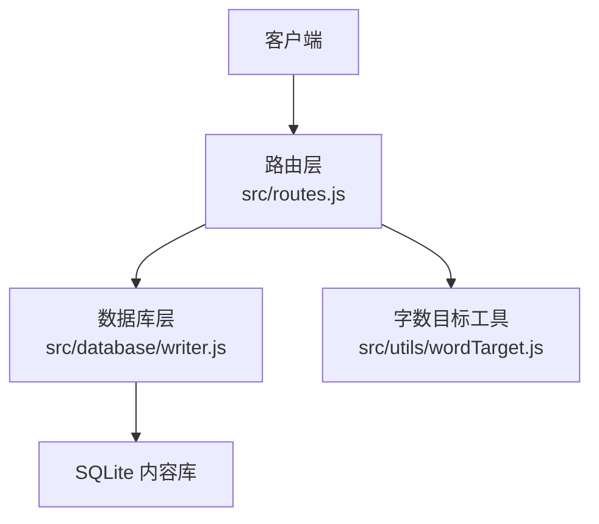
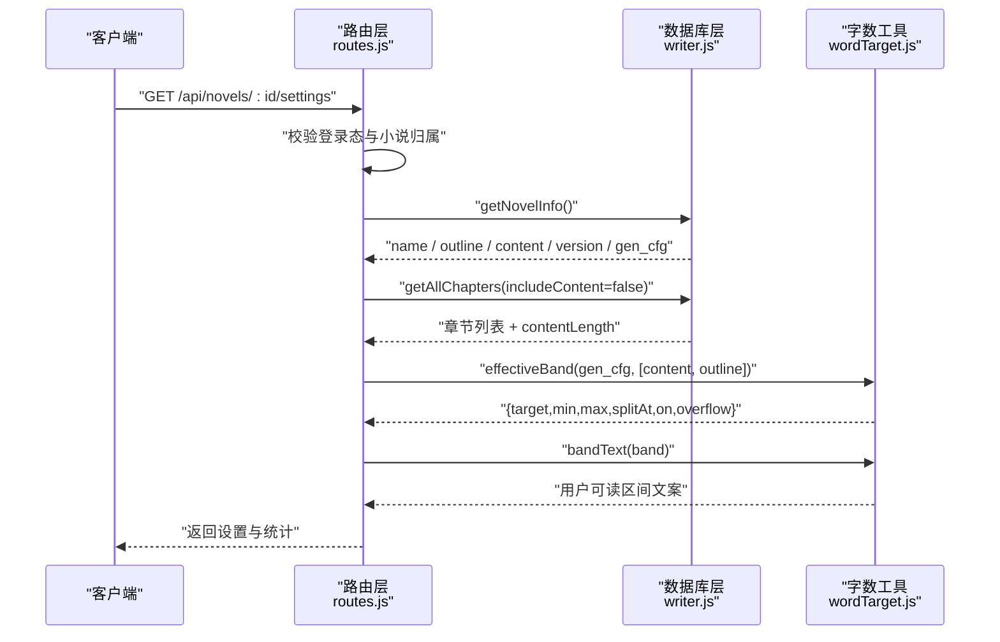
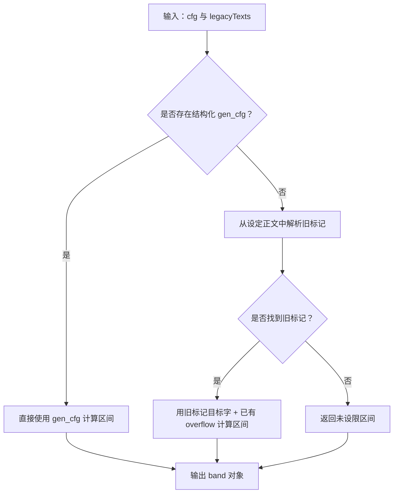
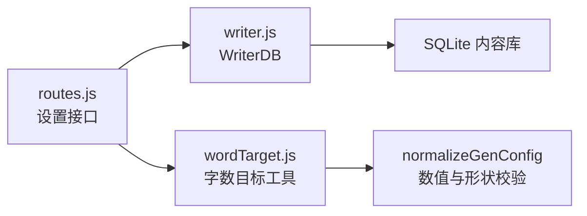

# 小说设置接口

<cite>
**本文引用的文件**   
- [routes.js](file://src/routes.js)
- [wordTarget.js](file://src/utils/wordTarget.js)
- [writer.js](file://src/database/writer.js)
- [README.md](file://README.md)
</cite>

## 目录
1. [简介](#简介)
2. [项目结构](#项目结构)
3. [核心组件](#核心组件)
4. [架构总览](#架构总览)
5. [详细组件分析](#详细组件分析)
6. [依赖关系分析](#依赖关系分析)
7. [性能与复杂度](#性能与复杂度)
8. [故障排查指南](#故障排查指南)
9. [结论](#结论)
10. [附录：请求与响应示例](#附录请求与响应示例)

## 简介
本文件面向“小说设置管理”的 API，重点说明以下两个端点：
- `GET /api/novels/:id/settings`：返回某本小说的元数据、生成配置、字数区间以及章节统计。
- `PUT /api/novels/:id/settings`：更新小说元数据与生成配置（`genCfg`），并对配置做严格校验。

文档同时解释：
- 生成配置（`genCfg`）的处理逻辑与数值范围限制。
- 字数区间计算算法，包括 `effectiveBand` 的工作原理和 `wordBandText` 的显示格式。
- 章节统计信息的计算口径：总字数、章节数、大纲数等。
- 完整的请求/响应示例与错误处理场景。

## 项目结构
小说设置相关逻辑分布在三层：
- 路由层：定义并实现 `/api/novels/:id/settings` 的 GET/PUT 行为。
- 工具层：集中实现字数目标、区间换算、溢出策略与人类可读文本。
- 数据层：通过 SQLite 读取小说概要、章节列表与统计字段。



**图表来源**
- [routes.js:748-800](file://src/routes.js#L748-L800)
- [writer.js:208-228](file://src/database/writer.js#L208-L228)
- [wordTarget.js:60-151](file://src/utils/wordTarget.js#L60-L151)

**章节来源**
- [routes.js:748-800](file://src/routes.js#L748-L800)
- [writer.js:208-228](file://src/database/writer.js#L208-L228)
- [wordTarget.js:60-151](file://src/utils/wordTarget.js#L60-L151)

## 核心组件
- **路由处理器**
  - `GET /api/novels/:id/settings`：解析小说归属、读取小说信息、计算字数区间、汇总章节统计。
  - `PUT /api/novels/:id/settings`：在落库前对 `genCfg` 做形状与数值校验，支持局部更新或清除。
- **字数目标工具**
  - `normalizeGenConfig`：校验并补齐生成配置。
  - `effectiveBand`：决定最终生效的字数区间。
  - `wordBand`：把配置换算为判定区间。
  - `bandText`：生成面向用户的区间说明。
- **数据库访问器**
  - `getNovelInfo`：读取 no=0 的小说概要行，包含书名、大纲、正文、版本、生成配置等。
  - `getAllChapters`：读取章节列表，支持不加载正文但保留长度统计。

**章节来源**
- [routes.js:748-800](file://src/routes.js#L748-L800)
- [wordTarget.js:12-151](file://src/utils/wordTarget.js#L12-L151)
- [writer.js:208-228](file://src/database/writer.js#L208-L228)
- [writer.js:355-377](file://src/database/writer.js#L355-L377)

## 架构总览
小说设置接口的调用链如下：



**图表来源**
- [routes.js:748-775](file://src/routes.js#L748-L775)
- [writer.js:208-228](file://src/database/writer.js#L208-L228)
- [writer.js:355-377](file://src/database/writer.js#L355-L377)
- [wordTarget.js:114-151](file://src/utils/wordTarget.js#L114-L151)

## 详细组件分析

### GET /api/novels/:id/settings
该接口用于获取小说的设置与统计信息。

#### 前置条件
- 必须已登录。
- 当前用户必须拥有该小说，或为超管。
- 小说对应的数据库文件必须存在。

#### 处理流程
1. 根据 `:id` 解析小说归属。
2. 打开只读数据库连接。
3. 读取小说概要（no=0 行）。
4. 读取所有章节（不加载正文，仅保留长度统计）。
5. 使用 `effectiveBand` 计算生效字数区间。
6. 使用 `bandText` 生成人类可读区间说明。
7. 汇总章节统计：章节数、大纲数、有正文数、总字数。
8. 返回设置对象与统计指标。

#### 响应字段说明
| 字段 | 类型 | 含义 |
| --- | --- | --- |
| `name` | 字符串 | 书名 |
| `outline` | 字符串 | 小说大纲 |
| `content` | 字符串 | 其他设定正文（角色、世界观等） |
| `preface` | 字符串 | 本书设定说明（可选） |
| `version` | 数字 | 小说概要版本号 |
| `updatedAt` | 时间戳或空值 | 最后更新时间 |
| `genCfg` | 对象或空值 | 原始生成配置；未设置时为 `null` |
| `wordBand` | 对象 | 生效的字数区间，含 `target`、`min`、`max`、`splitAt`、`on`、`overflow` |
| `wordBandText` | 字符串 | 面向用户的区间说明 |
| `chapterCount` | 数字 | 章节总数 |
| `outlineCount` | 数字 | 有非空大纲的章节数 |
| `bodyCount` | 数字 | 有正文内容的章节数 |
| `totalWords` | 数字 | 全书正文字数合计 |

#### 关键计算规则
- 章节统计基于 `getAllChapters({ includeContent: false })`，避免拉取整本正文。
- 正文字数使用 SQL `LENGTH(content)`，中文按字符计数。
- 是否“有正文”以 `contentLength > 0` 判断。
- 是否“有大纲”以 `outline` 非空且去除空白后仍非空判断。
- 生效区间由 `effectiveBand(gen_cfg, [content, outline])` 决定。

**章节来源**
- [routes.js:748-775](file://src/routes.js#L748-L775)
- [writer.js:355-377](file://src/database/writer.js#L355-L377)
- [wordTarget.js:114-151](file://src/utils/wordTarget.js#L114-L151)

### PUT /api/novels/:id/settings
该接口用于更新小说设置，重点在于 `genCfg` 的校验与保存。

#### 前置条件
- 必须已登录。
- 当前用户必须拥有该小说，或为超管。
- 小说对应的数据库文件必须存在。

#### 处理流程
1. 解析小说归属。
2. 读取当前小说信息与现有生成配置。
3. 如果请求体携带 `genCfg`：
   - 传 `null` 或空字符串表示清除生成配置。
   - 传非对象或非数组直接拒绝。
   - 否则合并现有配置并调用 `normalizeGenConfig` 校验。
4. 校验失败时立即返回 400，不写入任何数据。
5. 校验通过后继续保存元数据与生成配置。

#### `genCfg` 字段与限制
| 字段 | 类型 | 默认值 | 允许值 | 说明 |
| --- | --- | --- | --- | --- |
| `targetWords` | 数字 | `0` | `0` 或 `300–20000` | `0` 表示不设限；其他值必须落在可用范围 |
| `tolerancePct` | 数字 | `20` | `5–50` | 允许浮动百分比 |
| `splitPct` | 数字 | `60` | `20–300` | 超过目标多少建议拆章 |
| `overflow` | 字符串 | `"trim"` | `"trim"` 或 `"split"` | 超长处理方式 |

#### 生成配置处理要点
- 未传 `genCfg` 表示“不改生成配置”，属于局部补丁语义。
- 显式传 `null` 或空字符串表示“清除生成配置”。
- 传对象时会与已有配置合并，再统一校验。
- 未知字段会被拒绝，防止前端传错形状却静默忽略。
- 数值越界会抛出明确错误，不会静默截断到边界值。

**章节来源**
- [routes.js:777-800](file://src/routes.js#L777-L800)
- [wordTarget.js:24-88](file://src/utils/wordTarget.js#L24-L88)

### 字数区间计算算法

#### `effectiveBand` 的工作原理
`effectiveBand` 是“生效区间”的唯一入口，负责决定最终按什么标准判定章节长度。



**图表来源**
- [wordTarget.js:114-125](file://src/utils/wordTarget.js#L114-L125)

#### `wordBand` 的计算公式
- 若 `targetWords` 为 `0`，则 `on=false`，四个数字均为 `0`，表示不做长度判定。
- 合格下限：`min = round(target × (1 - tolerancePct / 100))`
- 合格上限：`max = round(target × (1 + tolerancePct / 100))`
- 拆章阈值：`splitAt = max(max, round(target × (1 + splitPct / 100)))`
- `overflow` 独立于 `on` 开关返回，便于界面展示超长处理策略。

#### `wordBandText` 的显示格式
- 未设限时显示：“未设每章字数目标（不做长度判定）”
- 设限后显示：“目标 N 字 · 合格 A–B 字 · 超过 C 字建议拆章 · 超长策略说明”

**章节来源**
- [wordTarget.js:96-105](file://src/utils/wordTarget.js#L96-L105)
- [wordTarget.js:140-151](file://src/utils/wordTarget.js#L140-L151)

### 章节统计信息计算方式
- **章节数**：过滤 `no > 0` 的章节数量。
- **大纲数**：`outline` 非空且去除空白后仍非空的章节数量。
- **正文数**：`contentLength > 0` 的章节数量。
- **总字数**：对所有章节的 `contentLength` 求和。
- 统计过程不加载正文内容，只使用 `LENGTH(content)`，降低内存占用。

**章节来源**
- [routes.js:755-772](file://src/routes.js#L755-L772)
- [writer.js:355-377](file://src/database/writer.js#L355-L377)

## 依赖关系分析
小说设置接口的依赖关系如下：



**图表来源**
- [routes.js:748-800](file://src/routes.js#L748-L800)
- [writer.js:208-228](file://src/database/writer.js#L208-L228)
- [wordTarget.js:60-88](file://src/utils/wordTarget.js#L60-L88)

**章节来源**
- [routes.js:748-800](file://src/routes.js#L748-L800)
- [writer.js:208-228](file://src/database/writer.js#L208-L228)
- [wordTarget.js:60-88](file://src/utils/wordTarget.js#L60-L88)

## 性能与复杂度
- **GET 接口**：
  - 数据库查询一次读取小说概要，一次读取章节列表。
  - 章节列表使用 `includeContent=false`，避免加载整本正文。
  - 字数统计基于 SQL `LENGTH(content)`，时间复杂度近似 O(章节数)。
- **PUT 接口**：
  - 主要开销在配置校验与数据库更新。
  - 校验失败时不写库，保证原子性体验。
- **内存占用**：
  - 不返回正文内容，显著降低大书库的响应体积。
  - 统计只依赖长度字段，避免把全文搬进内存。

[本节为通用性能说明，不直接分析具体代码片段]

## 故障排查指南

### 常见错误与处理
| 场景 | 可能原因 | 服务端行为 | 建议处理 |
| --- | --- | --- | --- |
| 小说不存在 | `:id` 无法映射到有效小说 | 返回 404 | 检查小说 ID 是否正确 |
| 无权访问 | 当前用户不是书主且不是超管 | 返回 403 | 使用正确账号或申请权限 |
| 数据库文件缺失 | 小说库文件不在预期路径 | 返回 404 | 检查数据目录与文件完整性 |
| `genCfg` 不是对象 | 前端传了数组、字符串或其他类型 | 返回 400 | 确保传对象或 `null` |
| `genCfg` 含未知字段 | 前端传了不支持的键 | 返回 400 | 只传 `targetWords`、`tolerancePct`、`splitPct`、`overflow` |
| 数值越界 | `targetWords`、`tolerancePct`、`splitPct` 超出范围 | 返回 400 | 调整数值到允许范围 |
| `overflow` 非法 | 传入非 `trim` 或 `split` 的值 | 返回 400 | 使用合法超长处理模式 |
| 配置校验失败 | 任意字段不符合要求 | 返回 400 并附带错误消息 | 根据错误消息修正请求 |

### 调试建议
- 先调用 `GET /api/novels/:id/settings`，确认当前配置与统计是否符合预期。
- 修改 `genCfg` 时，优先只改一个字段，观察是否影响其他字段。
- 如果页面显示“未设限”但生成行为仍受字数约束，检查是否还在吃旧标记；应通过结构化 `gen_cfg` 明确取消限制。
- 对于超长处理，注意 `trim` 与 `split` 的区别：前者保持章数不变，后者可能增加章节数和总字数。

**章节来源**
- [routes.js:748-800](file://src/routes.js#L748-L800)
- [wordTarget.js:24-88](file://src/utils/wordTarget.js#L24-L88)
- [README.md:89-96](file://README.md#L89-L96)

## 结论
小说设置接口围绕“元数据 + 生成配置 + 字数区间 + 章节统计”四个维度组织：
- GET 接口提供只读视图，适合初始化设置页、展示字数目标与章节概况。
- PUT 接口提供安全可控的更新能力，重点保护 `genCfg` 的形状与数值范围。
- 字数区间算法集中在 `wordTarget.js`，避免多处实现产生口径漂移。
- 统计口径统一使用 SQL `LENGTH(content)`，保证管理与发布侧一致。

正确使用这两个接口，可以让小说设置在前端与服务端之间保持一致，同时为后续“字数治理”“章节拆分”“生成提示词”提供稳定依据。

[本节为总结性内容，不直接分析具体代码片段]

## 附录：请求与响应示例

### GET /api/novels/:id/settings 成功响应示例
```json
{
  "name": "示例小说",
  "outline": "故事概要",
  "content": "角色与世界观设定",
  "preface": "本书设定说明",
  "version": 3,
  "updatedAt": 1710000000000,
  "genCfg": {
    "targetWords": 3000,
    "tolerancePct": 20,
    "splitPct": 60,
    "overflow": "trim"
  },
  "wordBand": {
    "target": 3000,
    "min": 2400,
    "max": 3600,
    "splitAt": 4800,
    "on": true,
    "overflow": "trim"
  },
  "wordBandText": "目标 3000 字 · 合格 2400–3600 字 · 超过 4800 字建议拆章 · 超长时删减次要场景（章数不变）",
  "chapterCount": 20,
  "outlineCount": 18,
  "bodyCount": 16,
  "totalWords": 58000
}
```

### PUT /api/novels/:id/settings 成功请求示例
请求体：
```json
{
  "name": "示例小说",
  "outline": "更新后的故事概要",
  "content": "新增角色设定",
  "genCfg": {
    "targetWords": 3000,
    "tolerancePct": 20,
    "splitPct": 60,
    "overflow": "split"
  }
}
```

### PUT /api/novels/:id/settings 清除生成配置示例
请求体：
```json
{
  "genCfg": null
}
```

### 错误响应示例：生成配置格式错误
```json
{
  "error": "生成设定必须是对象（或传 null 清除）"
}
```

### 错误响应示例：数值越界
```json
{
  "error": "生成设定未保存：每章目标字数 超出可用范围（300–20000，收到 999999）"
}
```

### 错误响应示例：未知字段
```json
{
  "error": "生成设定含未知字段：unknownField"
}
```

### 错误响应示例：超长处理模式非法
```json
{
  "error": "生成设定未保存：超长处理方式只接受 trim / split（收到 \"invalid\"）"
}
```

**章节来源**
- [routes.js:748-800](file://src/routes.js#L748-L800)
- [wordTarget.js:24-88](file://src/utils/wordTarget.js#L24-L88)
- [wordTarget.js:140-151](file://src/utils/wordTarget.js#L140-L151)