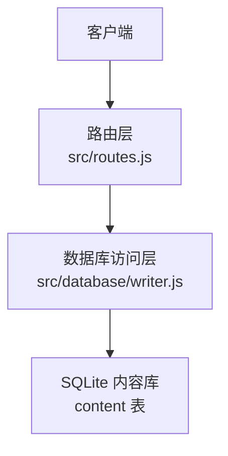
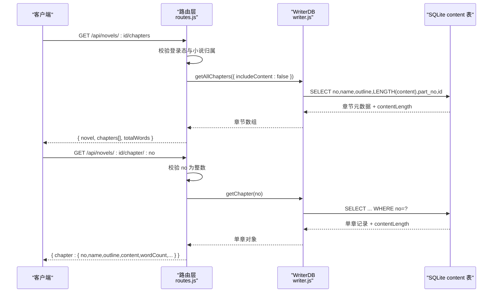
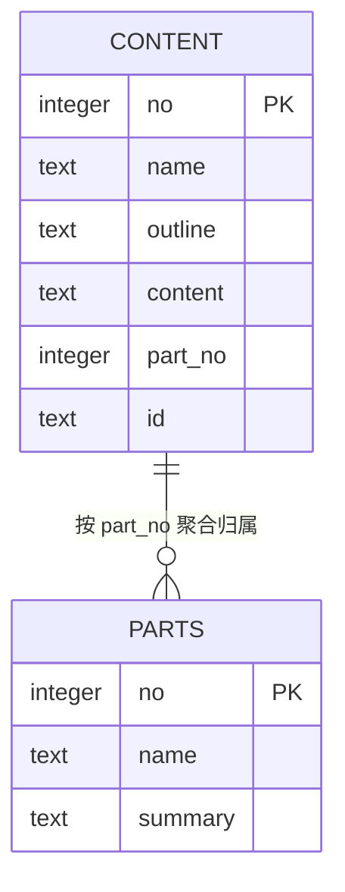
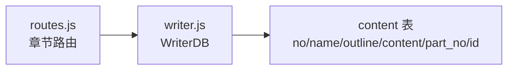

# 章节管理接口

<cite>
**本文引用的文件**   
- [src/routes.js](file://src/routes.js)
- [src/database/writer.js](file://src/database/writer.js)
- [README.md](file://README.md)
</cite>

## 目录
1. [简介](#简介)
2. [项目结构](#项目结构)
3. [核心组件](#核心组件)
4. [架构总览](#架构总览)
5. [详细接口说明](#详细接口说明)
6. [依赖关系分析](#依赖关系分析)
7. [性能考虑](#性能考虑)
8. [故障排查指南](#故障排查指南)
9. [结论](#结论)

## 简介
本节文档聚焦“章节管理”相关 API，覆盖以下目标：
- 章节列表获取接口 `GET /api/novels/:id/chapters`
- 单章内容获取接口 `GET /api/novels/:id/chapter/:no`
- 章节数据结构设计（`no`、`name`、`outline`、`content`、`wordCount`、`partNo` 等）
- 章节与“部”结构的关联关系
- 请求/响应示例与不同状态下的数据格式
- 按需加载正文的性能优化策略
- 常见错误处理示例

## 项目结构
章节管理相关逻辑主要位于后端路由层与数据库访问层：
- 路由层负责鉴权、小说归属校验、参数校验、调用数据库并组装对外 JSON。
- 数据库层封装 SQLite 操作，提供按章节号查询、全量枚举、长度统计等方法。



**图示来源**
- [src/routes.js:686-725](file://src/routes.js#L686-L725)
- [src/database/writer.js:355-401](file://src/database/writer.js#L355-L401)

**章节来源**
- [src/routes.js:686-725](file://src/routes.js#L686-L725)
- [src/database/writer.js:355-401](file://src/database/writer.js#L355-L401)

## 核心组件
- 路由处理器
  - 章节列表：`GET /api/novels/:id/chapters`
  - 单章正文：`GET /api/novels/:id/chapter/:no`
- 数据库访问器
  - `getAllChapters(options)`：支持 `includeContent=false`，返回 `contentLength` 而不拉取正文
  - `getChapter(no)`：按章节号直查，返回完整行及 `contentLength`

关键实现要点：
- 列表接口不拉正文，仅通过 SQL `LENGTH(content)` 得到字数，避免整本书正文进入内存。
- 单章接口直接按 `no` 查询，不再受全量枚举的 LIMIT 限制。
- 所有 `/api` 接口默认需要登录态；章节接口还会校验当前用户是否拥有该小说。

**章节来源**
- [src/routes.js:686-725](file://src/routes.js#L686-L725)
- [src/database/writer.js:355-401](file://src/database/writer.js#L355-L401)

## 架构总览
章节管理接口的整体调用链如下：



**图示来源**
- [src/routes.js:686-725](file://src/routes.js#L686-L725)
- [src/database/writer.js:355-401](file://src/database/writer.js#L355-L401)

## 详细接口说明

### 章节列表接口
- 方法：`GET`
- 路径：`/api/novels/:id/chapters`
- 鉴权：需要有效会话；且当前用户必须拥有该小说（超管可跨用户）。
- 路径参数
  - `id`：小说标识（内部以 `novel.id` 定位真实 `.db` 文件）。

#### 请求示例
```text
GET /api/novels/<小说ID>/chapters
```

#### 响应字段
| 字段 | 类型 | 含义 |
| --- | --- | --- |
| `novel` | string | 书名 |
| `chapters` | array | 章节数组 |
| `totalWords` | number | 全书正文字数合计（各章 `wordCount` 之和） |

章节对象字段：
| 字段 | 类型 | 含义 |
| --- | --- | --- |
| `no` | number | 章节序号（从 1 开始） |
| `name` | string | 章节标题 |
| `outline` | string | 章节大纲 |
| `wordCount` | number | 正文字数，来源于 `LENGTH(content)` |
| `hasContent` | boolean | 是否存在正文（`wordCount > 0`） |
| `partNo` | number | 所属“部”序号；未划分时为 0 |
| `id` | string | 稳定章节 ID（发布文件名依据，不随重排变化） |

注意：
- 列表接口不返回 `content`，只返回 `wordCount` 与 `hasContent`，用于快速展示目录与统计。
- `partNo` 表示章节归属的“部”。若未划分部，则为 0。

#### 成功响应示例
```json
{
  "novel": "某本小说",
  "chapters": [
    {
      "no": 1,
      "name": "第一章",
      "outline": "本章构思...",
      "wordCount": 3200,
      "hasContent": true,
      "partNo": 1,
      "id": "a1b2c3d4e5f6g7h8"
    },
    {
      "no": 2,
      "name": "第二章",
      "outline": "",
      "wordCount": 0,
      "hasContent": false,
      "partNo": 1,
      "id": "i9j0k1l2m3n4o5p6"
    }
  ],
  "totalWords": 3200
}
```

#### 失败响应示例
- 小说不存在或未登记：
```json
{
  "error": "小说不存在或未登记"
}
```
- 无权访问该小说：
```json
{
  "error": "无权访问该小说"
}
```
- 服务器内部错误：
```json
{
  "error": "<具体异常信息>"
}
```

**章节来源**
- [src/routes.js:686-708](file://src/routes.js#L686-L708)
- [src/database/writer.js:355-377](file://src/database/writer.js#L355-L377)

---

### 单章内容接口
- 方法：`GET`
- 路径：`/api/novels/:id/chapter/:no`
- 鉴权：需要有效会话；且当前用户必须拥有该小说。
- 路径参数
  - `id`：小说标识
  - `no`：章节号，必须是整数

#### 参数验证
- 如果 `no` 不是整数，返回 400，提示“章节号必须是整数”。
- 如果章节不存在，返回 404，提示“第 N 章不存在”。

#### 请求示例
```text
GET /api/novels/<小说ID>/chapter/<章节号>
```

#### 响应字段
| 字段 | 类型 | 含义 |
| --- | --- | --- |
| `chapter.no` | number | 章节序号 |
| `chapter.name` | string | 章节标题 |
| `chapter.outline` | string | 章节大纲 |
| `chapter.content` | string | 章节正文 |
| `chapter.wordCount` | number | 正文字数 |
| `chapter.outlineCount` | number | 大纲字符数 |

#### 成功响应示例（有正文）
```json
{
  "chapter": {
    "no": 1,
    "name": "第一章",
    "outline": "本章构思...",
    "content": "这里是正文内容...",
    "wordCount": 3200,
    "outlineCount": 120
  }
}
```

#### 成功响应示例（无正文）
```json
{
  "chapter": {
    "no": 2,
    "name": "第二章",
    "outline": "",
    "content": null,
    "wordCount": 0,
    "outlineCount": 0
  }
}
```

#### 失败响应示例
- 章节号格式错误：
```json
{
  "error": "章节号必须是整数"
}
```
- 章节不存在：
```json
{
  "error": "第 99 章不存在"
}
```
- 小说不存在或无权访问：
```json
{
  "error": "小说不存在或未登记"
}
```

**章节来源**
- [src/routes.js:710-725](file://src/routes.js#L710-L725)
- [src/database/writer.js:384-401](file://src/database/writer.js#L384-L401)

---

### 章节数据结构设计
- `no`：章节序号，从 1 开始；`no=0` 是小说概要行，不参与章节列表。
- `name`：章节标题。
- `outline`：章节大纲；可为空。
- `content`：章节正文；可能为空或 `null`。
- `wordCount`：正文字数，口径为存储字符数（SQL `LENGTH(content)`），中文 1 字计 1，不 trim。
- `hasContent`：列表接口中用于标识是否有正文。
- `partNo`：章节所属“部”的序号；未划分部时为 0。
- `id`：稳定章节 ID，用于发布文件名，不因重排而变化。

字数口径说明：
- 字数统计使用 SQL `LENGTH(content)`，与前端展示的 `wordCount` 同源。
- 列表接口通过 `contentLength` 计算 `wordCount`，避免把整本正文读进内存。

**章节来源**
- [src/routes.js:696-700](file://src/routes.js#L696-L700)
- [src/routes.js:721-722](file://src/routes.js#L721-L722)
- [src/database/writer.js:361-363](file://src/database/writer.js#L361-L363)
- [src/database/writer.js:390-396](file://src/database/writer.js#L390-L396)
- [README.md:82-88](file://README.md#L82-L88)

---

### 章节与“部”结构的关联
- “部”是比“章”更大的结构单元。
- 章节通过 `part_no` 字段归属到某个部。
- 若未划分部，则 `part_no` 为 0。
- 部的起止章与章节数量由 `content.part_no` 聚合派生，而不是在 parts 表里重复存区间。



**图示来源**
- [src/database/writer.js:95-107](file://src/database/writer.js#L95-L107)
- [src/database/writer.js:124-130](file://src/database/writer.js#L124-L130)

**章节来源**
- [src/database/writer.js:95-107](file://src/database/writer.js#L95-L107)
- [src/database/writer.js:124-130](file://src/database/writer.js#L124-L130)

## 依赖关系分析
章节管理接口依赖以下层次：
- 路由层：负责鉴权、小说归属解析、参数校验、结果组装。
- 数据库层：封装 SQLite 查询，提供 `getAllChapters` 与 `getChapter`。
- 内容库：SQLite 中的 `content` 表，包含章节元数据、正文、部分归属等。



**图示来源**
- [src/routes.js:686-725](file://src/routes.js#L686-L725)
- [src/database/writer.js:355-401](file://src/database/writer.js#L355-L401)

**章节来源**
- [src/routes.js:686-725](file://src/routes.js#L686-L725)
- [src/database/writer.js:355-401](file://src/database/writer.js#L355-L401)

## 性能考虑
- 列表接口按需加载：
  - 调用 `getAllChapters({ includeContent: false })`，只返回 `contentLength`，不返回 `content`。
  - 避免整本小说正文被一次性加载到内存。
- 单章接口直查：
  - 调用 `getChapter(no)`，按章节号直接查询，不再受全量枚举的 LIMIT 限制。
- 字数统计口径统一：
  - 使用 SQL `LENGTH(content)`，与前端 `wordCount` 口径一致，减少额外计算。

这些优化使章节列表适合频繁刷新，而单章正文只在读者真正打开时加载。

**章节来源**
- [src/routes.js:693-700](file://src/routes.js#L693-L700)
- [src/routes.js:718-722](file://src/routes.js#L718-L722)
- [src/database/writer.js:355-377](file://src/database/writer.js#L355-L377)
- [src/database/writer.js:384-401](file://src/database/writer.js#L384-L401)
- [README.md:82-88](file://README.md#L82-L88)

## 故障排查指南
常见问题与处理方式：

| 问题 | 可能原因 | 服务端行为 | 建议处理 |
| --- | --- | --- | --- |
| 章节列表为空 | 小说没有已编号章节 | 返回空数组，`totalWords` 为 0 | 检查是否已生成章节 |
| 章节列表有章节但无正文 | 只有大纲，尚未生成正文 | `hasContent=false`，`wordCount=0` | 触发正文生成流程 |
| 单章 400 | `no` 不是整数 | 返回“章节号必须是整数” | 前端校验章节号为数字 |
| 单章 404 | 章节号不存在 | 返回“第 N 章不存在” | 确认章节号是否正确 |
| 403 | 当前用户无权访问该小说 | 返回“无权访问该小说” | 使用正确账号或提升权限 |
| 404（小说） | 小说不存在或未登记 | 返回“小说不存在或未登记” | 检查小说 ID 与登记状态 |
| 500 | 数据库或内部异常 | 返回 `{ error: "<消息>" }` | 查看服务端日志 |

**章节来源**
- [src/routes.js:686-725](file://src/routes.js#L686-L725)

## 结论
章节管理接口围绕两个核心端点展开：
- 章节列表接口提供轻量元数据与字数统计，适合目录渲染与统计展示。
- 单章接口按需返回正文，适合阅读器逐章加载。

设计上强调：
- 列表不拉正文，避免内存压力。
- 单章直查，避免全量枚举限制。
- 字数口径统一，便于前后端一致展示。
- 通过 `partNo` 表达章节与“部”的关系，同时保持分部结构的可推导性。