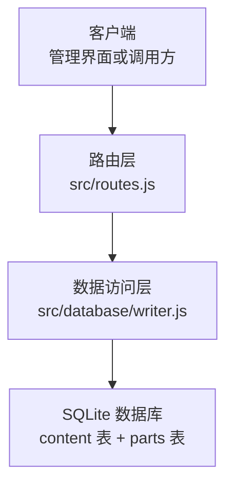
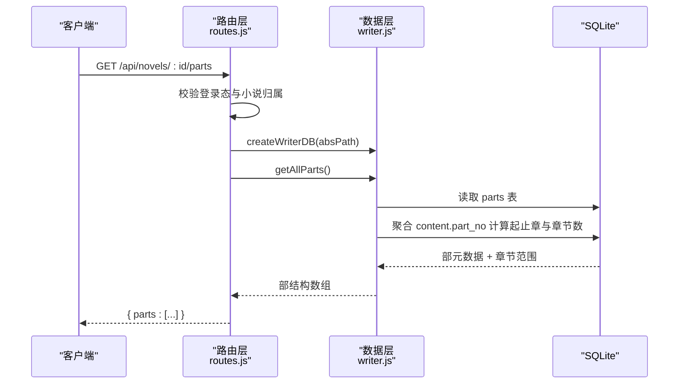
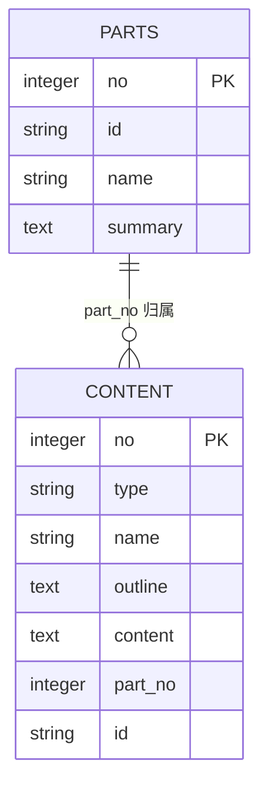
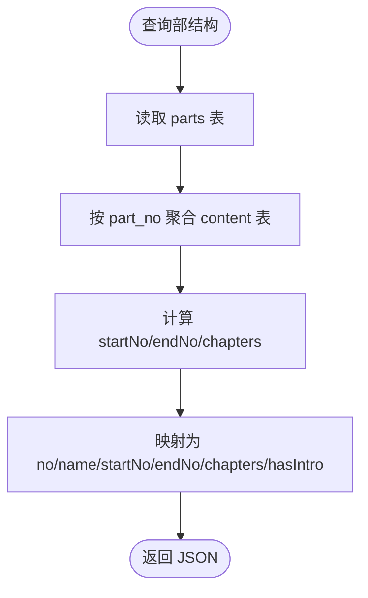

# 部结构管理接口

<cite>
**本文引用的文件**   
- [src/routes.js](file://src/routes.js)
- [src/database/writer.js](file://src/database/writer.js)
- [README.md](file://README.md)
</cite>

## 目录
1. [简介](#简介)
2. [项目结构与定位](#项目结构与定位)
3. [核心接口：GET /api/novels/:id/parts](#核心接口get-apinovelssidparts)
4. [响应字段说明](#响应字段说明)
5. [部结构在小说组织中的作用](#部结构在小说组织中的作用)
6. [部与章节的关联关系](#部与章节的关联关系)
7. [部导言状态 hasIntro 的判断逻辑](#部导言状态-hasintro-的判断逻辑)
8. [请求与响应示例](#请求与响应示例)
9. [数据存储格式与查询优化](#数据存储格式与查询优化)
10. [错误处理与异常场景](#错误处理与异常场景)
11. [最佳实践与常见问题](#最佳实践与常见问题)
12. [结论](#结论)

## 简介
本文件面向“小说部结构管理”相关的使用者与开发者，重点说明 `GET /api/novels/:id/parts` 接口的职责、返回字段含义、部结构在长篇小说组织中的作用，以及部结构与章节之间的关联方式。文档同时解释部导言状态标识 `hasIntro` 的判断逻辑，给出不同部结构配置下的数据格式示例，并说明底层存储结构与查询优化策略。

该接口属于只读接口，用于向管理界面或客户端暴露当前小说的“部结构现状”，以便前端预填“划分部”弹窗、校验区间完整性、提示空部或缺口等异常情况。

## 项目结构与定位
小说部结构相关能力由两层组成：
- 路由层：负责鉴权、小说归属校验、数据库连接与响应封装。
- 数据层：负责 SQLite 表结构、部范围派生、章节归属推断与部结构读写。



**图表来源**
- [src/routes.js:730-745](file://src/routes.js#L730-L745)
- [src/database/writer.js:95-132](file://src/database/writer.js#L95-L132)

**章节来源**
- [src/routes.js:730-745](file://src/routes.js#L730-L745)
- [src/database/writer.js:95-132](file://src/database/writer.js#L95-L132)

## 核心接口：GET /api/novels/:id/parts
该接口用于获取指定小说的部结构信息。它不返回部的导言正文，只返回“是否存在导言”的状态标志。

### 接口定义
- **方法**：GET
- **路径**：`/api/novels/:id/parts`
- **认证要求**：需要登录态；非超管用户只能访问自己拥有的小说。
- **路径参数**：
  - `id`：全局登记的小说 ID。服务端通过该 ID 定位真实数据库文件，避免直接暴露文件名。

### 主要流程
1. 解析并校验当前用户会话。
2. 根据 `id` 解析小说归属，确认当前用户是否有权访问。
3. 打开对应小说的 SQLite 数据库。
4. 调用数据层的 `getAllParts()` 获取部列表及其派生的章节范围。
5. 将每部映射为对外字段，包括编号、名称、起止章节、包含章节数、是否有导言。
6. 关闭数据库连接并返回 JSON。



**图表来源**
- [src/routes.js:730-745](file://src/routes.js#L730-L745)
- [src/database/writer.js:1001-1031](file://src/database/writer.js#L1001-L1031)
- [src/database/writer.js:853-879](file://src/database/writer.js#L853-L879)

**章节来源**
- [src/routes.js:730-745](file://src/routes.js#L730-L745)

## 响应字段说明
接口返回的数据结构如下：
```json
{
  "parts": [
    {
      "no": 1,
      "name": "",
      "startNo": 1,
      "endNo": 10,
      "chapters": 10,
      "hasIntro": false
    }
  ]
}
```

| 字段 | 类型 | 含义 | 说明 |
|---|---|---|---|
| `no` | 整数 | 部编号 | 从 1 开始的部序号，对应数据库中 `parts.no`。 |
| `name` | 字符串 | 部名称 | 可为空；为空时前端通常展示默认名称，例如“第一部”。 |
| `startNo` | 整数 | 起始章节号 | 该部包含的最小正文章节号；若该部没有章节，则为 0。 |
| `endNo` | 整数 | 结束章节号 | 该部包含的最大正文章节号；若该部没有章节，则为 0。 |
| `chapters` | 整数 | 包含章节数 | 该部实际归属的正文章节数量；若该部没有章节，则为 0。 |
| `hasIntro` | 布尔值 | 是否有部导言 | 当 `summary` 存在且非空时为 `true`，否则为 `false`。 |

**章节来源**
- [src/routes.js:737-742](file://src/routes.js#L737-L742)
- [src/database/writer.js:1001-1031](file://src/database/writer.js#L1001-L1031)

## 部结构在小说组织中的作用
部结构是“小说 → 部 → 章节”三层组织中的中间层。其作用包括：

1. **长篇小说分段管理**  
   长篇作品可按主题、时间线、视角或剧情阶段划分为多个部，便于作者规划、读者阅读与管理界面展示。

2. **章节归属依据**  
   每个正文章节通过 `part_no` 归属到某个部。新增章节时，系统会根据现有部的章节范围自动推断归属；如果章节号落在某部区间内，则归入该部；如果超过最后一部末章，则默认归入最后一部；如果处于首部之前或无部，则视为未归部。

3. **导出与发布支持**  
   部结构可用于生成部级页面、导航、统计与发布产物。部的稳定 ID 用于导言页文件名，避免改名导致链接漂移。

4. **前端交互基础**  
   管理界面的“划分部”弹窗依赖该接口预填现有部结构，并在结构不完整时给出缺口、空部等提示。

**章节来源**
- [src/database/writer.js:95-107](file://src/database/writer.js#L95-L107)
- [src/database/writer.js:881-902](file://src/database/writer.js#L881-L902)
- [README.md:133](file://README.md#L133)

## 部与章节的关联关系
部与章节的关系不是通过“部表记录起止章节”来维护，而是通过“章节表记录所属部编号”来维护。

### 关键设计原则
- **事实来源在章节侧**：`content.part_no` 表示章节归属哪个部。
- **起止章节和章节数是派生值**：`startNo`、`endNo`、`chapters` 由 `content.part_no` 聚合计算得到，而不是直接写入 `parts` 表。
- **避免区间谎报**：如果起止章节也存一份副本，删除章节、重排章节号后容易不一致；按章节聚合可保证始终与实际列表一致。

### 关联规则
- 章节表 `content` 中，`no >= 1` 且 `type = 'chapter'` 的行代表正文章节。
- 章节的 `part_no` 为 0 表示不属于任何部。
- 部的 `no` 与章节的 `part_no` 一一对应。
- 查询部结构时，先读取 `parts` 表的部元数据，再按 `part_no` 聚合 `content` 表得出起止章节与章节数。



**图表来源**
- [src/database/writer.js:58-107](file://src/database/writer.js#L58-L107)
- [src/database/writer.js:853-879](file://src/database/writer.js#L853-L879)

**章节来源**
- [src/database/writer.js:95-107](file://src/database/writer.js#L95-L107)
- [src/database/writer.js:853-879](file://src/database/writer.js#L853-L879)

## 部导言状态 hasIntro 的判断逻辑
`hasIntro` 表示某部是否已经生成或保存了导言正文。

判断逻辑如下：
1. 数据层 `getAllParts()` 会读取 `parts.summary`。
2. 路由层对 `summary` 做布尔转换：`!!p.summary`。
3. 因此：
   - `summary` 为 `null`、`undefined`、空字符串时，`hasIntro` 为 `false`。
   - `summary` 为非空字符串时，`hasIntro` 为 `true`。

注意：该接口**不返回 `summary` 正文**，只返回 `hasIntro`。这是为了避免把整段导言正文暴露给管理界面，同时保持接口职责清晰：结构查询接口不负责内容正文。

**章节来源**
- [src/routes.js:737-742](file://src/routes.js#L737-L742)
- [src/database/writer.js:1001-1031](file://src/database/writer.js#L1001-L1031)

## 请求与响应示例

### 正常请求
```http
GET /api/novels/abc-123/parts
Authorization: Cookie（已登录）
```

### 单部示例
当小说只有一个部，且该部包含第 1 到第 10 章，但没有导言时：
```json
{
  "parts": [
    {
      "no": 1,
      "name": "第一部",
      "startNo": 1,
      "endNo": 10,
      "chapters": 10,
      "hasIntro": false
    }
  ]
}
```

### 多部分割示例
当小说分为两部：
- 第一部：第 1 到第 20 章，有导言。
- 第二部：第 21 到第 50 章，暂无导言。
```json
{
  "parts": [
    {
      "no": 1,
      "name": "卷一",
      "startNo": 1,
      "endNo": 20,
      "chapters": 20,
      "hasIntro": true
    },
    {
      "no": 2,
      "name": "卷二",
      "startNo": 21,
      "endNo": 50,
      "chapters": 30,
      "hasIntro": false
    }
  ]
}
```

### 空部示例
当某部没有归属章节时：
```json
{
  "parts": [
    {
      "no": 1,
      "name": "序部",
      "startNo": 0,
      "endNo": 0,
      "chapters": 0,
      "hasIntro": false
    }
  ]
}
```

### 无部示例
当小说尚未划分部时，接口可能返回空数组：
```json
{
  "parts": []
}
```

**章节来源**
- [src/routes.js:730-745](file://src/routes.js#L730-L745)
- [src/database/writer.js:1001-1031](file://src/database/writer.js#L1001-L1031)

## 数据存储格式与查询优化

### 表结构
- **content 表**：统一存储小说概要行（`no = 0`）与正文章节（`no >= 1`）。
  - 关键字段：`no`、`type`、`name`、`outline`、`content`、`part_no`、`id`。
  - `part_no` 表示章节归属的部编号；0 表示未归部。
- **parts 表**：存储部的元数据。
  - 关键字段：`no`、`id`、`name`、`summary`。
  - `summary` 是部导言正文；`id` 是稳定部 ID，用于导言页文件名。

### 索引
- `idx_content_part_no`：加速按部聚合章节范围。
- `idx_content_no`、`idx_content_type`、`idx_content_name`、`idx_content_id`：支撑章节查询与唯一性约束。

### 查询优化策略
1. **起止章节不冗余存储**  
   部结构的起止章节与章节数通过 `content.part_no` 聚合计算，避免与章节实际归属不一致。
2. **列表接口避免加载正文**  
   章节列表类接口使用 `includeContent: false`，仅通过 `LENGTH(content)` 获取字数，避免把整本小说正文搬进内存。
3. **按部聚合使用 GROUP BY**  
   `getPartRanges()` 使用 `GROUP BY part_no` 计算 `MIN(no)`、`MAX(no)`、`COUNT(*)`，时间复杂度与章节数量线性相关，但只在需要时执行。
4. **事务保护写操作**  
   部结构覆盖保存等操作使用数据库事务，保证一致性。



**图表来源**
- [src/database/writer.js:853-879](file://src/database/writer.js#L853-L879)
- [src/database/writer.js:1001-1031](file://src/database/writer.js#L1001-L1031)

**章节来源**
- [src/database/writer.js:58-132](file://src/database/writer.js#L58-L132)
- [src/database/writer.js:853-879](file://src/database/writer.js#L853-L879)
- [src/database/writer.js:1001-1031](file://src/database/writer.js#L1001-L1031)

## 错误处理与异常场景

### 常见错误
| 场景 | HTTP 状态码 | 响应示例 | 说明 |
|---|---:|---|---|
| 缺少小说标识 | 400 | `{ "error": "缺少小说标识" }` | `id` 为空或无法识别。 |
| 小说不存在或未登记 | 404 | `{ "error": "小说不存在或未登记" }` | 全局注册表中找不到该小说。 |
| 无权访问 | 403 | `{ "error": "无权访问该小说" }` | 当前用户不是超管且不是小说拥有者。 |
| 小说库文件缺失 | 404 | `{ "error": "小说库文件缺失" }` | 对应 `.db` 文件不存在。 |
| 数据库操作异常 | 500 | `{ "error": "具体错误消息" }` | 打开数据库、执行 SQL 或关闭连接失败。 |

### 数据库连接异常示例
当 SQLite 数据库损坏、权限不足或文件被占用时，可能触发 500 错误。路由层捕获异常后返回通用错误对象，避免泄露内部堆栈。

```json
{
  "error": "数据库打开失败或 SQL 执行异常的具体消息"
}
```

### 建议的错误处理策略
- 客户端收到 400/404/403 时，应提示用户检查小说 ID、登录状态或权限。
- 客户端收到 500 时，应提示“服务器内部错误”，并可重试一次；若仍失败，引导用户稍后再试或联系管理员。
- 对于 `hasIntro` 为 `false` 的部，前端可提示“该部尚无导言”，但不阻断其他操作。

**章节来源**
- [src/routes.js:103-116](file://src/routes.js#L103-L116)
- [src/routes.js:730-745](file://src/routes.js#L730-L745)

## 最佳实践与常见问题

### 如何划分长篇小说
1. **先确定分界点**  
   按剧情阶段、时间线、视角切换或主题变化划分部。
2. **确保章节连续**  
   尽量让每个部覆盖连续的章节区间，避免大量“未归部章节”。
3. **为重要部编写导言**  
   导言有助于读者理解背景设定，提升阅读体验。
4. **修改部名不会丢失导言**  
   部的稳定 ID 与导言正文绑定，改名不会导致导言丢失或导言页 URL 漂移。

### 常见问题
- **为什么 `startNo` 和 `endNo` 都是 0？**  
  表示该部目前没有归属章节，可能是空部或历史脏数据。
- **为什么 `chapters` 与 `endNo - startNo + 1` 不一致？**  
  因为 `chapters` 是实际归属该部的章节数，而 `startNo`/`endNo` 是该部最小与最大章节号；中间可能有未归部章节或其他异常状态。
- **为什么接口不返回 `summary`？**  
  该接口是结构查询接口，不返回导言正文，避免管理界面意外携带大文本；如需导言正文，应使用专门的导言或内容接口。
- **新增章节会自动归部吗？**  
  会。新增章节时，系统根据现有部的章节范围推断归属；尾部追加通常归入最后一部。

**章节来源**
- [src/database/writer.js:881-902](file://src/database/writer.js#L881-L902)
- [README.md:133](file://README.md#L133)

## 结论
`GET /api/novels/:id/parts` 是小说部结构管理的核心只读接口。它通过 `parts` 表与 `content.part_no` 的配合，提供稳定的部编号、部名称、起止章节、包含章节数与导言状态。该设计以章节归属为事实来源，避免区间副本不一致问题，并通过索引与聚合查询实现性能优化。客户端可基于该接口完成部结构展示、区间校验、空部与缺口提示，以及“划分部”弹窗的预填逻辑。