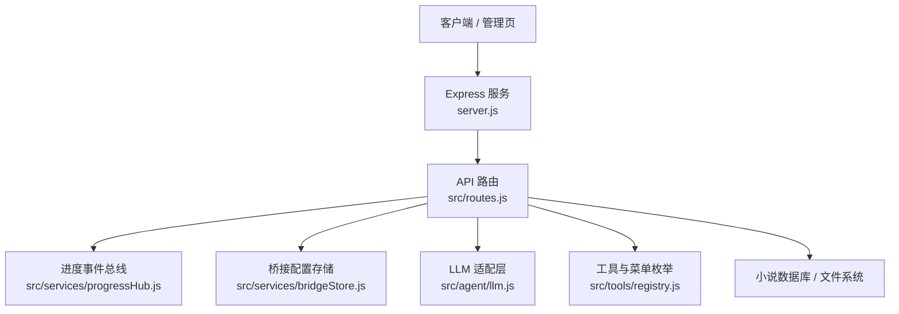
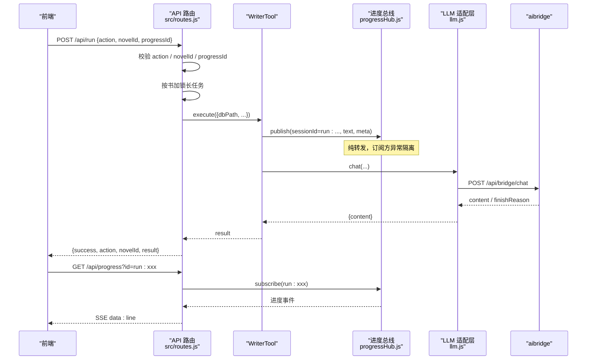
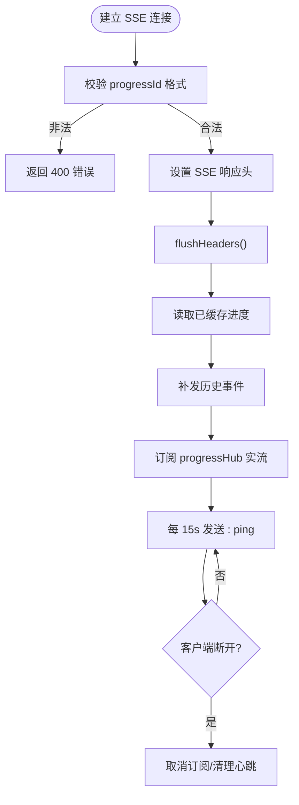
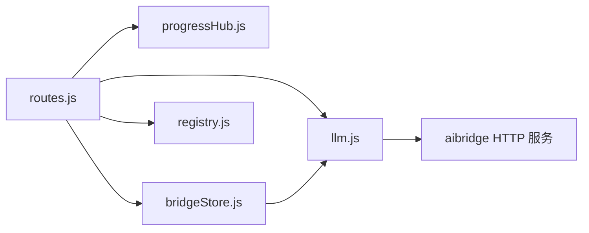

# 系统管理 API

<cite>
**本文引用的文件**   
- [server.js](file://server.js)
- [routes.js](file://src/routes.js)
- [progressHub.js](file://src/services/progressHub.js)
- [bridgeStore.js](file://src/services/bridgeStore.js)
- [llm.js](file://src/agent/llm.js)
- [registry.js](file://src/tools/registry.js)
</cite>

## 目录
1. [简介](#简介)
2. [项目结构](#项目结构)
3. [核心组件](#核心组件)
4. [架构总览](#架构总览)
5. [详细接口说明](#详细接口说明)
6. [依赖关系分析](#依赖关系分析)
7. [性能与并发特性](#性能与并发特性)
8. [故障排查指南](#故障排查指南)
9. [结论](#结论)

## 简介
本文件面向“系统管理与工具类”场景，聚焦以下能力：
- 长任务进度查询：基于 SSE 的实时进度推送、任务状态与互斥锁。
- 系统健康检查：LLM 桥接服务连通性检测。
- 菜单与工具枚举：返回前端可用的操作选项与 AI 工具清单。
- 桥接服务接口：外部推理服务集成、密钥管理与地址覆盖。
- 系统维护接口：数据对账、TTS 音频体检与清理等。
- 监控与排障：运行中任务、限流、鉴权、脱敏输出等运维相关行为。

## 项目结构
系统入口使用 Express 启动，静态资源与 API 路由分离；所有业务路由集中在 `src/routes.js`，并通过 `server.js` 完成初始化、前缀平移、桥接服务注入与静态资源挂载。

**图示来源**
- [server.js:18-63](file://server.js#L18-L63)
- [routes.js:331-339](file://src/routes.js#L331-L339)

**章节来源**
- [server.js:1-64](file://server.js#L1-L64)
- [routes.js:1-30](file://src/routes.js#L1-L30)

## 核心组件
- **进度事件总线（ProgressHub）**：进程内单例事件总线，用于在长任务执行期间发布阶段性进度，订阅方异常隔离，不影响主执行链路。
- **桥接配置存储（BridgeStore）**：持久化 aibridge 的 API Key 清单、当前生效项与可选地址覆盖；对外一律脱敏，仅暴露 keyPrefix。
- **LLM 适配层**：封装 aibridge 调用、连接探测、whoami 身份探测，以及运行时 URL/Key 覆盖。
- **工具与菜单枚举（Registry）**：定义前端菜单分组与 AI 工具 schema，供管理界面与 AI 窗口使用。

**章节来源**
- [progressHub.js:1-59](file://src/services/progressHub.js#L1-L59)
- [bridgeStore.js:1-221](file://src/services/bridgeStore.js#L1-L221)
- [llm.js:1-205](file://src/agent/llm.js#L1-L205)
- [registry.js:1-64](file://src/tools/registry.js#L1-L64)

## 架构总览
下图展示“长任务发起 → 进度 SSE → 任务互斥锁 → 结果返回”的主流程，以及与 LLM 和桥接服务的交互。

**图示来源**
- [routes.js:914-973](file://src/routes.js#L914-L973)
- [routes.js:599-627](file://src/routes.js#L599-L627)
- [progressHub.js:16-55](file://src/services/progressHub.js#L16-L55)
- [llm.js:102-171](file://src/agent/llm.js#L102-L171)

## 详细接口说明

### 一、长任务进度查询（SSE）

#### 1. 发起长任务
- **端点**：`POST /api/run`
- **鉴权**：需要登录态
- **关键参数**
  - `action`：受白名单限制，包含生成、修改、批量补大纲、字数治理等。
  - `novelId`：目标小说标识；新建动作可省略，由服务端分配。
  - `progressId`：可选，格式为 `run:` + 6~64 位字符，作为 SSE 会话键。
- **行为要点**
  - 删除类 action 需二次确认 `confirm:"OK"`。
  - 长任务按书互斥：同一本书同时只能有一个生成任务。
  - 成功后刷新小说统计信息。
- **典型响应**
  - 成功：`{ success: true, action, novelId, result }`
  - 冲突：`{ error: "本书已有生成任务在跑..." }`
  - 参数错误：`{ error: "不支持的 action / progressId 格式非法 / 缺少 novelId" }`

**章节来源**
- [routes.js:35-43](file://src/routes.js#L35-L43)
- [routes.js:48-53](file://src/routes.js#L48-L53)
- [routes.js:631-637](file://src/routes.js#L631-L637)
- [routes.js:914-973](file://src/routes.js#L914-L973)

#### 2. 订阅进度（SSE）
- **端点**：`GET /api/progress`
- **查询参数**
  - `id`：必须匹配 `run:[A-Za-z0-9_-]{6,64}`。
- **响应头**
  - `Content-Type: text/event-stream; charset=utf-8`
  - `Cache-Control: no-cache, no-transform`
  - `Connection: keep-alive`
  - `X-Accel-Buffering: no`（经 nginx 时关闭缓冲）
- **事件体**
  - 每条事件为 JSON：`{ type: "line", text, timestamp }`
  - 先补发已错过的近期事件，再转实流。
  - 心跳：每 15 秒发送 `: ping`。
- **注意事项**
  - 只处理以 `run:` 开头的 sessionId。
  - delta 类型增量事件会被过滤，避免刷屏。
  - 服务端对每个进度 id 保留最多 200 行，10 分钟 TTL 自动清理。

**图示来源**
- [routes.js:573-627](file://src/routes.js#L573-L627)
- [progressHub.js:22-55](file://src/services/progressHub.js#L22-L55)

**章节来源**
- [routes.js:573-627](file://src/routes.js#L573-L627)
- [progressHub.js:1-59](file://src/services/progressHub.js#L1-L59)

#### 3. 进度事件数据结构
- **字段**
  - `sessionId`：会话标识，形如 `run:xxxx`。
  - `text`：用户可见的进度描述。
  - `timestamp`：ISO 时间戳。
  - `type`：事件类型，SSE 侧统一为 `line`。
  - `meta`：扩展元数据（例如 stage、agent、tool），由上游发布方决定。
- **处理建议**
  - 前端应忽略 `delta` 类型或带 `step` 的增量事件，避免 UI 被刷屏。
  - 若长时间无心跳，应视为连接异常并尝试重连。
  - 对 `run:` 前缀做白名单校验，拒绝非预期会话。

**章节来源**
- [routes.js:581-591](file://src/routes.js#L581-L591)
- [routes.js:617-621](file://src/routes.js#L617-L621)
- [progressHub.js:28-45](file://src/services/progressHub.js#L28-L45)

### 二、系统状态检查（LLM 连通性）

#### 1. LLM 链路预检
- **端点**：`GET /api/llm-status`
- **鉴权**：需要登录态
- **行为**
  - 检查是否有可用 API Key。
  - 探测桥接服务 `/api/health` 可达性与 status。
  - 不发起真实生成，不计费，不代表上游模型一定可用。
- **响应示例**
  - 正常：`{ ok: true, detail: "...可达" }`
  - 失败：`{ ok: false, detail: "没有可用的 API Key / 连不上 ..." }`

**章节来源**
- [routes.js:566-571](file://src/routes.js#L566-L571)
- [llm.js:67-100](file://src/agent/llm.js#L67-L100)

#### 2. 桥接服务可达性（超管）
- **端点**：`POST /api/admin/bridge/ping`
- **鉴权**：需要超级管理员
- **行为**：复用 LLM 的可达性探测逻辑，便于控制台自检。

**章节来源**
- [routes.js:1337-1340](file://src/routes.js#L1337-L1340)
- [llm.js:75-99](file://src/agent/llm.js#L75-L99)

### 三、菜单与工具枚举

#### 1. 菜单动作
- **端点**：`GET /api/menu`
- **响应**：`{ groups: MENU_ACTIONS }`
- **用途**：渲染管理界面的操作按钮分组与提示文案。

**章节来源**
- [routes.js:562-564](file://src/routes.js#L562-L564)
- [registry.js:14-46](file://src/tools/registry.js#L14-L46)

#### 2. AI 工具清单
- **端点**：`GET /api/tools`
- **响应**：`{ tools: AI_TOOLS }`
- **用途**：AI 窗口的 function schema，让 LLM 输出工具选择与参数。

**章节来源**
- [routes.js:562-564](file://src/routes.js#L562-L564)
- [registry.js:48-63](file://src/tools/registry.js#L48-L63)

### 四、桥接服务接口（外部服务集成与密钥管理）

#### 1. 查看桥接配置
- **端点**：`GET /api/admin/bridge`
- **鉴权**：需要超级管理员
- **响应字段**
  - `current.url`：当前生效的桥接地址。
  - `current.source`：`console`（控制台切换）或 `env`（环境变量）。
  - `current.keyPrefix`：脱敏后的 Key 前缀。
  - `current.hasKey`：是否携带有效 Key。
  - `current.activeName`：当前激活条目名称。
  - `keys[]`：Key 列表（含 id、name、prefix、probe、addedAt）。
  - `urlOverride`：地址覆盖值。
  - `activeId`：当前激活 Key 的 id。

**章节来源**
- [routes.js:1296-1302](file://src/routes.js#L1296-L1302)
- [bridgeStore.js:101-124](file://src/services/bridgeStore.js#L101-L124)

#### 2. 管理 API Key
- **新增 Key**：`POST /api/admin/bridge/keys`
- **启用 Key**：`PUT /api/admin/bridge/keys/:id/active`
- **测试 Key**：`POST /api/admin/bridge/keys/:id/test`
- **重命名 Key**：`PUT /api/admin/bridge/keys/:id/name`
- **删除 Key**：`DELETE /api/admin/bridge/keys/:id`
- **行为要点**
  - 新增后自动探测一次 whoami，返回列表即可显示“连到哪个模型”。
  - 删除正在使用的 Key 会自动清除覆盖，回落到 `.env`。
  - 所有明文 Key 不落响应，仅返回 prefix。

**章节来源**
- [routes.js:1303-1331](file://src/routes.js#L1303-L1331)
- [bridgeStore.js:126-218](file://src/services/bridgeStore.js#L126-L218)

#### 3. 覆盖桥接地址
- **端点**：`PUT /api/admin/bridge/url`
- **鉴权**：需要超级管理员
- **行为**：支持 http/https 地址覆盖；空串表示清除覆盖，回落到环境变量或内置默认。

**章节来源**
- [routes.js:1332-1336](file://src/routes.js#L1332-L1336)
- [bridgeStore.js:185-200](file://src/services/bridgeStore.js#L185-L200)

#### 4. 身份探测（whoami）
- **内部函数**：`probeIdentity`
- **用途**：用指定 Key 探测桥接侧 provider/model/keyName，不改变当前生效连接。
- **适用场景**：Key 添加后自动探测、控制台手动测试、启动时打印上游模型。

**章节来源**
- [llm.js:174-201](file://src/agent/llm.js#L174-L201)
- [bridgeStore.js:202-211](file://src/services/bridgeStore.js#L202-L211)

### 五、系统维护接口

#### 1. 小说数据对账（超管）
- **端点**：`POST /api/novels/reconcile`
- **鉴权**：需要超级管理员
- **行为**
  - 扫描 `data/` 下小说库文件，补登记未注册的小说。
  - 清理悬挂登记（文件不存在则删除登记行）。
- **响应**：`{ ok: true, added, removed }`

**章节来源**
- [routes.js:678-684](file://src/routes.js#L678-L684)

#### 2. TTS 音频体检与清理（超管）
- **体检**：`GET /api/admin/tts/audio`
- **清理**：`POST /api/admin/tts/audio/prune`
- **行为**
  - 体检只读，返回不一致或冗余音频统计。
  - 清理默认干跑；传入 `apply:true` 且 `confirm:"OK"` 才真删。
  - 可按音色、语速或全部清理。

**章节来源**
- [routes.js:1342-1360](file://src/routes.js#L1342-L1360)

#### 3. 一致性检查
- **端点**：`POST /api/novels/:id/check`
- **鉴权**：需要登录态
- **行为**：对整本小说执行一致性检查（章节连续性、角色、时间线等），可选择是否包含正文。

**章节来源**
- [routes.js:975-989](file://src/routes.js#L975-L989)

### 六、其他系统级接口（与监控相关）

#### 1. 公开书单
- **端点**：`GET /api/catalog`
- **鉴权**：无需登录
- **行为**：扫描已发布站点，按 VIP 授权过滤条目。

**章节来源**
- [routes.js:515-557](file://src/routes.js#L515-L557)

#### 2. 用户与会话
- **登录**：`POST /api/login`
- **登出**：`POST /api/logout`
- **当前用户**：`GET /api/me`
- **用户管理（超管）**：`/api/admin/users/*`

**章节来源**
- [routes.js:341-350](file://src/routes.js#L341-L350)
- [routes.js:1250-1264](file://src/routes.js#L1250-L1264)

#### 3. 限流与脱敏
- **限流**：按真实 IP 分桶，60 秒窗口，超限返回 429 并带 `Retry-After`。
- **脱敏**：除登录、账号、预览、公开书单等白名单路径外，所有 `/api` 响应会清洗敏感字段与绝对路径。

**章节来源**
- [routes.js:263-306](file://src/routes.js#L263-L306)
- [routes.js:67-95](file://src/routes.js#L67-L95)
- [routes.js:331-339](file://src/routes.js#L331-L339)

## 依赖关系分析

**图示来源**
- [routes.js:17-21](file://src/routes.js#L17-L21)
- [bridgeStore.js:19](file://src/services/bridgeStore.js#L19)
- [llm.js:37-46](file://src/agent/llm.js#L37-L46)

**章节来源**
- [routes.js:17-21](file://src/routes.js#L17-L21)
- [bridgeStore.js:1-221](file://src/services/bridgeStore.js#L1-L221)
- [llm.js:1-205](file://src/agent/llm.js#L1-L205)

## 性能与并发特性
- **长任务互斥**：按小说维度加锁，防止同一本书并发生成导致正文与章号错乱。
- **SSE 缓冲与 TTL**：对 `run:` 进度事件保留最近 200 行，10 分钟过期清理，避免内存无限增长。
- **心跳保活**：SSE 每 15 秒发送心跳，便于前端判断连接存活。
- **限流保护**：读者侧接口与 TTS 接口分别限流，避免批量请求压垮上游。
- **响应脱敏**：避免泄露服务器路径、IP、密钥等敏感信息。

[本节为通用指导，不直接分析具体代码片段]

## 故障排查指南

### 1. SSE 进度丢失或延迟
- **现象**：刚发起任务就连接 SSE，前几条进度缺失。
- **原因**：发起 `/api/run` 与建立 SSE 是两个请求，存在竞态。
- **机制**：服务端按 `progressId` 缓冲近期事件，连接时先补发再转实流。
- **排查**
  - 确认 `progressId` 格式正确且与 `/api/run` 一致。
  - 检查 SSE 是否收到心跳。
  - 观察服务端日志中 `[ProgressHub] 订阅方异常已隔离` 是否出现。

**章节来源**
- [routes.js:573-591](file://src/routes.js#L573-L591)
- [routes.js:617-627](file://src/routes.js#L617-L627)
- [progressHub.js:36-45](file://src/services/progressHub.js#L36-L45)

### 2. LLM 连通性失败
- **现象**：`/api/llm-status` 返回不可达。
- **可能原因**
  - 未配置 API Key。
  - aibridge 未启动或端口不通。
  - 桥接地址不是合法 URL。
- **排查**
  - 检查控制台是否选择了有效的 Key。
  - 检查 `.env` 或环境变量中的 `AIBRIDGE_URL`、`AIBRIDGE_API_KEY`。
  - 使用 `/api/admin/bridge/ping` 进行超管自检。

**章节来源**
- [llm.js:67-100](file://src/agent/llm.js#L67-L100)
- [routes.js:566-571](file://src/routes.js#L566-L571)
- [routes.js:1337-1340](file://src/routes.js#L1337-L1340)

### 3. 桥接 Key 无效或 401/403
- **现象**：whoami 探测失败，返回 401 或 403。
- **原因**：Key 无效、被禁用或桥接版本过旧。
- **排查**
  - 使用 `/api/admin/bridge/keys/:id/test` 重新探测。
  - 检查桥接服务是否正常运行。
  - 确认 Key 长度与复制完整性。

**章节来源**
- [llm.js:179-201](file://src/agent/llm.js#L179-L201)
- [bridgeStore.js:202-211](file://src/services/bridgeStore.js#L202-L211)

### 4. 长任务被拒绝（409）
- **现象**：提交生成任务时报“本书已有生成任务在跑”。
- **原因**：同一本书的长任务互斥。
- **处理**
  - 等待现有任务结束。
  - 前端应禁用重复提交按钮，并提示剩余时间。

**章节来源**
- [routes.js:631-637](file://src/routes.js#L631-L637)
- [routes.js:948-959](file://src/routes.js#L948-L959)

### 5. 数据不一致或悬挂登记
- **现象**：全局小说列表与实际文件不一致。
- **处理**：使用 `/api/novels/reconcile` 进行对账，自动补登记与清悬挂。

**章节来源**
- [routes.js:678-684](file://src/routes.js#L678-L684)

## 结论
本系统管理 API 围绕“长任务进度、系统健康、菜单与工具枚举、桥接服务集成、系统维护”五个维度提供完整能力。通过 SSE 实时进度、任务互斥锁、桥接密钥管理与数据对账，既保证了用户体验，也兼顾了多租户安全与运维可观测性。在实际使用中，建议：
- 前端始终携带 `progressId` 并实现 SSE 心跳与断线重连。
- 控制台优先使用 `/api/admin/bridge` 系列接口管理密钥与地址。
- 定期执行数据对账与 TTS 清理，保持系统整洁。
- 通过 `/api/llm-status` 与 `/api/admin/bridge/ping` 快速定位 LLM 链路问题。