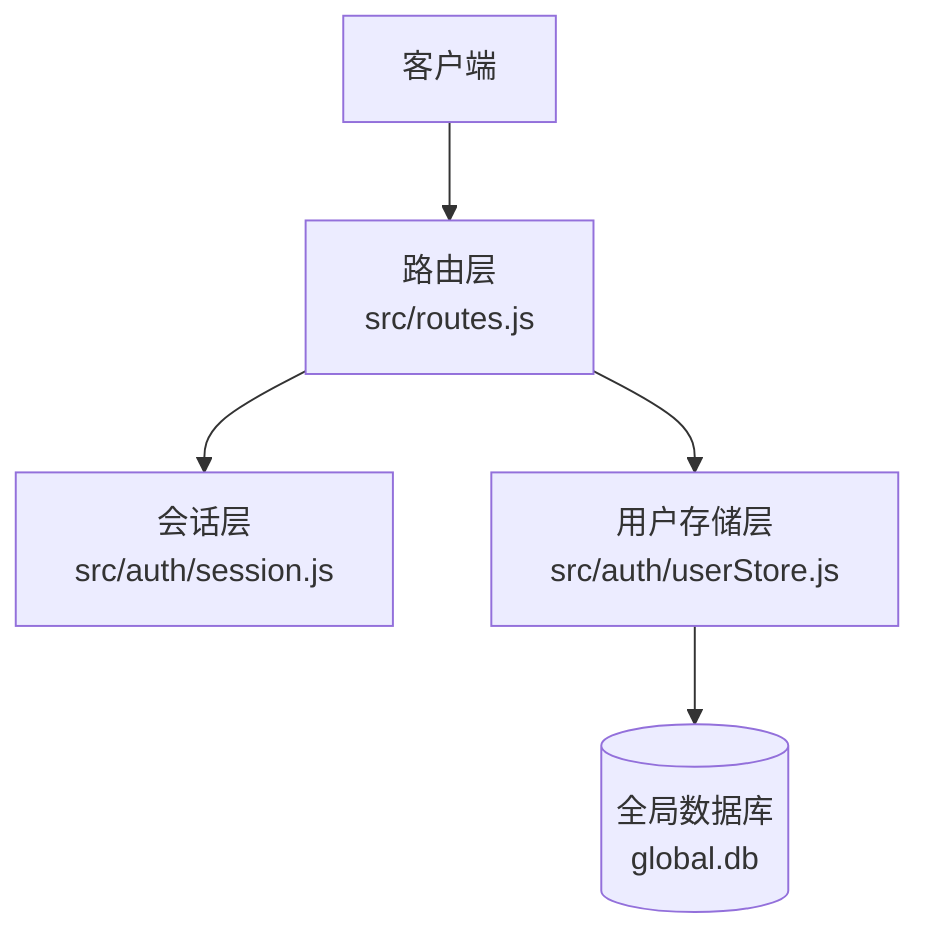
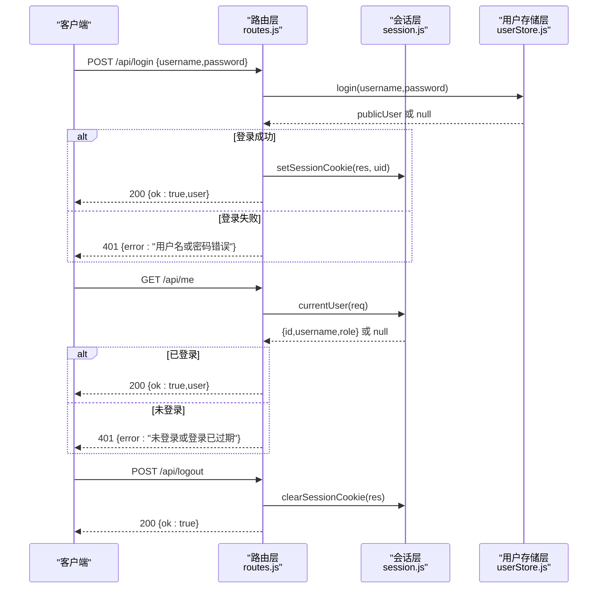
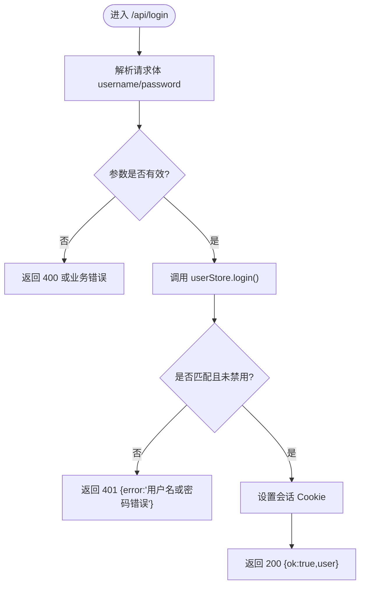
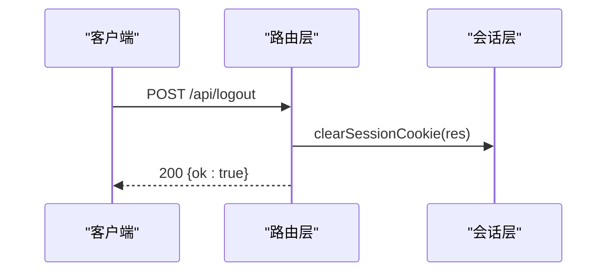
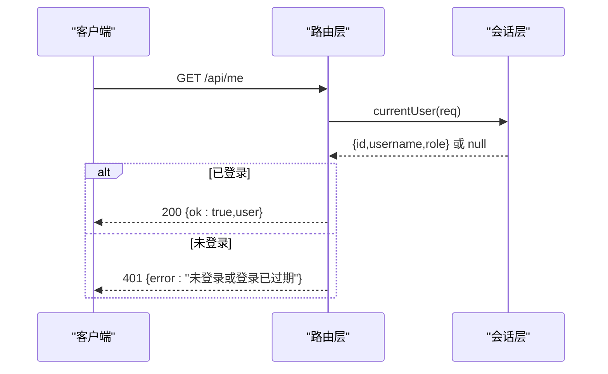
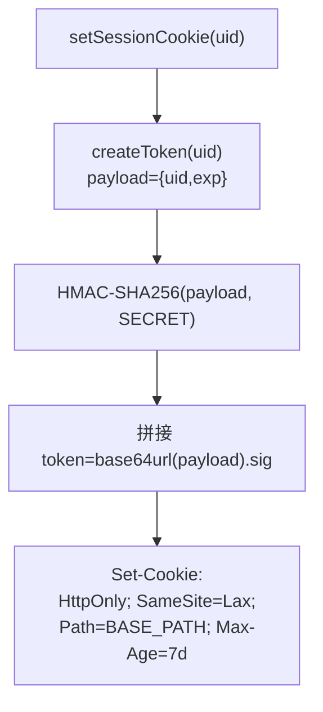
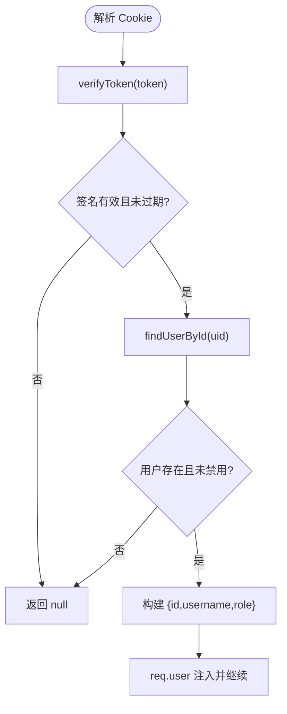
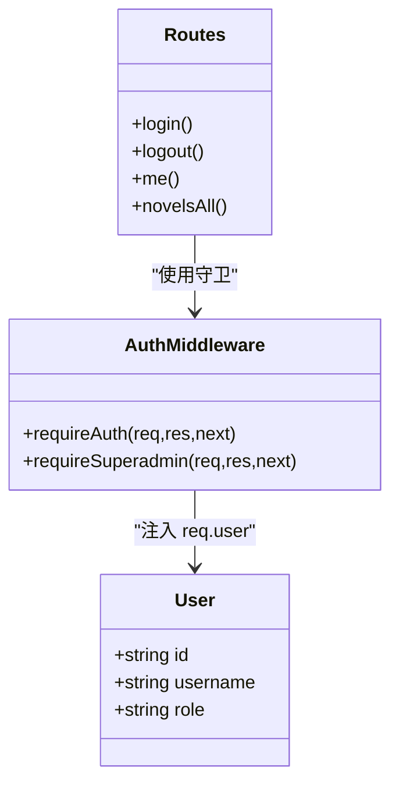
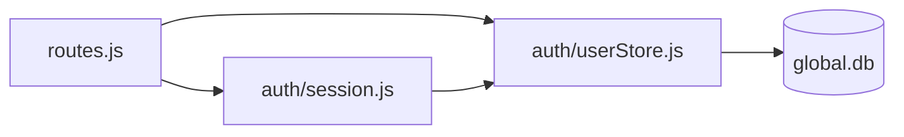

# 认证 API

<cite>
**本文引用的文件**   
- [src/routes.js](file://src/routes.js)
- [src/auth/session.js](file://src/auth/session.js)
- [src/auth/userStore.js](file://src/auth/userStore.js)
- [config/users.json.example](file://config/users.json.example)
</cite>

## 目录
1. [简介](#简介)
2. [项目结构](#项目结构)
3. [核心组件](#核心组件)
4. [架构总览](#架构总览)
5. [详细接口规范](#详细接口规范)
6. [会话管理机制](#会话管理机制)
7. [权限控制机制](#权限控制机制)
8. [依赖关系分析](#依赖关系分析)
9. [性能与安全考虑](#性能与安全考虑)
10. [故障排查指南](#故障排查指南)
11. [结论](#结论)

## 简介
本文档面向需要对接本项目的后端开发者，系统化说明认证相关 API 的接口规范与实现细节。内容覆盖：
- 用户登录、登出、获取当前用户信息
- HTTP 方法、URL 模式、请求参数、响应格式与错误码
- Cookie 与会话验证流程
- 普通用户与超级管理员的权限差异
- 安全设计要点（密码加密、会话签名与过期、路径净化等）

## 项目结构
认证能力由以下模块协作完成：
- 路由层：定义 `/api/login`、`/api/logout`、`/api/me` 等端点，并挂载鉴权中间件
- 会话层：生成、校验、设置/清除会话 Cookie
- 用户存储层：账号注册、口令哈希、登录校验、用户信息查询
- 配置层：初始种子用户示例

**图表来源**
- [src/routes.js:331-350](file://src/routes.js#L331-L350)
- [src/auth/session.js:75-110](file://src/auth/session.js#L75-L110)
- [src/auth/userStore.js:181-188](file://src/auth/userStore.js#L181-L188)

**章节来源**
- [src/routes.js:331-350](file://src/routes.js#L331-L350)
- [src/auth/session.js:1-118](file://src/auth/session.js#L1-L118)
- [src/auth/userStore.js:1-501](file://src/auth/userStore.js#L1-L501)

## 核心组件
- 路由层
  - 公开认证端点：POST /api/login、POST /api/logout、GET /api/me
  - 鉴权守卫：requireAuth 拦截除登录/登出/当前用户外的所有 /api 请求
  - 超管守卫：requireSuperadmin 用于仅超级管理员可访问的接口
- 会话层
  - 使用 HMAC-SHA256 签名的 httpOnly Cookie，包含用户 ID 与过期时间
  - Cookie 作用域受 BASE_PATH 限制，避免跨子系统串扰
- 用户存储层
  - 使用 scrypt + 随机 salt 对口令进行哈希存储
  - 提供用户名查找、登录校验、用户信息脱敏返回等能力

**章节来源**
- [src/routes.js:341-350](file://src/routes.js#L341-L350)
- [src/auth/session.js:26-91](file://src/auth/session.js#L26-L91)
- [src/auth/userStore.js:30-45](file://src/auth/userStore.js#L30-L45)

## 架构总览
认证流程的关键交互如下：

**图表来源**
- [src/routes.js:341-350](file://src/routes.js#L341-L350)
- [src/auth/session.js:75-110](file://src/auth/session.js#L75-L110)
- [src/auth/userStore.js:181-188](file://src/auth/userStore.js#L181-L188)

## 详细接口规范

### 用户登录
- 方法：POST
- URL：/api/login
- 请求体：JSON
  - username：字符串，必填
  - password：字符串，必填
- 成功响应：200
  - ok：布尔值，true
  - user：对象，包含 id、username、role 等脱敏字段
- 失败响应：401
  - error：字符串，提示“用户名或密码错误”

**图表来源**
- [src/routes.js:341-348](file://src/routes.js#L341-L348)
- [src/auth/userStore.js:181-188](file://src/auth/userStore.js#L181-L188)

**章节来源**
- [src/routes.js:341-348](file://src/routes.js#L341-L348)
- [src/auth/userStore.js:181-188](file://src/auth/userStore.js#L181-L188)

### 用户登出
- 方法：POST
- URL：/api/logout
- 请求体：无要求
- 成功响应：200
  - ok：布尔值，true
- 行为说明：清除会话 Cookie，使后续请求视为未登录

**图表来源**
- [src/routes.js:349-349](file://src/routes.js#L349-L349)
- [src/auth/session.js:79-81](file://src/auth/session.js#L79-L81)

**章节来源**
- [src/routes.js:349-349](file://src/routes.js#L349-L349)
- [src/auth/session.js:79-81](file://src/auth/session.js#L79-L81)

### 获取当前用户信息
- 方法：GET
- URL：/api/me
- 请求头：需携带有效的会话 Cookie
- 成功响应：200
  - ok：布尔值，true
  - user：对象，包含 id、username、role 等脱敏字段
- 失败响应：401
  - error：字符串，提示“未登录或登录已过期”

**图表来源**
- [src/routes.js:350-350](file://src/routes.js#L350-L350)
- [src/auth/session.js:83-91](file://src/auth/session.js#L83-L91)

**章节来源**
- [src/routes.js:350-350](file://src/routes.js#L350-L350)
- [src/auth/session.js:83-91](file://src/auth/session.js#L83-L91)

## 会话管理机制

### Cookie 设置与属性
- Cookie 名称：ainovel_session
- 内容：base64url(JSON{uid,exp}) + "." + hex(HMAC(payload, SECRET))
- 安全属性：
  - HttpOnly：禁止前端脚本读取
  - SameSite=Lax：降低 CSRF 风险
  - Path：基于 BASE_PATH，避免与其他子系统共享
  - Max-Age：7 天（秒）

**图表来源**
- [src/auth/session.js:38-45](file://src/auth/session.js#L38-L45)
- [src/auth/session.js:75-78](file://src/auth/session.js#L75-L78)

**章节来源**
- [src/auth/session.js:26-45](file://src/auth/session.js#L26-L45)
- [src/auth/session.js:75-81](file://src/auth/session.js#L75-L81)

### 会话验证流程
- 从请求头 cookie 中解析 ainovel_session
- 校验签名与过期时间
- 根据 uid 查询用户，若用户不存在或被禁用则视为未登录
- requireAuth 中间件将 req.user 注入到后续处理函数

**图表来源**
- [src/auth/session.js:46-60](file://src/auth/session.js#L46-L60)
- [src/auth/session.js:83-91](file://src/auth/session.js#L83-L91)
- [src/auth/session.js:93-102](file://src/auth/session.js#L93-L102)

**章节来源**
- [src/auth/session.js:46-60](file://src/auth/session.js#L46-L60)
- [src/auth/session.js:83-102](file://src/auth/session.js#L83-L102)

## 权限控制机制

### 角色与权限差异
- 普通用户（role=user）
  - 可访问自身拥有的小说资源
  - 不能访问超管专属接口
- 超级管理员（role=superadmin）
  - 可访问全部小说列表（包括 all 参数场景）
  - 可使用 requireSuperadmin 保护的接口（例如数据对账等）

**图表来源**
- [src/auth/session.js:93-110](file://src/auth/session.js#L93-L110)
- [src/routes.js:639-644](file://src/routes.js#L639-L644)

**章节来源**
- [src/auth/session.js:93-110](file://src/auth/session.js#L93-L110)
- [src/routes.js:639-644](file://src/routes.js#L639-L644)

### 授权闸门
- requireAuth：除 /login、/logout、/me 外，所有 /api 请求必须携带有效会话
- requireSuperadmin：在 requireAuth 基础上进一步校验 role=superadmin

**章节来源**
- [src/auth/session.js:93-110](file://src/auth/session.js#L93-L110)

## 依赖关系分析

**图表来源**
- [src/routes.js:24-26](file://src/routes.js#L24-L26)
- [src/auth/session.js:10-11](file://src/auth/session.js#L10-L11)
- [src/auth/userStore.js:18-23](file://src/auth/userStore.js#L18-L23)

**章节来源**
- [src/routes.js:24-26](file://src/routes.js#L24-L26)
- [src/auth/session.js:10-11](file://src/auth/session.js#L10-L11)
- [src/auth/userStore.js:18-23](file://src/auth/userStore.js#L18-L23)

## 性能与安全考虑

### 性能
- 会话验证为轻量级内存计算（HMAC 与 JSON 解析），开销低
- 用户查询通过 SQLite 索引优化（如 user_id 索引）
- 对外响应会进行敏感字段清洗，避免泄露内部路径与密钥

### 安全
- 口令采用 scrypt + 随机 salt 存储，避免明文与弱哈希
- 会话 Token 使用 HMAC-SHA256 签名，防止篡改
- Cookie 启用 HttpOnly、SameSite=Lax，降低 XSS/CSRF 风险
- 会话过期时间为 7 天；同时支持服务端禁用用户（disabled）立即失效
- 输出净化策略过滤敏感键名与绝对路径，减少信息泄露面

**章节来源**
- [src/auth/userStore.js:30-45](file://src/auth/userStore.js#L30-L45)
- [src/auth/session.js:26-45](file://src/auth/session.js#L26-L45)
- [src/routes.js:67-95](file://src/routes.js#L67-L95)

## 故障排查指南

### 常见问题与定位
- 401 未登录或登录已过期
  - 检查 Cookie 是否存在且未过期
  - 确认 SESSION_SECRET 是否稳定（重启后临时密钥会导致旧会话失效）
- 用户名或密码错误
  - 核对用户名与密码
  - 检查用户是否被禁用（disabled=1）
- 无法访问超管接口
  - 确认当前用户 role=superadmin
  - 检查是否先经过 requireAuth 再进入 requireSuperadmin

### 调试建议
- 查看服务器日志中的会话警告（SESSION_SECRET 未设置时会有告警）
- 检查 global.db 中 user 表记录是否完整
- 使用浏览器开发者工具检查 Cookie 的 Path、Max-Age、HttpOnly、SameSite 属性

**章节来源**
- [src/auth/session.js:32-36](file://src/auth/session.js#L32-L36)
- [src/auth/userStore.js:181-188](file://src/auth/userStore.js#L181-L188)

## 结论
本项目认证体系以轻量、自洽为目标：
- 路由层明确划分公开与受保护接口
- 会话层通过签名 Cookie 保障身份可信与防篡改
- 用户存储层采用强哈希与盐值保护口令
- 权限控制通过中间件分层实现，清晰区分普通用户与超级管理员

在实际对接中，请严格遵循本文档的接口规范与安全建议，确保客户端正确处理登录态、错误码与权限边界。