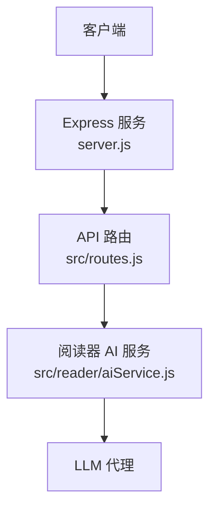
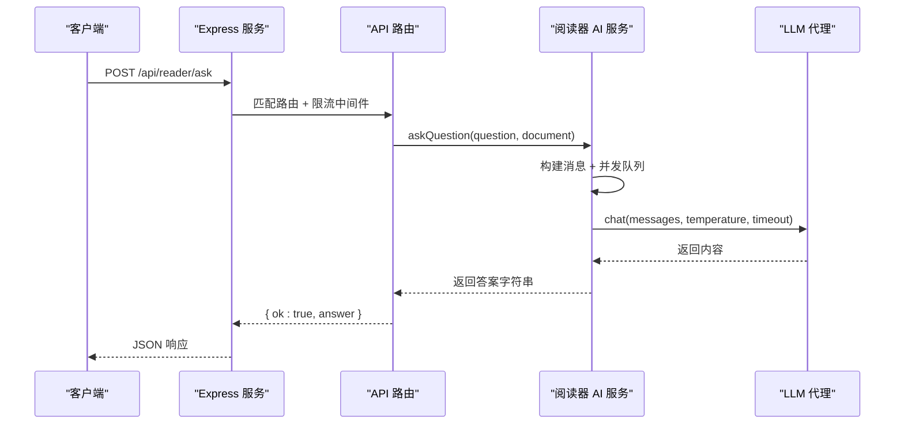
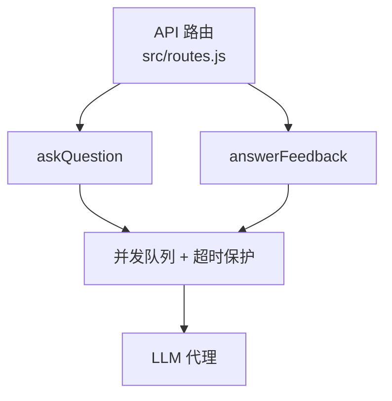
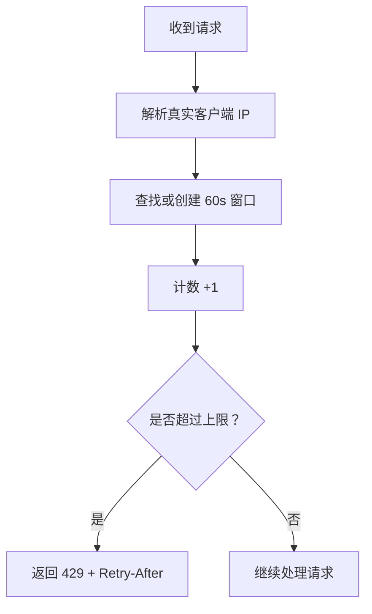
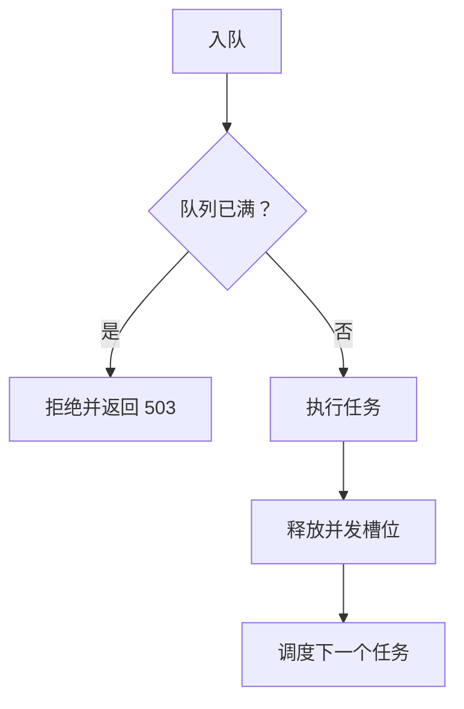

# AI 问答接口

<cite>
**本文引用的文件**   
- [server.js](file://server.js)
- [src/routes.js](file://src/routes.js)
- [src/reader/aiService.js](file://src/reader/aiService.js)
</cite>

## 目录
1. [简介](#简介)
2. [项目结构](#项目结构)
3. [核心组件](#核心组件)
4. [架构总览](#架构总览)
5. [详细接口说明](#详细接口说明)
6. [依赖关系分析](#依赖关系分析)
7. [性能与限流](#性能与限流)
8. [错误处理与状态码](#错误处理与状态码)
9. [常见问题排查](#常见问题排查)
10. [结论](#结论)

## 简介
本文档面向调用方，说明 AI 阅读器的两个关键接口：
- `/api/reader/ask`：向系统提交问题并获取基于文档上下文的答案。
- `/api/reader/feedback`：收集用户对回答的反馈，触发鼓励式讲解。

这两个接口均位于“阅读器 AI”路由段，公开可用（读者无需登录），但受统一限流保护；后端通过 LLM 代理生成答案或反馈文本。

## 项目结构
AI 问答能力由三层组成：
- Web 服务入口：Express 应用启动、CORS、JSON 解析、静态资源挂载。
- API 路由层：注册 `/api/reader/*` 等路由，负责参数校验、限流、转发到业务逻辑。
- 阅读器 AI 服务：封装 LLM 调用、并发控制、缓存策略与提示词构造。

**图表来源**
- [server.js:1-64](file://server.js#L1-L64)
- [src/routes.js:331-390](file://src/routes.js#L331-L390)
- [src/reader/aiService.js:1-40](file://src/reader/aiService.js#L1-L40)

**章节来源**
- [server.js:1-64](file://server.js#L1-L64)
- [src/routes.js:1-30](file://src/routes.js#L1-L30)

## 核心组件
- Express 应用：启用 CORS、JSON 解析、路径前缀剥离、静态资源托管。
- 路由注册器：集中定义 `/api` 下所有端点，包含鉴权、限流、数据净化、小说归属校验等。
- 阅读器 AI 服务：提供出题、句子讲解、生词挑选、自由问答、答题反馈等能力，并对 LLM 调用做并发与超时保护。

**章节来源**
- [server.js:22-53](file://server.js#L22-L53)
- [src/routes.js:331-390](file://src/routes.js#L331-L390)
- [src/reader/aiService.js:1-40](file://src/reader/aiService.js#L1-L40)

## 架构总览
下图展示一次 `/api/reader/ask` 请求从客户端到 LLM 的完整流程。

**图表来源**
- [src/routes.js:383-386](file://src/routes.js#L383-L386)
- [src/reader/aiService.js:225-236](file://src/reader/aiService.js#L225-L236)

## 详细接口说明

### 通用说明
- 基础路径：`/api/reader/ask`、`/api/reader/feedback`
- 认证要求：无需登录（读者侧开放）
- 请求格式：`application/json`
- 响应格式：`application/json`
- 限流：按真实客户端 IP 分桶，默认 60 次/分钟；超限返回 429 并附带 `Retry-After`

### 接口一：`POST /api/reader/ask`
用于提交问题，并可附带文档上下文（例如当前章节正文）。服务端会调用 LLM 生成适合学生理解的回答。

#### 请求体字段
| 字段 | 类型 | 必填 | 说明 |
| --- | --- | --- | --- |
| question | string | 是 | 用户问题 |
| document | string | 否 | 章节正文或相关上下文；为空时仅以问题提问 |

#### 成功响应
| 字段 | 类型 | 说明 |
| --- | --- | --- |
| ok | boolean | 固定为 `true` |
| answer | string | LLM 生成的回答文本 |

#### 失败响应
| 场景 | HTTP 状态码 | 响应示例 |
| --- | ---: | --- |
| 缺少问题 | 400 | `{ error: "缺少问题" }` |
| 服务繁忙（队列满） | 503 | `{ error: "服务繁忙，请稍后重试" }` |
| 请求过于频繁 | 429 | `{ error: "请求过于频繁，请 Xs 后再试", retryAfter: X }` |

#### 使用步骤
1. 准备问题文本。
2. 可选：复制当前章节正文作为 `document`，提升回答相关性。
3. 发送 POST 请求，携带 JSON 请求体。
4. 读取响应中的 `answer` 字段进行展示。

**章节来源**
- [src/routes.js:383-386](file://src/routes.js#L383-L386)
- [src/reader/aiService.js:225-236](file://src/reader/aiService.js#L225-L236)

### 接口二：`POST /api/reader/feedback`
用于收集用户对回答或题目的反馈，服务端会返回一段鼓励式讲解文本。

#### 请求体字段
| 字段 | 类型 | 必填 | 说明 |
| --- | --- | --- | --- |
| text | string | 是 | 用户反馈内容 |

#### 成功响应
| 字段 | 类型 | 说明 |
| --- | --- | --- |
| ok | boolean | 固定为 `true` |
| feedback | string | 鼓励式讲解文本 |

#### 失败响应
| 场景 | HTTP 状态码 | 响应示例 |
| --- | --- | --- |
| 缺少反馈内容 | 400 | `{ error: "缺少内容" }` |
| 服务繁忙（队列满） | 503 | `{ error: "服务繁忙，请稍后重试" }` |
| 请求过于频繁 | 429 | `{ error: "请求过于频繁，请 Xs 后再试", retryAfter: X }` |

#### 使用步骤
1. 在用户完成答题或查看回答后，引导其输入简短反馈。
2. 将反馈文本放入 `text` 字段发起请求。
3. 展示返回的 `feedback` 作为即时鼓励或解释。

**章节来源**
- [src/routes.js:387-390](file://src/routes.js#L387-L390)
- [src/reader/aiService.js:238-250](file://src/reader/aiService.js#L238-L250)

## 依赖关系分析
- 路由层依赖阅读器 AI 服务提供的函数：`askQuestion`、`answerFeedback`。
- 阅读器 AI 服务依赖 LLM 代理进行实际推理，并通过并发队列、超时、进程内缓存等机制保护上游服务。
- 路由层对 `/api` 响应体进行敏感信息净化，但 `/api/reader/*` 被放行以避免误删必要字段。

**图表来源**
- [src/routes.js:27](file://src/routes.js#L27)
- [src/routes.js:383-390](file://src/routes.js#L383-L390)
- [src/reader/aiService.js:225-250](file://src/reader/aiService.js#L225-L250)

**章节来源**
- [src/routes.js:27](file://src/routes.js#L27)
- [src/routes.js:331-390](file://src/routes.js#L331-L390)
- [src/reader/aiService.js:21-40](file://src/reader/aiService.js#L21-L40)

## 性能与限流

### 限流机制
- 维度：按真实客户端 IP 分桶。
- 窗口：60 秒定窗。
- 默认上限：60 次/分钟（读者侧 AI 接口共用同一限流器）。
- 超限响应：HTTP 429，并设置 `Retry-After` 头部，建议前端退避重试。
- 内存清理：当 Map 条目过多时，会清理过期窗口键，防止内存无限增长。

**图表来源**
- [src/routes.js:263-306](file://src/routes.js#L263-L306)

**章节来源**
- [src/routes.js:263-306](file://src/routes.js#L263-L306)

### 并发与队列
- 全局并发上限：默认 2，可通过环境变量调整。
- 队列长度上限：默认 50，超出直接 fail-fast，返回 503。
- 在途请求去重：相同 key 的请求合并，避免重复计算。
- 进程内缓存：对可缓存任务保留结果，带淘汰策略。

**图表来源**
- [src/reader/aiService.js:27-60](file://src/reader/aiService.js#L27-L60)

**章节来源**
- [src/reader/aiService.js:27-60](file://src/reader/aiService.js#L27-L60)

### 优化建议
- 合理传递 `document`：尽量只传入与问题相关的章节片段，减少无关上下文带来的噪声。
- 控制反馈频率：避免短时间内高频提交反馈，利用 `Retry-After` 退避。
- 前端重试策略：遇到 429 时采用指数退避；遇到 503 时可提示稍后重试。
- 批量操作规避：不要在页面加载时同时发起大量问答或反馈请求。

[本节为通用指导，不直接分析具体代码文件]

## 错误处理与状态码

### 常见状态码
| 状态码 | 含义 | 典型原因 | 建议处理方式 |
| ---: | --- | --- | --- |
| 200 | 成功 | 正常返回 `ok` 与业务字段 | 渲染答案或反馈 |
| 400 | 请求参数错误 | 缺少必填字段、格式非法 | 提示用户补全或修正 |
| 429 | 请求过于频繁 | 超过限流上限 | 根据 `retryAfter` 延迟重试 |
| 503 | 服务繁忙 | 并发队列已满 | 提示稍后重试，避免立即重试风暴 |

### 错误响应结构
- 成功：`{ ok: true, ... }`
- 失败：`{ error: "..." }`，必要时附带 `retryAfter`

**章节来源**
- [src/routes.js:383-390](file://src/routes.js#L383-L390)
- [src/reader/aiService.js:41-60](file://src/reader/aiService.js#L41-L60)

## 常见问题排查

### 为什么总是返回 429？
- 可能原因：短时间内请求过多，触发了按 IP 的限流。
- 排查方法：检查请求频率、观察响应头中的 `Retry-After`。
- 解决方式：前端实现退避重试；避免并发重复请求。

**章节来源**
- [src/routes.js:289-306](file://src/routes.js#L289-L306)

### 为什么有时返回 503？
- 可能原因：LLM 调用队列已满，服务进入 fail-fast 保护。
- 排查方法：确认是否同时发起大量问答或反馈请求。
- 解决方式：降低并发；等待队列空闲后重试。

**章节来源**
- [src/reader/aiService.js:27-60](file://src/reader/aiService.js#L27-L60)

### 为什么答案不够准确？
- 可能原因：未提供足够的 `document` 上下文，或上下文过长引入噪声。
- 排查方法：对比不同 `document` 下的回答质量。
- 解决方式：精简上下文，聚焦与问题相关的段落。

**章节来源**
- [src/reader/aiService.js:225-236](file://src/reader/aiService.js#L225-L236)

### 为什么反馈没有即时显示？
- 可能原因：LLM 生成耗时或排队中。
- 排查方法：观察网络请求耗时与状态码。
- 解决方式：前端增加加载态；对 503 给出友好提示。

**章节来源**
- [src/reader/aiService.js:238-250](file://src/reader/aiService.js#L238-L250)

## 结论
- `/api/reader/ask` 和 `/api/reader/feedback` 是面向读者的开放接口，无需登录即可使用。
- 两者均受统一限流保护，并在后端通过并发队列与超时保护 LLM 调用。
- 调用方应遵循参数规范、合理使用上下文、实现合理的重试与退避策略。
- 遇到问题时优先检查状态码、限流提示与上下文质量，再结合日志定位上游 LLM 状态。

[本节为总结性内容，不直接分析具体代码文件]