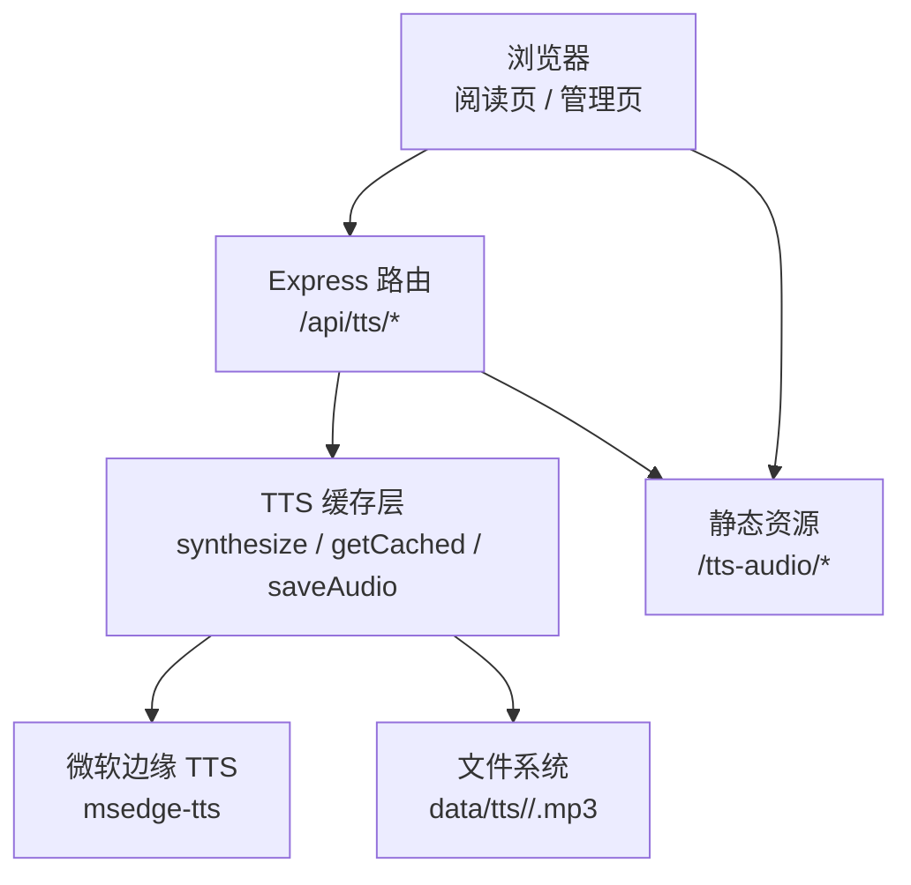
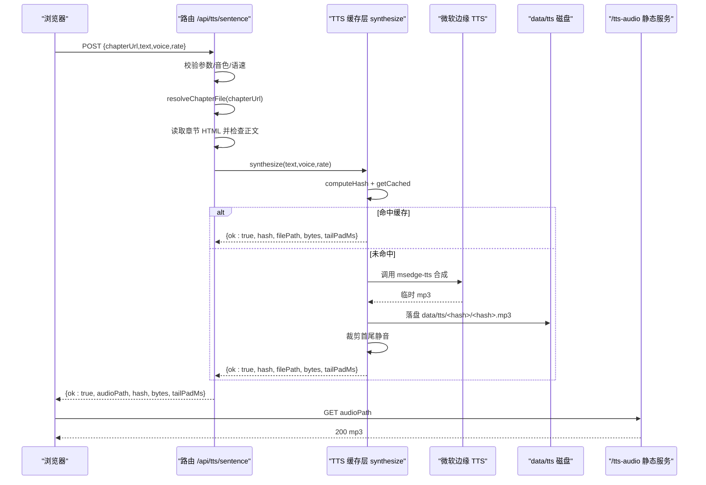
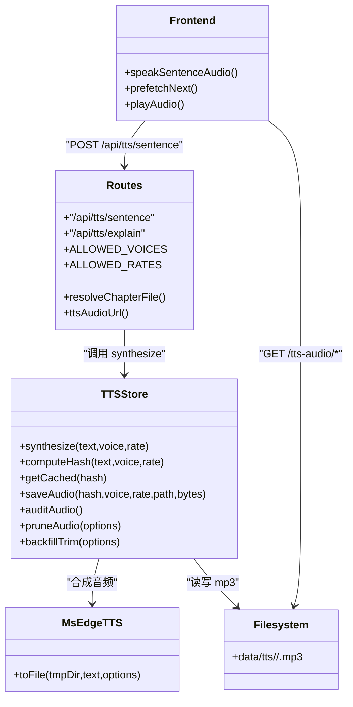
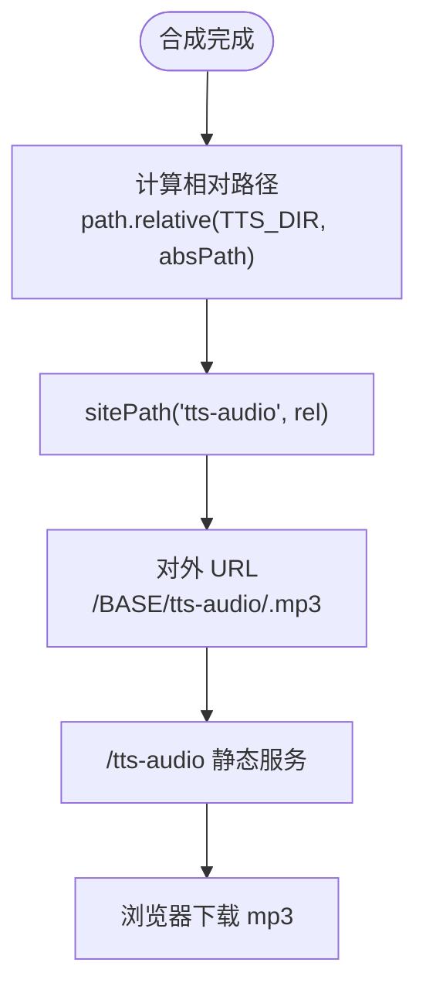

# TTS 语音合成接口

<cite>
**本文引用的文件**   
- [server.js](file://server.js)
- [src/routes.js](file://src/routes.js)
- [src/reader/ttsStore.js](file://src/reader/ttsStore.js)
- [public/tts/reader.core.js](file://public/tts/reader.core.js)
- [src/base.js](file://src/base.js)
</cite>

## 目录
1. [简介](#简介)
2. [项目结构](#项目结构)
3. [核心组件](#核心组件)
4. [架构总览](#架构总览)
5. [接口详解](#接口详解)
6. [依赖关系分析](#依赖关系分析)
7. [性能与并发特性](#性能与并发特性)
8. [音频存储与 URL 生成规则](#音频存储与-url-生成规则)
9. [限流策略](#限流策略)
10. [错误处理与降级机制](#错误处理与降级机制)
11. [请求示例与响应格式](#请求示例与响应格式)
12. [音频播放优化建议](#音频播放优化建议)
13. [故障排除指南](#故障排除指南)
14. [结论](#结论)

## 简介
本文件为 TTS 文本转语音服务的 API 文档，聚焦以下两个服务端接口：
- `/api/tts/sentence`：句子级语音合成接口。用于章节正文朗读，会校验章节 URL、读取章节内容并合成 mp3。
- `/api/tts/explain`：讲解音频合成接口。用于教学内容的语音文件（如生词讲解、AI 问答结果），不做章节存在性校验，但限制文本长度。

服务使用微软边缘 TTS 引擎，支持中文、英文、日文音色，并提供多档语速选项；合成产物持久化到 `data/tts`，通过 `/tts-audio` 静态路径对外暴露。

## 项目结构
TTS 相关代码分布在服务端路由、TTS 缓存层和前端播放器中：
- 路由层：定义 `/api/tts/sentence` 与 `/api/tts/explain`，负责参数校验、章节 URL 解析、调用 TTS 合成、返回音频 URL。
- 缓存层：按 `(text, voice, rate)` 计算哈希，命中则直接返回已有 mp3；未命中则调用微软边缘接口合成，裁剪首尾静音后落盘。
- 前端：阅读模式页面在“语音版”模式下调用 `/api/tts/sentence`，并对下一句做预取以降低跨句延迟。



**图表来源**
- [src/routes.js:430-513](file://src/routes.js#L430-L513)
- [src/reader/ttsStore.js:296-326](file://src/reader/ttsStore.js#L296-L326)
- [server.js:49-50](file://server.js#L49-L50)

**章节来源**
- [server.js:25-53](file://server.js#L25-L53)
- [src/routes.js:430-513](file://src/routes.js#L430-L513)
- [src/reader/ttsStore.js:1-23](file://src/reader/ttsStore.js#L1-L23)

## 核心组件
- **路由处理器**：实现参数校验、音色白名单、语速白名单、章节 URL 解析、长度限制、错误封装、对外音频 URL 构造。
- **TTS 缓存层**：提供 `computeHash`、`getCached`、`saveAudio`、`synthesize`、`auditAudio`、`pruneAudio`、`backfillTrim` 等能力。
- **前端播放器**：在“语音版”模式下调用 `/api/tts/sentence`，并实现下一句预取、Media Session、息屏保活、定时关闭等体验优化。

**章节来源**
- [src/routes.js:430-513](file://src/routes.js#L430-L513)
- [src/reader/ttsStore.js:75-147](file://src/reader/ttsStore.js#L75-L147)
- [public/tts/reader.core.js:704-797](file://public/tts/reader.core.js#L704-L797)

## 架构总览
下图展示一次句子级 TTS 请求的完整流程：



**图表来源**
- [src/routes.js:457-488](file://src/routes.js#L457-L488)
- [src/reader/ttsStore.js:296-326](file://src/reader/ttsStore.js#L296-L326)
- [src/reader/ttsStore.js:251-287](file://src/reader/ttsStore.js#L251-L287)
- [server.js:49-50](file://server.js#L49-L50)

## 接口详解

### `/api/tts/sentence` 句子级语音合成
- **用途**：为章节正文逐句合成 mp3，供阅读模式“语音版”播放。
- **鉴权**：该路由注册在通用 `/api` 净化中间件之后，但在登录态保护之前；不过实际部署中读者端通常由公开阅读器触发，且该接口本身不依赖用户会话。
- **限流**：使用独立限流器 `ttsRateLimit`，默认每 IP 每分钟最多 600 次。
- **输入字段**：
  - `chapterUrl`：当前章节 URL（例如 `<BASE>/novel/<uid>/<书名>/chapter_x.html`）。
  - `text`：要合成的句子文本。
  - `voice`：音色 ID，必须来自白名单。
  - `rate`：语速，必须来自白名单。
- **处理逻辑**：
  1. 校验必填字段。
  2. 校验 `voice` 是否在允许列表。
  3. 校验 `rate` 是否在允许列表。
  4. 解析 `chapterUrl`，解码百分号编码段，防止路径穿越，并确认目标章节文件存在。
  5. 读取章节 HTML，检查是否存在 `.content` 正文容器。
  6. 调用 `synthesize(text, voice, rate)` 获取音频。
  7. 返回 `audioPath`、`hash`、`bytes`、`tailPadMs`。
- **成功响应**：
  - `ok`: true
  - `hash`: 音频缓存键
  - `audioPath`: 可访问的 mp3 URL
  - `bytes`: 音频字节数
  - `tailPadMs`: 尾部留白毫秒数（可能为 null）
- **失败响应**：
  - 缺少参数：400
  - 不支持的音色：400
  - 不支持的语速：400
  - 章节 URL 无效或不存在：400 或 404
  - 章节无正文内容：400
  - 合成失败：503，包含 `error` 与 `fallback: 'browser'`

**章节来源**
- [src/routes.js:430-443](file://src/routes.js#L430-L443)
- [src/routes.js:457-488](file://src/routes.js#L457-L488)
- [src/routes.js:308-329](file://src/routes.js#L308-L329)

### `/api/tts/explain` 讲解音频合成
- **用途**：为教学类文本（如词汇讲解、AI 问答结果）生成 mp3。
- **鉴权**：同 `/api/tts/sentence`，注册在通用 `/api` 净化中间件之后。
- **限流**：复用 `ttsRateLimit`，默认每 IP 每分钟最多 600 次。
- **输入字段**：
  - `text`：讲解文本，最大 2000 字。
  - `voice`：音色 ID，必须来自白名单。
  - `rate`：语速，必须来自白名单。
- **处理逻辑**：
  1. 校验必填字段。
  2. 校验 `voice` 是否在允许列表。
  3. 校验 `rate` 是否在允许列表。
  4. 校验 `text.length <= 2000`。
  5. 调用 `synthesize(text, voice, rate)` 获取音频。
  6. 返回 `audioPath`、`hash`、`bytes`、`tailPadMs`。
- **成功响应**：
  - `ok`: true
  - `hash`: 音频缓存键
  - `audioPath`: 可访问的 mp3 URL
  - `bytes`: 音频字节数
  - `tailPadMs`: 尾部留白毫秒数（可能为 null）
- **失败响应**：
  - 缺少参数：400
  - 不支持的音色：400
  - 不支持的语速：400
  - 文本过长：400
  - 合成失败：503，包含 `error` 与 `fallback: 'browser'`

**章节来源**
- [src/routes.js:490-513](file://src/routes.js#L490-L513)

## 依赖关系分析
- 路由层依赖：
  - `resolveChapterFile`：章节 URL → 磁盘路径，含百分号解码与安全校验。
  - `ALLOWED_VOICES`、`ALLOWED_RATES`：音色与语速白名单。
  - `ttsSynthesize`、`ttsComputeHash`、`ttsAudit`、`ttsPrune`：从 `ttsStore` 导入。
  - `sitePath`：构造带 BASE_PATH 的对外 URL。
- 缓存层依赖：
  - `better-sqlite3`：全局 DB 表 `reader_tts_audio`。
  - `msedge-tts`：微软边缘 TTS Node 端口。
  - `mp3Cut`、`probeSilence`：MP3 解析与静音探测。
  - `fs-extra`：文件操作。
- 前端依赖：
  - `fetch('/api/tts/sentence')`：语音版逐句合成。
  - `fetch(data.audioPath)`：预取下一句 mp3 为 blob。
  - Media Session：锁屏控件。
  - Wake Lock / 静音保活：息屏朗读。



**图表来源**
- [src/routes.js:430-513](file://src/routes.js#L430-L513)
- [src/reader/ttsStore.js:296-326](file://src/reader/ttsStore.js#L296-L326)
- [public/tts/reader.core.js:704-797](file://public/tts/reader.core.js#L704-L797)

**章节来源**
- [src/routes.js:1-28](file://src/routes.js#L1-L28)
- [src/reader/ttsStore.js:24-31](file://src/reader/ttsStore.js#L24-L31)
- [public/tts/reader.core.js:704-797](file://public/tts/reader.core.js#L704-L797)

## 性能与并发特性
- **进程内并发闸**：`MAX_CONCURRENT` 默认 2，可通过环境变量 `TTS_CONCURRENCY` 调整。
- **同句去重**：同一 `hash` 的并发请求合并为一个合成任务，避免重复调用上游。
- **失败重试**：首次失败后随机退避 500~1000ms 重试一次，再失败才返回 `{ok:false,error}`。
- **缓存优先**：先查 DB，再回退到纯文件检测；DB 不可用时仍可命中已有 mp3。
- **临时目录回收**：合成失败时保留临时目录，由后台扫描清理，避免子进程事件回调崩溃。

**章节来源**
- [src/reader/ttsStore.js:211-226](file://src/reader/ttsStore.js#L211-L226)
- [src/reader/ttsStore.js:228-249](file://src/reader/ttsStore.js#L228-L249)
- [src/reader/ttsStore.js:296-326](file://src/reader/ttsStore.js#L296-L326)

## 音频存储与 URL 生成规则
- **存储路径**：`data/tts/<hash[:2]>/<hash>.mp3`。
- **DB 索引**：`reader_tts_audio` 表记录 `hash`、`voice`、`rate`、`file_path`、`bytes`、`created_at`、`last_accessed`、`tail_pad_ms`。
- **URL 生成**：
  - 内部绝对路径转为相对 `data/tts` 的路径。
  - 通过 `sitePath('tts-audio', relativePath)` 拼接 BASE_PATH，得到对外 URL。
  - 线上若挂载 `/novel`，最终 URL 形如 `/novel/tts-audio/xx/hash.mp3`。
- **静态服务**：`/tts-audio` 指向 `data/tts`，启用强缓存 `immutable: true, maxAge: '1y'`。



**图表来源**
- [src/routes.js:448-449](file://src/routes.js#L448-L449)
- [src/base.js:36-39](file://src/base.js#L36-L39)
- [server.js:49-50](file://server.js#L49-L50)

**章节来源**
- [src/reader/ttsStore.js:80-83](file://src/reader/ttsStore.js#L80-L83)
- [src/reader/ttsStore.js:127-147](file://src/reader/ttsStore.js#L127-L147)
- [src/routes.js:448-449](file://src/routes.js#L448-L449)
- [server.js:49-50](file://server.js#L49-L50)
- [src/base.js:36-39](file://src/base.js#L36-L39)

## 限流策略
- **IP 识别**：
  - 直连时直接使用 socket 远端地址。
  - 经本机反代时信任 `X-Real-IP` 与 `X-Forwarded-For`，并剥离端口。
- **窗口限流**：固定 60 秒窗口，超出即返回 429，并附带 `Retry-After`。
- **TTS 专用额度**：`ttsRateLimit` 默认 600 次/分钟，适合全章批量逐句合成。
- **内存清理**：Map 超过 5000 项时清理过期窗口，防止公网被撑爆。

**章节来源**
- [src/routes.js:263-306](file://src/routes.js#L263-L306)
- [src/routes.js:352-358](file://src/routes.js#L352-L358)

## 错误处理与降级机制
- **参数错误**：400，返回 `error` 字段说明缺失或非法值。
- **章节定位错误**：400 或 404，携带 `detail` 便于日志排查。
- **合成失败**：503，返回 `error` 与 `fallback: 'browser'`，前端自动切换浏览器 TTS。
- **前端降级**：
  - 语音版请求失败时显示原因并切换到网页版。
  - 媒体播放错误时提示“音频播放中断”。
  - Web Speech API 不可用时提示浏览器不支持。

**章节来源**
- [src/routes.js:450-454](file://src/routes.js#L450-L454)
- [public/tts/reader.core.js:777-797](file://public/tts/reader.core.js#L777-L797)
- [public/tts/reader.core.js:43-53](file://public/tts/reader.core.js#L43-L53)

## 请求示例与响应格式

### `/api/tts/sentence`
- **请求方法**：POST
- **Content-Type**：application/json
- **请求体字段**：
  - `chapterUrl`：字符串，章节 URL
  - `text`：字符串，句子文本
  - `voice`：字符串，音色 ID
  - `rate`：字符串，语速
- **成功响应**：
  - `ok`: boolean
  - `hash`: string
  - `audioPath`: string
  - `bytes`: number
  - `tailPadMs`: number|null
- **失败响应**：
  - `error`: string
  - `status`: 400/404/503

示例请求体结构：
```json
{
  "chapterUrl": "/novel/<uid>/<书名>/chapter_1.html",
  "text": "这是一句需要朗读的正文。",
  "voice": "zh-CN-YunxiNeural",
  "rate": "+0%"
}
```

示例成功响应结构：
```json
{
  "ok": true,
  "hash": "abc123...",
  "audioPath": "/novel/tts-audio/ab/abc123.mp3",
  "bytes": 12345,
  "tailPadMs": 120
}
```

**章节来源**
- [src/routes.js:457-488](file://src/routes.js#L457-L488)

### `/api/tts/explain`
- **请求方法**：POST
- **Content-Type**：application/json
- **请求体字段**：
  - `text`：字符串，讲解文本，最大 2000 字
  - `voice`：字符串，音色 ID
  - `rate`：字符串，语速
- **成功响应**：
  - `ok`: boolean
  - `hash`: string
  - `audioPath`: string
  - `bytes`: number
  - `tailPadMs`: number|null
- **失败响应**：
  - `error`: string
  - `status`: 400/503

示例请求体结构：
```json
{
  "text": "这个单词的意思是学习，常用于教育场景。",
  "voice": "en-US-JennyNeural",
  "rate": "+30%"
}
```

示例成功响应结构：
```json
{
  "ok": true,
  "hash": "def456...",
  "audioPath": "/novel/tts-audio/de/def456.mp3",
  "bytes": 23456,
  "tailPadMs": 120
}
```

**章节来源**
- [src/routes.js:490-513](file://src/routes.js#L490-L513)

## 音频播放优化建议
- **预取下一句**：当前句播放时立即预取下一句 mp3 为本地 blob，跨句时直接换源，降低网络等待。
- **尾部留白控制**：使用 `tailPadMs` 决定提前跨句时机，避免吃掉最后一个字。
- **句间停顿**：前端可选“紧贴/自然/舒缓”，在服务端裁剪基础上叠加额外停顿。
- **Media Session**：支持锁屏控件与蓝牙耳机控制。
- **息屏保活**：使用静音 WAV 循环保持音频会话，配合 Wake Lock 实现息屏朗读。
- **定时关闭**：支持 15/30/60 分钟或本章结束自动停止。

**章节来源**
- [public/tts/reader.core.js:613-797](file://public/tts/reader.core.js#L613-L797)
- [public/tts/reader.core.js:346-383](file://public/tts/reader.core.js#L346-L383)
- [public/tts/reader.core.js:385-468](file://public/tts/reader.core.js#L385-L468)

## 故障排除指南
- **400 缺少参数**：检查是否传入 `chapterUrl`、`text`、`voice`、`rate`。
- **400 不支持的音色**：确认 `voice` 在白名单中。
- **400 不支持的语速**：确认 `rate` 在白名单中。
- **400 章节 URL 无效**：检查 URL 格式是否为 `<BASE>/novel/<uid>/<书名>/chapter_x.html`。
- **404 章节文件不存在**：确认章节已发布且路径正确。
- **400 章节无正文内容**：确认章节 HTML 中存在 `.content` 容器。
- **503 合成失败**：查看 `error` 字段，可能是上游限流或断流；前端会自动降级到浏览器 TTS。
- **429 请求过于频繁**：等待 `Retry-After` 指定秒数后重试。
- **音频播放中断**：检查浏览器权限、网络状态、Media Session 支持。

**章节来源**
- [src/routes.js:457-513](file://src/routes.js#L457-L513)
- [src/routes.js:289-306](file://src/routes.js#L289-L306)
- [public/tts/reader.core.js:777-797](file://public/tts/reader.core.js#L777-L797)

## 结论
TTS 语音合成服务通过 `/api/tts/sentence` 与 `/api/tts/explain` 两个接口，分别满足章节正文朗读与教学内容讲解的语音需求。系统采用微软边缘 TTS 引擎，结合哈希缓存、并发控制、失败重试、首尾静音裁剪等机制，在保证音质的同时提升性能与稳定性。前端播放器进一步通过预取、Media Session、息屏保活等手段优化用户体验。运维侧可通过审计与清理接口维护音频缓存健康。