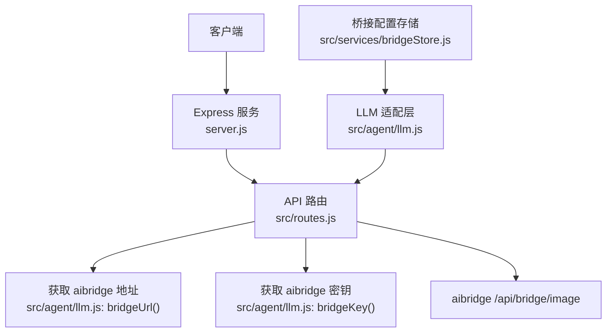
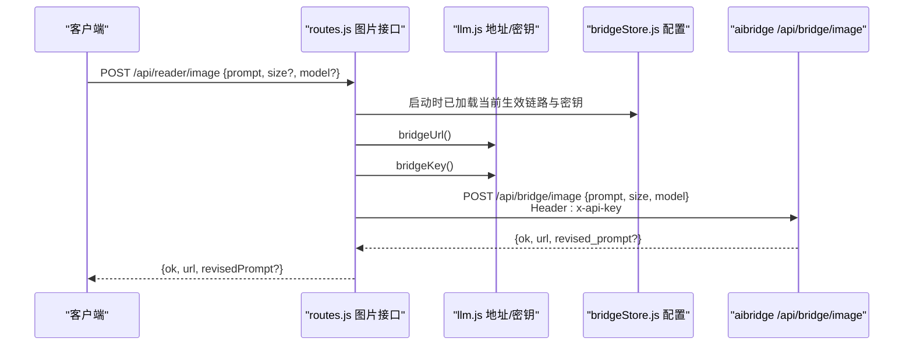
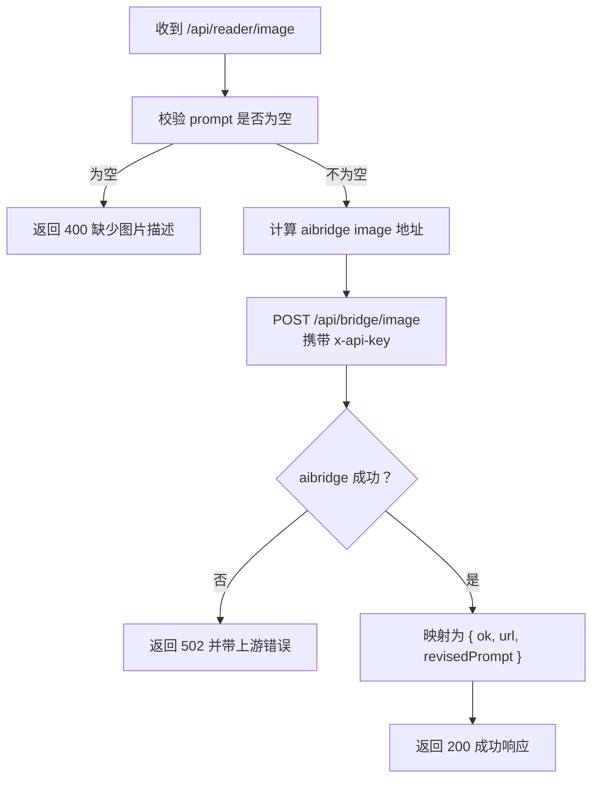
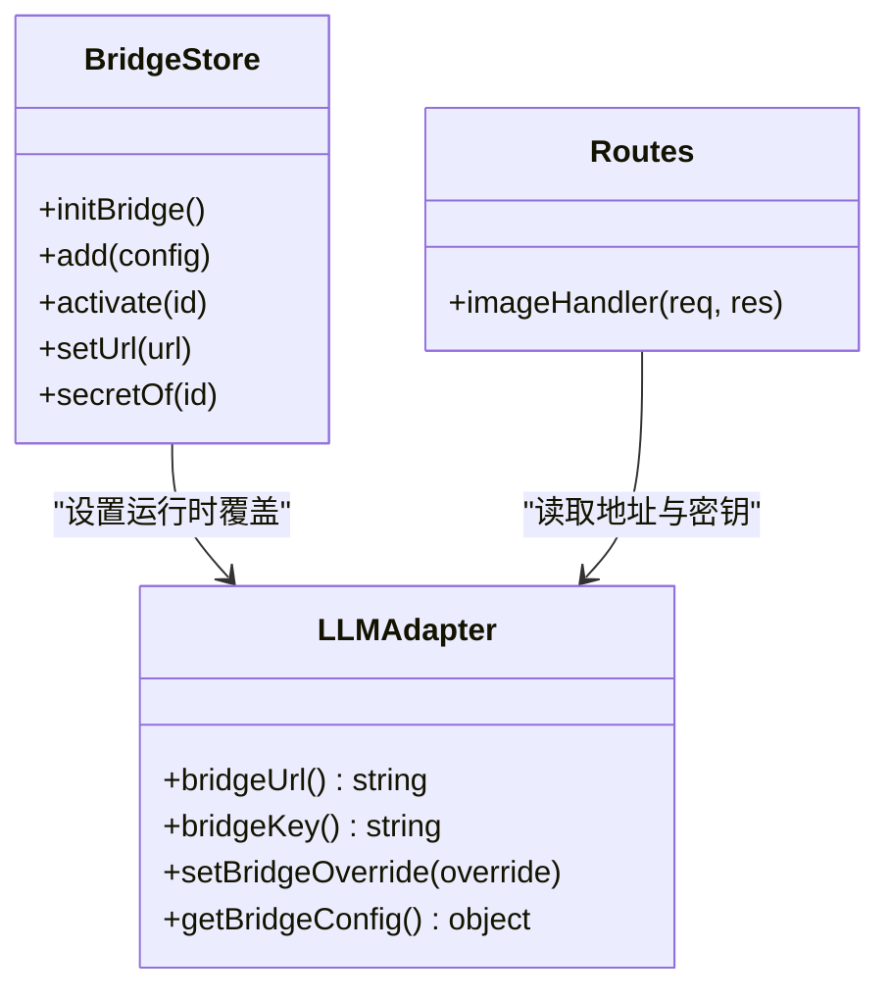
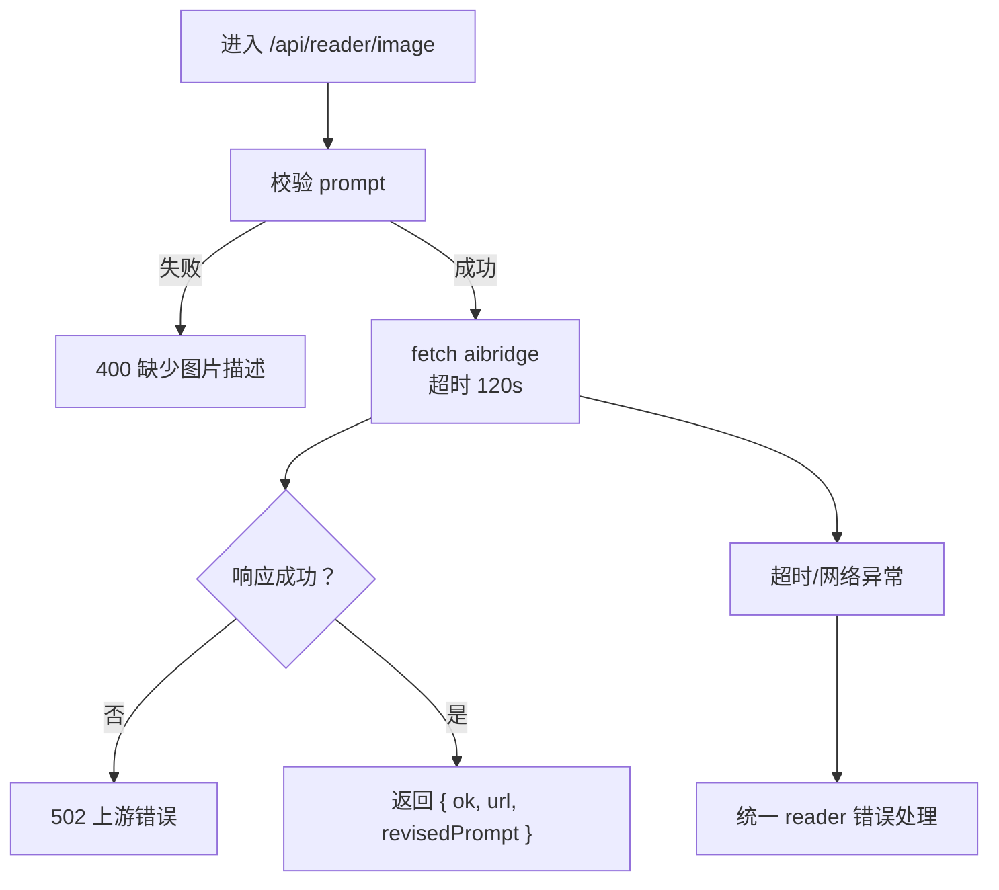

# 图片生成接口

<cite>
**本文引用的文件**   
- [server.js](file://server.js)
- [src/routes.js](file://src/routes.js)
- [src/agent/llm.js](file://src/agent/llm.js)
- [src/services/bridgeStore.js](file://src/services/bridgeStore.js)
</cite>

## 目录
1. [简介](#简介)
2. [项目结构定位](#项目结构定位)
3. [核心组件](#核心组件)
4. [架构总览](#架构总览)
5. [接口定义](#接口定义)
6. [与 aibridge 的集成机制](#与-aibridge-的集成机制)
7. [密钥管理](#密钥管理)
8. [错误处理与超时策略](#错误处理与超时策略)
9. [返回格式与后续使用](#返回格式与后续使用)
10. [调用示例](#调用示例)
11. [最佳实践](#最佳实践)
12. [常见问题诊断](#常见问题诊断)
13. [性能优化建议](#性能优化建议)
14. [结论](#结论)

## 简介
本文档说明本项目中“文生图”功能的对外接口 `/api/reader/image`，包括：
- 提示词输入、图片尺寸配置、模型选择等参数
- 与 aibridge 服务的集成方式
- 密钥管理与地址覆盖机制
- 错误处理、限流与超时策略
- 图片 URL 返回格式及前端后续使用方式
- 调用示例、最佳实践、常见问题与性能优化建议

该接口面向读者侧能力，由服务端统一转发到 aibridge 的图片生成端点，并负责鉴权、限流、脱敏和错误包装。

## 项目结构定位
- 服务入口在 `server.js`，负责初始化 Express、CORS、静态资源、多用户数据库桥接以及注册路由。
- 所有 API 路由集中在 `src/routes.js`，其中 `/api/reader/image` 属于“阅读器公开能力”分支，使用统一的读者限流器。
- aibridge 的地址与密钥通过 `src/agent/llm.js` 暴露 `bridgeUrl()` 与 `bridgeKey()`，并由 `src/services/bridgeStore.js` 提供控制台可切换的运行时覆盖。

**图表来源**
- [server.js:13-16](file://server.js#L13-L16)
- [src/routes.js:412-428](file://src/routes.js#L412-L428)
- [src/agent/llm.js:37-42](file://src/agent/llm.js#L37-L42)
- [src/services/bridgeStore.js:85-99](file://src/services/bridgeStore.js#L85-L99)

**章节来源**
- [server.js:1-64](file://server.js#L1-L64)
- [src/routes.js:331-428](file://src/routes.js#L331-L428)

## 核心组件
- **图片生成路由**：位于 `src/routes.js`，接收提示词、可选尺寸与模型，转发到 aibridge，并返回图片 URL。
- **aibridge 地址与密钥**：由 `src/agent/llm.js` 提供，支持运行时覆盖、环境变量与 `.env` 回退。
- **桥接配置存储**：由 `src/services/bridgeStore.js` 维护，允许控制台添加、启用、删除密钥，并设置地址覆盖。
- **限流器**：读者侧接口共用一个基于真实 IP 的固定窗口限流器，防止批量请求打满上游。

**章节来源**
- [src/routes.js:402-428](file://src/routes.js#L402-L428)
- [src/agent/llm.js:37-42](file://src/agent/llm.js#L37-L42)
- [src/services/bridgeStore.js:25-66](file://src/services/bridgeStore.js#L25-L66)

## 架构总览
图片生成的端到端流程如下：

**图表来源**
- [src/routes.js:402-428](file://src/routes.js#L402-L428)
- [src/agent/llm.js:37-42](file://src/agent/llm.js#L37-L42)
- [src/services/bridgeStore.js:85-99](file://src/services/bridgeStore.js#L85-L99)

## 接口定义
### 基本信息
- **路径**：`POST /api/reader/image`
- **鉴权**：该接口位于“阅读器 AI（公开）”区域，不要求登录态；但受读者限流保护。
- **Content-Type**：`application/json`
- **响应类型**：`application/json`

### 请求体字段
| 字段 | 类型 | 必填 | 说明 |
|---|---|---:|---|
| `prompt` | 字符串 | 是 | 图片描述提示词；会被去除首尾空白后校验是否为空 |
| `size` | 字符串或对象 | 否 | 图片尺寸配置，透传给 aibridge；具体取值由上游决定 |
| `model` | 字符串 | 否 | 模型标识，透传给 aibridge；具体取值由上游决定 |

### 成功响应
| 字段 | 类型 | 说明 |
|---|---|---|
| `ok` | 布尔值 | 表示本次图片生成是否成功 |
| `url` | 字符串 | 图片访问 URL，供前端直接展示或下载 |
| `revisedPrompt` | 字符串或空 | 上游可能返回优化后的提示词；为空表示未提供 |

### 失败响应
| 场景 | HTTP 状态码 | 响应特征 |
|---|---:|---|
| 缺少提示词 | `400` | 返回 `error` 字段，提示缺少图片描述 |
| aibridge 返回非成功 | `502` | 返回 `error`，包含上游错误或 aibridge HTTP 状态 |
| 网络异常、超时、解析失败 | 由统一 reader 错误处理返回 | 通常包含 `error` 字段，避免泄露内部路径与密钥 |

**章节来源**
- [src/routes.js:412-428](file://src/routes.js#L412-L428)

## 与 aibridge 的集成机制
### 目标端点
本服务不会直接实现图片生成算法，而是作为代理转发到 aibridge 的 `/api/bridge/image`。

### 地址推导逻辑
- 优先使用 `bridgeUrl()` 返回的 aibridge 地址。
- 若地址解析失败，则尝试把 chat 地址替换为 image 地址。
- 最终兜底为本地默认地址。

### 请求体映射
- 将客户端传入的 `prompt`、`size`、`model` 原样封装为 JSON 发送给 aibridge。
- 头部携带 `x-api-key`，密钥来自 `bridgeKey()`。

### 响应映射
- 若 aibridge 返回 `ok === false` 或非 HTTP 成功，则包装为 `502` 并返回 `error`。
- 成功时返回 `{ ok: true, url, revisedPrompt }`，其中 `revisedPrompt` 对应上游的 `revised_prompt`。

**图表来源**
- [src/routes.js:402-428](file://src/routes.js#L402-L428)

**章节来源**
- [src/routes.js:402-428](file://src/routes.js#L402-L428)

## 密钥管理
### 密钥来源优先级
密钥读取顺序为：
1. 控制台运行时覆盖（由 `bridgeStore` 激活）
2. 环境变量 `AIBRIDGE_API_KEY`
3. `.env` 中的 `AIBRIDGE_API_KEY`
4. 空字符串（无密钥）

### 运行时覆盖
- `bridgeStore.initBridge()` 在服务启动时被调用，会把 `data/system/bridge.json` 中选中的条目推给 LLM 适配层。
- 如果未选中任何条目，则回落到环境变量或 `.env`。
- 密钥明文只在进程内和本地文件间流动，对外一律只暴露前缀。

### 安全要点
- 图片接口在发送请求时使用 `x-api-key` 头，密钥不进入日志或普通响应。
- 全局响应净化会过滤常见敏感键名，但图片接口本身不返回密钥。
- 桥接配置文件权限设置为仅所有者可读。

**图表来源**
- [src/services/bridgeStore.js:85-99](file://src/services/bridgeStore.js#L85-L99)
- [src/agent/llm.js:37-56](file://src/agent/llm.js#L37-L56)
- [src/routes.js:412-428](file://src/routes.js#L412-L428)

**章节来源**
- [src/agent/llm.js:16-42](file://src/agent/llm.js#L16-L42)
- [src/services/bridgeStore.js:1-66](file://src/services/bridgeStore.js#L1-L66)
- [src/services/bridgeStore.js:85-99](file://src/services/bridgeStore.js#L85-L99)

## 错误处理与超时策略
### 输入校验
- 若 `prompt` 为空，直接返回 `400`，错误信息提示缺少图片描述。

### 上游错误
- 若 aibridge 返回非成功状态或业务 `ok === false`，返回 `502`，错误消息包含上游错误或 HTTP 状态。

### 网络与超时
- 对 aibridge 的请求设置了 `AbortSignal.timeout(120000)`，即 120 秒超时。
- 若 fetch 抛出超时或中止异常，会进入统一 reader 错误处理，返回结构化错误。

### 限流
- 图片接口使用读者侧限流器，默认窗口为 60 秒，超出返回 `429`，并附带 `Retry-After`。
- 限流键基于真实客户端 IP，考虑了反向代理场景下的 `X-Real-IP` 与 `X-Forwarded-For`。

**图表来源**
- [src/routes.js:289-306](file://src/routes.js#L289-L306)
- [src/routes.js:412-428](file://src/routes.js#L412-L428)

**章节来源**
- [src/routes.js:289-306](file://src/routes.js#L289-L306)
- [src/routes.js:412-428](file://src/routes.js#L412-L428)

## 返回格式与后续使用
### 成功返回
- `ok`：布尔值，表示图片生成是否成功。
- `url`：图片访问地址，可直接用于 ``、预览、下载或保存到本地。
- `revisedPrompt`：可选，上游可能返回优化后的提示词，可用于界面提示或记录。

### 失败返回
- 失败响应通常包含 `error` 字段，便于前端展示给用户或上报日志。
- 对于 `502`，错误消息可能包含上游 aibridge 的状态或错误文本。

### 前端使用建议
- 拿到 `url` 后优先用 HTTPS 或同源地址访问，避免跨域问题。
- 若需要缓存图片，可在浏览器层做缓存，或在服务端落盘后提供稳定 URL。
- 若上游返回 `revisedPrompt`，可在 UI 中显示“优化后的提示词”，帮助用户理解生成结果。

**章节来源**
- [src/routes.js:412-428](file://src/routes.js#L412-L428)

## 调用示例
以下示例以通用 HTTP 客户端为例，实际使用时请替换为你的服务地址与参数。

### 基本调用
- **方法**：`POST`
- **路径**：`/api/reader/image`
- **请求体**：
  - `prompt`：必填，例如描述一张“夕阳下的海边小镇插画”。
- **预期成功响应**：
  - `ok: true`
  - `url`：图片地址
  - `revisedPrompt`：可能为空

### 指定尺寸与模型
- **请求体**：
  - `prompt`：必填
  - `size`：根据上游支持的尺寸格式填写
  - `model`：根据上游支持的模型名称填写

### 错误示例
- 未传 `prompt`：返回 `400`，提示缺少图片描述。
- aibridge 不可用或返回错误：返回 `502`，包含上游错误信息。
- 请求过于频繁：返回 `429`，并附带重试等待时间。

**章节来源**
- [src/routes.js:412-428](file://src/routes.js#L412-L428)

## 最佳实践
- **始终提供有意义的提示词**：提示词越清晰，生成结果越可控。
- **合理设置尺寸与模型**：尺寸过大或模型过复杂会增加耗时与成本；建议先小尺寸测试，再放大。
- **控制并发**：避免短时间内大量并发请求，以免触发限流或上游拒绝。
- **缓存图片 URL**：对相同提示词或相似结果做去重或缓存，减少重复生成。
- **监控上游健康**：结合 aibridge 的健康检查接口，提前发现连接问题。
- **记录错误但不记录密钥**：日志中不要打印 `x-api-key` 或完整密钥。

[本节为通用实践建议，不直接分析具体代码文件]

## 常见问题诊断
### 1. 返回 400 缺少图片描述
- 原因：请求体中没有 `prompt`，或 `prompt` 为空字符串。
- 处理：确保前端提交时校验提示词长度，并在后端再次校验。

**章节来源**
- [src/routes.js:414-415](file://src/routes.js#L414-L415)

### 2. 返回 502 上游错误
- 原因：aibridge 不可达、密钥无效、上游模型报错或返回非成功状态。
- 处理：
  - 检查 aibridge 服务是否启动。
  - 检查 `bridgeUrl()` 与 `bridgeKey()` 是否正确。
  - 查看 aibridge 日志确认上游模型状态。

**章节来源**
- [src/routes.js:416-425](file://src/routes.js#L416-L425)

### 3. 返回 429 请求过于频繁
- 原因：同一客户端 IP 在 60 秒内请求过多。
- 处理：
  - 前端增加重试退避。
  - 合并重复请求。
  - 调整限流阈值需结合业务量评估。

**章节来源**
- [src/routes.js:289-306](file://src/routes.js#L289-L306)

### 4. 图片 URL 无法访问
- 原因：URL 跨域、协议不一致、CDN 未生效或上游图片服务不可用。
- 处理：
  - 检查 URL 是否可直连访问。
  - 检查浏览器控制台是否有跨域或混合内容错误。
  - 确认 aibridge 图片服务正常。

**章节来源**
- [src/routes.js:426-427](file://src/routes.js#L426-L427)

### 5. 密钥不生效
- 原因：控制台未激活密钥、环境变量未设置、`.env` 未生效。
- 处理：
  - 在控制台添加并激活密钥。
  - 检查 `bridgeStore` 是否在服务启动时执行。
  - 检查 `llm.js` 的密钥读取优先级。

**章节来源**
- [src/agent/llm.js:37-42](file://src/agent/llm.js#L37-L42)
- [src/services/bridgeStore.js:85-99](file://src/services/bridgeStore.js#L85-L99)

## 性能优化建议
- **限制单次请求频率**：利用前端节流与队列，避免瞬间爆发。
- **复用图片 URL**：对相同或高度相似的提示词进行去重。
- **合理选择模型**：简单插图任务不需要最重模型。
- **合理选择尺寸**：先用较小尺寸验证效果，再按需放大。
- **启用浏览器缓存**：对静态图片 URL 设置合适的缓存策略。
- **监控上游延迟**：若 aibridge 经常慢，应评估其负载与模型配置。

[本节为通用性能建议，不直接分析具体代码文件]

## 结论
`/api/reader/image` 是一个简洁可靠的图片生成代理接口：它负责输入校验、限流、密钥注入、上游转发与错误包装。真正的图片生成能力由 aibridge 提供，密钥与地址可通过控制台动态切换，兼顾灵活性与安全性。前端只需关注提示词、尺寸、模型与返回的 `url`，即可完成图片展示、预览与下载等常见场景。

[本节为总结性内容，不直接分析具体代码文件]