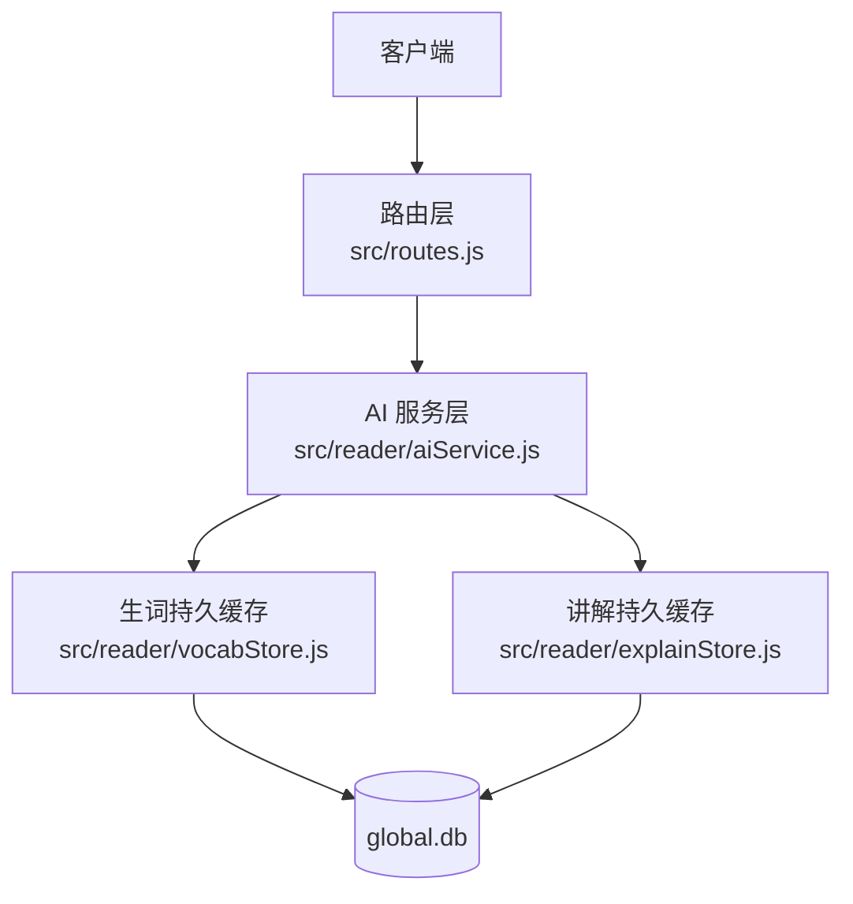
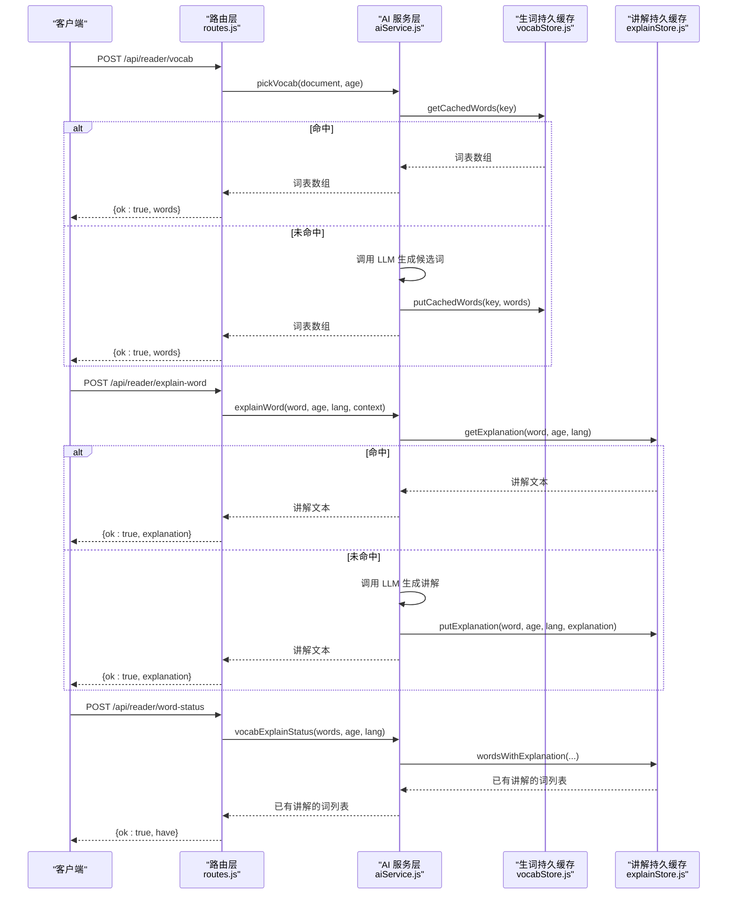
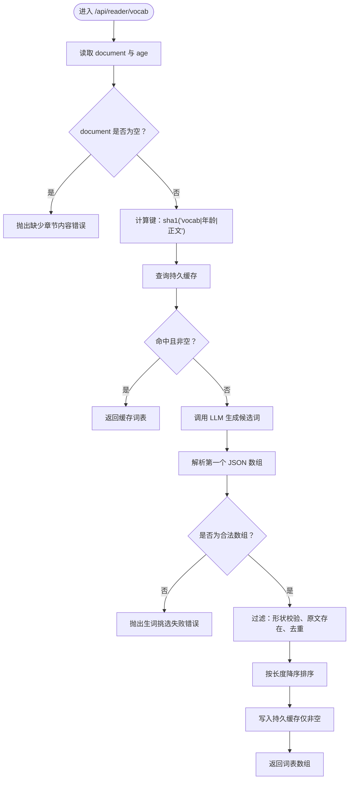
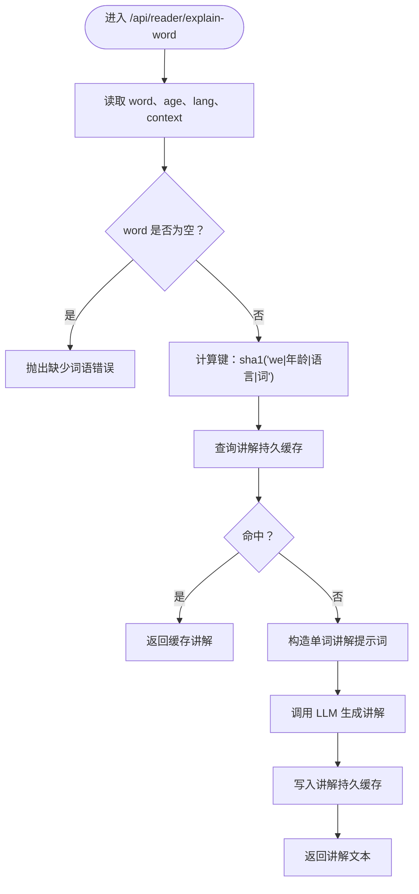
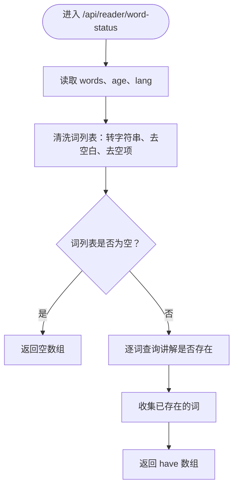
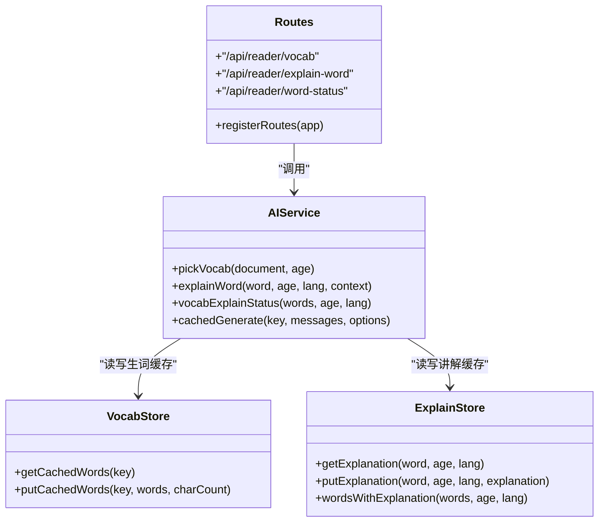
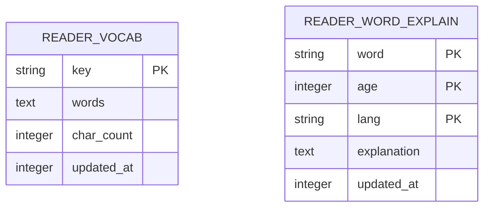

# 词汇学习接口

<cite>
**本文引用的文件**   
- [src/routes.js](file://src/routes.js)
- [src/reader/aiService.js](file://src/reader/aiService.js)
- [src/reader/vocabStore.js](file://src/reader/vocabStore.js)
- [src/reader/explainStore.js](file://src/reader/explainStore.js)
</cite>

## 目录
1. [简介](#简介)
2. [项目结构](#项目结构)
3. [核心组件](#核心组件)
4. [架构总览](#架构总览)
5. [详细接口说明](#详细接口说明)
6. [依赖关系分析](#依赖关系分析)
7. [性能与缓存策略](#性能与缓存策略)
8. [参数校验与错误响应](#参数校验与错误响应)
9. [最佳实践](#最佳实践)
10. [故障排查](#故障排查)
11. [结论](#结论)

## 简介
本文件面向“词汇学习系统”的读者侧 API，重点文档化以下三个接口：
- `/api/reader/vocab`：生词识别。输入章节内容、年龄，返回适合该年龄段积累的生词列表。
- `/api/reader/explain-word`：单词讲解。支持多语言解释，并可附带上下文原句帮助模型理解语境。
- `/api/reader/word-status`：词汇状态查询。批量检查一批词是否已生成讲解，用于正文着色（已有讲解的词黑体显示，未生成的灰体显示）。

这些接口面向读者端，属于公开能力；服务端通过限流、并发保护、进程内缓存和 SQLite 持久缓存降低 LLM 调用成本，保证高并发下仍可稳定响应。

## 项目结构
词汇学习相关代码主要分布在以下模块：
- 路由层：注册并接收 HTTP 请求，做基础参数提取、限流、统一错误处理。
- AI 服务层：封装 LLM 调用、并发控制、进程内缓存、业务提示词构造。
- 持久缓存层：分别维护“生词表”和“单词讲解”两个 SQLite 表，提供读写与淘汰策略。

**图表来源**
- [src/routes.js:352-390](file://src/routes.js#L352-L390)
- [src/reader/aiService.js:1-25](file://src/reader/aiService.js#L1-L25)
- [src/reader/vocabStore.js:1-15](file://src/reader/vocabStore.js#L1-L15)
- [src/reader/explainStore.js:1-15](file://src/reader/explainStore.js#L1-L15)

**章节来源**
- [src/routes.js:352-390](file://src/routes.js#L352-L390)
- [src/reader/aiService.js:1-25](file://src/reader/aiService.js#L1-L25)

## 核心组件
- 路由层负责：
  - 为读者侧接口挂载统一的速率限制器。
  - 从请求体中提取 `document`、`age`、`lang`、`context`、`words` 等字段。
  - 调用 AI 服务方法，并把结果包装成 `{ ok, ... }` 形式返回。
  - 捕获异常后交给统一错误处理器。
- AI 服务层负责：
  - 构造面向不同任务的提示词。
  - 对可复用结果做进程内缓存、在途请求去重、并发上限控制。
  - 对生词挑选和单词讲解分别对接持久缓存。
- 持久缓存层负责：
  - 使用 SQLite 表保存“按章节+年龄”的生词表和“按词+年龄+语言”的讲解。
  - 实现基于 `updated_at` 的冷数据淘汰，防止匿名接口被刷导致数据库无限增长。

**章节来源**
- [src/routes.js:352-390](file://src/routes.js#L352-L390)
- [src/reader/aiService.js:27-77](file://src/reader/aiService.js#L27-L77)
- [src/reader/vocabStore.js:18-46](file://src/reader/vocabStore.js#L18-L46)
- [src/reader/explainStore.js:19-47](file://src/reader/explainStore.js#L19-L47)

## 架构总览
下图展示一次“生词识别 + 单词讲解 + 状态查询”的典型调用链：

**图表来源**
- [src/routes.js:368-382](file://src/routes.js#L368-L382)
- [src/reader/aiService.js:167-185](file://src/reader/aiService.js#L167-L185)
- [src/reader/aiService.js:199-223](file://src/reader/aiService.js#L199-L223)
- [src/reader/vocabStore.js:53-68](file://src/reader/vocabStore.js#L53-L68)
- [src/reader/explainStore.js:53-65](file://src/reader/explainStore.js#L53-L65)

## 详细接口说明

### 接口一：`POST /api/reader/vocab` 生词识别
- 作用：根据章节内容和目标年龄，挑选值得积累的生词。
- 适用场景：阅读页加载时拉取本章生词，或发布前预先生成词表用于正文标注。
- 请求体字段：
  - `document`：章节正文内容，字符串。
  - `age`：目标年龄，数字；默认值为 9。
- 成功响应：
  - `ok`：布尔值，表示请求是否成功。
  - `words`：字符串数组，包含挑出的生词；数组为空表示本次未挑出有效词。
- 行为要点：
  - 先查持久缓存；若命中则直接返回，不触发 LLM。
  - 未命中时调用 LLM，并对结果做 JSON 解析、原文存在性过滤、去重、长词优先排序。
  - 非空结果写入持久缓存，空结果不入库，避免“模型抽风”把整章锁定为无生词。

**图表来源**
- [src/routes.js:368-372](file://src/routes.js#L368-L372)
- [src/reader/aiService.js:199-223](file://src/reader/aiService.js#L199-L223)
- [src/reader/vocabStore.js:53-89](file://src/reader/vocabStore.js#L53-L89)

**章节来源**
- [src/routes.js:368-372](file://src/routes.js#L368-L372)
- [src/reader/aiService.js:122-124](file://src/reader/aiService.js#L122-L124)
- [src/reader/aiService.js:199-223](file://src/reader/aiService.js#L199-L223)
- [src/reader/vocabStore.js:1-14](file://src/reader/vocabStore.js#L1-L14)
- [src/reader/vocabStore.js:53-89](file://src/reader/vocabStore.js#L53-L89)

### 接口二：`POST /api/reader/explain-word` 单词讲解
- 作用：为单个词生成简短讲解，支持中文、英语、日语、韩语等多语言解释。
- 适用场景：读者点击某个词查看讲解；首次生成后跨读者、跨章节复用。
- 请求体字段：
  - `word`：要讲解的词语，字符串。
  - `age`：目标年龄，数字；默认值为 9。
  - `lang`：解释语言，字符串；默认值为“英语”。
  - `context`：可选上下文原句，字符串；仅用于帮助模型理解语境，不参与缓存键。
- 成功响应：
  - `ok`：布尔值。
  - `explanation`：讲解文本。
- 行为要点：
  - 先查持久缓存，键为 `(word, age, lang)`，不含 `context`。
  - 未命中时调用 LLM，并将结果写入持久缓存。
  - 讲解口径会根据 `lang` 自适应：中文解释中文词时只给白话释义；外语解释中文词时以目标语言为主，必要时附一句中文对照。

**图表来源**
- [src/routes.js:373-377](file://src/routes.js#L373-L377)
- [src/reader/aiService.js:106-121](file://src/reader/aiService.js#L106-L121)
- [src/reader/aiService.js:167-179](file://src/reader/aiService.js#L167-L179)
- [src/reader/explainStore.js:53-82](file://src/reader/explainStore.js#L53-L82)

**章节来源**
- [src/routes.js:373-377](file://src/routes.js#L373-L377)
- [src/reader/aiService.js:106-121](file://src/reader/aiService.js#L106-L121)
- [src/reader/aiService.js:167-179](file://src/reader/aiService.js#L167-L179)
- [src/reader/explainStore.js:1-15](file://src/reader/explainStore.js#L1-L15)
- [src/reader/explainStore.js:53-82](file://src/reader/explainStore.js#L53-L82)

### 接口三：`POST /api/reader/word-status` 词汇状态查询
- 作用：批量检查一批词在当前 `(age, lang)` 下是否已有讲解，返回已有讲解的词集合。
- 适用场景：正文渲染前快速判断哪些词应黑体显示、哪些词灰体显示；纯查库，零 LLM 调用。
- 请求体字段：
  - `words`：词数组，字符串数组。
  - `age`：目标年龄，数字；默认值为 9。
  - `lang`：解释语言，字符串；默认值为“英语”。
- 成功响应：
  - `ok`：布尔值。
  - `have`：字符串数组，表示已有讲解的词；不包含未生成的词。
- 行为要点：
  - 对每个词执行主键查询，天然去歧义。
  - 如果持久缓存不可用，返回空数组，前端可按“全部未生成”降级处理。

**图表来源**
- [src/routes.js:378-382](file://src/routes.js#L378-L382)
- [src/reader/aiService.js:181-185](file://src/reader/aiService.js#L181-L185)
- [src/reader/explainStore.js:84-102](file://src/reader/explainStore.js#L84-L102)

**章节来源**
- [src/routes.js:378-382](file://src/routes.js#L378-L382)
- [src/reader/aiService.js:181-185](file://src/reader/aiService.js#L181-L185)
- [src/reader/explainStore.js:84-102](file://src/reader/explainStore.js#L84-L102)

## 依赖关系分析
- 路由层依赖 AI 服务层提供的函数：
  - `pickVocab`
  - `explainWord`
  - `vocabExplainStatus`
- AI 服务层依赖：
  - LLM 抽象层，用于实际推理。
  - 生词持久缓存 `vocabStore`。
  - 讲解持久缓存 `explainStore`。
- 持久缓存层依赖：
  - SQLite 数据库连接。
  - 全局数据库路径常量。

**图表来源**
- [src/routes.js:27-28](file://src/routes.js#L27-L28)
- [src/routes.js:368-382](file://src/routes.js#L368-L382)
- [src/reader/aiService.js:199-223](file://src/reader/aiService.js#L199-L223)
- [src/reader/aiService.js:167-185](file://src/reader/aiService.js#L167-L185)
- [src/reader/vocabStore.js:53-89](file://src/reader/vocabStore.js#L53-L89)
- [src/reader/explainStore.js:53-102](file://src/reader/explainStore.js#L53-L102)

**章节来源**
- [src/routes.js:27-28](file://src/routes.js#L27-L28)
- [src/routes.js:368-382](file://src/routes.js#L368-L382)
- [src/reader/aiService.js:199-223](file://src/reader/aiService.js#L199-L223)
- [src/reader/aiService.js:167-185](file://src/reader/aiService.js#L167-L185)
- [src/reader/vocabStore.js:53-89](file://src/reader/vocabStore.js#L53-L89)
- [src/reader/explainStore.js:53-102](file://src/reader/explainStore.js#L53-L102)

## 性能与缓存策略

### 进程内缓存与并发保护
- AI 服务层维护进程内 Map 作为内容哈希缓存，同时维护在途 Promise 做相同 key 的去重合并。
- 通过有界队列控制并发，超出队列上限直接 fail-fast，避免压垮自托管推理服务。
- 关键配置来自环境变量：
  - `READER_LLM_CONC`：最大并发数。
  - `READER_LLM_QUEUE`：队列长度上限。
  - `READER_LLM_CACHE`：进程内缓存条目上限。
  - `READER_LLM_TIMEOUT`：默认 LLM 超时时间。
  - `READER_VOCAB_TIMEOUT`：生词挑选专用超时。

**章节来源**
- [src/reader/aiService.js:27-34](file://src/reader/aiService.js#L27-L34)
- [src/reader/aiService.js:36-77](file://src/reader/aiService.js#L36-L77)

### 持久缓存设计
- 生词表：
  - 键：`sha1('vocab|年龄|正文')`。
  - 表名：`reader_vocab`。
  - 字段：`key`、`words`、`char_count`、`updated_at`。
  - 淘汰：超过 `READER_VOCAB_DB_ROWS` 行时，按 `updated_at` 删除最冷数据。
- 单词讲解：
  - 键：`(word, age, lang)`。
  - 表名：`reader_word_explain`。
  - 字段：`word`、`age`、`lang`、`explanation`、`updated_at`。
  - 淘汰：超过 `READER_EXPLAIN_DB_ROWS` 行时，按 `updated_at` 删除最冷数据。

**图表来源**
- [src/reader/vocabStore.js:31-38](file://src/reader/vocabStore.js#L31-L38)
- [src/reader/explainStore.js:31-38](file://src/reader/explainStore.js#L31-L38)

**章节来源**
- [src/reader/vocabStore.js:18-46](file://src/reader/vocabStore.js#L18-L46)
- [src/reader/vocabStore.js:53-100](file://src/reader/vocabStore.js#L53-L100)
- [src/reader/explainStore.js:19-47](file://src/reader/explainStore.js#L19-L47)
- [src/reader/explainStore.js:84-112](file://src/reader/explainStore.js#L84-L112)

### 网络限流
- 读者侧接口统一经过 `rateLimit`，默认每 IP 每分钟最多 60 次。
- TTS 相关接口单独使用更高限额，因为全章合成是批量逐句请求。
- 超限响应包含 `Retry-After`，引导客户端退避重试。

**章节来源**
- [src/routes.js:289-306](file://src/routes.js#L289-L306)
- [src/routes.js:352-358](file://src/routes.js#L352-L358)

## 参数校验与错误响应

### 参数校验规则
- `/api/reader/vocab`：
  - `document` 必须为非空字符串；否则 AI 服务层抛出“缺少章节内容”。
  - `age` 会转为数字，缺省为 9。
- `/api/reader/explain-word`：
  - `word` 必须为非空字符串；否则 AI 服务层抛出“缺少词语”。
  - `age` 会转为数字，缺省为 9。
  - `lang` 会转为字符串，缺省为“英语”。
  - `context` 可选，会被截断到一定长度后作为语境传入提示词。
- `/api/reader/word-status`：
  - `words` 会清洗为字符串数组，去除空项。
  - `age` 会转为数字，缺省为 9。
  - `lang` 会转为字符串，缺省为“英语”。

### 错误响应格式
- 成功响应统一包含 `ok: true`，并携带业务字段：
  - 生词识别：`{ ok: true, words: [...] }`
  - 单词讲解：`{ ok: true, explanation: "..." }`
  - 词汇状态：`{ ok: true, have: [...] }`
- 失败响应统一包含 `error` 字段，常见类型包括：
  - 参数缺失：如“缺少章节内容”“缺少词语”。
  - 模型输出异常：如“生词挑选失败：模型未返回可解析的 JSON 数组”。
  - 服务繁忙：当并发队列满时，底层可能抛出“服务繁忙，请稍后重试”，状态码为 503。
  - 其他运行时异常：由路由层统一捕获后返回错误信息。

注意：当前路由文件中多处 reader 接口使用 `readerErr(res, e)` 包裹异常处理；该函数定义未在已读取范围内出现，因此对外暴露的错误语义应以 AI 服务层抛出的明确错误消息为准。

**章节来源**
- [src/reader/aiService.js:134-151](file://src/reader/aiService.js#L134-L151)
- [src/reader/aiService.js:167-179](file://src/reader/aiService.js#L167-L179)
- [src/reader/aiService.js:199-223](file://src/reader/aiService.js#L199-L223)
- [src/routes.js:368-382](file://src/routes.js#L368-L382)

## 最佳实践

### 词汇学习流程建议
1. **首次进入阅读页**：
   - 调用 `/api/reader/vocab` 获取本章生词。
   - 将返回的 `words` 用于正文高亮标记。
2. **批量预着色**：
   - 调用 `/api/reader/word-status`，传入上一步得到的 `words`、当前 `age`、当前 `lang`。
   - 返回的 `have` 表示已有讲解的词，其余词按“未生成”处理。
3. **用户点击单词**：
   - 调用 `/api/reader/explain-word`，传入 `word`、`age`、`lang`、以及该词所在原句作为 `context`。
   - 首次生成后会持久缓存，后续同词同年龄同语言秒显。
4. **切换语言或年龄**：
   - 切换 `lang` 或 `age` 会改变讲解缓存键，因此讲解会重新生成；生词表键不含 `lang`，但含正文，所以正文变化才会失效。
5. **发布前预生成**：
   - 发布流程可调用 `pickVocab` 预先生成词表，减少读者首刷等待。
   - 讲解缓存是全局共享的，无需按书重复生成。

### 客户端交互建议
- 对 `/api/reader/vocab` 和 `/api/reader/explain-word` 的请求做防抖和重试，配合限流返回的 `Retry-After`。
- 对 `/api/reader/word-status` 尽量批量传词，避免逐词点查造成过多请求。
- 正文渲染时优先使用 `have` 列表进行黑体显示，未命中词保持灰体，并在用户点击时再触发讲解生成。

**章节来源**
- [src/reader/aiService.js:167-185](file://src/reader/aiService.js#L167-L185)
- [src/reader/aiService.js:199-223](file://src/reader/aiService.js#L199-L223)
- [src/routes.js:368-382](file://src/routes.js#L368-L382)

## 故障排查

### 常见问题
- **生词列表为空**：
  - 可能是模型未按要求返回 JSON 数组，AI 服务层会抛出“生词挑选失败：模型未返回可解析的 JSON 数组”。
  - 也可能是过滤阶段认为候选词不在原文中出现，或被判定为常用词。
- **讲解一直未命中**：
  - 检查 `age` 和 `lang` 是否与预期一致；讲解缓存键包含这两个字段。
  - 检查 `word` 是否完全一致，包括大小写和标点。
- **频繁 429 或 503**：
  - 429 表示请求过于频繁，应遵循 `Retry-After` 退避。
  - 503 表示服务繁忙，队列已满，应降低并发或增加后端容量。
- **持久缓存不可用**：
  - 如果 global.db 初始化失败，持久缓存会降级为进程内缓存；功能可用但重启后需重新计算。
  - 日志中会出现“持久缓存不可用，退回纯进程内缓存”的警告。

### 定位建议
- 优先确认请求参数是否符合接口约定。
- 观察 AI 服务层抛出的错误消息，区分“参数错误”“模型输出异常”“服务繁忙”。
- 检查持久缓存表是否存在数据，以及淘汰策略是否因高频访问导致热点数据被保留而冷数据被清理。

**章节来源**
- [src/reader/aiService.js:199-223](file://src/reader/aiService.js#L199-L223)
- [src/reader/vocabStore.js:41-46](file://src/reader/vocabStore.js#L41-L46)
- [src/reader/explainStore.js:42-47](file://src/reader/explainStore.js#L42-L47)
- [src/routes.js:289-306](file://src/routes.js#L289-L306)

## 结论
词汇学习系统的三个核心接口围绕“生词识别、单词讲解、状态查询”形成完整闭环：
- `/api/reader/vocab` 解决“本章有哪些词值得学”。
- `/api/reader/explain-word` 解决“这个词是什么意思”。
- `/api/reader/word-status` 解决“哪些词已经学过，可以直接高亮”。

系统通过多层缓存和并发保护，在保证体验的同时控制 LLM 成本；通过 SQLite 持久缓存，让同一词在不同读者、不同章节之间共享讲解，提升整体效率。客户端应结合批量查询、上下文传递和退避重试，构建流畅的词汇学习体验。