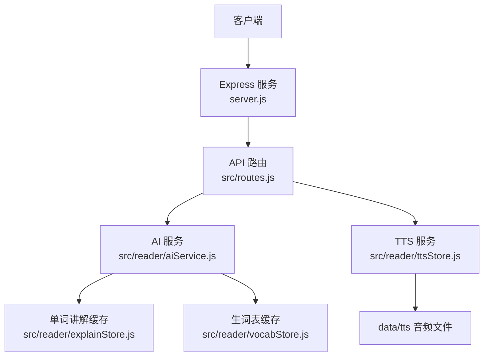
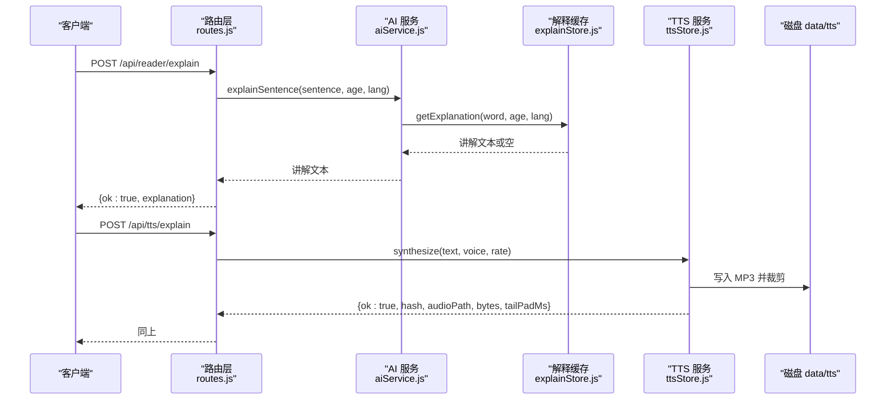
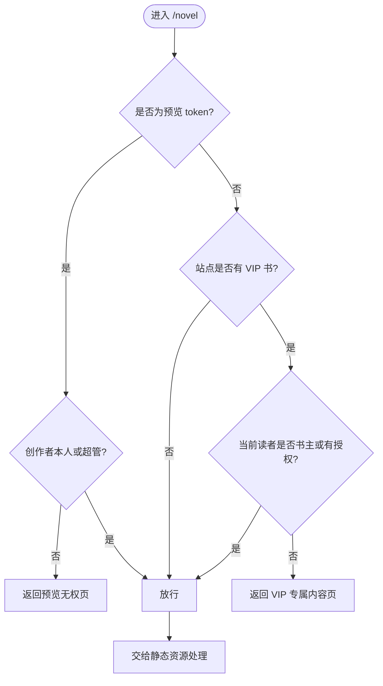
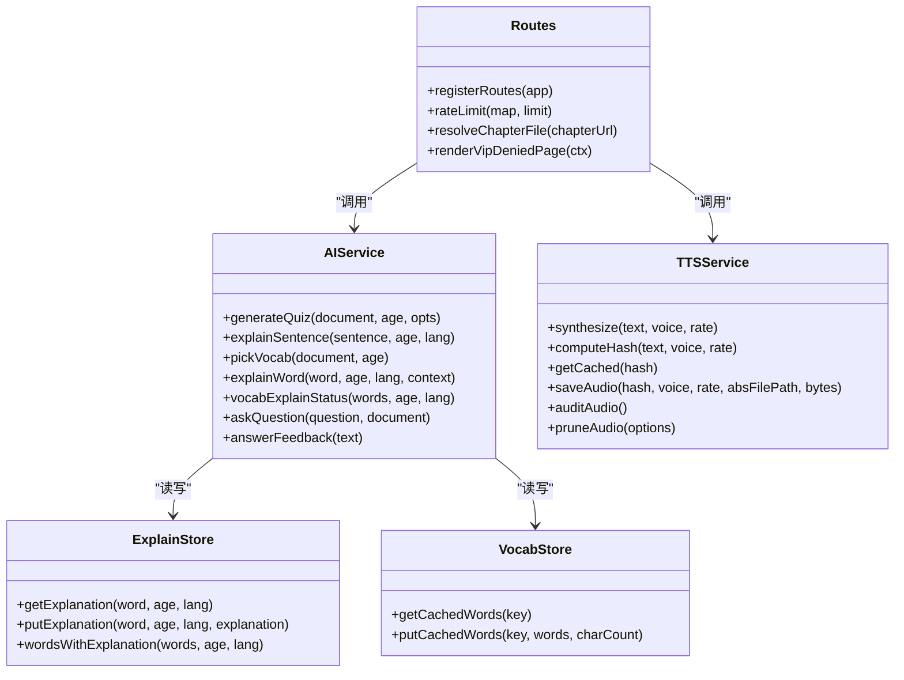

# 阅读器 API

<cite>
**本文引用的文件**   
- [server.js](file://server.js)
- [routes.js](file://src/routes.js)
- [aiService.js](file://src/reader/aiService.js)
- [ttsStore.js](file://src/reader/ttsStore.js)
- [explainStore.js](file://src/reader/explainStore.js)
- [vocabStore.js](file://src/reader/vocabStore.js)
</cite>

## 目录
1. [简介](#简介)
2. [项目结构](#项目结构)
3. [核心组件](#核心组件)
4. [架构总览](#架构总览)
5. [详细接口说明](#详细接口说明)
6. [依赖关系分析](#依赖关系分析)
7. [性能与限流](#性能与限流)
8. [错误处理与故障排查](#错误处理与故障排查)
9. [最佳实践](#最佳实践)
10. [结论](#结论)

## 简介
本文件面向“阅读器”能力，覆盖以下对外 API：
- AI 问答：章节出题、句子讲解、生词识别、单词讲解、状态查询、自由问答、答题反馈。
- TTS 文本转语音：句子合成、讲解音频合成。
- 图片生成：文生图代理。
- VIP 访问控制：VIP 书籍的读者授权机制与页面闸门。
- 请求参数与响应格式、使用示例、限流策略和错误处理。

该服务以 Express 为入口，通过 `registerRoutes` 注册 `/api/*` 路由；阅读器相关接口位于 `/api/reader/*` 与 `/api/tts/*`，并受统一的限流、鉴权（部分公开）、输出净化等中间件保护。

**章节来源**
- [server.js:25-53](file://server.js#L25-L53)
- [routes.js:331-390](file://src/routes.js#L331-L390)

## 项目结构
从“阅读器 API”视角，关键路径如下：
- 服务启动与静态资源挂载：`server.js`
- 路由与业务编排：`src/routes.js`
- AI 能力实现与缓存：`src/reader/aiService.js`
- TTS 合成与音频缓存：`src/reader/ttsStore.js`
- 单词讲解持久缓存：`src/reader/explainStore.js`
- 生词表持久缓存：`src/reader/vocabStore.js`

**图表来源**
- [server.js:25-53](file://server.js#L25-L53)
- [routes.js:331-390](file://src/routes.js#L331-L390)
- [aiService.js:1-25](file://src/reader/aiService.js#L1-L25)
- [ttsStore.js:1-23](file://src/reader/ttsStore.js#L1-L23)

**章节来源**
- [server.js:1-64](file://server.js#L1-L64)
- [routes.js:1-30](file://src/routes.js#L1-L30)

## 核心组件
- **路由层（routes.js）**：统一处理鉴权、限流、VIP 闸门、参数校验、输出净化，并转发到具体服务。
- **AI 服务（aiService.js）**：封装 LLM 调用、并发队列、进程内缓存、持久化缓存（词汇解释、生词表、题目），并提供问题回答与反馈接口。
- **TTS 服务（ttsStore.js）**：基于微软边缘 TTS 合成 MP3，提供去重、并发限制、失败重试、首尾静音裁剪、LRU 清理与审计。
- **解释缓存（explainStore.js）**：按（词, 年龄, 语言）持久化单词讲解，支持批量状态查询。
- **生词缓存（vocabStore.js）**：按（正文哈希, 年龄）持久化生词表，带行上限淘汰。

**章节来源**
- [routes.js:331-390](file://src/routes.js#L331-L390)
- [aiService.js:1-25](file://src/reader/aiService.js#L1-L25)
- [ttsStore.js:1-23](file://src/reader/ttsStore.js#L1-L23)
- [explainStore.js:1-15](file://src/reader/explainStore.js#L1-L15)
- [vocabStore.js:1-14](file://src/reader/vocabStore.js#L1-L14)

## 架构总览
下图展示一次“句子讲解 + 讲解音频”的典型流程：

**图表来源**
- [routes.js:364-376](file://src/routes.js#L364-L376)
- [routes.js:490-513](file://src/routes.js#L490-L513)
- [aiService.js:154-179](file://src/reader/aiService.js#L154-L179)
- [explainStore.js:53-65](file://src/reader/explainStore.js#L53-L65)
- [ttsStore.js:296-326](file://src/reader/ttsStore.js#L296-L326)

## 详细接口说明

### 一、AI 问答接口

#### 1. 章节出题
- **方法**: `POST /api/reader/quiz`
- **鉴权**: 无需登录（公开）
- **限流**: 读者端通用限流（默认 60 次/分钟/IP）
- **请求体**:
  - `document`: 字符串，章节内容（必填）
  - `age`: 数字，学生年龄（可选，默认 9）
  - `force`: 布尔值，是否强制重新出题（可选）
- **响应**:
  - `ok`: 布尔值
  - `questions`: 数组，每道题含问题、选项、答案字段
- **错误码**:
  - `429`: 请求过于频繁
  - `503`: 服务繁忙（LLM 队列满）
  - `500`: 服务端异常

**章节来源**
- [routes.js:359-363](file://src/routes.js#L359-L363)
- [aiService.js:134-152](file://src/reader/aiService.js#L134-L152)

#### 2. 句子讲解
- **方法**: `POST /api/reader/explain`
- **鉴权**: 无需登录（公开）
- **限流**: 读者端通用限流（默认 60 次/分钟/IP）
- **请求体**:
  - `sentence`: 字符串，待讲解的句子（必填）
  - `age`: 数字，学生年龄（可选，默认 9）
  - `lang`: 字符串，目标语言（可选，默认“英语”）
- **响应**:
  - `ok`: 布尔值
  - `explanation`: 字符串，讲解文本
- **错误码**:
  - `429`: 请求过于频繁
  - `500`: 服务端异常

**章节来源**
- [routes.js:364-367](file://src/routes.js#L364-L367)
- [aiService.js:154-160](file://src/reader/aiService.js#L154-L160)

#### 3. 生词识别
- **方法**: `POST /api/reader/vocab`
- **鉴权**: 无需登录（公开）
- **限流**: 读者端通用限流（默认 60 次/分钟/IP）
- **请求体**:
  - `document`: 字符串，章节内容（必填）
  - `age`: 数字，学生年龄（可选，默认 9）
- **响应**:
  - `ok`: 布尔值
  - `words`: 字符串数组，适合标注的生词列表
- **错误码**:
  - `429`: 请求过于频繁
  - `500`: 服务端异常

**章节来源**
- [routes.js:369-372](file://src/routes.js#L369-L372)
- [aiService.js:199-223](file://src/reader/aiService.js#L199-L223)

#### 4. 单词讲解
- **方法**: `POST /api/reader/explain-word`
- **鉴权**: 无需登录（公开）
- **限流**: 读者端通用限流（默认 60 次/分钟/IP）
- **请求体**:
  - `word`: 字符串，要解释的词（必填）
  - `age`: 数字，学生年龄（可选，默认 9）
  - `lang`: 字符串，目标语言（可选，默认“英语”）
  - `context`: 字符串，原句上下文（可选，仅首次生成时作为语境）
- **响应**:
  - `ok`: 布尔值
  - `explanation`: 字符串，讲解文本
- **错误码**:
  - `429`: 请求过于频繁
  - `500`: 服务端异常

**章节来源**
- [routes.js:374-377](file://src/routes.js#L374-L377)
- [aiService.js:167-179](file://src/reader/aiService.js#L167-L179)

#### 5. 词义状态查询
- **方法**: `POST /api/reader/word-status`
- **鉴权**: 无需登录（公开）
- **限流**: 读者端通用限流（默认 60 次/分钟/IP）
- **请求体**:
  - `words`: 字符串数组，待查词列表（必填）
  - `age`: 数字，学生年龄（可选，默认 9）
  - `lang`: 字符串，目标语言（可选，默认“英语”）
- **响应**:
  - `ok`: 布尔值
  - `have`: 字符串数组，已存在讲解的词
- **错误码**:
  - `429`: 请求过于频繁
  - `500`: 服务端异常

**章节来源**
- [routes.js:379-382](file://src/routes.js#L379-L382)
- [aiService.js:181-185](file://src/reader/aiService.js#L181-L185)

#### 6. 自由问答
- **方法**: `POST /api/reader/ask`
- **鉴权**: 无需登录（公开）
- **限流**: 读者端通用限流（默认 60 次/分钟/IP）
- **请求体**:
  - `question`: 字符串，问题（必填）
  - `document`: 字符串，章节内容（可选）
- **响应**:
  - `ok`: 布尔值
  - `answer`: 字符串，回答文本
- **错误码**:
  - `429`: 请求过于频繁
  - `500`: 服务端异常

**章节来源**
- [routes.js:383-386](file://src/routes.js#L383-L386)
- [aiService.js:225-236](file://src/reader/aiService.js#L225-L236)

#### 7. 答题反馈
- **方法**: `POST /api/reader/feedback`
- **鉴权**: 无需登录（公开）
- **限流**: 读者端通用限流（默认 60 次/分钟/IP）
- **请求体**:
  - `text`: 字符串，用户答题内容（必填）
- **响应**:
  - `ok`: 布尔值
  - `feedback`: 字符串，鼓励式讲解
- **错误码**:
  - `429`: 请求过于频繁
  - `500`: 服务端异常

**章节来源**
- [routes.js:387-390](file://src/routes.js#L387-L390)
- [aiService.js:238-250](file://src/reader/aiService.js#L238-L250)

### 二、TTS 文本转语音接口

#### 1. 句子合成
- **方法**: `POST /api/tts/sentence`
- **鉴权**: 无需登录（公开）
- **限流**: TTS 专用限流（默认 600 次/分钟/IP）
- **请求体**:
  - `chapterUrl`: 字符串，章节 URL（必填）
  - `text`: 字符串，待合成文本（必填）
  - `voice`: 字符串，音色名（必填，白名单校验）
  - `rate`: 字符串，语速（必填，白名单校验）
- **响应**:
  - `ok`: 布尔值
  - `hash`: 字符串，音频缓存键
  - `audioPath`: 字符串，音频相对路径
  - `bytes`: 数字，音频字节数
  - `tailPadMs`: 数字或空，尾部留白毫秒数
- **错误码**:
  - `400`: 缺少参数、不支持的音色/语速、章节无正文
  - `404`: 章节不存在
  - `429`: 请求过于频繁
  - `503`: 合成失败（返回 fallback 提示）

**章节来源**
- [routes.js:457-488](file://src/routes.js#L457-L488)
- [ttsStore.js:296-326](file://src/reader/ttsStore.js#L296-L326)

#### 2. 讲解音频合成
- **方法**: `POST /api/tts/explain`
- **鉴权**: 无需登录（公开）
- **限流**: TTS 专用限流（默认 600 次/分钟/IP）
- **请求体**:
  - `text`: 字符串，讲解文本（必填，长度上限 2000）
  - `voice`: 字符串，音色名（必填，白名单校验）
  - `rate`: 字符串，语速（必填，白名单校验）
- **响应**:
  - `ok`: 布尔值
  - `hash`: 字符串，音频缓存键
  - `audioPath`: 字符串，音频相对路径
  - `bytes`: 数字，音频字节数
  - `tailPadMs`: 数字或空，尾部留白毫秒数
- **错误码**:
  - `400`: 缺少参数、不支持的音色/语速、文本过长
  - `429`: 请求过于频繁
  - `503`: 合成失败（返回 fallback 提示）

**章节来源**
- [routes.js:490-513](file://src/routes.js#L490-L513)
- [ttsStore.js:296-326](file://src/reader/ttsStore.js#L296-L326)

### 三、图片生成接口

- **方法**: `POST /api/reader/image`
- **鉴权**: 无需登录（公开）
- **限流**: 读者端通用限流（默认 60 次/分钟/IP）
- **请求体**:
  - `prompt`: 字符串，图片描述（必填）
  - `size`: 字符串，图片尺寸（可选）
  - `model`: 字符串，模型标识（可选）
- **响应**:
  - `ok`: 布尔值
  - `url`: 字符串，图片地址
  - `revisedPrompt`: 字符串或空，优化后的 prompt
- **错误码**:
  - `400`: 缺少图片描述
  - `502`: 上游桥接服务不可用或返回错误
  - `429`: 请求过于频繁

**章节来源**
- [routes.js:399-428](file://src/routes.js#L399-L428)

### 四、VIP 内容访问控制

VIP 访问采用“读者账号授权制”，不再依赖共享密码：
- 书籍标记：`novel.vip = true`
- 授权名单：`vip_grant` 表（用户名/用户 ID + 小说 ID + 到期时间）
- 页面闸门：对 `/novel/<uid>/<书名>/...` 每个请求实时校验
- 首页过滤：未授权 VIP 书整条隐藏（不显示锁标）
- 旧密码入口：返回 410，提示改用授权账号登录

**图表来源**
- [routes.js:1035-1094](file://src/routes.js#L1035-L1094)

**章节来源**
- [routes.js:144-157](file://src/routes.js#L144-L157)
- [routes.js:190-206](file://src/routes.js#L190-L206)
- [routes.js:212-241](file://src/routes.js#L212-L241)
- [routes.js:392-397](file://src/routes.js#L392-L397)
- [routes.js:515-557](file://src/routes.js#L515-L557)
- [routes.js:1035-1094](file://src/routes.js#L1035-L1094)

## 依赖关系分析

**图表来源**
- [routes.js:331-390](file://src/routes.js#L331-L390)
- [aiService.js:134-250](file://src/reader/aiService.js#L134-L250)
- [ttsStore.js:75-147](file://src/reader/ttsStore.js#L75-L147)
- [explainStore.js:53-102](file://src/reader/explainStore.js#L53-L102)
- [vocabStore.js:53-90](file://src/reader/vocabStore.js#L53-L90)

**章节来源**
- [routes.js:331-390](file://src/routes.js#L331-L390)
- [aiService.js:134-250](file://src/reader/aiService.js#L134-L250)
- [ttsStore.js:75-147](file://src/reader/ttsStore.js#L75-L147)
- [explainStore.js:53-102](file://src/reader/explainStore.js#L53-L102)
- [vocabStore.js:53-90](file://src/reader/vocabStore.js#L53-L90)

## 性能与限流

- **读者端限流**：
  - 通用限流：60 次/分钟/IP，超限返回 429 并附带 `Retry-After`。
  - TTS 限流：600 次/分钟/IP，适配整章逐句合成的批量场景。
- **并发与队列**：
  - AI 服务：全局并发上限（默认 2），队列上限（默认 50），相同 key 在途合并。
  - TTS 服务：进程内并发闸（默认 2），同句去重，失败退避重试一次。
- **缓存层级**：
  - 进程内 Map：快速命中，避免重复计算。
  - 持久缓存：词汇解释、生词表、音频文件，跨进程复用。
  - 淘汰策略：按更新时间或 LRU 清理，防止无限增长。
- **外部依赖**：
  - LLM 上游：通过桥接服务访问，支持运行时切换密钥与地址。
  - 微软边缘 TTS：免 Key，但对并发敏感，需节流与重试。

**章节来源**
- [routes.js:263-306](file://src/routes.js#L263-L306)
- [routes.js:352-358](file://src/routes.js#L352-L358)
- [aiService.js:27-34](file://src/reader/aiService.js#L27-L34)
- [aiService.js:45-77](file://src/reader/aiService.js#L45-L77)
- [ttsStore.js:211-226](file://src/reader/ttsStore.js#L211-L226)
- [ttsStore.js:296-326](file://src/reader/ttsStore.js#L296-L326)

## 错误处理与故障排查

- **通用错误格式**：
  - `{ error: string }`：客户端可直接展示。
  - `{ ok: boolean, ... }`：成功时 `ok=true`，失败时携带具体错误信息。
- **常见错误码**：
  - `400`：参数缺失、格式非法、业务校验失败。
  - `401`：需要登录或预览权限不足。
  - `403`：无权访问该小说。
  - `404`：章节或小说不存在。
  - `409`：长任务冲突（同一本书已有生成任务）。
  - `410`：VIP 密码解锁已停用。
  - `429`：请求过于频繁，建议前端根据 `Retry-After` 退避。
  - `500`：服务端异常。
  - `502`：上游 LLM 或桥接服务不可用。
  - `503`：服务繁忙或 TTS 合成失败。
- **调试建议**：
  - 检查 `Retry-After` 头，确认是否触发限流。
  - 查看日志中的 `[tts]` 前缀，定位合成阶段失败原因。
  - 对于 VIP 访问问题，确认读者是否已登录且拥有授权。
  - 对于 TTS 失败，优先检查音色与语速是否在白名单内。

**章节来源**
- [routes.js:331-390](file://src/routes.js#L331-L390)
- [routes.js:457-513](file://src/routes.js#L457-L513)
- [routes.js:1035-1094](file://src/routes.js#L1035-L1094)

## 最佳实践

- **AI 问答**：
  - 使用 `force=true` 仅在用户主动点击“换一组新题”时触发，避免静默换题影响体验。
  - 对高频词汇使用 `explain-word` 接口，利用持久缓存提升响应速度。
- **TTS 合成**：
  - 优先使用 `tts/explain` 接口生成讲解音频，避免章节 URL 校验开销。
  - 合理选择音色与语速，确保在白名单内，避免 400 错误。
  - 对于整章朗读，建议使用批量合成策略，结合 `tailPadMs` 控制句间停顿。
- **VIP 访问**：
  - 管理员通过控制台授予 VIP 权限，设置合理的到期时间。
  - 读者登录后自动获得 VIP 内容访问权，无需手动解锁。
- **错误处理**：
  - 前端应处理 429 错误，根据 `Retry-After` 进行指数退避。
  - 对于 503 错误，提示用户稍后重试或降级到浏览器 TTS。

**章节来源**
- [aiService.js:134-152](file://src/reader/aiService.js#L134-L152)
- [routes.js:457-513](file://src/routes.js#L457-L513)
- [routes.js:1035-1094](file://src/routes.js#L1035-L1094)

## 结论
本 API 文档覆盖了阅读器功能的核心接口，包括 AI 问答、TTS 文本转语音、图片生成以及 VIP 访问控制。通过分层架构设计，系统实现了高可用、高性能与良好的用户体验。在实际使用中，建议遵循最佳实践，合理配置限流与缓存策略，确保服务稳定运行。