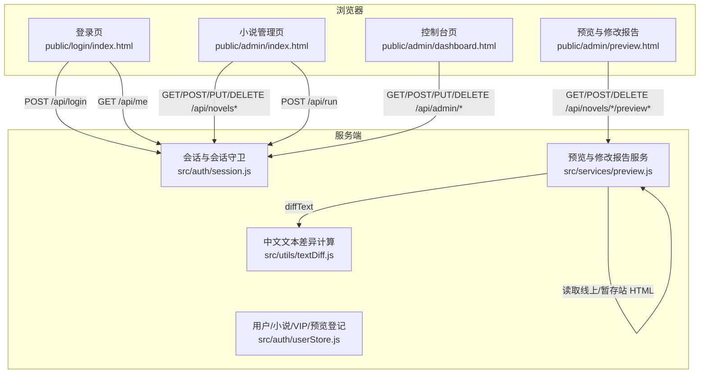
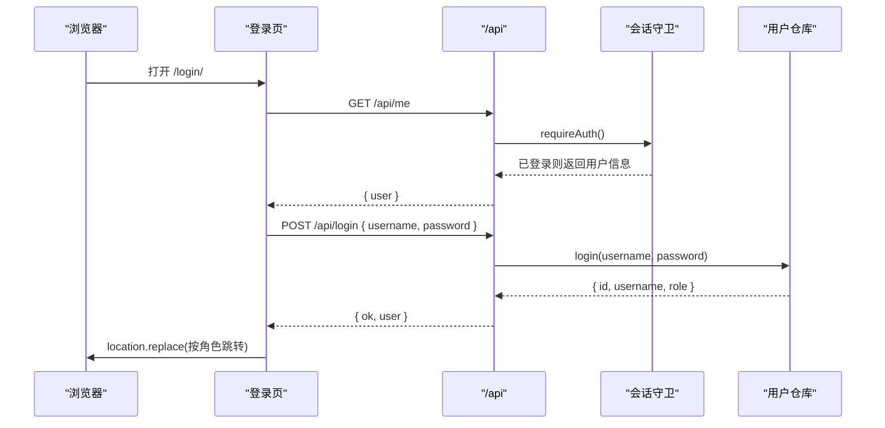
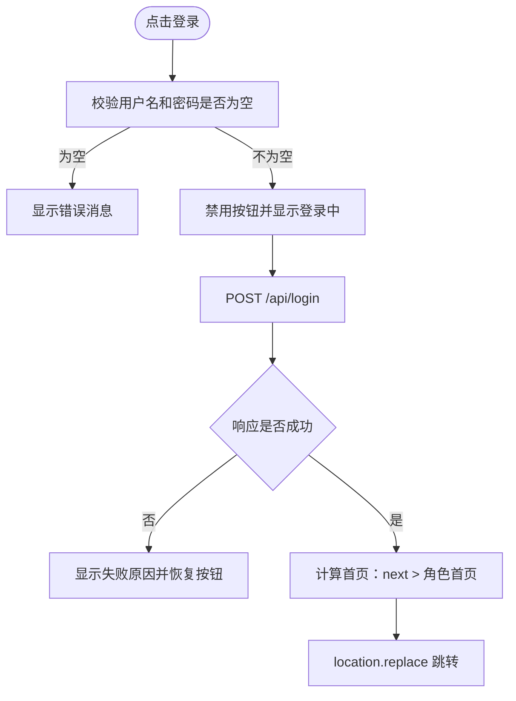
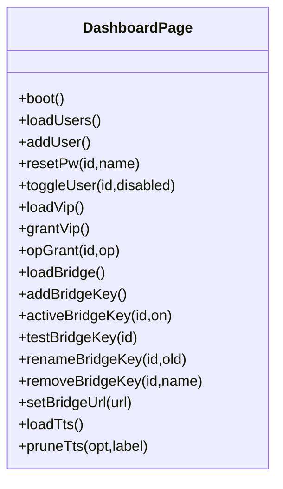
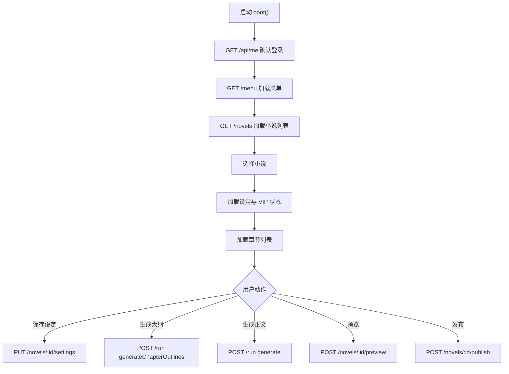
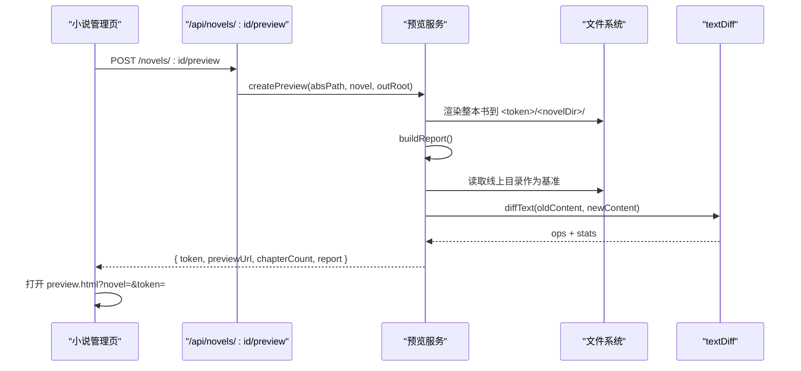
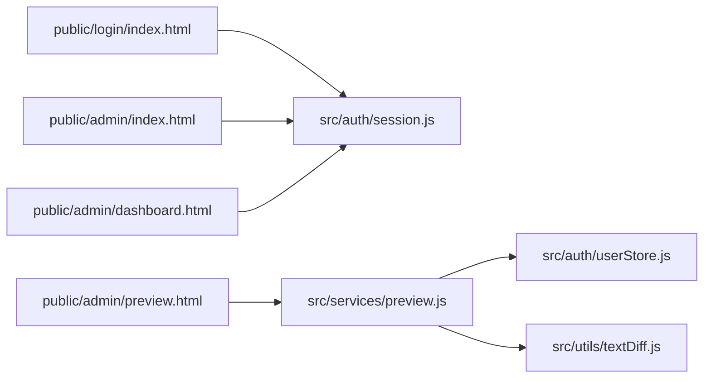

# Web 前端界面

<cite>
**本文引用的文件**   
- [public/login/index.html](file://public/login/index.html)
- [public/admin/dashboard.html](file://public/admin/dashboard.html)
- [public/admin/index.html](file://public/admin/index.html)
- [public/admin/preview.html](file://public/admin/preview.html)
- [src/auth/session.js](file://src/auth/session.js)
- [src/auth/userStore.js](file://src/auth/userStore.js)
- [src/services/preview.js](file://src/services/preview.js)
- [src/utils/textDiff.js](file://src/utils/textDiff.js)
</cite>

## 目录
1. [简介](#简介)
2. [项目结构](#项目结构)
3. [核心组件](#核心组件)
4. [架构总览](#架构总览)
5. [详细组件分析](#详细组件分析)
6. [依赖关系分析](#依赖关系分析)
7. [性能与体验特性](#性能与体验特性)
8. [故障排查指南](#故障排查指南)
9. [结论](#结论)

## 简介
本文件面向 Web 前端，系统性说明小说管理系统的登录页、管理后台、预览与修改报告等界面的实现方式。文档覆盖：
- 登录认证流程、表单校验与错误提示
- 控制台（仪表盘）的用户管理、VIP 授权、推理服务连接配置、TTS 缓存体检
- 小说管理主界面：设定、大纲、正文生成、章节编辑、批量操作、菜单工具、AI 指令
- 预览功能：暂存站点、修改报告、逐页 diff、发布确认
- 静态资源组织、CSS 样式风格、JavaScript 模块化与前后端接口约定

## 项目结构
Web 前端以“单页 HTML + 内嵌 CSS/JS”为主，按页面职责划分到 `public` 目录；服务端提供 `/api/*` 接口，由浏览器直接调用。

**图表来源**
- [public/login/index.html:35-65](file://public/login/index.html#L35-L65)
- [public/admin/index.html:358-379](file://public/admin/index.html#L358-L379)
- [public/admin/dashboard.html:141-146](file://public/admin/dashboard.html#L141-L146)
- [public/admin/preview.html:107-112](file://public/admin/preview.html#L107-L112)
- [src/auth/session.js:83-110](file://src/auth/session.js#L83-L110)
- [src/services/preview.js:117-273](file://src/services/preview.js#L117-L273)
- [src/utils/textDiff.js:84-123](file://src/utils/textDiff.js#L84-L123)

**章节来源**
- [public/login/index.html:1-69](file://public/login/index.html#L1-L69)
- [public/admin/index.html:1-1553](file://public/admin/index.html#L1-L1553)
- [public/admin/dashboard.html:1-472](file://public/admin/dashboard.html#L1-L472)
- [public/admin/preview.html:1-311](file://public/admin/preview.html#L1-L311)

## 核心组件
- 登录页：负责用户名/密码输入、基础校验、调用 `/api/login`、根据角色跳转管理页或控制台。
- 小说管理页：集中承载小说选择、设定保存、大纲生成、正文生成、章节编辑、批量区间操作、菜单工具、AI 指令入口。
- 控制台：超级管理员专用，包含平台概览、用户增删改禁、VIP 读者授权、aibridge Key 管理、TTS 音频缓存体检与清理。
- 预览页：展示修改报告、打开暂存站点、查看逐页 diff、作废预览、确认发布。
- 后端支撑：会话鉴权、用户与 VIP 数据、预览产物与报告、中文文本 diff。

**章节来源**
- [public/login/index.html:35-65](file://public/login/index.html#L35-L65)
- [public/admin/index.html:267-440](file://public/admin/index.html#L267-L440)
- [public/admin/dashboard.html:134-180](file://public/admin/dashboard.html#L134-L180)
- [public/admin/preview.html:98-121](file://public/admin/preview.html#L98-L121)
- [src/auth/session.js:83-110](file://src/auth/session.js#L83-L110)
- [src/auth/userStore.js:126-188](file://src/auth/userStore.js#L126-L188)
- [src/services/preview.js:328-360](file://src/services/preview.js#L328-L360)
- [src/utils/textDiff.js:84-123](file://src/utils/textDiff.js#L84-L123)

## 架构总览
前端采用“页面脚本直连 API”的轻量模式：每个 HTML 页面通过 `fetch(BASE + '/api' + p, ...)` 与服务端交互，统一处理 401 未登录、业务错误和成功响应。会话由服务端基于 HMAC-SHA256 签名 cookie 维护，前端不持有敏感凭据。

**图表来源**
- [public/login/index.html:45-65](file://public/login/index.html#L45-L65)
- [src/auth/session.js:83-110](file://src/auth/session.js#L83-L110)
- [src/auth/userStore.js:181-188](file://src/auth/userStore.js#L181-L188)

## 详细组件分析

### 登录页面
登录页是一个极简移动端友好的卡片表单，核心行为包括：
- 从 URL 反推站点前缀 `BASE`，保证页面可挂载在任意子路径下。
- 提交时做非空校验，禁用按钮并显示“登录中…”，避免重复提交。
- 调用 `/api/login`，成功后根据 `next` 参数或用户角色跳转到管理页或控制台。
- 若当前已有会话，先尝试 `/api/me` 自动进入。

**图表来源**
- [public/login/index.html:49-65](file://public/login/index.html#L49-L65)

关键实现要点：
- 表单使用原生 `<form>` 与 `required`，同时 JS 再做一次空值检查。
- 错误消息通过 `.msg` 元素切换颜色，成功时短暂显示“登录成功，进入中…”。
- 跳转目标优先取 `?next=`，但仅允许站内 `/novel/` 或 `/admin/` 开头，防止开放重定向。

**章节来源**
- [public/login/index.html:28-65](file://public/login/index.html#L28-L65)

### 管理后台：控制台（仪表盘）
控制台面向超级管理员，提供以下能力：
- 平台概览：用户总数、禁用数、小说总数、VIP 授权数。
- 用户管理：新建用户、重置密码、启用/禁用用户。
- VIP 读者授权：为读者账号授予全站或指定书的阅读权限，支持到期天数与备注。
- aibridge 推理服务连接：保存多条 API Key，启用其中一条，运行时即时生效；支持测连通、改名、删除、覆盖地址。
- TTS 朗读音频缓存：体检统计、按音色/语速明细查看、干跑确认后再清理。

**图表来源**
- [public/admin/dashboard.html:160-468](file://public/admin/dashboard.html#L160-L468)

交互说明：
- 所有 API 调用统一封装为 `api(p, opt)`，遇到 401 自动跳回登录页。
- 用户列表渲染时区分本人行，禁止对本人执行禁用/重置密码。
- VIP 授权同一用户+范围只保留一条有效记录，重复授予视为续期或改备注。
- Bridge Key 列表显示 Key 前缀，明文 Key 只存在服务端；测试结果显示 provider/model 及是否走公网。
- TTS 清理分两步：先 dry run 拿到真实匹配条数和占用，再让用户确认后真正删除。

**章节来源**
- [public/admin/dashboard.html:134-468](file://public/admin/dashboard.html#L134-L468)
- [src/auth/userStore.js:235-349](file://src/auth/userStore.js#L235-L349)

### 管理后台：小说管理主界面
小说管理页是整个创作工作流的核心，涵盖：
- 顶部小说选择器、刷新、新建、AI 链路状态灯。
- “流程管理”标签：设定保存、VIP 开关、生成大纲、加章/补大纲、章节列表、区间生成正文、区间删除、重排编号、一致性检查、预览、发布、分享。
- “菜单 + AI”标签：动态加载服务端菜单项，支持参数化执行。
- 底部命令栏：自然语言指令经 `/ai/plan` 解析后弹出确认卡片，确认后执行 `/ai/execute`。

**图表来源**
- [public/admin/index.html:420-440](file://public/admin/index.html#L420-L440)
- [public/admin/index.html:616-641](file://public/admin/index.html#L616-L641)
- [public/admin/index.html:669-683](file://public/admin/index.html#L669-L683)
- [public/admin/index.html:656-667](file://public/admin/index.html#L656-L667)
- [public/admin/index.html:1233-1241](file://public/admin/index.html#L1233-L1241)

重要交互细节：
- 长任务遮罩：`busyPush/busyPop` 统一管理，延迟 600ms 才显示，避免短请求抖动；对 `/run` 且带进度 ID 的请求，通过 EventSource 实时推送日志。
- 章节编辑弹层：支持标题、构思、大纲、正文只读预览；生成大纲草稿会保留“换回生成前那版”的能力；正文生成前先判断是否保存了大纲。
- 区间操作：区间生成正文循环中保持遮罩，逐章输出进度；区间删除从大到小遍历，避免删除后序号变化影响后续索引。
- 字数治理：区分 trim（删减次要场景）与 split（拆成更多章），并在执行前给出明确风险提示。
- AI 指令：自然语言 → `/ai/plan` → 工具名 + 参数 → 用户确认 → `/ai/execute`。

**章节来源**
- [public/admin/index.html:301-379](file://public/admin/index.html#L301-L379)
- [public/admin/index.html:876-980](file://public/admin/index.html#L876-L980)
- [public/admin/index.html:1065-1136](file://public/admin/index.html#L1065-L1136)
- [public/admin/index.html:1491-1533](file://public/admin/index.html#L1491-L1533)

### 预览功能：修改报告、逐页 diff、暂存站点
预览功能的目标是在正式发布前回答三个问题：
1. 这次发布会产出哪些新页、删除哪些旧页？
2. 哪些页面正文变了，哪些只是被牵连（章号顺延、翻页链接变化）？
3. 实际改动到底改了什么？

**图表来源**
- [public/admin/index.html:656-667](file://public/admin/index.html#L656-L667)
- [src/services/preview.js:328-360](file://src/services/preview.js#L328-L360)
- [src/services/preview.js:117-273](file://src/services/preview.js#L117-L273)
- [src/utils/textDiff.js:84-123](file://src/utils/textDiff.js#L84-L123)

预览报告与 diff 的关键点：
- 比较口径：去掉大标题与分部 kicker 后的纯文本，避免排版噪声干扰。
- 报告条目分类：新增、正文改动、待下线、连带影响、未变。
- 目录页单独分析：条目增删、顺序变化、章号/章名变化。
- 逐页 diff：点击展开后按需拉取 `/novels/:id/preview/:token/diff?file=`，返回 ops 序列与统计。
- 暂存站点：结构与线上一致，可直接翻阅；默认保留 24 小时，支持手动作废。
- 发布确认：以预览时的渲染结果为基准重新出页，检测漂移页；若书名冲突，跳过旧页清理以免误删另一本同名书。

**章节来源**
- [public/admin/preview.html:123-255](file://public/admin/preview.html#L123-L255)
- [public/admin/preview.html:257-307](file://public/admin/preview.html#L257-L307)
- [src/services/preview.js:32-58](file://src/services/preview.js#L32-L58)
- [src/services/preview.js:117-273](file://src/services/preview.js#L117-L273)
- [src/services/preview.js:391-414](file://src/services/preview.js#L391-L414)
- [src/services/preview.js:423-470](file://src/services/preview.js#L423-L470)
- [src/utils/textDiff.js:84-123](file://src/utils/textDiff.js#L84-L123)

### 静态资源管理与样式组织
- 静态页面位于 `public` 目录，按功能划分为 `login`、`admin`、`tts` 等子目录。
- 每个页面自带 `<style>`，采用深色主题、圆角卡片、flex 布局，适配移动端。
- 没有引入外部 CSS/JS 框架，全部逻辑写在内联 `<script>` 中，便于单页部署。
- 公共样式模式：
  - 全局 reset：`margin:0; padding:0; box-sizing:border-box;`
  - 深色背景：`#0f1419`，卡片背景：`#1a252f`，边框：`#2c3e50`
  - 主色：`#3498db`，成功：`#27ae60`，危险：`#c0392b`
  - 常用组件类：`.card`、`.field`、`.mbtn`、`.result`、`.loading`、`.toast`、`.busy`、`.sheet`、`.mask`
- JavaScript 组织：
  - 每个页面自持一个 `api()` 封装，统一处理 401 跳转与 JSON 错误。
  - 使用 `const BASE = location.pathname.replace(/\/admin(\/.*)?$/, '')` 推导站点前缀，使页面可挂在任意子路径。
  - 长任务用 `busyPush/busyPop` 控制遮罩，配合 EventSource 进度流。
  - 安全转义：多处使用 `escapeHtml` 防止 XSS，尤其是模型生成的标题、备注、大纲。

**章节来源**
- [public/login/index.html:7-22](file://public/login/index.html#L7-L22)
- [public/admin/dashboard.html:7-49](file://public/admin/dashboard.html#L7-L49)
- [public/admin/index.html:7-114](file://public/admin/index.html#L7-L114)
- [public/admin/preview.html:7-65](file://public/admin/preview.html#L7-L65)
- [public/admin/index.html:358-379](file://public/admin/index.html#L358-L379)
- [public/admin/index.html:1543-1547](file://public/admin/index.html#L1543-L1547)

## 依赖关系分析
前端页面与服务端模块之间的依赖如下：

**图表来源**
- [public/login/index.html:45-65](file://public/login/index.html#L45-L65)
- [public/admin/index.html:358-379](file://public/admin/index.html#L358-L379)
- [public/admin/dashboard.html:141-146](file://public/admin/dashboard.html#L141-L146)
- [public/admin/preview.html:107-112](file://public/admin/preview.html#L107-L112)
- [src/services/preview.js:17-20](file://src/services/preview.js#L17-L20)

耦合与边界：
- 前端与后端通过 RESTful API 解耦，页面只关心请求路径、请求体与成功/失败响应。
- 会话鉴权集中在 `session.js`，前端不感知 cookie 细节。
- 预览服务独立于用户管理，专注渲染、比对、报告与暂存站生命周期。
- 文本 diff 零依赖，既用于预览报告，也可扩展到其他内容对比场景。

潜在风险：
- 大量内联 JS 不利于复用与测试，建议未来将通用逻辑抽离为模块。
- 页面间共享状态较少，跨页面通信主要靠 URL 参数与服务器端存储。

**章节来源**
- [src/auth/session.js:83-110](file://src/auth/session.js#L83-L110)
- [src/services/preview.js:117-273](file://src/services/preview.js#L117-L273)
- [src/utils/textDiff.js:84-123](file://src/utils/textDiff.js#L84-L123)

## 性能与体验特性
- 长任务遮罩延迟显示：快请求无感，慢任务才出现旋转与计时器。
- 进度流：对 `/run` 且带 `progressId` 的请求，通过 `/api/progress?id=` 推送日志，避免用户以为卡死。
- 分页章节列表：每页 50 章，减少首屏 DOM 压力。
- 中文 diff 粒度为句子，避免整段替换；超长时退化到整块替换，防止 LCS DP 卡住进程。
- 预览报告按需加载 diff：只有用户点击某页时才拉取该页 diff，避免一次性渲染大量红绿文本。
- TTS 清理先干跑：让用户看到真实匹配条数与占用大小，再决定是否删除。

[本节为通用性能讨论，不直接分析具体代码片段]

## 故障排查指南
常见问题与定位建议：
- 登录后仍被跳回登录页：
  - 检查 `/api/me` 是否返回 401，可能是会话过期或 cookie 路径不一致。
  - 确认服务端 `SESSION_SECRET` 已设置，否则每次重启会更换临时密钥。
- 控制台无法加载用户列表：
  - 检查 `/api/admin/users` 是否返回 401 或业务错误。
  - 确认当前用户角色为 `superadmin`。
- 预览报告说“无改动”，但 diff 里却有红绿：
  - 确保报告与 diff 都使用相同基准；预览页默认用 `ref=live` 与线上版本比对。
  - 如果使用了暂存 token，需确认 token 仍有效且属于当前小说。
- 发布后页面内容与预览不一致：
  - 预览页发布时会检测漂移页；若漂移，返回值会列出文件名，需要重新生成预览。
- 中文 diff 显示整段替换：
  - 可能因改动过大触发 SAFETY_LIMIT，系统退化为粗粒度替换；这是预期保护机制。

**章节来源**
- [src/auth/session.js:32-36](file://src/auth/session.js#L32-L36)
- [public/admin/dashboard.html:141-146](file://public/admin/dashboard.html#L141-L146)
- [public/admin/preview.html:241-255](file://public/admin/preview.html#L241-L255)
- [src/services/preview.js:423-470](file://src/services/preview.js#L423-L470)
- [src/utils/textDiff.js:84-123](file://src/utils/textDiff.js#L84-L123)

## 结论
本项目的 Web 前端以简洁的单页 HTML 为核心，配合清晰的 API 契约，实现了从登录认证、用户管理、小说创作流程到预览发布的完整闭环。其设计亮点在于：
- 登录与鉴权简单可靠，前端不持有敏感凭据。
- 控制台聚焦运维与权限，把复杂配置收敛到超管界面。
- 预览与修改报告把“发布前不可逆”的风险显式化，并通过逐页 diff 让改动可解释。
- 中文文本 diff 兼顾可读性与性能，适合长篇小说正文对比。

未来可改进的方向包括：将公共 JS 逻辑模块化、引入更完善的单元测试、逐步拆分内联样式为可复用样式库，以及在前端增加更丰富的无障碍支持与国际化能力。