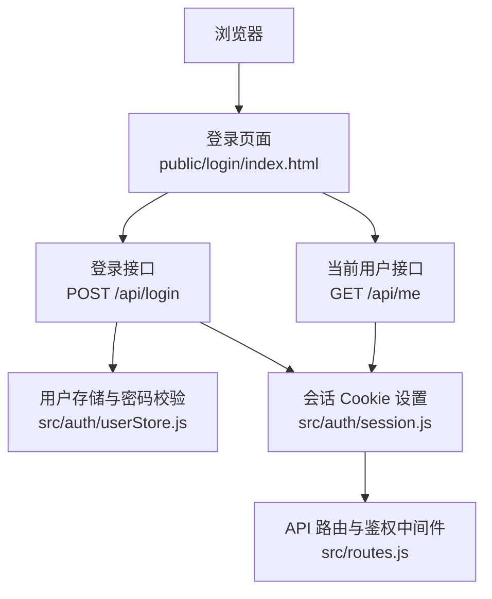
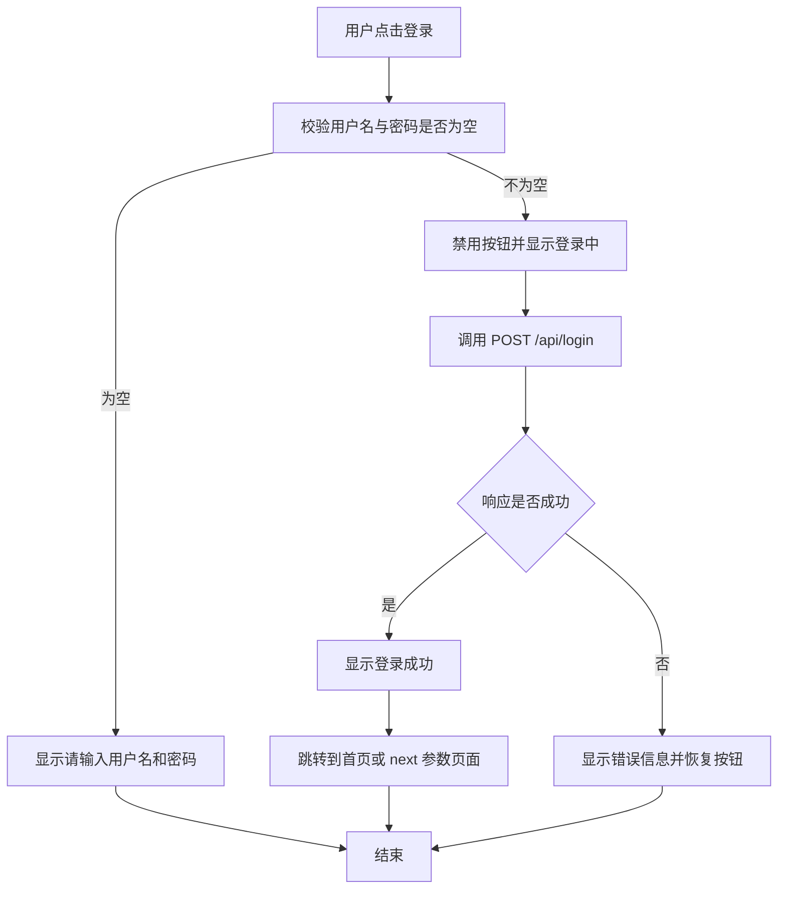
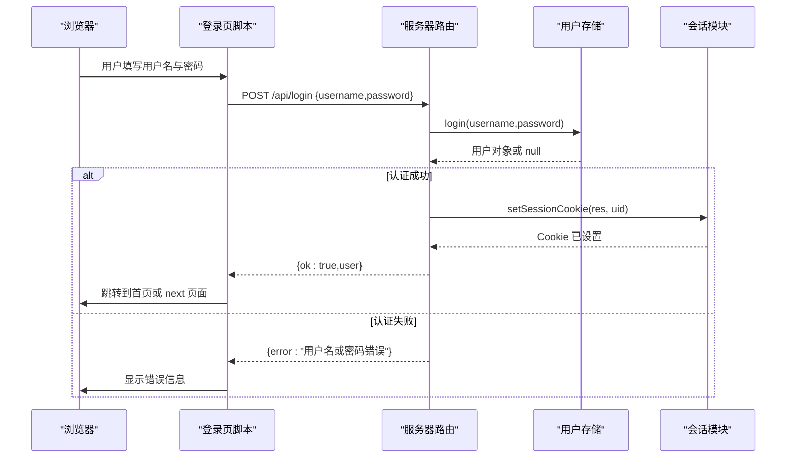
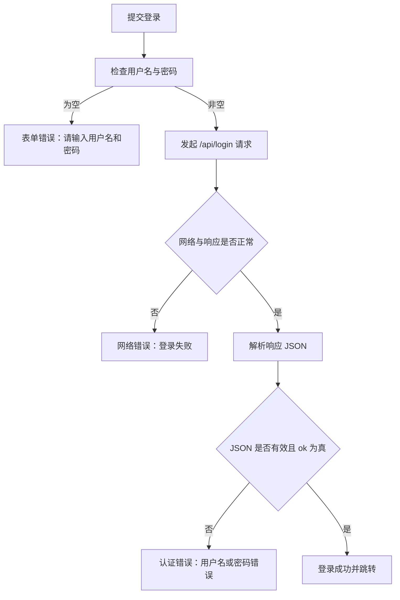
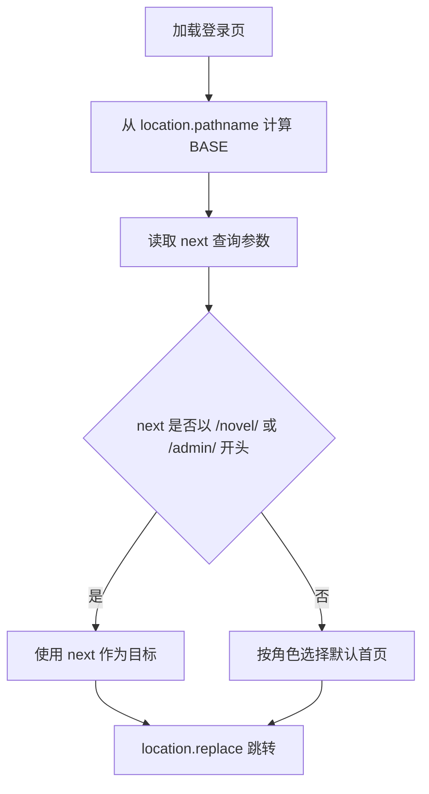
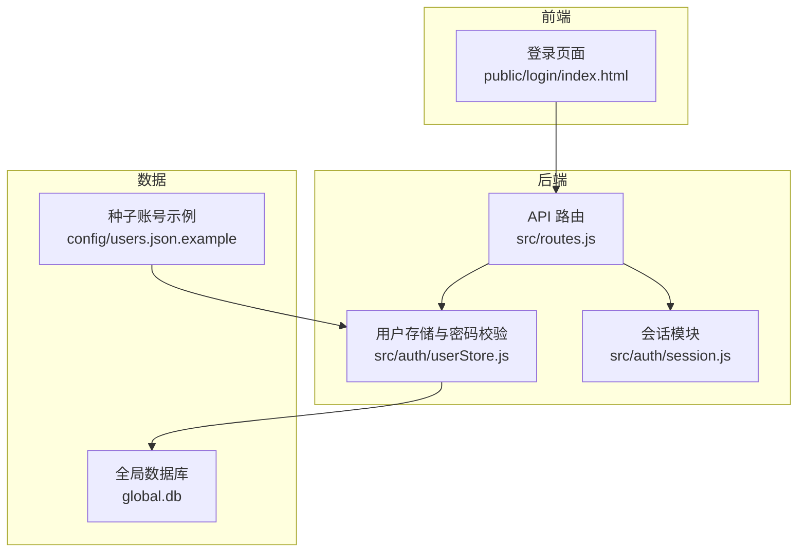
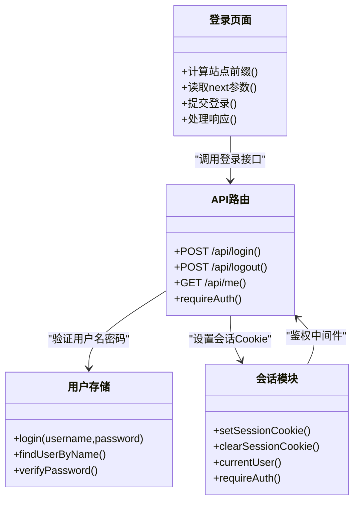

# 登录页面

<cite>
**本文引用的文件**   
- [public/login/index.html](file://public/login/index.html)
- [src/routes.js](file://src/routes.js)
- [src/auth/session.js](file://src/auth/session.js)
- [src/auth/userStore.js](file://src/auth/userStore.js)
- [config/users.json.example](file://config/users.json.example)
</cite>

## 目录
1. [简介](#简介)
2. [项目结构中的登录入口](#项目结构中的登录入口)
3. [登录界面设计实现](#登录界面设计实现)
4. [用户输入验证与交互流程](#用户输入验证与交互流程)
5. [认证流程：用户名密码、会话建立与权限检查](#认证流程用户名密码会话建立与权限检查)
6. [错误处理机制](#错误处理机制)
7. [动态站点前缀计算与重定向安全](#动态站点前缀计算与重定向安全)
8. [架构总览与关键流程图](#架构总览与关键流程图)
9. [依赖关系分析](#依赖关系分析)
10. [性能与安全注意事项](#性能与安全注意事项)
11. [常见问题排查](#常见问题排查)
12. [结论](#结论)

## 简介
本文件面向“小说管理”系统的登录页面，从前端界面到后端认证链路进行完整说明。重点包括：
- 登录表单结构与样式设计
- 用户名与密码的客户端校验
- 服务端用户名密码校验、会话 Cookie 建立、权限守卫
- 网络异常、认证失败、表单错误的统一处理
- 基于当前 URL 的动态站点前缀计算
- 登录后跳转的安全校验逻辑

该文档既适合前端开发者理解登录页实现，也适合后端开发者理解登录接口与会话机制。

## 项目结构中的登录入口
登录页面是静态 HTML，位于 `public/login/index.html`；后端路由在 `src/routes.js` 中注册 `/api/login`、`/api/logout`、`/api/me` 等接口；会话由 `src/auth/session.js` 管理；用户数据与密码哈希由 `src/auth/userStore.js` 维护；初始种子账号示例位于 `config/users.json.example`。

**图表来源**
- [public/login/index.html:35-65](file://public/login/index.html#L35-L65)
- [src/routes.js:341-350](file://src/routes.js#L341-L350)
- [src/auth/session.js:75-90](file://src/auth/session.js#L75-L90)
- [src/auth/userStore.js:181-188](file://src/auth/userStore.js#L181-L188)

**章节来源**
- [public/login/index.html:1-69](file://public/login/index.html#L1-L69)
- [src/routes.js:341-350](file://src/routes.js#L341-L350)
- [src/auth/session.js:1-118](file://src/auth/session.js#L1-L118)
- [src/auth/userStore.js:1-501](file://src/auth/userStore.js#L1-L501)
- [config/users.json.example:1-4](file://config/users.json.example#L1-L4)

## 登录界面设计实现
登录页面采用单卡片布局，适配移动端，使用深色主题。核心结构如下：
- 标题区域：显示系统名称与引导文案
- 表单区域：用户名输入框、密码输入框、登录按钮
- 消息区域：用于显示成功或错误提示

### 表单结构
- 表单元素使用原生 `<form>`，启用自动填充
- 用户名输入框使用 `type="text"` 与 `autocomplete="username"`
- 密码输入框使用 `type="password"` 与 `autocomplete="current-password"`
- 登录按钮类型为 `submit`，提交时阻止默认行为并发起异步请求

### 样式设计要点
- 全局重置边距与盒模型
- 背景色为深色，文字颜色为浅色
- 卡片容器限制最大宽度，圆角边框
- 输入框聚焦时高亮边框
- 按钮禁用态降低透明度
- 消息区域根据成功或失败切换颜色

### 可访问性与移动端优化
- 视口配置禁止缩放，提升移动端体验
- 输入框具备明确标签与自动填充属性
- 按钮提供禁用状态反馈，避免重复提交

**章节来源**
- [public/login/index.html:7-34](file://public/login/index.html#L7-L34)

## 用户输入验证与交互流程
登录页在前端做了基础校验：
- 如果用户名为空或密码为空，直接提示“请输入用户名和密码”
- 提交后禁用按钮并显示“登录中…”
- 成功后显示“登录成功，进入中…”并跳转
- 失败时恢复按钮文本并显示错误信息

**图表来源**
- [public/login/index.html:49-64](file://public/login/index.html#L49-L64)

**章节来源**
- [public/login/index.html:49-64](file://public/login/index.html#L49-L64)

## 认证流程：用户名密码、会话建立与权限检查
登录流程分为前端请求、后端校验、会话写入、后续鉴权四个阶段。

### 前端请求
- 登录页通过 `fetch` 向 `BASE + '/api/login'` 发送 JSON 请求体 `{ username, password }`
- 成功时读取响应中的 `user` 字段并跳转
- 失败时捕获错误并展示给用户

### 后端登录接口
- 路由接收 `username` 与 `password`
- 调用用户存储模块的 `login` 方法
- 若用户不存在、被禁用或密码错误，返回 401
- 若认证成功，设置会话 Cookie 并返回 `{ ok: true, user }`

### 会话机制
- 会话 Token 由用户 ID 与过期时间组成，经 HMAC-SHA256 签名
- Cookie 名称固定，HttpOnly、SameSite=Lax，路径为站点前缀
- 有效期为 7 天
- 后续 `/api` 请求需携带有效 Cookie，否则返回未登录

### 权限检查
- 除 `/api/login`、`/api/logout`、`/api/me` 外，所有 `/api` 路由需通过 `requireAuth`
- `currentUser` 会解析 Cookie、校验签名、查找用户并排除禁用用户
- 超管操作还需额外权限检查

**图表来源**
- [public/login/index.html:55-60](file://public/login/index.html#L55-L60)
- [src/routes.js:342-348](file://src/routes.js#L342-L348)
- [src/auth/userStore.js:181-188](file://src/auth/userStore.js#L181-L188)
- [src/auth/session.js:75-78](file://src/auth/session.js#L75-L78)

**章节来源**
- [public/login/index.html:55-60](file://public/login/index.html#L55-L60)
- [src/routes.js:341-350](file://src/routes.js#L341-L350)
- [src/auth/userStore.js:181-188](file://src/auth/userStore.js#L181-L188)
- [src/auth/session.js:75-102](file://src/auth/session.js#L75-L102)

## 错误处理机制
登录相关错误分为三类：网络错误、认证失败、表单验证错误。

### 表单验证错误
- 前端检测到用户名为空或密码为空时，直接提示“请输入用户名和密码”
- 不发起网络请求，避免无效请求

### 认证失败
- 后端 `login` 返回 null 时，路由返回 401 与错误消息
- 前端判断 `!r.ok || !j.ok` 时抛出错误并显示具体信息

### 网络错误
- 前端对 `fetch` 响应和 JSON 解析做容错处理
- 若响应不可用或 JSON 解析失败，按登录失败分支处理
- 错误消息包含 HTTP 状态码，便于定位问题

**图表来源**
- [public/login/index.html:51-63](file://public/login/index.html#L51-L63)
- [src/routes.js:342-348](file://src/routes.js#L342-L348)

**章节来源**
- [public/login/index.html:51-63](file://public/login/index.html#L51-L63)
- [src/routes.js:342-348](file://src/routes.js#L342-L348)

## 动态站点前缀计算与重定向安全
登录页支持部署在不同子路径下，例如 `/login/`、`/admin/login/` 等。其核心逻辑是：
- 从当前 URL 路径反推站点前缀 `BASE`
- 所有接口调用与跳转都基于 `BASE` 拼接
- 登录后去向优先使用 `next` 参数，但仅允许站内 `/novel/` 或 `/admin/` 开头的路径
- 若没有 `next`，超级管理员进入管理仪表盘，普通用户进入管理首页

### 前缀计算
- 使用正则将 `/login` 及其可选后缀替换掉，得到 `BASE`
- 这样即使站点挂载在任意子路径，也能正确构造接口地址

### 重定向安全
- `next` 参数必须匹配 `/novel/` 或 `/admin/` 开头
- 不符合规则时忽略 `next`，回退到角色默认首页
- 防止开放重定向漏洞

**图表来源**
- [public/login/index.html:37-44](file://public/login/index.html#L37-L44)

**章节来源**
- [public/login/index.html:37-44](file://public/login/index.html#L37-L44)

## 架构总览与关键流程图
登录功能涉及前端页面、API 路由、用户存储与会话模块。整体架构如下：

**图表来源**
- [public/login/index.html:35-65](file://public/login/index.html#L35-L65)
- [src/routes.js:341-350](file://src/routes.js#L341-L350)
- [src/auth/userStore.js:181-188](file://src/auth/userStore.js#L181-L188)
- [src/auth/session.js:75-102](file://src/auth/session.js#L75-L102)
- [config/users.json.example:1-4](file://config/users.json.example#L1-L4)

## 依赖关系分析
登录功能的依赖关系清晰且职责分离：
- 登录页面只负责 UI 与基础校验
- 路由层负责接口定义与鉴权中间件
- 用户存储层负责密码哈希、用户查找与登录校验
- 会话层负责 Cookie 生成、解析与守卫

**图表来源**
- [public/login/index.html:35-65](file://public/login/index.html#L35-L65)
- [src/routes.js:341-350](file://src/routes.js#L341-L350)
- [src/auth/userStore.js:181-188](file://src/auth/userStore.js#L181-L188)
- [src/auth/session.js:75-102](file://src/auth/session.js#L75-L102)

**章节来源**
- [public/login/index.html:35-65](file://public/login/index.html#L35-L65)
- [src/routes.js:341-350](file://src/routes.js#L341-L350)
- [src/auth/userStore.js:181-188](file://src/auth/userStore.js#L181-L188)
- [src/auth/session.js:75-102](file://src/auth/session.js#L75-L102)

## 性能与安全注意事项
### 性能
- 登录请求轻量，主要开销在后端密码哈希与数据库查询
- 会话 Cookie 本地存储，无需频繁刷新用户信息
- 登录成功后使用 `location.replace` 跳转，避免历史栈堆积

### 安全
- 密码使用 scrypt 哈希与随机 salt 存储
- 会话 Token 使用 HMAC-SHA256 签名，防篡改
- Cookie 设置 HttpOnly 与 SameSite=Lax，降低跨站风险
- 重定向仅允许站内路径，防止开放重定向攻击
- 用户禁用状态参与登录校验，禁用账号无法登录

**章节来源**
- [src/auth/userStore.js:30-45](file://src/auth/userStore.js#L30-L45)
- [src/auth/session.js:26-44](file://src/auth/session.js#L26-L44)
- [public/login/index.html:40-44](file://public/login/index.html#L40-L44)

## 常见问题排查
### 登录一直提示用户名或密码错误
- 检查种子文件或数据库中是否存在该用户
- 确认密码是否正确，注意最小长度要求
- 检查用户是否被禁用

### 登录后无法访问受保护接口
- 检查 Cookie 是否携带成功
- 确认会话是否过期（默认 7 天）
- 检查站点前缀是否正确，导致 Cookie Path 不匹配

### 登录后跳转到错误页面
- 检查 `next` 参数是否符合 `/novel/` 或 `/admin/` 开头
- 若无 `next`，确认用户角色对应的默认首页

### 网络错误
- 检查后端服务是否正常运行
- 检查 CORS 或反向代理配置
- 查看浏览器控制台与服务器日志

**章节来源**
- [src/auth/userStore.js:147-188](file://src/auth/userStore.js#L147-L188)
- [src/auth/session.js:75-102](file://src/auth/session.js#L75-L102)
- [public/login/index.html:40-63](file://public/login/index.html#L40-L63)

## 结论
登录页面以简洁的前端表单配合稳健的后端认证机制，实现了安全的用户登录流程。前端负责基础校验与用户体验，后端负责密码验证、会话管理与权限控制。动态站点前缀与重定向安全机制确保系统在多种部署场景下仍能保持安全性与可用性。对于生产环境，建议：
- 配置固定的 `SESSION_SECRET`
- 使用 HTTPS 传输
- 定期审查用户权限与 VIP 授权
- 监控登录失败率与异常跳转行为