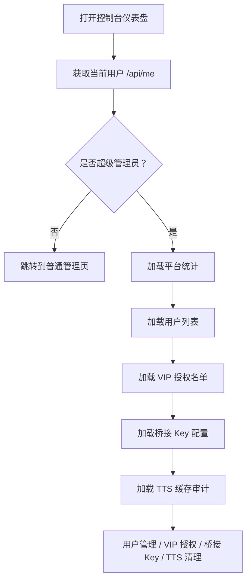
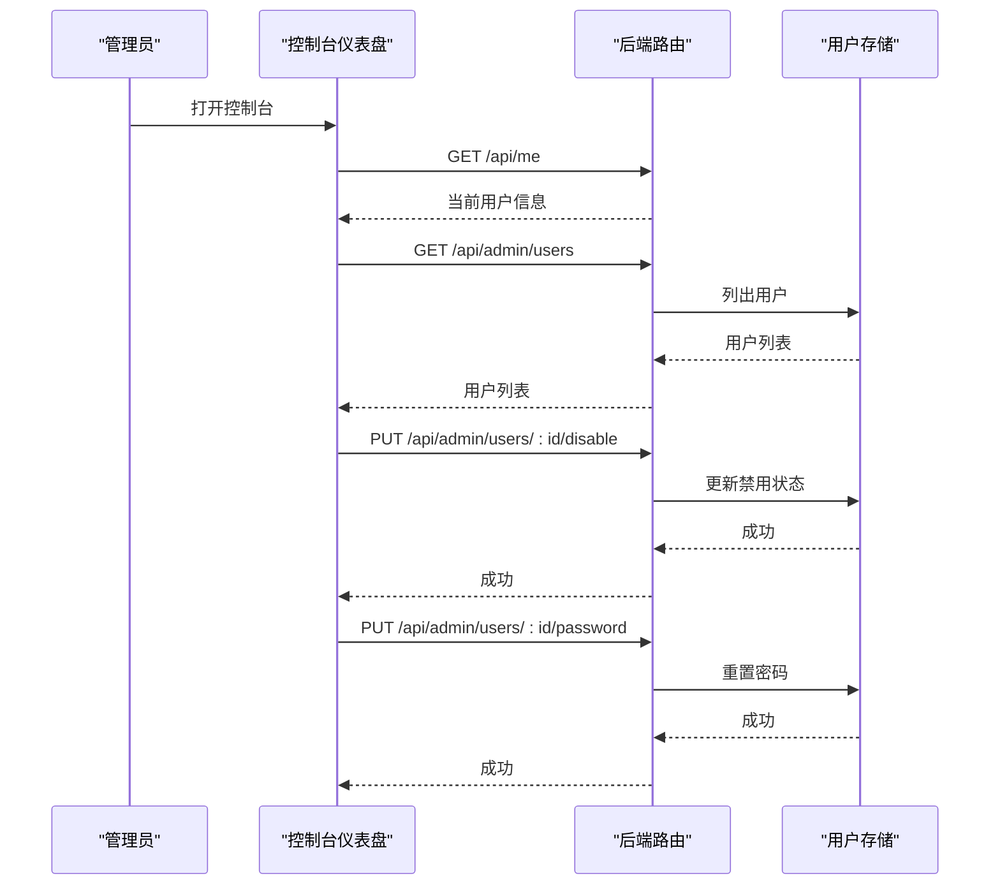
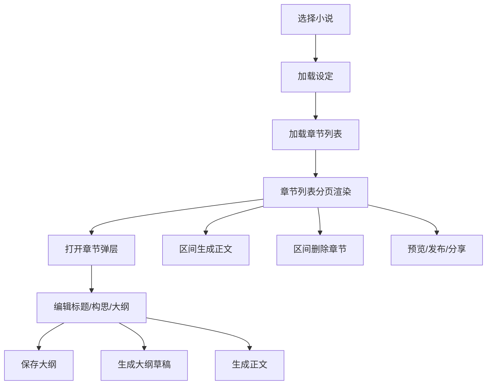
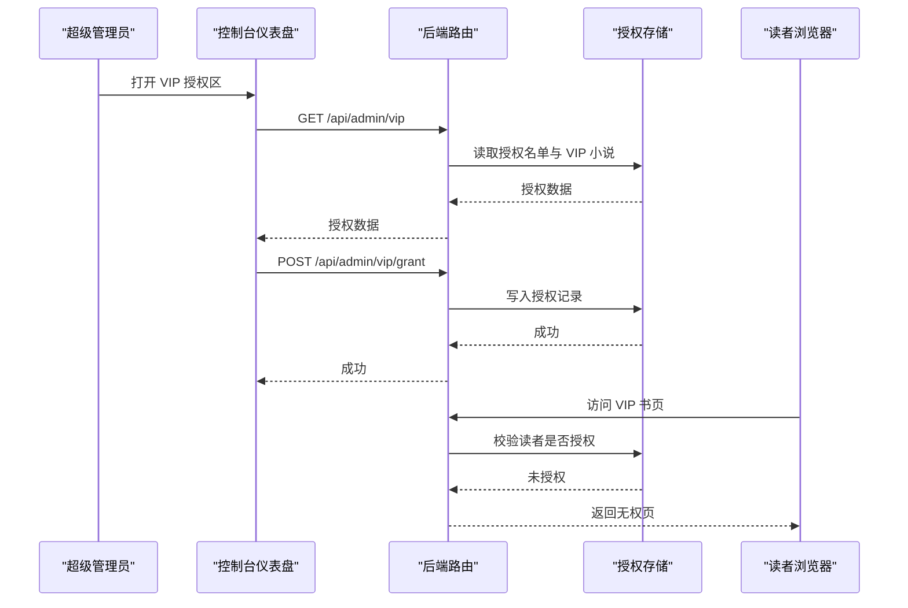
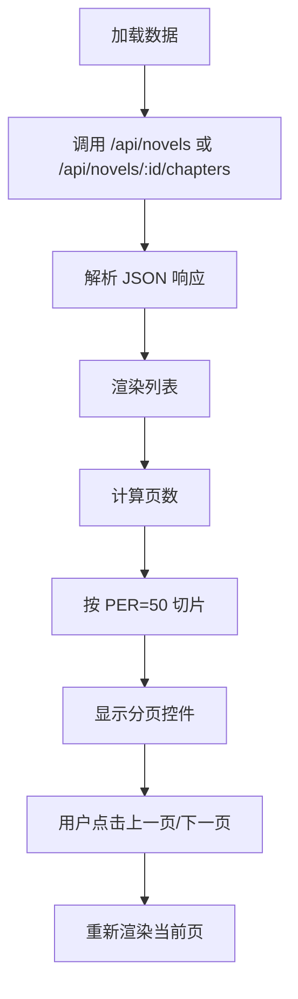
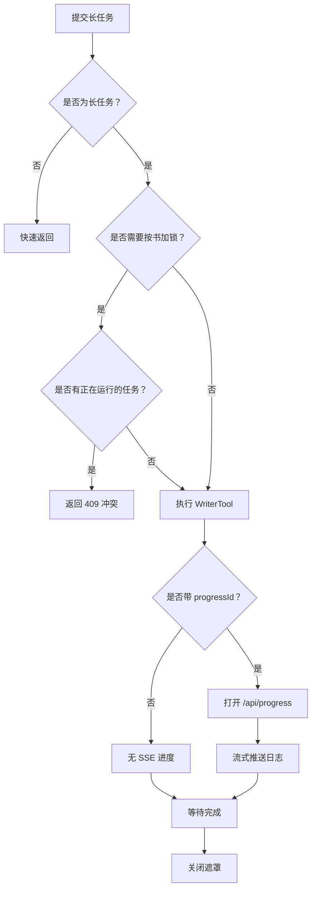
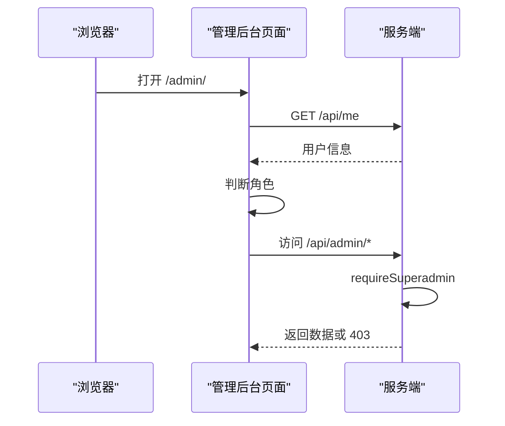
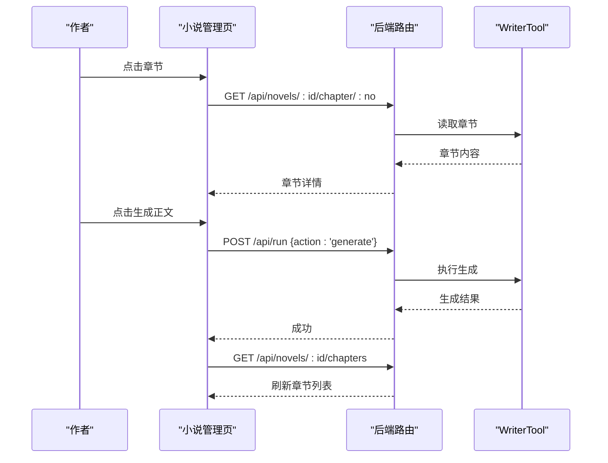

# 管理后台仪表盘

<cite>
**本文引用的文件**   
- [dashboard.html](file://public/admin/dashboard.html)
- [index.html](file://public/admin/index.html)
- [routes.js](file://src/routes.js)
</cite>

## 目录
1. [简介](#简介)
2. [项目结构与管理入口](#项目结构与管理入口)
3. [仪表盘总览与界面布局](#仪表盘总览与界面布局)
4. [用户管理功能](#用户管理功能)
5. [小说管理功能](#小说管理功能)
6. [VIP 授权与权限控制](#vip-授权与权限控制)
7. [数据加载、分页与搜索过滤](#数据加载分页与搜索过滤)
8. [长任务、进度与错误处理](#长任务进度与错误处理)
9. [架构与交互流程图](#架构与交互流程图)
10. [性能与运维特性](#性能与运维特性)
11. [故障排查指南](#故障排查指南)
12. [结论](#结论)

## 简介
本文档面向管理后台的使用者与二次开发者，系统化说明“管理后台仪表盘”的界面布局、用户管理、小说管理、VIP 授权、数据加载机制、分页处理、搜索过滤、批量操作以及错误处理。系统包含两个主要前端页面：

- **控制台（仪表盘）**：`public/admin/dashboard.html`，负责平台概览、用户管理、VIP 读者授权、推理服务连接配置、朗读音频缓存体检与清理。
- **小说管理页**：`public/admin/index.html`，负责作品列表、章节编辑、大纲生成、正文生成、批量加章/删章、预览发布、菜单与 AI 工具执行。

后端统一由 `src/routes.js` 提供 REST API，并实现鉴权、租户隔离、VIP 闸门、长任务互斥、SSE 进度推送等核心逻辑。

## 项目结构与管理入口
管理后台通过 Express 路由暴露以下关键路径：

| 路径 | 用途 | 鉴权要求 |
|---|---|---|
| `/api/login` | 登录，设置会话 Cookie | 公开 |
| `/api/logout` | 退出登录，清除会话 | 公开 |
| `/api/me` | 返回当前登录用户信息 | 公开读取，但依赖会话 |
| `/admin/` | 小说管理页 SPA 入口 | 登录后进入 |
| `/admin/dashboard.html` | 控制台仪表盘 | 仅超级管理员 |
| `/admin/:id` | 按 URL 选中某本小说的管理页 | 登录后进入 |
| `/api/novels` | 列举当前用户或全部小说 | 登录 |
| `/api/admin/*` | 用户、VIP、桥接 Key、TTS 审计等超管接口 | 超级管理员 |

```mermaid
graph TB
AdminIndex["小说管理页<br/>public/admin/index.html"] --> ApiRun["通用长任务接口<br/>/api/run"]
AdminIndex --> ApiNovels["小说列表接口<br/>/api/novels"]
AdminIndex --> ApiChapters["章节列表接口<br/>/api/novels/:id/chapters"]
AdminIndex --> ApiSettings["设定接口<br/>/api/novels/:id/settings"]
AdminIndex --> ApiPreview["预览接口<br/>/api/novels/:id/preview"]
AdminIndex --> ApiPublish["发布接口<br/>/api/novels/:id/publish"]
Dashboard["控制台仪表盘<br/>public/admin/dashboard.html"] --> ApiAdminUsers["用户管理接口<br/>/api/admin/users"]
Dashboard --> ApiAdminVip["VIP 授权接口<br/>/api/admin/vip"]
Dashboard --> ApiAdminBridge["桥接 Key 接口<br/>/api/admin/bridge"]
Dashboard --> ApiAdminTts["TTS 审计接口<br/>/api/admin/tts/audio"]
Routes["后端路由<br/>src/routes.js"] --> ApiRun
Routes --> ApiNovels
Routes --> ApiChapters
Routes --> ApiSettings
Routes --> ApiPreview
Routes --> ApiPublish
Routes --> ApiAdminUsers
Routes --> ApiAdminVip
Routes --> ApiAdminBridge
Routes --> ApiAdminTts
```

**图表来源**
- [index.html:127-142](file://public/admin/index.html#L127-L142)
- [dashboard.html:52-57](file://public/admin/dashboard.html#L52-L57)
- [routes.js:341-350](file://src/routes.js#L341-L350)
- [routes.js:639-644](file://src/routes.js#L639-L644)
- [routes.js:1250-1360](file://src/routes.js#L1250-L1360)

**章节来源**
- [routes.js:341-350](file://src/routes.js#L341-L350)
- [routes.js:639-644](file://src/routes.js#L639-L644)
- [routes.js:1362-1368](file://src/routes.js#L1362-L1368)

## 仪表盘总览与界面布局
控制台仪表盘采用深色移动端优先布局，顶部固定导航栏显示当前用户名、跳转按钮和退出按钮；主体内容按区块划分：

| 区块 | 展示内容 | 主要交互 |
|---|---|---|
| 平台概览 | 用户总数、已禁用数、小说总数、VIP 授权数 | 自动刷新统计 |
| 新建用户 | 用户名、密码、角色选择 | 添加用户 |
| 用户列表 | 用户名、角色、状态、上次登录、小说数量、操作 | 启用/禁用、重置密码 |
| VIP 读者授权 | 读者账号、可读范围、有效天数、备注、授权列表 | 授予/续期、撤销/恢复 |
| 推理服务连接 | 当前生效 Key、地址覆盖、Key 列表 | 新增、启用/停用、测试、改名、删除 |
| 朗读音频缓存 | 总体统计、按音色汇总、按音色×语速明细 | 重新体检、清理音库或指定档位 |

**图表来源**
- [dashboard.html:160-180](file://public/admin/dashboard.html#L160-L180)
- [dashboard.html:182-207](file://public/admin/dashboard.html#L182-L207)
- [dashboard.html:235-257](file://public/admin/dashboard.html#L235-L257)
- [dashboard.html:309-332](file://public/admin/dashboard.html#L309-L332)
- [dashboard.html:412-427](file://public/admin/dashboard.html#L412-L427)

**章节来源**
- [dashboard.html:52-132](file://public/admin/dashboard.html#L52-L132)
- [dashboard.html:160-180](file://public/admin/dashboard.html#L160-L180)

## 用户管理功能
用户管理集中在控制台仪表盘的“新建用户”和“用户列表”区域，支持创建普通用户与超级管理员，并对已有用户进行启用/禁用和密码重置。

### 用户列表字段
| 字段 | 含义 | 行为 |
|---|---|---|
| 用户名 | 登录账号 | 可点击重置密码（非本人） |
| 角色 | 普通用户或超级管理员 | 只读 |
| 状态 | 启用或禁用 | 可切换 |
| 上次登录 | 最近一次登录时间 | 格式化显示 |
| 小说 | 该用户关联的小说数量 | 只读统计 |
| 操作 | 重置密码、启用/禁用 | 受本人保护限制 |

### 用户管理 API
| 接口 | 方法 | 作用 | 校验 |
|---|---|---|---|
| `/api/admin/users` | GET | 列出所有用户 | 超级管理员 |
| `/api/admin/users` | POST | 创建用户 | 用户名、密码必填 |
| `/api/admin/users/:id/disable` | PUT | 启用/禁用用户 | 不能禁用自己 |
| `/api/admin/users/:id/password` | PUT | 重置用户密码 | 密码至少 4 位 |

**图表来源**
- [dashboard.html:182-229](file://public/admin/dashboard.html#L182-L229)
- [routes.js:1250-1264](file://src/routes.js#L1250-L1264)

**章节来源**
- [dashboard.html:69-82](file://public/admin/dashboard.html#L69-L82)
- [dashboard.html:182-229](file://public/admin/dashboard.html#L182-L229)
- [routes.js:1250-1264](file://src/routes.js#L1250-L1264)

## 小说管理功能
小说管理页是创作者主工作台，顶部有小说选择器、刷新、新建、AI 链路状态灯；主体分为“流程管理”和“菜单 + AI”两个标签页。

### 界面布局
| 区域 | 功能 |
|---|---|
| 顶部导航 | 书名、刷新、新建、AI 链路检测、控制台跳转、退出 |
| 流程管理 | ① 小说设定、② 生成大纲、②b 加章/补大纲、③ 章节列表 |
| 菜单 + AI | 动态加载后端菜单组，执行 WriterTool 动作 |
| 底部命令栏 | 自然语言指令，交由 AI 解析为工具调用 |
| 结果区 | 显示操作结果、进度日志、错误提示 |

### 核心能力
- **作品列表**：从 `/api/novels` 拉取，支持 URL 直接定位小说。
- **章节编辑**：点击章节弹出弹层，可修改标题、构思、大纲，查看正文，生成大纲草稿，保存大纲，生成正文，删除章节。
- **批量操作**：区间生成正文、区间删除章节、重排编号、一致性检查、预览、发布、分享链接。
- **AI 辅助**：LLM 链路预检、单章大纲草稿、菜单动作、AI 计划与执行。

**图表来源**
- [index.html:442-467](file://public/admin/index.html#L442-L467)
- [index.html:796-825](file://public/admin/index.html#L796-L825)
- [index.html:876-980](file://public/admin/index.html#L876-L980)
- [index.html:1065-1137](file://public/admin/index.html#L1065-L1137)

**章节来源**
- [index.html:127-142](file://public/admin/index.html#L127-L142)
- [index.html:144-243](file://public/admin/index.html#L144-L243)
- [index.html:442-467](file://public/admin/index.html#L442-L467)
- [index.html:796-825](file://public/admin/index.html#L796-L825)
- [index.html:876-980](file://public/admin/index.html#L876-L980)
- [index.html:1065-1137](file://public/admin/index.html#L1065-L1137)

## VIP 授权与权限控制
VIP 不再使用共享密码，而是“书级开关 + 读者账号授权名单”。

- **书级开关**：在小说管理页“① 小说设定”下方开启本书为 VIP。
- **读者授权**：在控制台“💎 VIP 读者授权”中给读者账号授予全站 VIP 或某本书的访问权限，可设置有效期和备注。
- **阅读侧门禁**：站点首页隐藏未授权 VIP 书；章节请求实时校验，撤销或到期立即生效。

### VIP 相关 API
| 接口 | 方法 | 作用 |
|---|---|---|
| `/api/novels/:id/vip` | GET | 查询本书是否 VIP 及已授权读者 |
| `/api/novels/:id/vip` | PUT | 设置本书 VIP 开关 |
| `/api/admin/vip` | GET | 超管查看授权名单、VIP 小说、用户列表 |
| `/api/admin/vip/grant` | POST | 授予或续期 VIP |
| `/api/admin/vip/:id` | DELETE | 撤销授权 |
| `/api/admin/vip/:id/restore` | POST | 恢复被撤销授权 |

**图表来源**
- [dashboard.html:84-98](file://public/admin/dashboard.html#L84-L98)
- [dashboard.html:235-280](file://public/admin/dashboard.html#L235-L280)
- [routes.js:1186-1294](file://src/routes.js#L1186-L1294)
- [routes.js:1035-1094](file://src/routes.js#L1035-L1094)

**章节来源**
- [index.html:171-179](file://public/admin/index.html#L171-L179)
- [index.html:643-654](file://public/admin/index.html#L643-L654)
- [dashboard.html:84-98](file://public/admin/dashboard.html#L84-L98)
- [dashboard.html:235-280](file://public/admin/dashboard.html#L235-L280)
- [routes.js:1186-1294](file://src/routes.js#L1186-L1294)
- [routes.js:1035-1094](file://src/routes.js#L1035-L1094)

## 数据加载、分页与搜索过滤
### 数据加载机制
- 前端通过统一的 `api()` 封装发起请求，自动处理 401 登录过期、JSON 解析失败、HTTP 错误。
- 长任务通过 `/api/run` 提交 action，后端根据 action 类型决定是否开启 SSE 进度通道。
- 进度通道 `/api/progress` 使用 EventSource 流式推送逐章日志，前端遮罩延迟 600ms 出现，避免快请求抖动。

### 分页处理
小说管理页章节列表默认每页 50 章，前端维护当前页码，渲染时切片 `CHAPS.slice(page * PER, page * PER + PER)`，并提供上一页/下一页按钮。

### 搜索过滤
当前代码库中：
- 用户列表没有前端搜索框，只有表格展示与操作按钮。
- 章节列表没有搜索框，只有范围选择（从第几章到第几章）和分页。
- 小说列表也没有前端搜索框，主要通过下拉选择与 URL 定位。

因此，“搜索过滤”在当前版本中更多体现为**范围筛选**与**分页浏览**，而非关键词检索。

**图表来源**
- [index.html:358-379](file://public/admin/index.html#L358-L379)
- [index.html:796-825](file://public/admin/index.html#L796-L825)
- [routes.js:639-644](file://src/routes.js#L639-L644)
- [routes.js:686-708](file://src/routes.js#L686-L708)

**章节来源**
- [index.html:358-379](file://public/admin/index.html#L358-L379)
- [index.html:796-825](file://public/admin/index.html#L796-L825)
- [routes.js:639-644](file://src/routes.js#L639-L644)
- [routes.js:686-708](file://src/routes.js#L686-L708)

## 长任务、进度与错误处理
### 长任务模型
- 前端将需要长时间运行的操作归类为“慢任务”，包括生成大纲、生成正文、发布、预览、一致性检查等。
- 后端对部分 action 按小说维度加锁，防止同一本书并发生成导致资源竞争。
- SSE 进度通道缓冲近期事件，解决“先发起任务后建立 SSE”的竞态问题。

### 错误处理策略
- 401：自动跳转到登录页。
- HTTP 非 2xx：抛出错误消息，前端 toast 或结果区显示。
- 删除类操作：强制要求 `confirm:"OK"`，前端弹出独立确认层输入 OK。
- 区间批量操作：先干跑再确认，避免误删。
- LLM 链路不通：预检拦截，不写坏数据。

**图表来源**
- [index.html:301-373](file://public/admin/index.html#L301-L373)
- [routes.js:573-627](file://src/routes.js#L573-L627)
- [routes.js:914-973](file://src/routes.js#L914-L973)

**章节来源**
- [index.html:301-373](file://public/admin/index.html#L301-L373)
- [routes.js:573-627](file://src/routes.js#L573-L627)
- [routes.js:914-973](file://src/routes.js#L914-L973)

## 架构与交互流程图
### 用户登录与权限校验

**图表来源**
- [routes.js:341-350](file://src/routes.js#L341-L350)
- [routes.js:559-564](file://src/routes.js#L559-L564)
- [routes.js:1250-1264](file://src/routes.js#L1250-L1264)

### 章节编辑与正文生成

**图表来源**
- [index.html:876-980](file://public/admin/index.html#L876-L980)
- [index.html:1038-1047](file://public/admin/index.html#L1038-L1047)
- [routes.js:710-725](file://src/routes.js#L710-L725)
- [routes.js:914-973](file://src/routes.js#L914-L973)

**章节来源**
- [index.html:876-980](file://public/admin/index.html#L876-L980)
- [index.html:1038-1047](file://public/admin/index.html#L1038-L1047)
- [routes.js:710-725](file://src/routes.js#L710-L725)
- [routes.js:914-973](file://src/routes.js#L914-L973)

## 性能与运维特性
- **章节列表优化**：服务端不再整本拉正文，改用 `includeContent:false` 并按 `contentLength` 统计字数，减少内存占用。
- **长任务互斥**：同一本书同时只允许一个生成任务，避免并发压垮推理服务。
- **SSE 进度缓冲**：解决 SSE 建立晚于任务启动导致的进度丢失。
- **TTS 缓存审计**：按音色、语速统计缓存条数与占用，支持干跑确认后再清理。
- **桥接 Key 运行时切换**：控制台可切换 aibridge API Key，无需重启服务。

**章节来源**
- [routes.js:686-708](file://src/routes.js#L686-L708)
- [routes.js:914-973](file://src/routes.js#L914-L973)
- [routes.js:573-627](file://src/routes.js#L573-L627)
- [routes.js:1342-1360](file://src/routes.js#L1342-L1360)
- [routes.js:1296-1340](file://src/routes.js#L1296-L1340)

## 故障排查指南
| 现象 | 可能原因 | 排查建议 |
|---|---|---|
| 控制台无法打开 | 不是超级管理员 | 检查 `/api/me` 返回的 role |
| 用户管理接口 403 | 非超级管理员 | 使用超管账号登录 |
| 章节生成失败 | LLM 链路不通 | 查看 AI 链路状态灯，检查桥接 Key |
| 区间生成卡住 | 同书并发任务 | 等待前一个任务结束，避免重复点击 |
| 删除章节无反应 | 未输入 OK | 使用独立确认层输入 OK |
| VIP 书页打不开 | 未授权或已撤销 | 在控制台授予或恢复授权 |
| TTS 清理无效 | 未干跑确认 | 先点干跑看匹配条数，再确认执行 |
| 进度日志丢失 | SSE 建立晚 | 后端已缓冲近期事件，重试连接 |

**章节来源**
- [dashboard.html:160-180](file://public/admin/dashboard.html#L160-L180)
- [index.html:400-417](file://public/admin/index.html#L400-L417)
- [index.html:502-538](file://public/admin/index.html#L502-L538)
- [routes.js:914-973](file://src/routes.js#L914-L973)
- [routes.js:1035-1094](file://src/routes.js#L1035-L1094)
- [routes.js:1342-1360](file://src/routes.js#L1342-L1360)

## 结论
管理后台仪表盘以控制台和小说管理页为核心，分别承担平台运维与创作工作流职责。用户管理、VIP 授权、桥接 Key 配置、TTS 缓存审计构成控制台能力；小说设定、大纲生成、正文生成、批量操作、预览发布、AI 工具构成小说管理能力。系统在鉴权、租户隔离、长任务互斥、SSE 进度、VIP 闸门等方面提供了完整保障。当前版本的分页与范围筛选足够支撑日常创作，若后续需要关键词搜索，可在前端增加搜索框并在后端扩展对应查询接口。