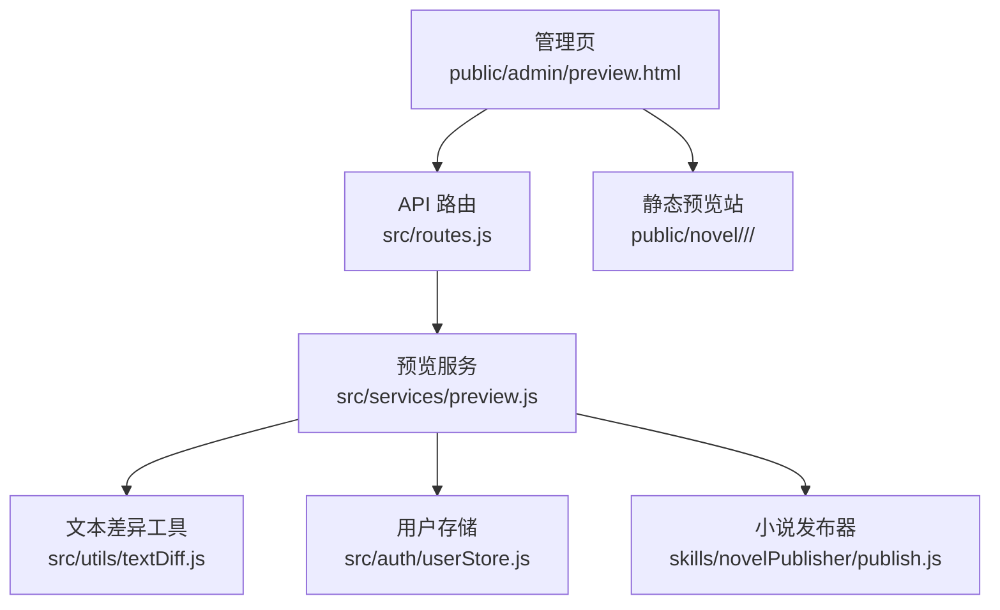
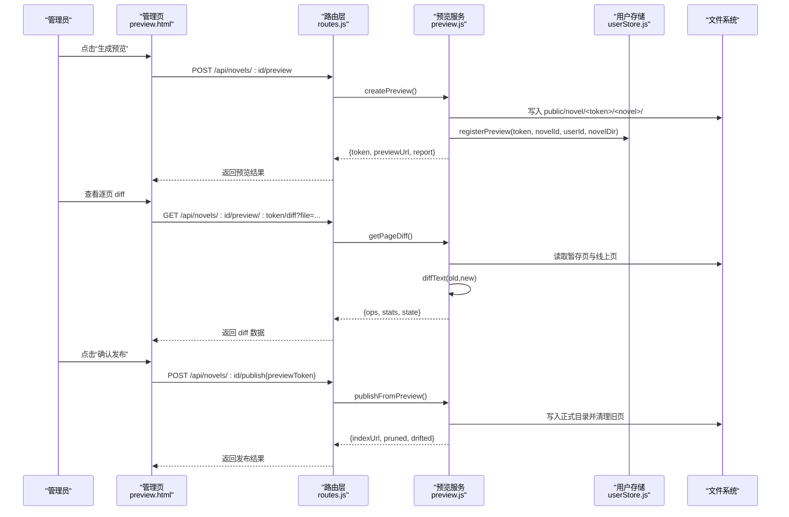
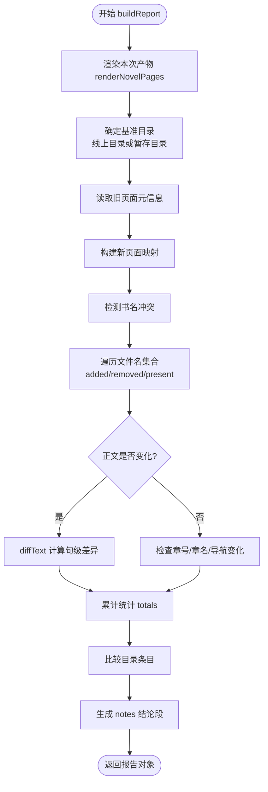
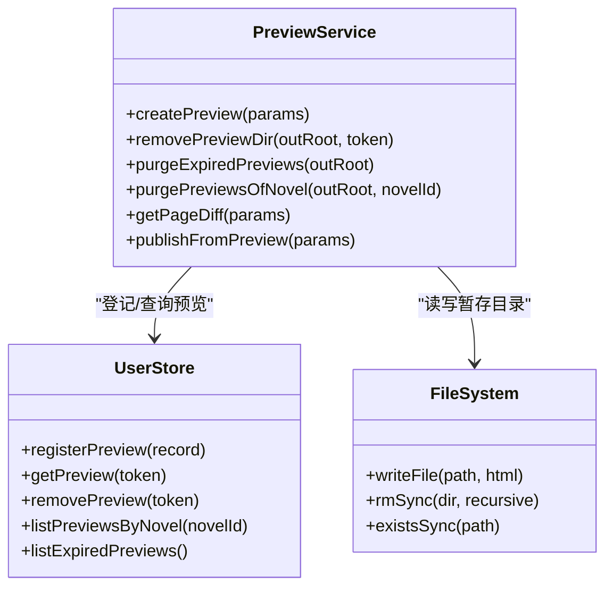
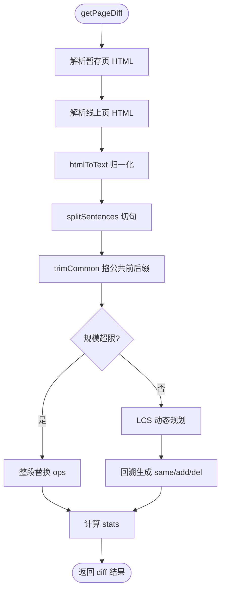
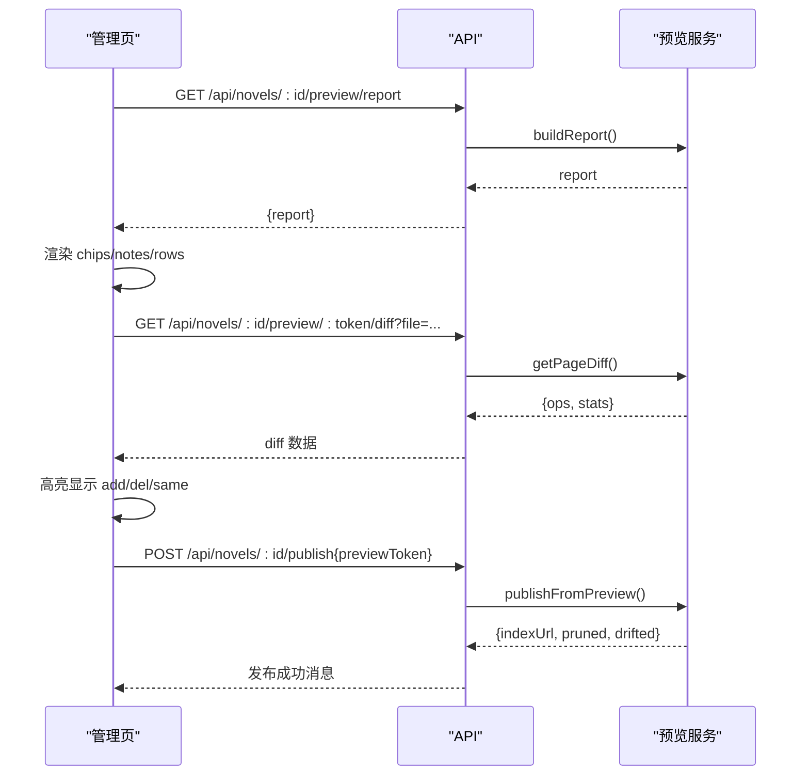
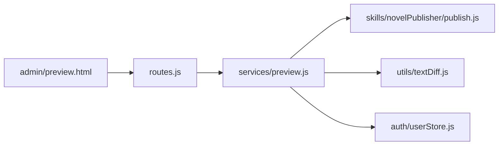

# 预览系统

<cite>
**本文引用的文件**   
- [src/services/preview.js](file://src/services/preview.js)
- [public/admin/preview.html](file://public/admin/preview.html)
- [src/utils/textDiff.js](file://src/utils/textDiff.js)
- [src/auth/userStore.js](file://src/auth/userStore.js)
- [src/routes.js](file://src/routes.js)
</cite>

## 目录
1. [简介](#简介)
2. [项目结构](#项目结构)
3. [核心组件](#核心组件)
4. [架构总览](#架构总览)
5. [详细组件分析](#详细组件分析)
6. [依赖关系分析](#依赖关系分析)
7. [性能与复杂度](#性能与复杂度)
8. [故障排查](#故障排查)
9. [结论](#结论)

## 简介
本预览系统用于在「整本发布」前，把即将生成的静态站点落到一个带 token 的暂存目录中，提供真实可翻阅的预览站，并生成修改报告：逐页对比线上已发布版本或另一份暂存预览，标注新增、正文改动、连带影响（如章号顺延、翻页链接变化）、待下线页面等。前端管理页支持打开预览站、重新生成、只看变化、作废预览和确认发布；单页 diff 支持文本差异高亮与版本切换。

## 项目结构
预览系统由后端服务、前端管理页、文本差异工具、用户存储与路由四个层次组成：

**图表来源**
- [src/routes.js:1120-1184](file://src/routes.js#L1120-L1184)
- [src/services/preview.js:1-473](file://src/services/preview.js#L1-L473)
- [public/admin/preview.html:98-307](file://public/admin/preview.html#L98-L307)
- [src/utils/textDiff.js:1-156](file://src/utils/textDiff.js#L1-L156)
- [src/auth/userStore.js:351-378](file://src/auth/userStore.js#L351-L378)

**章节来源**
- [src/routes.js:1120-1184](file://src/routes.js#L1120-L1184)
- [src/services/preview.js:1-473](file://src/services/preview.js#L1-L473)
- [public/admin/preview.html:1-311](file://public/admin/preview.html#L1-L311)
- [src/utils/textDiff.js:1-156](file://src/utils/textDiff.js#L1-L156)
- [src/auth/userStore.js:351-378](file://src/auth/userStore.js#L351-L378)

## 核心组件
- 预览服务：负责渲染预览产物、生成修改报告、创建/删除暂存站、计算单页 diff、从预览确认发布。
- 文本差异工具：按句进行 LCS 差异计算，输出 ops 与 stats，供前端高亮显示。
- 用户存储：持久化 preview 登记行，记录 token、归属小说、创建/过期时间，并提供过期清理查询。
- 路由层：暴露预览创建、报告读取、单页 diff、作废预览、确认发布等接口，并对预览站点做访问控制。
- 管理页：展示总览、逐页说明、正文 diff、操作按钮，驱动整个预览流程。

**章节来源**
- [src/services/preview.js:1-473](file://src/services/preview.js#L1-L473)
- [src/utils/textDiff.js:1-156](file://src/utils/textDiff.js#L1-L156)
- [src/auth/userStore.js:351-378](file://src/auth/userStore.js#L351-L378)
- [src/routes.js:1120-1184](file://src/routes.js#L1120-L1184)
- [public/admin/preview.html:98-307](file://public/admin/preview.html#L98-L307)

## 架构总览
预览系统的整体交互如下：

**图表来源**
- [src/routes.js:1120-1184](file://src/routes.js#L1120-L1184)
- [src/services/preview.js:328-470](file://src/services/preview.js#L328-L470)
- [public/admin/preview.html:257-291](file://public/admin/preview.html#L257-L291)

## 详细组件分析

### 修改报告生成
修改报告的核心思路是：先渲染本次产物，再与基准目录（线上已发布目录或另一份暂存预览）逐页比对，提取标题、正文纯文本、章节编号、前后章链接等信息，计算新增、修改、未变、待下线、连带影响等统计，并给出人类可读的 notes。

关键实现要点：
- 正文比较口径：去掉 `<h1>` 大标题与分部 kicker 后转纯文本，避免排版噪声干扰。
- 页面元信息解析：从 title 与导航链接还原章节编号、章名、prev/next。
- 目录页差异：单独比较 index.html 条目增删与顺序变化。
- 书名冲突检测：同名书共用发布目录时，不盲目删除旧页，仅提示风险。

**图表来源**
- [src/services/preview.js:117-273](file://src/services/preview.js#L117-L273)
- [src/services/preview.js:275-322](file://src/services/preview.js#L275-L322)

**章节来源**
- [src/services/preview.js:117-273](file://src/services/preview.js#L117-L273)
- [src/services/preview.js:275-322](file://src/services/preview.js#L275-L322)

### 暂存站点管理
暂存站点以 `public/novel/<token>/<novelDir>/` 形式落盘，结构与线上站点一致，可直接通过浏览器翻阅。每个预览都登记到数据库，包含 token、所属小说、创建者、目录名、创建时间与过期时间。

生命周期职责：
- 创建：渲染产物、写文件、注册登记、生成首页索引、返回 token 与预览 URL。
- 删除：校验 token 格式，递归删除暂存目录，移除登记行。
- 过期清理：按 expires_at 查询过期登记，逐个删除对应目录。
- 小说删除前清理：先清所有该小说的预览目录，再删登记行，防止残留。

**图表来源**
- [src/services/preview.js:328-389](file://src/services/preview.js#L328-L389)
- [src/auth/userStore.js:351-378](file://src/auth/userStore.js#L351-L378)

**章节来源**
- [src/services/preview.js:328-389](file://src/services/preview.js#L328-L389)
- [src/auth/userStore.js:351-378](file://src/auth/userStore.js#L351-L378)

### 逐页 Diff 功能
逐页 diff 基于句级 LCS 算法，将 HTML 正文转为纯文本后按段落与中文句末标点切句，计算 add/del/same 序列，并附带统计信息（句子数、字数、粗粒度退化标记）。前端根据 ops 渲染红绿高亮，同时展示标题与翻页链接变化。

实现要点：
- 文本归一化：去标签、实体解码、空白压缩。
- 断句策略：保留段落边界，处理引号/括号收尾的句号。
- 公共前后缀裁剪：长文重写场景下先掐掉两端相同部分，降低 DP 规模。
- 安全上限：超过 SAFETY_LIMIT 时退化为整段替换，保证预览不会卡死。
- 前端展示：头部显示新旧字数/句数，ops 按阅读顺序渲染，nav 变化单独列出。

**图表来源**
- [src/services/preview.js:391-414](file://src/services/preview.js#L391-L414)
- [src/utils/textDiff.js:84-145](file://src/utils/textDiff.js#L84-L145)

**章节来源**
- [src/services/preview.js:391-414](file://src/services/preview.js#L391-L414)
- [src/utils/textDiff.js:1-156](file://src/utils/textDiff.js#L1-L156)

### 预览页面与管理流程
管理页负责加载报告、渲染总览卡片、展开逐页原因与 diff、驱动预览站跳转、重新生成、作废与发布。其核心流程包括：
- 加载报告：调用 `/api/novels/:id/preview/report`，默认与线上正式目录比对，也可传 token 与另一份预览比对。
- 渲染总览：根据 summary 显示页数、章节、新增、正文改动、连带影响、待下线、句增减、字数差、目录页变化等。
- 渲染逐页：每行显示状态徽章、标题、文件名、字数，展开后可见 reasons、stats 与 diff 按钮。
- 操作按钮：打开预览站、重新生成、只看变化、作废预览、确认发布。

**图表来源**
- [public/admin/preview.html:241-291](file://public/admin/preview.html#L241-L291)
- [src/routes.js:1140-1184](file://src/routes.js#L1140-L1184)

**章节来源**
- [public/admin/preview.html:98-307](file://public/admin/preview.html#L98-L307)
- [src/routes.js:1140-1184](file://src/routes.js#L1140-L1184)

### 与后端服务的交互协议和数据格式
主要接口如下：

| 方法 | 路径 | 请求体 | 响应字段 | 说明 |
|---|---|---|---|---|
| POST | `/api/novels/:id/preview` | `{title?, premakeQuiz?, quizAge?}` | `{success, token, previewUrl, novelDir, chapterCount, report}` | 生成暂存预览站并返回报告 |
| GET | `/api/novels/:id/preview/report` | `?ref=live|preview&token=&title=` | `{success, report}` | 获取修改报告，默认与线上比对 |
| GET | `/api/novels/:id/preview/:token/diff` | `?file=chapter_x.html` | `{success, file, state, old, current, stats, ops}` | 单页正文 diff |
| DELETE | `/api/novels/:id/preview/:token` | 无 | `{ok}` | 作废预览，删除暂存目录 |
| POST | `/api/novels/:id/publish` | `{previewToken?, premakeQuiz?, quizAge?, title?}` | `{success, novelDir, indexUrl, chapterCount, files, pruned, pruneSkipped, fromPreview, drifted}` | 确认发布，可从预览基准重渲染 |

数据关键字段说明：
- report.summary：pages、chapters、added、modified、unchanged、removed、cascadeOnly、sentencesAdded、sentencesRemoved、charsDelta、indexChanged、reNumbered、renamed。
- report.items：filename、kind、state、label、reasons、stats、diffAvailable、cascade、removed、contentLength。
- diff.ops：type 为 same/add/del，text 为句文本，para 为段落序号。
- diff.stats：sentencesOld/New、added、removed、unchanged、charsOld/New/Delta、coarse。

**章节来源**
- [src/routes.js:1120-1184](file://src/routes.js#L1120-L1184)
- [src/services/preview.js:117-273](file://src/services/preview.js#L117-L273)
- [src/services/preview.js:391-414](file://src/services/preview.js#L391-L414)

## 依赖关系分析
预览服务依赖以下模块：
- 小说发布器：渲染章节页、目录页、清理孤儿页、生成站点首页。
- 文本差异工具：句级 diff 与行级 diff。
- 用户存储：预览登记、过期查询、小说列表。
- 路由层：鉴权、租户隔离、限流、VIP 闸门。

**图表来源**
- [src/routes.js:22-27](file://src/routes.js#L22-L27)
- [src/services/preview.js:14-21](file://src/services/preview.js#L14-L21)

**章节来源**
- [src/routes.js:22-27](file://src/routes.js#L22-L27)
- [src/services/preview.js:14-21](file://src/services/preview.js#L14-L21)

## 性能与复杂度
- 文本差异：句级 LCS 使用二维数组 dp，时间复杂度 O(n×m)，空间复杂度 O(n×m)。为避免大文档卡顿，超过 SAFETY_LIMIT 时退化为整段替换，仍保持统计准确。
- 报告生成：对每个页面执行 HTML 解析与文本归一化，总体复杂度与页面数量线性相关；目录页比较为 O(k) 条目对齐。
- 暂存站创建：文件写入 I/O 为主，渲染阶段可能触发 LLM 预生成（可选），默认预览关闭 LLM 以提升速度。
- 过期清理：按需扫描过期登记并删除目录，避免引入定时器，减少后台任务复杂度。

[本节为通用性能讨论，不直接分析具体代码文件]

## 故障排查
常见问题与定位建议：
- 预览链接 401：预览站需要创作者本人或超管登录态；若未登录或 token 不存在，会返回无权页。
- 报告与 diff 不一致：确保报告与 diff 使用同一基准；前端默认 ref=live，如需与另一份预览比对需传 token。
- 发布后旧页未删除：同名书共用发布目录时会跳过清理，需在报告中查看 pruneSkipped 提示。
- 预览过期：默认 TTL 为 24 小时；过期后需重新生成预览。
- 单页 diff 参数非法：file 必须匹配 `[\w.-]+\.html$` 且不含 `..`。

**章节来源**
- [src/routes.js:1040-1094](file://src/routes.js#L1040-L1094)
- [src/routes.js:1160-1184](file://src/routes.js#L1160-L1184)
- [src/auth/userStore.js:351-378](file://src/auth/userStore.js#L351-L378)

## 结论
预览系统通过暂存站点与修改报告，让作者在发布前能直观看到整本书的变化范围与连带影响；逐页 diff 提供句级高亮，帮助快速定位正文改动；生命周期管理确保临时文件自动清理与访问控制；与后端交互协议清晰，便于前端集成与扩展。建议在大规模改写场景下关注 LCS 退化策略，并在发布前检查书名冲突与旧页清理情况。