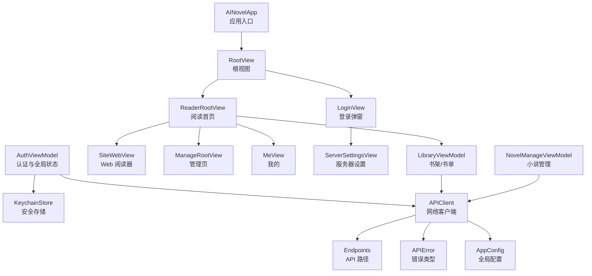
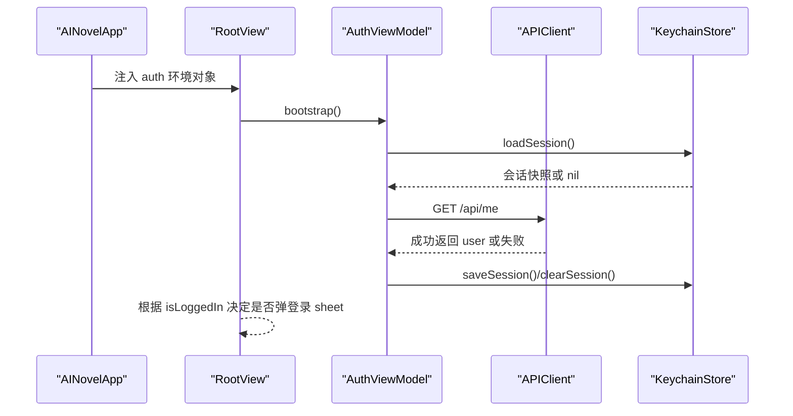
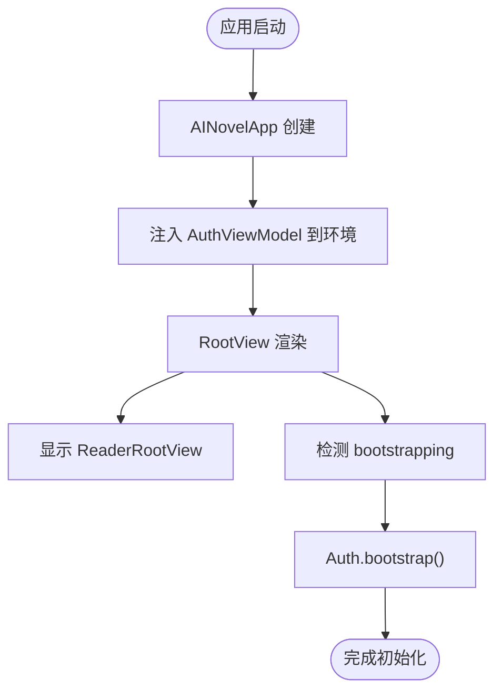
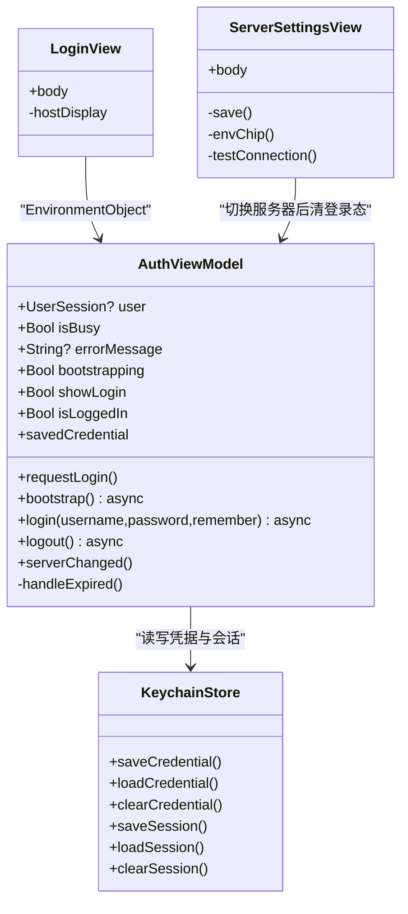
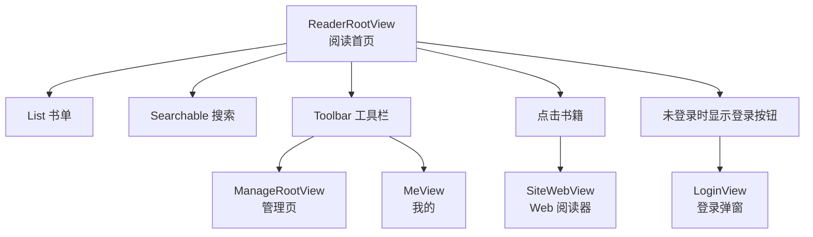
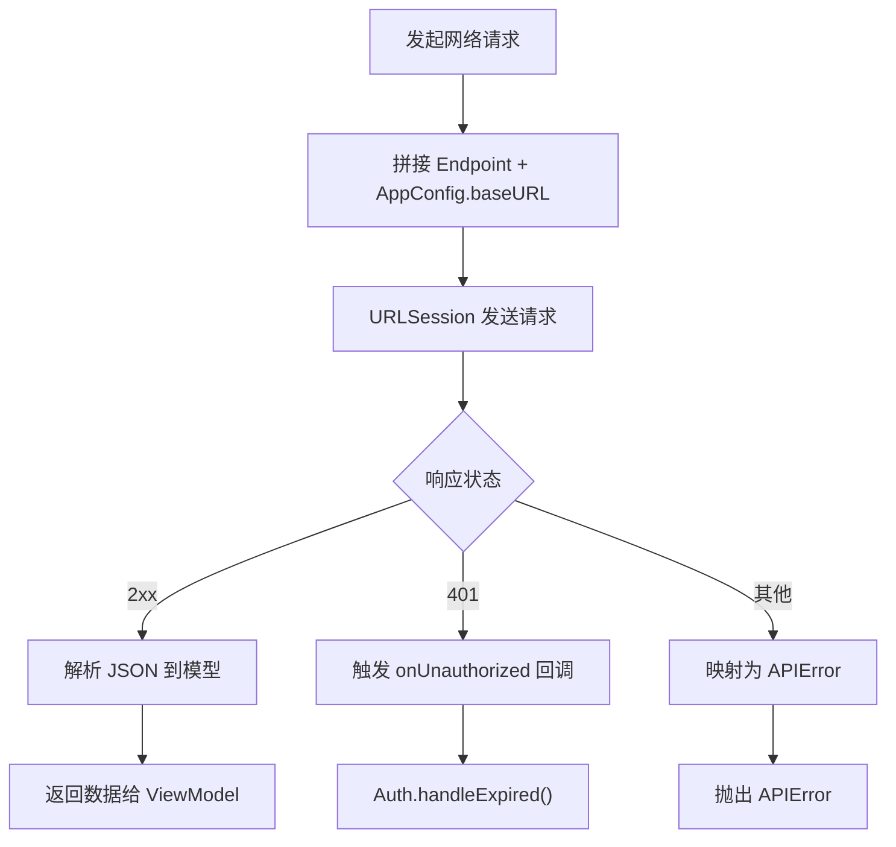
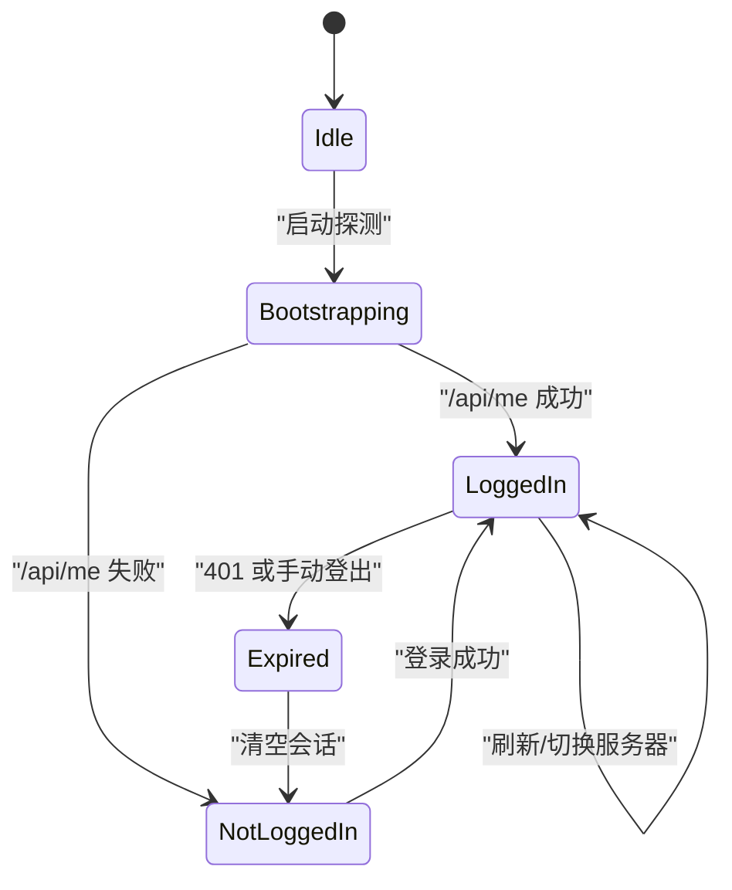
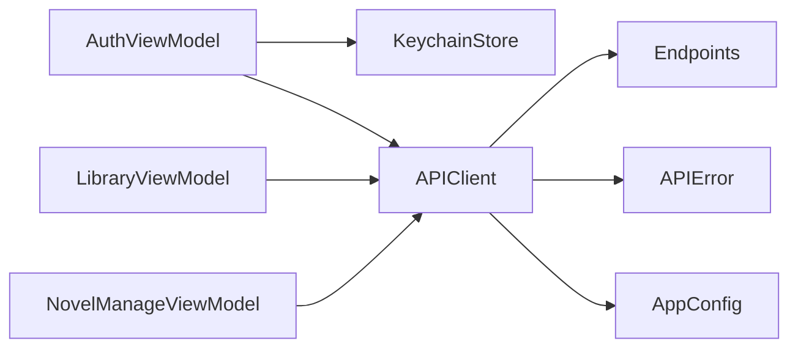

# iOS 原生应用

<cite>
**本文引用的文件**   
- [AINovelApp.swift](file://ios/AINovel/AINovelApp.swift)
- [RootView.swift](file://ios/AINovel/App/RootView.swift)
- [MainTabView.swift](file://ios/AINovel/App/MainTabView.swift)
- [AuthViewModel.swift](file://ios/AINovel/Auth/AuthViewModel.swift)
- [LoginView.swift](file://ios/AINovel/Auth/LoginView.swift)
- [ServerSettingsView.swift](file://ios/AINovel/Auth/ServerSettingsView.swift)
- [KeychainStore.swift](file://ios/AINovel/Security/KeychainStore.swift)
- [APIError.swift](file://ios/AINovel/Networking/APIError.swift)
- [Endpoints.swift](file://ios/AINovel/Networking/Endpoints.swift)
- [Models.swift](file://ios/AINovel/Models/Models.swift)
- [AppConfig.swift](file://ios/AINovel/Config/AppConfig.swift)
- [ReaderRootView.swift](file://ios/AINovel/Reader/ReaderRootView.swift)
- [LibraryViewModel.swift](file://ios/AINovel/Reader/LibraryViewModel.swift)
- [NovelManageViewModel.swift](file://ios/AINovel/Manage/NovelManageViewModel.swift)
</cite>

## 目录
1. [引言](#引言)
2. [项目结构](#项目结构)
3. [核心组件](#核心组件)
4. [架构总览](#架构总览)
5. [详细组件分析](#详细组件分析)
6. [依赖关系分析](#依赖关系分析)
7. [性能与体验优化](#性能与体验优化)
8. [故障排查指南](#故障排查指南)
9. [结论](#结论)
10. [附录：扩展示例](#附录扩展示例)

## 引言
本文件面向 iOS 开发者，系统化梳理 AINovel iOS 应用的 SwiftUI 架构、MVVM 设计、认证与会话管理、网络层封装、安全存储以及用户界面组织方式。文档不仅解释现有实现，还提供“如何新增视图控制器、发起网络请求、读写 Keychain”的可操作指引，帮助读者快速在现有代码基础上扩展功能。

该应用以 SwiftUI 为主，采用 MVVM 分层：
- View 层负责展示与交互；
- ViewModel 层负责状态、业务编排与网络调用；
- Networking 层统一封装 API 客户端、错误处理与序列化；
- Security 层通过 Keychain 保存凭据与会话快照；
- Config 层集中管理服务器地址与环境切换。

## 项目结构
iOS 端位于 `ios/AINovel` 目录，按功能域划分模块：
- App：应用入口、根视图、旧版 Tab 容器（当前默认阅读首页）
- Auth：认证逻辑、登录界面、服务器设置
- Reader：阅读首页、书架、阅读器相关视图与 ViewModel
- Manage：小说管理、章节编辑、发布等
- Models：数据模型与响应体
- Networking：API 错误类型与端点常量
- Security：Keychain 安全存储
- Config：全局配置（服务器地址、超时等）

图表来源
- [AINovelApp.swift:3-12](file://ios/AINovel/AINovelApp.swift#L3-L12)
- [RootView.swift:3-20](file://ios/AINovel/App/RootView.swift#L3-L20)
- [ReaderRootView.swift:6-78](file://ios/AINovel/Reader/ReaderRootView.swift#L6-L78)
- [AuthViewModel.swift:9-106](file://ios/AINovel/Auth/AuthViewModel.swift#L9-L106)
- [LibraryViewModel.swift:4-51](file://ios/AINovel/Reader/LibraryViewModel.swift#L4-L51)
- [NovelManageViewModel.swift:5-183](file://ios/AINovel/Manage/NovelManageViewModel.swift#L5-L183)
- [Endpoints.swift:5-50](file://ios/AINovel/Networking/Endpoints.swift#L5-L50)
- [APIError.swift:9-47](file://ios/AINovel/Networking/APIError.swift#L9-L47)
- [AppConfig.swift:11-110](file://ios/AINovel/Config/AppConfig.swift#L11-L110)

章节来源
- [AINovelApp.swift:3-12](file://ios/AINovel/AINovelApp.swift#L3-L12)
- [RootView.swift:3-20](file://ios/AINovel/App/RootView.swift#L3-L20)
- [MainTabView.swift:3-16](file://ios/AINovel/App/MainTabView.swift#L3-L16)

## 核心组件
- 应用入口与根视图：注入全局认证状态，启动时探测登录态并显示阅读首页。
- 认证模块：维护会话、处理登录/登出、记住密码、401 自动登出。
- 网络层：统一错误处理、端点定义、超时策略、Cookie 鉴权。
- 安全存储：Keychain 保存凭据与会话快照。
- 配置中心：多环境服务器地址、规范化 URL、超时参数。
- 视图与 ViewModel：阅读首页、书架、小说管理等 MVVM 组合。

章节来源
- [AINovelApp.swift:3-12](file://ios/AINovel/AINovelApp.swift#L3-L12)
- [AuthViewModel.swift:9-106](file://ios/AINovel/Auth/AuthViewModel.swift#L9-L106)
- [APIError.swift:9-47](file://ios/AINovel/Networking/APIError.swift#L9-L47)
- [Endpoints.swift:5-50](file://ios/AINovel/Networking/Endpoints.swift#L5-L50)
- [KeychainStore.swift:7-82](file://ios/AINovel/Security/KeychainStore.swift#L7-L82)
- [AppConfig.swift:11-110](file://ios/AINovel/Config/AppConfig.swift#L11-L110)
- [ReaderRootView.swift:6-78](file://ios/AINovel/Reader/ReaderRootView.swift#L6-L78)
- [LibraryViewModel.swift:4-51](file://ios/AINovel/Reader/LibraryViewModel.swift#L4-L51)
- [NovelManageViewModel.swift:5-183](file://ios/AINovel/Manage/NovelManageViewModel.swift#L5-L183)

## 架构总览
应用采用 SwiftUI + Combine + MVVM 的轻量架构：
- 启动流程：AINovelApp 创建 AuthViewModel 单例并注入 EnvironmentObject；RootView 挂载阅读首页，并在首次启动时异步探测登录态。
- 导航结构：默认阅读首页为独立入口；管理/我的通过工具栏按钮弹出 sheet；旧版 MainTabView 保留但不作为默认入口。
- 状态管理：AuthViewModel 持有全局登录态；各页面 ViewModel 管理局部列表与加载状态。
- 网络层：APIClient 统一处理请求、错误、超时；Endpoints 集中声明 API 路径；APIError 提供可读错误信息。
- 安全存储：KeychainStore 仅存凭据与会话快照，权威登录态由服务端 Cookie 维持。

图表来源
- [AINovelApp.swift:3-12](file://ios/AINovel/AINovelApp.swift#L3-L12)
- [RootView.swift:6-19](file://ios/AINovel/App/RootView.swift#L6-L19)
- [AuthViewModel.swift:37-54](file://ios/AINovel/Auth/AuthViewModel.swift#L37-L54)
- [KeychainStore.swift:31-44](file://ios/AINovel/Security/KeychainStore.swift#L31-L44)

## 详细组件分析

### 应用启动与根视图
- AINovelApp 使用 @StateObject 持有 AuthViewModel 单例，并通过 environmentObject 注入到整个视图树。
- RootView 默认渲染 ReaderRootView，同时监听 showLogin 弹出登录弹窗；首次启动执行 bootstrap 探测登录态。
- MainTabView 是旧版三 Tab 容器，当前默认不启用，便于理解历史结构。

图表来源
- [AINovelApp.swift:3-12](file://ios/AINovel/AINovelApp.swift#L3-L12)
- [RootView.swift:6-19](file://ios/AINovel/App/RootView.swift#L6-L19)
- [AuthViewModel.swift:37-54](file://ios/AINovel/Auth/AuthViewModel.swift#L37-L54)

章节来源
- [AINovelApp.swift:3-12](file://ios/AINovel/AINovelApp.swift#L3-L12)
- [RootView.swift:3-20](file://ios/AINovel/App/RootView.swift#L3-L20)
- [MainTabView.swift:3-16](file://ios/AINovel/App/MainTabView.swift#L3-L16)

### 认证模块与全局状态
- AuthViewModel 是全局认证中心，负责：
  - 冷启动：从 Keychain 回填会话快照，再调用 /api/me 确认权威登录态。
  - 登录：POST /api/login，成功后保存会话与可选凭据。
  - 登出：调用 /api/logout，清空本地会话。
  - 401 回调：统一触发 handleExpired，清空会话并拉起登录弹窗。
- LoginView 提供用户名/密码输入、记住密码开关、服务器设置入口，并在登录成功后关闭弹窗。
- ServerSettingsView 支持预设环境（局域网/公网）与自定义地址，保存后清除登录态并提示重新登录。

图表来源
- [AuthViewModel.swift:9-106](file://ios/AINovel/Auth/AuthViewModel.swift#L9-L106)
- [LoginView.swift:3-77](file://ios/AINovel/Auth/LoginView.swift#L3-L77)
- [ServerSettingsView.swift:6-129](file://ios/AINovel/Auth/ServerSettingsView.swift#L6-L129)
- [KeychainStore.swift:7-82](file://ios/AINovel/Security/KeychainStore.swift#L7-L82)

章节来源
- [AuthViewModel.swift:9-106](file://ios/AINovel/Auth/AuthViewModel.swift#L9-L106)
- [LoginView.swift:3-77](file://ios/AINovel/Auth/LoginView.swift#L3-L77)
- [ServerSettingsView.swift:6-129](file://ios/AINovel/Auth/ServerSettingsView.swift#L6-L129)
- [KeychainStore.swift:7-82](file://ios/AINovel/Security/KeychainStore.swift#L7-L82)

### 用户界面设计与导航
- 主界面布局：ReaderRootView 作为默认首页，展示公开书单，未登录可浏览已发布作品；VIP 内容需登录后才可见。
- 导航结构：
  - 阅读首页：搜索、下拉刷新、点击书籍打开 SiteWebView。
  - 管理/我的：通过工具栏按钮弹出 sheet，避免复杂底部 Tab。
  - 登录：按需弹出 sheet，支持记住密码与服务器设置。
- 组件设计原则：
  - 视图保持简洁，状态与逻辑下沉至 ViewModel。
  - 使用 EnvironmentObject 共享全局状态（如 AuthViewModel）。
  - 使用 @StateObject 管理局部状态（如 LibraryViewModel）。

图表来源
- [ReaderRootView.swift:6-78](file://ios/AINovel/Reader/ReaderRootView.swift#L6-L78)
- [LoginView.swift:3-77](file://ios/AINovel/Auth/LoginView.swift#L3-L77)

章节来源
- [ReaderRootView.swift:6-78](file://ios/AINovel/Reader/ReaderRootView.swift#L6-L78)
- [MainTabView.swift:3-16](file://ios/AINovel/App/MainTabView.swift#L3-L16)

### 网络层设计与错误处理
- Endpoints：集中声明所有 API 路径，包括认证、书单、小说、章节、通用动作、阅读器 AI、TTS 等。
- APIError：统一封装网络错误、HTTP 状态码、解码异常、未授权等，并提供可读文案。
- 超时策略：AppConfig 提供基础超时与 LLM 长任务超时。
- 鉴权机制：基于 httpOnly Cookie，URLSession 自动携带；换服务器地址会清除登录态。

图表来源
- [Endpoints.swift:5-50](file://ios/AINovel/Networking/Endpoints.swift#L5-L50)
- [APIError.swift:9-47](file://ios/AINovel/Networking/APIError.swift#L9-L47)
- [AppConfig.swift:107-110](file://ios/AINovel/Config/AppConfig.swift#L107-L110)
- [AuthViewModel.swift:26-35](file://ios/AINovel/Auth/AuthViewModel.swift#L26-L35)

章节来源
- [Endpoints.swift:5-50](file://ios/AINovel/Networking/Endpoints.swift#L5-L50)
- [APIError.swift:9-47](file://ios/AINovel/Networking/APIError.swift#L9-L47)
- [AppConfig.swift:107-110](file://ios/AINovel/Config/AppConfig.swift#L107-L110)

### 安全存储与会话管理
- KeychainStore：
  - 凭据存储：用户名+密码，供“记住密码”自动填充。
  - 会话快照：最近一次 UserSession 的 JSON，用于冷启动即时回填界面。
  - 权威登录态：仍以 /api/me 探测为准，Cookie 过期则清空快照。
- 会话生命周期：
  - 登录成功：保存会话与可选凭据。
  - 登出/401：清空会话，保留凭据以便再次登录。
  - 切换服务器：清空会话，要求重新登录。

图表来源
- [KeychainStore.swift:7-82](file://ios/AINovel/Security/KeychainStore.swift#L7-L82)
- [AuthViewModel.swift:37-106](file://ios/AINovel/Auth/AuthViewModel.swift#L37-L106)

章节来源
- [KeychainStore.swift:7-82](file://ios/AINovel/Security/KeychainStore.swift#L7-L82)
- [AuthViewModel.swift:37-106](file://ios/AINovel/Auth/AuthViewModel.swift#L37-L106)

### 数据模型与序列化
- Models.swift 定义了认证、小说、章节、设定、分部、阅读器 AI、分享/发布/检查等响应体。
- JSONValue 提供宽松兜底，适配后端多变返回结构。
- 序列化策略：
  - 严格模型：如 Novel、Chapter、Part 等。
  - 宽松模型：如 RunResponse.result、CheckResponse.report 使用 JSONValue。

章节来源
- [Models.swift:5-233](file://ios/AINovel/Models/Models.swift#L5-L233)

## 依赖关系分析
- 低耦合高内聚：
  - AuthViewModel 依赖 KeychainStore 与 APIClient，不直接感知 UI。
  - LibraryViewModel 与 NovelManageViewModel 依赖 APIClient，不直接操作网络细节。
  - View 层仅消费 ViewModel 的 Published 属性。
- 外部依赖：
  - URLSession（通过 APIClient 封装）
  - Security.framework（Keychain）
  - UserDefaults（AppConfig 持久化）
  - SwiftUI（UI 框架）

图表来源
- [AuthViewModel.swift:9-106](file://ios/AINovel/Auth/AuthViewModel.swift#L9-L106)
- [LibraryViewModel.swift:4-51](file://ios/AINovel/Reader/LibraryViewModel.swift#L4-L51)
- [NovelManageViewModel.swift:5-183](file://ios/AINovel/Manage/NovelManageViewModel.swift#L5-L183)
- [Endpoints.swift:5-50](file://ios/AINovel/Networking/Endpoints.swift#L5-L50)
- [APIError.swift:9-47](file://ios/AINovel/Networking/APIError.swift#L9-L47)
- [AppConfig.swift:11-110](file://ios/AINovel/Config/AppConfig.swift#L11-L110)

章节来源
- [AuthViewModel.swift:9-106](file://ios/AINovel/Auth/AuthViewModel.swift#L9-L106)
- [LibraryViewModel.swift:4-51](file://ios/AINovel/Reader/LibraryViewModel.swift#L4-L51)
- [NovelManageViewModel.swift:5-183](file://ios/AINovel/Manage/NovelManageViewModel.swift#L5-L183)

## 性能与体验优化
- 冷启动优化：先回填 Keychain 会话快照，再异步探测 /api/me，避免界面闪烁。
- 并发加载：NovelManageViewModel.loadAll 使用 withTaskGroup 并行加载设定、章节、分部、VIP、分享。
- 长任务超时：LLM 类接口使用更长的 llmTimeout，避免误判超时。
- 列表性能：ReaderRootView 使用 List + ForEach，结合 searchable 与 refreshable 提升交互体验。
- 状态驱动：所有 UI 变化由 @Published 驱动，减少不必要的重绘。

[本节为通用指导，不涉及具体文件分析]

## 故障排查指南
- 网络连接问题：
  - 现象：提示“网络连接不可用”或“无法连接服务器”。
  - 排查：检查 ServerSettingsView 中服务器地址是否正确；使用“测试连接”验证连通性。
  - 参考：APIError.network 分支文案。
- 登录失败：
  - 现象：登录按钮禁用或提示“登录失败：服务端未返回用户信息”。
  - 排查：确认用户名/密码正确；检查服务器是否返回 user 字段。
  - 参考：AuthViewModel.login 中的错误处理。
- 401 未授权：
  - 现象：登录后仍被要求重新登录。
  - 排查：确认 Cookie Path 匹配（/novel）；切换服务器后会清空会话。
  - 参考：AuthViewModel.handleExpired 与 serverChanged。
- 数据解析失败：
  - 现象：提示“数据解析失败”。
  - 排查：检查后端返回结构与 Models.swift 定义是否一致；必要时使用 JSONValue 兜底。
  - 参考：APIError.decoding。

章节来源
- [APIError.swift:18-46](file://ios/AINovel/Networking/APIError.swift#L18-L46)
- [AuthViewModel.swift:56-96](file://ios/AINovel/Auth/AuthViewModel.swift#L56-L96)
- [ServerSettingsView.swift:116-128](file://ios/AINovel/Auth/ServerSettingsView.swift#L116-L128)

## 结论
AINovel iOS 应用采用清晰的 SwiftUI + MVVM 架构，将认证、网络、安全存储与配置解耦，便于扩展与维护。通过统一的错误处理与可读文案，提升了用户体验；通过 Keychain 与会话快照，兼顾了安全性与性能。未来可在现有基础上继续扩展更多功能视图与业务逻辑，保持 ViewModel 的职责单一与网络层的统一封装。

[本节为总结性内容，不涉及具体文件分析]

## 附录：扩展示例

### 新增一个视图控制器（SwiftUI View）
步骤：
1. 新建一个 SwiftUI View 文件，例如 NewFeatureView.swift。
2. 如需局部状态，使用 @State 或 @StateObject 管理。
3. 如需访问全局认证状态，使用 @EnvironmentObject var auth: AuthViewModel。
4. 在 ReaderRootView 或 ManageRootView 中通过 NavigationLink 或 sheet 展示新视图。

参考路径
- [ReaderRootView.swift:6-78](file://ios/AINovel/Reader/ReaderRootView.swift#L6-L78)
- [AuthViewModel.swift:9-106](file://ios/AINovel/Auth/AuthViewModel.swift#L9-L106)

### 发起一个新的网络请求
步骤：
1. 在 Endpoints.swift 中添加新的端点常量或函数。
2. 在 Models.swift 中定义对应的响应体模型。
3. 在 ViewModel 中调用 APIClient.shared.get/post/put/delete，传入模型与端点。
4. 处理 APIError 并更新 errorMessage。

参考路径
- [Endpoints.swift:5-50](file://ios/AINovel/Networking/Endpoints.swift#L5-L50)
- [Models.swift:5-233](file://ios/AINovel/Models/Models.swift#L5-L233)
- [LibraryViewModel.swift:16-45](file://ios/AINovel/Reader/LibraryViewModel.swift#L16-L45)
- [APIError.swift:9-47](file://ios/AINovel/Networking/APIError.swift#L9-L47)

### 读写 Keychain 安全存储
步骤：
1. 使用 KeychainStore.saveCredential 保存用户名/密码（可选）。
2. 使用 KeychainStore.saveSession 保存会话快照。
3. 使用 KeychainStore.loadCredential/loadSession 读取数据。
4. 使用 clearCredential/clearSession 清理敏感数据。

参考路径
- [KeychainStore.swift:7-82](file://ios/AINovel/Security/KeychainStore.swift#L7-L82)
- [AuthViewModel.swift:56-106](file://ios/AINovel/Auth/AuthViewModel.swift#L56-L106)