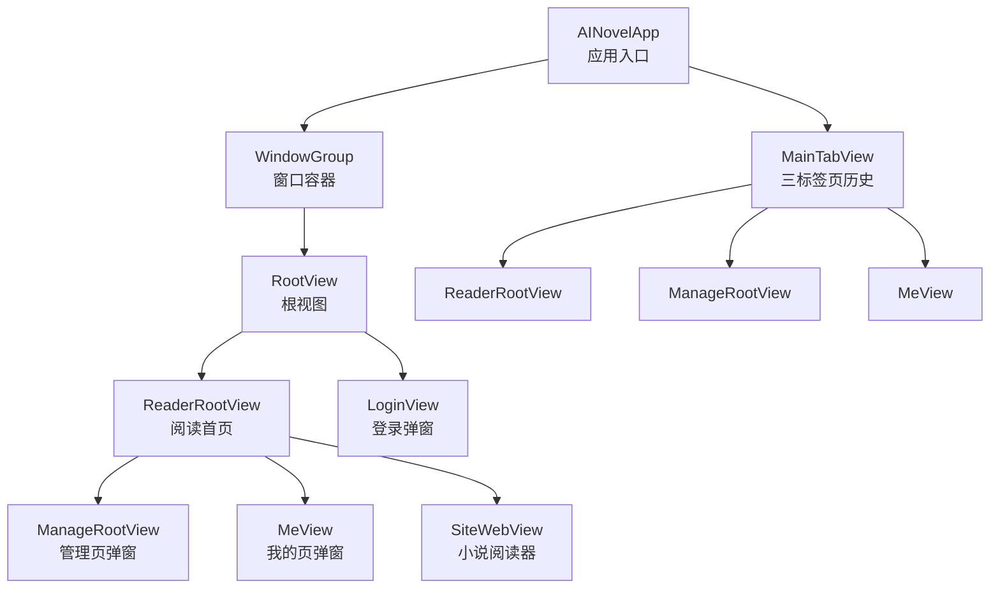
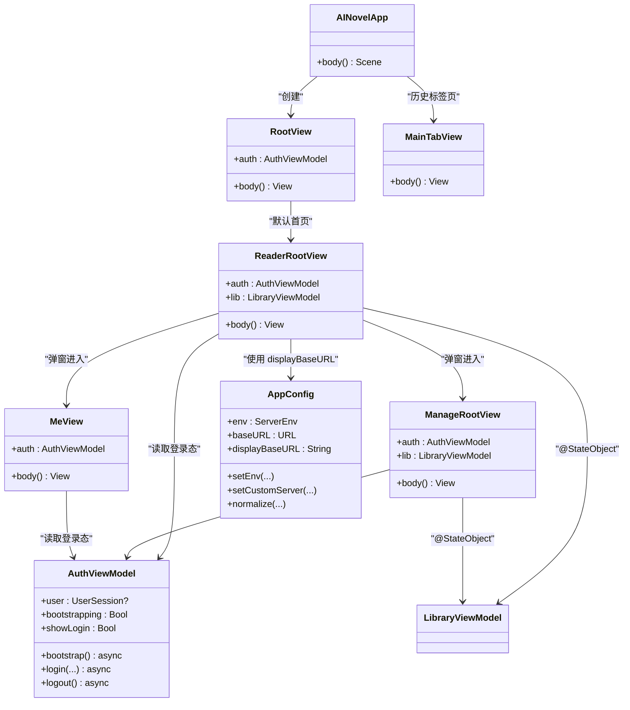
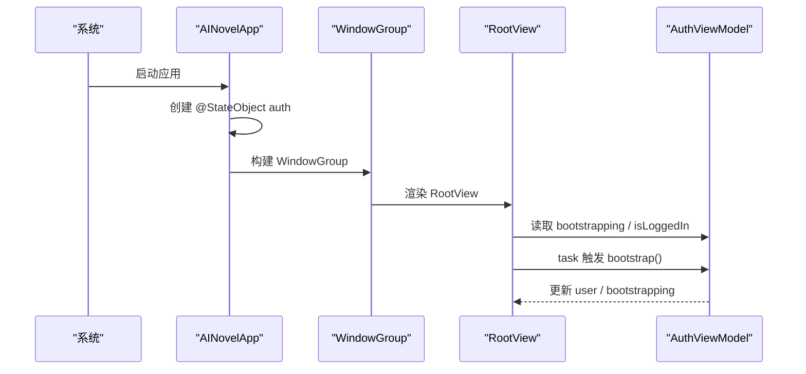
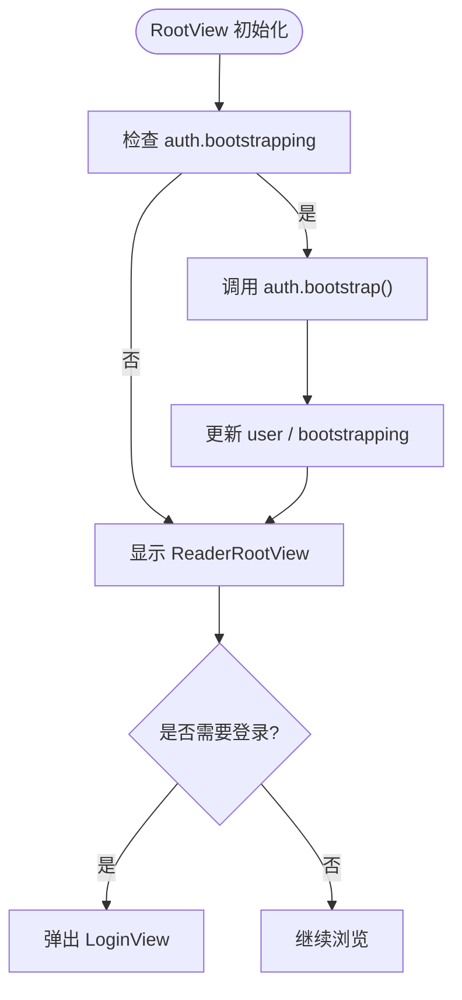
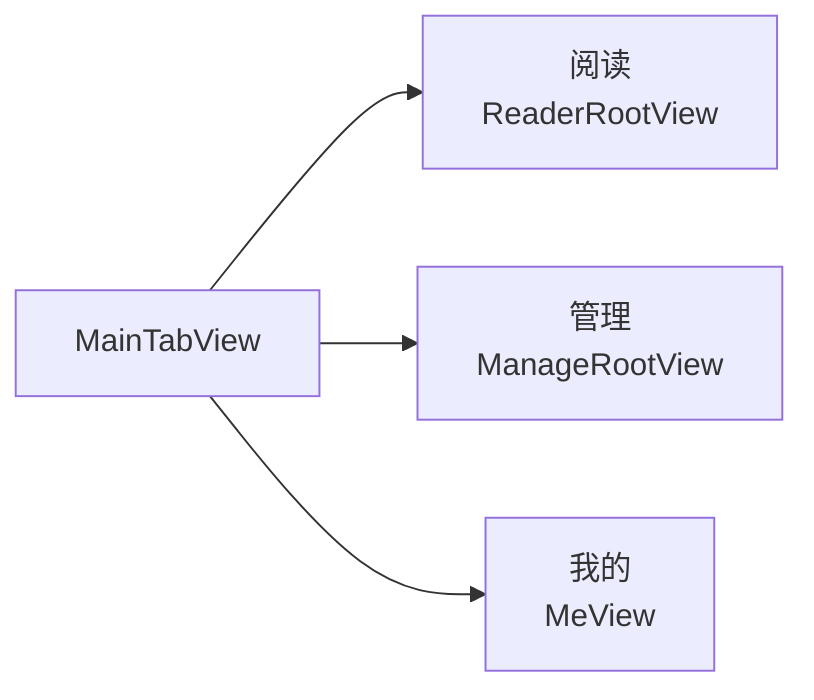
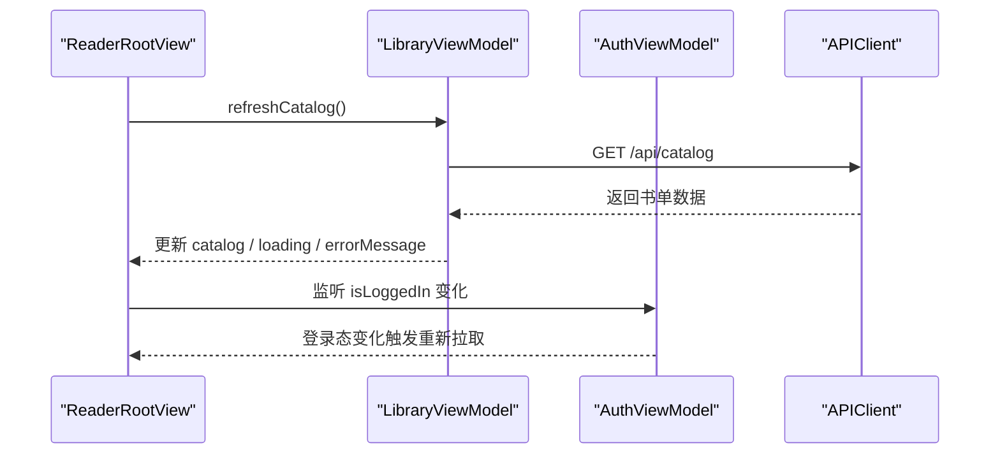
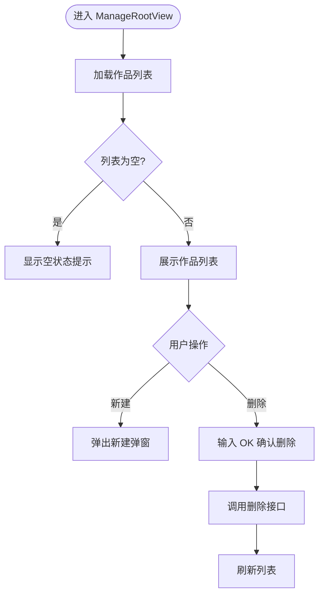
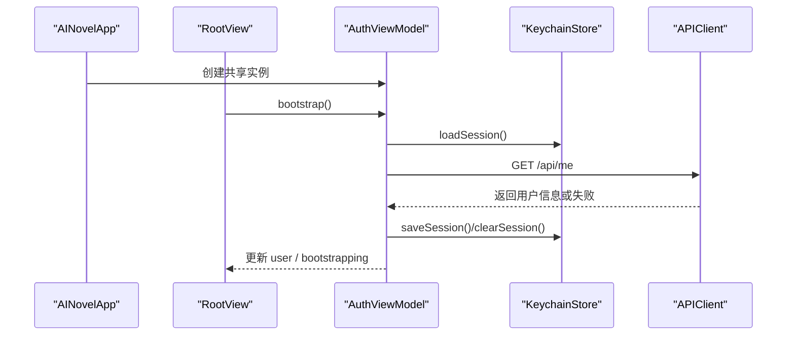
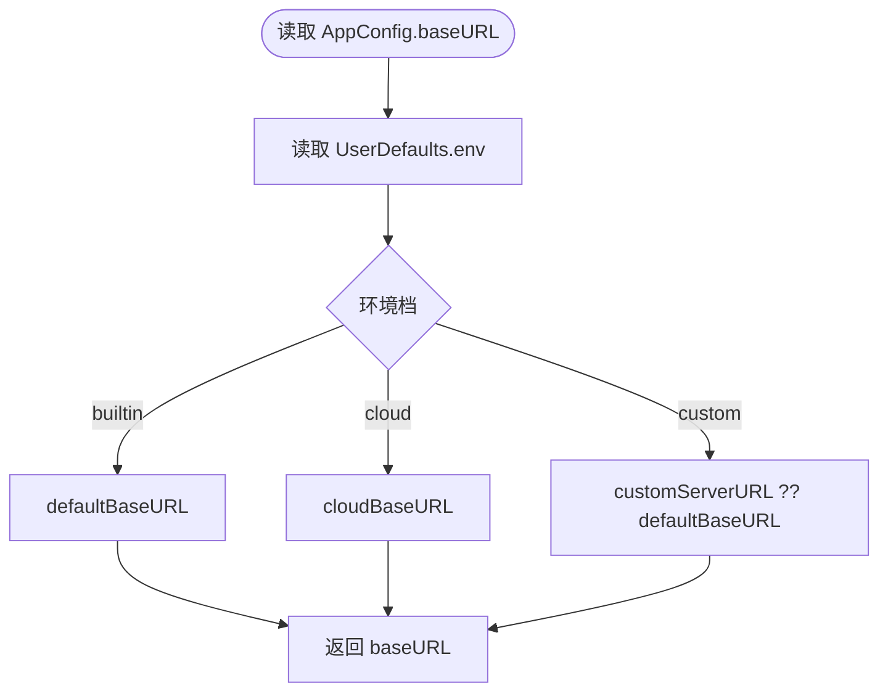
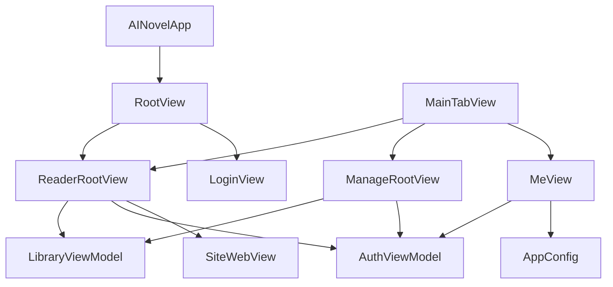

# 应用架构设计

<cite>
**本文引用的文件**   
- [AINovelApp.swift](file://ios/AINovel/AINovelApp.swift)
- [RootView.swift](file://ios/AINovel/App/RootView.swift)
- [MainTabView.swift](file://ios/AINovel/App/MainTabView.swift)
- [AppConfig.swift](file://ios/AINovel/Config/AppConfig.swift)
- [AuthViewModel.swift](file://ios/AINovel/Auth/AuthViewModel.swift)
- [ReaderRootView.swift](file://ios/AINovel/Reader/ReaderRootView.swift)
- [ManageRootView.swift](file://ios/AINovel/Manage/ManageRootView.swift)
- [MeView.swift](file://ios/AINovel/Me/MeView.swift)
</cite>

## 目录
1. [引言](#引言)
2. [项目结构](#项目结构)
3. [核心组件](#核心组件)
4. [架构总览](#架构总览)
5. [详细组件分析](#详细组件分析)
6. [依赖关系分析](#依赖关系分析)
7. [性能与可维护性](#性能与可维护性)
8. [故障排查指南](#故障排查指南)
9. [结论](#结论)
10. [附录：扩展实践](#附录扩展实践)

## 引言
本文件面向 iOS 端 SwiftUI 应用的架构设计与实现，重点解释以下方面：
- SwiftUI 应用启动流程：@main 注解入口、WindowGroup 配置、全局状态注入。
- RootView 的初始化过程与导航策略。
- MainTabView 的标签页导航结构（历史形态与当前默认首页的关系）。
- AppConfig 的配置管理机制与环境变量处理。
- MVVM 模式在应用中的落地：StateObject 的使用、数据流向与生命周期。
- 如何扩展应用配置、添加新标签页视图与管理应用生命周期。

## 项目结构
iOS 端采用 SwiftUI + Combine 的现代架构，围绕“阅读”作为默认首页，管理和个人功能通过工具栏或独立页面进入；同时保留 MainTabView 作为多标签页导航的历史实现。

图表来源
- [AINovelApp.swift:3-12](file://ios/AINovel/AINovelApp.swift#L3-L12)
- [RootView.swift:3-20](file://ios/AINovel/App/RootView.swift#L3-L20)
- [MainTabView.swift:3-16](file://ios/AINovel/App/MainTabView.swift#L3-L16)
- [ReaderRootView.swift:6-78](file://ios/AINovel/Reader/ReaderRootView.swift#L6-L78)
- [ManageRootView.swift:3-81](file://ios/AINovel/Manage/ManageRootView.swift#L3-L81)
- [MeView.swift:3-52](file://ios/AINovel/Me/MeView.swift#L3-L52)

章节来源
- [AINovelApp.swift:3-12](file://ios/AINovel/AINovelApp.swift#L3-L12)
- [RootView.swift:3-20](file://ios/AINovel/App/RootView.swift#L3-L20)
- [MainTabView.swift:3-16](file://ios/AINovel/App/MainTabView.swift#L3-L16)

## 核心组件
- AINovelApp：应用入口，负责创建并注入全局认证状态 AuthViewModel。
- RootView：根视图，决定默认首页为 ReaderRootView，并在未登录时按需弹出登录弹窗。
- ReaderRootView：阅读首页，展示公开书单，支持搜索、刷新、打开阅读器、进入管理与个人页。
- ManageRootView：作品管理页，支持新建、删除、列表刷新等。
- MeView：个人中心，显示用户信息、服务器设置、退出登录。
- MainTabView：三标签页导航（阅读/管理/我的），作为历史导航形态保留。
- AuthViewModel：认证与全局登录态，协调 Keychain、API 会话探测与 UI 状态。
- AppConfig：全局运行配置，管理服务器地址、环境档、超时等。

章节来源
- [AINovelApp.swift:3-12](file://ios/AINovel/AINovelApp.swift#L3-L12)
- [RootView.swift:3-20](file://ios/AINovel/App/RootView.swift#L3-L20)
- [ReaderRootView.swift:6-78](file://ios/AINovel/Reader/ReaderRootView.swift#L6-L78)
- [ManageRootView.swift:3-81](file://ios/AINovel/Manage/ManageRootView.swift#L3-L81)
- [MeView.swift:3-52](file://ios/AINovel/Me/MeView.swift#L3-L52)
- [AuthViewModel.swift:9-106](file://ios/AINovel/Auth/AuthViewModel.swift#L9-L106)
- [AppConfig.swift:11-110](file://ios/AINovel/Config/AppConfig.swift#L11-L110)

## 架构总览
应用采用 MVVM 模式：
- View 层：RootView、ReaderRootView、ManageRootView、MeView、MainTabView。
- ViewModel 层：AuthViewModel（认证）、LibraryViewModel（阅读/管理数据，由 View 以 @StateObject 持有）。
- Model 层：UserSession、CatalogNovel、Novel 等数据模型。
- 配置层：AppConfig 提供全局配置。
- 网络层：APIClient、Endpoints、APIError（不在本节展开）。

图表来源
- [AINovelApp.swift:3-12](file://ios/AINovel/AINovelApp.swift#L3-L12)
- [RootView.swift:3-20](file://ios/AINovel/App/RootView.swift#L3-L20)
- [ReaderRootView.swift:6-78](file://ios/AINovel/Reader/ReaderRootView.swift#L6-L78)
- [ManageRootView.swift:3-81](file://ios/AINovel/Manage/ManageRootView.swift#L3-L81)
- [MeView.swift:3-52](file://ios/AINovel/Me/MeView.swift#L3-L52)
- [MainTabView.swift:3-16](file://ios/AINovel/App/MainTabView.swift#L3-L16)
- [AuthViewModel.swift:9-106](file://ios/AINovel/Auth/AuthViewModel.swift#L9-L106)
- [AppConfig.swift:11-110](file://ios/AINovel/Config/AppConfig.swift#L11-L110)

## 详细组件分析

### 应用启动与全局状态注入
- 入口：AINovelApp 使用 @main 注解，定义应用主体。
- 全局状态：通过 @StateObject 持有 AuthViewModel.shared，并以 .environmentObject 注入到整个视图树。
- 窗口容器：WindowGroup 包裹 RootView，作为应用主界面。

图表来源
- [AINovelApp.swift:3-12](file://ios/AINovel/AINovelApp.swift#L3-L12)
- [RootView.swift:14-18](file://ios/AINovel/App/RootView.swift#L14-L18)
- [AuthViewModel.swift:37-54](file://ios/AINovel/Auth/AuthViewModel.swift#L37-L54)

章节来源
- [AINovelApp.swift:3-12](file://ios/AINovel/AINovelApp.swift#L3-L12)
- [RootView.swift:3-20](file://ios/AINovel/App/RootView.swift#L3-L20)

### RootView 初始化与导航策略
- RootView 通过 @EnvironmentObject 获取 AuthViewModel。
- 默认首页为 ReaderRootView，未登录时不强制弹登录，而是允许浏览公开书单；需要登录的操作再拉起登录 sheet。
- 首次加载时若处于 bootstrapping 状态，调用 AuthViewModel.bootstrap() 探测权威登录态。

图表来源
- [RootView.swift:3-20](file://ios/AINovel/App/RootView.swift#L3-L20)
- [AuthViewModel.swift:37-54](file://ios/AINovel/Auth/AuthViewModel.swift#L37-L54)

章节来源
- [RootView.swift:3-20](file://ios/AINovel/App/RootView.swift#L3-L20)

### MainTabView 的导航结构
- MainTabView 包含三个标签页：阅读、管理、我的。
- 当前默认首页为 ReaderRootView，不再使用底部三 Tab；MainTabView 作为历史导航形态保留。
- 如需恢复底部三标签导航，可在 AINovelApp 中将 RootView 替换为 MainTabView。

图表来源
- [MainTabView.swift:3-16](file://ios/AINovel/App/MainTabView.swift#L3-L16)

章节来源
- [MainTabView.swift:3-16](file://ios/AINovel/App/MainTabView.swift#L3-L16)

### ReaderRootView 的阅读首页
- 使用 @EnvironmentObject 读取 AuthViewModel，根据登录态动态刷新书单。
- 使用 @StateObject 持有 LibraryViewModel，负责拉取公开书单、错误处理、刷新。
- 支持搜索、下拉刷新、点击书籍打开 SiteWebView。
- 已登录时显示“管理”和“我的”工具栏按钮，未登录时显示“登录”。

图表来源
- [ReaderRootView.swift:6-78](file://ios/AINovel/Reader/ReaderRootView.swift#L6-L78)

章节来源
- [ReaderRootView.swift:6-78](file://ios/AINovel/Reader/ReaderRootView.swift#L6-L78)

### ManageRootView 的管理页
- 使用 @EnvironmentObject 读取 AuthViewModel，用于鉴权相关逻辑。
- 使用 @StateObject 持有 LibraryViewModel，负责作品列表、新建、删除等操作。
- 提供新建弹窗、删除确认、下拉刷新等功能。

图表来源
- [ManageRootView.swift:3-81](file://ios/AINovel/Manage/ManageRootView.swift#L3-L81)

章节来源
- [ManageRootView.swift:3-81](file://ios/AINovel/Manage/ManageRootView.swift#L3-L81)

### MeView 的个人中心
- 显示用户信息、角色、ID 等。
- 提供服务器设置入口与退出登录确认。
- 未登录时引导用户登录。

章节来源
- [MeView.swift:3-52](file://ios/AINovel/Me/MeView.swift#L3-L52)

### AuthViewModel 的认证与生命周期
- 单例模式，@MainActor 保证线程安全。
- 冷启动流程：先用 Keychain 快照回填界面，再调用 APIClient 探权威登录态。
- 登录流程：POST /api/login，成功后保存会话与凭据（可选记住密码）。
- 登出流程：POST /api/logout，清理本地会话。
- 401 自动登出：回调中清空用户并拉起登录弹窗。

图表来源
- [AuthViewModel.swift:9-106](file://ios/AINovel/Auth/AuthViewModel.swift#L9-L106)
- [RootView.swift:14-18](file://ios/AINovel/App/RootView.swift#L14-L18)

章节来源
- [AuthViewModel.swift:9-106](file://ios/AINovel/Auth/AuthViewModel.swift#L9-L106)

### AppConfig 的配置管理与环境变量
- 环境档：builtin（局域网/内置）、cloud（公网）、custom（手填）。
- 优先级：用户选的接入环境 > 用户自设地址 > Info.plist / 编译默认。
- 默认地址解析：Info.plist 键 AINovelBaseURL → DEBUG 环境变量 AINovel_BASE_URL → 回环 http://127.0.0.1:3400/novel。
- 规范化：补 scheme、去尾斜杠、无路径时补 /novel。
- 持久化：UserDefaults 存储 env 与 serverOverrideKey。
- 展示用 baseURL：displayBaseURL 便于核对当前生效地址。

图表来源
- [AppConfig.swift:11-110](file://ios/AINovel/Config/AppConfig.swift#L11-L110)

章节来源
- [AppConfig.swift:11-110](file://ios/AINovel/Config/AppConfig.swift#L11-L110)

## 依赖关系分析
- AINovelApp 依赖 RootView 与 AuthViewModel。
- RootView 依赖 ReaderRootView、LoginView。
- ReaderRootView 依赖 LibraryViewModel、AuthViewModel、SiteWebView。
- ManageRootView 依赖 LibraryViewModel、AuthViewModel。
- MeView 依赖 AuthViewModel、AppConfig。
- MainTabView 聚合 ReaderRootView、ManageRootView、MeView。

图表来源
- [AINovelApp.swift:3-12](file://ios/AINovel/AINovelApp.swift#L3-L12)
- [RootView.swift:3-20](file://ios/AINovel/App/RootView.swift#L3-L20)
- [ReaderRootView.swift:6-78](file://ios/AINovel/Reader/ReaderRootView.swift#L6-L78)
- [ManageRootView.swift:3-81](file://ios/AINovel/Manage/ManageRootView.swift#L3-L81)
- [MeView.swift:3-52](file://ios/AINovel/Me/MeView.swift#L3-L52)
- [MainTabView.swift:3-16](file://ios/AINovel/App/MainTabView.swift#L3-L16)

章节来源
- [AINovelApp.swift:3-12](file://ios/AINovel/AINovelApp.swift#L3-L12)
- [RootView.swift:3-20](file://ios/AINovel/App/RootView.swift#L3-L20)
- [ReaderRootView.swift:6-78](file://ios/AINovel/Reader/ReaderRootView.swift#L6-L78)
- [ManageRootView.swift:3-81](file://ios/AINovel/Manage/ManageRootView.swift#L3-L81)
- [MeView.swift:3-52](file://ios/AINovel/Me/MeView.swift#L3-L52)
- [MainTabView.swift:3-16](file://ios/AINovel/App/MainTabView.swift#L3-L16)

## 性能与可维护性
- 启动优化：AuthViewModel 先回填 Keychain 快照，再异步探测登录态，避免界面闪烁。
- 数据刷新：ReaderRootView 在登录态变化时重新拉取书单，确保 VIP 条目可见性正确。
- 配置解耦：AppConfig 集中管理服务器地址与环境变量，便于切换与调试。
- 视图职责清晰：ReaderRootView 专注阅读首页，ManageRootView 专注管理，MeView 专注个人设置。
- 可扩展性：新增标签页或功能模块可通过扩展 MainTabView 或在 ReaderRootView 的工具栏中添加入口。

[本节为通用指导，不涉及具体文件分析]

## 故障排查指南
- 登录态异常：
  - 现象：登录后仍显示未登录或频繁弹出登录弹窗。
  - 排查：检查 AuthViewModel.bootstrap() 是否成功调用、KeychainStore 是否保存会话、APIClient 的 401 回调是否正确触发。
  - 参考：[AuthViewModel.swift:37-54](file://ios/AINovel/Auth/AuthViewModel.swift#L37-L54)、[AuthViewModel.swift:89-96](file://ios/AINovel/Auth/AuthViewModel.swift#L89-L96)
- 服务器地址错误：
  - 现象：请求失败或 Cookie 不携带。
  - 排查：检查 AppConfig.normalize() 是否正确补全 scheme 与 /novel 前缀；确认 Info.plist 或环境变量配置正确。
  - 参考：[AppConfig.swift:89-102](file://ios/AINovel/Config/AppConfig.swift#L89-L102)
- 书单加载失败：
  - 现象：ReaderRootView 显示加载失败或空状态。
  - 排查：检查 LibraryViewModel.refreshCatalog() 是否被调用、APIClient 返回错误类型是否为 APIError。
  - 参考：[ReaderRootView.swift:22-31](file://ios/AINovel/Reader/ReaderRootView.swift#L22-L31)

章节来源
- [AuthViewModel.swift:37-54](file://ios/AINovel/Auth/AuthViewModel.swift#L37-L54)
- [AuthViewModel.swift:89-96](file://ios/AINovel/Auth/AuthViewModel.swift#L89-L96)
- [AppConfig.swift:89-102](file://ios/AINovel/Config/AppConfig.swift#L89-L102)
- [ReaderRootView.swift:22-31](file://ios/AINovel/Reader/ReaderRootView.swift#L22-L31)

## 结论
该 iOS 应用采用 SwiftUI + Combine 的 MVVM 架构，以 ReaderRootView 为默认首页，AuthViewModel 作为全局认证状态中枢，AppConfig 统一管理运行配置。通过 @StateObject 与 @EnvironmentObject 的组合，实现了清晰的数据流向与生命周期管理。MainTabView 作为历史导航形态保留，便于未来扩展或切换导航策略。整体设计具备良好的可维护性与扩展性。

[本节为总结性内容，不涉及具体文件分析]

## 附录：扩展实践

### 扩展应用配置
- 新增配置项：在 AppConfig 中添加静态属性或方法，例如新增 feature flag 或超时参数。
- 环境变量处理：在 defaultBaseURL 的计算逻辑中增加对 ProcessInfo.processInfo.environment 的读取。
- 持久化：如需用户自定义配置，使用 UserDefaults.standard 进行读写，并提供 setEnv/setCustomServer 等方法。

章节来源
- [AppConfig.swift:27-40](file://ios/AINovel/Config/AppConfig.swift#L27-L40)
- [AppConfig.swift:63-84](file://ios/AINovel/Config/AppConfig.swift#L63-L84)

### 添加新的标签页视图
- 步骤：
  1. 新建一个 SwiftUI View（例如 NewFeatureView）。
  2. 在 MainTabView 中添加一个新的 TabView 子项，并配置 tabItem。
  3. 如需要全局状态，通过 @EnvironmentObject 注入 AuthViewModel 或其他共享状态。
- 注意：当前默认首页为 ReaderRootView，若需将新标签页作为默认入口，可在 AINovelApp 中调整 WindowGroup 的内容。

章节来源
- [MainTabView.swift:3-16](file://ios/AINovel/App/MainTabView.swift#L3-L16)
- [AINovelApp.swift:7-12](file://ios/AINovel/AINovelApp.swift#L7-L12)

### 管理应用生命周期
- 启动阶段：
  - 在 AINovelApp 中创建并注入 AuthViewModel。
  - 在 RootView 中通过 task 调用 AuthViewModel.bootstrap()。
- 运行时：
  - 在 ReaderRootView 中监听 auth.isLoggedIn 变化以刷新数据。
  - 在 ManageRootView 与 MeView 中使用 AuthViewModel 进行鉴权与用户操作。
- 退出阶段：
  - 在 MeView 中调用 AuthViewModel.logout() 清理会话与凭据。

章节来源
- [AINovelApp.swift:3-12](file://ios/AINovel/AINovelApp.swift#L3-L12)
- [RootView.swift:14-18](file://ios/AINovel/App/RootView.swift#L14-L18)
- [ReaderRootView.swift:49-50](file://ios/AINovel/Reader/ReaderRootView.swift#L49-L50)
- [MeView.swift:46-49](file://ios/AINovel/Me/MeView.swift#L46-L49)