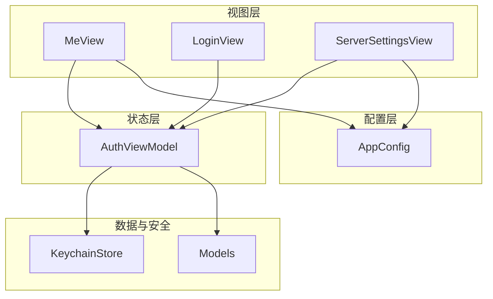
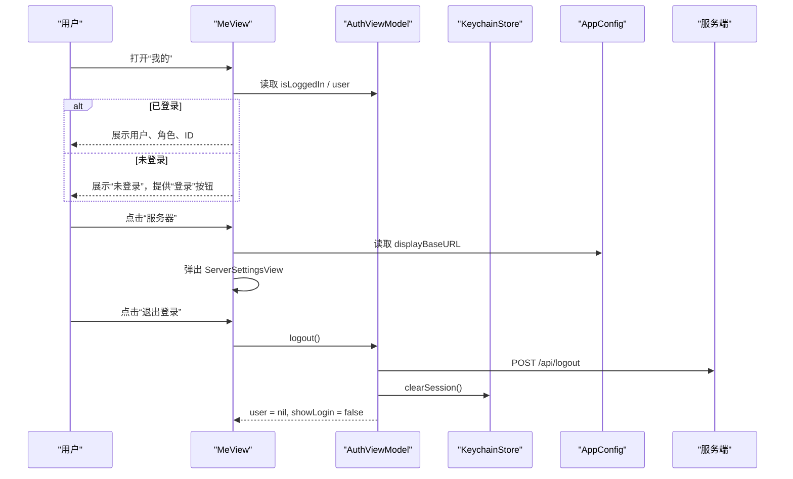
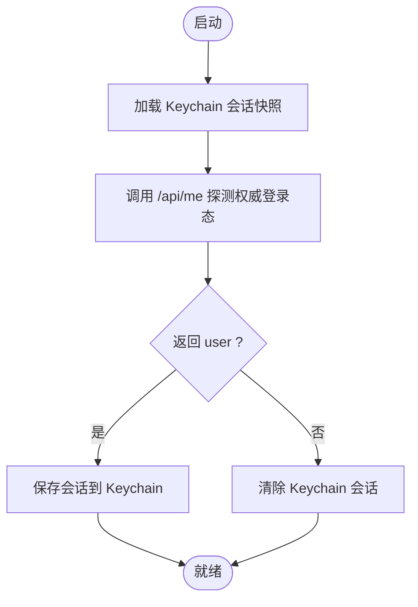
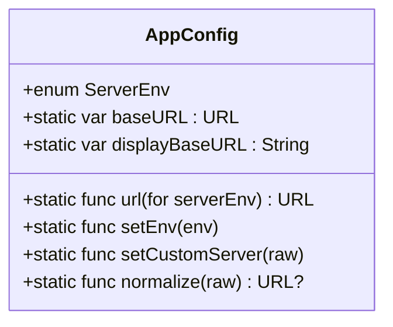
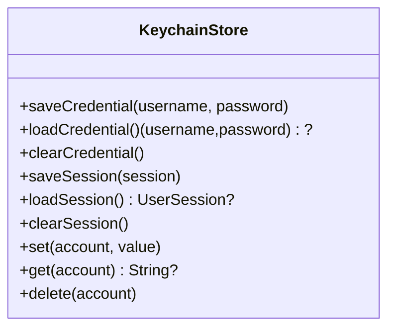
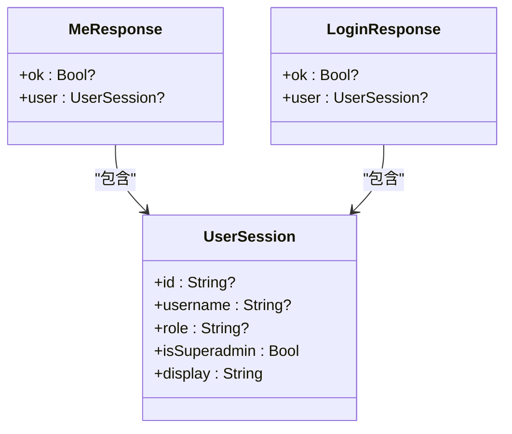
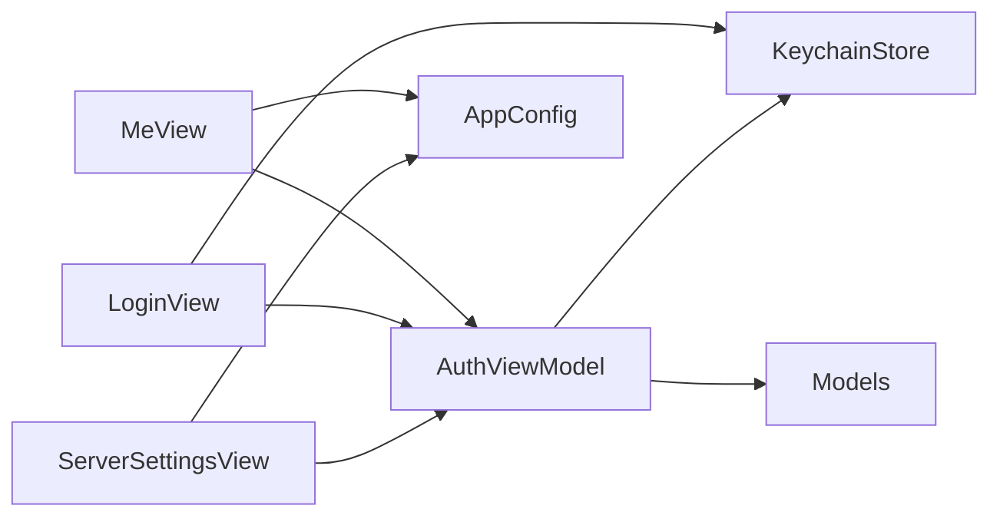

# 用户资料

<cite>
**本文引用的文件**   
- [MeView.swift](file://ios/AINovel/Me/MeView.swift)
- [AuthViewModel.swift](file://ios/AINovel/Auth/AuthViewModel.swift)
- [AppConfig.swift](file://ios/AINovel/Config/AppConfig.swift)
- [KeychainStore.swift](file://ios/AINovel/Security/KeychainStore.swift)
- [Models.swift](file://ios/AINovel/Models/Models.swift)
- [LoginView.swift](file://ios/AINovel/Auth/LoginView.swift)
- [ServerSettingsView.swift](file://ios/AINovel/Auth/ServerSettingsView.swift)
</cite>

## 目录
1. [引言](#引言)
2. [项目结构](#项目结构)
3. [核心组件](#核心组件)
4. [架构总览](#架构总览)
5. [详细组件分析](#详细组件分析)
6. [依赖关系分析](#依赖关系分析)
7. [性能与可靠性考虑](#性能与可靠性考虑)
8. [故障排查指南](#故障排查指南)
9. [结论](#结论)
10. [附录：扩展设置项与个性化配置](#附录扩展设置项与个性化配置)

## 引言
本文件面向 iOS 端“我的”（用户资料）页面的开发与维护，聚焦以下目标：
- 解释 MeView 的用户信息展示界面、登录状态、服务器连接入口与退出登录流程。
- 说明用户数据的本地存储与同步机制：Keychain 凭据、会话快照、Cookie 会话、服务端权威校验。
- 梳理设置项的分类管理：账号信息、连接设置、功能开关（如记住密码）。
- 提供可扩展的设置项与个性化配置方案，包括新增偏好保存策略与 UI 集成方式。

## 项目结构
iOS 应用采用 SwiftUI + Combine 的声明式架构，围绕“认证—配置—数据模型—安全存储”四个维度组织代码：
- 视图层：MeView、LoginView、ServerSettingsView 负责用户交互与信息展示。
- 状态层：AuthViewModel 集中管理登录态、错误提示与全局行为。
- 配置层：AppConfig 统一管理后端地址、环境档位与超时等运行参数。
- 数据与安全层：Models.swift 定义 API 数据结构；KeychainStore 封装 Keychain 存取。

图表来源
- [MeView.swift:1-53](file://ios/AINovel/Me/MeView.swift#L1-L53)
- [LoginView.swift:1-78](file://ios/AINovel/Auth/LoginView.swift#L1-L78)
- [ServerSettingsView.swift:1-130](file://ios/AINovel/Auth/ServerSettingsView.swift#L1-L130)
- [AuthViewModel.swift:1-107](file://ios/AINovel/Auth/AuthViewModel.swift#L1-L107)
- [AppConfig.swift:1-111](file://ios/AINovel/Config/AppConfig.swift#L1-L111)
- [Models.swift:1-234](file://ios/AINovel/Models/Models.swift#L1-L234)
- [KeychainStore.swift:1-83](file://ios/AINovel/Security/KeychainStore.swift#L1-L83)

章节来源
- [MeView.swift:1-53](file://ios/AINovel/Me/MeView.swift#L1-L53)
- [AuthViewModel.swift:1-107](file://ios/AINovel/Auth/AuthViewModel.swift#L1-L107)
- [AppConfig.swift:1-111](file://ios/AINovel/Config/AppConfig.swift#L1-L111)
- [KeychainStore.swift:1-83](file://ios/AINovel/Security/KeychainStore.swift#L1-L83)
- [Models.swift:1-234](file://ios/AINovel/Models/Models.swift#L1-L234)
- [LoginView.swift:1-78](file://ios/AINovel/Auth/LoginView.swift#L1-L78)
- [ServerSettingsView.swift:1-130](file://ios/AINovel/Auth/ServerSettingsView.swift#L1-L130)

## 核心组件
- MeView：用户资料页，展示账号信息、当前服务器地址、登录/退出操作。
- AuthViewModel：统一处理登录、登出、401 自动登出、冷启动探测、记住密码与服务器切换后的状态清理。
- AppConfig：后端地址与环境档管理，支持局域网、公网与自定义地址，并提供规范化与显示逻辑。
- KeychainStore：封装 Keychain 的凭据与会话快照读写。
- Models：API 响应与业务数据模型，包含 UserSession、MeResponse、LoginResponse 等。
- LoginView：登录表单，支持从 Keychain 预填凭据、打开服务器设置。
- ServerSettingsView：服务器设置页，支持预设环境切换、自定义地址、连接测试与保存。

章节来源
- [MeView.swift:1-53](file://ios/AINovel/Me/MeView.swift#L1-L53)
- [AuthViewModel.swift:1-107](file://ios/AINovel/Auth/AuthViewModel.swift#L1-L107)
- [AppConfig.swift:1-111](file://ios/AINovel/Config/AppConfig.swift#L1-L111)
- [KeychainStore.swift:1-83](file://ios/AINovel/Security/KeychainStore.swift#L1-L83)
- [Models.swift:1-234](file://ios/AINovel/Models/Models.swift#L1-L234)
- [LoginView.swift:1-78](file://ios/AINovel/Auth/LoginView.swift#L1-L78)
- [ServerSettingsView.swift:1-130](file://ios/AINovel/Auth/ServerSettingsView.swift#L1-L130)

## 架构总览
下图展示了“我的”页面与相关组件之间的交互关系，以及数据流与控制流。

图表来源
- [MeView.swift:1-53](file://ios/AINovel/Me/MeView.swift#L1-L53)
- [AuthViewModel.swift:82-96](file://ios/AINovel/Auth/AuthViewModel.swift#L82-L96)
- [AppConfig.swift:86-87](file://ios/AINovel/Config/AppConfig.swift#L86-L87)
- [ServerSettingsView.swift:1-130](file://ios/AINovel/Auth/ServerSettingsView.swift#L1-L130)

## 详细组件分析

### MeView：用户资料与基础设置入口
职责与要点：
- 使用 EnvironmentObject 注入 AuthViewModel，根据 isLoggedIn 分支展示账号信息或登录引导。
- 通过 AppConfig.displayBaseURL 展示当前生效的服务器地址，并弹出 ServerSettingsView 进行编辑。
- 提供“退出登录”确认对话框，调用 AuthViewModel.logout() 完成登出。

关键交互路径：
- 账号信息展示：auth.user?.display / role / id。
- 服务器设置入口：showServerSettings sheet 展示 ServerSettingsView。
- 退出登录：confirmationDialog 确认后调用 auth.logout()。

章节来源
- [MeView.swift:1-53](file://ios/AINovel/Me/MeView.swift#L1-L53)

### AuthViewModel：认证与全局登录态
职责与要点：
- 单例模式，@MainActor 保证主线程更新 UI。
- 冷启动流程：先用 KeychainStore.loadSession() 回填界面，再调用 APIClient 探活 /api/me 以权威登录态为准。
- 登录流程：POST /api/login，成功后写入 KeychainStore.saveSession()，可选记住密码。
- 登出流程：POST /api/logout，清空 KeychainStore.clearSession()，重置 user。
- 401 自动登出：APIClient.shared.onUnauthorized 回调中 handleExpired()，清空会话并拉起登录 sheet。
- 服务器切换：serverChanged() 清除会话，避免 Cookie 域不匹配。

图表来源
- [AuthViewModel.swift:26-54](file://ios/AINovel/Auth/AuthViewModel.swift#L26-L54)
- [KeychainStore.swift:31-44](file://ios/AINovel/Security/KeychainStore.swift#L31-L44)

章节来源
- [AuthViewModel.swift:1-107](file://ios/AINovel/Auth/AuthViewModel.swift#L1-L107)

### AppConfig：服务器地址与环境档管理
职责与要点：
- 环境档：builtin（局域网）、cloud（公网）、custom（自定义），优先级：用户自设 > Info.plist/DEBUG 环境变量 > 默认。
- baseURL 动态解析：每次请求时读取 env，确保设置即时生效。
- normalize 规范化：补 scheme、去尾斜杠、无路径时补 /novel 前缀。
- displayBaseURL 用于界面展示，便于核对实际生效地址。
- setEnv/setCustomServer 修改 UserDefaults 中的键值，并在必要时清除旧地址。

图表来源
- [AppConfig.swift:11-111](file://ios/AINovel/Config/AppConfig.swift#L11-L111)

章节来源
- [AppConfig.swift:1-111](file://ios/AINovel/Config/AppConfig.swift#L1-L111)

### KeychainStore：凭据与会话快照
职责与要点：
- 凭据存储：用户名+密码，供登录页预填与自动重登。
- 会话快照：UserSession JSON，用于冷启动快速填充界面，非权威登录态。
- 通用方法：set/get/delete 封装 SecItem 操作，统一 service/account 命名空间。

图表来源
- [KeychainStore.swift:1-83](file://ios/AINovel/Security/KeychainStore.swift#L1-L83)

章节来源
- [KeychainStore.swift:1-83](file://ios/AINovel/Security/KeychainStore.swift#L1-L83)

### Models：数据模型
职责与要点：
- UserSession：登录用户信息，含 id、username、role，提供 isSuperadmin、display 便捷属性。
- MeResponse/LoginResponse：认证接口响应体，包含 ok 与 user。
- 其他小说、章节、设定等模型与本模块关联度较低，但为整体数据层的一部分。

图表来源
- [Models.swift:5-16](file://ios/AINovel/Models/Models.swift#L5-L16)

章节来源
- [Models.swift:1-234](file://ios/AINovel/Models/Models.swift#L1-L234)

### LoginView：登录表单与凭据预填
职责与要点：
- 从 AuthViewModel.savedCredential 预填用户名与密码。
- 提供 Toggle“记住密码”，控制是否将凭据保存到 Keychain。
- 打开 ServerSettingsView 以调整服务器地址。
- 调用 AuthViewModel.login() 完成登录，成功后关闭弹窗。

章节来源
- [LoginView.swift:1-78](file://ios/AINovel/Auth/LoginView.swift#L1-L78)

### ServerSettingsView：服务器设置与连接测试
职责与要点：
- 预设环境一键切换：局域网/公网，点击即生效并触发 auth.serverChanged()。
- 自定义地址输入框，支持测试连接（GET /api/me），成功则显示绿色提示。
- 保存后调用 AppConfig.setCustomServer() 并触发 auth.serverChanged()。
- 恢复默认地址会清除自定义地址并重置 env 为 builtin。

章节来源
- [ServerSettingsView.swift:1-130](file://ios/AINovel/Auth/ServerSettingsView.swift#L1-L130)

## 依赖关系分析
- MeView 依赖 AuthViewModel 与 AppConfig，用于展示用户信息与服务器地址。
- AuthViewModel 依赖 KeychainStore 与 Models，负责会话持久化与数据解码。
- ServerSettingsView 依赖 AppConfig 与 AuthViewModel，用于地址管理与登录态清理。
- LoginView 依赖 AuthViewModel 与 KeychainStore（通过 savedCredential），用于凭据预填与登录。

图表来源
- [MeView.swift:1-53](file://ios/AINovel/Me/MeView.swift#L1-L53)
- [LoginView.swift:1-78](file://ios/AINovel/Auth/LoginView.swift#L1-L78)
- [ServerSettingsView.swift:1-130](file://ios/AINovel/Auth/ServerSettingsView.swift#L1-L130)
- [AuthViewModel.swift:1-107](file://ios/AINovel/Auth/AuthViewModel.swift#L1-L107)
- [AppConfig.swift:1-111](file://ios/AINovel/Config/AppConfig.swift#L1-L111)
- [KeychainStore.swift:1-83](file://ios/AINovel/Security/KeychainStore.swift#L1-L83)
- [Models.swift:1-234](file://ios/AINovel/Models/Models.swift#L1-L234)

章节来源
- [MeView.swift:1-53](file://ios/AINovel/Me/MeView.swift#L1-L53)
- [AuthViewModel.swift:1-107](file://ios/AINovel/Auth/AuthViewModel.swift#L1-L107)
- [AppConfig.swift:1-111](file://ios/AINovel/Config/AppConfig.swift#L1-L111)
- [KeychainStore.swift:1-83](file://ios/AINovel/Security/KeychainStore.swift#L1-L83)
- [Models.swift:1-234](file://ios/AINovel/Models/Models.swift#L1-L234)
- [LoginView.swift:1-78](file://ios/AINovel/Auth/LoginView.swift#L1-L78)
- [ServerSettingsView.swift:1-130](file://ios/AINovel/Auth/ServerSettingsView.swift#L1-L130)

## 性能与可靠性考虑
- 冷启动优化：先 Keychain 快照回填界面，再异步探测 /api/me，避免界面闪烁与白屏。
- 网络容错：登录失败、401 过期均会清理本地会话并提示重新登录，保证状态一致性。
- 地址规范化：normalize 自动补 scheme 与前缀，减少无效地址导致的请求失败。
- 超时配置：AppConfig.requestTimeout 与 llmTimeout 区分常规与长耗时接口，提升用户体验。

[本节为通用指导，不直接分析具体文件]

## 故障排查指南
常见问题与定位建议：
- 登录后仍显示未登录：检查 APIClient 的 onUnauthorized 回调是否触发 handleExpired()，确认 /api/me 是否返回有效 user。
- 服务器地址变更后无法携带 Cookie：确认 baseURL 带 /novel 前缀，且切换后调用了 auth.serverChanged() 清理会话。
- 记住密码失效：检查 KeychainStore.saveCredential/clearCredential 是否被正确调用，确认凭据格式 username\npassword。
- 连接测试失败：查看 ServerSettingsView.testConnection() 的错误信息，确认网络可达性与 Endpoint.me 路径。

章节来源
- [AuthViewModel.swift:89-96](file://ios/AINovel/Auth/AuthViewModel.swift#L89-L96)
- [ServerSettingsView.swift:116-128](file://ios/AINovel/Auth/ServerSettingsView.swift#L116-L128)
- [KeychainStore.swift:12-27](file://ios/AINovel/Security/KeychainStore.swift#L12-L27)

## 结论
MeView 作为用户资料入口，结合 AuthViewModel、AppConfig、KeychainStore 与 Models，构建了完整的登录态管理、服务器地址配置与本地持久化能力。通过分层清晰的组件设计与明确的职责划分，系统具备良好的可维护性与可扩展性。后续可在现有基础上扩展更多用户设置项与个性化配置，保持 UI 与状态的一致性。

[本节为总结性内容，不直接分析具体文件]

## 附录：扩展设置项与个性化配置
目标：在不破坏现有架构的前提下，扩展用户设置选项（如主题、字体大小、阅读偏好、通知开关等），并实现分类管理与偏好保存。

推荐方案：
- 新增 SettingsManager：封装 UserDefaults 键值与类型安全的 getter/setter，按分类分组（如 account、appearance、reader、notifications）。
- 在 MeView 增加“设置”Section，列出分类入口，跳转到对应设置页。
- 在 ServerSettingsView 中复用相同的 UserDefaults 键值策略，保持设置一致性。
- 对敏感设置（如 API Key）使用 KeychainStore 存储，普通设置使用 UserDefaults。

示例步骤（概念性描述）：
- 定义枚举分类：Account、Appearance、Reader、Notifications。
- 为每个设置项定义键名与默认值，提供 get/set 方法。
- 在 MeView 中增加“设置”按钮，打开 SettingsRootView。
- 在 SettingsRootView 中按分类渲染列表，点击进入具体设置页。
- 在设置页中使用 Toggle/TextField/Switch 绑定 SettingsManager 的值。
- 保存后立即刷新 UI，必要时触发副作用（如重启阅读器、刷新主题）。

注意事项：
- 所有设置变更应幂等，避免重复写入导致性能问题。
- 对可能影响鉴权的设置（如服务器地址）需调用 auth.serverChanged()。
- 对需要立即生效的设置，应在保存后主动刷新相关视图。

[本节为概念性指导，不直接分析具体文件]