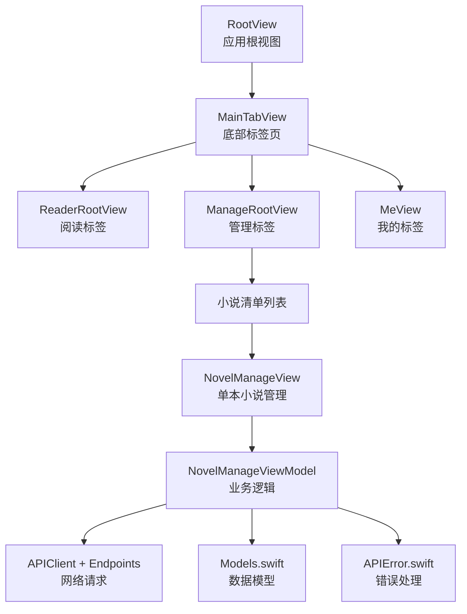
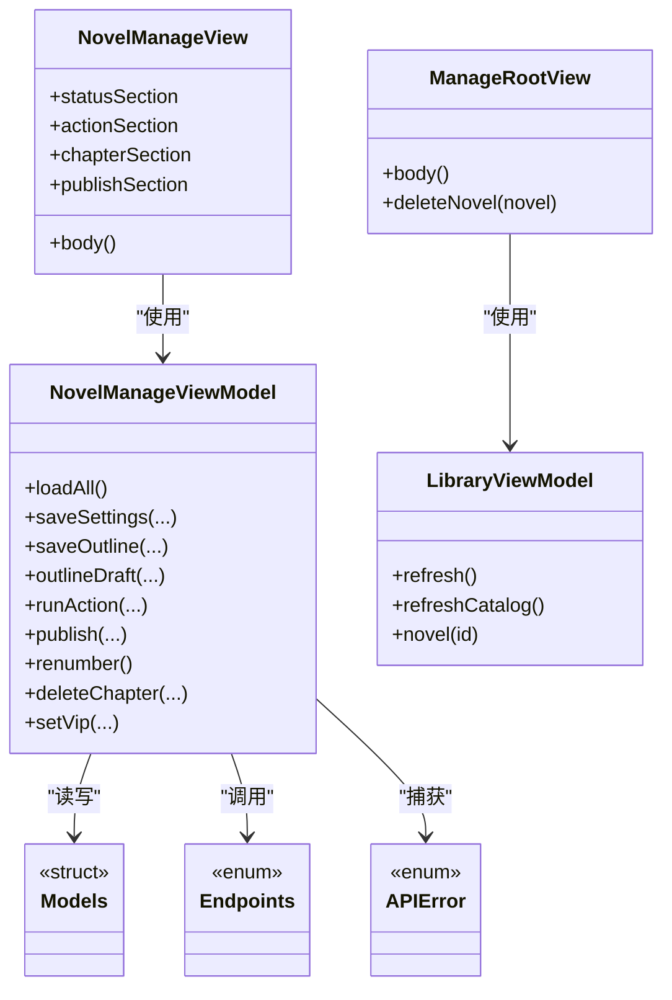
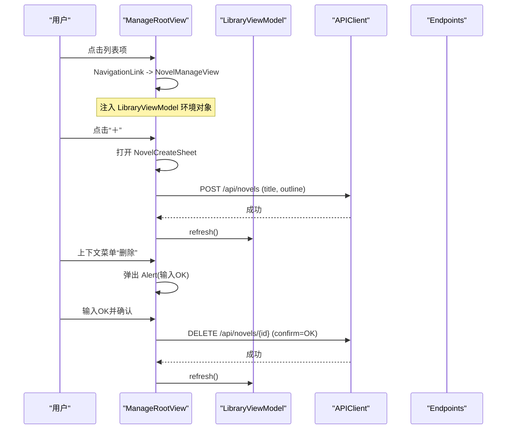
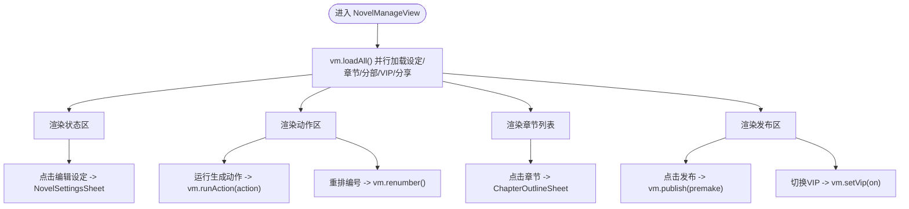
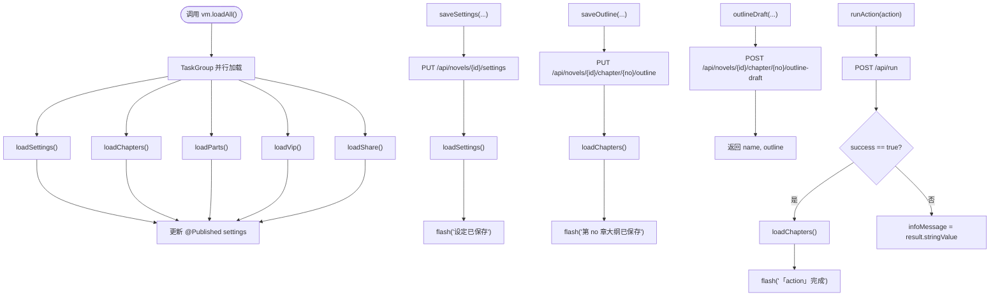
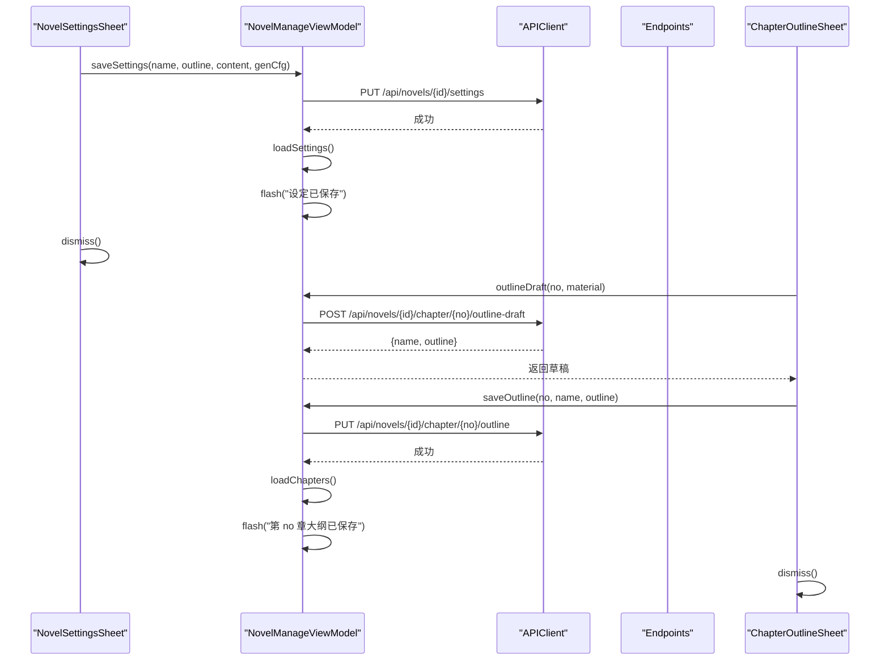
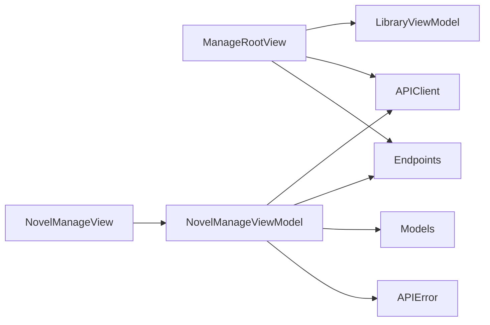

# 管理模块

<cite>
**本文引用的文件**   
- [ManageRootView.swift](file://ios/AINovel/Manage/ManageRootView.swift)
- [NovelManageView.swift](file://ios/AINovel/Manage/NovelManageView.swift)
- [NovelManageViewModel.swift](file://ios/AINovel/Manage/NovelManageViewModel.swift)
- [Sheets.swift](file://ios/AINovel/Manage/Sheets.swift)
- [MainTabView.swift](file://ios/AINovel/App/MainTabView.swift)
- [RootView.swift](file://ios/AINovel/App/RootView.swift)
- [Models.swift](file://ios/AINovel/Models/Models.swift)
- [APIError.swift](file://ios/AINovel/Networking/APIError.swift)
- [Endpoints.swift](file://ios/AINovel/Networking/Endpoints.swift)
- [LibraryViewModel.swift](file://ios/AINovel/Reader/LibraryViewModel.swift)
</cite>

## 目录
1. [引言](#引言)
2. [项目结构](#项目结构)
3. [核心组件](#核心组件)
4. [架构总览](#架构总览)
5. [详细组件分析](#详细组件分析)
6. [依赖关系分析](#依赖关系分析)
7. [性能与并发特性](#性能与并发特性)
8. [常见问题排查](#常见问题排查)
9. [结论](#结论)
10. [附录：关键操作示例路径](#附录关键操作示例路径)

## 引言
本开发文档聚焦 iOS 端的“管理模块”，围绕 ManageRootView 的管理界面布局与导航、NovelManageView 的小说管理界面（列表展示、搜索过滤、操作按钮）、NovelManageViewModel 的业务逻辑（数据获取、CRUD、状态同步），以及 Sheets.swift 中的模态对话框与表单组件进行系统化说明。文档同时给出小说创建、编辑、删除和批量操作的实现思路与代码路径，帮助开发者快速理解并扩展该模块。

## 项目结构
管理模块位于 ios/AINovel/Manage 目录下，主要包含以下文件：
- ManageRootView.swift：管理入口视图，负责小说清单、新建小说、删除确认等。
- NovelManageView.swift：单本小说的管理界面，负责章节列表、生成动作、发布、VIP 设置等。
- NovelManageViewModel.swift：单本小说的 ViewModel，封装数据加载、设定保存、章节大纲、生成动作、发布、重排、删除、VIP 切换等。
- Sheets.swift：提供“小说设定”和“章节大纲”两个模态表单。

此外，管理模块通过 MainTabView 作为底部 Tab 之一进入，并通过 LibraryViewModel 共享小说清单数据；网络层使用 Endpoints.swift 定义 API 路径，APIError.swift 统一错误处理；数据模型集中在 Models.swift。

**图表来源**
- [RootView.swift:1-21](file://ios/AINovel/App/RootView.swift#L1-L21)
- [MainTabView.swift:1-17](file://ios/AINovel/App/MainTabView.swift#L1-L17)
- [ManageRootView.swift:1-137](file://ios/AINovel/Manage/ManageRootView.swift#L1-L137)
- [NovelManageView.swift:1-155](file://ios/AINovel/Manage/NovelManageView.swift#L1-L155)
- [NovelManageViewModel.swift:1-184](file://ios/AINovel/Manage/NovelManageViewModel.swift#L1-L184)
- [Endpoints.swift:1-51](file://ios/AINovel/Networking/Endpoints.swift#L1-L51)
- [APIError.swift:1-51](file://ios/AINovel/Networking/APIError.swift#L1-L51)
- [Models.swift:1-234](file://ios/AINovel/Models/Models.swift#L1-L234)

**章节来源**
- [RootView.swift:1-21](file://ios/AINovel/App/RootView.swift#L1-L21)
- [MainTabView.swift:1-17](file://ios/AINovel/App/MainTabView.swift#L1-L17)

## 核心组件
- ManageRootView：管理入口视图，负责：
  - 显示小说清单（加载中、空状态、错误状态）。
  - 右上角“＋”按钮打开新建小说表单。
  - 长按或上下文菜单触发删除整本小说的确认弹窗。
  - 下拉刷新与首次加载自动拉取清单。
- NovelManageView：单本小说管理界面，负责：
  - 状态概览（章节数、正文数、字数区间等）。
  - 生成动作（重建大纲、补写正文、重排编号）。
  - 章节列表（点击编辑、滑动删除）。
  - 发布与 VIP 开关。
  - 弹出“小说设定”和“章节大纲”表单。
- NovelManageViewModel：单本小说业务逻辑，负责：
  - 并行加载设定、章节、分部、VIP、分享信息。
  - 保存设定、保存章节大纲、就地生成大纲草稿。
  - 通用生成动作 /api/run、发布、重排编号、删除章节、切换 VIP。
  - 统一的忙碌状态、错误提示与信息提示。
- Sheets.swift：模态表单组件，包括：
  - NovelSettingsSheet：书名、概要、正文设定、每章字数参数配置。
  - ChapterOutlineSheet：章节标题、构思、大纲编辑与草稿生成。

**章节来源**
- [ManageRootView.swift:1-137](file://ios/AINovel/Manage/ManageRootView.swift#L1-L137)
- [NovelManageView.swift:1-155](file://ios/AINovel/Manage/NovelManageView.swift#L1-L155)
- [NovelManageViewModel.swift:1-184](file://ios/AINovel/Manage/NovelManageViewModel.swift#L1-L184)
- [Sheets.swift:1-143](file://ios/AINovel/Manage/Sheets.swift#L1-L143)

## 架构总览
管理模块采用 SwiftUI + MVVM 架构：
- 视图层（View）：ManageRootView、NovelManageView、Sheets.swift 中的表单。
- 视图模型层（ViewModel）：NovelManageViewModel 负责业务逻辑与状态管理；LibraryViewModel 负责小说清单共享。
- 数据层（Model + Networking）：Models.swift 定义数据模型；Endpoints.swift 定义 API 路径；APIError.swift 统一错误处理；APIClient 发起网络请求。

**图表来源**
- [ManageRootView.swift:1-137](file://ios/AINovel/Manage/ManageRootView.swift#L1-L137)
- [NovelManageView.swift:1-155](file://ios/AINovel/Manage/NovelManageView.swift#L1-L155)
- [NovelManageViewModel.swift:1-184](file://ios/AINovel/Manage/NovelManageViewModel.swift#L1-L184)
- [LibraryViewModel.swift:1-52](file://ios/AINovel/Reader/LibraryViewModel.swift#L1-L52)
- [Models.swift:1-234](file://ios/AINovel/Models/Models.swift#L1-L234)
- [Endpoints.swift:1-51](file://ios/AINovel/Networking/Endpoints.swift#L1-L51)
- [APIError.swift:1-51](file://ios/AINovel/Networking/APIError.swift#L1-L51)

## 详细组件分析

### ManageRootView：管理入口与清单导航
- 界面布局：
  - 顶部导航标题为“管理”。
  - 右上角工具栏按钮用于打开“新建小说”表单。
  - 列表项支持上下文菜单触发删除整本小说的确认弹窗。
- 导航结构：
  - 每个小说条目通过 NavigationLink 跳转到 NovelManageView，并注入 LibraryViewModel 环境对象。
- 状态处理：
  - 加载中：显示 ProgressView。
  - 错误：ContentUnavailableView 展示错误信息与重试按钮。
  - 空状态：引导用户新建小说。
- 删除流程：
  - 弹出 Alert，要求输入大写 OK 以确认删除。
  - 调用 APIClient 删除接口，成功后刷新清单。

**图表来源**
- [ManageRootView.swift:1-137](file://ios/AINovel/Manage/ManageRootView.swift#L1-L137)
- [LibraryViewModel.swift:1-52](file://ios/AINovel/Reader/LibraryViewModel.swift#L1-L52)
- [Endpoints.swift:1-51](file://ios/AINovel/Networking/Endpoints.swift#L1-L51)

**章节来源**
- [ManageRootView.swift:1-137](file://ios/AINovel/Manage/ManageRootView.swift#L1-L137)
- [LibraryViewModel.swift:1-52](file://ios/AINovel/Reader/LibraryViewModel.swift#L1-L52)

### NovelManageView：小说管理界面
- 列表展示：
  - 状态区：显示章节数、已生成正文数、全书字数、字数区间，并提供“编辑设定”按钮。
  - 动作区：提供“生成/重建全部大纲”、“补写缺失正文”、“重排章节编号”三个长任务按钮。
  - 章节区：列出所有章节，显示大纲字数与正文字数，支持滑动删除。
  - 发布区：提供“预生成测试题与生词表”开关、“发布到读者站”按钮、线上状态与直接观看链接、VIP 专属开关。
- 搜索过滤：
  - 当前版本未内置搜索框；如需添加，可在 chapterSection 中增加 Filtered 列表或使用 SearchBar 配合 @State 过滤 vm.chapters。
- 操作按钮：
  - 点击章节行打开 ChapterOutlineSheet。
  - 点击“编辑设定”打开 NovelSettingsSheet。
  - 点击“发布到读者站”触发 publish(premake:)。
  - 点击“直接观看”打开 SiteWebView。

**图表来源**
- [NovelManageView.swift:1-155](file://ios/AINovel/Manage/NovelManageView.swift#L1-L155)
- [NovelManageViewModel.swift:1-184](file://ios/AINovel/Manage/NovelManageViewModel.swift#L1-L184)

**章节来源**
- [NovelManageView.swift:1-155](file://ios/AINovel/Manage/NovelManageView.swift#L1-L155)

### NovelManageViewModel：业务逻辑与状态同步
- 数据获取：
  - loadAll() 使用 TaskGroup 并行加载 settings、chapters、parts、vip、share。
  - 各 loadXxx() 方法分别调用 APIClient 对应端点，失败时设置 errorMessage。
- CRUD 操作：
  - 设定保存：saveSettings(name, outline, content, genCfg) 调用 PUT /api/novels/{id}/settings，成功后刷新设定并提示。
  - 章节大纲：saveOutline(no, name, outline) 调用 PUT /api/novels/{id}/chapter/{no}/outline，成功后刷新章节并提示。
  - 就地生成大纲草稿：outlineDraft(no, material) 调用 POST /api/novels/{id}/chapter/{no}/outline-draft，返回 name 与 outline。
  - 通用生成动作：runAction(action, extra) 调用 POST /api/run，根据 success 与 result 更新 UI。
  - 发布：publish(premake) 调用 POST /api/novels/{id}/publish，成功后刷新 share 并提示页数。
  - 重排编号：renumber() 调用 PUT /api/novels/{id}/renumber，成功后刷新章节并提示顺延数量。
  - 删除章节：deleteChapter(no) 调用 DELETE /api/novels/{id}/chapter/{no}，成功后刷新章节并提示。
  - VIP 切换：setVip(on) 调用 PUT /api/novels/{id}/vip，成功后更新 vip 状态。
- 状态同步：
  - 使用 @Published 暴露 settings、chapters、parts、share、vip、loading、busyAction、errorMessage、infoMessage。
  - busy(label, work) 统一包装长任务，设置 busyAction 与错误信息，完成后清理。
  - flash(message) 设置 infoMessage，供界面底部横幅展示。

**图表来源**
- [NovelManageViewModel.swift:1-184](file://ios/AINovel/Manage/NovelManageViewModel.swift#L1-L184)
- [Endpoints.swift:1-51](file://ios/AINovel/Networking/Endpoints.swift#L1-L51)

**章节来源**
- [NovelManageViewModel.swift:1-184](file://ios/AINovel/Manage/NovelManageViewModel.swift#L1-L184)

### Sheets.swift：模态对话框与表单组件
- NovelSettingsSheet：
  - 字段：书名、故事概要、正文设定、目标字数、浮动比例、拆章线。
  - 初始化：onAppear 从 vm.settings 预填表单。
  - 保存：构建 GenCfg，调用 vm.saveSettings(...)，成功后关闭表单。
- ChapterOutlineSheet：
  - 字段：章节标题、本章构思、章节大纲。
  - 生成草稿：调用 vm.outlineDraft(...)，将返回的 name 与 outline 回填表单。
  - 保存：调用 vm.saveOutline(...)，成功后关闭表单。

**图表来源**
- [Sheets.swift:1-143](file://ios/AINovel/Manage/Sheets.swift#L1-L143)
- [NovelManageViewModel.swift:1-184](file://ios/AINovel/Manage/NovelManageViewModel.swift#L1-L184)
- [Endpoints.swift:1-51](file://ios/AINovel/Networking/Endpoints.swift#L1-L51)

**章节来源**
- [Sheets.swift:1-143](file://ios/AINovel/Manage/Sheets.swift#L1-L143)

## 依赖关系分析
- ManageRootView 依赖 LibraryViewModel 获取小说清单，依赖 APIClient 与 Endpoints 执行新建与删除操作。
- NovelManageView 依赖 NovelManageViewModel 驱动所有业务逻辑。
- NovelManageViewModel 依赖 APIClient、Endpoints、Models、APIError 完成数据交互与错误处理。
- LibraryViewModel 与 NovelManageViewModel 均通过 APIClient 访问后端，但职责不同：前者负责清单，后者负责单本小说详情与操作。

**图表来源**
- [ManageRootView.swift:1-137](file://ios/AINovel/Manage/ManageRootView.swift#L1-L137)
- [NovelManageView.swift:1-155](file://ios/AINovel/Manage/NovelManageView.swift#L1-L155)
- [NovelManageViewModel.swift:1-184](file://ios/AINovel/Manage/NovelManageViewModel.swift#L1-L184)
- [LibraryViewModel.swift:1-52](file://ios/AINovel/Reader/LibraryViewModel.swift#L1-L52)
- [Endpoints.swift:1-51](file://ios/AINovel/Networking/Endpoints.swift#L1-L51)
- [APIError.swift:1-51](file://ios/AINovel/Networking/APIError.swift#L1-L51)
- [Models.swift:1-234](file://ios/AINovel/Models/Models.swift#L1-L234)

**章节来源**
- [ManageRootView.swift:1-137](file://ios/AINovel/Manage/ManageRootView.swift#L1-L137)
- [NovelManageView.swift:1-155](file://ios/AINovel/Manage/NovelManageView.swift#L1-L155)
- [NovelManageViewModel.swift:1-184](file://ios/AINovel/Manage/NovelManageViewModel.swift#L1-L184)
- [LibraryViewModel.swift:1-52](file://ios/AINovel/Reader/LibraryViewModel.swift#L1-L52)

## 性能与并发特性
- 并行加载：NovelManageViewModel.loadAll() 使用 withTaskGroup 并行加载设定、章节、分部、VIP、分享，减少首屏等待时间。
- 长任务超时：生成类动作（如 runAction、publish、outlineDraft）使用 AppConfig.llmTimeout 放宽超时，避免 LLM 推理链路耗时过长导致请求中断。
- 状态反馈：busyAction 与 errorMessage/infoMessage 提供清晰的进度与错误提示，避免用户重复操作。
- 建议优化：
  - 对章节列表进行分页或虚拟滚动，避免大量章节导致的 UI 卡顿。
  - 对长任务增加取消机制（例如在视图消失时取消 Task）。
  - 对频繁更新的 @Published 属性进行节流，减少不必要的 UI 重绘。

[本节为通用性能讨论，不直接分析具体文件]

## 常见问题排查
- 网络连接问题：
  - APIError.network 会区分未连接、超时、无法连接主机等场景，并返回友好文案。
  - 检查服务器地址与网络连通性，必要时在“服务器设置”中调整。
- 权限与认证：
  - 401/403 错误会提示“未登录或登录已过期”或“无权访问”，需重新登录或检查角色权限。
- 数据解析失败：
  - APIError.decoding 会抛出解析异常，检查后端返回体是否与 Models.swift 定义一致。
- 长任务失败：
  - runAction/publish/outlineDraft 等长任务失败时，errorMessage 会显示后端 error 文案，便于定位问题。

**章节来源**
- [APIError.swift:1-51](file://ios/AINovel/Networking/APIError.swift#L1-L51)
- [NovelManageViewModel.swift:1-184](file://ios/AINovel/Manage/NovelManageViewModel.swift#L1-L184)

## 结论
管理模块通过清晰的分层架构与 MVVM 模式，实现了小说清单管理、单本小说管理与章节大纲编辑等功能。ManageRootView 提供清单与新建/删除入口，NovelManageView 提供丰富的操作界面，NovelManageViewModel 封装了完整的业务逻辑与状态同步，Sheets.swift 提供了直观的模态表单。整体设计易于扩展与维护，适合进一步加入搜索过滤、批量操作与更丰富的生成动作。

[本节为总结性内容，不直接分析具体文件]

## 附录：关键操作示例路径
- 创建小说：
  - 入口：ManageRootView 的 NovelCreateSheet。
  - 调用：APIClient.shared.post(CreateNovelResponse, Endpoint.novels, json: ["title", "outline"])。
  - 参考路径：[ManageRootView.swift:118-135](file://ios/AINovel/Manage/ManageRootView.swift#L118-L135)
- 编辑小说设定：
  - 入口：NovelManageView 的“编辑设定”按钮 -> NovelSettingsSheet。
  - 调用：vm.saveSettings(name, outline, content, genCfg)。
  - 参考路径：[Sheets.swift:62-72](file://ios/AINovel/Manage/Sheets.swift#L62-L72), [NovelManageViewModel.swift:67-81](file://ios/AINovel/Manage/NovelManageViewModel.swift#L67-L81)
- 编辑章节大纲：
  - 入口：NovelManageView 的章节行 -> ChapterOutlineSheet。
  - 调用：vm.saveOutline(no, name, outline) 或 vm.outlineDraft(no, material)。
  - 参考路径：[Sheets.swift:114-121](file://ios/AINovel/Manage/Sheets.swift#L114-L121), [NovelManageViewModel.swift:85-113](file://ios/AINovel/Manage/NovelManageViewModel.swift#L85-L113)
- 删除章节：
  - 入口：NovelManageView 的章节滑动删除。
  - 调用：vm.deleteChapter(no)。
  - 参考路径：[NovelManageView.swift:96-100](file://ios/AINovel/Manage/NovelManageView.swift#L96-L100), [NovelManageViewModel.swift:150-156](file://ios/AINovel/Manage/NovelManageViewModel.swift#L150-L156)
- 删除整本小说：
  - 入口：ManageRootView 的上下文菜单“删除” -> Alert 确认。
  - 调用：APIClient.shared.delete(OkResponse, Endpoint.novel(id), json: ["confirm": "OK"])。
  - 参考路径：[ManageRootView.swift:52-80](file://ios/AINovel/Manage/ManageRootView.swift#L52-L80)
- 批量操作（生成动作）：
  - 入口：NovelManageView 的“生成/重建全部大纲”、“补写缺失正文”、“重排章节编号”。
  - 调用：vm.runAction("generateChapterOutlines"/"generate") 或 vm.renumber()。
  - 参考路径：[NovelManageView.swift:60-76](file://ios/AINovel/Manage/NovelManageView.swift#L60-L76), [NovelManageViewModel.swift:117-148](file://ios/AINovel/Manage/NovelManageViewModel.swift#L117-L148)
- 发布与 VIP：
  - 入口：NovelManageView 的“发布到读者站”与“本书为 VIP 专属”。
  - 调用：vm.publish(premake:) 与 vm.setVip(on)。
  - 参考路径：[NovelManageView.swift:107-125](file://ios/AINovel/Manage/NovelManageView.swift#L107-L125), [NovelManageViewModel.swift:133-164](file://ios/AINovel/Manage/NovelManageViewModel.swift#L133-L164)