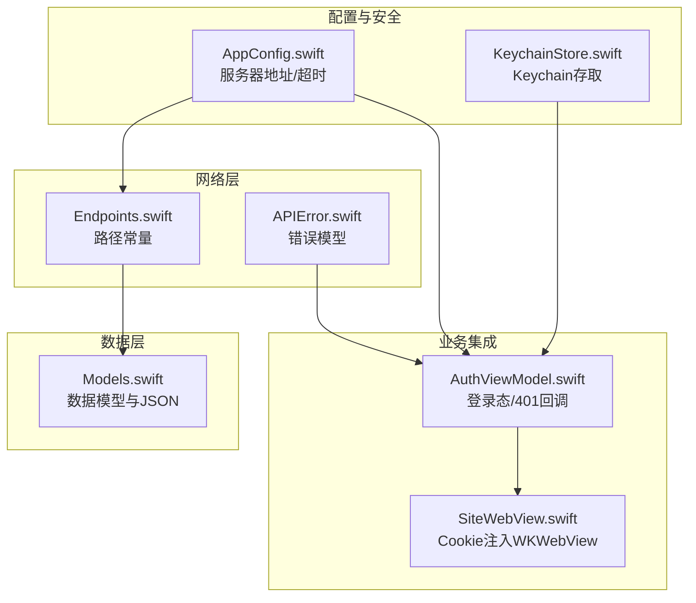
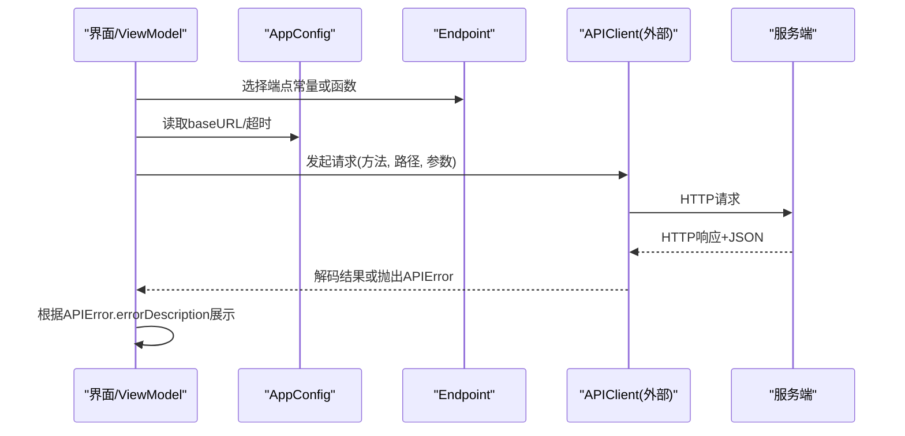
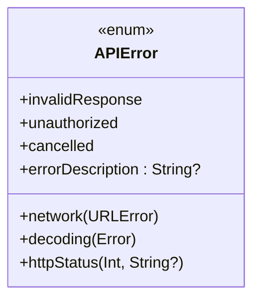
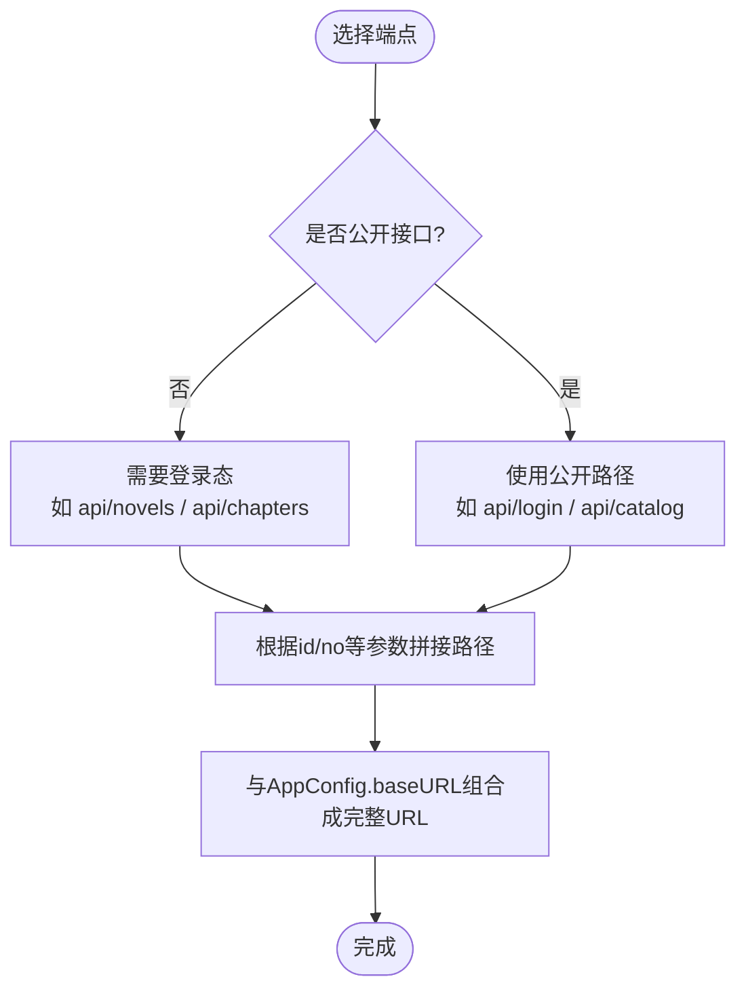
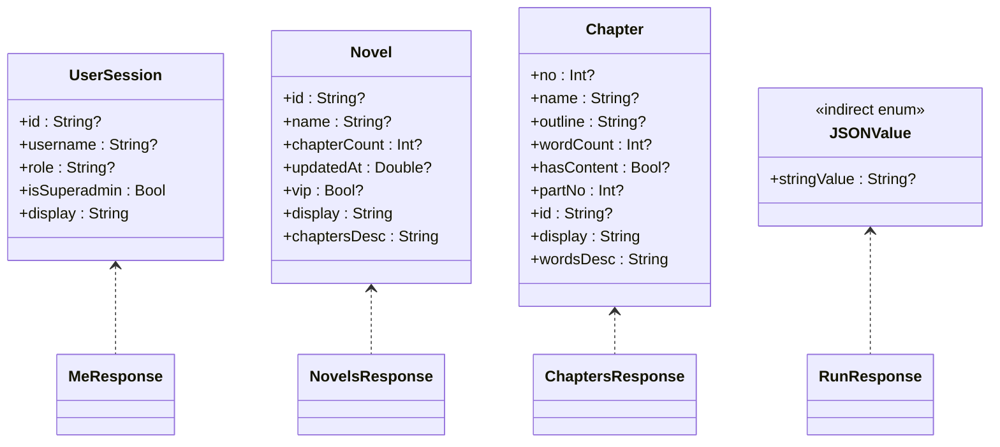
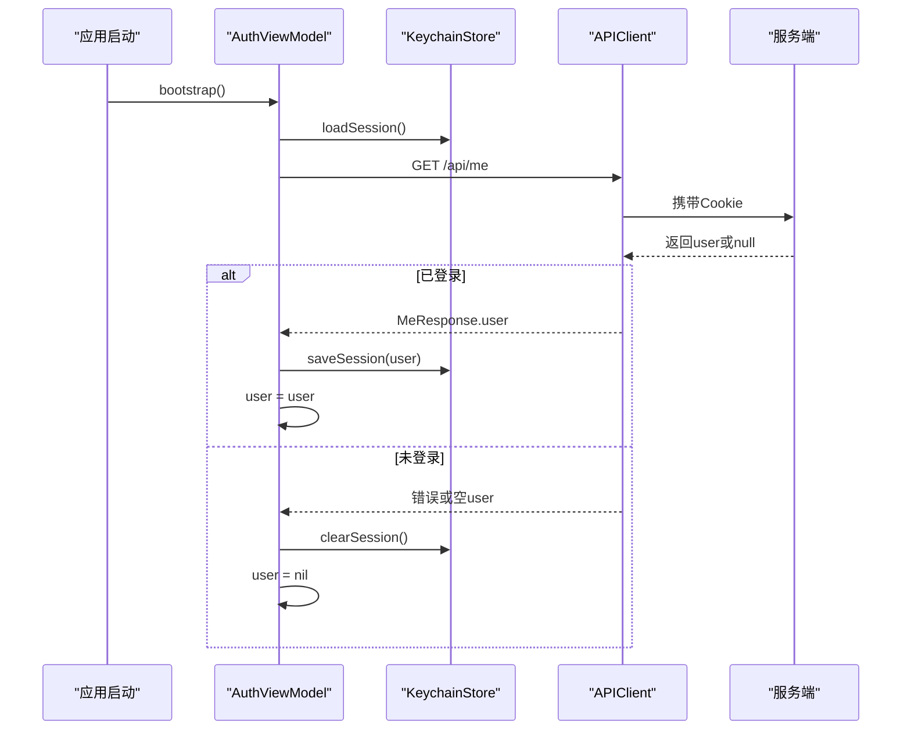
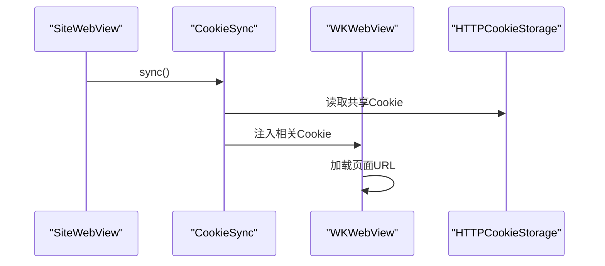
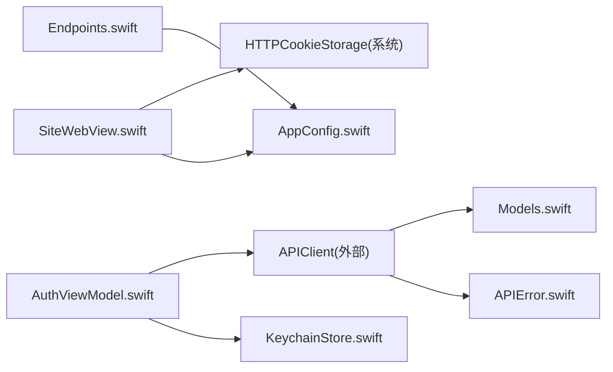
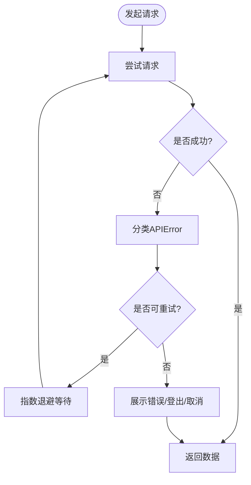

# 网络层设计

<cite>
**本文引用的文件**   
- [APIError.swift](file://ios/AINovel/Networking/APIError.swift)
- [Endpoints.swift](file://ios/AINovel/Networking/Endpoints.swift)
- [Models.swift](file://ios/AINovel/Models/Models.swift)
- [AuthViewModel.swift](file://ios/AINovel/Auth/AuthViewModel.swift)
- [AppConfig.swift](file://ios/AINovel/Config/AppConfig.swift)
- [KeychainStore.swift](file://ios/AINovel/Security/KeychainStore.swift)
- [SiteWebView.swift](file://ios/AINovel/Reader/SiteWebView.swift)
</cite>

## 目录
1. [引言](#引言)
2. [项目结构](#项目结构)
3. [核心组件](#核心组件)
4. [架构总览](#架构总览)
5. [详细组件分析](#详细组件分析)
6. [依赖关系分析](#依赖关系分析)
7. [性能与可靠性](#性能与可靠性)
8. [故障排查指南](#故障排查指南)
9. [结论](#结论)
10. [附录：请求示例与最佳实践](#附录请求示例与最佳实践)

## 引言
本技术文档聚焦 iOS 客户端的网络层设计，围绕以下目标展开：
- 解释 APIError 的错误类型定义与错误处理策略。
- 文档化 Endpoints 的路径常量管理与 URL 构建逻辑。
- 说明 Models.swift 中的数据模型定义与 JSON 序列化机制。
- 给出发起网络请求、处理响应数据与实现重试机制的实践路径。
- 解释网络请求的生命周期管理、缓存策略与离线支持现状。
- 文档化错误分类、用户友好的错误提示与调试信息收集方式。

该网络层以“集中式端点常量 + 统一错误模型 + Codable 数据模型”为核心，配合认证状态与 Keychain 持久化，形成可维护、可扩展的客户端 API 访问层。

## 项目结构
iOS 端的网络相关代码主要分布在以下模块：
- Networking：错误模型与端点常量。
- Models：业务数据模型与 JSON 编解码。
- Config：全局服务器地址与超时配置。
- Security：Keychain 凭据与会话快照存储。
- Auth：登录态生命周期与 401 处理。
- Reader：阅读器页面与 Cookie 同步（WKWebView 与 URLSession 共享 Cookie）。

**图表来源**
- [Endpoints.swift:1-51](file://ios/AINovel/Networking/Endpoints.swift#L1-L51)
- [APIError.swift:1-51](file://ios/AINovel/Networking/APIError.swift#L1-L51)
- [Models.swift:1-234](file://ios/AINovel/Models/Models.swift#L1-L234)
- [AppConfig.swift:1-111](file://ios/AINovel/Config/AppConfig.swift#L1-L111)
- [KeychainStore.swift:1-83](file://ios/AINovel/Security/KeychainStore.swift#L1-L83)
- [AuthViewModel.swift:1-107](file://ios/AINovel/Auth/AuthViewModel.swift#L1-L107)
- [SiteWebView.swift:1-111](file://ios/AINovel/Reader/SiteWebView.swift#L1-L111)

**章节来源**
- [Endpoints.swift:1-51](file://ios/AINovel/Networking/Endpoints.swift#L1-L51)
- [APIError.swift:1-51](file://ios/AINovel/Networking/APIError.swift#L1-L51)
- [Models.swift:1-234](file://ios/AINovel/Models/Models.swift#L1-L234)
- [AppConfig.swift:1-111](file://ios/AINovel/Config/AppConfig.swift#L1-L111)
- [KeychainStore.swift:1-83](file://ios/AINovel/Security/KeychainStore.swift#L1-L83)
- [AuthViewModel.swift:1-107](file://ios/AINovel/Auth/AuthViewModel.swift#L1-L107)
- [SiteWebView.swift:1-111](file://ios/AINovel/Reader/SiteWebView.swift#L1-L111)

## 核心组件
- APIError：统一封装网络、HTTP、解析等错误，并提供本地化错误描述。
- Endpoint：集中管理所有 API 路径常量与带参路径生成函数。
- Models：使用 Codable 定义服务端返回的数据结构，包含宽松兜底的 JSONValue。
- AppConfig：统一管理 baseURL、环境切换、超时时间等运行配置。
- KeychainStore：安全存储记住的密码与会话快照。
- AuthViewModel：负责登录、登出、401 自动登出与界面状态联动。
- SiteWebView：将 URLSession 的 Cookie 注入 WKWebView，保证读者站 VIP 内容可用。

**章节来源**
- [APIError.swift:1-51](file://ios/AINovel/Networking/APIError.swift#L1-L51)
- [Endpoints.swift:1-51](file://ios/AINovel/Networking/Endpoints.swift#L1-L51)
- [Models.swift:1-234](file://ios/AINovel/Models/Models.swift#L1-L234)
- [AppConfig.swift:1-111](file://ios/AINovel/Config/AppConfig.swift#L1-L111)
- [KeychainStore.swift:1-83](file://ios/AINovel/Security/KeychainStore.swift#L1-L83)
- [AuthViewModel.swift:1-107](file://ios/AINovel/Auth/AuthViewModel.swift#L1-L107)
- [SiteWebView.swift:1-111](file://ios/AINovel/Reader/SiteWebView.swift#L1-L111)

## 架构总览
网络层采用“端点常量 + 数据模型 + 统一错误”的分层设计：
- 调用方通过 Endpoint 获取相对路径，结合 AppConfig.baseURL 构建完整 URL。
- 请求由上层（如 APIClient）发起，返回体通过 Codable 映射到 Models。
- 所有异常被收敛为 APIError，便于 UI 展示与后续重试策略。

**图表来源**
- [Endpoints.swift:1-51](file://ios/AINovel/Networking/Endpoints.swift#L1-L51)
- [AppConfig.swift:1-111](file://ios/AINovel/Config/AppConfig.swift#L1-L111)
- [APIError.swift:1-51](file://ios/AINovel/Networking/APIError.swift#L1-L51)

## 详细组件分析

### APIError：错误类型与处理策略
APIError 是网络层的统一错误抽象，覆盖以下场景：
- 网络层错误：断网、超时、无法连接主机等。
- 响应异常：非预期响应体或空响应。
- 解析失败：JSON 解码出错。
- 鉴权失败：未登录或会话过期。
- HTTP 状态码：按常见状态码提供友好文案，并可选附带后端 error 消息。

**图表来源**
- [APIError.swift:9-47](file://ios/AINovel/Networking/APIError.swift#L9-L47)

关键行为：
- 对常见 URLError.code 进行本地化文案映射，提升用户体验。
- httpStatus 分支对 400/401/403/404/409/410/429 等提供基础文案，并可拼接后端 error 字段。
- EmptyResponse 用于无返回体的成功接口，简化调用方处理。

**章节来源**
- [APIError.swift:1-51](file://ios/AINovel/Networking/APIError.swift#L1-L51)

### Endpoints：路径常量与 URL 构建
Endpoint 枚举集中管理所有 API 路径，并与后端路由对齐：
- 公开接口：登录、书单、阅读器 AI、TTS 等。
- 需登录接口：小说、章节、设置、发布、分享等。
- 通用动作入口：/api/run。

带参数的路径通过函数动态拼接，例如：
- novel(id)
- chapters(id)
- chapter(id, no)
- outline(id, no)
- settings(id)
- publish(id)
- vip(id)

**图表来源**
- [Endpoints.swift:1-51](file://ios/AINovel/Networking/Endpoints.swift#L1-L51)
- [AppConfig.swift:1-111](file://ios/AINovel/Config/AppConfig.swift#L1-L111)

注意：
- 所有路径均为相对路径，最终 URL 由调用方（APIClient）与 AppConfig.baseURL 组合。
- 换服务器地址会清除登录态，因为 Cookie Path 必须匹配站点根。

**章节来源**
- [Endpoints.swift:1-51](file://ios/AINovel/Networking/Endpoints.swift#L1-L51)
- [AppConfig.swift:1-111](file://ios/AINovel/Config/AppConfig.swift#L1-L111)

### Models：数据模型与 JSON 序列化
Models.swift 使用 Codable 定义服务端返回的数据结构，涵盖：
- 认证：UserSession、MeResponse、LoginResponse。
- 小说与章节：Novel、ChaptersResponse、ChapterDetail、ChapterResponse。
- 设定：GenCfg、WordBand、NovelSettings、SaveSettingsResponse。
- 分部：Part、PartsResponse。
- 阅读器 AI：QuizQuestion、QuizResponse、VocabResponse、ExplainResponse、AskResponse、FeedbackResponse、WordStatusResponse。
- 分享/发布/检查：ShareResponse、PublishResponse、CheckResponse。
- 通用动作：RunResponse、LLMStatus、RenumberResponse、OkResponse。
- 宽松兜底：JSONValue，用于形状多变的 result/report 字段。

**图表来源**
- [Models.swift:5-13](file://ios/AINovel/Models/Models.swift#L5-L13)
- [Models.swift:20-31](file://ios/AINovel/Models/Models.swift#L20-L31)
- [Models.swift:56-77](file://ios/AINovel/Models/Models.swift#L56-L77)
- [Models.swift:197-233](file://ios/AINovel/Models/Models.swift#L197-L233)

JSON 序列化机制要点：
- 所有模型均遵循 Codable，便于直接解码 JSON。
- JSONValue 作为宽松兜底类型，支持 string/number/bool/object/array/null，避免严格校验导致解析失败。
- 部分响应体包含 ok 字段，调用方可据此判断业务成功与否。

**章节来源**
- [Models.swift:1-234](file://ios/AINovel/Models/Models.swift#L1-L234)

### 认证与登录态生命周期
AuthViewModel 负责：
- 冷启动时从 Keychain 恢复界面显示的用户快照。
- 调用 /api/me 探测权威登录态，更新 Keychain 与界面状态。
- 登录成功后保存用户信息与可选的记住密码凭据。
- 401 时触发全局登出流程，清空 Keychain 并拉起登录弹窗。

**图表来源**
- [AuthViewModel.swift:31-54](file://ios/AINovel/Auth/AuthViewModel.swift#L31-L54)
- [KeychainStore.swift:29-44](file://ios/AINovel/Security/KeychainStore.swift#L29-L44)

关键点：
- 会话本身由 httpOnly Cookie 维持，URLSession 自动保存；Keychain 仅存快照用于界面即时显示。
- 换服务器地址后 Cookie 属另一域，需重新登录。

**章节来源**
- [AuthViewModel.swift:1-107](file://ios/AINovel/Auth/AuthViewModel.swift#L1-L107)
- [KeychainStore.swift:1-83](file://ios/AINovel/Security/KeychainStore.swift#L1-L83)

### WKWebView 与 Cookie 同步
SiteWebView 在加载读者站页面之前，将 URLSession 共享 Cookie 存储中的会话 Cookie 注入 WKWebsiteDataStore，确保 VIP 书页不被拦截。

**图表来源**
- [SiteWebView.swift:94-110](file://ios/AINovel/Reader/SiteWebView.swift#L94-L110)

**章节来源**
- [SiteWebView.swift:1-111](file://ios/AINovel/Reader/SiteWebView.swift#L1-L111)

## 依赖关系分析
- Endpoint 与 AppConfig 解耦：Endpoint 只关心相对路径，AppConfig 提供 baseURL 与超时。
- APIError 被上层统一捕获，用于 UI 展示与重试决策。
- Models 与 Codable 紧密耦合，所有响应体均可通过 Decodable 解码。
- AuthViewModel 依赖 KeychainStore 与 APIClient（外部），负责登录态与界面状态。
- SiteWebView 依赖 AppConfig 与系统 Cookie 存储，确保 WebView 与 URLSession 的会话一致。

**图表来源**
- [Endpoints.swift:1-51](file://ios/AINovel/Networking/Endpoints.swift#L1-L51)
- [AppConfig.swift:1-111](file://ios/AINovel/Config/AppConfig.swift#L1-L111)
- [APIError.swift:1-51](file://ios/AINovel/Networking/APIError.swift#L1-L51)
- [Models.swift:1-234](file://ios/AINovel/Models/Models.swift#L1-L234)
- [AuthViewModel.swift:1-107](file://ios/AINovel/Auth/AuthViewModel.swift#L1-L107)
- [KeychainStore.swift:1-83](file://ios/AINovel/Security/KeychainStore.swift#L1-L83)
- [SiteWebView.swift:1-111](file://ios/AINovel/Reader/SiteWebView.swift#L1-L111)

**章节来源**
- [Endpoints.swift:1-51](file://ios/AINovel/Networking/Endpoints.swift#L1-L51)
- [AppConfig.swift:1-111](file://ios/AINovel/Config/AppConfig.swift#L1-L111)
- [APIError.swift:1-51](file://ios/AINovel/Networking/APIError.swift#L1-L51)
- [Models.swift:1-234](file://ios/AINovel/Models/Models.swift#L1-L234)
- [AuthViewModel.swift:1-107](file://ios/AINovel/Auth/AuthViewModel.swift#L1-L107)
- [KeychainStore.swift:1-83](file://ios/AINovel/Security/KeychainStore.swift#L1-L83)
- [SiteWebView.swift:1-111](file://ios/AINovel/Reader/SiteWebView.swift#L1-L111)

## 性能与可靠性
- 超时配置：
  - 默认请求超时：AppConfig.requestTimeout。
  - LLM/生成类接口超时：AppConfig.llmTimeout，适配长耗时任务。
- 缓存策略：
  - 当前网络层未内置 HTTP 缓存；如需缓存，可在 APIClient 层引入 URLRequest.cachePolicy 或自定义缓存策略。
- 离线支持：
  - 当前未实现离线队列与本地缓存；建议在 APIClient 层增加离线模式开关与本地数据库（如 CoreData/SQLite）缓存。
- 重试机制：
  - 建议基于 APIError 的分类实现指数退避重试，针对网络错误与 429 限流进行重试，401 不重试直接登出。

[本节为通用指导，不直接分析具体文件]

## 故障排查指南
- 网络连接问题：
  - 检查 AppConfig.baseURL 是否正确，确认服务器地址与环境档。
  - 查看 APIError.network 的 localizedDescription，定位具体 URLError.code。
- 登录态失效：
  - 若出现 401，AuthViewModel 会清空 Keychain 并拉起登录弹窗。
  - 更换服务器地址后需重新登录，因为 Cookie 属不同域。
- 解析失败：
  - 检查 Models 字段与服务端返回是否一致，必要时扩展 JSONValue 的宽松解析。
- WebView 无法加载 VIP 内容：
  - 确认 CookieSync 已将会话 Cookie 注入 WKWebsiteDataStore。

**章节来源**
- [APIError.swift:18-46](file://ios/AINovel/Networking/APIError.swift#L18-L46)
- [AuthViewModel.swift:89-96](file://ios/AINovel/Auth/AuthViewModel.swift#L89-L96)
- [SiteWebView.swift:94-110](file://ios/AINovel/Reader/SiteWebView.swift#L94-L110)

## 结论
该网络层通过集中化的端点常量、统一的错误模型与 Codable 数据模型，构建了清晰、可维护的客户端 API 访问层。结合 AppConfig 的配置管理与 Keychain 的安全存储，实现了稳定的认证与用户体验。未来可在 APIClient 层增强缓存、离线与重试能力，进一步提升可靠性与性能。

[本节为总结性内容，不直接分析具体文件]

## 附录：请求示例与最佳实践

### 发起网络请求与处理响应
- 选择端点：
  - 公开接口：Endpoint.login、Endpoint.catalog 等。
  - 需登录接口：Endpoint.novels、Endpoint.chapters 等。
- 构建 URL：
  - 使用 AppConfig.baseURL 与 Endpoint 路径组合。
- 发起请求：
  - 通过 APIClient 的 get/post 等方法，传入期望的 Decodable 类型。
- 处理响应：
  - 成功：解码为 Models 类型，提取所需字段。
  - 失败：捕获 APIError，使用 errorDescription 展示给用户。

参考路径：
- [Endpoints.swift:1-51](file://ios/AINovel/Networking/Endpoints.swift#L1-L51)
- [Models.swift:1-234](file://ios/AINovel/Models/Models.swift#L1-L234)
- [APIError.swift:1-51](file://ios/AINovel/Networking/APIError.swift#L1-L51)

### 实现重试机制的建议流程

[本节为概念性流程图，不直接映射具体源码文件]

### 最佳实践
- 统一错误处理：
  - 所有网络异常收敛为 APIError，UI 层统一展示。
- 端点管理：
  - 新增接口时在 Endpoint 中声明，保持与后端路由一致。
- 数据模型：
  - 优先使用 Codable 强类型模型；对于形状多变字段使用 JSONValue。
- 认证与 Cookie：
  - 使用 httpOnly Cookie 维持会话；换服务器地址后清理 Keychain 并重新登录。
- WebView 集成：
  - 在加载读者站前执行 CookieSync，确保 VIP 内容正常访问。

**章节来源**
- [APIError.swift:1-51](file://ios/AINovel/Networking/APIError.swift#L1-L51)
- [Endpoints.swift:1-51](file://ios/AINovel/Networking/Endpoints.swift#L1-L51)
- [Models.swift:1-234](file://ios/AINovel/Models/Models.swift#L1-L234)
- [AuthViewModel.swift:1-107](file://ios/AINovel/Auth/AuthViewModel.swift#L1-L107)
- [SiteWebView.swift:1-111](file://ios/AINovel/Reader/SiteWebView.swift#L1-L111)