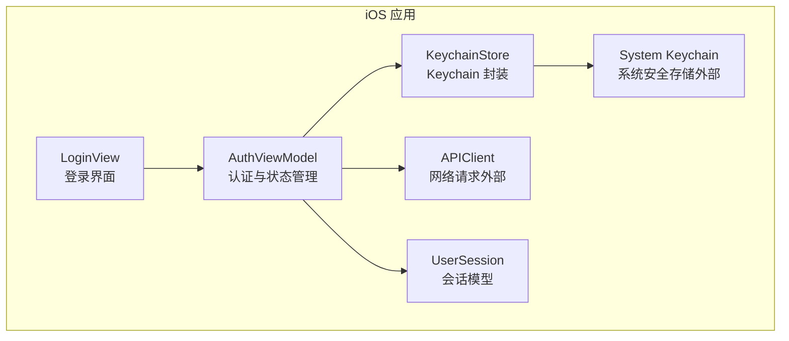
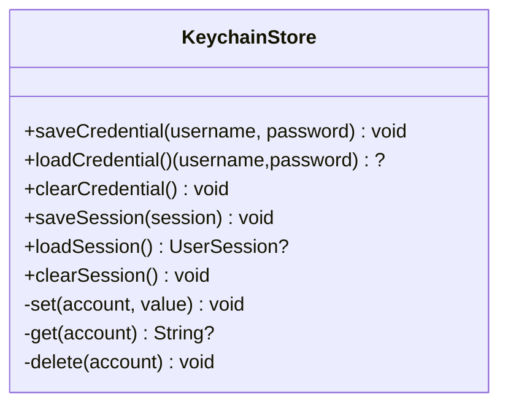
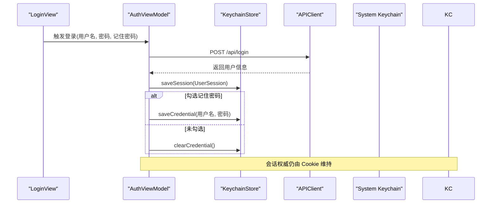
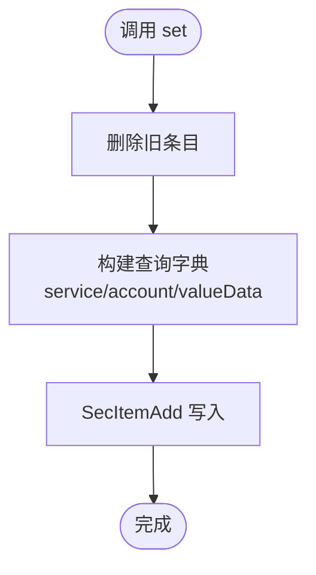
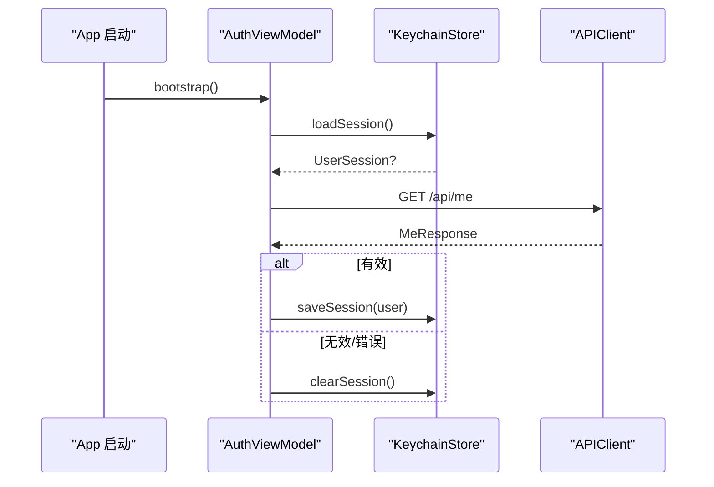
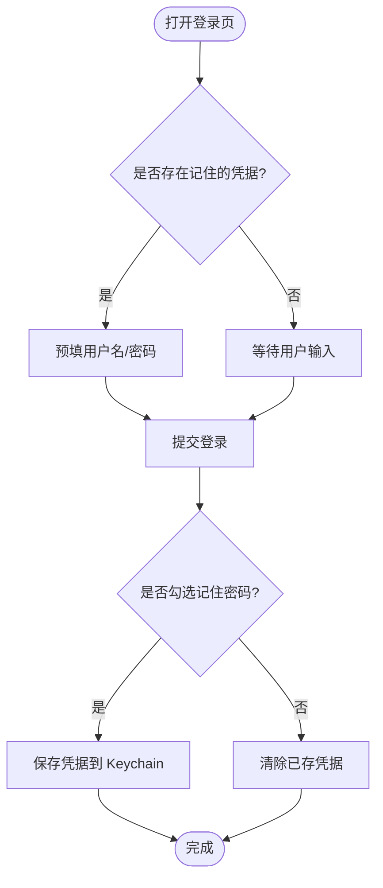
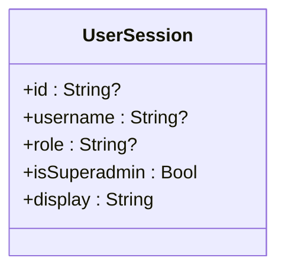
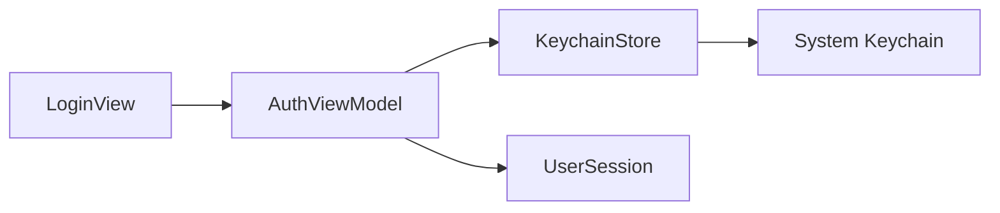

# 密钥链存储

<cite>
**本文引用的文件**   
- [KeychainStore.swift](file://ios/AINovel/Security/KeychainStore.swift)
- [AuthViewModel.swift](file://ios/AINovel/Auth/AuthViewModel.swift)
- [LoginView.swift](file://ios/AINovel/Auth/LoginView.swift)
- [Models.swift](file://ios/AINovel/Models/Models.swift)
</cite>

## 目录
1. [引言](#引言)
2. [项目结构与安全边界](#项目结构与安全边界)
3. [核心组件：KeychainStore](#核心组件keychainstore)
4. [架构总览](#架构总览)
5. [详细组件分析](#详细组件分析)
6. [依赖关系分析](#依赖关系分析)
7. [性能与行为特征](#性能与行为特征)
8. [安全注意事项与漏洞防护](#安全注意事项与漏洞防护)
9. [故障排查指南](#故障排查指南)
10. [结论](#结论)
11. [附录：扩展与最佳实践清单](#附录扩展与最佳实践清单)

## 引言
本文面向 iOS 端的安全存储需求，围绕 KeychainStore 的实现，系统说明用户凭据加密、会话令牌管理与敏感数据安全存储机制。文档同时解释 iOS Keychain API 的使用方式、数据模型、调用流程、权限与访问控制策略，并给出可操作的自定义安全存储方案、数据迁移与过期凭据清理建议。重点强调与系统安全框架的集成方式和常见安全风险防护措施。

## 项目结构与安全边界
本项目在 iOS 端将安全相关能力收敛到 Security 模块，并通过 Auth 层进行业务编排；数据模型集中在 Models 中，供认证与会话使用。

**图表来源**
- [LoginView.swift:1-78](file://ios/AINovel/Auth/LoginView.swift#L1-L78)
- [AuthViewModel.swift:1-107](file://ios/AINovel/Auth/AuthViewModel.swift#L1-L107)
- [KeychainStore.swift:1-83](file://ios/AINovel/Security/KeychainStore.swift#L1-L83)
- [Models.swift:1-20](file://ios/AINovel/Models/Models.swift#L1-L20)

**章节来源**
- [LoginView.swift:1-78](file://ios/AINovel/Auth/LoginView.swift#L1-L78)
- [AuthViewModel.swift:1-107](file://ios/AINovel/Auth/AuthViewModel.swift#L1-L107)
- [KeychainStore.swift:1-83](file://ios/AINovel/Security/KeychainStore.swift#L1-L83)
- [Models.swift:1-20](file://ios/AINovel/Models/Models.swift#L1-L20)

## 核心组件：KeychainStore
KeychainStore 是对 iOS Keychain 的极简封装，负责两类敏感数据的持久化：
- 记住密码：用户名与密码组合字符串，用于自动重登。
- 会话快照：当前登录用户的 UserSession JSON，用于冷启动快速回填 UI。

关键设计要点：
- 统一 service 标识，避免不同应用或目标混淆。
- 以 account 区分不同条目（credential、session）。
- 写入前先删除旧条目，再新增，保证幂等更新。
- 读取时返回 nil 表示不存在或解码失败，上层需做空值处理。

**图表来源**
- [KeychainStore.swift:7-82](file://ios/AINovel/Security/KeychainStore.swift#L7-L82)

**章节来源**
- [KeychainStore.swift:1-83](file://ios/AINovel/Security/KeychainStore.swift#L1-L83)

## 架构总览
认证流程由 AuthViewModel 编排，KeychainStore 作为底层安全存储被调用。会话权威校验通过服务端接口完成，Keychain 仅保存“快照”以提升体验。

**图表来源**
- [AuthViewModel.swift:56-80](file://ios/AINovel/Auth/AuthViewModel.swift#L56-L80)
- [KeychainStore.swift:12-44](file://ios/AINovel/Security/KeychainStore.swift#L12-L44)

**章节来源**
- [AuthViewModel.swift:1-107](file://ios/AINovel/Auth/AuthViewModel.swift#L1-L107)
- [KeychainStore.swift:1-83](file://ios/AINovel/Security/KeychainStore.swift#L1-L83)

## 详细组件分析

### KeychainStore 实现细节
- 服务标识：使用固定 service 字符串，确保同一应用内所有 Keychain 条目归属一致。
- 凭据格式：用户名与密码以换行符拼接为单一字符串，简化存取逻辑。
- 会话格式：UserSession 经 JSON 编码后存入 Keychain，读取时反序列化为对象。
- 通用操作：
  - set：先删除同名条目，再新增，保证幂等。
  - get：按 service+account 查询，返回 UTF-8 字符串。
  - delete：按 service+account 删除条目。

**图表来源**
- [KeychainStore.swift:48-58](file://ios/AINovel/Security/KeychainStore.swift#L48-L58)

**章节来源**
- [KeychainStore.swift:48-81](file://ios/AINovel/Security/KeychainStore.swift#L48-L81)

### AuthViewModel 与 KeychainStore 协作
- 冷启动：优先从 Keychain 加载会话快照，立即填充 UI；随后调用 /api/me 验证 Cookie 有效性，成功后更新快照，失败则清空。
- 登录成功：保存会话快照；根据“记住密码”选项决定是否保存凭据。
- 登出与过期：清除会话快照；保留凭据以便下次手动登录。
- 服务器变更：清除会话快照，避免跨域 Cookie 失效导致的状态不一致。

**图表来源**
- [AuthViewModel.swift:31-54](file://ios/AINovel/Auth/AuthViewModel.swift#L31-L54)
- [KeychainStore.swift:31-44](file://ios/AINovel/Security/KeychainStore.swift#L31-L44)

**章节来源**
- [AuthViewModel.swift:1-107](file://ios/AINovel/Auth/AuthViewModel.swift#L1-L107)
- [KeychainStore.swift:1-83](file://ios/AINovel/Security/KeychainStore.swift#L1-L83)

### LoginView 与记住密码
- 登录页预填：若存在记住的凭据，自动填充用户名和密码。
- 交互开关：“记住密码”复选框决定登录成功后是否保存凭据。
- 用户体验：登录成功后关闭登录页，进入主界面。

**图表来源**
- [LoginView.swift:62-67](file://ios/AINovel/Auth/LoginView.swift#L62-L67)
- [AuthViewModel.swift:69-74](file://ios/AINovel/Auth/AuthViewModel.swift#L69-L74)
- [KeychainStore.swift:12-27](file://ios/AINovel/Security/KeychainStore.swift#L12-L27)

**章节来源**
- [LoginView.swift:1-78](file://ios/AINovel/Auth/LoginView.swift#L1-L78)
- [AuthViewModel.swift:56-80](file://ios/AINovel/Auth/AuthViewModel.swift#L56-L80)
- [KeychainStore.swift:12-27](file://ios/AINovel/Security/KeychainStore.swift#L12-L27)

### 数据模型：UserSession
UserSession 是会话快照的数据载体，包含用户标识、用户名与角色等信息，支持 Codable 以进行 JSON 序列化与反序列化。

**图表来源**
- [Models.swift:6-13](file://ios/AINovel/Models/Models.swift#L6-L13)

**章节来源**
- [Models.swift:1-20](file://ios/AINovel/Models/Models.swift#L1-L20)

## 依赖关系分析
- AuthViewModel 依赖 KeychainStore 进行本地敏感数据存储。
- KeychainStore 依赖 System Keychain（Security.framework）进行安全存储。
- LoginView 依赖 AuthViewModel 提供认证状态与凭据预填能力。
- UserSession 作为数据模型被 KeychainStore 与 AuthViewModel 共同使用。

**图表来源**
- [LoginView.swift:1-78](file://ios/AINovel/Auth/LoginView.swift#L1-L78)
- [AuthViewModel.swift:1-107](file://ios/AINovel/Auth/AuthViewModel.swift#L1-L107)
- [KeychainStore.swift:1-83](file://ios/AINovel/Security/KeychainStore.swift#L1-L83)
- [Models.swift:1-20](file://ios/AINovel/Models/Models.swift#L1-L20)

**章节来源**
- [LoginView.swift:1-78](file://ios/AINovel/Auth/LoginView.swift#L1-L78)
- [AuthViewModel.swift:1-107](file://ios/AINovel/Auth/AuthViewModel.swift#L1-L107)
- [KeychainStore.swift:1-83](file://ios/AINovel/Security/KeychainStore.swift#L1-L83)
- [Models.swift:1-20](file://ios/AINovel/Models/Models.swift#L1-L20)

## 性能与行为特征
- Keychain 读写开销较低，适合小体积敏感数据（如凭据、会话快照）。
- 写入采用“先删后增”，保证幂等但会产生一次额外删除操作。
- 会话快照仅在登录成功或权威校验通过后更新，减少不必要的 I/O。
- 读取失败返回 nil，避免异常传播，上层需妥善处理空值。

[本节为一般性讨论，不直接分析具体代码文件]

## 安全注意事项与漏洞防护
- 凭据最小化暴露：
  - 仅在用户明确选择“记住密码”时才保存凭据。
  - 凭据以换行分隔的明文形式存储在 Keychain 中，未进行应用层二次加密。应评估是否需要更强的应用层加密或引入密钥派生。
- 会话快照非权威凭证：
  - 会话权威由服务端 Cookie 维护，Keychain 仅用于 UI 快速回填。每次启动都会通过 /api/me 校验，避免长期缓存导致的越权。
- 访问控制与隔离：
  - 使用统一的 service 标识，避免与其他应用或目标混淆。
  - 通过 account 字段区分不同用途条目（credential、session），降低误用风险。
- 数据生命周期管理：
  - 登出、服务器地址变更、401 过期均会清除会话快照，防止跨域或过期状态残留。
  - 未勾选“记住密码”时主动清除凭据，避免意外泄露。
- 日志与调试：
  - 避免在日志中输出凭据或会话内容；如需调试，请脱敏或使用占位符。
- 升级与迁移：
  - 当凭据格式变化时，应在读取侧兼容旧格式并进行迁移，避免破坏已有用户数据。
- 权限与配置：
  - 确保 Info.plist 中未开启不必要的调试或测试特性；生产环境禁用可能绕过安全限制的开关。
- 常见漏洞防护：
  - 防止凭据硬编码或默认值。
  - 防止在未授权路径中读取 Keychain 数据。
  - 防止在崩溃转储或内存 dump 中泄露敏感数据。
  - 防止跨进程共享敏感数据（Keychain 默认受沙箱保护，但仍需谨慎使用）。

[本节为一般性指导，不直接分析具体代码文件]

## 故障排查指南
- 无法读取凭据：
  - 检查 account 名称是否正确（credential）。
  - 确认 service 标识与应用一致。
  - 检查凭据格式是否为“用户名\n密码”，且两端非空。
- 会话快照为空：
  - 检查 /api/me 是否返回有效用户信息。
  - 确认登录成功后是否调用了保存会话的方法。
  - 检查登出或 401 处理逻辑是否清除了会话。
- 记住密码未生效：
  - 确认用户是否勾选“记住密码”。
  - 检查登录成功后是否调用保存凭据方法。
  - 检查登录失败分支是否清除了凭据。

**章节来源**
- [KeychainStore.swift:12-27](file://ios/AINovel/Security/KeychainStore.swift#L12-L27)
- [KeychainStore.swift:31-44](file://ios/AINovel/Security/KeychainStore.swift#L31-L44)
- [AuthViewModel.swift:31-54](file://ios/AINovel/Auth/AuthViewModel.swift#L31-L54)
- [AuthViewModel.swift:69-74](file://ios/AINovel/Auth/AuthViewModel.swift#L69-L74)

## 结论
KeychainStore 提供了对 iOS Keychain 的最小必要封装，满足记住密码与会话快照的基本安全存储需求。结合 AuthViewModel 的业务编排，实现了冷启动体验优化与权威登录态校验。尽管当前实现未进行应用层二次加密，但通过最小暴露面、严格的生命周期管理与权威校验，整体风险可控。建议在后续迭代中引入更严格的凭据加密与版本化迁移策略，进一步提升安全性与可维护性。

[本节为总结性内容，不直接分析具体代码文件]

## 附录：扩展与最佳实践清单
- 自定义安全存储建议：
  - 为凭据增加应用层加密（例如基于设备唯一标识或生物识别派生的密钥）。
  - 引入凭据版本号，便于未来格式迁移。
  - 将敏感数据访问集中到单一入口，避免分散调用。
- 数据迁移策略：
  - 读取时检测旧格式并转换为新格式，成功后写回新版本。
  - 迁移失败时保留原数据并提供降级路径。
- 过期凭据清理：
  - 定期清理超过阈值的凭据（如 90 天未使用）。
  - 在登出、服务器变更、权限变更时强制清理。
- 与系统安全框架集成：
  - 使用 SecItemAdd/CopyMatching/Delete 进行标准操作。
  - 合理设置 kSecAttrAccessible 等属性（如需限制访问时机）。
  - 避免在日志、崩溃报告、远程诊断中输出敏感数据。
- 权限管理：
  - 仅在必要时请求生物识别或 Face ID/Touch ID。
  - 在后台任务中避免直接访问敏感数据。

[本节为一般性指导，不直接分析具体代码文件]