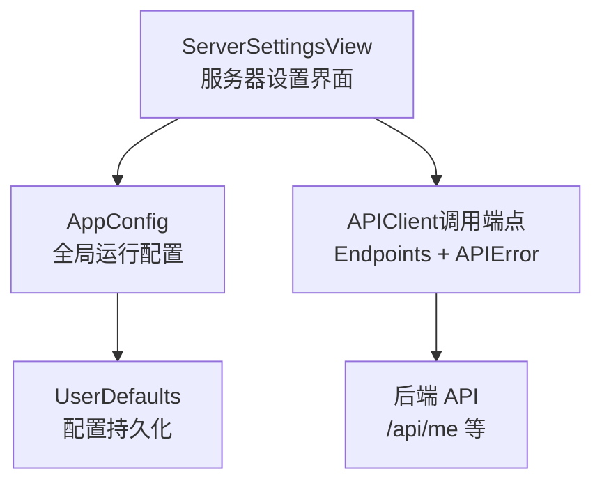
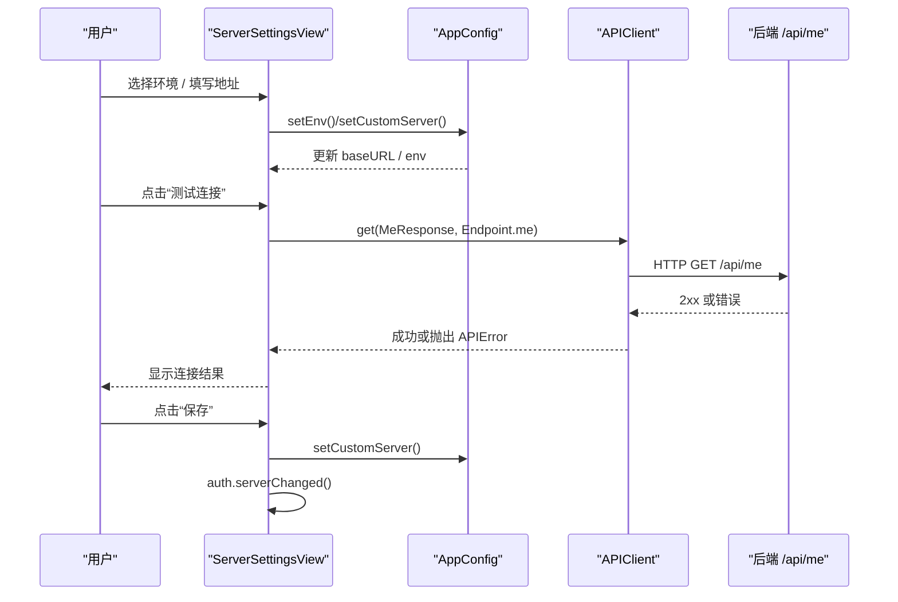
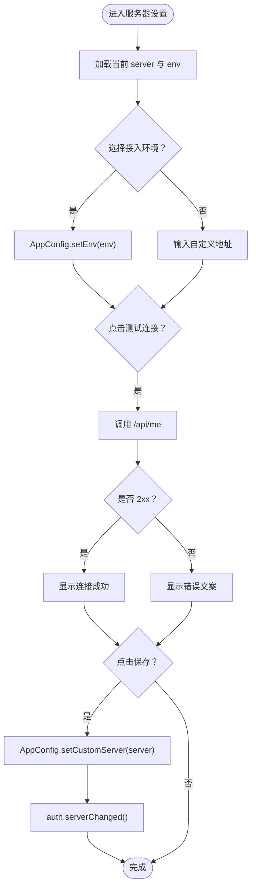
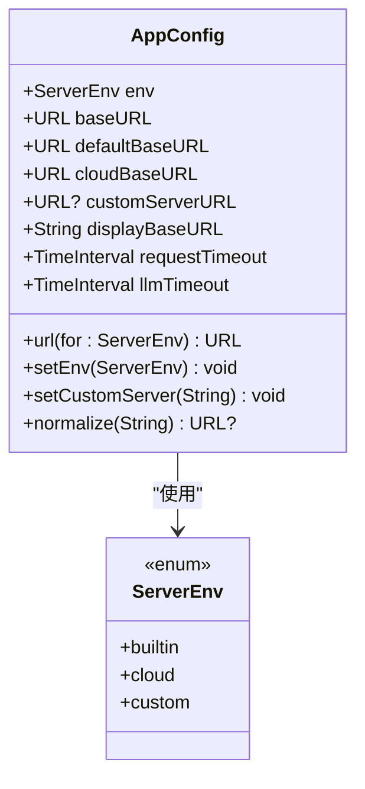
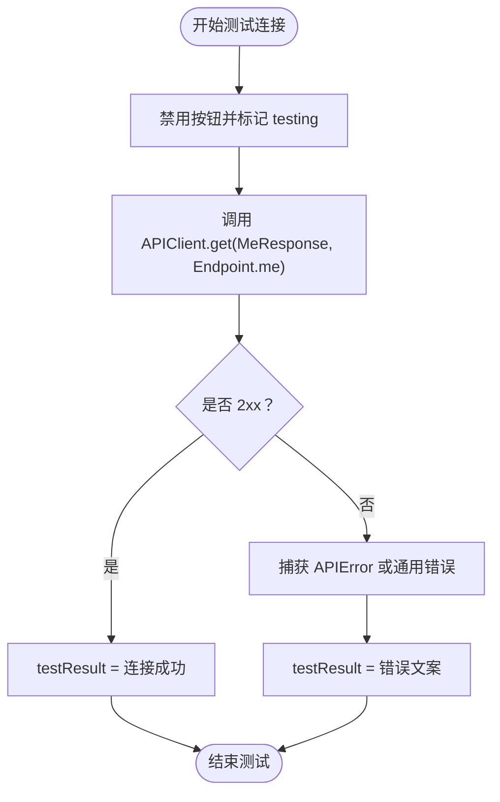
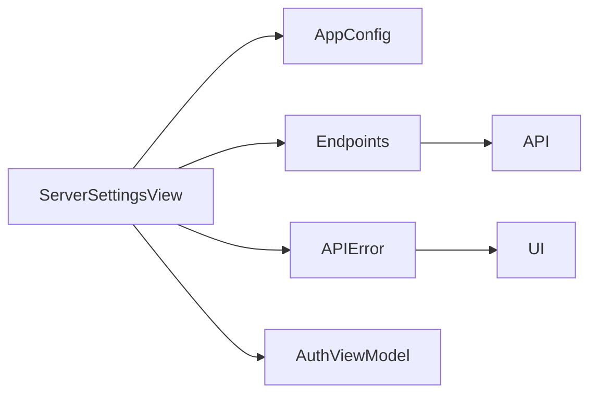

# 服务器设置界面

<cite>
**本文引用的文件**   
- [ServerSettingsView.swift](file://ios/AINovel/Auth/ServerSettingsView.swift)
- [AppConfig.swift](file://ios/AINovel/Config/AppConfig.swift)
- [APIError.swift](file://ios/AINovel/Networking/APIError.swift)
- [Endpoints.swift](file://ios/AINovel/Networking/Endpoints.swift)
- [README.md](file://README.md)
</cite>

## 目录
1. [引言](#引言)
2. [项目结构](#项目结构)
3. [核心组件](#核心组件)
4. [架构总览](#架构总览)
5. [详细组件分析](#详细组件分析)
6. [依赖关系分析](#依赖关系分析)
7. [性能与超时配置](#性能与超时配置)
8. [故障排查指南](#故障排查指南)
9. [结论](#结论)
10. [附录：扩展示例](#附录扩展示例)

## 引言
本开发文档面向“服务器设置界面”的实现与维护，聚焦以下目标：
- 说明 ServerSettingsView 的配置选项、用户交互流程与状态管理。
- 文档化 AppConfig 的优先级、更新机制与配置持久化策略。
- 解释网络连接测试的实现原理、错误处理与用户体验设计。
- 给出扩展配置项、新增服务器参数与连接超时的具体实现思路。
- 说明与网络层的集成方式以及配置验证逻辑。

该功能的核心价值是让用户在不重启 App 的前提下，动态切换或自定义后端服务器地址，并通过内置的连接测试快速验证可达性；同时保证 Cookie 域一致性，避免换服务器后登录态失效。

## 项目结构
与服务器设置相关的代码主要分布在 iOS 客户端的三个层次：
- 视图层：ServerSettingsView 负责展示接入环境选择、自定义地址输入、连接测试与保存操作。
- 配置层：AppConfig 提供当前生效的 baseURL、环境枚举、地址规范化与 UserDefaults 持久化。
- 网络层：Endpoints 定义 API 路径，APIError 统一错误语义；连接测试通过公开接口探测服务器可达性。

图示来源
- [ServerSettingsView.swift:6-129](file://ios/AINovel/Auth/ServerSettingsView.swift#L6-L129)
- [AppConfig.swift:11-110](file://ios/AINovel/Config/AppConfig.swift#L11-L110)
- [Endpoints.swift:5-50](file://ios/AINovel/Networking/Endpoints.swift#L5-L50)
- [APIError.swift:9-47](file://ios/AINovel/Networking/APIError.swift#L9-L47)

章节来源
- [ServerSettingsView.swift:1-130](file://ios/AINovel/Auth/ServerSettingsView.swift#L1-L130)
- [AppConfig.swift:1-111](file://ios/AINovel/Config/AppConfig.swift#L1-L111)
- [Endpoints.swift:1-51](file://ios/AINovel/Networking/Endpoints.swift#L1-L51)
- [APIError.swift:1-51](file://ios/AINovel/Networking/APIError.swift#L1-L51)

## 核心组件
- ServerSettingsView：提供“局域网 / 公网服务器”一键切换、自定义地址输入、连接测试、保存与恢复默认等操作；在切换或保存时触发登录态清理，确保新地址重新登录。
- AppConfig：集中管理 baseURL 解析、环境枚举、地址规范化、持久化键与请求超时；支持 Info.plist、环境变量与编译默认值的回退策略。
- Endpoints：以静态字符串与函数形式声明 API 路径，与后端路由对齐；连接测试使用公开的 /api/me。
- APIError：将底层网络错误、HTTP 状态码与后端错误体统一为可读文案，便于界面提示。

章节来源
- [ServerSettingsView.swift:6-129](file://ios/AINovel/Auth/ServerSettingsView.swift#L6-L129)
- [AppConfig.swift:11-110](file://ios/AINovel/Config/AppConfig.swift#L11-L110)
- [Endpoints.swift:5-50](file://ios/AINovel/Networking/Endpoints.swift#L5-L50)
- [APIError.swift:9-47](file://ios/AINovel/Networking/APIError.swift#L9-L47)

## 架构总览
服务器设置界面的整体数据流如下：
- 用户选择接入环境或填写自定义地址。
- 配置写入 AppConfig 并持久化到 UserDefaults。
- 点击“测试连接”时，通过 APIClient 调用公开端点 /api/me。
- 成功返回 2xx 即视为可达；失败则根据 APIError 分类显示友好提示。
- 保存或切换环境会调用 auth.serverChanged() 清除登录态，防止 Cookie 域不一致导致鉴权失败。

图示来源
- [ServerSettingsView.swift:42-90](file://ios/AINovel/Auth/ServerSettingsView.swift#L42-L90)
- [AppConfig.swift:51-84](file://ios/AINovel/Config/AppConfig.swift#L51-L84)
- [Endpoints.swift:5-10](file://ios/AINovel/Networking/Endpoints.swift#L5-L10)

## 详细组件分析

### ServerSettingsView：配置选项与交互设计
- 接入环境选择：
  - “局域网”对应内置默认地址，“公网服务器”对应云端站点根。
  - 选中态高亮，点击即生效，无需重启 App。
- 自定义地址输入：
  - 仅接受 host[:port] 或带 scheme 的完整 URL。
  - 自动补 http:// 与 /novel 前缀；若用户已指定自定义路径，则保留原样。
- 连接测试：
  - 调用公开接口 /api/me，2xx 即成功。
  - 失败时显示 APIError 的本地化描述。
- 保存与恢复：
  - 保存后清空测试反馈，并调用 auth.serverChanged() 清登录态。
  - 恢复默认地址会重置 env 与自定义地址，并清登录态。

图示来源
- [ServerSettingsView.swift:14-90](file://ios/AINovel/Auth/ServerSettingsView.swift#L14-L90)
- [ServerSettingsView.swift:116-128](file://ios/AINovel/Auth/ServerSettingsView.swift#L116-L128)

章节来源
- [ServerSettingsView.swift:6-129](file://ios/AINovel/Auth/ServerSettingsView.swift#L6-L129)

### AppConfig：更新机制与配置持久化
- 优先级规则：
  - 用户选择的接入环境 > 用户自设地址 > Info.plist / 环境变量 / 编译默认值。
- 地址解析：
  - builtin → defaultBaseURL（Info.plist → DEBUG 环境变量 → 127.0.0.1:3400/novel）。
  - cloud → cloudBaseURL（https://ai.fsr.co.jp/novel）。
  - custom → customServerURL（已规范化），无效时回落 builtin。
- 持久化：
  - envKey 存储当前环境枚举。
  - serverOverrideKey 存储用户自定义地址（绝对字符串）。
- 规范化：
  - 缺省 scheme 补 http://。
  - 去除尾斜杠。
  - 无路径或仅 / 时补 /novel。
  - 非法地址直接丢弃并回退到 builtin。
- 切档行为：
  - 非 custom 档会清理自定义地址，避免环境与地址不一致。

图示来源
- [AppConfig.swift:11-110](file://ios/AINovel/Config/AppConfig.swift#L11-L110)

章节来源
- [AppConfig.swift:11-110](file://ios/AINovel/Config/AppConfig.swift#L11-L110)

### 网络连接测试：实现原理与错误处理
- 测试端点：
  - 使用公开接口 /api/me，匿名也可访问，适合探活。
- 成功判定：
  - 返回 2xx 即视为连接成功。
- 错误分类：
  - 网络不可用、超时、无法连接主机等由 APIError 映射为中文提示。
  - HTTP 状态码（如 401、404、429）统一转换为可读文案。
- 界面表现：
  - 测试中禁用按钮并显示进度指示。
  - 成功显示绿色提示，失败显示红色提示。

图示来源
- [ServerSettingsView.swift:116-128](file://ios/AINovel/Auth/ServerSettingsView.swift#L116-L128)
- [APIError.swift:9-47](file://ios/AINovel/Networking/APIError.swift#L9-L47)
- [Endpoints.swift:5-10](file://ios/AINovel/Networking/Endpoints.swift#L5-L10)

章节来源
- [ServerSettingsView.swift:116-128](file://ios/AINovel/Auth/ServerSettingsView.swift#L116-L128)
- [APIError.swift:9-47](file://ios/AINovel/Networking/APIError.swift#L9-L47)
- [Endpoints.swift:5-10](file://ios/AINovel/Networking/Endpoints.swift#L5-L10)

### 配置验证逻辑
- 输入校验：
  - 空串或非法 URL 会被 normalize 拒绝。
  - 只含 host[:port] 时自动补 /novel。
- 环境一致性：
  - 切换为非 custom 档时清理自定义地址。
- 登录态安全：
  - 任何影响 baseURL 的操作都会触发 auth.serverChanged()，避免 Cookie 域不匹配。

章节来源
- [AppConfig.swift:63-84](file://ios/AINovel/Config/AppConfig.swift#L63-L84)
- [AppConfig.swift:89-102](file://ios/AINovel/Config/AppConfig.swift#L89-L102)
- [ServerSettingsView.swift:84-90](file://ios/AINovel/Auth/ServerSettingsView.swift#L84-L90)

## 依赖关系分析
- ServerSettingsView 依赖：
  - SwiftUI 框架与环境对象（AuthViewModel）。
  - AppConfig 用于读取与更新 baseURL/env。
  - APIClient（未在本仓库列出）用于发起网络请求。
  - Endpoints 提供 API 路径常量。
  - APIError 提供错误分类与本地化文案。
- AppConfig 依赖：
  - Foundation（URL、Bundle、ProcessInfo）。
  - UserDefaults 进行配置持久化。
- Endpoints 与 APIError 为纯数据与错误模型，被上层 UI 与网络层共同消费。

图示来源
- [ServerSettingsView.swift:6-129](file://ios/AINovel/Auth/ServerSettingsView.swift#L6-L129)
- [AppConfig.swift:11-110](file://ios/AINovel/Config/AppConfig.swift#L11-L110)
- [Endpoints.swift:5-50](file://ios/AINovel/Networking/Endpoints.swift#L5-L50)
- [APIError.swift:9-47](file://ios/AINovel/Networking/APIError.swift#L9-L47)

章节来源
- [ServerSettingsView.swift:6-129](file://ios/AINovel/Auth/ServerSettingsView.swift#L6-L129)
- [AppConfig.swift:11-110](file://ios/AINovel/Config/AppConfig.swift#L11-L110)
- [Endpoints.swift:5-50](file://ios/AINovel/Networking/Endpoints.swift#L5-L50)
- [APIError.swift:9-47](file://ios/AINovel/Networking/APIError.swift#L9-L47)

## 性能与超时配置
- 常规请求超时：
  - AppConfig.requestTimeout 提供统一的请求超时时间。
- LLM 类长任务超时：
  - AppConfig.llmTimeout 针对生成类接口放宽超时，适配整章生成等耗时场景。
- 建议：
  - 对连接测试可复用 requestTimeout，避免过长等待影响用户体验。
  - 对生成类接口应使用 llmTimeout，并结合服务端超时策略（例如 Node 侧 300s 限制）做预算分配。

章节来源
- [AppConfig.swift:107-109](file://ios/AINovel/Config/AppConfig.swift#L107-L109)
- [README.md:63-80](file://README.md#L63-L80)

## 故障排查指南
- 无法连接服务器：
  - 检查网络连通性与防火墙策略。
  - 确认 ServerSettingsView 中的地址是否正确，必要时使用“恢复默认地址”。
- 登录态异常：
  - 切换环境或自定义地址后必须重新登录；若仍失败，确认 Cookie Path 与 baseURL 一致（均带 /novel）。
- 连接测试失败：
  - 查看 APIError 的本地化文案，区分网络错误、超时、HTTP 状态码错误。
  - 若后端返回非 2xx，检查后端路由与鉴权策略。
- 配置未生效：
  - 确认 UserDefaults 中 envKey 与 serverOverrideKey 的值是否符合预期。
  - 检查 normalize 是否按预期补全 scheme 与 /novel 前缀。

章节来源
- [APIError.swift:9-47](file://ios/AINovel/Networking/APIError.swift#L9-L47)
- [AppConfig.swift:42-84](file://ios/AINovel/Config/AppConfig.swift#L42-L84)
- [ServerSettingsView.swift:84-90](file://ios/AINovel/Auth/ServerSettingsView.swift#L84-L90)

## 结论
ServerSettingsView 与 AppConfig 共同构成了灵活的服务器配置体系：
- 用户可通过一键切换或手动输入快速变更后端地址。
- 配置即时生效且持久化，无需重启 App。
- 连接测试基于公开接口，配合 APIError 提供清晰的错误反馈。
- 通过 auth.serverChanged() 保障 Cookie 域一致性，避免鉴权问题。
- 可扩展性强，便于新增服务器参数、调整超时策略与对接更多端点。

## 附录：扩展示例

### 扩展配置选项：添加新的服务器参数
- 在 AppConfig 中新增字段与持久化键：
  - 新增 key（如 serverProxyKey）。
  - 在 url(for:) 中根据新参数拼接代理路径。
  - 在 setCustomServer 或新增 setter 中写入 UserDefaults。
- 在 ServerSettingsView 中添加表单控件：
  - 新增 TextField 绑定到新的 @State 变量。
  - 在 save() 中同步写入 AppConfig。
  - 在切换环境时清理或重置新参数。

章节来源
- [AppConfig.swift:20-84](file://ios/AINovel/Config/AppConfig.swift#L20-L84)
- [ServerSettingsView.swift:29-68](file://ios/AINovel/Auth/ServerSettingsView.swift#L29-L68)

### 实现连接超时处理
- 在 APIClient 调用处传入超时参数：
  - 使用 AppConfig.requestTimeout 作为默认超时。
  - 对生成类接口使用 AppConfig.llmTimeout。
- 在 APIError 中补充超时相关文案：
  - 已有 .timedOut 分支，可直接复用。
- 在 ServerSettingsView 中优化提示：
  - 对超时错误给出重试建议与更友好的文案。

章节来源
- [AppConfig.swift:107-109](file://ios/AINovel/Config/AppConfig.swift#L107-L109)
- [APIError.swift:18-26](file://ios/AINovel/Networking/APIError.swift#L18-L26)
- [ServerSettingsView.swift:116-128](file://ios/AINovel/Auth/ServerSettingsView.swift#L116-L128)

### 与网络层的集成方式
- 端点定义：
  - 在 Endpoints 中新增或修改 API 路径，保持与后端路由一致。
- 错误处理：
  - 使用 APIError 统一封装网络错误、解码错误与 HTTP 状态码。
- 调用方式：
  - 通过 APIClient.shared.get(...) 发起请求，结合 Endpoints 常量。

章节来源
- [Endpoints.swift:5-50](file://ios/AINovel/Networking/Endpoints.swift#L5-L50)
- [APIError.swift:9-47](file://ios/AINovel/Networking/APIError.swift#L9-L47)
- [ServerSettingsView.swift:116-128](file://ios/AINovel/Auth/ServerSettingsView.swift#L116-L128)