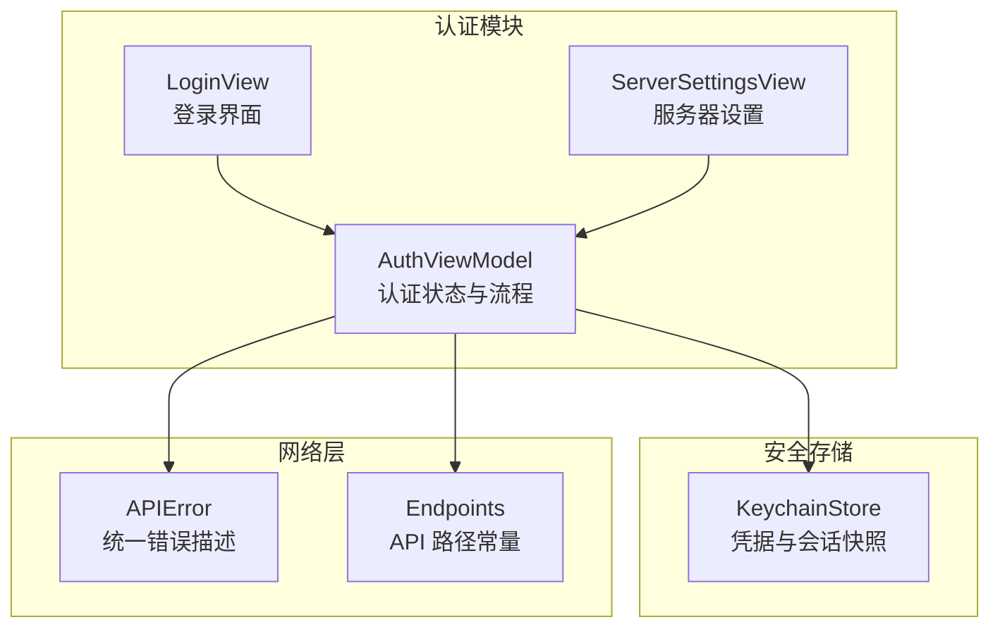
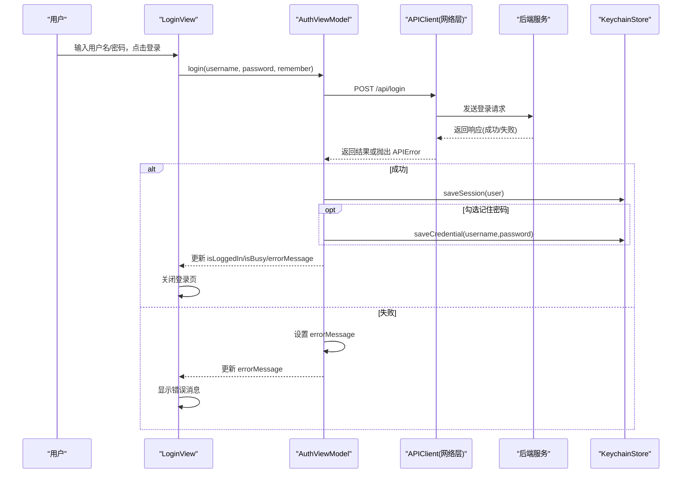
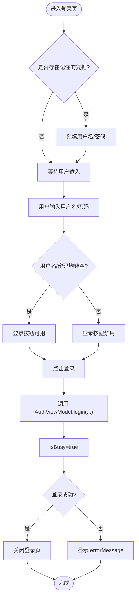
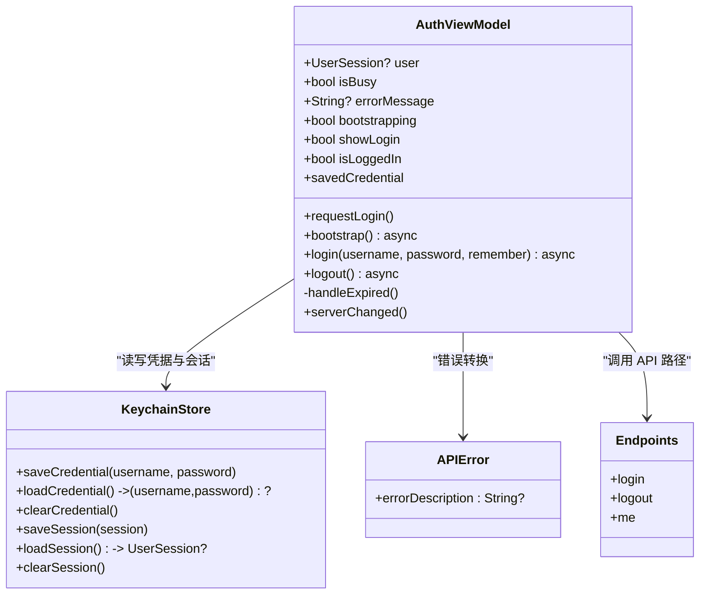
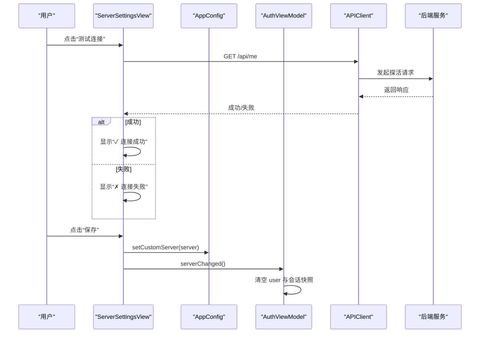
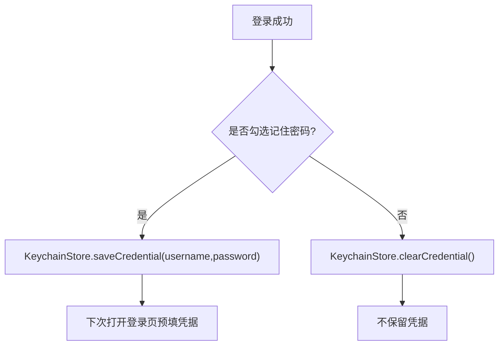
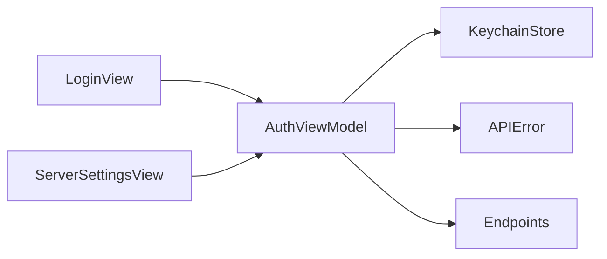

# 登录界面

<cite>
**本文引用的文件**   
- [LoginView.swift](file://ios/AINovel/Auth/LoginView.swift)
- [AuthViewModel.swift](file://ios/AINovel/Auth/AuthViewModel.swift)
- [ServerSettingsView.swift](file://ios/AINovel/Auth/ServerSettingsView.swift)
- [KeychainStore.swift](file://ios/AINovel/Security/KeychainStore.swift)
- [APIError.swift](file://ios/AINovel/Networking/APIError.swift)
- [Endpoints.swift](file://ios/AINovel/Networking/Endpoints.swift)
</cite>

## 目录
1. [简介](#简介)
2. [项目结构定位](#项目结构定位)
3. [核心组件总览](#核心组件总览)
4. [架构概览](#架构概览)
5. [详细组件分析](#详细组件分析)
6. [依赖关系分析](#依赖关系分析)
7. [性能与体验要点](#性能与体验要点)
8. [故障排查指南](#故障排查指南)
9. [结论](#结论)
10. [附录：扩展与自定义示例](#附录扩展与自定义示例)

## 简介
本文面向 iOS SwiftUI 开发者，围绕“登录界面”的实现进行系统化文档说明。重点覆盖以下内容：
- LoginView 的 SwiftUI 组件结构与表单布局
- 用户名、密码输入处理与记住密码功能
- 服务器配置按钮的交互流程与错误消息显示机制
- 与 AuthViewModel 的数据绑定和生命周期管理
- 可扩展点：自定义表单样式、新增认证字段、键盘事件处理

## 项目结构定位
登录相关代码位于 iOS 客户端模块中，采用按功能域划分的目录组织方式：
- Auth：认证视图与状态管理（登录页、服务器设置、认证视图模型）
- Security：安全存储（Keychain 封装）
- Networking：网络层抽象（错误类型、API 端点定义）

**图表来源**
- [LoginView.swift:1-78](file://ios/AINovel/Auth/LoginView.swift#L1-L78)
- [ServerSettingsView.swift:1-130](file://ios/AINovel/Auth/ServerSettingsView.swift#L1-L130)
- [AuthViewModel.swift:1-107](file://ios/AINovel/Auth/AuthViewModel.swift#L1-L107)
- [KeychainStore.swift:1-83](file://ios/AINovel/Security/KeychainStore.swift#L1-L83)
- [APIError.swift:1-51](file://ios/AINovel/Networking/APIError.swift#L1-L51)
- [Endpoints.swift:1-51](file://ios/AINovel/Networking/Endpoints.swift#L1-L51)

**章节来源**
- [LoginView.swift:1-78](file://ios/AINovel/Auth/LoginView.swift#L1-L78)
- [AuthViewModel.swift:1-107](file://ios/AINovel/Auth/AuthViewModel.swift#L1-L107)
- [ServerSettingsView.swift:1-130](file://ios/AINovel/Auth/ServerSettingsView.swift#L1-L130)
- [KeychainStore.swift:1-83](file://ios/AINovel/Security/KeychainStore.swift#L1-L83)
- [APIError.swift:1-51](file://ios/AINovel/Networking/APIError.swift#L1-L51)
- [Endpoints.swift:1-51](file://ios/AINovel/Networking/Endpoints.swift#L1-L51)

## 核心组件总览
- LoginView：负责登录表单 UI、用户输入、记住密码开关、服务器设置入口、登录按钮行为与错误提示展示。
- AuthViewModel：全局认证状态与流程控制，包括冷启动探测、登录、登出、记住凭据、401 自动登出等。
- ServerSettingsView：服务器地址与环境切换、连接测试、保存与恢复默认值。
- KeychainStore：对 Keychain 的极简封装，用于持久化“记住的凭据”和“会话快照”。
- APIError：统一后端错误体解析与可读文案输出。
- Endpoints：集中维护 API 路径常量，保证前后端对齐。

**章节来源**
- [LoginView.swift:1-78](file://ios/AINovel/Auth/LoginView.swift#L1-L78)
- [AuthViewModel.swift:1-107](file://ios/AINovel/Auth/AuthViewModel.swift#L1-L107)
- [ServerSettingsView.swift:1-130](file://ios/AINovel/Auth/ServerSettingsView.swift#L1-L130)
- [KeychainStore.swift:1-83](file://ios/AINovel/Security/KeychainStore.swift#L1-L83)
- [APIError.swift:1-51](file://ios/AINovel/Networking/APIError.swift#L1-L51)
- [Endpoints.swift:1-51](file://ios/AINovel/Networking/Endpoints.swift#L1-L51)

## 架构概览
登录流程从 UI 触发到服务端校验，再回写本地状态与凭据，整体时序如下：

**图表来源**
- [LoginView.swift:34-54](file://ios/AINovel/Auth/LoginView.swift#L34-L54)
- [AuthViewModel.swift:56-80](file://ios/AINovel/Auth/AuthViewModel.swift#L56-L80)
- [Endpoints.swift:7-9](file://ios/AINovel/Networking/Endpoints.swift#L7-L9)
- [KeychainStore.swift:12-27](file://ios/AINovel/Security/KeychainStore.swift#L12-L27)
- [APIError.swift:9-47](file://ios/AINovel/Networking/APIError.swift#L9-L47)

## 详细组件分析

### LoginView：表单布局、输入处理与状态管理
- 使用 NavigationStack + Form 构建标准 iOS 表单布局。
- 包含三个 Section：
  - 服务器信息区：展示当前生效的服务器地址，点击弹出 ServerSettingsView。
  - 认证输入区：用户名 TextField、密码 SecureField、记住密码 Toggle。
  - 登录操作区：登录按钮，禁用条件为“用户名或密码为空”或“正在登录”。
- 错误消息：当 AuthViewModel.errorMessage 非空时，在底部 Section 以红色文字展示。
- 生命周期：onAppear 时若存在 savedCredential，则预填用户名和密码。
- 交互细节：
  - 用户名输入禁用自动大写与纠错，提升输入一致性。
  - 登录成功后根据 auth.isLoggedIn 调用 dismiss() 关闭登录页。
  - 通过 sheet 展示 ServerSettingsView。

**图表来源**
- [LoginView.swift:11-71](file://ios/AINovel/Auth/LoginView.swift#L11-L71)
- [AuthViewModel.swift:56-80](file://ios/AINovel/Auth/AuthViewModel.swift#L56-L80)

**章节来源**
- [LoginView.swift:1-78](file://ios/AINovel/Auth/LoginView.swift#L1-L78)

### AuthViewModel：数据绑定与生命周期管理
- 作为 @MainActor ObservableObject，提供登录态 user、忙碌状态 isBusy、错误消息 errorMessage、引导状态 bootstrapping、按需登录 showLogin 等可观察属性。
- 冷启动流程：
  - 构造时注册 401 全局回调，触发 handleExpired。
  - 优先从 KeychainStore.loadSession() 回填 user，使界面即时可见。
  - bootstrap() 调用 /api/me 权威探测 Cookie 有效性，并同步 Keychain 会话快照。
- 登录流程：
  - 调用 APIClient.post 至 Endpoint.login，成功后保存会话与可选的记住凭据。
  - 捕获 APIError 并转换为 errorMessage。
- 登出与过期处理：
  - logout() 调用服务端登出接口，清空本地会话。
  - handleExpired() 清空 user 与会话快照，并拉起登录 sheet；若之前已登录，设置过期提示。
- 服务器变更：serverChanged() 清空会话，强制重新登录。

**图表来源**
- [AuthViewModel.swift:1-107](file://ios/AINovel/Auth/AuthViewModel.swift#L1-L107)
- [KeychainStore.swift:1-83](file://ios/AINovel/Security/KeychainStore.swift#L1-L83)
- [APIError.swift:1-51](file://ios/AINovel/Networking/APIError.swift#L1-L51)
- [Endpoints.swift:1-51](file://ios/AINovel/Networking/Endpoints.swift#L1-L51)

**章节来源**
- [AuthViewModel.swift:1-107](file://ios/AINovel/Auth/AuthViewModel.swift#L1-L107)

### ServerSettingsView：服务器配置交互与错误消息
- 提供“局域网/公网服务器”一键切换，同时支持手动输入自定义地址。
- 显示当前生效地址 AppConfig.displayBaseURL，并在 footer 提示换服务器需重新登录。
- 测试连接：调用 /api/me 探活，成功显示绿色提示，失败显示红色错误文案。
- 保存逻辑：
  - 保存自定义地址后调用 auth.serverChanged() 清除登录态。
  - 恢复默认地址同样触发 serverChanged()。
- 预设环境按钮：选中高亮，点击即生效并清空测试状态。

**图表来源**
- [ServerSettingsView.swift:42-90](file://ios/AINovel/Auth/ServerSettingsView.swift#L42-L90)
- [AuthViewModel.swift:101-105](file://ios/AINovel/Auth/AuthViewModel.swift#L101-L105)
- [Endpoints.swift:9](file://ios/AINovel/Networking/Endpoints.swift#L9)

**章节来源**
- [ServerSettingsView.swift:1-130](file://ios/AINovel/Auth/ServerSettingsView.swift#L1-L130)

### KeychainStore：记住密码与会话快照
- 记住密码：将 username\npassword 存入 Keychain，登录页 onAppear 时读取并预填。
- 会话快照：序列化 UserSession 存入 Keychain，用于冷启动快速填充界面；权威登录态仍以 /api/me 为准。
- 提供统一的 set/get/delete 方法封装 SecItem API。

**图表来源**
- [AuthViewModel.swift:70-74](file://ios/AINovel/Auth/AuthViewModel.swift#L70-L74)
- [KeychainStore.swift:12-27](file://ios/AINovel/Security/KeychainStore.swift#L12-L27)

**章节来源**
- [KeychainStore.swift:1-83](file://ios/AINovel/Security/KeychainStore.swift#L1-L83)
- [AuthViewModel.swift:56-80](file://ios/AINovel/Auth/AuthViewModel.swift#L56-L80)

### APIError：错误消息统一处理
- 将网络异常、超时、无法连接主机、HTTP 状态码等统一映射为可读中文文案。
- 登录页直接展示 errorMessage，无需额外处理。

**章节来源**
- [APIError.swift:1-51](file://ios/AINovel/Networking/APIError.swift#L1-L51)

### Endpoints：API 路径常量
- 登录、登出、当前用户信息等关键路径集中定义，避免硬编码字符串散落各处。

**章节来源**
- [Endpoints.swift:1-51](file://ios/AINovel/Networking/Endpoints.swift#L1-L51)

## 依赖关系分析
- LoginView 依赖 AuthViewModel 的状态与方法，并通过 EnvironmentObject 注入。
- AuthViewModel 依赖 KeychainStore 进行凭据与会话持久化，依赖 APIError 进行错误转换，依赖 Endpoints 确定 API 路径。
- ServerSettingsView 依赖 AppConfig 进行环境切换，依赖 APIClient 进行连接测试，依赖 AuthViewModel 触发 serverChanged。

**图表来源**
- [LoginView.swift:4-4](file://ios/AINovel/Auth/LoginView.swift#L4-L4)
- [ServerSettingsView.swift:7-7](file://ios/AINovel/Auth/ServerSettingsView.swift#L7-L7)
- [AuthViewModel.swift:1-107](file://ios/AINovel/Auth/AuthViewModel.swift#L1-L107)
- [KeychainStore.swift:1-83](file://ios/AINovel/Security/KeychainStore.swift#L1-L83)
- [APIError.swift:1-51](file://ios/AINovel/Networking/APIError.swift#L1-L51)
- [Endpoints.swift:1-51](file://ios/AINovel/Networking/Endpoints.swift#L1-L51)

**章节来源**
- [LoginView.swift:1-78](file://ios/AINovel/Auth/LoginView.swift#L1-L78)
- [ServerSettingsView.swift:1-130](file://ios/AINovel/Auth/ServerSettingsView.swift#L1-L130)
- [AuthViewModel.swift:1-107](file://ios/AINovel/Auth/AuthViewModel.swift#L1-L107)

## 性能与体验要点
- 冷启动优化：先加载 Keychain 中的会话快照，再异步探测 /api/me，避免登录页闪烁。
- 输入体验：禁用自动大写与纠错，减少误输入；登录按钮在输入为空或忙碌时禁用，防止重复提交。
- 错误反馈：所有错误统一经 APIError 转译为中文文案，便于用户理解。
- 服务器切换：切换环境或自定义地址后立即清除登录态，避免 Cookie 跨域问题导致的状态不一致。

[本节为通用指导，不涉及具体文件分析]

## 故障排查指南
- 网络连接不可用：APIError 会返回“网络连接不可用”，检查服务器地址与网络连通性。
- 无法连接服务器：提示“无法连接服务器，请在「服务器设置」确认地址”，建议通过 ServerSettingsView 的“测试连接”验证。
- 登录失败：errorMessage 可能来自后端 error 文案或 HTTP 状态码映射，查看 APIError.errorDescription。
- 登录已过期：401 触发 handleExpired，自动拉起登录页并提示“登录已过期，请重新登录”。

**章节来源**
- [APIError.swift:18-47](file://ios/AINovel/Networking/APIError.swift#L18-L47)
- [AuthViewModel.swift:89-96](file://ios/AINovel/Auth/AuthViewModel.swift#L89-L96)

## 结论
登录界面通过 LoginView 与 AuthViewModel 的协作，实现了清晰的表单布局、稳健的用户输入处理、可靠的记住密码机制以及完善的错误反馈。ServerSettingsView 提供了灵活的服务器配置能力，配合 KeychainStore 的安全存储与 APIError 的统一错误处理，整体架构简洁且易于扩展。

[本节为总结性内容，不涉及具体文件分析]

## 附录：扩展与自定义示例

### 自定义表单样式
- 修改 Section 标题与 Footer 文案，增强引导信息。
- 调整 TextField/SecureField 的字体、内边距与占位符样式。
- 使用 LabeledContent 展示更丰富的元数据（如服务器版本、环境标签）。

参考位置：
- [LoginView.swift:13-31](file://ios/AINovel/Auth/LoginView.swift#L13-L31)
- [ServerSettingsView.swift:14-40](file://ios/AINovel/Auth/ServerSettingsView.swift#L14-L40)

**章节来源**
- [LoginView.swift:11-71](file://ios/AINovel/Auth/LoginView.swift#L11-L71)
- [ServerSettingsView.swift:14-40](file://ios/AINovel/Auth/ServerSettingsView.swift#L14-L40)

### 添加额外的认证字段
- 在 LoginView 中添加新的 @State 变量（例如 email、otpCode）。
- 在 Form 中增加对应 TextField/SecureField，并绑定到该变量。
- 在 AuthViewModel.login 的参数与请求体中加入新字段，确保后端接口支持。
- 在登录按钮禁用条件中增加对新字段的非空校验。

参考位置：
- [LoginView.swift:6-9](file://ios/AINovel/Auth/LoginView.swift#L6-L9)
- [AuthViewModel.swift:56-63](file://ios/AINovel/Auth/AuthViewModel.swift#L56-L63)

**章节来源**
- [LoginView.swift:6-9](file://ios/AINovel/Auth/LoginView.swift#L6-L9)
- [AuthViewModel.swift:56-63](file://ios/AINovel/Auth/AuthViewModel.swift#L56-L63)

### 处理键盘事件
- 监听 .onTapGesture 或 .keyboardDismissable 来收起键盘。
- 在登录按钮按下前主动调用 resignFirstResponder（如需），或在 Form 外层包裹合适的容器。
- 对于多行输入场景，考虑使用 TextEditor 并处理换行与提交逻辑。

参考位置：
- [LoginView.swift:25-31](file://ios/AINovel/Auth/LoginView.swift#L25-L31)

**章节来源**
- [LoginView.swift:25-31](file://ios/AINovel/Auth/LoginView.swift#L25-L31)