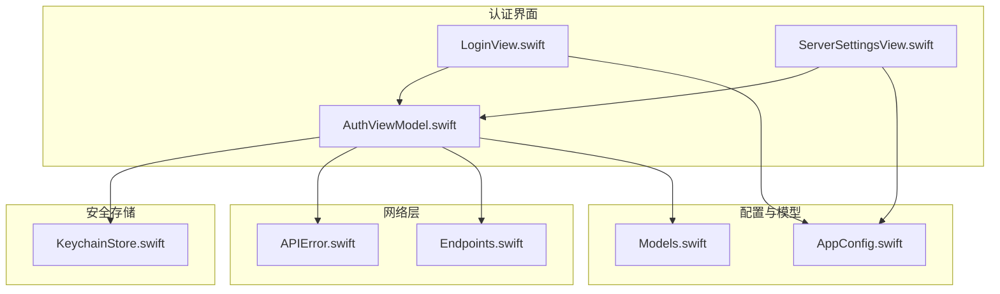
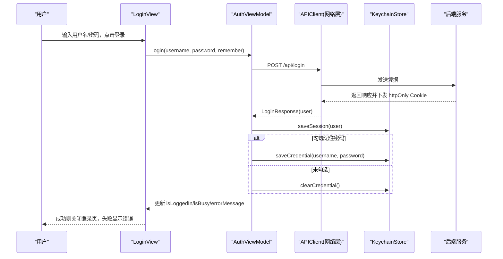
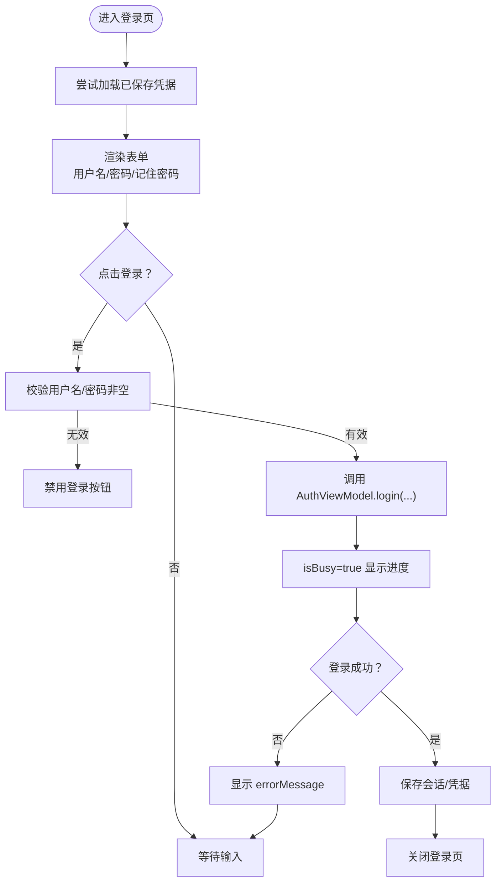
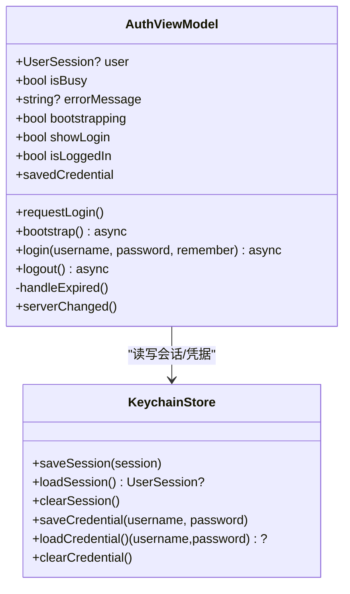
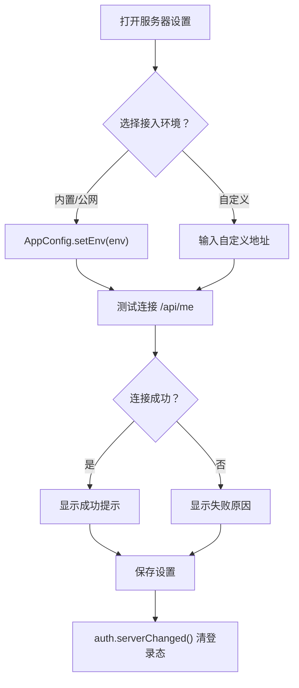
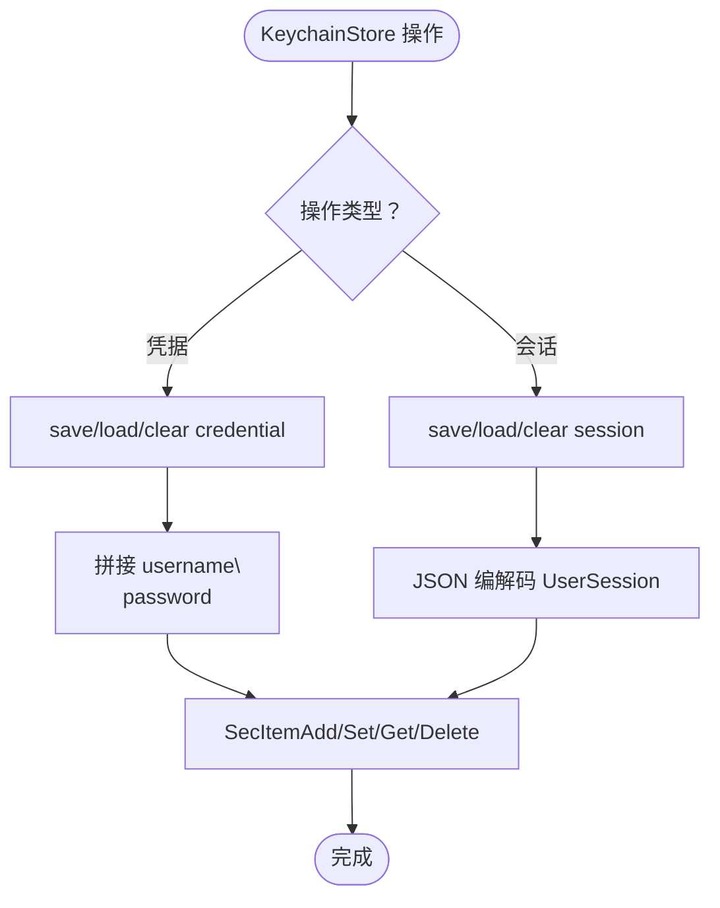
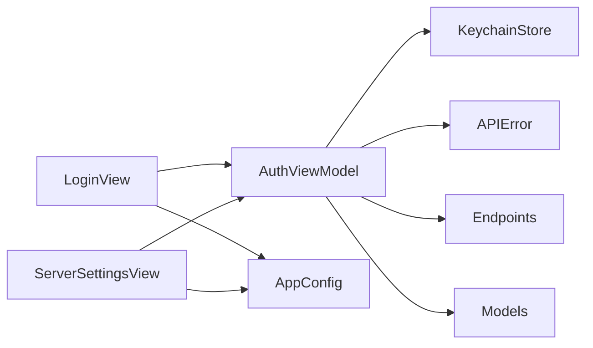

# 认证模块

<cite>
**本文引用的文件**   
- [LoginView.swift](file://ios/AINovel/Auth/LoginView.swift)
- [AuthViewModel.swift](file://ios/AINovel/Auth/AuthViewModel.swift)
- [ServerSettingsView.swift](file://ios/AINovel/Auth/ServerSettingsView.swift)
- [KeychainStore.swift](file://ios/AINovel/Security/KeychainStore.swift)
- [APIError.swift](file://ios/AINovel/Networking/APIError.swift)
- [Endpoints.swift](file://ios/AINovel/Networking/Endpoints.swift)
- [AppConfig.swift](file://ios/AINovel/Config/AppConfig.swift)
- [Models.swift](file://ios/AINovel/Models/Models.swift)
</cite>

## 目录
1. [引言](#引言)
2. [项目结构](#项目结构)
3. [核心组件](#核心组件)
4. [架构总览](#架构总览)
5. [详细组件分析](#详细组件分析)
6. [依赖关系分析](#依赖关系分析)
7. [性能与安全性考虑](#性能与安全性考虑)
8. [故障排查指南](#故障排查指南)
9. [结论](#结论)
10. [附录：扩展与集成示例](#附录扩展与集成示例)

## 引言
本文件面向 iOS 端“认证模块”的开发者与维护者，系统性说明登录界面 UI、用户交互流程、表单验证与错误提示；文档化 AuthViewModel 的状态管理与会话控制逻辑；说明服务器设置界面的配置选项与网络连接测试；重点介绍 KeychainStore 的安全存储机制（凭据加密、会话快照、持久化策略）；并提供自定义认证流程、第三方登录集成与认证失败处理的实践建议。

该模块采用 SwiftUI + Combine 架构，认证状态由全局 ViewModel 管理，网络请求通过统一 API 客户端发起，Cookie 由系统 URLSession 自动维护（httpOnly），Keychain 仅用于本地凭据与冷启动会话快照。

## 项目结构
认证相关代码主要位于 ios/AINovel 下的 Auth、Security、Networking、Config、Models 等目录：

**图表来源**
- [LoginView.swift:1-78](file://ios/AINovel/Auth/LoginView.swift#L1-L78)
- [AuthViewModel.swift:1-107](file://ios/AINovel/Auth/AuthViewModel.swift#L1-L107)
- [ServerSettingsView.swift:1-130](file://ios/AINovel/Auth/ServerSettingsView.swift#L1-L130)
- [KeychainStore.swift:1-83](file://ios/AINovel/Security/KeychainStore.swift#L1-L83)
- [APIError.swift:1-51](file://ios/AINovel/Networking/APIError.swift#L1-L51)
- [Endpoints.swift:1-51](file://ios/AINovel/Networking/Endpoints.swift#L1-L51)
- [AppConfig.swift:1-111](file://ios/AINovel/Config/AppConfig.swift#L1-L111)
- [Models.swift:1-234](file://ios/AINovel/Models/Models.swift#L1-L234)

**章节来源**
- [LoginView.swift:1-78](file://ios/AINovel/Auth/LoginView.swift#L1-L78)
- [AuthViewModel.swift:1-107](file://ios/AINovel/Auth/AuthViewModel.swift#L1-L107)
- [ServerSettingsView.swift:1-130](file://ios/AINovel/Auth/ServerSettingsView.swift#L1-L130)
- [KeychainStore.swift:1-83](file://ios/AINovel/Security/KeychainStore.swift#L1-L83)
- [APIError.swift:1-51](file://ios/AINovel/Networking/APIError.swift#L1-L51)
- [Endpoints.swift:1-51](file://ios/AINovel/Networking/Endpoints.swift#L1-L51)
- [AppConfig.swift:1-111](file://ios/AINovel/Config/AppConfig.swift#L1-L111)
- [Models.swift:1-234](file://ios/AINovel/Models/Models.swift#L1-L234)

## 核心组件
- LoginView：登录表单 UI，负责用户名/密码输入、记住密码开关、打开服务器设置、显示错误信息、调用 AuthViewModel 登录并关闭自身。
- AuthViewModel：全局认证状态机，处理登录、登出、401 过期回调、冷启动探测 /api/me、保存/清理 Keychain 会话与凭据、切换服务器地址后的状态重置。
- ServerSettingsView：服务器接入环境选择（局域网/公网）、自定义地址输入、连接测试、保存与恢复默认，并在地址变更时触发重新登录。
- KeychainStore：基于 Security.framework 的 Keychain 封装，提供凭据与会话快照的增删查。
- APIError：统一网络错误类型与可读文案，涵盖网络异常、HTTP 状态码、未授权等。
- Endpoints：集中定义后端 API 路径，包括认证相关接口。
- AppConfig：全局服务器地址与环境配置，支持多档切换与 URL 规范化。
- Models：认证相关数据模型（UserSession、MeResponse、LoginResponse）。

**章节来源**
- [LoginView.swift:1-78](file://ios/AINovel/Auth/LoginView.swift#L1-L78)
- [AuthViewModel.swift:1-107](file://ios/AINovel/Auth/AuthViewModel.swift#L1-L107)
- [ServerSettingsView.swift:1-130](file://ios/AINovel/Auth/ServerSettingsView.swift#L1-L130)
- [KeychainStore.swift:1-83](file://ios/AINovel/Security/KeychainStore.swift#L1-L83)
- [APIError.swift:1-51](file://ios/AINovel/Networking/APIError.swift#L1-L51)
- [Endpoints.swift:1-51](file://ios/AINovel/Networking/Endpoints.swift#L1-L51)
- [AppConfig.swift:1-111](file://ios/AINovel/Config/AppConfig.swift#L1-L111)
- [Models.swift:1-234](file://ios/AINovel/Models/Models.swift#L1-L234)

## 架构总览
认证模块整体遵循 MVVM 分层：UI 层（LoginView、ServerSettingsView）通过 EnvironmentObject 注入 AuthViewModel；ViewModel 协调网络层（APIClient，使用 Endpoints 与 AppConfig）与安全存储（KeychainStore）；错误统一收敛为 APIError 并展示给用户。

**图表来源**
- [LoginView.swift:33-54](file://ios/AINovel/Auth/LoginView.swift#L33-L54)
- [AuthViewModel.swift:56-80](file://ios/AINovel/Auth/AuthViewModel.swift#L56-L80)
- [Endpoints.swift:6-9](file://ios/AINovel/Networking/Endpoints.swift#L6-L9)
- [KeychainStore.swift:12-44](file://ios/AINovel/Security/KeychainStore.swift#L12-L44)

## 详细组件分析

### 登录界面 UI 与交互流程
- 表单字段：用户名文本框、密码安全输入框、“记住密码”开关。
- 服务器入口：顶部显示当前服务器地址，点击弹出 ServerSettingsView。
- 登录按钮：禁用条件为空用户名或空密码或正在登录中；成功后根据 isLoggedIn 关闭登录页。
- 错误提示：当 AuthViewModel.errorMessage 非空时，以红色文字展示。
- 预填凭据：onAppear 时从 AuthViewModel.savedCredential 回填用户名和密码。

**图表来源**
- [LoginView.swift:11-70](file://ios/AINovel/Auth/LoginView.swift#L11-L70)
- [AuthViewModel.swift:56-80](file://ios/AINovel/Auth/AuthViewModel.swift#L56-L80)

**章节来源**
- [LoginView.swift:1-78](file://ios/AINovel/Auth/LoginView.swift#L1-L78)

### AuthViewModel 状态管理与会话控制
- 状态字段：user（当前会话）、isBusy（操作忙态）、errorMessage（错误文案）、bootstrapping（启动探测中）、showLogin（按需拉起登录）。
- 初始化：注册 APIClient 的 onUnauthorized 回调，优先从 KeychainStore.loadSession() 回填 user，保证界面即时可见。
- bootstrap：启动后调用 /api/me 权威校验 Cookie；成功则更新 user 并缓存到 Keychain；失败则清空 Keychain 并落到登录态。
- login：POST /api/login，成功后保存会话与可选凭据；捕获 APIError 并转为 errorMessage。
- logout：调用 /api/logout，清空 user 与 Keychain 会话，保留凭据以便下次快速登录。
- handleExpired：统一处理 401 场景，清空会话并拉起登录 sheet，必要时提示“登录已过期”。
- serverChanged：切换服务器地址后清空会话，避免 Cookie 域不匹配。

**图表来源**
- [AuthViewModel.swift:9-106](file://ios/AINovel/Auth/AuthViewModel.swift#L9-L106)
- [KeychainStore.swift:12-44](file://ios/AINovel/Security/KeychainStore.swift#L12-L44)

**章节来源**
- [AuthViewModel.swift:1-107](file://ios/AINovel/Auth/AuthViewModel.swift#L1-L107)

### 服务器设置界面与连接测试
- 接入环境：内置（局域网）与公网两档一键切换，选中态高亮，点击即生效。
- 自定义地址：支持手填 host[:port]，自动补 scheme 与 /novel 前缀；显示当前生效地址。
- 连接测试：调用 /api/me 探活，2xx 视为可达，失败输出具体错误文案。
- 保存与恢复：保存自定义地址并切换到 custom 档；恢复默认会清除自设地址并切回 builtin。
- 地址变更影响：任何地址变更都会调用 auth.serverChanged() 清空登录态，因为 Cookie 属另一域。

**图表来源**
- [ServerSettingsView.swift:14-128](file://ios/AINovel/Auth/ServerSettingsView.swift#L14-L128)
- [AppConfig.swift:42-102](file://ios/AINovel/Config/AppConfig.swift#L42-L102)

**章节来源**
- [ServerSettingsView.swift:1-130](file://ios/AINovel/Auth/ServerSettingsView.swift#L1-L130)
- [AppConfig.swift:1-111](file://ios/AINovel/Config/AppConfig.swift#L1-L111)

### KeychainStore 安全存储机制
- 设计目标：最小化敏感数据存储范围，仅保存“记住密码”凭据与最近一次会话快照；权威登录态仍依赖服务端 Cookie。
- 凭据存储：将 username\npassword 作为单一字符串存入 Keychain account="credential"；读取时按换行符拆分并校验非空。
- 会话快照：将 UserSession 编码为 JSON 字符串存入 account="session"；读取时解码为 UserSession。
- 通用方法：set/get/delete 封装 SecItemAdd/CopyMatching/Delete，统一 service="com.ainovel.app"。
- 安全注意：Keychain 受系统保护，但不应被视为强加密容器；如需更高强度可结合应用密钥派生或额外混淆。

**图表来源**
- [KeychainStore.swift:12-81](file://ios/AINovel/Security/KeychainStore.swift#L12-L81)

**章节来源**
- [KeychainStore.swift:1-83](file://ios/AINovel/Security/KeychainStore.swift#L1-L83)

### 错误处理与提示
- APIError 统一封装网络错误、HTTP 状态码、解析失败、未授权等，并提供中文可读文案。
- 常见网络错误映射：断网、超时、无法连接主机等分别给出明确提示。
- HTTP 状态码映射：400/401/403/404/409/410/429 等均有基础文案，并可附加后端 error 消息。
- 在登录与连接测试中，捕获 APIError 并转换为 errorMessage 展示给用户。

**章节来源**
- [APIError.swift:1-51](file://ios/AINovel/Networking/APIError.swift#L1-L51)
- [AuthViewModel.swift:75-79](file://ios/AINovel/Auth/AuthViewModel.swift#L75-L79)
- [ServerSettingsView.swift:117-128](file://ios/AINovel/Auth/ServerSettingsView.swift#L117-L128)

## 依赖关系分析
- LoginView 依赖 AuthViewModel（EnvironmentObject）与 AppConfig（显示服务器地址）。
- AuthViewModel 依赖 APIClient（未在本文列出，但通过 Endpoints 与 APIError 协作）、KeychainStore、Models。
- ServerSettingsView 依赖 AppConfig（环境切换与 URL 规范化）、APIClient（连接测试）。
- KeychainStore 依赖 Security.framework。
- Endpoints 与 AppConfig 被多处复用，确保 API 路径与 baseURL 一致性。

**图表来源**
- [LoginView.swift:1-78](file://ios/AINovel/Auth/LoginView.swift#L1-L78)
- [AuthViewModel.swift:1-107](file://ios/AINovel/Auth/AuthViewModel.swift#L1-L107)
- [ServerSettingsView.swift:1-130](file://ios/AINovel/Auth/ServerSettingsView.swift#L1-L130)
- [KeychainStore.swift:1-83](file://ios/AINovel/Security/KeychainStore.swift#L1-L83)
- [APIError.swift:1-51](file://ios/AINovel/Networking/APIError.swift#L1-L51)
- [Endpoints.swift:1-51](file://ios/AINovel/Networking/Endpoints.swift#L1-L51)
- [AppConfig.swift:1-111](file://ios/AINovel/Config/AppConfig.swift#L1-L111)
- [Models.swift:1-234](file://ios/AINovel/Models/Models.swift#L1-L234)

**章节来源**
- [LoginView.swift:1-78](file://ios/AINovel/Auth/LoginView.swift#L1-L78)
- [AuthViewModel.swift:1-107](file://ios/AINovel/Auth/AuthViewModel.swift#L1-L107)
- [ServerSettingsView.swift:1-130](file://ios/AINovel/Auth/ServerSettingsView.swift#L1-L130)
- [KeychainStore.swift:1-83](file://ios/AINovel/Security/KeychainStore.swift#L1-L83)
- [APIError.swift:1-51](file://ios/AINovel/Networking/APIError.swift#L1-L51)
- [Endpoints.swift:1-51](file://ios/AINovel/Networking/Endpoints.swift#L1-L51)
- [AppConfig.swift:1-111](file://ios/AINovel/Config/AppConfig.swift#L1-L111)
- [Models.swift:1-234](file://ios/AINovel/Models/Models.swift#L1-L234)

## 性能与安全性考虑
- 性能
  - 冷启动先回填 Keychain 会话快照，再异步探测 /api/me，减少登录页闪烁。
  - 登录按钮在 isBusy 期间禁用，避免重复提交。
  - 服务器设置页测试连接使用独立状态 testing，避免阻塞 UI。
- 安全性
  - 会话令牌由 httpOnly Cookie 维持，Keychain 仅存快照与凭据，降低泄露面。
  - Keychain 使用统一 service 与 account 命名，便于审计与清理。
  - 切换服务器地址后主动清空会话，防止跨域 Cookie 污染。
  - 对网络错误进行友好文案映射，避免暴露底层细节。

[本节为通用指导，不直接分析具体文件]

## 故障排查指南
- 登录失败
  - 检查网络连接与服务器地址是否正确（可通过 ServerSettingsView 的连接测试确认）。
  - 查看 errorMessage 是否包含“网络连接不可用/请求超时/无法连接服务器”等提示。
  - 若出现“登录已过期”，请重新登录；必要时检查后端是否已下发有效 Cookie。
- 服务器设置问题
  - 确认自定义地址是否合法（带 scheme、host），必要时恢复默认地址。
  - 切换环境后需重新登录，因为 Cookie 属不同域。
- Keychain 相关问题
  - 若“记住密码”失效，检查是否误删 Keychain 条目或设备锁屏策略限制。
  - 会话快照丢失不影响登录态，仍以服务端 Cookie 为准。

**章节来源**
- [APIError.swift:18-46](file://ios/AINovel/Networking/APIError.swift#L18-L46)
- [AuthViewModel.swift:89-96](file://ios/AINovel/Auth/AuthViewModel.swift#L89-L96)
- [ServerSettingsView.swift:116-128](file://ios/AINovel/Auth/ServerSettingsView.swift#L116-L128)

## 结论
认证模块通过清晰的 MVVM 分层与统一的错误处理，提供了稳定的登录体验与灵活的服务器配置能力。AuthViewModel 负责会话生命周期管理，KeychainStore 提供安全的本地凭据与快照存储，ServerSettingsView 简化了多环境切换与连通性验证。建议在扩展时保持对 httpOnly Cookie 的依赖，谨慎处理 Keychain 数据，并确保所有 API 路径与 baseURL 保持一致。

[本节为总结，不直接分析具体文件]

## 附录：扩展与集成示例

### 实现自定义认证流程
- 新增自定义登录入口：在 AuthViewModel 中增加新的登录方法，调用对应 Endpoint 与 APIClient，成功后保存会话与凭据。
- 前端引导：在 LoginView 或其他页面添加入口按钮，调用新登录方法并根据结果更新 UI。
- 错误处理：复用 APIError 的错误文案，确保用户体验一致。

参考路径
- [AuthViewModel.swift:56-80](file://ios/AINovel/Auth/AuthViewModel.swift#L56-L80)
- [Endpoints.swift:6-9](file://ios/AINovel/Networking/Endpoints.swift#L6-L9)
- [APIError.swift:18-46](file://ios/AINovel/Networking/APIError.swift#L18-L46)

### 集成第三方登录
- 在 AuthViewModel 中新增第三方登录方法，获取第三方 token 后调用后端 /api/login 或专用接口换取会话 Cookie。
- 将第三方 token 暂存于内存或安全存储（如需要），并在成功后写入 Keychain 会话快照。
- 若第三方登录失败，统一通过 APIError 或自定义错误类型提示用户。

参考路径
- [AuthViewModel.swift:56-80](file://ios/AINovel/Auth/AuthViewModel.swift#L56-L80)
- [Models.swift:5-16](file://ios/AINovel/Models/Models.swift#L5-L16)

### 处理认证失败场景
- 401 未授权：通过 APIClient.onUnauthorized 回调统一处理，清空会话并拉起登录页。
- 网络异常：根据 APIError 的网络错误类型给出明确提示，引导用户检查网络或服务器地址。
- 业务错误：后端返回 error 文案时，合并到 errorMessage 展示。

参考路径
- [AuthViewModel.swift:26-30](file://ios/AINovel/Auth/AuthViewModel.swift#L26-L30)
- [AuthViewModel.swift:89-96](file://ios/AINovel/Auth/AuthViewModel.swift#L89-L96)
- [APIError.swift:18-46](file://ios/AINovel/Networking/APIError.swift#L18-L46)