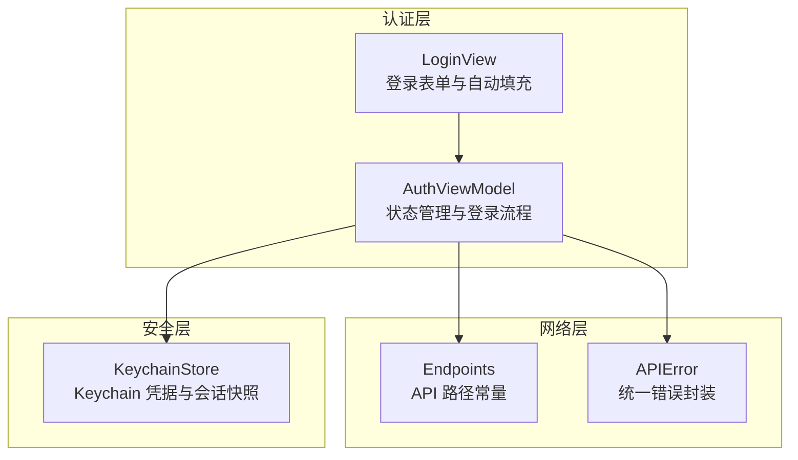
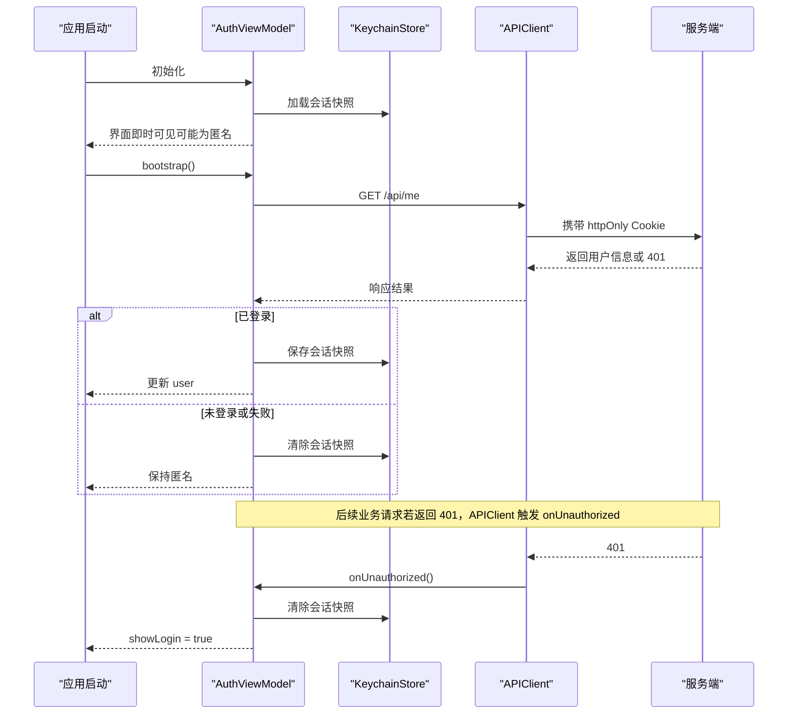
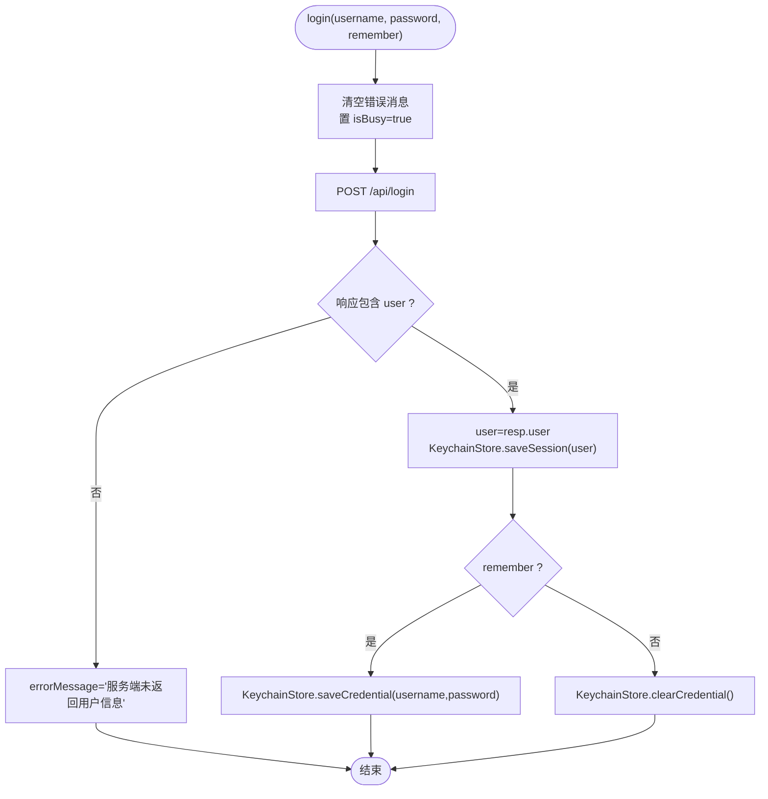
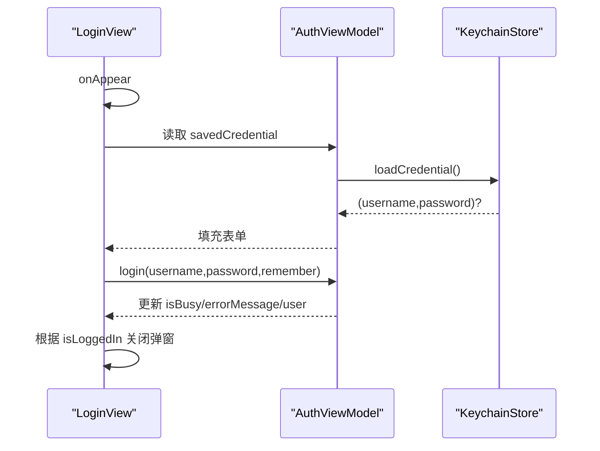
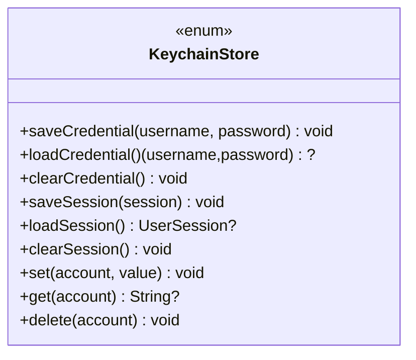
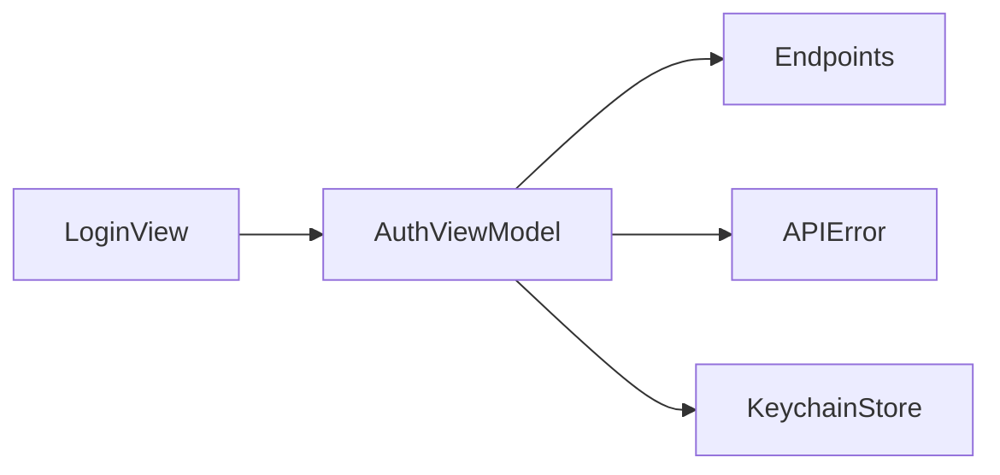

# 认证视图模型

<cite>
**本文引用的文件**   
- [AuthViewModel.swift](file://ios/AINovel/Auth/AuthViewModel.swift)
- [LoginView.swift](file://ios/AINovel/Auth/LoginView.swift)
- [KeychainStore.swift](file://ios/AINovel/Security/KeychainStore.swift)
- [APIError.swift](file://ios/AINovel/Networking/APIError.swift)
- [Endpoints.swift](file://ios/AINovel/Networking/Endpoints.swift)
</cite>

## 目录
1. [简介](#简介)
2. [项目结构](#项目结构)
3. [核心组件](#核心组件)
4. [架构总览](#架构总览)
5. [详细组件分析](#详细组件分析)
6. [依赖关系分析](#依赖关系分析)
7. [性能与安全性考虑](#性能与安全性考虑)
8. [故障排查指南](#故障排查指南)
9. [结论](#结论)
10. [附录：扩展与集成示例](#附录扩展与集成示例)

## 简介
本文件面向 iOS 端的认证子系统，重点围绕 AuthViewModel 的状态管理、登录流程、凭据安全存储以及与 KeychainStore 的集成进行系统化说明。文档同时给出可扩展的实践建议，包括自定义认证流程、第三方登录集成以及失败场景处理策略。

## 项目结构
认证相关代码主要位于以下模块：
- 认证视图模型与界面：Auth/AuthViewModel.swift、Auth/LoginView.swift
- 安全存储：Security/KeychainStore.swift
- 网络错误与端点定义：Networking/APIError.swift、Networking/Endpoints.swift

图表来源
- [AuthViewModel.swift:1-107](file://ios/AINovel/Auth/AuthViewModel.swift#L1-L107)
- [LoginView.swift:1-78](file://ios/AINovel/Auth/LoginView.swift#L1-L78)
- [Endpoints.swift:1-51](file://ios/AINovel/Networking/Endpoints.swift#L1-L51)
- [APIError.swift:1-51](file://ios/AINovel/Networking/APIError.swift#L1-L51)
- [KeychainStore.swift:1-83](file://ios/AINovel/Security/KeychainStore.swift#L1-L83)

章节来源
- [AuthViewModel.swift:1-107](file://ios/AINovel/Auth/AuthViewModel.swift#L1-L107)
- [LoginView.swift:1-78](file://ios/AINovel/Auth/LoginView.swift#L1-L78)
- [Endpoints.swift:1-51](file://ios/AINovel/Networking/Endpoints.swift#L1-L51)
- [APIError.swift:1-51](file://ios/AINovel/Networking/APIError.swift#L1-L51)
- [KeychainStore.swift:1-83](file://ios/AINovel/Security/KeychainStore.swift#L1-L83)

## 核心组件
- AuthViewModel：负责全局会话状态、登录态探测、登录/登出、记住密码、服务器变更后的状态清理，以及 401 全局登出回调。
- LoginView：提供登录 UI，支持“记住密码”自动填充、登录按钮交互、错误消息展示。
- KeychainStore：基于系统 Keychain 的安全存储，保存“记住密码”凭据与最近一次用户会话快照。
- Endpoints：集中定义 API 路径，如登录、登出、当前用户信息等。
- APIError：统一后端错误体解析与用户可读的错误描述。

章节来源
- [AuthViewModel.swift:1-107](file://ios/AINovel/Auth/AuthViewModel.swift#L1-L107)
- [LoginView.swift:1-78](file://ios/AINovel/Auth/LoginView.swift#L1-L78)
- [KeychainStore.swift:1-83](file://ios/AINovel/Security/KeychainStore.swift#L1-L83)
- [Endpoints.swift:1-51](file://ios/AINovel/Networking/Endpoints.swift#L1-L51)
- [APIError.swift:1-51](file://ios/AINovel/Networking/APIError.swift#L1-L51)

## 架构总览
认证流程采用“服务端 Cookie + 客户端 Keychain 快照”的双轨机制：
- 权威登录态由服务端通过 httpOnly Cookie 维持；客户端通过 /api/me 探测确认。
- Keychain 仅用于冷启动快速回填界面显示（用户体验）和“记住密码”功能。
- APIClient 在 401 时触发全局登出回调，AuthViewModel 清理状态并拉起登录页。

图表来源
- [AuthViewModel.swift:26-54](file://ios/AINovel/Auth/AuthViewModel.swift#L26-L54)
- [AuthViewModel.swift:89-96](file://ios/AINovel/Auth/AuthViewModel.swift#L89-L96)
- [Endpoints.swift:7-9](file://ios/AINovel/Networking/Endpoints.swift#L7-L9)

## 详细组件分析

### AuthViewModel：状态管理与登录流程
- 状态字段
  - user：当前用户会话对象（可空）。
  - isBusy：是否处于异步操作进行中。
  - errorMessage：最近一次错误消息。
  - bootstrapping：冷启动探测期间标志，避免闪屏。
  - showLogin：按需拉起登录弹窗。
- 生命周期与初始化
  - 单例 shared，构造中注册 401 全局登出回调。
  - 从 KeychainStore 加载会话快照以立即渲染界面。
- 启动探测 bootstrap
  - 调用 /api/me 校验 Cookie 有效性。
  - 成功则更新 user 并持久化会话快照；失败则清空快照并落回匿名态。
- 登录 login
  - 发送 POST /api/login，携带用户名与密码。
  - 成功后设置 user、持久化会话快照；根据 remember 决定是否保存凭据到 Keychain。
  - 捕获 APIError 与通用错误，写入 errorMessage。
- 登出 logout
  - 调用 /api/logout，清空 user 与会话快照，保留“记住密码”。
- 过期处理 handleExpired
  - 清空 user 与会话快照，拉起登录弹窗；若之前已登录则提示“登录已过期”。
- 服务器变更 serverChanged
  - 因 Cookie 域名变化导致失效，需清空会话快照并重新登录。
- 记住密码 savedCredential
  - 直接读取 KeychainStore.loadCredential()，供登录页预填。

图表来源
- [AuthViewModel.swift:56-80](file://ios/AINovel/Auth/AuthViewModel.swift#L56-L80)
- [Endpoints.swift:7-8](file://ios/AINovel/Networking/Endpoints.swift#L7-L8)

章节来源
- [AuthViewModel.swift:1-107](file://ios/AINovel/Auth/AuthViewModel.swift#L1-L107)

### LoginView：登录界面与自动填充
- 绑定 AuthViewModel 实例，提供用户名、密码输入与“记住密码”开关。
- 点击登录按钮后调用 auth.login(...)，成功后关闭弹窗。
- 首次出现时从 auth.savedCredential 自动填充用户名与密码。
- 显示来自 auth.errorMessage 的错误提示。

图表来源
- [LoginView.swift:62-67](file://ios/AINovel/Auth/LoginView.swift#L62-L67)
- [LoginView.swift:34-47](file://ios/AINovel/Auth/LoginView.swift#L34-L47)
- [AuthViewModel.swift:98-99](file://ios/AINovel/Auth/AuthViewModel.swift#L98-L99)

章节来源
- [LoginView.swift:1-78](file://ios/AINovel/Auth/LoginView.swift#L1-L78)
- [AuthViewModel.swift:98-99](file://ios/AINovel/Auth/AuthViewModel.swift#L98-L99)

### KeychainStore：安全存储与数据持久化
- 凭据存储（记住密码）
  - 使用单一 account="credential"，值格式为 username\npassword。
  - 提供 save/load/clear 方法。
- 会话快照存储
  - 将 UserSession 序列化为 JSON 字符串，account="session"。
  - 提供 save/load/clear 方法。
- 底层实现
  - 基于 Security.framework 的 SecItemAdd/CopyMatching/Delete。
  - 统一 service 命名空间，保证隔离性。

图表来源
- [KeychainStore.swift:12-44](file://ios/AINovel/Security/KeychainStore.swift#L12-L44)
- [KeychainStore.swift:48-81](file://ios/AINovel/Security/KeychainStore.swift#L48-L81)

章节来源
- [KeychainStore.swift:1-83](file://ios/AINovel/Security/KeychainStore.swift#L1-L83)

### APIError：统一错误处理
- 覆盖网络错误、无效响应、解码异常、未授权、取消、HTTP 状态码等场景。
- 对常见网络错误给出中文可读文案，便于 UI 直接展示。
- 对 HTTP 状态码映射基础文案，并可拼接后端 error 字段。

章节来源
- [APIError.swift:1-51](file://ios/AINovel/Networking/APIError.swift#L1-L51)

### Endpoints：API 路径定义
- 认证相关：login、logout、me。
- 其他业务端点按模块分组，便于维护与对齐后端路由。

章节来源
- [Endpoints.swift:1-51](file://ios/AINovel/Networking/Endpoints.swift#L1-L51)

## 依赖关系分析
- AuthViewModel 依赖：
  - APIClient（未在本文列出具体文件，但被多处调用）：发起网络请求、处理 401 回调。
  - KeychainStore：读写凭据与会话快照。
  - Endpoints：获取 API 路径。
  - APIError：捕获并转换错误。
- LoginView 依赖：
  - AuthViewModel：状态与行为。
  - AppConfig：读取服务器地址（用于显示）。

图表来源
- [AuthViewModel.swift:1-107](file://ios/AINovel/Auth/AuthViewModel.swift#L1-L107)
- [LoginView.swift:1-78](file://ios/AINovel/Auth/LoginView.swift#L1-L78)
- [Endpoints.swift:1-51](file://ios/AINovel/Networking/Endpoints.swift#L1-L51)
- [APIError.swift:1-51](file://ios/AINovel/Networking/APIError.swift#L1-L51)
- [KeychainStore.swift:1-83](file://ios/AINovel/Security/KeychainStore.swift#L1-L83)

章节来源
- [AuthViewModel.swift:1-107](file://ios/AINovel/Auth/AuthViewModel.swift#L1-L107)
- [LoginView.swift:1-78](file://ios/AINovel/Auth/LoginView.swift#L1-L78)
- [Endpoints.swift:1-51](file://ios/AINovel/Networking/Endpoints.swift#L1-L51)
- [APIError.swift:1-51](file://ios/AINovel/Networking/APIError.swift#L1-L51)
- [KeychainStore.swift:1-83](file://ios/AINovel/Security/KeychainStore.swift#L1-L83)

## 性能与安全性考虑
- 性能
  - 冷启动优先从 Keychain 恢复界面显示，再异步探测 /api/me，减少白屏时间。
  - 登录过程中使用 isBusy 控制 UI 禁用与进度反馈，避免重复提交。
- 安全性
  - 凭据仅存储在系统 Keychain，不落地明文文件或日志。
  - 会话快照仅为 UI 快速渲染用途，权威登录态仍以服务端 Cookie 为准。
  - 服务器变更后主动清理会话快照，防止跨域 Cookie 污染。

[本节为通用指导，无需引用具体文件]

## 故障排查指南
- 登录失败
  - 检查 errorMessage 是否包含“网络连接不可用”“无法连接服务器”“请求超时”等提示。
  - 核对服务器地址是否正确（可在登录页查看 hostDisplay）。
- 登录后仍显示未登录
  - 确认 /api/me 是否返回有效用户信息。
  - 检查 KeychainStore.saveSession 是否执行成功。
- 401 频繁出现
  - 检查服务端 Cookie 是否 httpOnly 且域名正确。
  - 确认 APIClient.onUnauthorized 回调是否触发并清理了本地状态。
- “记住密码”未生效
  - 检查 KeychainStore.saveCredential 与 loadCredential 是否匹配。
  - 确认 remember 开关状态与 UI 绑定是否正确。

章节来源
- [APIError.swift:18-46](file://ios/AINovel/Networking/APIError.swift#L18-L46)
- [AuthViewModel.swift:56-80](file://ios/AINovel/Auth/AuthViewModel.swift#L56-L80)
- [AuthViewModel.swift:89-96](file://ios/AINovel/Auth/AuthViewModel.swift#L89-L96)
- [KeychainStore.swift:12-27](file://ios/AINovel/Security/KeychainStore.swift#L12-L27)

## 结论
AuthViewModel 通过“Cookie 权威 + Keychain 快照”的组合，实现了稳定、安全的认证状态管理。其登录流程清晰、错误处理完善，并与 UI 层紧密协作，提供良好的用户体验。KeychainStore 提供了最小化的安全存储能力，满足“记住密码”与快速冷启动需求。整体设计简洁、职责清晰，易于扩展与维护。

[本节为总结性内容，无需引用具体文件]

## 附录：扩展与集成示例

### 自定义认证流程
- 目标：在不改变现有登录入口的前提下，接入自定义认证逻辑（例如双因素认证、企业 SSO 跳转）。
- 步骤建议：
  - 在 AuthViewModel 新增一个 async 方法，如 customLogin(provider, params)。
  - 在该方法内先调用第三方服务完成认证，再将服务端下发的 Cookie 视为已登录。
  - 成功后复用现有的 user 设置与 KeychainStore.saveSession 逻辑。
  - 失败时复用 APIError 的错误描述展示给用户。
- 参考位置
  - 登录主流程：[AuthViewModel.swift:56-80](file://ios/AINovel/Auth/AuthViewModel.swift#L56-L80)
  - 错误处理：[APIError.swift:18-46](file://ios/AINovel/Networking/APIError.swift#L18-L46)

### 集成第三方登录服务
- 目标：支持 Apple ID、Google、微信等第三方登录。
- 步骤建议：
  - 在 LoginView 增加第三方登录按钮，调用对应 SDK 获取临时令牌。
  - 将临时令牌发送至后端换取服务端会话（httpOnly Cookie）。
  - 成功后复用 AuthViewModel 的 user 设置与 KeychainStore.saveSession。
  - 若选择“记住密码”，可将第三方账号标识与用户名存入 Keychain（注意隐私合规）。
- 参考位置
  - 登录 UI：[LoginView.swift:34-47](file://ios/AINovel/Auth/LoginView.swift#L34-L47)
  - 会话持久化：[KeychainStore.swift:31-44](file://ios/AINovel/Security/KeychainStore.swift#L31-L44)

### 处理认证失败场景
- 目标：提升失败体验，明确错误原因并提供重试路径。
- 步骤建议：
  - 在网络层统一捕获 APIError，并在 UI 层展示友好文案。
  - 针对 401，触发全局登出流程，清理本地状态并拉起登录页。
  - 对于临时网络问题，提供“重试”按钮，避免用户困惑。
- 参考位置
  - 错误类型与文案：[APIError.swift:18-46](file://ios/AINovel/Networking/APIError.swift#L18-L46)
  - 401 处理：[AuthViewModel.swift:89-96](file://ios/AINovel/Auth/AuthViewModel.swift#L89-L96)