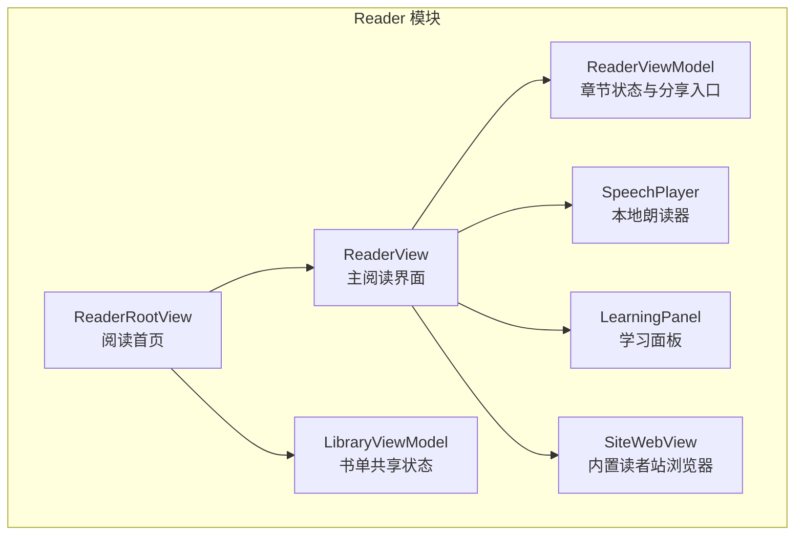
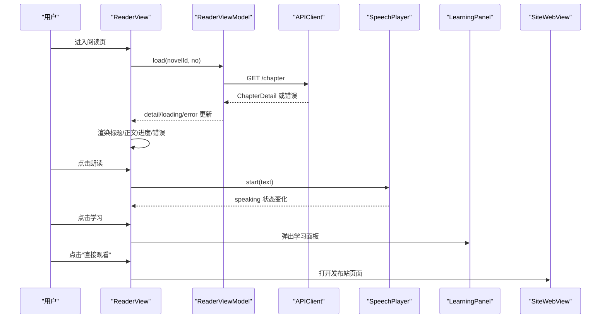
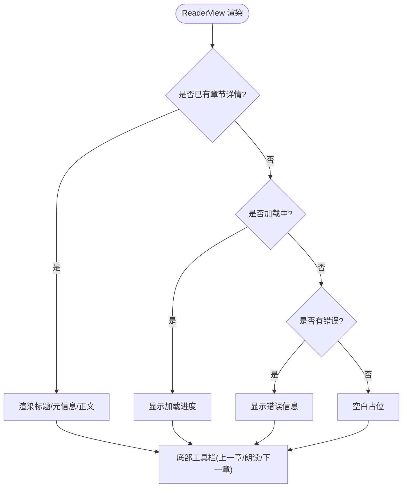
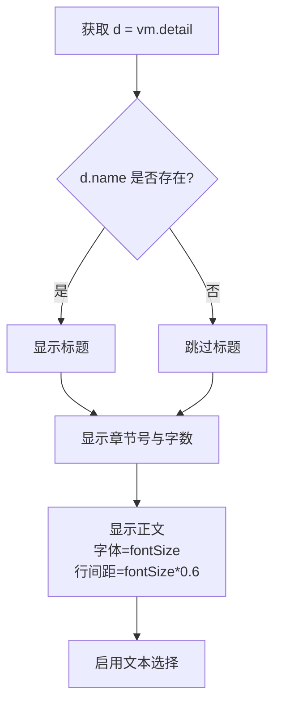
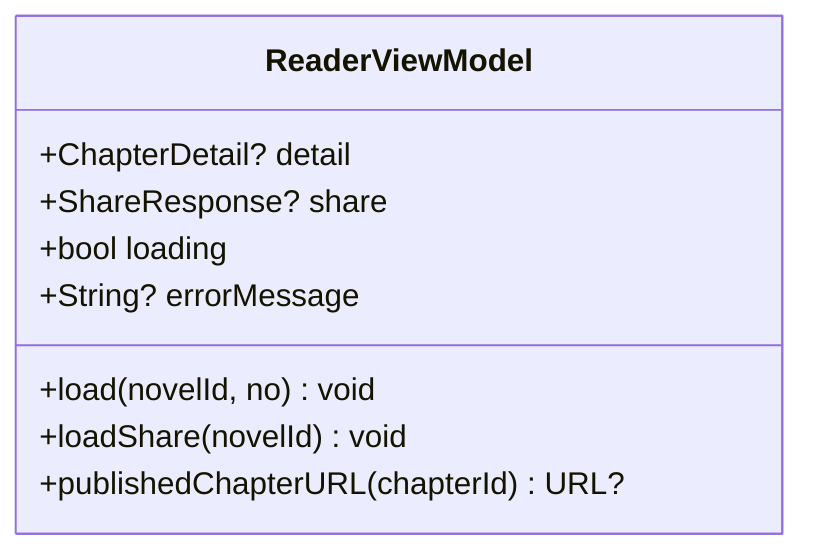
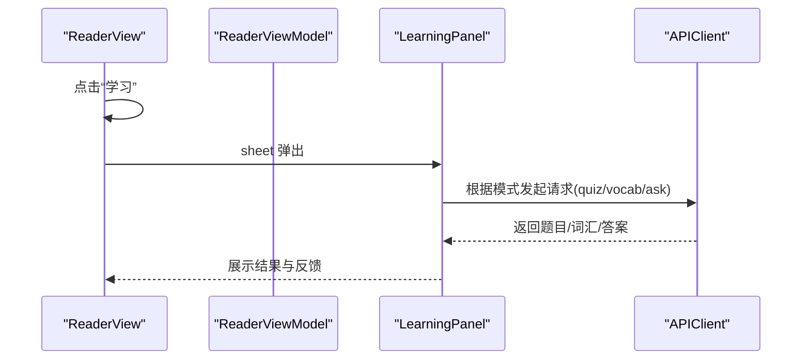
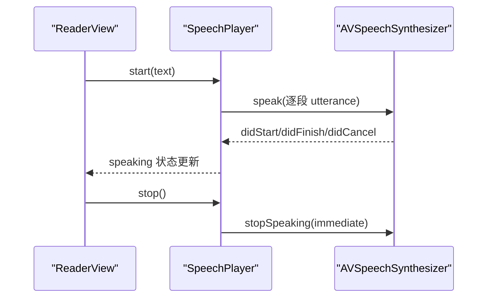
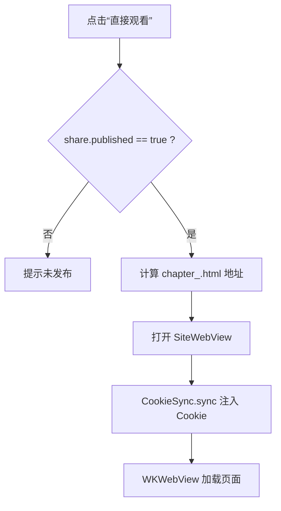
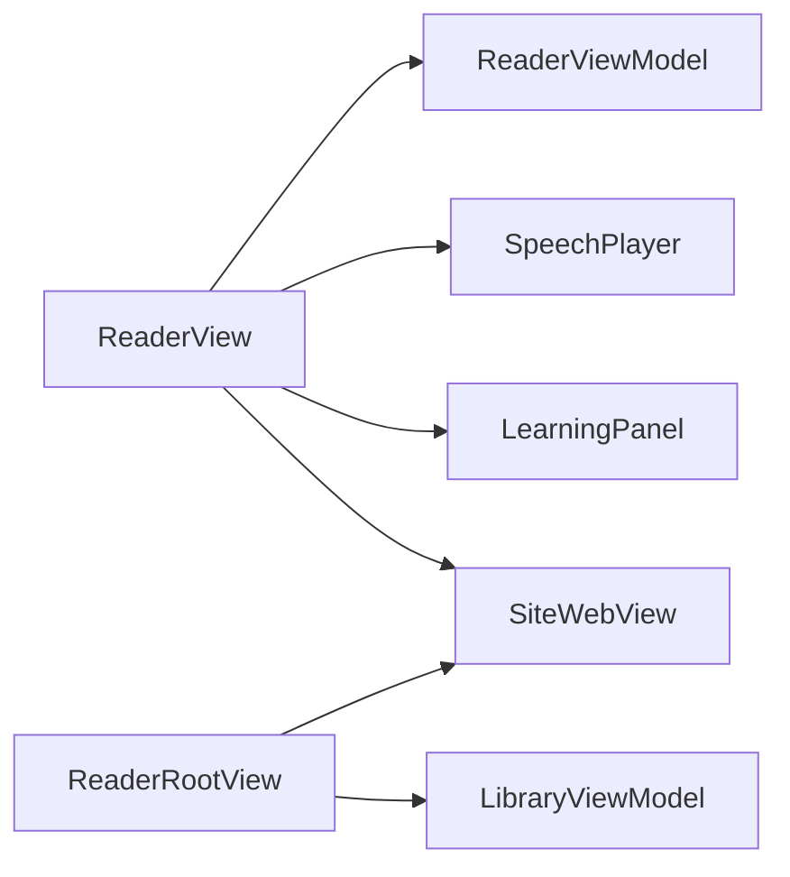

# 主阅读界面

<cite>
**本文引用的文件**   
- [ReaderView.swift](file://ios/AINovel/Reader/ReaderView.swift)
- [LearningPanel.swift](file://ios/AINovel/Reader/LearningPanel.swift)
- [SpeechPlayer.swift](file://ios/AINovel/Reader/SpeechPlayer.swift)
- [SiteWebView.swift](file://ios/AINovel/Reader/SiteWebView.swift)
- [LibraryViewModel.swift](file://ios/AINovel/Reader/LibraryViewModel.swift)
- [ReaderRootView.swift](file://ios/AINovel/Reader/ReaderRootView.swift)
</cite>

## 目录
1. [引言](#引言)
2. [项目结构定位](#项目结构定位)
3. [核心组件总览](#核心组件总览)
4. [架构概览](#架构概览)
5. [详细组件分析](#详细组件分析)
6. [依赖关系分析](#依赖关系分析)
7. [性能与体验优化](#性能与体验优化)
8. [故障排查指南](#故障排查指南)
9. [结论](#结论)
10. [附录：扩展实践](#附录扩展实践)

## 引言
本文件面向 ReaderView 主阅读界面，系统性说明其 SwiftUI 布局、章节渲染逻辑、状态管理、导航标题与工具栏交互、学习面板集成、朗读能力以及“直接观看”发布站页面的实现方式。文档同时给出可操作的扩展建议，帮助你在不破坏现有结构的前提下添加自定义主题、新的 UI 功能并优化阅读体验。

## 项目结构定位
ReaderView 位于 iOS 客户端的 Reader 模块中，是“阅读”Tab 的核心页面之一。它负责：
- 根据当前小说和章节索引加载章节详情；
- 以 ScrollView + VStack 的形式展示章节标题、元信息与正文；
- 通过 SafeArea 底部工具栏提供上一章/下一章与朗读控制；
- 通过顶部导航标题与工具栏按钮打开学习面板、设置字号与发布站点；
- 与 SpeechPlayer、SiteWebView、LearningPanel 等组件协作完成朗读、学习与外部站点浏览。

**图表来源**
- [ReaderView.swift:41-132](file://ios/AINovel/Reader/ReaderView.swift#L41-L132)
- [ReaderRootView.swift:19-59](file://ios/AINovel/Reader/ReaderRootView.swift#L19-L59)
- [LibraryViewModel.swift:4-14](file://ios/AINovel/Reader/LibraryViewModel.swift#L4-L14)

**章节来源**
- [ReaderView.swift:41-132](file://ios/AINovel/Reader/ReaderView.swift#L41-L132)
- [ReaderRootView.swift:19-59](file://ios/AINovel/Reader/ReaderRootView.swift#L19-L59)
- [LibraryViewModel.swift:4-14](file://ios/AINovel/Reader/LibraryViewModel.swift#L4-L14)

## 核心组件总览
- ReaderView：主阅读界面视图，组织 ScrollView、VStack、SafeArea 底部工具栏、导航标题与工具栏按钮。
- ReaderViewModel：章节加载、错误处理、分享页入口与发布站 URL 计算。
- LearningPanel：学习面板，包含测试题、生词讲解与提问模式。
- SpeechPlayer：基于 AVSpeechSynthesizer 的本地朗读器，按段落朗读并暴露 speaking 状态。
- SiteWebView：WKWebView 封装，负责注入 Cookie 后打开发布后的读者站页面。
- LibraryViewModel：共享书单 ViewModel，供阅读首页与管理端使用。

**章节来源**
- [ReaderView.swift:4-39](file://ios/AINovel/Reader/ReaderView.swift#L4-L39)
- [ReaderView.swift:41-169](file://ios/AINovel/Reader/ReaderView.swift#L41-L169)
- [LearningPanel.swift:4-82](file://ios/AINovel/Reader/LearningPanel.swift#L4-L82)
- [SpeechPlayer.swift:7-75](file://ios/AINovel/Reader/SpeechPlayer.swift#L7-L75)
- [SiteWebView.swift:7-111](file://ios/AINovel/Reader/SiteWebView.swift#L7-L111)
- [LibraryViewModel.swift:4-52](file://ios/AINovel/Reader/LibraryViewModel.swift#L4-L52)

## 架构概览
ReaderView 采用典型的 SwiftUI 组合式架构：
- 视图层：ReaderView 负责布局与用户交互。
- 状态层：ReaderViewModel 持有章节详情、加载状态与错误信息；SpeechPlayer 持有朗读状态。
- 服务层：APIClient（由 ReaderViewModel 与 LearningViewModel 共用）负责网络请求。
- 辅助层：SiteWebView 提供 Web 浏览能力；LearningPanel 提供学习功能。

**图表来源**
- [ReaderView.swift:74-132](file://ios/AINovel/Reader/ReaderView.swift#L74-L132)
- [ReaderView.swift:12-31](file://ios/AINovel/Reader/ReaderView.swift#L12-L31)
- [SpeechPlayer.swift:27-44](file://ios/AINovel/Reader/SpeechPlayer.swift#L27-L44)
- [SiteWebView.swift:13-34](file://ios/AINovel/Reader/SiteWebView.swift#L13-L34)

## 详细组件分析

### ReaderView 布局与内容组织
ReaderView 的主体是一个 ScrollView，内部使用 VStack 纵向排列章节标题、元信息、分隔线与正文。正文使用系统字体并按配置字号显示，行间距随字号动态调整，同时启用文本选择以便复制。

- ScrollView + VStack：保证长文滚动流畅，内容左对齐，左右内边距统一。
- SafeArea 底部工具栏：通过 safeAreaInset(edge:.bottom) 插入 HStack 工具栏，包含上一章、朗读、下一章三个主要操作。
- 导航标题与工具栏：navigationTitle 使用小说展示名；navigationBarTrailing 放置“直接观看”“学习”“字号设置”三个按钮。
- 任务与生命周期：.task(id:index) 在章节切换时重新加载；.task 初始化时拉取分享页入口；onDisappear 停止朗读。

**图表来源**
- [ReaderView.swift:74-97](file://ios/AINovel/Reader/ReaderView.swift#L74-L97)
- [ReaderView.swift:134-167](file://ios/AINovel/Reader/ReaderView.swift#L134-L167)

**章节来源**
- [ReaderView.swift:74-132](file://ios/AINovel/Reader/ReaderView.swift#L74-L132)
- [ReaderView.swift:134-167](file://ios/AINovel/Reader/ReaderView.swift#L134-L167)

### 章节内容渲染逻辑
- 标题与元信息：若存在章节名称则显示加粗标题；随后显示“第 X 章 · Y 字”的元信息。
- 正文显示：使用 Text(d.content ?? "")，字体大小来自 AppStorage("readerFontSize")，行间距为 fontSize * 0.6，启用文本选择。
- 加载与错误：loading 时显示 ProgressView；errorMessage 非空时以红色文字显示错误。

**图表来源**
- [ReaderView.swift:77-88](file://ios/AINovel/Reader/ReaderView.swift#L77-L88)

**章节来源**
- [ReaderView.swift:77-93](file://ios/AINovel/Reader/ReaderView.swift#L77-L93)

### ReaderViewModel 状态管理
ReaderViewModel 负责：
- 章节加载：load(novelId:no) 调用 APIClient 获取章节详情，更新 detail、loading、errorMessage。
- 分享页入口：loadShare(novelId:) 拉取 ShareResponse，用于“直接观看”。
- 发布站 URL 计算：publishedChapterURL(chapterId:) 将 share.url 转换为 chapter_<id>.html 的稳定链接。

**图表来源**
- [ReaderView.swift:4-39](file://ios/AINovel/Reader/ReaderView.swift#L4-L39)

**章节来源**
- [ReaderView.swift:4-39](file://ios/AINovel/Reader/ReaderView.swift#L4-L39)

### 导航标题、工具栏按钮与学习面板
- 导航标题：使用 novel.display，显示模式为 inline。
- 工具栏按钮：
  - “直接观看”：检查是否已发布，未发布则提示；已发布则打开 SiteWebView。
  - “学习”：弹出 LearningPanel，传入 novelId、正文内容与标题。
  - “字号设置”：弹出 popover，提供 Stepper 调节 fontSize（14~28）。
- 学习面板：LearningPanel 支持三种模式（测试题、生词、提问），通过 APIClient 与后端 LLM 接口交互，并在 UI 上展示结果与反馈。

**图表来源**
- [ReaderView.swift:101-128](file://ios/AINovel/Reader/ReaderView.swift#L101-L128)
- [LearningPanel.swift:84-129](file://ios/AINovel/Reader/LearningPanel.swift#L84-L129)
- [LearningPanel.swift:131-210](file://ios/AINovel/Reader/LearningPanel.swift#L131-L210)

**章节来源**
- [ReaderView.swift:101-128](file://ios/AINovel/Reader/ReaderView.swift#L101-L128)
- [LearningPanel.swift:84-210](file://ios/AINovel/Reader/LearningPanel.swift#L84-L210)

### 底部工具栏与朗读控制
底部工具栏通过 safeAreaInset(edge:.bottom) 插入，包含：
- 上一章：index > 0 时递减 index，并停止朗读。
- 朗读：根据 speech.speaking 切换播放/停止；start(text) 传入当前章节正文。
- 下一章：index < chapters.count - 1 时递增 index，并停止朗读。

SpeechPlayer 基于 AVSpeechSynthesizer，按换行分段朗读，暴露 speaking 与 currentParagraph 状态，便于未来高亮当前段落。

**图表来源**
- [ReaderView.swift:134-167](file://ios/AINovel/Reader/ReaderView.swift#L134-L167)
- [SpeechPlayer.swift:27-64](file://ios/AINovel/Reader/SpeechPlayer.swift#L27-L64)

**章节来源**
- [ReaderView.swift:134-167](file://ios/AINovel/Reader/ReaderView.swift#L134-L167)
- [SpeechPlayer.swift:7-75](file://ios/AINovel/Reader/SpeechPlayer.swift#L7-L75)

### “直接观看”与发布站集成
ReaderView 通过 ReaderViewModel.loadShare 拉取 ShareResponse，并根据 share.url 与当前章节 id 计算发布站 URL。SiteWebView 使用 WKWebView 打开页面，并在加载前同步 URLSession 的 Cookie，确保 VIP 页面权限正确。

**图表来源**
- [ReaderView.swift:63-71](file://ios/AINovel/Reader/ReaderView.swift#L63-L71)
- [ReaderView.swift:27-38](file://ios/AINovel/Reader/ReaderView.swift#L27-L38)
- [SiteWebView.swift:54-91](file://ios/AINovel/Reader/SiteWebView.swift#L54-L91)
- [SiteWebView.swift:94-110](file://ios/AINovel/Reader/SiteWebView.swift#L94-L110)

**章节来源**
- [ReaderView.swift:63-71](file://ios/AINovel/Reader/ReaderView.swift#L63-L71)
- [SiteWebView.swift:7-111](file://ios/AINovel/Reader/SiteWebView.swift#L7-L111)

## 依赖关系分析
- ReaderView 依赖 ReaderViewModel 提供章节数据与分享入口。
- ReaderView 依赖 SpeechPlayer 提供朗读能力。
- ReaderView 依赖 LearningPanel 提供学习功能。
- ReaderView 依赖 SiteWebView 提供发布站浏览。
- ReaderRootView 依赖 LibraryViewModel 拉取公开书单，并通过 Sheet 打开 SiteWebView。

**图表来源**
- [ReaderView.swift:41-132](file://ios/AINovel/Reader/ReaderView.swift#L41-L132)
- [ReaderRootView.swift:19-59](file://ios/AINovel/Reader/ReaderRootView.swift#L19-L59)
- [LibraryViewModel.swift:4-14](file://ios/AINovel/Reader/LibraryViewModel.swift#L4-L14)

**章节来源**
- [ReaderView.swift:41-132](file://ios/AINovel/Reader/ReaderView.swift#L41-L132)
- [ReaderRootView.swift:19-59](file://ios/AINovel/Reader/ReaderRootView.swift#L19-L59)
- [LibraryViewModel.swift:4-14](file://ios/AINovel/Reader/LibraryViewModel.swift#L4-L14)

## 性能与体验优化
- 文本渲染：正文使用 .lineSpacing(fontSize * 0.6)，在较大字号下保持舒适行距；启用 textSelection(.enabled) 提升可复制性。
- 朗读性能：SpeechPlayer 使用系统合成器，零联网、低延迟；按换行分段减少单次合成压力。
- 网络请求：ReaderViewModel 与 LearningViewModel 均使用统一的 APIClient，避免重复连接；错误信息集中到 errorMessage，便于 UI 统一处理。
- Web 加载：SiteWebView 先同步 Cookie 再加载，避免 VIP 页面被拦截；WKWebView 复用默认数据存储，提高 Cookie 注入效率。

[本节为通用指导，不涉及具体代码片段]

## 故障排查指南
- 章节加载失败：
  - 检查 ReaderViewModel.errorMessage 是否为空；查看 APIError.errorDescription 或 error.localizedDescription。
  - 确认 novelId 与 no 参数有效。
- 朗读无响应：
  - 检查 SpeechPlayer.speaking 状态；确认传入正文非空且包含有效段落。
  - 在 onDisappear 中确保 speech.stop() 被调用。
- “直接观看”无法访问：
  - 确认 share.published 为 true；检查 publishedChapterURL 生成的 URL 是否正确。
  - 检查 CookieSync.sync 是否成功注入 Cookie；确认 AppConfig.baseURL 配置正确。
- 学习面板报错：
  - 查看 LearningViewModel.errorMessage；检查 Endpoint.readerQuiz/readerVocab/readerExplainWord/readerAsk 的请求参数是否符合后端要求。

**章节来源**
- [ReaderView.swift:12-31](file://ios/AINovel/Reader/ReaderView.swift#L12-L31)
- [LearningPanel.swift:74-81](file://ios/AINovel/Reader/LearningPanel.swift#L74-L81)
- [SiteWebView.swift:94-110](file://ios/AINovel/Reader/SiteWebView.swift#L94-L110)

## 结论
ReaderView 通过清晰的 SwiftUI 组合结构实现了章节阅读、朗读、学习与发布站浏览的一体化体验。ReaderViewModel 统一管理章节状态与分享入口，SpeechPlayer 提供本地朗读能力，SiteWebView 解决 VIP 页面权限问题，LearningPanel 提供丰富的学习模式。整体架构耦合度低、职责清晰，便于扩展主题、新增 UI 功能与优化阅读体验。

[本节为总结性内容，不涉及具体代码片段]

## 附录：扩展实践

### 自定义主题
- 目标：在不修改业务逻辑的前提下，改变字体、颜色与行距。
- 方法：
  - 在 ReaderView 中将 fontSize 与 lineSpacing 抽取为 Theme 对象，通过 @Environment 注入。
  - 在 ReaderView.body 中替换 Text 的 font 与 foregroundStyle，使用 Theme.primaryColor、Theme.accentColor。
  - 在底部工具栏与 popover 中使用 Theme.barBackground、Theme.toolbarColor。
- 参考位置：
  - [ReaderView.swift:74-97](file://ios/AINovel/Reader/ReaderView.swift#L74-L97)
  - [ReaderView.swift:121-128](file://ios/AINovel/Reader/ReaderView.swift#L121-L128)
  - [ReaderView.swift:134-167](file://ios/AINovel/Reader/ReaderView.swift#L134-L167)

### 添加新的 UI 功能
- 目标：在 ReaderView 增加“收藏”按钮。
- 方法：
  - 在 ReaderViewModel 中添加 isFavorite 状态与 toggleFavorite 方法。
  - 在 ReaderView 的工具栏中添加 Button，调用 toggleFavorite 并刷新 UI。
  - 在 onDisappear 中保存收藏状态到持久化存储。
- 参考位置：
  - [ReaderView.swift:101-107](file://ios/AINovel/Reader/ReaderView.swift#L101-L107)
  - [ReaderView.swift:12-31](file://ios/AINovel/Reader/ReaderView.swift#L12-L31)

### 优化阅读体验
- 目标：提升长文阅读舒适度与可访问性。
- 方法：
  - 引入夜间模式：根据系统暗色模式切换背景与前景色。
  - 增加段落高亮：结合 SpeechPlayer.currentParagraph 高亮当前朗读段落。
  - 优化行距与字重：根据设备尺寸与字体大小动态调整 lineSpacing 与 fontWeight。
- 参考位置：
  - [ReaderView.swift:84-88](file://ios/AINovel/Reader/ReaderView.swift#L84-L88)
  - [SpeechPlayer.swift:9-10](file://ios/AINovel/Reader/SpeechPlayer.swift#L9-L10)