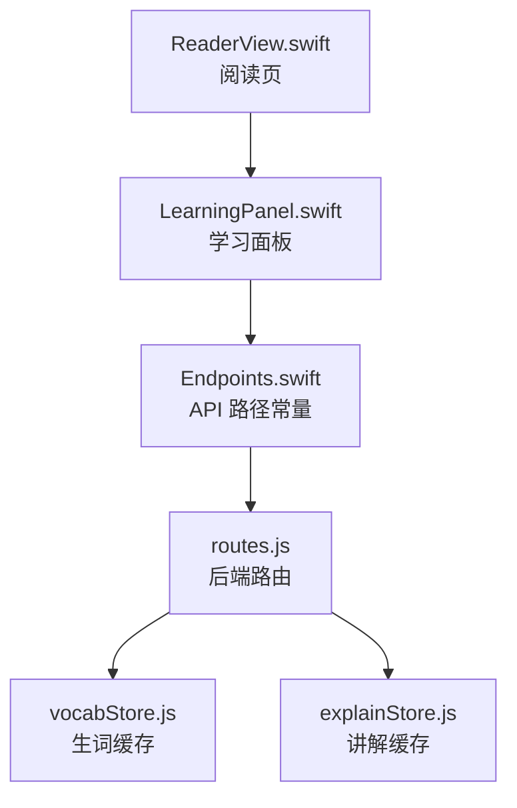
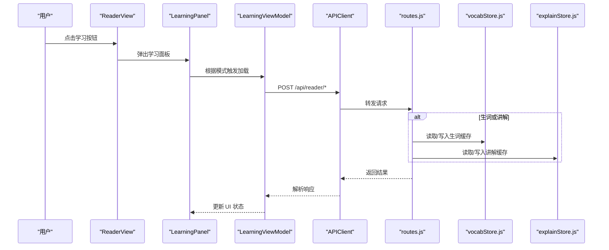
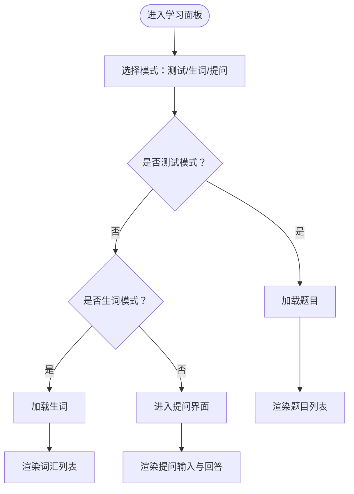
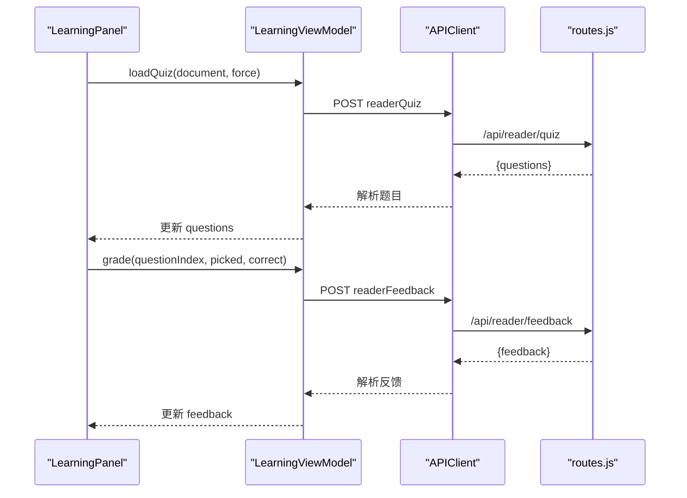
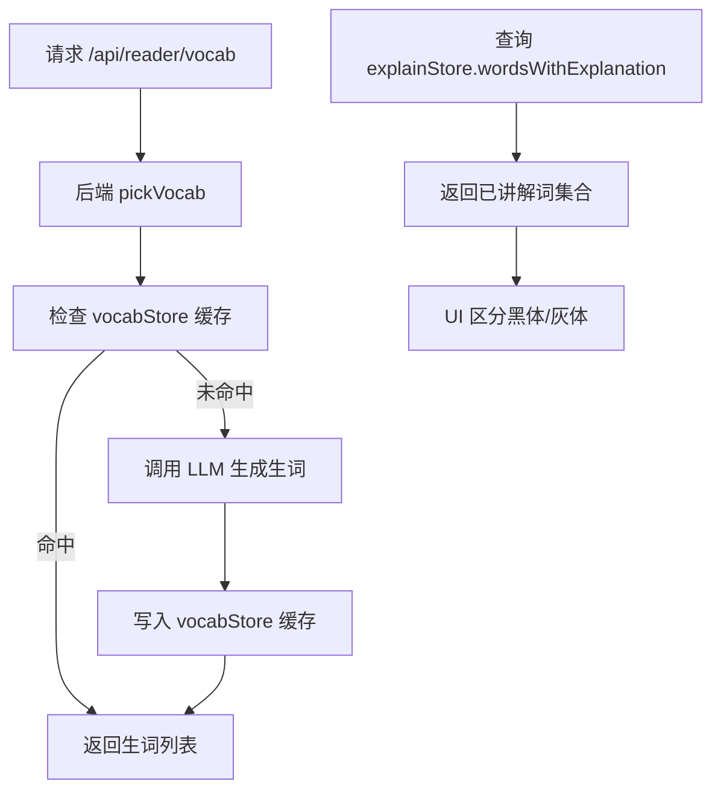
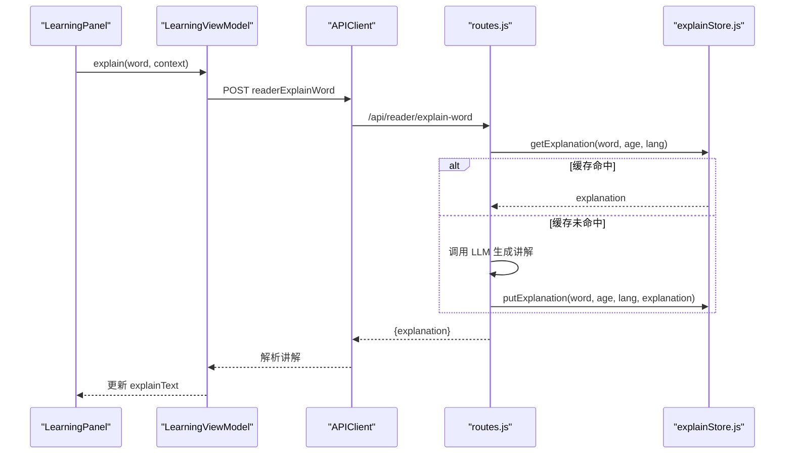
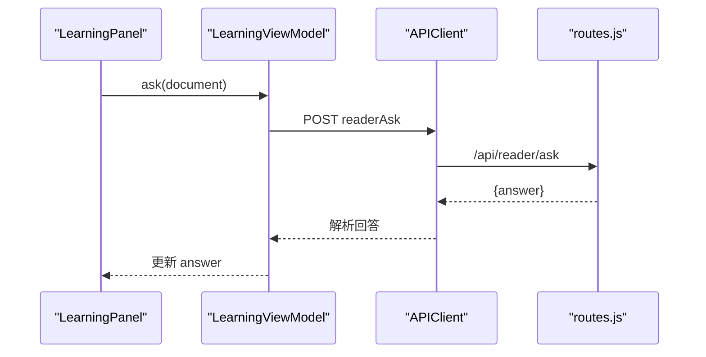
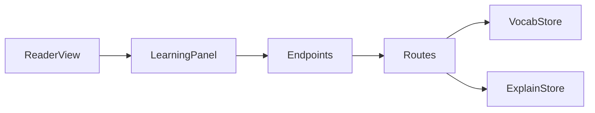

# 学习面板

<cite>
**本文引用的文件**   
- [LearningPanel.swift](file://ios/AINovel/Reader/LearningPanel.swift)
- [ReaderView.swift](file://ios/AINovel/Reader/ReaderView.swift)
- [Endpoints.swift](file://ios/AINovel/Networking/Endpoints.swift)
- [routes.js](file://src/routes.js)
- [vocabStore.js](file://src/reader/vocabStore.js)
- [explainStore.js](file://src/reader/explainStore.js)
</cite>

## 目录
1. [引言](#引言)
2. [项目结构定位](#项目结构定位)
3. [核心组件总览](#核心组件总览)
4. [架构总览](#架构总览)
5. [详细组件分析](#详细组件分析)
6. [依赖关系分析](#依赖关系分析)
7. [性能与缓存特性](#性能与缓存特性)
8. [故障排查指南](#故障排查指南)
9. [扩展与优化建议](#扩展与优化建议)
10. [结论](#结论)

## 引言
本文件面向 LearningPanel 学习面板的开发与维护，目标是帮助读者理解该功能的整体架构、数据流、后端交互方式以及状态管理机制。学习面板提供三类能力：阅读理解测试、生词提取与讲解、基于章节内容的提问。它通过 iOS 端 SwiftUI 视图驱动 `LearningViewModel`，调用后端公开阅读者接口，并借助服务端持久化缓存降低重复推理成本。

## 项目结构定位
学习面板位于 iOS 客户端的阅读器模块中，由阅读页以弹窗形式打开；后端路由在 Node.js 服务中注册，最终调用 AI 服务并落库到全局数据库。

**图表来源**
- [ReaderView.swift:108-110](file://ios/AINovel/Reader/ReaderView.swift#L108-L110)
- [LearningPanel.swift:84-120](file://ios/AINovel/Reader/LearningPanel.swift#L84-L120)
- [Endpoints.swift:39-46](file://ios/AINovel/Networking/Endpoints.swift#L39-L46)
- [routes.js:359-390](file://src/routes.js#L359-L390)
- [vocabStore.js:1-101](file://src/reader/vocabStore.js#L1-L101)
- [explainStore.js:1-113](file://src/reader/explainStore.js#L1-L113)

**章节来源**
- [ReaderView.swift:41-131](file://ios/AINovel/Reader/ReaderView.swift#L41-L131)
- [LearningPanel.swift:84-120](file://ios/AINovel/Reader/LearningPanel.swift#L84-L120)
- [Endpoints.swift:39-46](file://ios/AINovel/Networking/Endpoints.swift#L39-L46)
- [routes.js:359-390](file://src/routes.js#L359-L390)

## 核心组件总览
- `LearningViewModel`：学习面板的状态与业务逻辑中心，负责模式切换、题目加载、生词加载、单词讲解、提问和答题反馈。
- `LearningPanel`：SwiftUI 视图层，渲染三种模式（测试、生词、提问），处理用户交互并驱动 ViewModel。
- `ReaderView`：阅读页入口，通过 sheet 展示学习面板，并把当前章节正文传给面板。
- 后端路由：将前端请求转发给 AI 服务，并使用持久化缓存减少重复 LLM 调用。
- 持久化缓存：
  - `vocabStore.js`：按“年龄 + 正文”维度缓存生词列表。
  - `explainStore.js`：按“词 + 年龄 + 语言”维度缓存单词讲解，并提供批量查询已生成词的接口。

**章节来源**
- [LearningPanel.swift:4-82](file://ios/AINovel/Reader/LearningPanel.swift#L4-L82)
- [LearningPanel.swift:84-211](file://ios/AINovel/Reader/LearningPanel.swift#L84-L211)
- [ReaderView.swift:41-131](file://ios/AINovel/Reader/ReaderView.swift#L41-L131)
- [vocabStore.js:1-101](file://src/reader/vocabStore.js#L1-L101)
- [explainStore.js:1-113](file://src/reader/explainStore.js#L1-L113)

## 架构总览
学习面板采用“前端状态驱动 + 后端公开 API + 持久化缓存”的分层设计。前端不直接操作数据库，也不保存长期学习进度；学习体验的核心数据（生词、讲解）在服务端缓存，保证不同读者、不同会话之间可复用。

**图表来源**
- [ReaderView.swift:108-110](file://ios/AINovel/Reader/ReaderView.swift#L108-L110)
- [LearningPanel.swift:112-119](file://ios/AINovel/Reader/LearningPanel.swift#L112-L119)
- [LearningPanel.swift:23-72](file://ios/AINovel/Reader/LearningPanel.swift#L23-L72)
- [Endpoints.swift:39-46](file://ios/AINovel/Networking/Endpoints.swift#L39-L46)
- [routes.js:359-390](file://src/routes.js#L359-L390)
- [vocabStore.js:48-100](file://src/reader/vocabStore.js#L48-L100)
- [explainStore.js:49-112](file://src/reader/explainStore.js#L49-L112)

## 详细组件分析

### 学习面板视图与模式切换
`LearningPanel` 使用分段选择器切换三种模式：测试、生词、提问。每种模式对应不同的子视图：
- 测试模式：渲染题目列表，支持选项点击、正确性标记、鼓励式讲解展示。
- 生词模式：渲染词汇列表，点击后请求单词讲解，并在下方展开讲解区域。
- 提问模式：输入框 + 提交按钮，展示 AI 基于章节内容的回答。

面板在首次加载时根据当前模式自动拉取数据：若测试题未加载则拉取题目，若生词未加载则拉取词汇。错误信息统一显示在顶部，完成按钮关闭面板。

**图表来源**
- [LearningPanel.swift:91-120](file://ios/AINovel/Reader/LearningPanel.swift#L91-L120)
- [LearningPanel.swift:123-129](file://ios/AINovel/Reader/LearningPanel.swift#L123-L129)

**章节来源**
- [LearningPanel.swift:84-129](file://ios/AINovel/Reader/LearningPanel.swift#L84-L129)

### 阅读理解测试流程
测试模式的数据来自 `/api/reader/quiz`。ViewModel 在 `loadQuiz` 中构造文档、年龄和可选的强制参数，调用后端获取题目数组。答题时，`grade` 方法记录用户选择，并根据正确答案生成鼓励式讲解，调用 `/api/reader/feedback`。

**图表来源**
- [LearningPanel.swift:23-30](file://ios/AINovel/Reader/LearningPanel.swift#L23-L30)
- [LearningPanel.swift:62-72](file://ios/AINovel/Reader/LearningPanel.swift#L62-L72)
- [Endpoints.swift:40-46](file://ios/AINovel/Networking/Endpoints.swift#L40-L46)
- [routes.js:359-390](file://src/routes.js#L359-L390)

**章节来源**
- [LearningPanel.swift:23-30](file://ios/AINovel/Reader/LearningPanel.swift#L23-L30)
- [LearningPanel.swift:62-72](file://ios/AINovel/Reader/LearningPanel.swift#L62-L72)

### 生词提取与词汇高亮机制
生词列表来自 `/api/reader/vocab`，后端调用 `pickVocab`，并通过 `vocabStore.js` 进行持久化缓存。缓存键为“年龄 + 正文”的哈希，避免正文变化后仍命中旧词表。

词汇高亮与解释状态由 `explainStore.js` 提供：
- `wordsWithExplanation` 返回已生成讲解的词集合，供正文着色：已讲解词用黑体，未讲解词用灰体。
- 点词讲解走 `/api/reader/explain-word`，后端调用 `explainWord`，并按“词 + 年龄 + 语言”持久化讲解文本。

**图表来源**
- [LearningPanel.swift:32-38](file://ios/AINovel/Reader/LearningPanel.swift#L32-L38)
- [routes.js:368-382](file://src/routes.js#L368-L382)
- [vocabStore.js:48-100](file://src/reader/vocabStore.js#L48-L100)
- [explainStore.js:84-102](file://src/reader/explainStore.js#L84-L102)

**章节来源**
- [LearningPanel.swift:32-38](file://ios/AINovel/Reader/LearningPanel.swift#L32-L38)
- [routes.js:368-382](file://src/routes.js#L368-L382)
- [vocabStore.js:1-101](file://src/reader/vocabStore.js#L1-L101)
- [explainStore.js:84-102](file://src/reader/explainStore.js#L84-L102)

### 单词讲解与上下文注入
当用户在生词列表中点击某个词时，`explain` 方法设置当前讲解词并清空旧讲解，然后调用 `/api/reader/explain-word`，传入词、年龄、语言和上下文（章节正文）。后端 `explainWord` 会优先查 `explainStore.js` 缓存，命中则秒回，否则调用 LLM 生成讲解并落库。

**图表来源**
- [LearningPanel.swift:40-49](file://ios/AINovel/Reader/LearningPanel.swift#L40-L49)
- [Endpoints.swift:43-44](file://ios/AINovel/Networking/Endpoints.swift#L43-L44)
- [routes.js:373-377](file://src/routes.js#L373-L377)
- [explainStore.js:49-82](file://src/reader/explainStore.js#L49-L82)

**章节来源**
- [LearningPanel.swift:40-49](file://ios/AINovel/Reader/LearningPanel.swift#L40-L49)
- [routes.js:373-377](file://src/routes.js#L373-L377)
- [explainStore.js:49-82](file://src/reader/explainStore.js#L49-L82)

### 提问功能
提问模式允许用户就本章内容提出问题，后端调用 `/api/reader/ask`，返回 AI 的回答。ViewModel 维护问题文本、回答文本和忙碌状态，UI 禁用空输入和重复提交。

**图表来源**
- [LearningPanel.swift:51-59](file://ios/AINovel/Reader/LearningPanel.swift#L51-L59)
- [Endpoints.swift:45-46](file://ios/AINovel/Networking/Endpoints.swift#L45-L46)
- [routes.js:383-390](file://src/routes.js#L383-L390)

**章节来源**
- [LearningPanel.swift:51-59](file://ios/AINovel/Reader/LearningPanel.swift#L51-L59)
- [routes.js:383-390](file://src/routes.js#L383-L390)

### 学习状态管理
当前实现中，学习面板的状态主要保存在内存中：
- 已学词汇标记：通过 `answers` 字典记录每道题的选择，通过 `feedback` 记录鼓励讲解。
- 学习统计：代码中没有显式的“已学词汇数”“正确率”等统计字段；如需统计，可在 ViewModel 新增计算属性。
- 进度同步：面板没有向服务端写学习进度的接口；持久化仅用于生词和讲解，不记录用户答题行为。

如果需要扩展学习进度追踪，建议在 ViewModel 增加持久化字段，例如本地 Keychain 或云端用户档案，并在答题完成后上报。

**章节来源**
- [LearningPanel.swift:4-18](file://ios/AINovel/Reader/LearningPanel.swift#L4-L18)
- [LearningPanel.swift:62-72](file://ios/AINovel/Reader/LearningPanel.swift#L62-L72)

### UI 组件设计模式
- 列表渲染：使用 SwiftUI `List` 与 `Section` 组织题目和词汇，配合 `ForEach` 遍历数据。
- 交互手势：按钮点击触发异步任务，使用 `Task` 包裹 ViewModel 方法。
- 动画效果：当前未使用显式动画；可通过 `.transition`、`.animation` 增强讲解展开、反馈出现等动效。
- 错误处理：统一通过 `busy` 和 `errorMessage` 控制加载态与错误提示。

**章节来源**
- [LearningPanel.swift:131-211](file://ios/AINovel/Reader/LearningPanel.swift#L131-L211)

## 依赖关系分析
学习面板依赖以下关键组件：
- 前端：`ReaderView` 负责弹出面板并传递章节内容。
- 网络：`Endpoints` 定义所有阅读者相关 API 路径。
- 后端：`routes.js` 注册公开阅读者接口，并调用 AI 服务。
- 缓存：`vocabStore.js` 与 `explainStore.js` 分别管理生词与讲解的持久化。

**图表来源**
- [ReaderView.swift:108-110](file://ios/AINovel/Reader/ReaderView.swift#L108-L110)
- [LearningPanel.swift:112-119](file://ios/AINovel/Reader/LearningPanel.swift#L112-L119)
- [Endpoints.swift:39-46](file://ios/AINovel/Networking/Endpoints.swift#L39-L46)
- [routes.js:359-390](file://src/routes.js#L359-L390)
- [vocabStore.js:1-101](file://src/reader/vocabStore.js#L1-L101)
- [explainStore.js:1-113](file://src/reader/explainStore.js#L1-L113)

**章节来源**
- [ReaderView.swift:108-110](file://ios/AINovel/Reader/ReaderView.swift#L108-L110)
- [LearningPanel.swift:112-119](file://ios/AINovel/Reader/LearningPanel.swift#L112-L119)
- [Endpoints.swift:39-46](file://ios/AINovel/Networking/Endpoints.swift#L39-L46)
- [routes.js:359-390](file://src/routes.js#L359-L390)

## 性能与缓存特性
- 生词缓存：按“年龄 + 正文”哈希键存储，避免正文改写后仍命中旧词表；超过上限按最近使用时间淘汰。
- 讲解缓存：按“词 + 年龄 + 语言”主键存储，跨读者、跨章节复用；提供批量查询已讲解词集合，零 LLM 开销。
- 限流保护：阅读者接口统一经过限流中间件，防止匿名接口被刷爆。
- 降级策略：数据库不可用时退回进程内缓存，功能不受影响但重启后需重新计算。

**章节来源**
- [vocabStore.js:1-101](file://src/reader/vocabStore.js#L1-L101)
- [explainStore.js:1-113](file://src/reader/explainStore.js#L1-L113)
- [routes.js:352-390](file://src/routes.js#L352-L390)

## 故障排查指南
- 学习面板无法加载数据：
  - 检查 `LoadingViewModel.busy` 是否为 true，确认是否有网络错误或超时。
  - 查看 `errorMessage` 是否包含后端返回的错误描述。
- 生词为空或讲解未生成：
  - 检查后端 `vocabStore` 与 `explainStore` 是否可用，观察日志中的降级警告。
  - 确认正文是否发生变化导致缓存键失效。
- 提问无回答：
  - 检查问题文本是否为空，以及后端 `/api/reader/ask` 是否正常返回。
- 词汇高亮异常：
  - 确认 `explainStore.wordsWithExplanation` 返回的已讲解词集合是否正确。
  - 检查年龄与语言参数是否与缓存键一致。

**章节来源**
- [LearningPanel.swift:74-81](file://ios/AINovel/Reader/LearningPanel.swift#L74-L81)
- [vocabStore.js:23-46](file://src/reader/vocabStore.js#L23-L46)
- [explainStore.js:24-47](file://src/reader/explainStore.js#L24-L47)

## 扩展与优化建议

### 扩展学习功能
- 新增词汇类型：
  - 在后端新增分类字段，例如“成语”“专有名词”，并在 `pickVocab` 中按类型过滤。
  - 在前端 `LearningViewModel` 新增词汇分类字段，并在 `vocabList` 中按类型分组渲染。
- 添加学习统计：
  - 在 `LearningViewModel` 新增 `correctCount`、`totalCount`、`accuracy` 等属性。
  - 在答题回调中更新统计，并在 UI 中展示进度条或百分比。
- 优化学习体验：
  - 为讲解展开添加过渡动画，提升视觉流畅度。
  - 支持离线缓存已生成的讲解，减少重复网络请求。
  - 增加“收藏词汇”功能，将重点词汇保存到本地或云端。

### 优化学习体验
- 列表渲染优化：
  - 对长列表使用分页或虚拟滚动，避免一次性渲染大量词汇。
  - 为高频操作的按钮添加长按快捷菜单，如“加入复习计划”。
- 交互手势优化：
  - 支持滑动删除已掌握词汇，或左滑标记“需复习”。
  - 支持双击词汇快速跳转至讲解区域。
- 动画效果优化：
  - 使用 `.transition(.slide)` 或 `.opacity` 实现讲解内容淡入。
  - 在答题反馈出现时使用轻微缩放动画，增强反馈感。

**章节来源**
- [LearningPanel.swift:131-211](file://ios/AINovel/Reader/LearningPanel.swift#L131-L211)
- [routes.js:368-382](file://src/routes.js#L368-L382)

## 结论
LearningPanel 学习面板以清晰的职责分离实现了阅读理解测试、生词学习与提问三大功能。前端通过 SwiftUI 视图驱动状态，后端通过公开 API 与持久化缓存保障性能与一致性。当前实现侧重于即时学习体验，未内置长期学习进度追踪；如需构建完整的学习系统，可扩展统计与持久化能力，并结合用户账户体系实现跨设备同步。