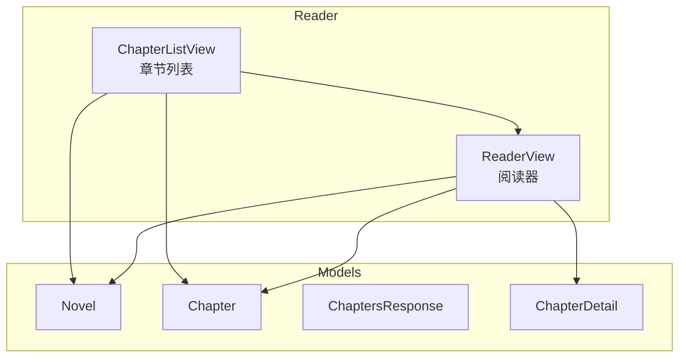
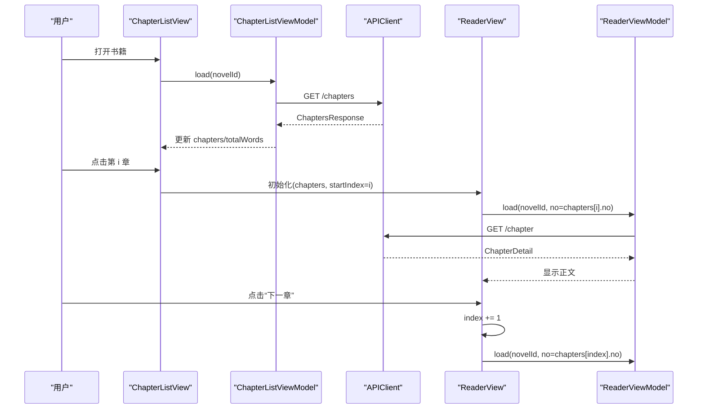
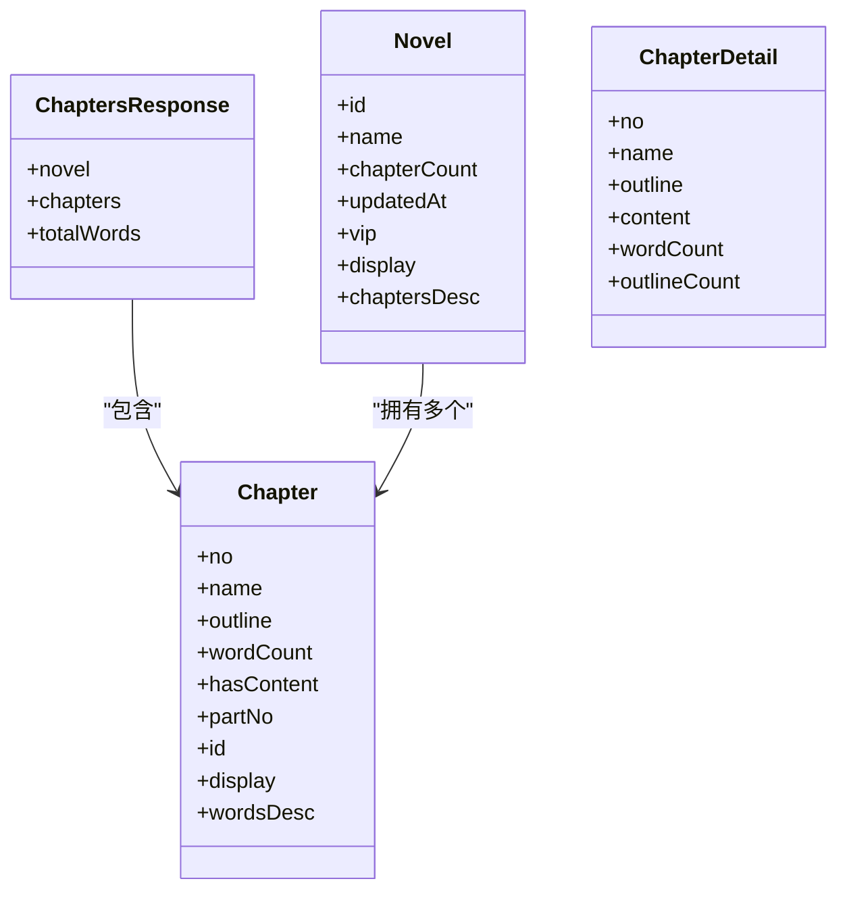
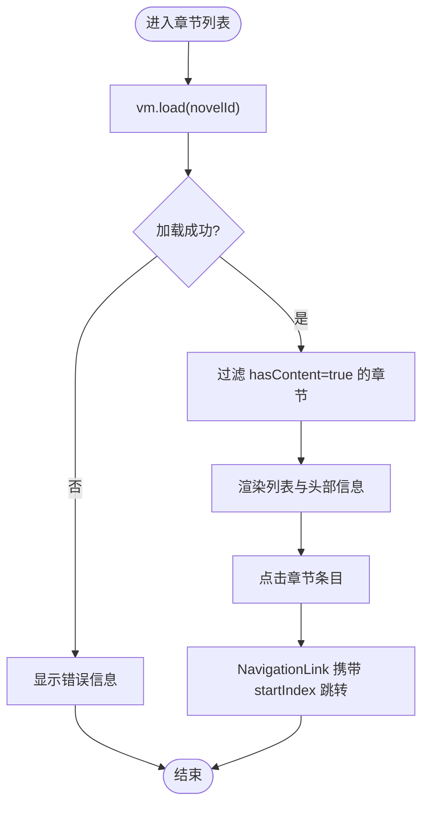
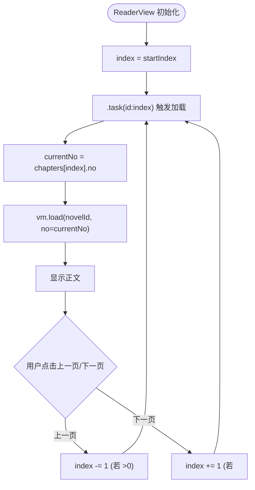
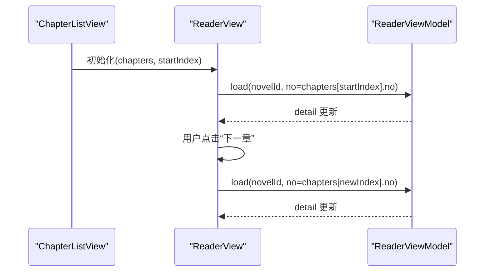
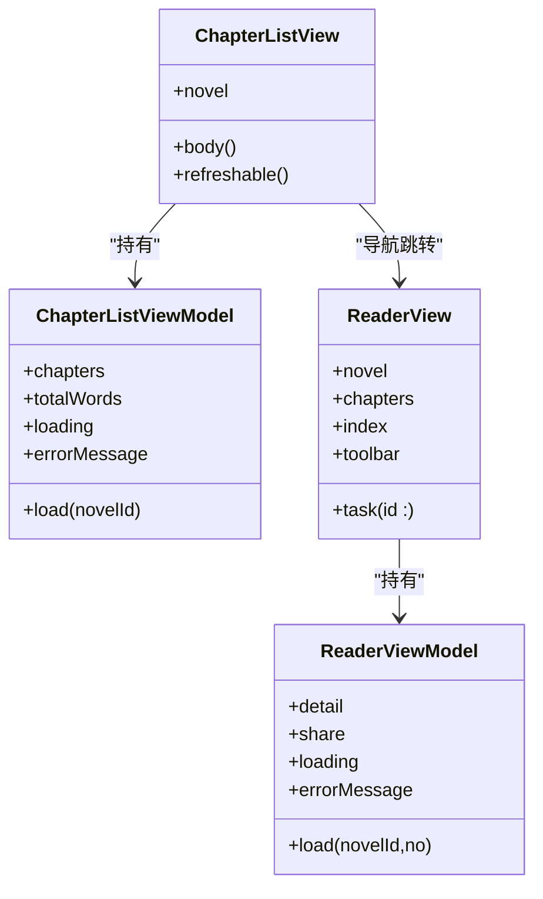
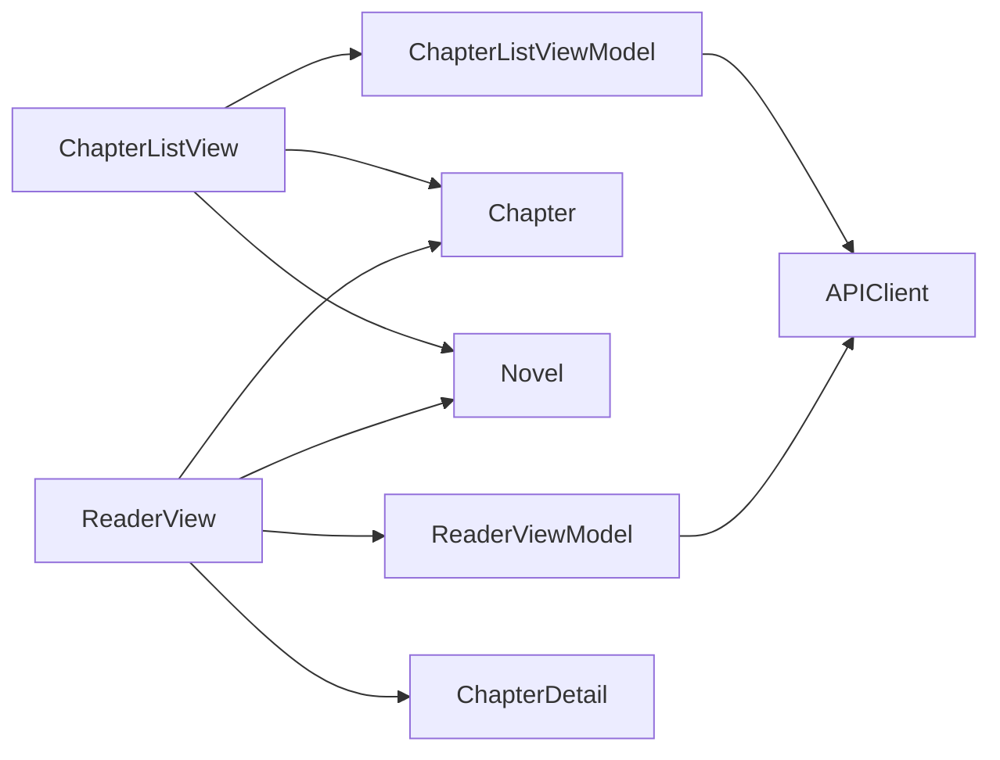

# 章节导航

<cite>
**本文引用的文件**   
- [ChapterListView.swift](file://ios/AINovel/Reader/ChapterListView.swift)
- [ReaderView.swift](file://ios/AINovel/Reader/ReaderView.swift)
- [Models.swift](file://ios/AINovel/Models/Models.swift)
</cite>

## 目录
1. [简介](#简介)
2. [项目结构](#项目结构)
3. [核心组件](#核心组件)
4. [架构总览](#架构总览)
5. [详细组件分析](#详细组件分析)
6. [依赖关系分析](#依赖关系分析)
7. [性能考虑](#性能考虑)
8. [故障排查指南](#故障排查指南)
9. [结论](#结论)
10. [附录：扩展与示例路径](#附录扩展与示例路径)

## 简介
本章文档聚焦 iOS 端“章节导航”功能，围绕 ChapterListView 与 ReaderView 的协作展开，系统说明：
- 章节列表的数据结构与展示逻辑
- 章节切换的索引管理与状态同步
- 与 ReaderView 的事件传递、数据更新和状态同步机制
- UI 渲染、点击处理与视觉反馈
- 如何扩展搜索过滤、排序与自定义样式，并优化导航性能

本说明面向不同技术背景的读者，既提供高层架构视图，也给出代码级实现要点与可视化图示。

## 项目结构
与章节导航直接相关的代码位于 ios/AINovel/Reader 与 Models 模块中：
- Reader/ChapterListView.swift：章节列表视图与 ViewModel
- Reader/ReaderView.swift：阅读器视图与 ViewModel
- Models/Models.swift：小说、章节等数据模型定义

**图表来源**
- [ChapterListView.swift:30-67](file://ios/AINovel/Reader/ChapterListView.swift#L30-L67)
- [ReaderView.swift:41-131](file://ios/AINovel/Reader/ReaderView.swift#L41-L131)
- [Models.swift:20-29](file://ios/AINovel/Models/Models.swift#L20-L29)
- [Models.swift:56-88](file://ios/AINovel/Models/Models.swift#L56-L88)

**章节来源**
- [ChapterListView.swift:1-68](file://ios/AINovel/Reader/ChapterListView.swift#L1-L68)
- [ReaderView.swift:1-169](file://ios/AINovel/Reader/ReaderView.swift#L1-L169)
- [Models.swift:1-234](file://ios/AINovel/Models/Models.swift#L1-L234)

## 核心组件
- ChapterListViewModel：负责加载章节列表、统计字数、错误处理与刷新
- ChapterListView：章节列表 UI，包含头部信息、章节条目与导航跳转
- ReaderViewModel：负责加载单章详情、分享页入口与发布站点 URL 计算
- ReaderView：阅读器 UI，包含正文展示、工具栏（上一章/下一章、朗读）、设置面板与站点预览

关键职责边界：
- 列表层只负责“获取章节元数据 + 跳转到指定索引的 ReaderView”
- 阅读层负责“根据当前索引拉取正文 + 维护翻页与朗读状态”

**章节来源**
- [ChapterListView.swift:4-28](file://ios/AINovel/Reader/ChapterListView.swift#L4-L28)
- [ChapterListView.swift:30-67](file://ios/AINovel/Reader/ChapterListView.swift#L30-L67)
- [ReaderView.swift:4-39](file://ios/AINovel/Reader/ReaderView.swift#L4-L39)
- [ReaderView.swift:41-131](file://ios/AINovel/Reader/ReaderView.swift#L41-L131)

## 架构总览
章节导航的整体流程如下：
- 用户进入书籍后，ChapterListView 通过 API 拉取章节目录，过滤出有正文的章节并展示
- 点击某章节时，ChapterListView 以该章节在列表中的索引作为 startIndex，构造 ReaderView
- ReaderView 根据传入的 chapters 数组与 index 决定当前章节 no，并调用 API 拉取正文
- 阅读器底部工具栏支持上一章/下一章切换，内部仅修改 index，触发 .task(id:) 重新加载对应章节内容

**图表来源**
- [ChapterListView.swift:49-52](file://ios/AINovel/Reader/ChapterListView.swift#L49-L52)
- [ReaderView.swift:55-59](file://ios/AINovel/Reader/ReaderView.swift#L55-L59)
- [ReaderView.swift:129-131](file://ios/AINovel/Reader/ReaderView.swift#L129-L131)
- [ReaderView.swift:134-167](file://ios/AINovel/Reader/ReaderView.swift#L134-L167)

## 详细组件分析

### 数据结构设计
- Novel：书籍基本信息，用于标题与描述
- Chapter：章节元数据，包括序号、名称、字数、是否有正文、分部编号、稳定 id 等；提供 display 与 wordsDesc 辅助展示
- ChaptersResponse：章节目录响应体，包含 novel、chapters 列表与 totalWords
- ChapterDetail：单章详情，包含 name/no/content/wordCount 等

复杂度与用途：
- 列表渲染使用 O(n) 遍历章节数组进行展示
- 过滤无正文章节为 O(n)，避免无效条目进入列表
- 章节切换基于索引访问 O(1)，随后按 no 请求正文

**图表来源**
- [Models.swift:20-29](file://ios/AINovel/Models/Models.swift#L20-L29)
- [Models.swift:56-88](file://ios/AINovel/Models/Models.swift#L56-L88)

**章节来源**
- [Models.swift:20-29](file://ios/AINovel/Models/Models.swift#L20-L29)
- [Models.swift:56-88](file://ios/AINovel/Models/Models.swift#L56-L88)

### 章节列表与展示逻辑
- 加载流程：
  - 进入页面时触发 task，调用 vm.load(novelId)
  - 成功后将 hasContent=true 的章节写入 chapters，并记录 totalWords
  - 失败时设置 errorMessage，UI 显示 ContentUnavailableView
- 列表渲染：
  - 顶部 Section 显示书名、章节数与总字数
  - ForEach 枚举章节，NavigationLink 携带 startIndex 跳转到 ReaderView
  - 每个条目显示章节名与字数描述
- 刷新能力：
  - 支持下拉刷新，再次调用 load

**图表来源**
- [ChapterListView.swift:12-27](file://ios/AINovel/Reader/ChapterListView.swift#L12-L27)
- [ChapterListView.swift:34-66](file://ios/AINovel/Reader/ChapterListView.swift#L34-L66)

**章节来源**
- [ChapterListView.swift:12-27](file://ios/AINovel/Reader/ChapterListView.swift#L12-L27)
- [ChapterListView.swift:34-66](file://ios/AINovel/Reader/ChapterListView.swift#L34-L66)

### 章节切换逻辑与索引管理
- 初始索引：
  - ChapterListView 通过 ForEach 的 idx 作为 startIndex 传给 ReaderView
- 当前章节号：
  - ReaderView 通过 currentNo = chapters[index].no 决定请求参数
- 翻页控制：
  - 底部工具栏“上一章/下一章”按钮修改 index，并在越界时禁用
- 自动加载：
  - .task(id: index) 监听 index 变化，自动拉取对应章节正文

**图表来源**
- [ReaderView.swift:55-61](file://ios/AINovel/Reader/ReaderView.swift#L55-L61)
- [ReaderView.swift:129-131](file://ios/AINovel/Reader/ReaderView.swift#L129-L131)
- [ReaderView.swift:134-167](file://ios/AINovel/Reader/ReaderView.swift#L134-L167)

**章节来源**
- [ReaderView.swift:55-61](file://ios/AINovel/Reader/ReaderView.swift#L55-L61)
- [ReaderView.swift:129-167](file://ios/AINovel/Reader/ReaderView.swift#L129-L167)

### 与 ReaderView 的通信机制
- 事件传递：
  - 列表点击通过 NavigationLink 传递 startIndex，ReaderView 据此确定当前章节
- 数据更新：
  - ReaderView 的 ReaderViewModel 根据 index 对应的 no 拉取 ChapterDetail
- 状态同步：
  - ReaderView 内部维护 index、fontSize、朗读状态等；工具栏按钮改变 index 即触发 .task(id:) 重新加载
- 发布站点联动：
  - ReaderView 可打开发布站点的当前章节页面，URL 由 share.url 推导

**图表来源**
- [ChapterListView.swift:49-52](file://ios/AINovel/Reader/ChapterListView.swift#L49-L52)
- [ReaderView.swift:55-61](file://ios/AINovel/Reader/ReaderView.swift#L55-L61)
- [ReaderView.swift:129-131](file://ios/AINovel/Reader/ReaderView.swift#L129-L131)

**章节来源**
- [ChapterListView.swift:49-52](file://ios/AINovel/Reader/ChapterListView.swift#L49-L52)
- [ReaderView.swift:55-61](file://ios/AINovel/Reader/ReaderView.swift#L55-L61)
- [ReaderView.swift:129-131](file://ios/AINovel/Reader/ReaderView.swift#L129-L131)

### UI 组件实现细节
- 列表渲染：
  - 使用 SwiftUI List + Section + ForEach 渲染章节条目
  - 头部显示书名、章节数与总字数
- 点击处理：
  - NavigationLink 包裹 ReaderView，并以 idx 作为 startIndex
- 视觉反馈：
  - 加载中显示 ProgressView
  - 错误与空数据分别显示 ContentUnavailableView
  - 阅读器正文区域支持文本选择与字号调节

**图表来源**
- [ChapterListView.swift:4-28](file://ios/AINovel/Reader/ChapterListView.swift#L4-L28)
- [ChapterListView.swift:30-67](file://ios/AINovel/Reader/ChapterListView.swift#L30-L67)
- [ReaderView.swift:4-39](file://ios/AINovel/Reader/ReaderView.swift#L4-L39)
- [ReaderView.swift:41-131](file://ios/AINovel/Reader/ReaderView.swift#L41-L131)

**章节来源**
- [ChapterListView.swift:30-67](file://ios/AINovel/Reader/ChapterListView.swift#L30-L67)
- [ReaderView.swift:74-131](file://ios/AINovel/Reader/ReaderView.swift#L74-L131)

## 依赖关系分析
- 组件耦合：
  - ChapterListView 依赖 ChapterListViewModel 与 Models.Chapter/Novel
  - ReaderView 依赖 ReaderViewModel 与 Models.Chapter/ChapterDetail/Novel
- 外部依赖：
  - 两者均通过 APIClient 与后端交互，使用 Endpoint 构建请求
- 潜在循环依赖：
  - 列表与阅读器之间通过 NavigationLink 单向跳转，不存在循环引用

**图表来源**
- [ChapterListView.swift:4-28](file://ios/AINovel/Reader/ChapterListView.swift#L4-L28)
- [ReaderView.swift:4-39](file://ios/AINovel/Reader/ReaderView.swift#L4-L39)
- [Models.swift:20-29](file://ios/AINovel/Models/Models.swift#L20-L29)
- [Models.swift:56-88](file://ios/AINovel/Models/Models.swift#L56-L88)

**章节来源**
- [ChapterListView.swift:4-28](file://ios/AINovel/Reader/ChapterListView.swift#L4-L28)
- [ReaderView.swift:4-39](file://ios/AINovel/Reader/ReaderView.swift#L4-L39)
- [Models.swift:20-29](file://ios/AINovel/Models/Models.swift#L20-L29)
- [Models.swift:56-88](file://ios/AINovel/Models/Models.swift#L56-L88)

## 性能考虑
- 列表渲染：
  - 使用 ForEach(Array(vm.chapters.enumerated())) 保证稳定的 id 与顺序
  - 过滤无正文章节减少无效条目数量
- 网络请求：
  - 列表与阅读器各自独立请求，避免一次请求承载过多数据
- 滚动位置保持：
  - 当前实现未显式保存与恢复滚动偏移；如需增强，可在 ReaderView 中缓存 ScrollView 的垂直偏移或章节锚点，并在返回时恢复
- 朗读与任务取消：
  - ReaderView 在 onDisappear 停止朗读，避免后台资源占用

[本节为通用指导，不直接分析具体文件]

## 故障排查指南
- 列表加载失败：
  - 检查 vm.errorMessage 是否被设置，确认 APIError 的处理分支
  - 确认 novel.id 非空且有效
- 章节正文为空：
  - 确认 hasContent 过滤逻辑是否正确
  - 检查 ReaderView 的 currentNo 是否能正确映射到后端章节号
- 翻页异常：
  - 检查 index 边界判断与按钮 disabled 条件
- 发布站点无法打开：
  - 确认 share.published 与 share.url 是否存在，publishedChapterURL 推导逻辑是否生效

**章节来源**
- [ChapterListView.swift:17-26](file://ios/AINovel/Reader/ChapterListView.swift#L17-L26)
- [ReaderView.swift:12-25](file://ios/AINovel/Reader/ReaderView.swift#L12-L25)
- [ReaderView.swift:63-71](file://ios/AINovel/Reader/ReaderView.swift#L63-L71)
- [ReaderView.swift:134-167](file://ios/AINovel/Reader/ReaderView.swift#L134-L167)

## 结论
ChapterListView 与 ReaderView 通过清晰的职责划分与稳定的索引传递机制，实现了可靠的章节导航体验。列表层专注元数据展示与跳转，阅读层专注正文加载与翻页控制。在此基础上，可通过添加搜索过滤、排序与滚动位置持久化进一步增强用户体验，同时保持现有架构的简洁与可维护性。

[本节为总结性内容，不直接分析具体文件]

## 附录：扩展与示例路径
以下示例路径指向仓库中可直接参考的实现片段，便于按需扩展：

- 自定义章节样式
  - 目标：调整章节条目的字体、间距与布局
  - 参考路径：[ChapterListView.swift:49-57](file://ios/AINovel/Reader/ChapterListView.swift#L49-L57)

- 添加搜索功能
  - 思路：在 ChapterListViewModel 中增加 searchText 与 filteredChapters，结合 @Published 驱动 UI 重绘
  - 参考路径：
    - 列表数据源与过滤逻辑：[ChapterListView.swift:12-27](file://ios/AINovel/Reader/ChapterListView.swift#L12-L27)
    - 列表渲染与条目展示：[ChapterListView.swift:44-59](file://ios/AINovel/Reader/ChapterListView.swift#L44-L59)

- 添加排序功能
  - 思路：按 wordCount 或 chapter no 排序后再渲染
  - 参考路径：
    - 章节数据字段：[Models.swift:56-71](file://ios/AINovel/Models/Models.swift#L56-L71)
    - 列表渲染：[ChapterListView.swift:49-59](file://ios/AINovel/Reader/ChapterListView.swift#L49-L59)

- 优化导航性能
  - 思路：
    - 预取相邻章节的正文以减少翻页等待
    - 对长列表使用 LazyVStack/LazyVGrid 替代 List（需权衡导航跳转）
    - 缓存已加载章节的 detail，避免重复请求
  - 参考路径：
    - 阅读器正文加载与任务触发：[ReaderView.swift:129-131](file://ios/AINovel/Reader/ReaderView.swift#L129-L131)
    - 翻页工具栏与索引变更：[ReaderView.swift:134-167](file://ios/AINovel/Reader/ReaderView.swift#L134-L167)