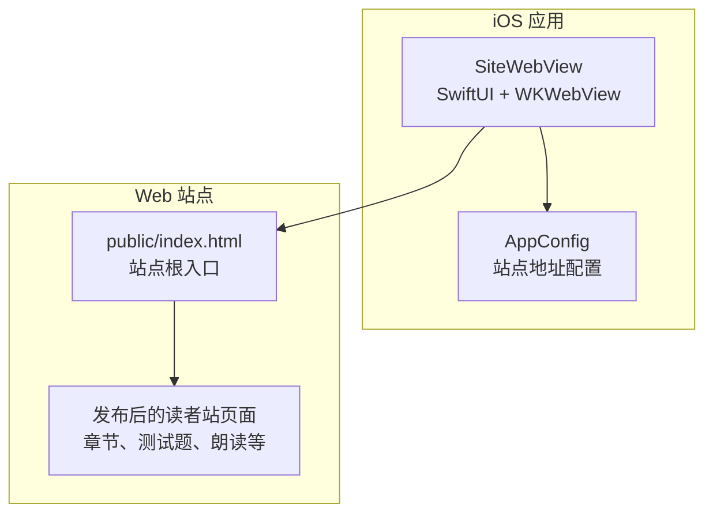
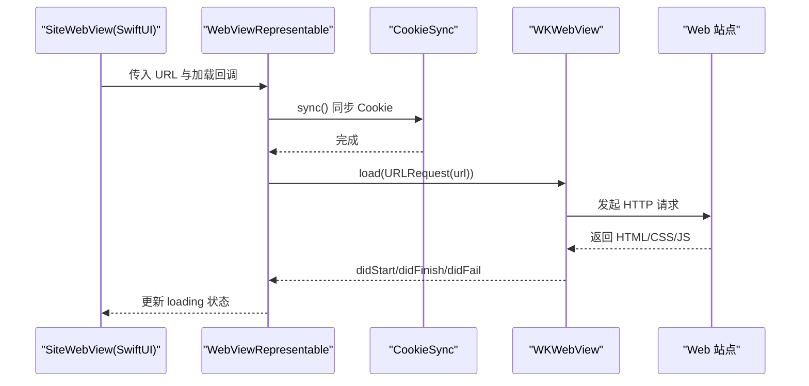
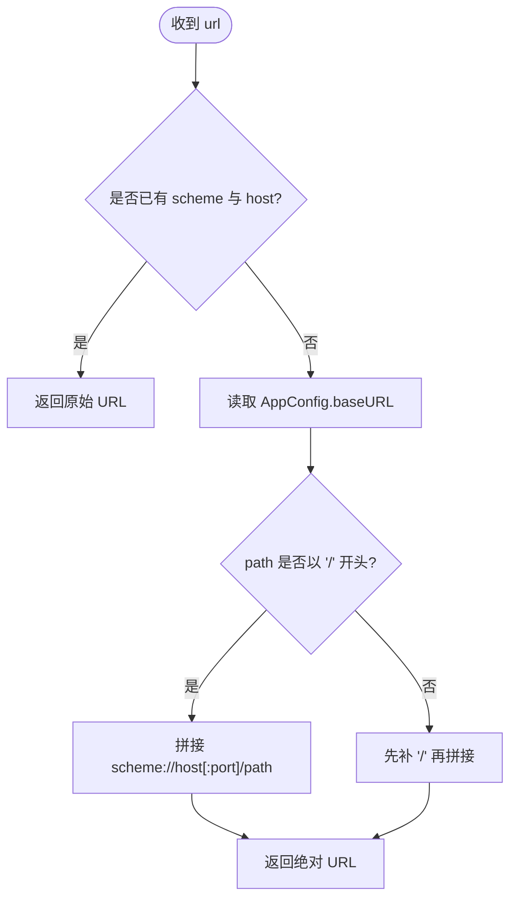
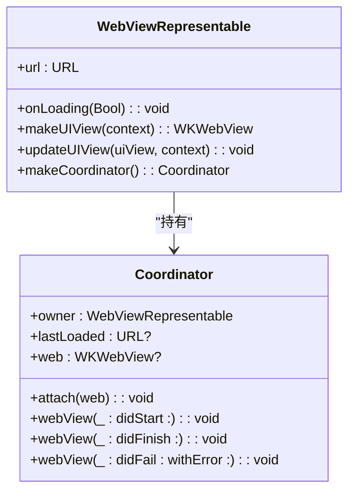
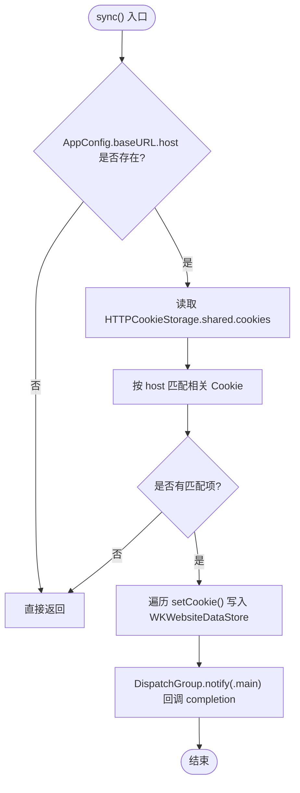
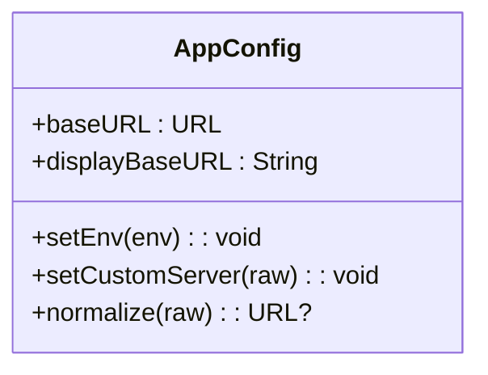
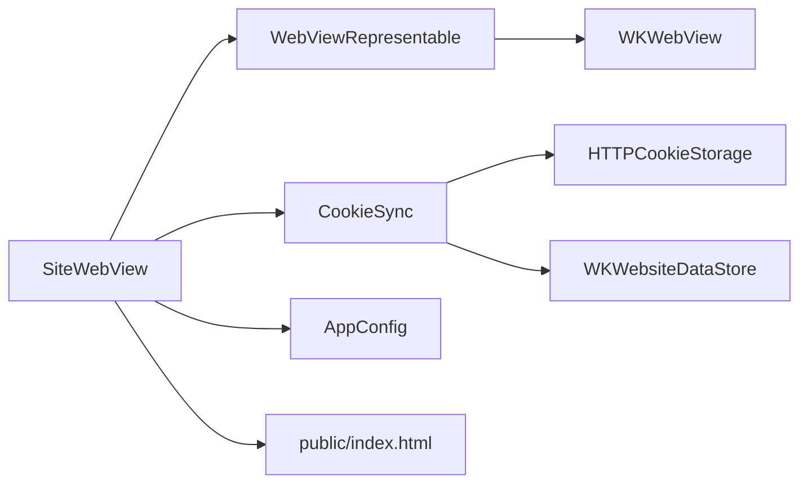

# 网页集成

<cite>
**本文引用的文件**   
- [SiteWebView.swift](file://ios/AINovel/Reader/SiteWebView.swift)
- [AppConfig.swift](file://ios/AINovel/Config/AppConfig.swift)
- [index.html](file://public/index.html)
</cite>

## 目录
1. [简介](#简介)
2. [项目结构](#项目结构)
3. [核心组件](#核心组件)
4. [架构总览](#架构总览)
5. [详细组件分析](#详细组件分析)
6. [依赖关系分析](#依赖关系分析)
7. [性能与缓存策略](#性能与缓存策略)
8. [安全与权限控制](#安全与权限控制)
9. [与原生应用的通信机制](#与原生应用的通信机制)
10. [用户交互处理](#用户交互处理)
11. [扩展指南：自定义脚本与功能增强](#扩展指南自定义脚本与功能增强)
12. [故障排查](#故障排查)
13. [结论](#结论)

## 简介
本文件面向需要在 iOS 应用中嵌入并运行“发布后的读者站点”的开发者，围绕 `SiteWebView` 实现进行系统化说明。重点包括：
- WKWebView 的配置、初始化与安全设置
- 发布站点的 URL 解析与页面加载流程
- Cookie 同步机制，确保登录态在 WebView 中可用
- 与原生应用之间的数据交换和事件通道（预留扩展点）
- 用户交互行为：链接跳转、表单提交、页面导航
- 如何扩展网页功能、注入自定义脚本以及优化加载性能

该文档既适合快速上手，也适合深入定制。

## 项目结构
本项目中与网页集成功能直接相关的代码位于 iOS 端 Swift 层与前端静态资源中：
- iOS 端
  - `ios/AINovel/Reader/SiteWebView.swift`：封装 SwiftUI 视图与 WKWebView，负责站点页面加载、Cookie 同步、导航回调等
  - `ios/AINovel/Config/AppConfig.swift`：全局站点地址配置，决定 WebView 最终访问的 origin
- 前端静态资源
  - `public/index.html`：站点根入口页，展示管理、阅读等入口卡片

**图表来源**
- [SiteWebView.swift:7-51](file://ios/AINovel/Reader/SiteWebView.swift#L7-L51)
- [AppConfig.swift:24-52](file://ios/AINovel/Config/AppConfig.swift#L24-L52)
- [index.html:22-38](file://public/index.html#L22-L38)

**章节来源**
- [SiteWebView.swift:7-51](file://ios/AINovel/Reader/SiteWebView.swift#L7-L51)
- [AppConfig.swift:24-52](file://ios/AINovel/Config/AppConfig.swift#L24-L52)
- [index.html:22-38](file://public/index.html#L22-L38)

## 核心组件
- `SiteWebView`：对外暴露的 SwiftUI 视图，接收一个 URL 与标题，内部使用 `WebViewRepresentable` 承载 WKWebView，并提供加载状态、关闭按钮、外部 Safari 打开能力。
- `WebViewRepresentable`：UIViewRepresentable 包装器，负责创建 WKWebView、绑定导航代理、触发 Cookie 同步后发起请求。
- `CookieSync`：将 URLSession 共享 Cookie 存储中的会话 Cookie 注入 WKWebView 默认数据存储，保证 VIP 书页等受保护内容可正常访问。
- `AppConfig`：提供当前生效的站点 baseURL，支持多环境切换与地址规范化。

**章节来源**
- [SiteWebView.swift:7-111](file://ios/AINovel/Reader/SiteWebView.swift#L7-L111)
- [AppConfig.swift:11-111](file://ios/AINovel/Config/AppConfig.swift#L11-L111)

## 架构总览
下图展示了从 SwiftUI 到 WKWebView 再到 Web 站点的整体调用链，以及 Cookie 同步的关键路径。

**图表来源**
- [SiteWebView.swift:54-91](file://ios/AINovel/Reader/SiteWebView.swift#L54-L91)
- [SiteWebView.swift:94-110](file://ios/AINovel/Reader/SiteWebView.swift#L94-L110)

## 详细组件分析

### SiteWebView：视图与 URL 解析
- 作用
  - 作为 SwiftUI 入口，渲染 WebView 并显示加载进度
  - 提供“关闭”与“在 Safari 中打开”工具栏操作
  - 对相对路径进行标准化，避免中文路径导致 URL 解析失败
- URL 解析逻辑
  - `relativeURL(_:)`：对相对路径进行百分号编码，防止非 ASCII 字符被误判为非法 URL
  - `absoluteSiteURL(_:)`：若输入已是完整 URL，则原样返回；否则基于 `AppConfig.baseURL` 拼接 scheme、host、port 与 path，形成绝对 URL

**图表来源**
- [SiteWebView.swift:36-51](file://ios/AINovel/Reader/SiteWebView.swift#L36-L51)
- [AppConfig.swift:51-60](file://ios/AINovel/Config/AppConfig.swift#L51-L60)

**章节来源**
- [SiteWebView.swift:7-51](file://ios/AINovel/Reader/SiteWebView.swift#L7-L51)

### WebViewRepresentable：WKWebView 生命周期与加载
- 创建与配置
  - 使用 `WKWebViewConfiguration()` 创建配置对象
  - 复用默认 `websiteDataStore`，使 Cookie、缓存等与系统默认行为一致
  - 启用手势后退/前进
  - 设置 `navigationDelegate` 为 Coordinator，用于监听加载状态
- 加载流程
  - 首次加载或 URL 变化时，先执行 `CookieSync.sync`，再调用 `uiView.load(URLRequest(url: url))`
  - Coordinator 通过 `didStart`、`didFinish`、`didFail` 回调通知上层更新 loading 状态

**图表来源**
- [SiteWebView.swift:54-91](file://ios/AINovel/Reader/SiteWebView.swift#L54-L91)

**章节来源**
- [SiteWebView.swift:54-91](file://ios/AINovel/Reader/SiteWebView.swift#L54-L91)

### CookieSync：会话 Cookie 同步
- 背景
  - WKWebView 拥有独立的 Cookie 存储，不会自动携带 URLSession 共享存储中的 httpOnly 会话 Cookie
  - 若不注入，VIP 书页等受保护内容可能被拒绝访问
- 实现要点
  - 从 `HTTPCookieStorage.shared` 获取所有 Cookie
  - 过滤出与当前站点 host 匹配的 Cookie
  - 逐个写入 `WKWebsiteDataStore.default().httpCookieStore`
  - 全部完成后在主线程回调继续加载

**图表来源**
- [SiteWebView.swift:94-110](file://ios/AINovel/Reader/SiteWebView.swift#L94-L110)

**章节来源**
- [SiteWebView.swift:94-110](file://ios/AINovel/Reader/SiteWebView.swift#L94-L110)

### AppConfig：站点地址与环境
- 作用
  - 提供当前生效的站点 baseURL，支持内置、云端、自定义三种环境
  - 规范化用户输入的服务器地址，自动补全 scheme、去除尾斜杠、必要时补 `/novel` 前缀
- 对 WebView 的影响
  - `SiteWebView.absoluteSiteURL` 依赖其 host/scheme/port/path 构造绝对 URL
  - `CookieSync` 使用其 host 过滤 Cookie

**图表来源**
- [AppConfig.swift:11-111](file://ios/AINovel/Config/AppConfig.swift#L11-L111)

**章节来源**
- [AppConfig.swift:11-111](file://ios/AINovel/Config/AppConfig.swift#L11-L111)

## 依赖关系分析
- `SiteWebView` 依赖
  - SwiftUI 与 WebKit 框架
  - `WebViewRepresentable` 与 `CookieSync`
  - `AppConfig` 提供的 baseURL 与 host
- `WebViewRepresentable` 依赖
  - WKWebView 及其配置、导航委托
- `CookieSync` 依赖
  - `HTTPCookieStorage.shared`
  - `WKWebsiteDataStore.default().httpCookieStore`
- 前端依赖
  - `public/index.html` 作为站点根入口，引导至管理、阅读等功能页

**图表来源**
- [SiteWebView.swift:7-111](file://ios/AINovel/Reader/SiteWebView.swift#L7-L111)
- [AppConfig.swift:11-111](file://ios/AINovel/Config/AppConfig.swift#L11-L111)
- [index.html:22-38](file://public/index.html#L22-L38)

**章节来源**
- [SiteWebView.swift:7-111](file://ios/AINovel/Reader/SiteWebView.swift#L7-L111)
- [AppConfig.swift:11-111](file://ios/AINovel/Config/AppConfig.swift#L11-L111)
- [index.html:22-38](file://public/index.html#L22-L38)

## 性能与缓存策略
- 缓存策略
  - 当前实现复用默认的 `WKWebsiteDataStore`，因此遵循系统默认缓存策略
  - 如需精细控制（如禁用缓存、清理历史），可在 `WKWebViewConfiguration` 中进一步配置 `cachePolicy`、`defaultSessionConfiguration` 等
- 加载性能建议
  - 优先确保 Cookie 同步完成后再发起请求，避免二次鉴权导致的重复请求
  - 对于大型页面，建议在服务端启用 Gzip/Brotli 压缩与静态资源缓存头
  - 避免在 WebView 内频繁执行重型 JS 计算，必要时拆分任务或使用 Web Worker

[本节为通用指导，不直接分析具体文件]

## 安全与权限控制
- Cookie 安全
  - 后端采用 httpOnly 会话 Cookie，且 Path 为 `/novel`，因此必须保证 baseURL 带 `/novel` 前缀，否则 Cookie 无法匹配
  - `CookieSync` 仅注入与当前 host 匹配的 Cookie，降低跨域泄露风险
- URL 安全
  - 对相对路径进行百分号编码，避免非法字符导致解析失败
  - 对已包含 scheme/host 的 URL 直接放行，便于直接打开外部链接
- 建议
  - 在生产环境中强制 HTTPS，并在服务端设置合适的 Cookie 属性（Secure、SameSite）
  - 限制 WebView 的 JavaScript 能力（如需禁用 JS，可在 `WKWebViewConfiguration` 中关闭）

**章节来源**
- [AppConfig.swift:8-10](file://ios/AINovel/Config/AppConfig.swift#L8-L10)
- [SiteWebView.swift:36-51](file://ios/AINovel/Reader/SiteWebView.swift#L36-L51)
- [SiteWebView.swift:94-110](file://ios/AINovel/Reader/SiteWebView.swift#L94-L110)

## 与原生应用的通信机制
当前 `SiteWebView` 未显式注册 JavaScript 消息处理器，也未定义桥接接口。但已提供可扩展点：
- 在 `WebViewRepresentable.makeUIView` 中可通过 `configuration.userContentController.add(...)` 添加 JS 消息处理器
- 在 `Coordinator` 中可实现 `WKNavigationDelegate` 的其他方法，拦截导航、响应 JS 消息
- 在 JS 侧可通过 `window.webkit.messageHandlers.<name>.postMessage(...)` 向原生发送消息

示例扩展思路（概念性说明）：
- 新增消息处理器名称，例如 `bridgeHandler`
- 在原生侧监听消息，解析 payload 后调用业务逻辑
- 在 JS 侧根据业务需要发送事件，如页面加载完成、用户点击等

[本节为概念性说明，不直接分析具体文件]

## 用户交互处理
- 链接跳转
  - 由 WKWebView 默认处理，支持站内跳转与外链
  - 如需拦截特定链接（如跳转到 App 内其他页面），可在 `WKNavigationDelegate` 中实现决策逻辑
- 表单提交
  - 默认由浏览器引擎处理；如需拦截敏感表单（如上传、支付），可在导航委托中判断 URL 与方法
- 页面导航
  - 已启用手势后退/前进
  - 通过 Coordinator 的 `didStart`、`didFinish`、`didFail` 可感知导航状态，用于 UI 反馈

**章节来源**
- [SiteWebView.swift:63-90](file://ios/AINovel/Reader/SiteWebView.swift#L63-L90)

## 扩展指南：自定义脚本与功能增强
以下提供可操作的扩展步骤（概念性说明，不含具体代码）：
- 注入自定义脚本
  - 在 `WKWebViewConfiguration` 中配置 `userContentController`
  - 添加全局脚本，例如在页面加载前注入统计、埋点或调试信息
- 扩展网页功能
  - 在 JS 侧暴露 API，供原生调用，例如获取当前章节、播放状态
  - 在原生侧监听 JS 消息，触发本地能力，如 TTS、分享、收藏
- 优化加载性能
  - 在服务端启用静态资源缓存与压缩
  - 在客户端按需加载资源，避免首屏阻塞
  - 合理使用 WKWebView 的缓存策略，减少重复请求

[本节为概念性说明，不直接分析具体文件]

## 故障排查
- 现象：VIP 书页显示无权或空白
  - 可能原因：Cookie 未同步或 host 不匹配
  - 排查步骤
    - 确认 `AppConfig.baseURL` 的 host 与后端 Cookie domain 一致
    - 检查 `CookieSync` 是否找到相关 Cookie
    - 验证后端 Cookie 的 Path 是否为 `/novel`
- 现象：中文路径无法打开
  - 可能原因：URL 编码问题
  - 排查步骤
    - 确认使用 `relativeURL(_:)` 对路径进行百分号编码
    - 检查最终生成的绝对 URL 是否合法
- 现象：页面加载卡住或一直显示加载中
  - 可能原因：网络错误、JS 报错、导航未结束
  - 排查步骤
    - 查看 `didFail` 回调的错误信息
    - 在浏览器或远程调试中检查控制台错误
    - 确认服务端返回状态码与资源完整性

**章节来源**
- [SiteWebView.swift:36-51](file://ios/AINovel/Reader/SiteWebView.swift#L36-L51)
- [SiteWebView.swift:88-90](file://ios/AINovel/Reader/SiteWebView.swift#L88-L90)
- [SiteWebView.swift:94-110](file://ios/AINovel/Reader/SiteWebView.swift#L94-L110)

## 结论
`SiteWebView` 以简洁的方式将 SwiftUI 与 WKWebView 结合，提供了安全的站点页面加载能力，并通过 `CookieSync` 解决了会话 Cookie 在不同存储间隔离的问题。配合 `AppConfig` 的多环境地址管理，能够稳定地打开发布后的读者站点。若需更强的交互能力，可在现有基础上扩展 JS 消息桥接、自定义脚本注入与更细粒度的缓存策略。

[本节为总结性内容，不直接分析具体文件]