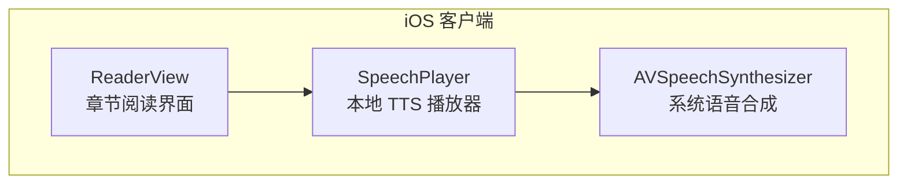
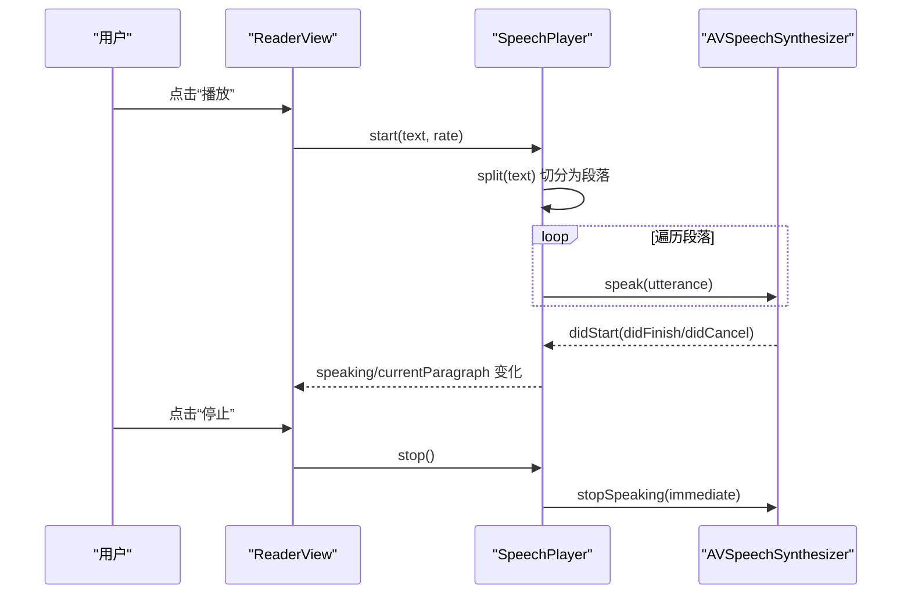
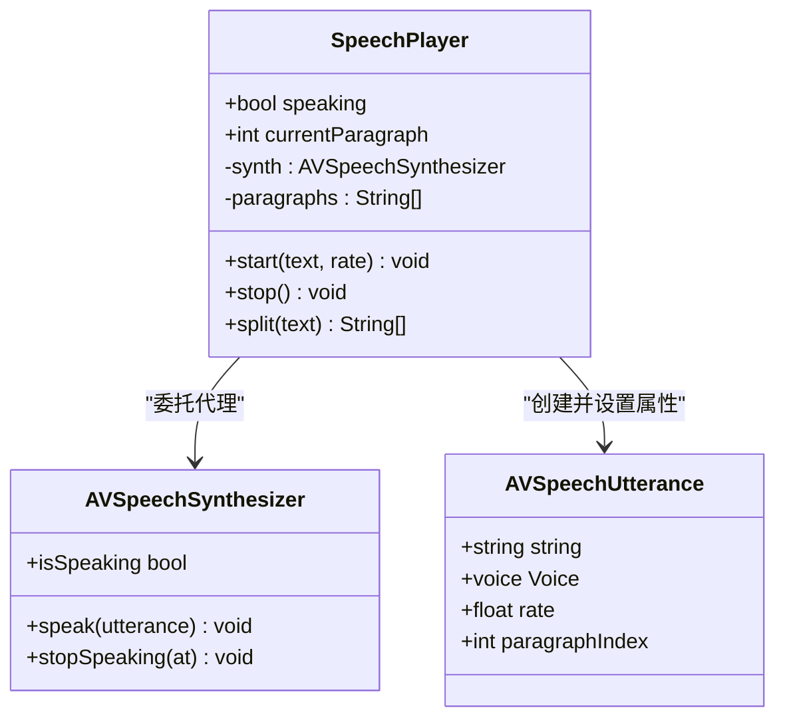
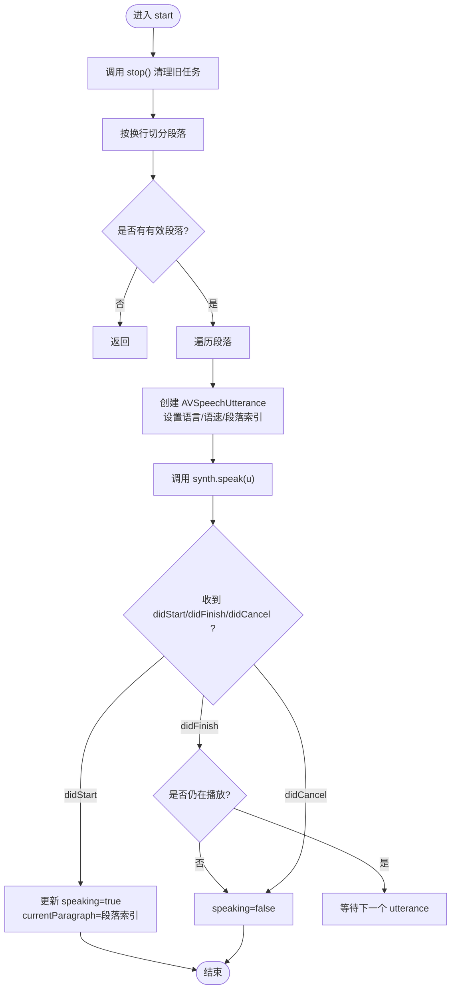
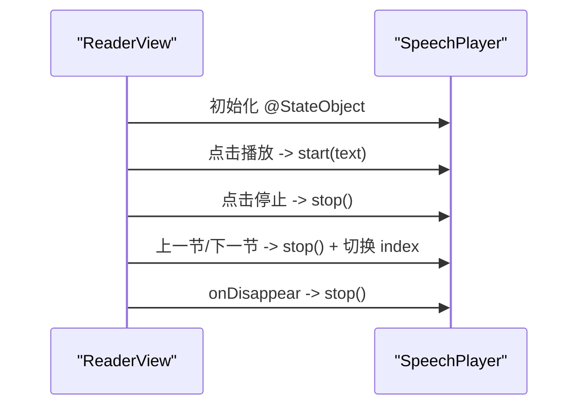
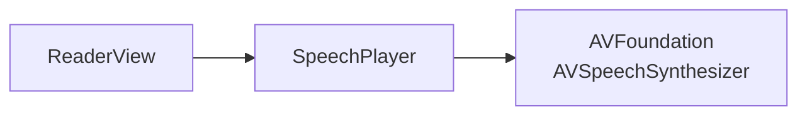

# 语音播放

<cite>
**本文引用的文件**   
- [SpeechPlayer.swift](file://ios/AINovel/Reader/SpeechPlayer.swift)
- [ReaderView.swift](file://ios/AINovel/Reader/ReaderView.swift)
</cite>

## 目录
1. [简介](#简介)
2. [项目结构](#项目结构)
3. [核心组件](#核心组件)
4. [架构总览](#架构总览)
5. [详细组件分析](#详细组件分析)
6. [依赖关系分析](#依赖关系分析)
7. [性能与扩展建议](#性能与扩展建议)
8. [故障排查指南](#故障排查指南)
9. [结论](#结论)

## 简介
本文件面向 iOS 端“小说阅读器”的语音朗读能力，围绕 SpeechPlayer 展开，说明其基于系统 AVSpeechSynthesizer 的本地 TTS 集成方案、播放控制流程、状态管理以及与 UI 层的交互方式。文档同时给出可操作的扩展点，帮助你在不改动现有 UI 的前提下，替换或增强语音引擎、优化播放体验，并补充音频会话配置、中断处理与后台播放支持等生产级能力。

需要特别说明的是：当前实现采用系统内置语音合成，不涉及网络音频流；因此不存在传统意义上的“音频流缓冲”“进度精确到毫秒”“音量调节 API”。若需更精细的播放控制（如逐句跳转、循环、随机、音量），可在 SpeechPlayer 之上封装一层队列与策略控制器。

## 项目结构
与语音播放直接相关的代码位于 iOS 客户端 Reader 模块中：
- SpeechPlayer.swift：封装 AVSpeechSynthesizer，提供文本切段、开始/停止朗读、段落高亮状态发布。
- ReaderView.swift：章节阅读界面，持有 SpeechPlayer 实例，并提供播放/停止按钮以及章节切换逻辑。

图示来源
- [SpeechPlayer.swift:1-75](file://ios/AINovel/Reader/SpeechPlayer.swift#L1-L75)
- [ReaderView.swift:41-169](file://ios/AINovel/Reader/ReaderView.swift#L41-L169)

章节来源
- [SpeechPlayer.swift:1-75](file://ios/AINovel/Reader/SpeechPlayer.swift#L1-L75)
- [ReaderView.swift:41-169](file://ios/AINovel/Reader/ReaderView.swift#L41-L169)

## 核心组件
- SpeechPlayer
  - 职责：将章节正文按段落切分，依次使用系统语音合成朗读；对外暴露 speaking 与 currentParagraph 两个可观察状态；提供 start(text, rate) 与 stop() 方法。
  - 关键特性：零联网、即时合成、可控语速；通过 delegate 回调更新 UI 状态。
- ReaderView
  - 职责：展示章节内容，提供“上一节/下一节”导航与“播放/停止”按钮；在页面消失时调用 speech.stop() 清理资源。

章节来源
- [SpeechPlayer.swift:1-75](file://ios/AINovel/Reader/SpeechPlayer.swift#L1-L75)
- [ReaderView.swift:41-169](file://ios/AINovel/Reader/ReaderView.swift#L41-L169)

## 架构总览
下图展示了从用户操作到系统语音合成的完整调用链。

图示来源
- [ReaderView.swift:134-169](file://ios/AINovel/Reader/ReaderView.swift#L134-L169)
- [SpeechPlayer.swift:20-64](file://ios/AINovel/Reader/SpeechPlayer.swift#L20-L64)

## 详细组件分析

### SpeechPlayer 组件
SpeechPlayer 是语音播放的核心类，负责：
- 文本切段：按换行分割并过滤空白段落。
- 播放控制：start(text, rate) 启动朗读；stop() 立即停止。
- 状态同步：通过 AVSpeechSynthesizerDelegate 回调更新 speaking 与 currentParagraph。
- 段落标记：为每个 utterance 附加段落索引，用于 UI 高亮。

图示来源
- [SpeechPlayer.swift:8-64](file://ios/AINovel/Reader/SpeechPlayer.swift#L8-L64)
- [SpeechPlayer.swift:67-74](file://ios/AINovel/Reader/SpeechPlayer.swift#L67-L74)

#### 播放流程与状态机

图示来源
- [SpeechPlayer.swift:20-64](file://ios/AINovel/Reader/SpeechPlayer.swift#L20-L64)

章节来源
- [SpeechPlayer.swift:1-75](file://ios/AINovel/Reader/SpeechPlayer.swift#L1-L75)

### ReaderView 与播放器交互
ReaderView 持有 SpeechPlayer 实例，并在以下场景与之交互：
- 初始化：@StateObject private var speech = SpeechPlayer()
- 播放/停止：根据当前 speaking 状态切换按钮图标，调用 speech.start(text) 或 speech.stop()
- 章节切换：上一节/下一节按钮会先停止播放再切换章节
- 页面销毁：onDisappear 中调用 speech.stop() 确保释放系统资源

图示来源
- [ReaderView.swift:41-169](file://ios/AINovel/Reader/ReaderView.swift#L41-L169)

章节来源
- [ReaderView.swift:41-169](file://ios/AINovel/Reader/ReaderView.swift#L41-L169)

## 依赖关系分析
- SpeechPlayer 依赖 AVFoundation 的 AVSpeechSynthesizer 与 AVSpeechSynthesizerDelegate。
- ReaderView 依赖 SwiftUI 的状态管理与事件绑定，并通过 @StateObject 持有 SpeechPlayer。
- 两者之间通过公开方法 start/stop 与 Published 属性进行松耦合通信。

图示来源
- [SpeechPlayer.swift:1-75](file://ios/AINovel/Reader/SpeechPlayer.swift#L1-L75)
- [ReaderView.swift:41-169](file://ios/AINovel/Reader/ReaderView.swift#L41-L169)

章节来源
- [SpeechPlayer.swift:1-75](file://ios/AINovel/Reader/SpeechPlayer.swift#L1-L75)
- [ReaderView.swift:41-169](file://ios/AINovel/Reader/ReaderView.swift#L41-L169)

## 性能与扩展建议

### 当前实现的优点
- 零联网、低延迟：直接使用系统语音合成，无需网络请求。
- 可控语速：start(text, rate) 允许调整语速。
- 简单可靠：通过 delegate 回调更新 UI 状态，避免竞态。

### 可扩展方向
- 音频会话与中断处理
  - 建议在应用启动或首次播放前配置 AVAudioSession（类别、模式、路由变更监听）。
  - 实现中断回调（例如电话来电、其他 App 打断）以暂停/恢复播放。
  - 如需后台播放，启用后台音频模式并处理生命周期事件。
- 播放队列与高级功能
  - 封装一个 QueueController，支持：
    - 章节切换：自动加载下一章内容并继续播放。
    - 循环播放：单章/全书循环。
    - 随机播放：打乱章节顺序。
    - 进度控制：跳转到指定段落或时间点（需结合自定义时间轴或外部 TTS 服务）。
- 多语音引擎
  - 抽象出 SpeechEngine 协议，默认实现为 AVSpeechSynthesizer。
  - 可替换为第三方 TTS SDK 或服务端 mp3 流式播放（此时需引入 AVPlayer/AVAudioPlayer 与网络缓冲策略）。
- 音量与音效
  - 系统 TTS 不提供独立音量 API；可通过系统媒体音量间接影响。
  - 若接入音频流，可使用 AVAudioPlayer 的 volume 属性进行细粒度控制。

### 与系统 AVAudioSession 的交互要点
- 会话类别：根据是否需要与其他音频共存选择 appropriate category（如 playback、playbackAndRecord）。
- 模式：根据场景设置（如 default、videoChat、measurement）。
- 路由变更：监听 audioRouteChange 以处理耳机插拔、蓝牙设备切换。
- 中断处理：实现 interruptionNotification 以暂停/恢复播放。
- 后台播放：开启后台模式，处理 applicationDidEnterBackground 等生命周期。

注意：上述为通用实践建议，当前代码未包含 AVAudioSession 配置与中断处理的具体实现。

## 故障排查指南
- 无声音输出
  - 检查系统静音开关与媒体音量。
  - 确认 AVAudioSession 已正确配置（若后续引入）。
  - 验证文本是否为空或仅含空白字符。
- 播放状态不同步
  - 检查 delegate 回调是否在主线程更新 UI（当前实现已通过 Task/@MainActor 保证）。
  - 确认多次 start 调用前是否调用了 stop 清理。
- 章节切换异常
  - 确保在切换章节前先 stop()，避免多个 utterance 队列叠加。
- 内存与资源泄漏
  - 页面消失时务必调用 stop()，避免后台持续合成。

章节来源
- [SpeechPlayer.swift:20-64](file://ios/AINovel/Reader/SpeechPlayer.swift#L20-L64)
- [ReaderView.swift:131-169](file://ios/AINovel/Reader/ReaderView.swift#L131-L169)

## 结论
SpeechPlayer 以系统 AVSpeechSynthesizer 为基础，提供了轻量、可靠的本地 TTS 朗读能力，并与 ReaderView 形成清晰的职责边界。当前实现聚焦于基础播放控制与段落状态同步，适合快速落地与稳定运行。若需更丰富的播放体验（如队列管理、循环/随机、进度跳转、音量控制、音频会话与中断处理），可在 SpeechPlayer 之上封装策略层，或替换为更强大的语音引擎。