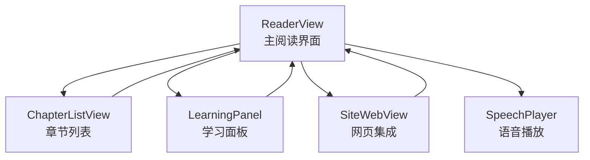
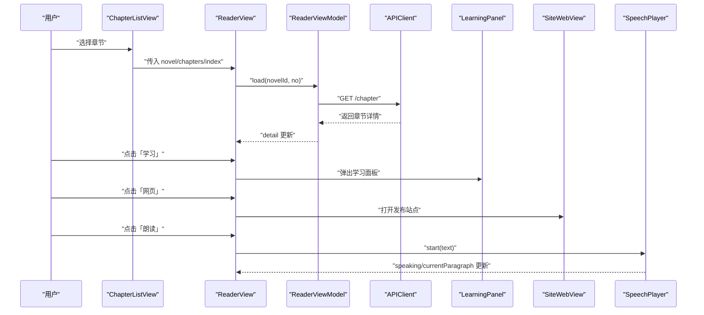
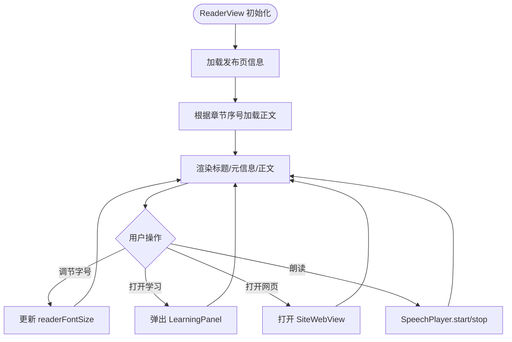
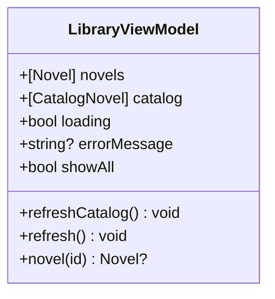
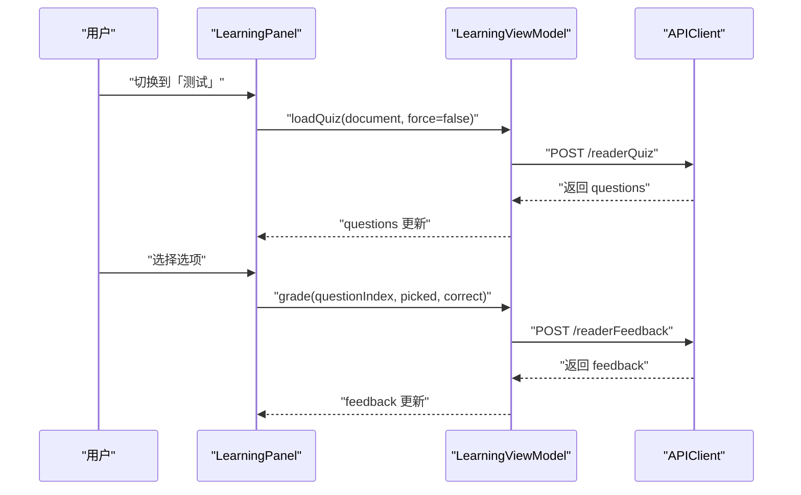
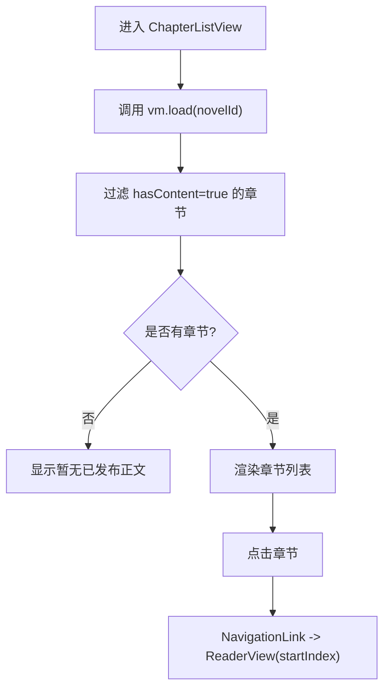
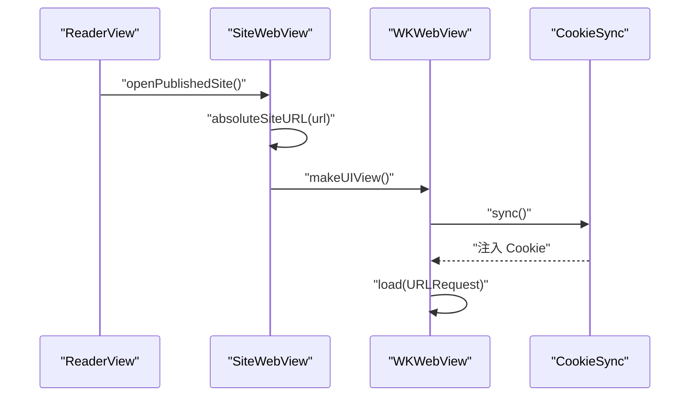
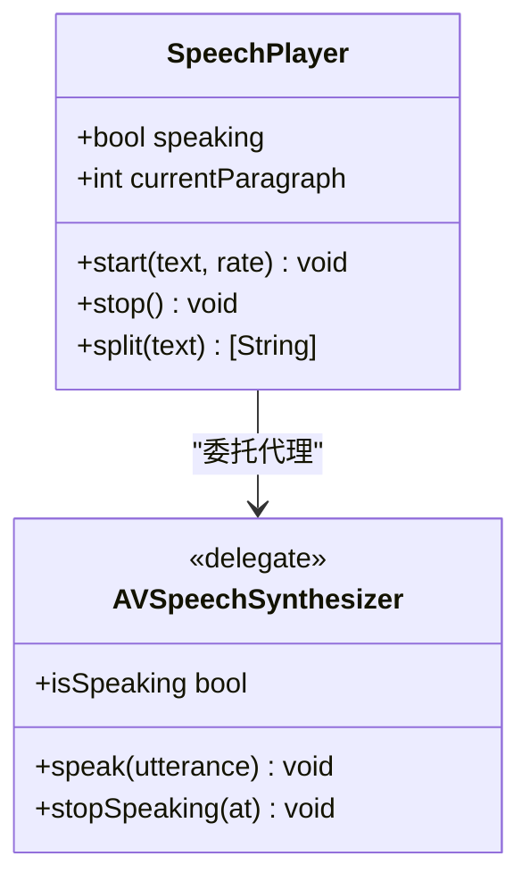
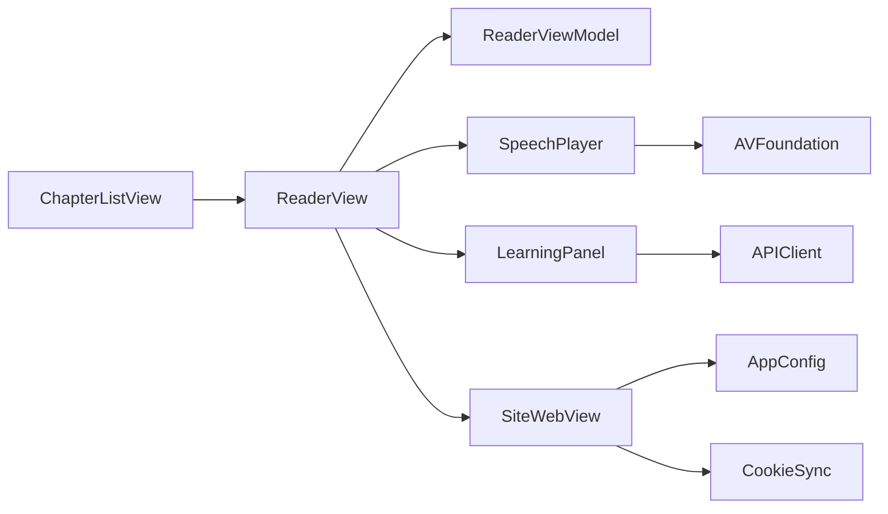

# 阅读器界面

<cite>
**本文引用的文件**   
- [ReaderView.swift](file://ios/AINovel/Reader/ReaderView.swift)
- [LibraryViewModel.swift](file://ios/AINovel/Reader/LibraryViewModel.swift)
- [LearningPanel.swift](file://ios/AINovel/Reader/LearningPanel.swift)
- [ChapterListView.swift](file://ios/AINovel/Reader/ChapterListView.swift)
- [SiteWebView.swift](file://ios/AINovel/Reader/SiteWebView.swift)
- [SpeechPlayer.swift](file://ios/AINovel/Reader/SpeechPlayer.swift)
</cite>

## 目录
1. [简介](#简介)
2. [项目结构](#项目结构)
3. [核心组件](#核心组件)
4. [架构总览](#架构总览)
5. [详细组件分析](#详细组件分析)
6. [依赖关系分析](#依赖关系分析)
7. [性能与体验优化](#性能与体验优化)
8. [故障排查指南](#故障排查指南)
9. [结论](#结论)
10. [附录：扩展实践](#附录扩展实践)

## 简介
本文件面向 iOS 端“阅读器”模块，系统性说明主阅读界面、章节导航、学习面板、网页集成与语音朗读等关键能力。重点覆盖以下目标：
- ReaderView 的主阅读界面设计：文本渲染、字体设置、主题切换思路。
- LibraryViewModel 的数据管理与章节加载逻辑（含公开书单与作品列表）。
- LearningPanel 的学习面板功能：词汇高亮、注释讲解、问答与测试。
- ChapterListView 的章节导航与 SiteWebView 的网页集成。
- SpeechPlayer 的语音播放：音频控制、播放状态管理、TTS 集成。
- 提供可操作的扩展示例路径，帮助实现自定义主题、新增学习功能与优化阅读体验。

## 项目结构
iOS 端阅读器相关代码集中在 ios/AINovel/Reader 目录下，采用 SwiftUI + ViewModel 分层组织：
- ReaderView：主阅读视图，负责正文展示、工具栏、设置弹窗、学习面板与网页入口。
- ChapterListView：章节列表视图，负责拉取章节并导航到具体章节。
- LearningPanel：学习面板，包含测试、生词、提问三种模式。
- SiteWebView：内置 WKWebView 打开发布后的读者站页面，处理 Cookie 同步与 URL 转换。
- SpeechPlayer：基于系统 AVSpeechSynthesizer 的本地 TTS 播放器。
- LibraryViewModel：共享的小说清单与公开书单数据源。

图表来源
- [ReaderView.swift:41-131](file://ios/AINovel/Reader/ReaderView.swift#L41-L131)
- [ChapterListView.swift:30-66](file://ios/AINovel/Reader/ChapterListView.swift#L30-L66)
- [LearningPanel.swift:84-121](file://ios/AINovel/Reader/LearningPanel.swift#L84-L121)
- [SiteWebView.swift:7-51](file://ios/AINovel/Reader/SiteWebView.swift#L7-L51)
- [SpeechPlayer.swift:8-44](file://ios/AINovel/Reader/SpeechPlayer.swift#L8-L44)

章节来源
- [ReaderView.swift:41-131](file://ios/AINovel/Reader/ReaderView.swift#L41-L131)
- [ChapterListView.swift:30-66](file://ios/AINovel/Reader/ChapterListView.swift#L30-L66)
- [LearningPanel.swift:84-121](file://ios/AINovel/Reader/LearningPanel.swift#L84-L121)
- [SiteWebView.swift:7-51](file://ios/AINovel/Reader/SiteWebView.swift#L7-L51)
- [SpeechPlayer.swift:8-44](file://ios/AINovel/Reader/SpeechPlayer.swift#L8-L44)

## 核心组件
本节对五个核心组件进行概览式说明，后续章节将深入展开。

- ReaderView
  - 负责章节正文渲染、字号调节、学习面板弹出、发布站点打开、底部工具栏（上一章/下一章、朗读控制）。
  - 通过 ReaderViewModel 拉取章节详情与发布页信息。
- LibraryViewModel
  - 提供公开书单 catalog 与登录后可见作品列表 novels 的统一数据源。
  - 支持刷新、错误提示、按 id 查找小说。
- LearningPanel
  - 提供“测试/生词/提问”三种学习模式，调用后端 LLM 接口生成题目、生词、解释与回答。
  - 维护答题反馈、生词讲解与问题答案的状态。
- ChapterListView
  - 拉取章节列表，过滤无正文章节，展示章节标题与字数描述，点击进入 ReaderView。
- SiteWebView
  - 使用 WKWebView 打开发布后的读者站页面，自动注入会话 Cookie，避免 VIP 内容被拦截。
  - 提供相对路径与绝对路径 URL 转换工具。
- SpeechPlayer
  - 基于系统 TTS 的本地朗读器，按段落切分文本，控制语速与播放状态，回调更新当前段落索引。

章节来源
- [ReaderView.swift:4-39](file://ios/AINovel/Reader/ReaderView.swift#L4-L39)
- [LibraryViewModel.swift:4-51](file://ios/AINovel/Reader/LibraryViewModel.swift#L4-L51)
- [LearningPanel.swift:4-82](file://ios/AINovel/Reader/LearningPanel.swift#L4-L82)
- [ChapterListView.swift:4-28](file://ios/AINovel/Reader/ChapterListView.swift#L4-L28)
- [SiteWebView.swift:7-51](file://ios/AINovel/Reader/SiteWebView.swift#L7-L51)
- [SpeechPlayer.swift:8-44](file://ios/AINovel/Reader/SpeechPlayer.swift#L8-L44)

## 架构总览
下图展示了阅读器界面的整体交互流程：用户从章节列表进入阅读页，阅读页可打开学习面板或发布站点，同时支持本地 TTS 朗读。

图表来源
- [ChapterListView.swift:49-57](file://ios/AINovel/Reader/ChapterListView.swift#L49-L57)
- [ReaderView.swift:129-131](file://ios/AINovel/Reader/ReaderView.swift#L129-L131)
- [ReaderView.swift:108-115](file://ios/AINovel/Reader/ReaderView.swift#L108-L115)
- [ReaderView.swift:146-152](file://ios/AINovel/Reader/ReaderView.swift#L146-L152)
- [SpeechPlayer.swift:27-44](file://ios/AINovel/Reader/SpeechPlayer.swift#L27-L44)

## 详细组件分析

### ReaderView：主阅读界面
- 文本渲染
  - 使用 SwiftUI Text 渲染章节标题、元信息与正文内容。
  - 正文通过 .font(.system(size: fontSize)) 动态调整字号，配合 lineSpacing 提升可读性。
  - 启用 textSelection 以便用户复制文本。
- 字体设置与主题切换
  - 通过 @AppStorage("readerFontSize") 持久化字号设置，范围 14–28，步进为 1。
  - 顶部弹出 Popover 提供 Stepper 控件实时调节字号。
  - 主题切换建议：可在 ReaderView 中引入主题配置对象，统一控制 foregroundStyle、背景色与分割线颜色；在 Settings 中切换主题后，通过 @Published 属性驱动 UI 重绘。
- 章节导航与朗读控制
  - 底部工具栏提供上一章/下一章按钮，并在边界处禁用。
  - 朗读按钮根据 SpeechPlayer.speaking 状态切换图标，点击时启动或停止朗读。
- 学习面板与网页集成
  - 点击“学习”弹出 LearningPanel，传入 novelId、content 与 title。
  - 点击“网页”打开 SiteWebView，优先使用发布页地址；若未发布则提示用户前往管理 Tab 发布。
- 数据加载与错误处理
  - 通过 ReaderViewModel.load 拉取章节详情，loading 与 errorMessage 驱动 UI 显示进度或错误。
  - 页面出现时触发 task(id: index) 重新加载对应章节；离开页面时停止朗读。

图表来源
- [ReaderView.swift:48-53](file://ios/AINovel/Reader/ReaderView.swift#L48-L53)
- [ReaderView.swift:74-97](file://ios/AINovel/Reader/ReaderView.swift#L74-L97)
- [ReaderView.swift:108-131](file://ios/AINovel/Reader/ReaderView.swift#L108-L131)
- [ReaderView.swift:134-167](file://ios/AINovel/Reader/ReaderView.swift#L134-L167)

章节来源
- [ReaderView.swift:4-39](file://ios/AINovel/Reader/ReaderView.swift#L4-L39)
- [ReaderView.swift:41-131](file://ios/AINovel/Reader/ReaderView.swift#L41-L131)
- [ReaderView.swift:134-167](file://ios/AINovel/Reader/ReaderView.swift#L134-L167)

### LibraryViewModel：数据管理与章节加载
- 公开书单与作品列表
  - refreshCatalog：拉取公开书单（无需登录），登录后可能包含更多 VIP 项。
  - refresh：拉取登录后可见作品列表，支持 showAll 参数以查看全部作品。
- 错误处理与状态管理
  - loading、errorMessage 用于 UI 状态控制。
  - novel(id:) 提供按 id 查找小说的方法。
- 使用场景
  - 阅读首页与管理 Tab 共用该 ViewModel，确保数据一致性。

图表来源
- [LibraryViewModel.swift:4-51](file://ios/AINovel/Reader/LibraryViewModel.swift#L4-L51)

章节来源
- [LibraryViewModel.swift:4-51](file://ios/AINovel/Reader/LibraryViewModel.swift#L4-L51)

### LearningPanel：学习面板
- 模式切换
  - 支持“测试/生词/提问”三种模式，通过 Picker 切换。
  - 首次进入对应模式时自动拉取数据（测试题、生词列表）。
- 测试模式
  - 调用后端接口生成阅读理解题，用户选择选项后触发鼓励式讲解。
  - 维护 answers 与 feedback 映射，展示正确/错误标记与讲解文本。
- 生词模式
  - 拉取生词列表，点击单词触发 explainWord 接口，结合上下文生成讲解。
  - 显示正在讲解的单词与讲解结果。
- 提问模式
  - 输入问题后调用 ask 接口，依据章节内容生成回答。
  - 输入为空或请求进行中禁用提交按钮。
- 错误与加载状态
  - busy 与 errorMessage 统一管理异步请求状态。

图表来源
- [LearningPanel.swift:23-30](file://ios/AINovel/Reader/LearningPanel.swift#L23-L30)
- [LearningPanel.swift:62-72](file://ios/AINovel/Reader/LearningPanel.swift#L62-L72)
- [LearningPanel.swift:84-121](file://ios/AINovel/Reader/LearningPanel.swift#L84-L121)

章节来源
- [LearningPanel.swift:4-82](file://ios/AINovel/Reader/LearningPanel.swift#L4-L82)
- [LearningPanel.swift:84-211](file://ios/AINovel/Reader/LearningPanel.swift#L84-L211)

### ChapterListView：章节导航
- 章节列表加载
  - load(novelId) 拉取章节列表，仅显示 hasContent 为 true 的章节。
  - 统计 totalWords 用于展示总字数。
- UI 状态
  - loading 时显示 ProgressView。
  - 有错误时显示 ContentUnavailableView 并附带错误信息。
  - 无章节时提示尚未生成正文。
- 导航行为
  - 点击章节行进入 ReaderView，并传入 startIndex 以定位章节。

图表来源
- [ChapterListView.swift:12-27](file://ios/AINovel/Reader/ChapterListView.swift#L12-L27)
- [ChapterListView.swift:34-66](file://ios/AINovel/Reader/ChapterListView.swift#L34-L66)

章节来源
- [ChapterListView.swift:4-28](file://ios/AINovel/Reader/ChapterListView.swift#L4-L28)
- [ChapterListView.swift:30-66](file://ios/AINovel/Reader/ChapterListView.swift#L30-L66)

### SiteWebView：网页集成
- URL 处理
  - relativeURL：将相对路径转换为 URL，中文路径先进行百分号编码。
  - absoluteSiteURL：将相对路径补全为完整 URL，已是完整 URL 则原样返回。
- WKWebView 集成
  - 使用 WebViewRepresentable 包装 WKWebView，复用默认数据存储。
  - 加载前通过 CookieSync.sync 注入会话 Cookie，避免 VIP 内容被拦截。
- 导航与关闭
  - 提供“关闭”按钮与外部 Safari 打开链接。

图表来源
- [SiteWebView.swift:36-51](file://ios/AINovel/Reader/SiteWebView.swift#L36-L51)
- [SiteWebView.swift:54-91](file://ios/AINovel/Reader/SiteWebView.swift#L54-L91)
- [SiteWebView.swift:94-110](file://ios/AINovel/Reader/SiteWebView.swift#L94-L110)

章节来源
- [SiteWebView.swift:7-51](file://ios/AINovel/Reader/SiteWebView.swift#L7-L51)
- [SiteWebView.swift:54-111](file://ios/AINovel/Reader/SiteWebView.swift#L54-L111)

### SpeechPlayer：语音播放
- 文本分段
  - split(text) 按换行切分段落，去除空白段落。
- 播放控制
  - start(text, rate)：创建 AVSpeechUtterance，设置语言为 zh-CN，语速默认 0.5，依次 speak。
  - stop()：立即停止朗读，重置 speaking 与 currentParagraph。
- 状态回调
  - didStart：更新 speaking 与 currentParagraph。
  - didFinish/didCancel：当不再朗读时重置 speaking。
- 段落追踪
  - 通过关联对象为 AVSpeechUtterance 添加 paragraphIndex，便于 UI 高亮当前段落。

图表来源
- [SpeechPlayer.swift:8-44](file://ios/AINovel/Reader/SpeechPlayer.swift#L8-L44)
- [SpeechPlayer.swift:48-64](file://ios/AINovel/Reader/SpeechPlayer.swift#L48-L64)
- [SpeechPlayer.swift:67-74](file://ios/AINovel/Reader/SpeechPlayer.swift#L67-L74)

章节来源
- [SpeechPlayer.swift:8-44](file://ios/AINovel/Reader/SpeechPlayer.swift#L8-L44)
- [SpeechPlayer.swift:48-74](file://ios/AINovel/Reader/SpeechPlayer.swift#L48-L74)

## 依赖关系分析
- ReaderView 依赖
  - ReaderViewModel：章节详情与发布页信息。
  - SpeechPlayer：本地 TTS 朗读。
  - LearningPanel：学习面板。
  - SiteWebView：网页集成。
- ChapterListView 依赖
  - APIClient：章节列表数据。
  - ReaderView：章节导航。
- LearningPanel 依赖
  - APIClient：测试、生词、解释、提问、反馈接口。
- SiteWebView 依赖
  - AppConfig：baseURL 与 host。
  - CookieSync：Cookie 注入。
- SpeechPlayer 依赖
  - AVFoundation：系统 TTS。

图表来源
- [ReaderView.swift:4-39](file://ios/AINovel/Reader/ReaderView.swift#L4-L39)
- [ChapterListView.swift:4-28](file://ios/AINovel/Reader/ChapterListView.swift#L4-L28)
- [LearningPanel.swift:4-82](file://ios/AINovel/Reader/LearningPanel.swift#L4-L82)
- [SiteWebView.swift:7-51](file://ios/AINovel/Reader/SiteWebView.swift#L7-L51)
- [SpeechPlayer.swift:8-44](file://ios/AINovel/Reader/SpeechPlayer.swift#L8-L44)

章节来源
- [ReaderView.swift:4-39](file://ios/AINovel/Reader/ReaderView.swift#L4-L39)
- [ChapterListView.swift:4-28](file://ios/AINovel/Reader/ChapterListView.swift#L4-L28)
- [LearningPanel.swift:4-82](file://ios/AINovel/Reader/LearningPanel.swift#L4-L82)
- [SiteWebView.swift:7-51](file://ios/AINovel/Reader/SiteWebView.swift#L7-L51)
- [SpeechPlayer.swift:8-44](file://ios/AINovel/Reader/SpeechPlayer.swift#L8-L44)

## 性能与体验优化
- 文本渲染
  - 合理设置 lineSpacing 与字体大小，避免过长段落导致滚动卡顿。
  - 对长文本考虑分页或虚拟列表（如 LazyVStack）以提升性能。
- 字体设置
  - 使用 @AppStorage 持久化用户偏好，减少重复设置成本。
  - 主题切换时批量更新样式，避免频繁重绘。
- 网络请求
  - 使用 defer 确保 loading 状态复位，避免 UI 卡死。
  - 对错误信息进行本地化展示，提升用户体验。
- 网页集成
  - 预注入 Cookie，减少权限校验失败导致的二次请求。
  - 使用 WKWebsiteDataStore.default() 复用缓存，提高加载速度。
- 语音播放
  - 按段落切分文本，降低单次合成压力。
  - 在页面消失时停止朗读，避免后台持续占用资源。

[本节为通用指导，不直接分析具体文件]

## 故障排查指南
- 章节加载失败
  - 检查 ReaderViewModel.errorMessage 是否为空，确认 Endpoint.chapter 参数是否正确。
  - 查看 Network 日志，确认服务端返回状态码与错误信息。
- 学习面板无数据
  - 检查 LearningViewModel.busy 与 errorMessage，确认接口超时与权限。
  - 验证 document 内容是否非空，避免空文档导致接口异常。
- 网页无法访问 VIP 内容
  - 确认 CookieSync.sync 是否成功注入 Cookie，检查 host 匹配逻辑。
  - 验证 AppConfig.baseURL 配置是否正确。
- 朗读无声音或中断
  - 检查 SpeechPlayer.speaking 状态与 currentParagraph 更新。
  - 确认设备语言支持 zh-CN，且未处于静音模式。

章节来源
- [ReaderView.swift:17-24](file://ios/AINovel/Reader/ReaderView.swift#L17-L24)
- [LearningPanel.swift:74-81](file://ios/AINovel/Reader/LearningPanel.swift#L74-L81)
- [SiteWebView.swift:94-110](file://ios/AINovel/Reader/SiteWebView.swift#L94-L110)
- [SpeechPlayer.swift:48-64](file://ios/AINovel/Reader/SpeechPlayer.swift#L48-L64)

## 结论
阅读器界面通过清晰的组件划分与状态管理，实现了章节阅读、学习辅助、网页集成与本地朗读等核心功能。ReaderView 作为入口整合各子组件，LibraryViewModel 提供统一数据源，LearningPanel 增强学习体验，ChapterListView 提供章节导航，SiteWebView 解决网页权限问题，SpeechPlayer 提供稳定可靠的本地 TTS。在此基础上，可通过主题配置、学习功能扩展与性能优化进一步提升用户体验。

[本节为总结性内容，不直接分析具体文件]

## 附录：扩展实践
- 自定义阅读器主题
  - 在 ReaderView 中引入主题配置对象，统一控制前景色、背景色与分割线颜色。
  - 在 Settings 中切换主题，通过 @Published 属性驱动 UI 重绘。
  - 参考路径：[ReaderView.swift:74-97](file://ios/AINovel/Reader/ReaderView.swift#L74-L97)
- 添加新的学习功能
  - 在 LearningViewModel 中新增 Mode 枚举值与对应接口调用方法。
  - 在 LearningPanel 中添加对应的 UI 分支与交互逻辑。
  - 参考路径：[LearningPanel.swift:4-82](file://ios/AINovel/Reader/LearningPanel.swift#L4-L82), [LearningPanel.swift:123-211](file://ios/AINovel/Reader/LearningPanel.swift#L123-L211)
- 优化阅读体验
  - 引入分页或虚拟列表以减少内存占用。
  - 增加夜间模式与对比度调节选项。
  - 参考路径：[ReaderView.swift:74-97](file://ios/AINovel/Reader/ReaderView.swift#L74-L97)

[本节为扩展指导，不直接分析具体文件]