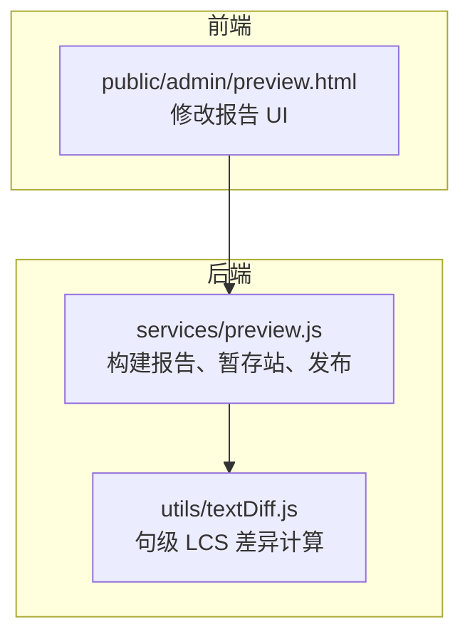
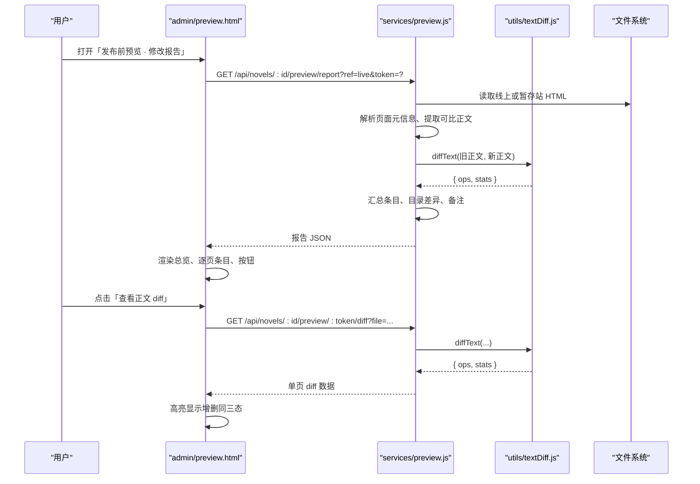
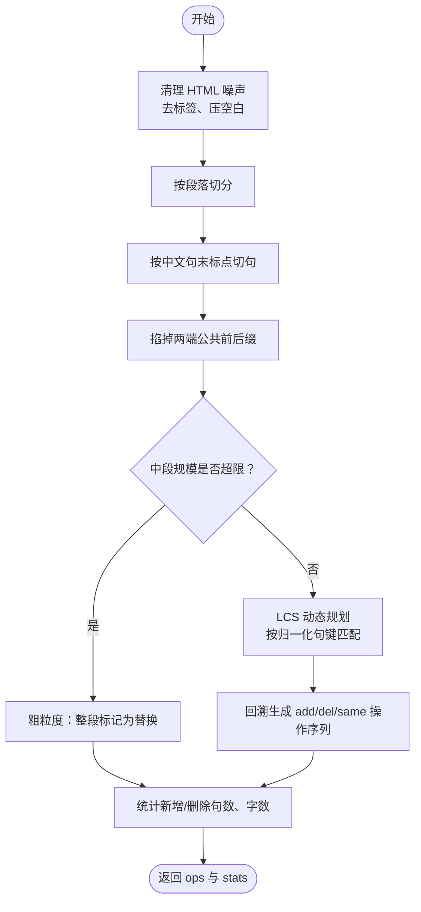
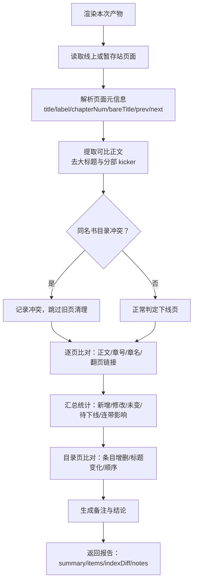
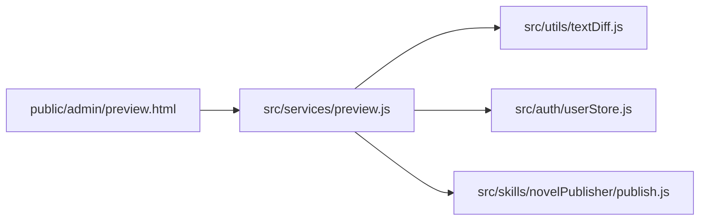
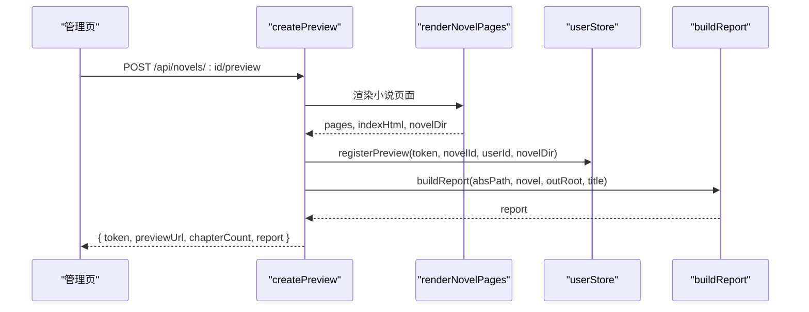

# 修改报告

<cite>
**本文引用的文件**   
- [textDiff.js](file://src/utils/textDiff.js)
- [preview.js](file://src/services/preview.js)
- [preview.html](file://public/admin/preview.html)
</cite>

## 目录
1. [引言](#引言)
2. [项目结构](#项目结构)
3. [核心组件](#核心组件)
4. [架构总览](#架构总览)
5. [详细组件分析](#详细组件分析)
6. [依赖关系分析](#依赖关系分析)
7. [性能与准确性](#性能与准确性)
8. [报告生成流程与自定义选项](#报告生成流程与自定义选项)
9. [故障排查](#故障排查)
10. [结论](#结论)

## 引言
本技术文档围绕“修改报告”能力展开，重点解释以下方面：
- 逐页 diff 计算算法：文本差异检测、变更高亮、上下文保留。
- 变更影响分析：章节结构变化、内容增量统计、版本对比。
- 报告输出格式：HTML 输出、样式设计、交互功能。
- 差异比较策略：算法选择、性能优化、准确性保证。
- 报告生成流程与可配置项：预览、发布、基准切换等。

该能力用于在发布前预览整本小说的静态站点，并与线上版本或另一份暂存预览进行逐页比对，生成可读性强的修改报告，帮助作者确认哪些页面真正改了、哪些只是连带影响（如章号顺延、翻页链接变化）。

## 项目结构
修改报告涉及后端服务逻辑、差异计算工具以及前端展示页面三类代码：
- 后端服务层负责渲染小说页面、读取线上或暂存站产物、执行逐页比对并汇总报告。
- 工具层提供零依赖的中文正文差异计算。
- 前端页面负责渲染报告、提供筛选、展开详情和查看逐句 diff 的交互。



**图表来源**
- [preview.js:1-20](file://src/services/preview.js#L1-L20)
- [textDiff.js:1-15](file://src/utils/textDiff.js#L1-L15)
- [preview.html:98-112](file://public/admin/preview.html#L98-L112)

**章节来源**
- [preview.js:1-20](file://src/services/preview.js#L1-L20)
- [textDiff.js:1-15](file://src/utils/textDiff.js#L1-L15)
- [preview.html:1-66](file://public/admin/preview.html#L1-L66)

## 核心组件
本节聚焦三个关键模块的职责与接口：

| 组件 | 职责 | 主要输入 | 主要输出 |
|---|---|---|---|
| `buildReport` | 渲染本次产物，与线上或暂存站比对，汇总逐页说明与总体摘要 | 小说库路径、小说元数据、输出根目录、可选对比 token | 报告对象（摘要、条目、目录差异、备注） |
| `diffText` | 对两版正文做句级 LCS 差异，返回操作序列与统计 | 旧正文文本、新正文文本 | `{ ops, stats }` |
| `preview.html` | 渲染报告、过滤条目、按需加载单页 diff、触发预览与发布 | 报告 JSON、token、小说标识 | 用户界面与交互结果 |

**章节来源**
- [preview.js:107-273](file://src/services/preview.js#L107-L273)
- [textDiff.js:84-123](file://src/utils/textDiff.js#L84-L123)
- [preview.html:123-255](file://public/admin/preview.html#L123-L255)

## 架构总览
修改报告的端到端流程如下：



**图表来源**
- [preview.html:241-255](file://public/admin/preview.html#L241-L255)
- [preview.html:205-219](file://public/admin/preview.html#L205-L219)
- [preview.js:117-273](file://src/services/preview.js#L117-L273)
- [preview.js:391-414](file://src/services/preview.js#L391-L414)
- [textDiff.js:84-123](file://src/utils/textDiff.js#L84-L123)

## 详细组件分析

### 逐页 diff 计算算法：文本差异检测、变更高亮、上下文保留
`textDiff.js` 实现的是面向中文小说正文的句级差异计算。其核心思路是：
- 先去除脚本、样式、标签等噪声，得到纯文本。
- 按自然段切分，再按中文句末标点切句，最小粒度是一句话。
- 使用最长公共子序列（LCS）动态规划，比较归一化后的句子键。
- 输出阅读顺序的操作序列：相同、新增、删除，附带段落编号以便还原 `<p>` 结构。
- 当规模超过安全阈值时，退化为整段替换，避免阻塞进程。



**图表来源**
- [textDiff.js:15-30](file://src/utils/textDiff.js#L15-L30)
- [textDiff.js:45-61](file://src/utils/textDiff.js#L45-L61)
- [textDiff.js:63-75](file://src/utils/textDiff.js#L63-L75)
- [textDiff.js:84-123](file://src/utils/textDiff.js#L84-L123)
- [textDiff.js:125-145](file://src/utils/textDiff.js#L125-L145)

关键点说明：
- 文本清洗：移除 script/style 标签、HTML 实体、多余空白，统一换行。
- 归一化键：去掉空白、统一半角标点、小写化，避免排版噪声被当成内容改动。
- 分段与断句：保留段落编号 para，便于渲染时重排 `<p>`；处理引号收尾的句号不切开。
- 公共前后缀裁剪：减少 LCS 规模，提升性能。
- 安全限制：当 `midA.length * max(midB.length, 1)` 超过阈值时，直接输出整段替换操作，仍给出准确统计。
- 输出结构：`ops` 包含 `type`（same/add/del）、`text`、`para`；`stats` 包含句数、字符数、增量、是否退化等。

**章节来源**
- [textDiff.js:15-30](file://src/utils/textDiff.js#L15-L30)
- [textDiff.js:32-38](file://src/utils/textDiff.js#L32-L38)
- [textDiff.js:45-61](file://src/utils/textDiff.js#L45-L61)
- [textDiff.js:63-75](file://src/utils/textDiff.js#L63-L75)
- [textDiff.js:84-123](file://src/utils/textDiff.js#L84-L123)
- [textDiff.js:125-145](file://src/utils/textDiff.js#L125-L145)

### 变更影响分析：章节结构变化、内容增量统计、版本对比
`preview.js` 中的 `buildReport` 负责将渲染产物与线上或暂存站进行比对，并汇总变更影响：
- 页面状态：新增、待下线、有变化、未变。
- 正文改动：调用 `diffText` 获取句级统计与操作序列。
- 章节结构变化：章号顺延、章名变更、翻页链接变化。
- 目录页变化：条目增删、标题变化、顺序变化。
- 备注总结：首次发布、新增章节、待下线页面、连带影响、书名冲突等。



**图表来源**
- [preview.js:117-273](file://src/services/preview.js#L117-L273)
- [preview.js:40-58](file://src/services/preview.js#L40-L58)
- [preview.js:73-81](file://src/services/preview.js#L73-L81)
- [preview.js:97-105](file://src/services/preview.js#L97-L105)
- [preview.js:284-294](file://src/services/preview.js#L284-L294)
- [preview.js:296-322](file://src/services/preview.js#L296-L322)

要点说明：
- 比较口径：一律取页面正文容器去掉 `<h1>` 大标题与分部 kicker 后的纯文本，避免章号顺延被误判为正文改动。
- 页面元信息：从 `<title>` 与导航链接解析出 label、chapterNum、bareTitle、prev、next。
- 目录页比对：按 href 对齐条目，给出 added/removed/changed 与 orderSame。
- 备注生成：综合新增章节、待下线页面、正文改动、章号顺延、章名变更、翻页链接受影响、目录页变化、连带影响等。
- 书名冲突：多本同名书共用发布目录时，提示不会删除旧页，避免误删另一本书的章节。

**章节来源**
- [preview.js:32-38](file://src/services/preview.js#L32-L38)
- [preview.js:40-58](file://src/services/preview.js#L40-L58)
- [preview.js:73-81](file://src/services/preview.js#L73-L81)
- [preview.js:97-105](file://src/services/preview.js#L97-L105)
- [preview.js:117-273](file://src/services/preview.js#L117-L273)
- [preview.js:284-294](file://src/services/preview.js#L284-L294)
- [preview.js:296-322](file://src/services/preview.js#L296-L322)

### 报告生成格式：HTML 输出、样式设计、交互功能
`public/admin/preview.html` 是修改报告的展示界面，具备以下特性：
- 深色主题、移动端友好布局。
- 顶部标题、返回链接、预览站跳转、重新生成、只看变化。
- 总览卡片：页数、章节、新增、正文改动、连带影响、待下线、句增减、字数差、章号顺延、章名变更、目录页变化。
- 逐页条目：支持筛选未改动的页面，点击展开原因与 diff。
- 单页 diff：懒加载，显示旧/新句数、字数、新增/删除句数、是否粗粒度对照。
- 底部操作：作废预览、确认发布。

```mermaid
classDiagram
class ReportUI {
+renderChips(summary)
+renderNotes(report)
+renderRows(items, token)
+renderDiff(diffData)
+loadReport(token, notice)
}
class API {
+fetch(url, options)
+handleError(status, json)
}
class Actions {
+regen()
+reload()
+publish()
+drop()
}
ReportUI --> API : "调用 /api/novels/ : id/preview/report"
ReportUI --> API : "调用 /api/novels/ : id/preview/ : token/diff"
ReportUI --> Actions : "绑定按钮事件"
```

**图表来源**
- [preview.html:135-155](file://public/admin/preview.html#L135-L155)
- [preview.html:157-170](file://public/admin/preview.html#L157-L170)
- [preview.html:172-221](file://public/admin/preview.html#L172-L221)
- [preview.html:223-239](file://public/admin/preview.html#L223-L239)
- [preview.html:241-255](file://public/admin/preview.html#L241-L255)
- [preview.html:257-301](file://public/admin/preview.html#L257-L301)

样式与交互要点：
- 颜色语义：新增绿色、修改黄色、删除红色、连带影响蓝色、未变灰色。
- 高亮规则：新增行带左侧绿边与背景，删除行带删除线与红边，相同行灰显。
- 懒加载 diff：点击按钮后请求后端单页 diff，避免一次性加载大量数据。
- 导航信息：在 diff 头部显示标题、上一章、下一章的变化。
- 错误处理：API 失败时显示错误消息，登录过期自动跳转登录页。

**章节来源**
- [preview.html:1-66](file://public/admin/preview.html#L1-L66)
- [preview.html:135-155](file://public/admin/preview.html#L135-L155)
- [preview.html:157-170](file://public/admin/preview.html#L157-L170)
- [preview.html:172-221](file://public/admin/preview.html#L172-L221)
- [preview.html:223-239](file://public/admin/preview.html#L223-L239)
- [preview.html:241-255](file://public/admin/preview.html#L241-L255)
- [preview.html:257-301](file://public/admin/preview.html#L257-L301)

## 依赖关系分析
修改报告的核心依赖关系如下：



耦合与内聚：
- `preview.html` 仅依赖后端 API，不直接访问文件系统。
- `preview.js` 聚合渲染、解析、比对、存储、发布等职责，内聚性强。
- `textDiff.js` 是独立工具模块，无外部依赖，易于测试与复用。
- 通过 `userStore.js` 管理预览 token 与过期清理，通过 `publish.js` 渲染小说页面。

潜在风险：
- 若线上 HTML 结构变化（如 `<title>` 或导航链接格式变化），会影响 `parsePageHtml` 与 `readIndexEntries` 的解析结果。
- 若正文容器类名或结构变化，会影响 `contentForDiff` 的比较口径。
- 若文件名规则变化（如 chapter/page 前缀），会影响 `pageKindOf` 与下线页判定。

**图表来源**
- [preview.html:98-112](file://public/admin/preview.html#L98-L112)
- [preview.js:14-20](file://src/services/preview.js#L14-L20)
- [preview.js:17-20](file://src/services/preview.js#L17-L20)
- [textDiff.js:155-156](file://src/utils/textDiff.js#L155-L156)

**章节来源**
- [preview.html:98-112](file://public/admin/preview.html#L98-L112)
- [preview.js:14-20](file://src/services/preview.js#L14-L20)
- [textDiff.js:155-156](file://src/utils/textDiff.js#L155-L156)

## 性能与准确性
### 算法选择
- 句级 LCS：适合中文小说正文，最小粒度为一句话，避免按行 diff 造成的整段替换噪声。
- 归一化键：消除空白与标点差异，提高匹配准确率。
- 公共前后缀裁剪：减少 DP 表规模，提升性能。

### 性能优化
- 安全阈值：当 `midA.length * max(midB.length, 1)` 超过 400000 时，退化为整段替换，避免阻塞。
- 懒加载 diff：前端仅在用户点击时请求单页 diff，减少初始负载。
- 段落编号：保留 para 字段，便于渲染时重排 `<p>`，避免重复解析。

### 准确性保证
- 比较口径一致：后端与前端均使用 `htmlToText` 与 `contentForDiff`，确保正文比较口径一致。
- 元信息解析稳定：从 `<title>` 与导航链接解析，避免依赖不稳定类名。
- 目录页比对按 href 对齐：避免因标题变化导致的误判。

**章节来源**
- [textDiff.js:1-11](file://src/utils/textDiff.js#L1-L11)
- [textDiff.js:13-13](file://src/utils/textDiff.js#L13-L13)
- [textDiff.js:63-75](file://src/utils/textDiff.js#L63-L75)
- [textDiff.js:84-123](file://src/utils/textDiff.js#L84-L123)
- [preview.js:32-38](file://src/services/preview.js#L32-L38)
- [preview.js:40-58](file://src/services/preview.js#L40-L58)
- [preview.js:284-294](file://src/services/preview.js#L284-L294)

## 报告生成流程与自定义选项
### 生成预览与报告
1. 用户点击「生成预览」。
2. 后端渲染小说页面，写入暂存目录。
3. 生成首页索引，注册预览 token。
4. 调用 `buildReport` 生成报告。
5. 返回 token 与预览 URL。



**图表来源**
- [preview.js:328-360](file://src/services/preview.js#L328-L360)
- [preview.js:117-273](file://src/services/preview.js#L117-L273)

### 自定义选项
- `compareToToken`：与另一份暂存预览比对，而非线上版本。
- `premake`：是否预生成 quiz 与生词。
- `quizAge`：quiz 与生词的缓存年龄。
- `llmHooks`：注入 LLM 钩子以生成 quiz 与挑选生词。
- `prune`：确认发布时是否清理旧页（书名冲突时禁用）。
- `urlBase`：发布后的 URL 基址。

**章节来源**
- [preview.js:117-124](file://src/services/preview.js#L117-L124)
- [preview.js:328-336](file://src/services/preview.js#L328-L336)
- [preview.js:423-434](file://src/services/preview.js#L423-L434)
- [preview.js:454-456](file://src/services/preview.js#L454-L456)

## 故障排查
常见问题与处理建议：
- 预览 token 不合法：检查 token 是否为 16 位十六进制字符串。
- 预览不存在或已过期：重新生成预览。
- 正文容器缺失：检查发布端 HTML 结构是否变化。
- 导航链接解析失败：检查 `<title>` 与导航链接格式是否符合预期。
- 目录页比对异常：检查目录条目类名与 href 是否变化。
- 发布后内容与预览不一致：检查预览后是否再次修改源码，导致漂移页。

**章节来源**
- [preview.js:363-368](file://src/services/preview.js#L363-L368)
- [preview.js:391-414](file://src/services/preview.js#L391-L414)
- [preview.js:423-470](file://src/services/preview.js#L423-L470)

## 结论
修改报告能力通过句级 LCS 差异计算、稳定的比较口径、详细的变更影响分析，以及友好的前端交互，为作者提供了可靠的发布前预览与确认机制。它不仅能识别真正的正文改动，还能揭示章节结构变化与连带影响，帮助作者做出更准确的发布决策。未来可考虑进一步优化大规模文本的差异性能，并扩展更多自定义选项以满足不同场景需求。