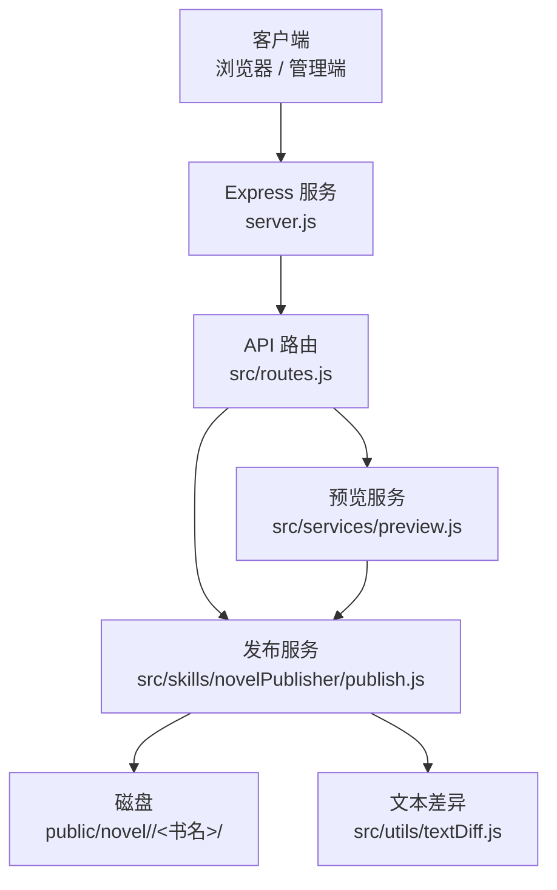
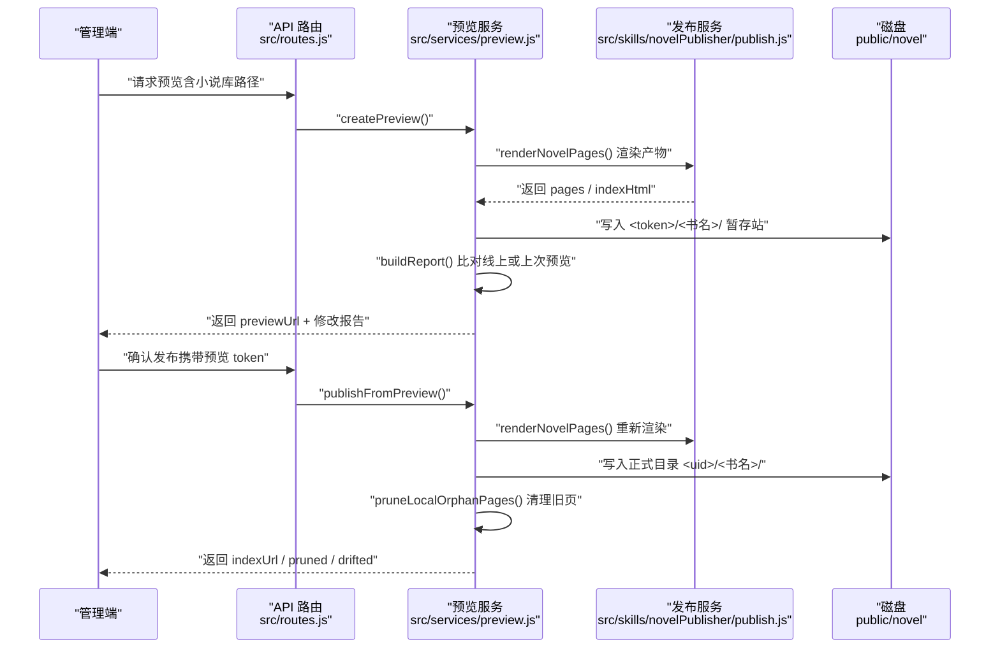
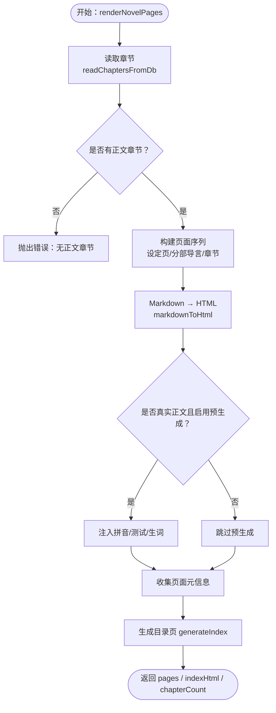
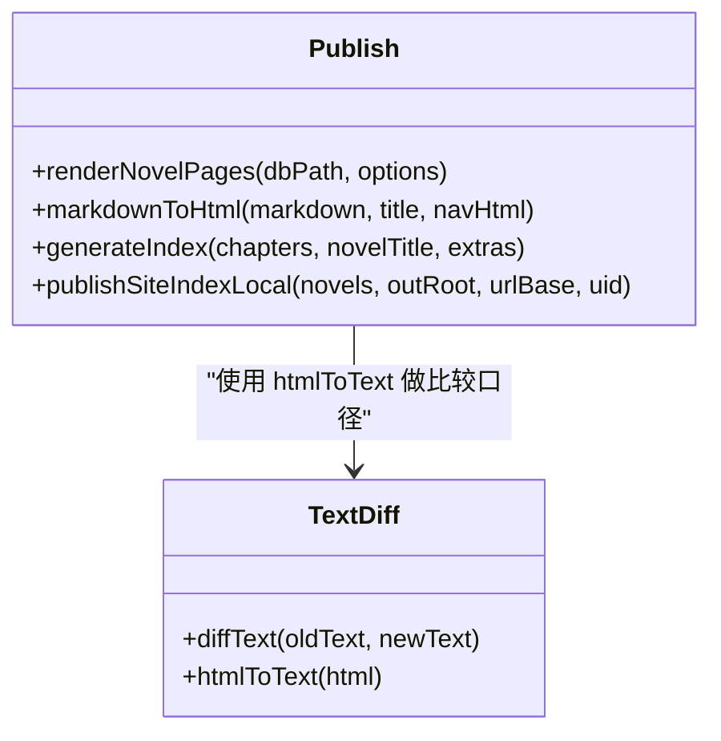
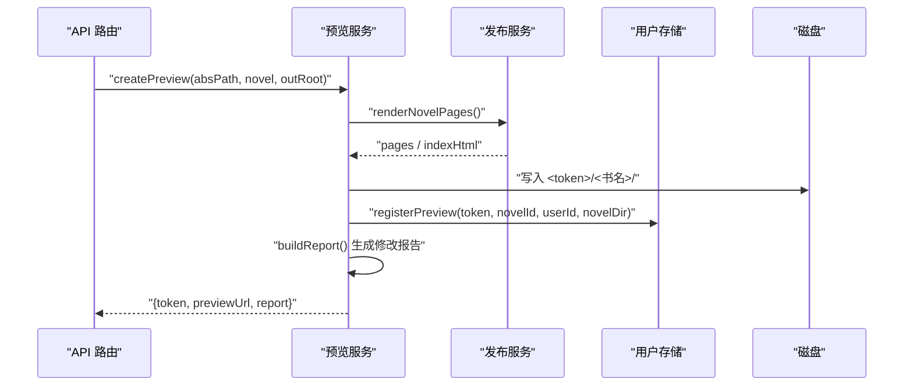
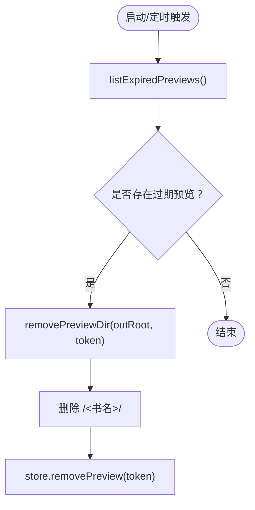
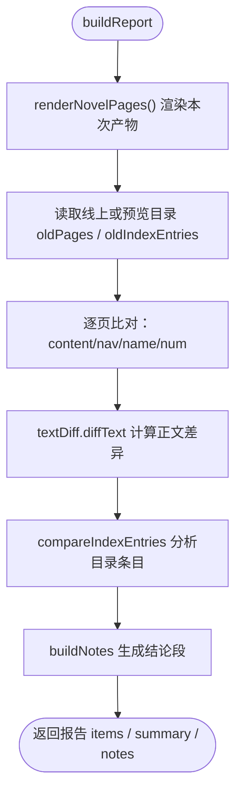
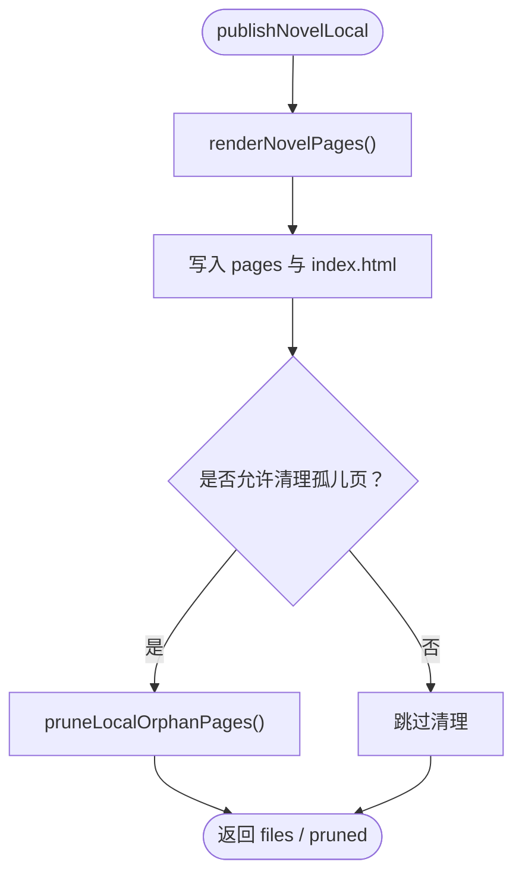
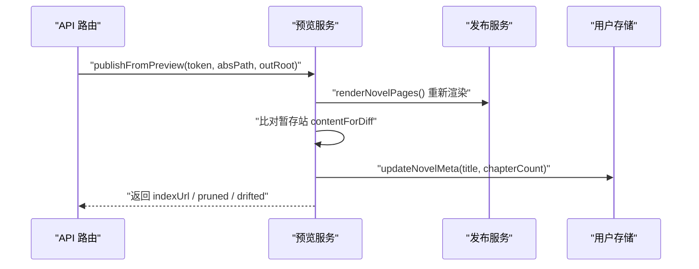
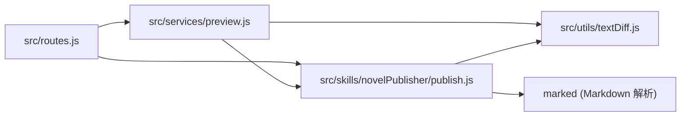

# 内容发布系统

<cite>
**本文引用的文件**   
- [server.js](file://server.js)
- [src/routes.js](file://src/routes.js)
- [src/services/preview.js](file://src/services/preview.js)
- [src/skills/novelPublisher/publish.js](file://src/skills/novelPublisher/publish.js)
- [src/utils/textDiff.js](file://src/utils/textDiff.js)
- [README.md](file://README.md)
- [package.json](file://package.json)
</cite>

## 目录
1. [简介](#简介)
2. [项目结构](#项目结构)
3. [核心组件](#核心组件)
4. [架构总览](#架构总览)
5. [详细组件分析](#详细组件分析)
6. [依赖关系分析](#依赖关系分析)
7. [性能与优化](#性能与优化)
8. [故障排查](#故障排查)
9. [结论](#结论)

## 简介
本技术文档聚焦“内容发布系统”，围绕以下目标展开：
- 静态站点生成流程：模板引擎、资源注入、SEO 相关元信息。
- 预览机制：临时站点生成、预览链接管理、自动清理策略。
- 修改报告：逐页 diff 计算、变更影响分析、版本对比。
- 发布策略：增量发布、回滚思路、错误处理与孤儿页面清理。
- 具体发布流程与配置选项说明。

该系统以 Node.js + Express 为服务入口，使用 SQLite 存储小说数据，通过内置渲染管线把章节 Markdown 转换为 HTML 静态页，并输出到 `public/novel` 下供浏览器直接访问；同时提供“预览站”和“修改报告”，让创作者在正式发布前确认改动范围与连带影响。

**章节来源**
- [README.md:33-41](file://README.md#L33-L41)
- [README.md:166-202](file://README.md#L166-L202)

## 项目结构
从发布视角看，关键路径如下：
- 服务入口：`server.js` 挂载静态目录 `/admin`、`/novel`、`/tts` 等，并注册 API。
- API 路由：`src/routes.js` 暴露预览、发布、章节列表、VIP 授权等接口。
- 预览模块：`src/services/preview.js` 负责暂存站、修改报告、预览生命周期。
- 发布模块：`src/skills/novelPublisher/publish.js` 负责渲染章节、目录、分部导言、站点首页，以及本地发布与孤儿页清理。
- Diff 工具：`src/utils/textDiff.js` 提供中文句级差异计算。

**图表来源**
- [server.js:44-53](file://server.js#L44-L53)
- [src/routes.js:331-339](file://src/routes.js#L331-L339)
- [src/services/preview.js:117-127](file://src/services/preview.js#L117-L127)
- [src/skills/novelPublisher/publish.js:2119-2268](file://src/skills/novelPublisher/publish.js#L2119-L2268)
- [src/utils/textDiff.js:84-123](file://src/utils/textDiff.js#L84-L123)

**章节来源**
- [server.js:1-64](file://server.js#L1-L64)
- [src/routes.js:1-35](file://src/routes.js#L1-L35)
- [README.md:166-193](file://README.md#L166-L193)

## 核心组件
- 服务入口与静态资源挂载：对外提供登录、管理后台、阅读器资源、已发布书页。
- API 路由层：统一鉴权、租户隔离、限流、长任务进度通道、预览与发布接口。
- 预览子系统：生成带 token 的暂存站、构建修改报告、维护预览登记与过期清理。
- 发布子系统：读取数据库章节、按部组织、渲染章节页与目录页、预生成学习资源、写入本地站点目录、清理孤儿页。
- 文本差异引擎：中文句级 LCS 差异，用于预览报告与单页 diff。

**章节来源**
- [server.js:44-53](file://server.js#L44-L53)
- [src/routes.js:331-339](file://src/routes.js#L331-L339)
- [src/services/preview.js:117-127](file://src/services/preview.js#L117-L127)
- [src/skills/novelPublisher/publish.js:2119-2268](file://src/skills/novelPublisher/publish.js#L2119-L2268)
- [src/utils/textDiff.js:84-123](file://src/utils/textDiff.js#L84-L123)

## 架构总览
下图展示一次“预览 → 修改报告 → 确认发布”的关键调用链：

**图表来源**
- [src/services/preview.js:328-359](file://src/services/preview.js#L328-L359)
- [src/services/preview.js:423-469](file://src/services/preview.js#L423-L469)
- [src/skills/novelPublisher/publish.js:2119-2268](file://src/skills/novelPublisher/publish.js#L2119-L2268)
- [src/skills/novelPublisher/publish.js:2283-2300](file://src/skills/novelPublisher/publish.js#L2283-L2300)

## 详细组件分析

### 静态站点生成流程
发布系统的核心是 `renderNovelPages`，它完成以下工作：
- 从数据库读取章节、设定页与分部结构。
- 按“设定页 → 各部分导言 → 章节”顺序构建页面序列。
- 将 Markdown 转为 HTML，注入导航栏、部标、占位章提示。
- 可选预生成拼音、章节测试、生词表，并内嵌到页面中。
- 生成目录页 `index.html`，并按部分组显示章节。

**图表来源**
- [src/skills/novelPublisher/publish.js:2119-2268](file://src/skills/novelPublisher/publish.js#L2119-L2268)

#### 模板引擎与资源注入
- 模板转换：使用 `marked` 将 Markdown 转为 HTML，并通过 `markdownToHtml` 包裹完整 HTML 壳。
- 阅读模式资源：通过 `` 外链加载阅读器逻辑，避免每次发布都打包前端代码。
- 学习资源预生成：在发布时可选择预生成拼音、章节测试、生词表，并注入到页面 JSON 中，读者打开即零 LLM 呈现。

**图表来源**
- [src/skills/novelPublisher/publish.js:131-255](file://src/skills/novelPublisher/publish.js#L131-L255)
- [src/skills/novelPublisher/publish.js:265-449](file://src/skills/novelPublisher/publish.js#L265-L449)
- [src/utils/textDiff.js:15-30](file://src/utils/textDiff.js#L15-L30)

#### SEO 优化现状
当前发布产物包含基础 SEO 元素：
- 每个页面设置 `<title>`，格式为“书名 - 章节标题”。
- 页面声明 `<meta charset="UTF-8">` 与 `<meta name="viewport">`。
- 未显式设置 `description`、`canonical`、Open Graph 等高级 SEO 字段。

若需增强 SEO，可在 `markdownToHtml` 或 `generateIndex` 中追加描述、关键词、结构化数据等元信息。

**章节来源**
- [src/skills/novelPublisher/publish.js:131-255](file://src/skills/novelPublisher/publish.js#L131-L255)
- [src/skills/novelPublisher/publish.js:265-449](file://src/skills/novelPublisher/publish.js#L265-L449)

### 预览机制
预览机制由 `createPreview` 与 `buildReport` 共同实现：
- 生成随机 token，创建 `<outRoot>/<token>/<书名>/` 暂存站。
- 调用 `renderNovelPages` 渲染产物，并写入暂存目录。
- 生成暂存站首页，便于读者端体验。
- 构建修改报告：与线上目录或上次预览比对，输出新增、修改、删除、连带影响等条目。
- 预览链接受登录态保护，仅创作者本人可访问。

**图表来源**
- [src/services/preview.js:328-359](file://src/services/preview.js#L328-L359)
- [src/services/preview.js:117-127](file://src/services/preview.js#L117-L127)

#### 预览链接管理与自动清理
- 预览登记：`store.registerPreview` 记录 token、小说 ID、作者 ID、目录名。
- 过期清理：`purgeExpiredPreviews` 遍历过期预览，调用 `removePreviewDir` 删除暂存目录并移除登记。
- 删除小说时：先清该小说的所有预览，再删登记行，避免残留。

**图表来源**
- [src/services/preview.js:371-377](file://src/services/preview.js#L371-L377)
- [src/services/preview.js:363-368](file://src/services/preview.js#L363-L368)

**章节来源**
- [src/services/preview.js:328-359](file://src/services/preview.js#L328-L359)
- [src/services/preview.js:363-377](file://src/services/preview.js#L363-L377)

### 修改报告生成
修改报告的核心是 `buildReport`，它：
- 渲染本次产物，并与线上目录或指定预览 token 比对。
- 对每页判断新增、删除、存在但变化。
- 使用 `textDiff.diffText` 计算正文句级差异，统计新增/删除句子数与字数变化。
- 单独分析目录页条目增删与顺序变化。
- 输出结论段，包括新增章节、章号顺延、章名变更、翻页链接受影响、目录页重生成等。

**图表来源**
- [src/services/preview.js:117-127](file://src/services/preview.js#L117-L127)
- [src/services/preview.js:157-232](file://src/services/preview.js#L157-L232)
- [src/services/preview.js:284-294](file://src/services/preview.js#L284-L294)
- [src/services/preview.js:297-322](file://src/services/preview.js#L297-L322)
- [src/utils/textDiff.js:84-123](file://src/utils/textDiff.js#L84-L123)

**章节来源**
- [src/services/preview.js:117-127](file://src/services/preview.js#L117-L127)
- [src/services/preview.js:157-232](file://src/services/preview.js#L157-L232)
- [src/services/preview.js:284-322](file://src/services/preview.js#L284-L322)
- [src/utils/textDiff.js:84-123](file://src/utils/textDiff.js#L84-L123)

### 发布策略
发布策略包括本地发布、孤儿页清理、预览后确认发布、同名书冲突处理。

#### 本地发布
`publishNovelLocal` 执行：
- 渲染全部页面。
- 写入 `outRoot/<书名>/`。
- 默认清理孤儿页（`chapter_*.html`、`page_*.html` 中不在本次清单的文件）。
- 返回实际写入文件与清理结果。

**图表来源**
- [src/skills/novelPublisher/publish.js:2310-2330](file://src/skills/novelPublisher/publish.js#L2310-L2330)
- [src/skills/novelPublisher/publish.js:2283-2300](file://src/skills/novelPublisher/publish.js#L2283-L2300)

#### 预览后确认发布
`publishFromPreview` 执行：
- 校验预览 token 有效性。
- 重新渲染产物，并与暂存站比对，检测漂移页。
- 写入正式目录，并清理孤儿页。
- 更新小说元信息（书名、章数）。

**图表来源**
- [src/services/preview.js:423-469](file://src/services/preview.js#L423-L469)

#### 同名书冲突处理
当同一作者有多本书同名时，发布目录会共用同一个清洗后的书名目录。此时：
- 预览报告中标注“书名冲突”，并列出其他同名书。
- 发布时跳过孤儿页清理，避免误删另一本书的合法章节。
- 建议先将书名改得不一样再发布。

**章节来源**
- [src/services/preview.js:97-105](file://src/services/preview.js#L97-L105)
- [src/services/preview.js:145-150](file://src/services/preview.js#L145-L150)
- [src/services/preview.js:244-246](file://src/services/preview.js#L244-L246)
- [src/services/preview.js:452-456](file://src/services/preview.js#L452-L456)

### 错误处理与回滚思路
- 预览失败：不写库、不参与生成任务锁，前端可直接关闭弹层。
- 发布失败：`publishNovelLocal` 与 `publishFromPreview` 均可能抛错，调用方应捕获并提示。
- 孤儿页清理失败：打印警告日志，不阻断发布主流程。
- 回滚思路：当前本地发布不写远程发布清单，因此“回滚”主要依赖文件系统回退（如保留上一版目录快照），或通过数据库修订快照（`chapter_revision`）恢复正文。

**章节来源**
- [src/skills/novelPublisher/publish.js:2283-2300](file://src/skills/novelPublisher/publish.js#L2283-L2300)
- [README.md:41-42](file://README.md#L41-L42)

## 依赖关系分析
发布系统内部依赖关系如下：

**图表来源**
- [src/routes.js:22-27](file://src/routes.js#L22-L27)
- [src/services/preview.js:17-19](file://src/services/preview.js#L17-L19)
- [src/skills/novelPublisher/publish.js:16-24](file://src/skills/novelPublisher/publish.js#L16-L24)

**章节来源**
- [src/routes.js:22-27](file://src/routes.js#L22-L27)
- [src/services/preview.js:17-19](file://src/services/preview.js#L17-L19)
- [src/skills/novelPublisher/publish.js:16-24](file://src/skills/novelPublisher/publish.js#L16-L24)

## 性能与优化
- 文本差异：采用句级 LCS，设置安全上限防止大段落卡死；超长时退化为整段替换，仍给出准确统计。
- 预生成学习资源：可选开关，避免发布变慢；失败不阻断发布。
- 静态资源缓存：`/tts-audio` 使用 `immutable` 与长期缓存；`reader.core.js` 通过时间戳参数绕过浏览器缓存。
- 目录页与章节页渲染：按数据库顺序构建，避免重复扫描。

**章节来源**
- [src/utils/textDiff.js:8-11](file://src/utils/textDiff.js#L8-L11)
- [src/utils/textDiff.js:84-123](file://src/utils/textDiff.js#L84-L123)
- [src/skills/novelPublisher/publish.js:2197-2226](file://src/skills/novelPublisher/publish.js#L2197-L2226)
- [server.js:48-53](file://server.js#L48-L53)

## 故障排查
常见问题与定位建议：
- 预览链接无法访问：检查登录态是否为创作者本人；确认预览 token 未过期。
- 发布后仍有旧章节页：检查是否启用孤儿页清理；确认同名书冲突场景。
- 修改报告未显示 diff：确认正文容器存在且非占位章；检查 `contentForDiff` 口径。
- 发布缓慢：检查是否启用 quiz/vocab 预生成；查看 LLM 链路状态与上游模型吞吐。

**章节来源**
- [src/services/preview.js:243-261](file://src/services/preview.js#L243-L261)
- [src/services/preview.js:371-377](file://src/services/preview.js#L371-L377)
- [src/skills/novelPublisher/publish.js:2283-2300](file://src/skills/novelPublisher/publish.js#L2283-L2300)
- [README.md:63-81](file://README.md#L63-L81)

## 结论
内容发布系统以“预览先行、报告透明、发布可控”为核心设计：
- 静态站点生成基于 Markdown 模板与内置 HTML 壳，支持分部导言、占位章、学习资源预生成。
- 预览机制通过 token 暂存站与修改报告，让创作者在正式发布前确认改动范围与连带影响。
- 发布策略强调孤儿页清理与同名书冲突防护，确保线上目录整洁。
- 文本差异引擎提供句级 diff，支撑逐页变更分析与版本对比。

未来可考虑扩展 SEO 元信息、增加发布历史版本对比、引入更细粒度的回滚机制。