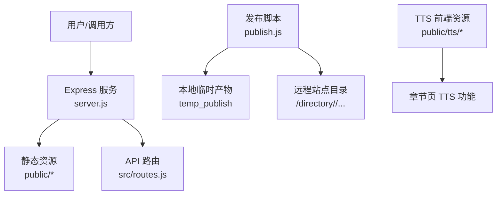
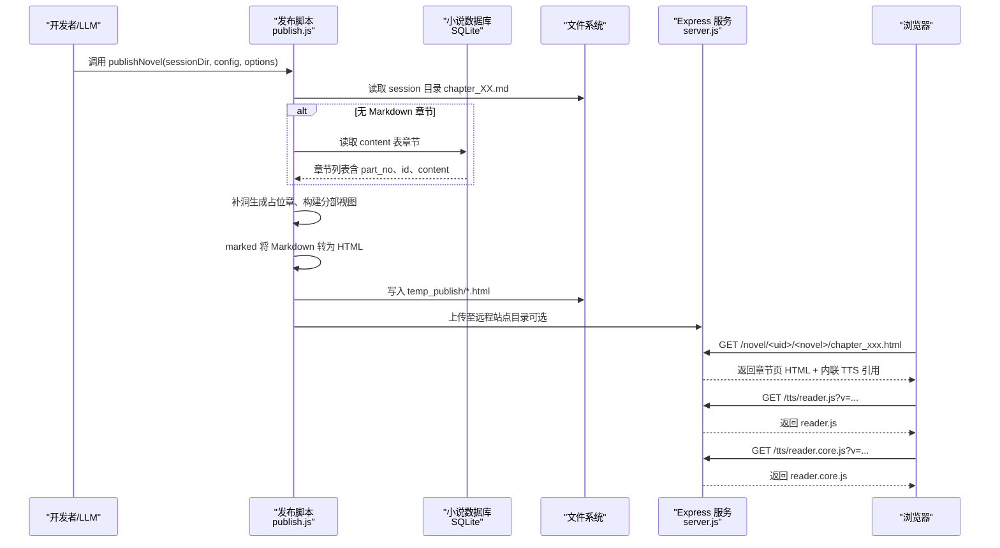
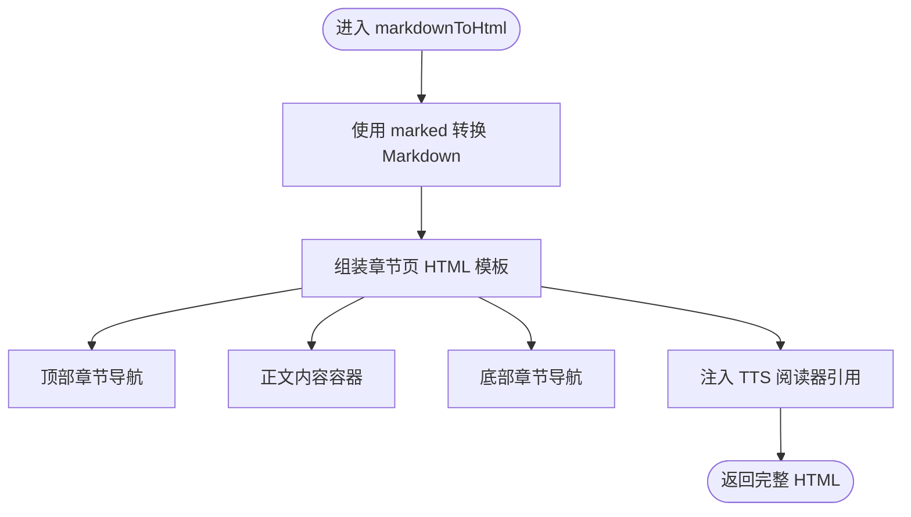
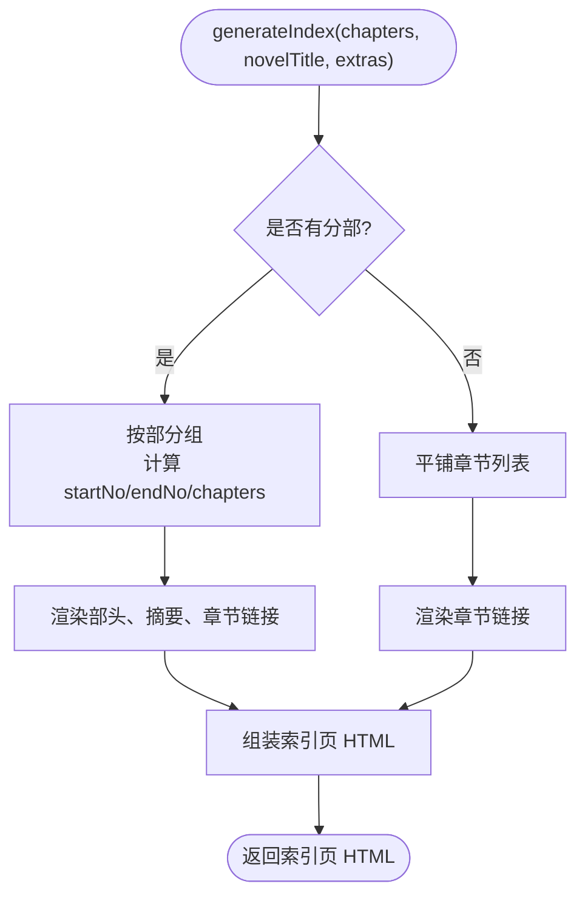
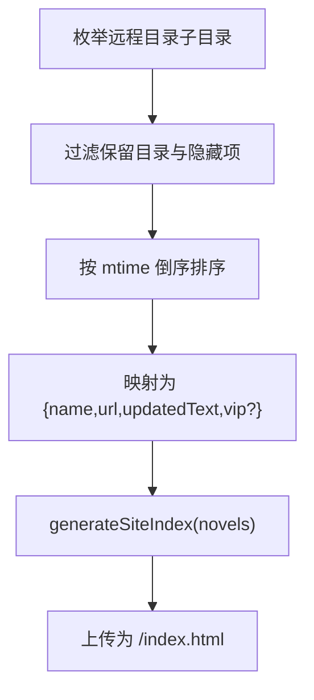
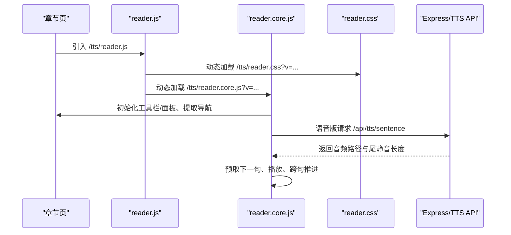
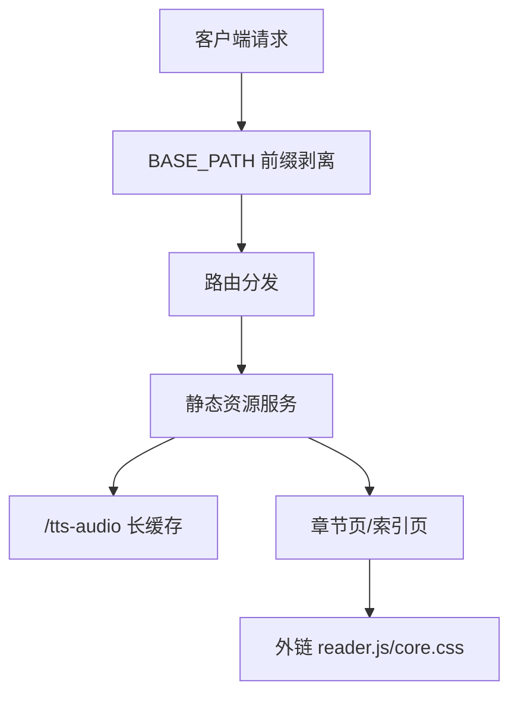
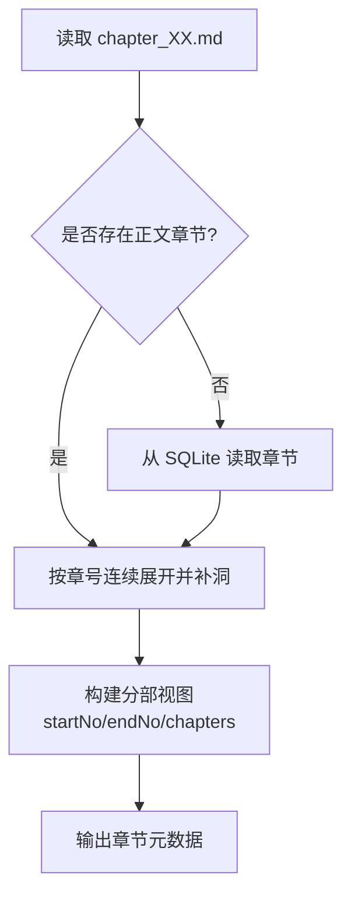
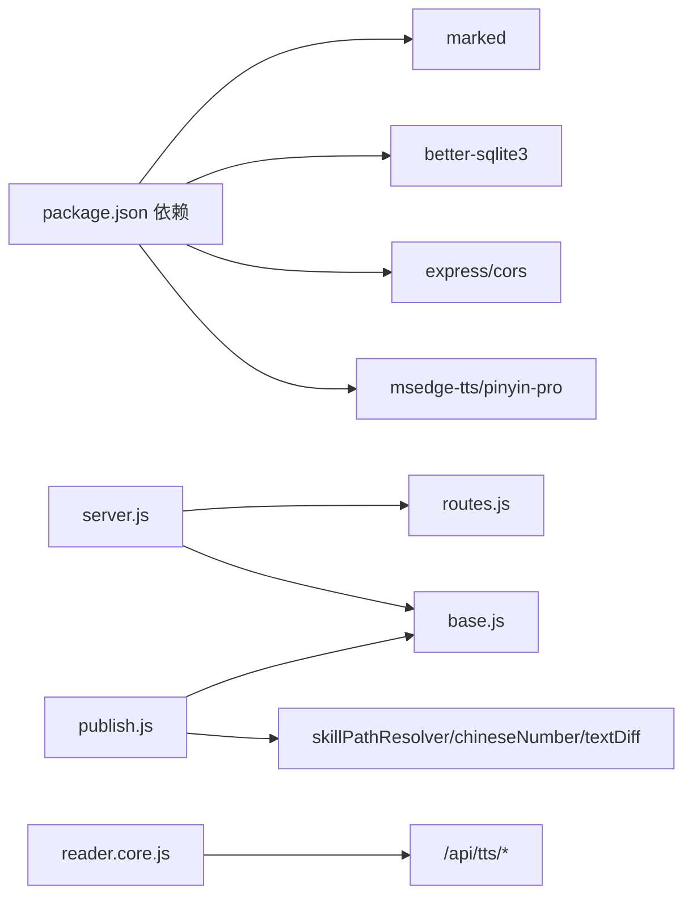

# 静态站点生成

<cite>
**本文引用的文件**   
- [package.json](file://package.json)
- [server.js](file://server.js)
- [publish.js](file://src/skills/novelPublisher/publish.js)
- [novel.html](file://src/skills/novelPublisher/novel.html)
- [reader.js](file://public/tts/reader.js)
- [reader.core.js](file://public/tts/reader.core.js)
- [reader.css](file://public/tts/reader.css)
- [index.html](file://public/index.html)
</cite>

## 目录
1. [简介](#简介)
2. [项目结构](#项目结构)
3. [核心组件](#核心组件)
4. [架构总览](#架构总览)
5. [详细组件分析](#详细组件分析)
6. [依赖关系分析](#依赖关系分析)
7. [性能与缓存策略](#性能与缓存策略)
8. [故障排查指南](#故障排查指南)
9. [结论](#结论)
10. [附录：配置选项与生成流程清单](#附录配置选项与生成流程清单)

## 简介
本技术文档聚焦于项目的“静态站点生成”能力，围绕小说发布脚本、Markdown 到 HTML 的转换、章节页与索引页生成、TTS 阅读器集成、资源管理与路径解析进行系统化说明。读者可据此理解从数据源（SQLite 或 Markdown）到最终静态页面的完整流水线，以及站点在 Express 服务中的挂载与缓存策略。

## 项目结构
本项目以 Node.js 为运行时，Express 提供 Web 服务；静态站点由发布脚本构建并输出到服务器目录，再由 Express 按前缀暴露给浏览器。关键目录与职责如下：
- server.js：Express 应用入口，负责路由注册、静态资源挂载、BASE_PATH 前缀平移。
- src/skills/novelPublisher/publish.js：小说发布脚本，承担 Markdown/数据库读取、HTML 渲染、站点首页生成、远端同步与清理等。
- public/tts/*：TTS 阅读模式前端资源（加载器、核心逻辑、样式）。
- public/index.html：平台入口页（开发环境），指向管理页与阅读入口。
- package.json：声明依赖（marked、better-sqlite3、express 等）与启动脚本。

图示来源
- [server.js:25-53](file://server.js#L25-L53)
- [publish.js:1520-1599](file://src/skills/novelPublisher/publish.js#L1520-L1599)

章节来源
- [server.js:1-64](file://server.js#L1-L64)
- [package.json:1-29](file://package.json#L1-L29)

## 核心组件
- 发布脚本 publish.js：实现章节数据收集、占位章补洞、分部视图构建、Markdown 转 HTML、章节页与索引页模板注入、站点首页刷新、远端增量发布与孤儿清理。
- TTS 前端 reader.js / reader.core.js / reader.css：章节页朗读模式的外链资源，通过带时间戳的动态加载实现热更新。
- Express 服务 server.js：统一 BASE_PATH 前缀处理、静态目录挂载、TTS 音频缓存策略。
- 平台入口 index.html：面向用户的导航卡片，链接到管理与阅读入口。

章节来源
- [publish.js:125-255](file://src/skills/novelPublisher/publish.js#L125-L255)
- [publish.js:265-449](file://src/skills/novelPublisher/publish.js#L265-L449)
- [publish.js:489-581](file://src/skills/novelPublisher/publish.js#L489-L581)
- [reader.js:1-47](file://public/tts/reader.js#L1-L47)
- [reader.core.js:1-15](file://public/tts/reader.core.js#L1-L15)
- [reader.css:1-20](file://public/tts/reader.css#L1-L20)
- [index.html:1-42](file://public/index.html#L1-L42)

## 架构总览
下图展示从数据源到静态页面再到浏览器阅读的端到端流程。

图示来源
- [publish.js:1520-1599](file://src/skills/novelPublisher/publish.js#L1520-L1599)
- [publish.js:125-255](file://src/skills/novelPublisher/publish.js#L125-L255)
- [server.js:47-53](file://server.js#L47-L53)
- [reader.js:1-47](file://public/tts/reader.js#L1-L47)

## 详细组件分析

### Markdown 到 HTML 转换与章节页模板
- marked 配置：启用换行与 GitHub Flavored Markdown，用于将章节正文转换为 HTML。
- 模板注入：章节页模板包含基础 meta、响应式 viewport、内联样式、章节导航区、内容容器，并在末尾注入 TTS 阅读器引用。
- 章节导航：buildChapterNav 生成上一章/目录/下一章链接；reader.core.js 会将其提取到悬浮面板并隐藏原始导航。
- 占位章：当章节缺失时生成“本章尚未完成”占位正文，并标记 .tts-skip 避免朗读误读。
- SEO 与可读性：标题、段落缩进、移动端导航按钮适配、部小标与占位章样式。

图示来源
- [publish.js:125-255](file://src/skills/novelPublisher/publish.js#L125-L255)
- [publish.js:35-41](file://src/skills/novelPublisher/publish.js#L35-L41)

章节来源
- [publish.js:125-255](file://src/skills/novelPublisher/publish.js#L125-L255)
- [publish.js:35-41](file://src/skills/novelPublisher/publish.js#L35-L41)

### 索引页面生成（单本小说章节目录）
- 输入：章节数组（含 title/url/chapterNum/partNo/isPlaceholder）、小说标题、附加信息（prefaceUrl、parts）。
- 单层与分部：未分部时平铺章节；有分部时按部分组，显示起止章范围、章节数、导言摘要与“读全文”链接。
- 未完成章节：目录中标灰并附“未完成”标签，保持缺口可见。
- 设定页：若存在 prefaceUrl，则在目录顶部显示“本书设定”入口。

图示来源
- [publish.js:265-449](file://src/skills/novelPublisher/publish.js#L265-L449)

章节来源
- [publish.js:265-449](file://src/skills/novelPublisher/publish.js#L265-L449)

### 站点首页（小说列表）生成
- 枚举远程目录下的子目录作为小说条目，过滤站点保留目录（如 tts），按更新时间倒序排列。
- VIP 标识：列表项中根据 vip 字段渲染 VIP 徽章；未解锁条目由服务端闸门整条移除，非 VIP 用户不可见。
- 响应式：列表项采用 Flex 布局，日期与徽章右对齐，整体风格与章节页一致。

图示来源
- [publish.js:1077-1138](file://src/skills/novelPublisher/publish.js#L1077-L1138)
- [publish.js:489-581](file://src/skills/novelPublisher/publish.js#L489-L581)

章节来源
- [publish.js:1077-1138](file://src/skills/novelPublisher/publish.js#L1077-L1138)
- [publish.js:489-581](file://src/skills/novelPublisher/publish.js#L489-L581)

### TTS 阅读器集成机制
- 外链资源：章节页仅引入稳定入口 reader.js；reader.js 再动态加载 reader.core.js 与 reader.css，并附带时间戳实现热更新。
- 导航防闪烁：reader.js 在 body 末尾执行时先通过类名隐藏原始导航，core 启动后接管隐藏逻辑，避免首屏闪烁。
- 核心能力：逐句切分、双引擎朗读（浏览器 TTS 与服务端 mp3）、当前句高亮与自动滚动、连读下一章、语速/音色/停顿持久化、Media Session、定时关闭、学习模式与拼音标注。
- 站点前缀自定位：reader.core.js 从自身 URL 反推 APP_BASE，确保 API 与资源路径正确，不受站点挂载前缀影响。

图示来源
- [reader.js:1-47](file://public/tts/reader.js#L1-L47)
- [reader.core.js:18-31](file://public/tts/reader.core.js#L18-L31)
- [reader.core.js:272-320](file://public/tts/reader.core.js#L272-L320)
- [reader.core.js:613-797](file://public/tts/reader.core.js#L613-L797)

章节来源
- [reader.js:1-47](file://public/tts/reader.js#L1-L47)
- [reader.core.js:1-15](file://public/tts/reader.core.js#L1-L15)
- [reader.core.js:272-320](file://public/tts/reader.core.js#L272-L320)
- [reader.core.js:613-797](file://public/tts/reader.core.js#L613-L797)
- [reader.css:1-20](file://public/tts/reader.css#L1-L20)

### 资源管理策略（静态文件、缓存、路径解析）
- 静态资源挂载：
  - /login、/admin、/tts、/novel 分别挂载对应目录。
  - /tts-audio 提供已合成音频，设置 immutable 与 maxAge='1y' 长期缓存。
- BASE_PATH 前缀平移：对外请求经 nginx 原样转发，内部路由通过中间件剥离 BASE_PATH，使路由字面量无需加前缀；书页目录 /novel 除外，避免双重前缀。
- 路径解析：
  - 小说数据库路径支持绝对路径、~ 展开、相对路径（优先 cwd，回退项目根）。
  - 章节页与站点同层，TTS 资源必须用带前缀的绝对路径引用，避免相对层级错误。
- 增量发布与一致性校验：
  - 基于 publish_state 表记录文件名→内容哈希，结合远程实际内容审计，避免旧命名方案遗留或内容不一致。
  - 删除孤儿页面（匹配 chapter_*.html/page_*.html 但不在本次清单）。

图示来源
- [server.js:25-53](file://server.js#L25-L53)
- [publish.js:1148-1162](file://src/skills/novelPublisher/publish.js#L1148-L1162)
- [publish.js:1253-1303](file://src/skills/novelPublisher/publish.js#L1253-L1303)
- [publish.js:1371-1453](file://src/skills/novelPublisher/publish.js#L1371-L1453)

章节来源
- [server.js:25-53](file://server.js#L25-L53)
- [publish.js:1148-1162](file://src/skills/novelPublisher/publish.js#L1148-L1162)
- [publish.js:1253-1303](file://src/skills/novelPublisher/publish.js#L1253-L1303)
- [publish.js:1371-1453](file://src/skills/novelPublisher/publish.js#L1371-L1453)

### 数据源与章节补洞逻辑
- 数据源优先级：session 目录 chapter_XX.md → SQLite content 表（no≥1, type=chapter）。
- 补洞规则：从第 1 章到最后一个有正文章号连续展开；中间缺正文生成占位章；尾部连续空章不补。
- 分部结构：从 parts 表读取部元数据，按章节归属派生 startNo/endNo/chapters，并生成导言页链接与摘要。

图示来源
- [publish.js:759-830](file://src/skills/novelPublisher/publish.js#L759-L830)
- [publish.js:611-675](file://src/skills/novelPublisher/publish.js#L611-L675)
- [publish.js:727-756](file://src/skills/novelPublisher/publish.js#L727-L756)

章节来源
- [publish.js:759-830](file://src/skills/novelPublisher/publish.js#L759-L830)
- [publish.js:611-675](file://src/skills/novelPublisher/publish.js#L611-L675)
- [publish.js:727-756](file://src/skills/novelPublisher/publish.js#L727-L756)

## 依赖关系分析
- 运行时依赖：
  - marked：Markdown 到 HTML 转换。
  - better-sqlite3：读取小说数据库（content/parts/publish_state）。
  - express/cors/fs-extra：Web 服务与文件系统操作。
  - msedge-tts/pinyin-pro：TTS 与拼音相关能力（主要在运行期或前端交互）。
- 模块耦合：
  - server.js 依赖 routes.js、base.js、auth/userStore.js、services/bridgeStore.js。
  - publish.js 依赖 skillPathResolver、chineseNumber、base、pinyin、textDiff。
  - TTS 前端 reader.js/core.css 与后端 /api/tts/* 接口解耦，通过 APP_BASE 自定位。

图示来源
- [package.json:19-27](file://package.json#L19-L27)
- [server.js:9-16](file://server.js#L9-L16)
- [publish.js:12-24](file://src/skills/novelPublisher/publish.js#L12-L24)

章节来源
- [package.json:19-27](file://package.json#L19-L27)
- [server.js:9-16](file://server.js#L9-L16)
- [publish.js:12-24](file://src/skills/novelPublisher/publish.js#L12-L24)

## 性能与缓存策略
- 浏览器缓存：
  - reader.js 长期稳定，适合被浏览器长期缓存；reader.core.js 与 reader.css 带时间戳，改动后立即全站生效。
  - /tts-audio 使用 immutable 与 maxAge='1y'，适合大体积音频文件的长期缓存。
- 网络优化：
  - 章节页内联必要样式，减少额外请求；TTS 资源外链分离，便于独立更新。
  - 语音版预取下一句音频 blob，降低跨句延迟，提升连读体验。
- 构建优化：
  - 增量发布：基于内容哈希比对，避免重复上传。
  - 孤儿清理：按远程目录实际内容删除旧页面，减少无效资源。

章节来源
- [reader.js:1-47](file://public/tts/reader.js#L1-L47)
- [server.js:50-53](file://server.js#L50-L53)
- [publish.js:1240-1303](file://src/skills/novelPublisher/publish.js#L1240-L1303)
- [publish.js:1371-1453](file://src/skills/novelPublisher/publish.js#L1371-L1453)

## 故障排查指南
- 章节页朗读不可用：
  - 检查 /tts/reader.js 是否成功加载；确认 reader.core.js 与 reader.css 是否带时间戳且未被拦截。
  - 若浏览器不支持 SpeechSynthesis，reader.core.js 会提示并退出。
- 站点首页无小说或出现 tts 目录：
  - 确认 refreshSiteIndex 是否正确过滤 RESERVED_SITE_DIRS（包含 tts）。
- 远端页面不一致或 404：
  - 使用 auditRemotePages 核对远程内容与本次渲染哈希；必要时全量重传。
- 孤儿页面残留：
  - 运行 pruneRemoteOrphanPages 清理 chapter_*.html/page_*.html 中不在本次清单的文件。
- 数据库路径解析失败：
  - 检查 resolveNovelDbPath 的 cwd 与项目根基准；必要时显式传入 dbPath。

章节来源
- [reader.core.js:43-54](file://public/tts/reader.core.js#L43-L54)
- [publish.js:1077-1138](file://src/skills/novelPublisher/publish.js#L1077-L1138)
- [publish.js:1467-1511](file://src/skills/novelPublisher/publish.js#L1467-L1511)
- [publish.js:1371-1453](file://src/skills/novelPublisher/publish.js#L1371-L1453)
- [publish.js:1148-1162](file://src/skills/novelPublisher/publish.js#L1148-L1162)

## 结论
该静态站点生成体系以发布脚本为核心，串联数据源（Markdown/SQLite）、HTML 模板渲染、TTS 前端集成与远端发布流程。通过 marked 配置、稳定的外链资源与时间戳热更新、BASE_PATH 前缀平移与长缓存策略，系统在易用性、可维护性与性能之间取得良好平衡。增量发布与孤儿清理进一步保障线上站点的整洁与一致性。

## 附录：配置选项与生成流程清单
- 发布脚本主要选项（options）：
  - dbPath：显式指定小说数据库路径。
  - syncAssetsOnly：仅同步 TTS 资源，不发布章节。
  - checkAssetsOnly：只读校验远端 TTS 资源是否在位。
  - dryRun：仅生成本地 HTML，不连接服务器、不写发布状态。
- 服务器配置（serverConfig）：
  - host/port/user/password/pass/privateKey/keyAuth/directory/siteUrl。
- 生成流程要点：
  - 读取章节（Markdown 优先，回退 SQLite）。
  - 补洞与分部视图构建。
  - Markdown 转 HTML 并注入 TTS 引用。
  - 生成索引页与站点首页。
  - 增量上传、孤儿清理、一致性审计。

章节来源
- [publish.js:1520-1599](file://src/skills/novelPublisher/publish.js#L1520-L1599)
- [publish.js:1077-1138](file://src/skills/novelPublisher/publish.js#L1077-L1138)
- [publish.js:1240-1303](file://src/skills/novelPublisher/publish.js#L1240-L1303)
- [publish.js:1371-1453](file://src/skills/novelPublisher/publish.js#L1371-L1453)