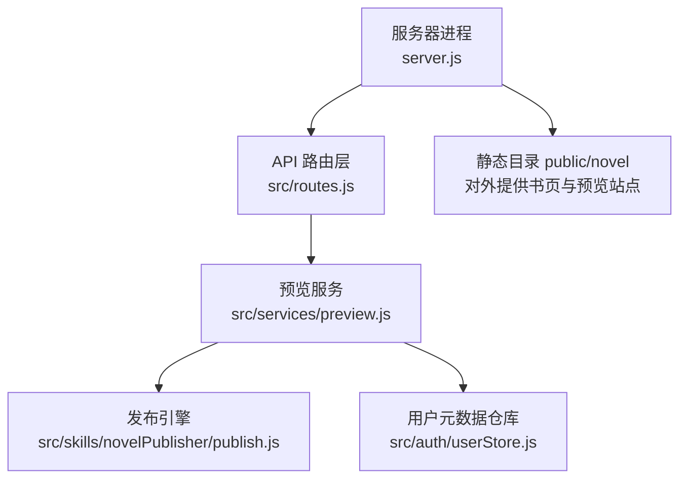
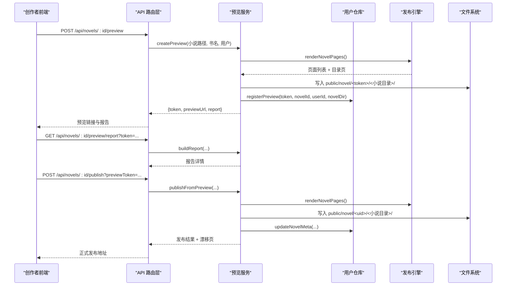
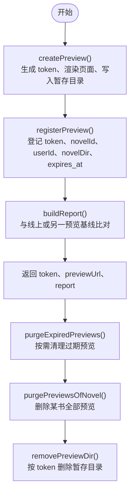
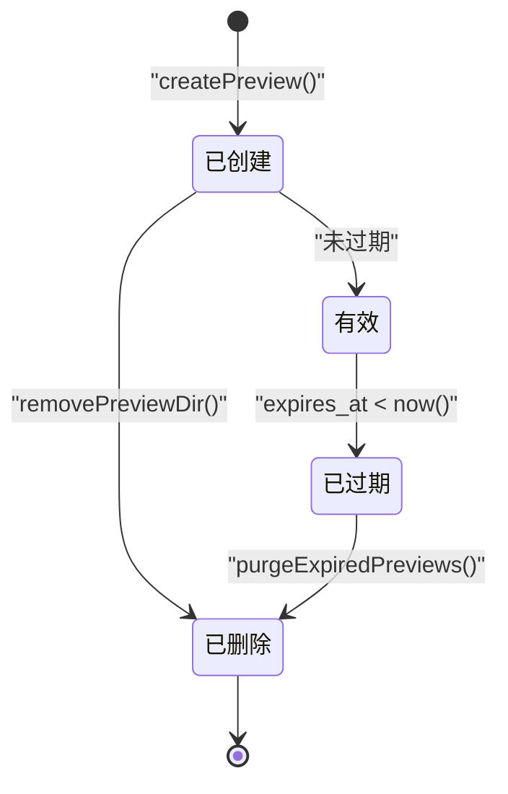
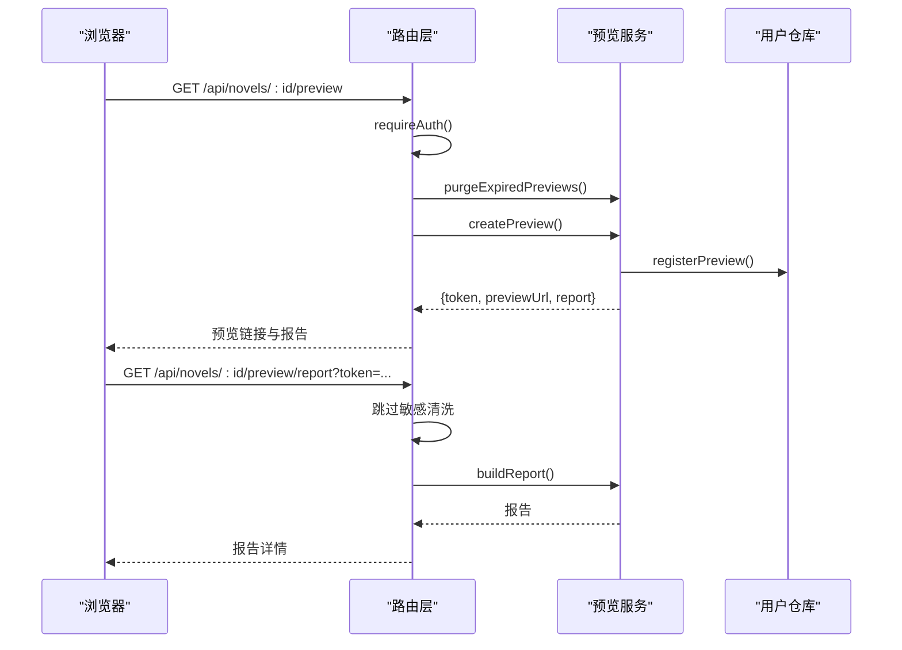
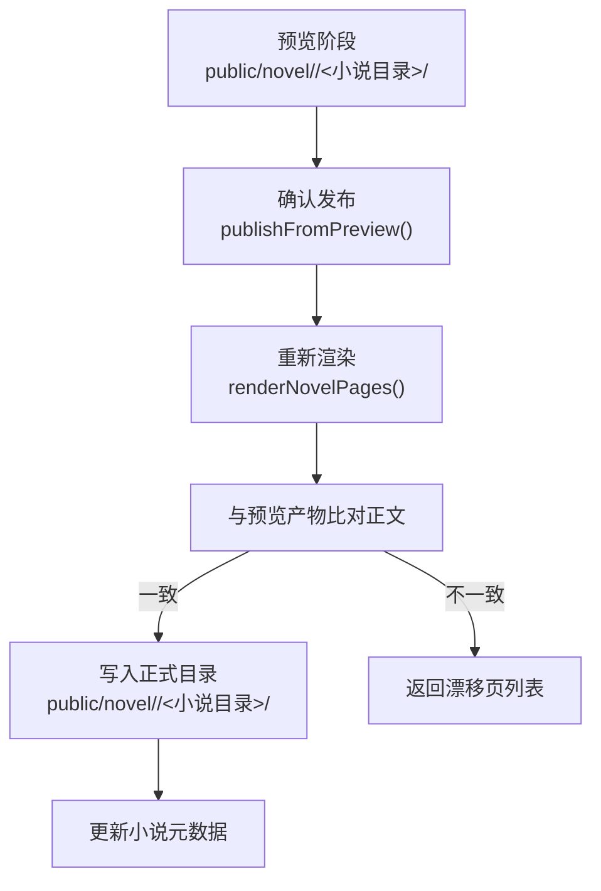
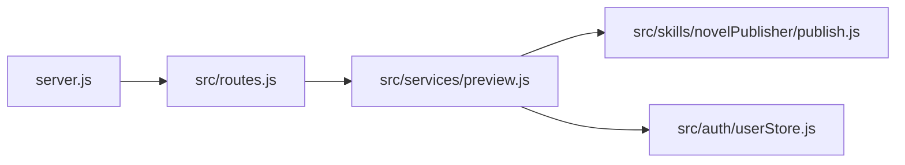

# 预览机制

<cite>
**本文引用的文件**   
- [src/services/preview.js](file://src/services/preview.js)
- [src/routes.js](file://src/routes.js)
- [src/auth/userStore.js](file://src/auth/userStore.js)
- [server.js](file://server.js)
- [src/skills/novelPublisher/publish.js](file://src/skills/novelPublisher/publish.js)
</cite>

## 目录
1. [引言](#引言)
2. [项目结构与预览相关入口](#项目结构与预览相关入口)
3. [核心组件与职责](#核心组件与职责)
4. [架构总览](#架构总览)
5. [详细组件分析](#详细组件分析)
6. [依赖关系分析](#依赖关系分析)
7. [性能与并发特性](#性能与并发特性)
8. [故障排查指南](#故障排查指南)
9. [结论](#结论)
10. [附录：配置与选项说明](#附录配置与选项说明)

## 引言
本技术文档聚焦“预览机制”，即发布前生成临时站点、对比线上页面、提供带鉴权的预览链接，并在确认后把预览产物升级为正式发布的完整流程。文档覆盖以下关键问题：
- 临时站点如何生成、存放、命名和清理。
- 预览链接的 URL 路由、访问控制、过期策略。
- 预览与正式发布的区别：数据隔离、状态管理、版本控制。
- 预览服务的启动与停止机制：端口、资源清理、错误恢复。
- 预览工作流与可配置项：是否预生成测验/生词、基线比对方式、冲突处理等。

## 项目结构与预览相关入口
预览机制横跨服务入口、路由层、预览服务、用户元数据仓库以及小说发布模块：
- 服务入口负责监听端口、挂载静态目录（含 `public/novel`）。
- 路由层暴露预览创建、报告查询、预览后确认发布等 API。
- 预览服务实现暂存站渲染、报告生成、目录清理、单页 diff 与发布校验。
- 用户仓库维护预览登记表，记录 token、归属小说、所有者、目录名与过期时间。
- 发布模块提供章节渲染、索引生成、孤儿页清理等底层能力。

**图表来源**
- [server.js:20-53](file://server.js#L20-L53)
- [src/routes.js:31-34](file://src/routes.js#L31-L34)
- [src/services/preview.js:17-20](file://src/services/preview.js#L17-L20)
- [src/auth/userStore.js:94-101](file://src/auth/userStore.js#L94-L101)
- [src/skills/novelPublisher/publish.js:469-475](file://src/skills/novelPublisher/publish.js#L469-L475)

**章节来源**
- [server.js:1-64](file://server.js#L1-L64)
- [src/routes.js:1-34](file://src/routes.js#L1-L34)

## 核心组件与职责
- **预览服务**：负责生成预览站点、构建修改报告、删除预览目录、清理过期预览、按预览基准发布并检测漂移。
- **路由层**：暴露 `/api/novels/:id/preview`、`/api/novels/:id/preview/report`、预览后确认发布等接口；对预览路径做鉴权与脱敏豁免。
- **用户仓库**：维护 `preview` 表，提供注册、查询、删除、按书枚举、过期扫描等能力。
- **发布引擎**：从小说库读取章节、生成 HTML 页面与目录页、清理孤儿页、生成站点首页。
- **服务入口**：监听端口、挂载静态目录，使 `public/novel` 下的正式站点与预览站点均可被浏览器访问。

**章节来源**
- [src/services/preview.js:1-20](file://src/services/preview.js#L1-L20)
- [src/routes.js:22-26](file://src/routes.js#L22-L26)
- [src/auth/userStore.js:351-378](file://src/auth/userStore.js#L351-L378)
- [src/skills/novelPublisher/publish.js:469-475](file://src/skills/novelPublisher/publish.js#L469-L475)
- [server.js:47-53](file://server.js#L47-L53)

## 架构总览
预览机制的整体调用链如下：
1. 创作者登录后调用预览创建接口。
2. 路由层解析小说、校验权限，并调用预览服务。
3. 预览服务渲染小说页面，写入 `public/novel/<token>/<小说目录>/`，登记预览元信息。
4. 返回预览 URL 与修改报告；前端可继续拉取报告或单页 diff。
5. 创作者确认后调用“预览后发布”接口，预览服务以预览产物为基准重新渲染，校验漂移，写入正式目录，并可选清理孤儿页。

**图表来源**
- [src/routes.js:1123-1145](file://src/routes.js#L1123-L1145)
- [src/services/preview.js:328-359](file://src/services/preview.js#L328-L359)
- [src/services/preview.js:423-469](file://src/services/preview.js#L423-L469)
- [src/auth/userStore.js:354-360](file://src/auth/userStore.js#L354-L360)

## 详细组件分析

### 预览服务：临时站点生成、生命周期与清理
预览服务是预览机制的核心，承担以下职责：
- 生成 16 位十六进制 token 作为预览目录名。
- 渲染小说页面，写入 `<outRoot>/<token>/<小说目录>/`。
- 生成预览站点首页，便于在预览根目录下浏览多本书。
- 登记预览元信息到用户仓库，包含 token、小说 id、用户 id、渲染时的小说目录名、创建时间与过期时间。
- 支持按 token 删除预览目录，幂等且只认登记表中的 token。
- 支持批量清理过期预览。
- 支持删除某本小说的全部预览目录。
- 支持生成修改报告与单页 diff。

**图表来源**
- [src/services/preview.js:328-359](file://src/services/preview.js#L328-L359)
- [src/services/preview.js:362-389](file://src/services/preview.js#L362-L389)
- [src/auth/userStore.js:354-378](file://src/auth/userStore.js#L354-L378)

#### 预览目录管理与命名规则
- 预览根目录为 `public/novel`。
- 每个预览使用 16 位十六进制 token 作为一级目录，例如 `public/novel/<token>`。
- 二级目录为清洗后的小说目录名，由发布模块的 `sanitizeDirName` 生成。
- 预览目录结构与正式站点目录结构一致：`<uid>/<小说目录>/index.html` 与 `chapter_*.html`。

**章节来源**
- [src/services/preview.js:24-30](file://src/services/preview.js#L24-L30)
- [src/skills/novelPublisher/publish.js:469-475](file://src/skills/novelPublisher/publish.js#L469-L475)

#### 预览生命周期与自动清理
- 默认预览 TTL 为 24 小时，登记时写入 `expires_at`。
- 过期预览通过 `listExpiredPreviews` 查询，再由 `purgeExpiredPreviews` 删除对应目录并移除登记行。
- 删除小说前必须先调用 `purgePreviewsOfNovel`，否则登记行被删后磁盘上的预览目录将无人认领。
- 删除预览目录时仅接受合法 token，避免误删未知目录。

**图表来源**
- [src/auth/userStore.js:352-378](file://src/auth/userStore.js#L352-L378)
- [src/services/preview.js:362-389](file://src/services/preview.js#L362-L389)

**章节来源**
- [src/auth/userStore.js:351-378](file://src/auth/userStore.js#L351-L378)
- [src/services/preview.js:362-389](file://src/services/preview.js#L362-L389)

### 预览链接生成与管理：URL 路由、访问控制、并发处理
- 预览 URL 格式为 `<BASE_PATH>/<token>/<小说目录>/index.html`。
- 预览链接不公开，需要创作者本人登录态或超管访问；未登录或未授权时返回专用无权页。
- 路由层对 `/api/novels/:id/preview` 与 `/api/novels/:id/preview/report` 进行鉴权保护，并对预览相关响应跳过敏感字段清洗。
- 预览创建接口会先清理过期预览，再创建新预览，避免旧 token 残留影响。
- 预览本身不引入独立服务或定时器，清理逻辑在服务请求中按需触发。

**图表来源**
- [src/routes.js:1123-1145](file://src/routes.js#L1123-L1145)
- [src/services/preview.js:328-359](file://src/services/preview.js#L328-L359)
- [src/auth/userStore.js:354-360](file://src/auth/userStore.js#L354-L360)

**章节来源**
- [src/routes.js:331-339](file://src/routes.js#L331-L339)
- [src/routes.js:1123-1145](file://src/routes.js#L1123-L1145)
- [src/services/preview.js:328-359](file://src/services/preview.js#L328-L359)

### 预览与正式发布的区别：数据隔离、状态管理、版本控制
- 数据隔离：预览产物写入 `public/novel/<token>/<小说目录>/`，正式产物写入 `public/novel/<uid>/<小说目录>/`。
- 状态管理：预览登记在 `preview` 表，正式发布更新 `novel` 表的标题与章节数。
- 版本控制：预览后确认发布会重新渲染，并与预览产物逐页比对正文内容；若不一致则返回漂移页列表，防止“看到的东西与发出去的不一样”。

**图表来源**
- [src/services/preview.js:423-469](file://src/services/preview.js#L423-L469)

**章节来源**
- [src/services/preview.js:423-469](file://src/services/preview.js#L423-L469)

### 预览服务的启动与停止机制：端口管理、资源清理、错误恢复
- 启动：服务入口监听环境变量 `PORT`，默认 3400；挂载 `/novel` 静态目录，使 `public/novel` 下的预览与正式站点可被浏览器访问。
- 资源清理：预览目录清理由 `removePreviewDir` 与 `purgeExpiredPreviews` 完成；删除小说时调用 `purgePreviewsOfNovel`。
- 错误恢复：预览首页生成失败不影响单本预览；预览目录不存在或 token 非法时返回明确错误；预览后发布检测到漂移时返回漂移页而非静默发布。

**章节来源**
- [server.js:20-53](file://server.js#L20-L53)
- [src/services/preview.js:346-353](file://src/services/preview.js#L346-L353)
- [src/services/preview.js:362-389](file://src/services/preview.js#L362-L389)
- [src/services/preview.js:423-469](file://src/services/preview.js#L423-L469)

## 依赖关系分析
预览机制的关键依赖如下：
- 预览服务依赖发布引擎进行页面渲染与目录生成。
- 预览服务依赖用户仓库进行预览登记、过期查询与删除。
- 路由层依赖预览服务暴露 API，并依赖用户仓库进行鉴权与会话管理。
- 服务入口依赖路由层与静态目录挂载。

**图表来源**
- [server.js:13-16](file://server.js#L13-L16)
- [src/routes.js:22-26](file://src/routes.js#L22-L26)
- [src/services/preview.js:17-20](file://src/services/preview.js#L17-L20)

**章节来源**
- [server.js:1-64](file://server.js#L1-L64)
- [src/routes.js:1-34](file://src/routes.js#L1-L34)
- [src/services/preview.js:1-20](file://src/services/preview.js#L1-L20)

## 性能与并发特性
- 预览创建会渲染整本小说页面，属于较重操作；路由层在长任务处有进度通道与限流设计，但预览接口本身未引入全局互斥锁。
- 预览清理采用“按需触发”模式，在创建预览时顺手回收过期预览，避免引入后台定时器。
- 预览目录清理与发布清理均基于文件系统操作，需注意磁盘 I/O 与并发写场景。
- 预览报告生成会读取线上或预览基线的页面并进行文本比对，复杂度与页面数量成正比。

[本节为通用性能讨论，不直接分析具体代码文件]

## 故障排查指南
常见问题与定位建议：
- 预览链接无法访问：检查是否已登录创作者账号；预览链接仅在创作者登录态下可见。
- 预览目录不存在：检查 token 是否合法；预览可能已过期或被手动删除。
- 预览后发布出现漂移：说明预览生成后又修改了小说内容；查看漂移页列表并重新生成预览。
- 同名书目录冲突：预览报告提示“书名冲突”，此时不会删除线上旧页，需先改书名再发布。
- 删除小说后仍有预览残留：确认是否在删除登记行前调用了 `purgePreviewsOfNovel`。

**章节来源**
- [src/routes.js:243-261](file://src/routes.js#L243-L261)
- [src/services/preview.js:391-414](file://src/services/preview.js#L391-L414)
- [src/services/preview.js:423-469](file://src/services/preview.js#L423-L469)

## 结论
预览机制通过“暂存站点 + 修改报告 + 预览后确认发布”的流程，确保创作者在发布前能看到真实可读的预览，并清楚知道哪些页面会被新增、修改、下线或连带影响。预览与正式发布在目录、状态与版本上严格隔离；预览生命周期由登记表与过期时间控制；清理逻辑在服务请求中按需执行，避免后台定时器的复杂性。整体设计兼顾安全性、可审计性与可恢复性。

[本节为总结性内容，不直接分析具体代码文件]

## 附录：配置与选项说明
- 预览预生成开关：`premake` 控制是否预生成测验与生词；配合 `llmHooks` 注入 LLM 能力。
- 测验年龄参数：`quizAge` 与 `vocabAge` 控制测验与生词生成的年龄偏好。
- 预览基线比对：`compareToToken` 允许与另一个预览基线比对，而不是与线上正式目录比对。
- 预览 URL 前缀：由 `BASE_PATH` 决定，服务入口会剥离应用命名空间前缀。
- 预览 TTL：默认 24 小时，登记时写入 `expires_at`。
- 预览清理策略：按需清理过期预览；删除小说前先清理预览目录。
- 发布清理策略：`prune` 控制是否清理孤儿页；书名冲突时禁用清理以免误删其他书章节。

**章节来源**
- [src/services/preview.js:328-359](file://src/services/preview.js#L328-L359)
- [src/services/preview.js:423-469](file://src/services/preview.js#L423-L469)
- [src/auth/userStore.js:352-378](file://src/auth/userStore.js#L352-L378)
- [server.js:25-36](file://server.js#L25-L36)