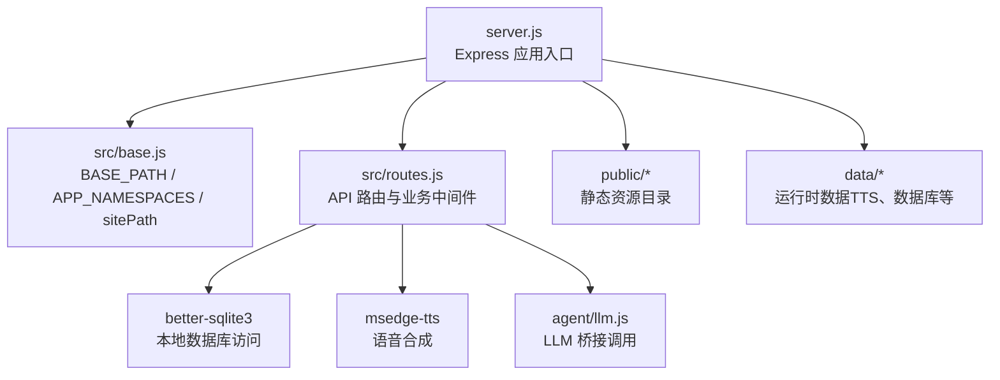
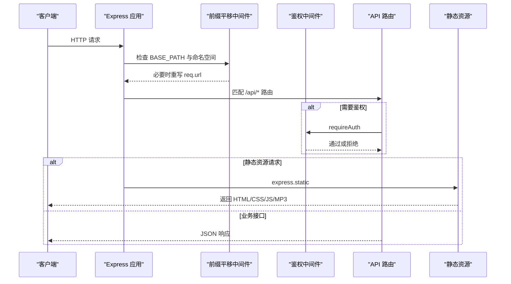
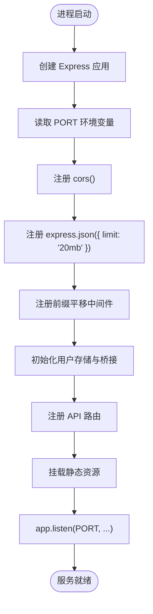
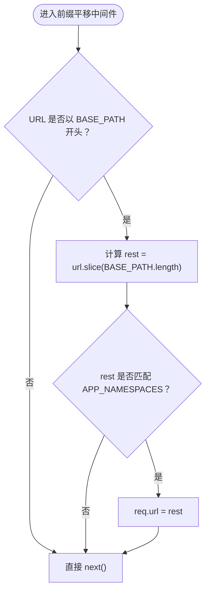
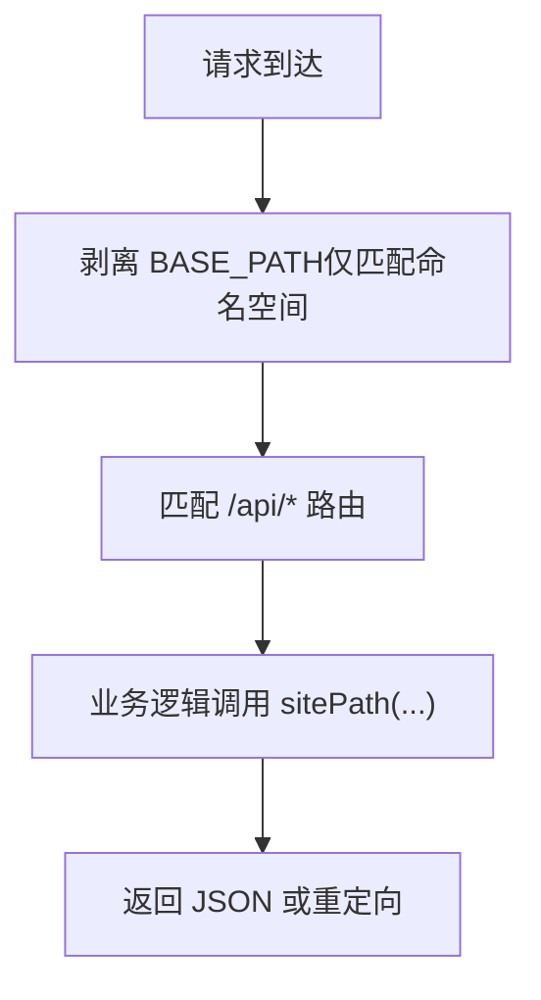
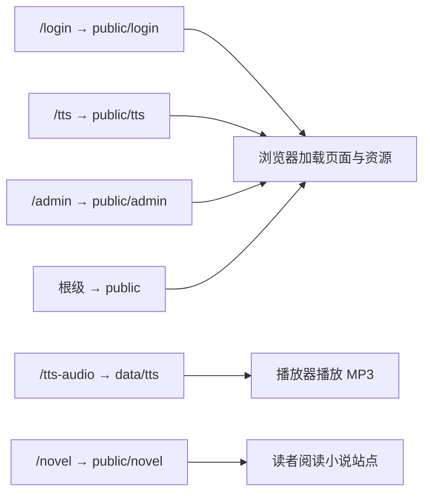
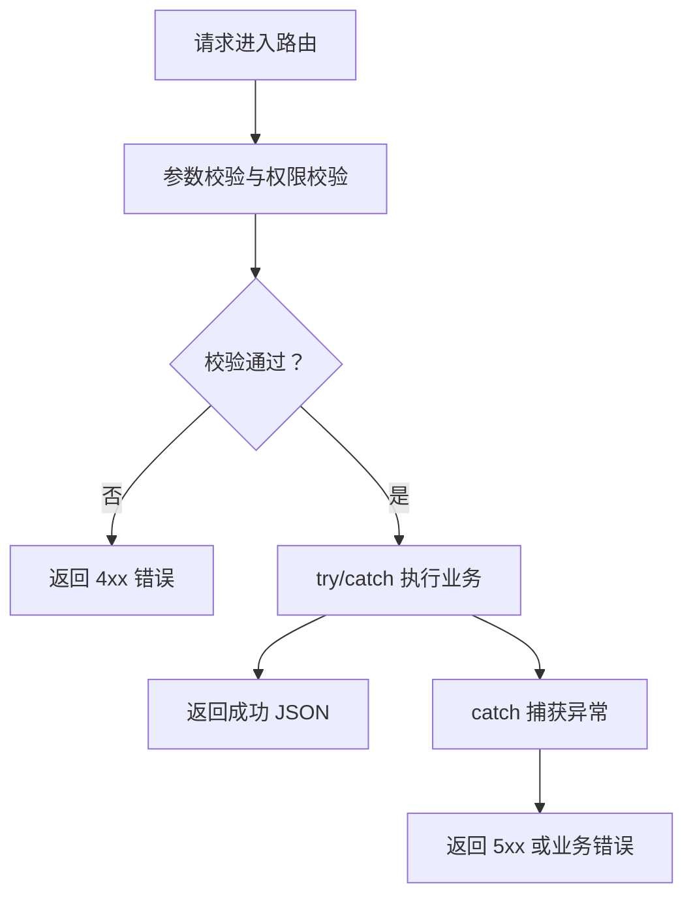
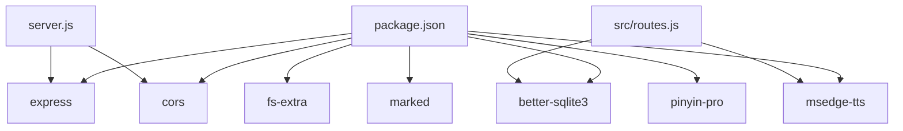

# Express.js 应用配置

<cite>
**本文引用的文件**   
- [server.js](file://server.js)
- [src/base.js](file://src/base.js)
- [src/routes.js](file://src/routes.js)
- [package.json](file://package.json)
</cite>

## 目录
1. [简介](#简介)
2. [项目结构](#项目结构)
3. [核心组件](#核心组件)
4. [架构总览](#架构总览)
5. [详细组件分析](#详细组件分析)
6. [依赖关系分析](#依赖关系分析)
7. [性能与容量特性](#性能与容量特性)
8. [故障排查指南](#故障排查指南)
9. [结论](#结论)
10. [附录：操作示例](#附录操作示例)

## 简介
本文面向需要理解并扩展该 Express.js 小说平台后端配置的工程师，重点覆盖以下内容：
- 应用启动流程与中间件注册顺序
- CORS、JSON 解析器设置
- BASE_PATH 前缀平移机制与 APP_NAMESPACES 命名空间匹配规则
- URL 重写逻辑及其对 API、静态资源的影响
- 静态资源服务挂载策略（登录页、管理后台、TTS 资源、小说内容）
- 端口与环境变量处理
- 错误处理机制
- 如何添加新中间件、新静态路径以及跨域请求配置

## 项目结构
本项目的 Web 入口是 `server.js`，它负责创建 Express 应用、注册全局中间件、初始化数据与桥接服务、挂载路由和静态资源。站点的基础路径由 `src/base.js` 集中定义；API 路由集中在 `src/routes.js`。

**图表来源**
- [server.js:9-53](file://server.js#L9-L53)
- [src/base.js:17-41](file://src/base.js#L17-L41)
- [src/routes.js:10-33](file://src/routes.js#L10-L33)

**章节来源**
- [server.js:1-64](file://server.js#L1-L64)
- [src/base.js:1-42](file://src/base.js#L1-L42)
- [src/routes.js:1-33](file://src/routes.js#L1-L33)
- [package.json:1-29](file://package.json#L1-L29)

## 核心组件
- Express 应用实例：在 `server.js` 中创建，并依次注册 CORS、JSON 解析器、前缀平移中间件、路由与静态资源。
- 基础路径与命名空间：在 `src/base.js` 中定义 `BASE_PATH`、`APP_NAMESPACES` 与 `sitePath`，作为全站路径权威来源。
- API 路由层：在 `src/routes.js` 中注册 `/api/*` 路由，包含鉴权、限流、租户隔离、TTS、阅读器 AI、发布与预览等能力。
- 静态资源：在 `server.js` 中按功能域分别挂载登录页、TTS 前端、TTS 音频、管理后台与小说站点。

**章节来源**
- [server.js:18-53](file://server.js#L18-L53)
- [src/base.js:17-41](file://src/base.js#L17-L41)
- [src/routes.js:331-560](file://src/routes.js#L331-L560)

## 架构总览
下图展示一次典型请求从进入服务器到返回响应的关键阶段，包括前缀剥离、鉴权、业务处理与静态资源返回。

**图表来源**
- [server.js:22-53](file://server.js#L22-L53)
- [src/routes.js:331-560](file://src/routes.js#L331-L560)

## 详细组件分析

### 应用启动流程与中间件注册顺序
启动过程如下：
1. 导入依赖并创建 Express 应用。
2. 读取环境变量 `PORT`，默认值为 `3400`。
3. 注册全局中间件：
   - CORS：允许跨域请求。
   - JSON 解析器：限制请求体大小为 `20mb`。
4. 注册前缀平移中间件：根据 `BASE_PATH` 与 `APP_NAMESPACES` 决定是否剥离外部前缀。
5. 初始化多用户元数据与 LLM 桥接。
6. 注册 API 路由。
7. 挂载静态资源目录。
8. 监听端口并输出运行信息。

**图表来源**
- [server.js:18-63](file://server.js#L18-L63)

**章节来源**
- [server.js:18-63](file://server.js#L18-L63)

### BASE_PATH 前缀平移机制与 APP_NAMESPACES 匹配规则
- `BASE_PATH` 来自环境变量 `BASE_PATH`，默认值为 `/novel`。
- 值会被规范化：去除空白、去除尾部斜杠；显式传空串表示挂在根路径。
- 校验规则：只允许空串或 `/novel`，否则启动即报错。这是为了防止书页内部挂载点 `/novel` 与外部前缀不一致导致双前缀问题。
- `APP_NAMESPACES` 是一个正则表达式，匹配以下相对 `BASE_PATH` 的内部路径：
  - `/api`
  - `/login`
  - `/tts`
  - `/tts-audio`
  - `/admin`
- 前缀平移中间件仅在请求 URL 以 `BASE_PATH` 开头时生效，并且只有当剩余部分匹配 `APP_NAMESPACES` 时才把 `req.url` 重写为去掉 `BASE_PATH` 后的路径。
- 书页路径 `<BASE>/<uid>/<小说名>/...` 不在此列，因为书页内部已经挂在 `/novel`，若一并剥离会导致 `/novel/novel/...` 的双前缀。

**图表来源**
- [server.js:30-36](file://server.js#L30-L36)
- [src/base.js:17-34](file://src/base.js#L17-L34)

**章节来源**
- [src/base.js:17-34](file://src/base.js#L17-L34)
- [server.js:25-36](file://server.js#L25-L36)

### URL 重写逻辑与对外路径生成
- 前缀平移发生在所有路由之前，因此 API 路由可以继续使用根级路径字面量，例如 `/api/login`、`/api/novels`。
- 对外路径统一通过 `sitePath(...)` 生成，它会拼接 `BASE_PATH` 并压缩多余斜杠。
- 对于 TTS 音频 URL，系统使用 `sitePath('tts-audio', ...)` 生成带前缀的音频地址，避免线上代理把根级 `/tts-audio` 误交给其他服务。

**图表来源**
- [server.js:30-36](file://server.js#L30-L36)
- [src/base.js:36-41](file://src/base.js#L36-L41)
- [src/routes.js:445-449](file://src/routes.js#L445-L449)

**章节来源**
- [src/base.js:36-41](file://src/base.js#L36-L41)
- [src/routes.js:445-449](file://src/routes.js#L445-L449)

### CORS 配置
- 使用 `cors()` 默认配置，未传入白名单、方法、头或凭据限制。
- 这意味着浏览器跨域请求会走通用放行策略；如需更严格的安全控制，应显式传入配置对象。

**章节来源**
- [server.js:22](file://server.js#L22)

### JSON 解析器设置
- 使用 `express.json({ limit: '20mb' })`。
- 这会影响所有后续中间件与路由的 `req.body` 解析。
- 如果上传大文件或二进制数据，应考虑改用 `express.raw` 或分片上传策略。

**章节来源**
- [server.js:23](file://server.js#L23)

### 静态资源服务配置
静态资源挂载顺序非常重要，因为 Express 会按注册顺序匹配第一个命中路径：

| 挂载路径 | 物理目录 | 用途说明 |
|---|---|---|
| `/login` | `public/login` | 登录页面公开可用 |
| `/tts` | `public/tts` | TTS 前端 JS/CSS |
| `/tts-audio` | `data/tts` | 已合成的 MP3 音频，启用强缓存 |
| `/admin` | `public/admin` | 管理后台 HTML 壳 |
| `/novel` | `public/novel` | 已发布的小说站点产物 |
| 根级 | `public` | 兜底静态资源 |

- `/tts-audio` 使用了 `{ immutable: true, maxAge: '1y' }`，适合长期不变的音频产物。
- 根级 `express.static(path.join(__dirname, 'public'))` 放在最后，用于兜底返回 `public/index.html` 等公共页面。

**图表来源**
- [server.js:48-53](file://server.js#L48-L53)

**章节来源**
- [server.js:48-53](file://server.js#L48-L53)

### 端口配置与环境变量处理
- 端口：`process.env.PORT || 3400`。
- 基础路径：`process.env.BASE_PATH`，默认 `/novel`，支持空串表示根路径。
- LLM 模型与参数：
  - `NOVEL_LLM_MODEL`
  - `NOVEL_LLM_TEMPERATURE`
  - `NOVEL_LLM_MAX_TOKENS`
- 桥接密钥与地址：由 `bridgeStore` 与 `agent/llm.js` 动态获取，不在启动时固定。

**章节来源**
- [server.js:20](file://server.js#L20)
- [src/base.js:17-28](file://src/base.js#L17-L28)
- [src/routes.js:55-64](file://src/routes.js#L55-L64)

### 错误处理机制
- 路由层普遍采用 try/catch 包裹异步逻辑，失败时返回结构化 JSON 错误。
- 限流中间件在超出阈值时返回 `429`，并附带 `Retry-After` 秒数。
- TTS 合成失败返回 `503`，并携带具体失败原因与降级提示。
- 删除类破坏性操作要求二次确认，否则返回 `400`。
- 输出净化：除登录、会话、账号管理、预览、公开书单等端点外，`/api` 响应会过滤敏感字段与绝对路径。

**图表来源**
- [src/routes.js:289-306](file://src/routes.js#L289-L306)
- [src/routes.js:457-488](file://src/routes.js#L457-L488)
- [src/routes.js:665-676](file://src/routes.js#L665-L676)
- [src/routes.js:331-339](file://src/routes.js#L331-L339)

**章节来源**
- [src/routes.js:289-306](file://src/routes.js#L289-L306)
- [src/routes.js:457-488](file://src/routes.js#L457-L488)
- [src/routes.js:665-676](file://src/routes.js#L665-L676)
- [src/routes.js:331-339](file://src/routes.js#L331-L339)

## 依赖关系分析
- 运行时依赖：
  - `express`：Web 框架。
  - `cors`：跨域中间件。
  - `better-sqlite3`：本地 SQLite 数据库。
  - `fs-extra`：文件系统增强。
  - `marked`：Markdown 渲染。
  - `msedge-tts`：微软边缘 TTS。
  - `pinyin-pro`：拼音工具。
- 入口脚本：`package.json` 的 `main` 指向 `server.js`，启动命令为 `node server.js`。

**图表来源**
- [package.json:19-27](file://package.json#L19-L27)
- [server.js:9-16](file://server.js#L9-L16)
- [src/routes.js:10-28](file://src/routes.js#L10-L28)

**章节来源**
- [package.json:1-29](file://package.json#L1-L29)
- [server.js:9-16](file://server.js#L9-L16)
- [src/routes.js:10-28](file://src/routes.js#L10-L28)

## 性能与容量特性
- JSON 请求体上限为 `20mb`，适合管理后台与大文本编辑场景。
- TTS 合成接口有独立限流桶，避免批量逐句生成时触发整体限流。
- 阅读器 AI 接口也有独立限流桶，防止读者并发点击造成雪崩。
- 长任务进度通道使用内存缓冲与定时清理，避免无限增长。
- 静态音频使用强缓存，减少重复下载。

[本节为通用性能讨论，不直接分析具体代码行]

## 故障排查指南
- 启动时报错 `BASE_PATH 只能取 '' 或 '/novel'`：
  - 检查 `BASE_PATH` 环境变量是否为空或 `/novel`。
  - 如果生产环境 nginx 原样转发前缀，请确保站点确实挂在 `/novel`。
- 登录后仍无法访问 VIP 内容：
  - 检查会话 Cookie 路径是否与 `BASE_PATH` 一致。
  - 检查管理员是否授予对应读者的 VIP 授权。
- TTS 音频 404 或播放失败：
  - 检查 `/tts-audio` 是否被正确挂载。
  - 检查音频文件是否生成到 `data/tts`。
  - 检查代理是否把根级 `/tts-audio` 转给其他服务。
- 跨域请求失败：
  - 检查浏览器是否发送了预检请求。
  - 如需限制来源，应在 `cors()` 中显式配置白名单。
- 接口返回 429：
  - 查看 `Retry-After` 头部，等待指定秒数后重试。
  - 检查是否同一真实 IP 频繁触发限流。

**章节来源**
- [src/base.js:23-28](file://src/base.js#L23-L28)
- [server.js:48-53](file://server.js#L48-L53)
- [src/routes.js:289-306](file://src/routes.js#L289-L306)
- [src/routes.js:445-449](file://src/routes.js#L445-L449)

## 结论
该 Express.js 应用通过集中化的 `BASE_PATH` 与命名空间匹配实现前缀透明，使开发环境与生产环境 URL 保持一致。CORS 与 JSON 解析器位于最外层，前缀平移紧随其后，再进入鉴权与业务路由。静态资源按功能域分层挂载，兼顾公开页面、管理后台、TTS 前端与音频产物。错误处理以结构化 JSON 为主，配合限流与输出净化提升安全性与可观测性。

[本节为总结性内容，不直接分析具体代码行]

## 附录：操作示例

### 添加新的中间件
推荐位置：
- 如果需要影响所有请求，放在 CORS 与 JSON 解析器之后、前缀平移之前或之后，视是否需要感知原始 URL 而定。
- 如果只影响 API，建议放在 `registerRoutes` 内部 `/api` 前缀下。

步骤要点：
1. 在 `server.js` 中引入中间件模块。
2. 在合适位置调用 `app.use(你的中间件)`。
3. 如果中间件需要修改请求体或响应体，注意不要破坏已有 JSON 解析与输出净化逻辑。

参考位置：
- [server.js:22-23](file://server.js#L22-L23)
- [src/routes.js:331-339](file://src/routes.js#L331-L339)

### 配置新的静态资源路径
步骤要点：
1. 确定对外路径，例如 `/my-assets`。
2. 确定物理目录，例如 `public/my-assets`。
3. 在 `server.js` 中新增 `app.use('/my-assets', express.static(path.join(__dirname, 'public/my-assets')))`.
4. 如果资源长期不变，可加上 `{ immutable: true, maxAge: '1y' }`。
5. 确保该挂载路径不会与已有路径冲突。

参考位置：
- [server.js:48-53](file://server.js#L48-L53)

### 处理跨域请求
当前使用默认 `cors()`，适用于大多数内网或同源代理场景。如需更严格策略：
- 指定允许的源：`origin`
- 指定允许的 HTTP 方法：`methods`
- 指定允许的请求头：`allowedHeaders`
- 允许携带凭据：`credentials`

参考位置：
- [server.js:22](file://server.js#L22)

### 添加新的 API 路由
步骤要点：
1. 在 `src/routes.js` 的 `registerRoutes(app)` 中添加路由。
2. 如果需要鉴权，放在 `app.use('/api', requireAuth)` 之后。
3. 如果需要限流，先包装限流中间件。
4. 返回结构化 JSON，避免泄露敏感信息。

参考位置：
- [src/routes.js:331-339](file://src/routes.js#L331-L339)
- [src/routes.js:559-560](file://src/routes.js#L559-L560)
- [src/routes.js:289-306](file://src/routes.js#L289-L306)