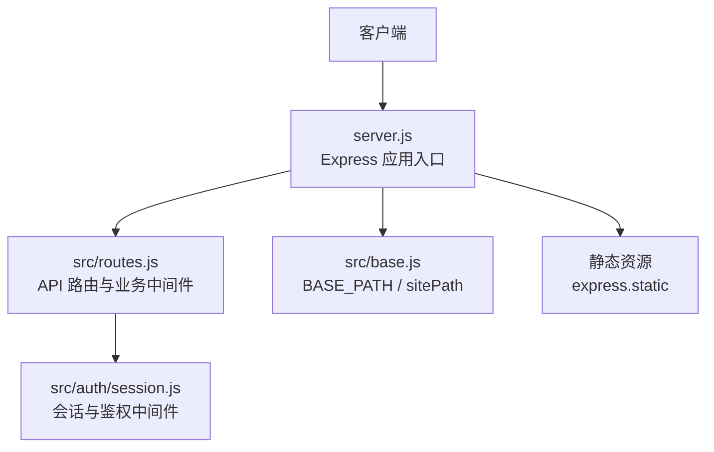
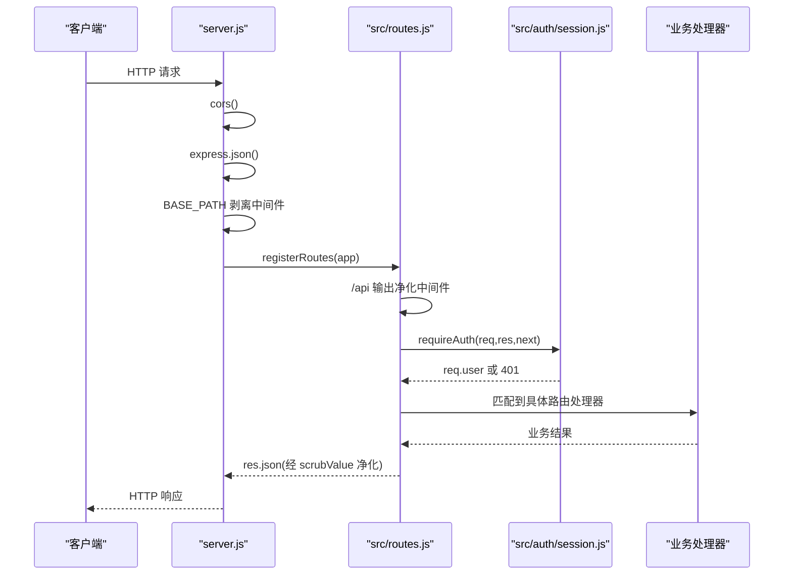
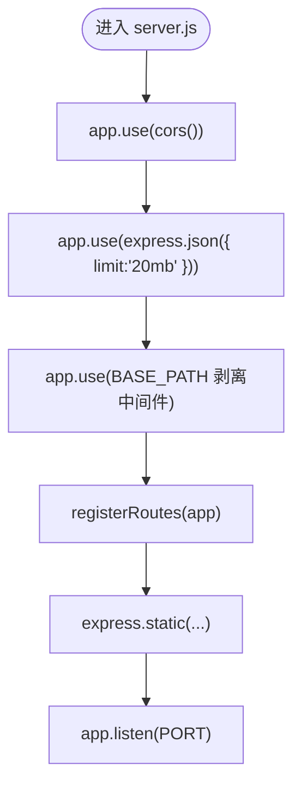
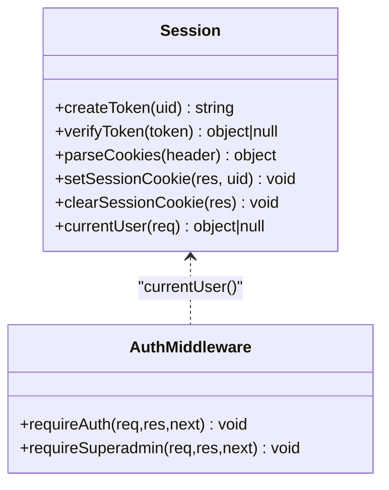
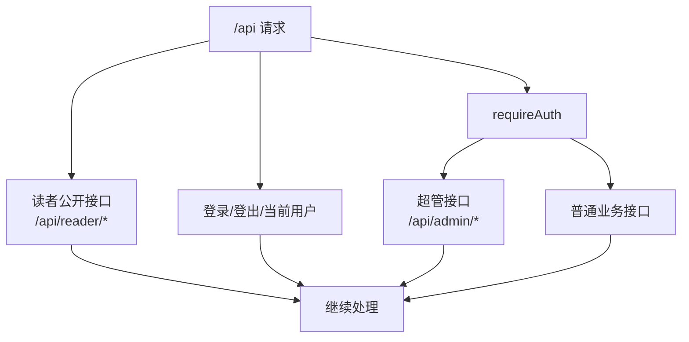
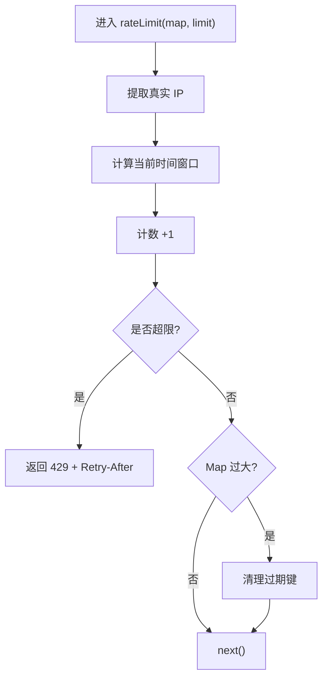
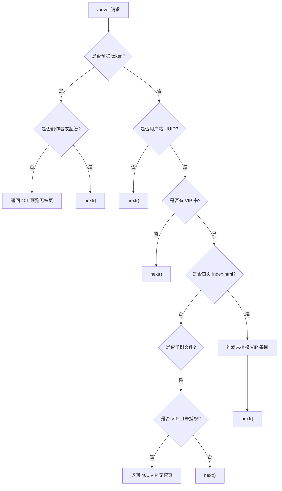
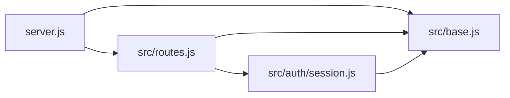

# 中间件机制

<cite>
**本文引用的文件**   
- [server.js](file://server.js)
- [src/routes.js](file://src/routes.js)
- [src/auth/session.js](file://src/auth/session.js)
- [src/base.js](file://src/base.js)
</cite>

## 目录
1. [引言](#引言)
2. [项目结构](#项目结构)
3. [核心组件](#核心组件)
4. [架构总览](#架构总览)
5. [详细组件分析](#详细组件分析)
6. [依赖关系分析](#依赖关系分析)
7. [性能与扩展建议](#性能与扩展建议)
8. [故障排查指南](#故障排查指南)
9. [结论](#结论)

## 引言
本文围绕 Express.js 中间件机制，结合本仓库的实际实现，系统说明：
- 中间件的执行顺序、请求拦截与响应修改方式
- 错误传播与统一处理模式
- 认证、限流、路径前缀剥离等自定义中间件模式
- 内置中间件（CORS、JSON 解析、静态资源）的使用方式
- 条件执行、组合模式与最佳实践
- 如何编写认证、日志、性能监控类中间件

## 项目结构
本项目采用“应用入口 + 路由模块”的简单分层：
- `server.js`：Express 应用初始化、全局中间件注册、静态资源挂载、服务启动
- `src/routes.js`：API 路由与业务逻辑，集中注册路由并挂载鉴权、净化、限流等中间件
- `src/auth/session.js`：零依赖会话与会话守卫中间件
- `src/base.js`：站点挂载前缀与路径工具，作为前缀感知的权威来源

**图表来源**
- [server.js:9-53](file://server.js#L9-L53)
- [src/routes.js:331-560](file://src/routes.js#L331-L560)
- [src/auth/session.js:93-110](file://src/auth/session.js#L93-L110)
- [src/base.js:17-41](file://src/base.js#L17-L41)

**章节来源**
- [server.js:1-64](file://server.js#L1-L64)
- [src/routes.js:1-35](file://src/routes.js#L1-L35)
- [src/auth/session.js:1-118](file://src/auth/session.js#L1-L118)
- [src/base.js:1-42](file://src/base.js#L1-L42)

## 核心组件
- 全局中间件层：CORS、JSON 解析、路径前缀剥离
- API 层中间件：输出净化、鉴权、超管校验、限流、VIP/预览闸门
- 会话中间件：基于 HMAC-SHA256 的 httpOnly Cookie 会话
- 静态资源中间件：登录页、管理页、TTS 音频、书页静态文件

关键职责划分：
- `server.js` 负责“平台级”中间件和静态资源
- `src/routes.js` 负责“API 级”中间件和业务路由
- `src/auth/session.js` 提供可复用的鉴权中间件
- `src/base.js` 提供前缀感知能力，避免 URL 拼接错误

**章节来源**
- [server.js:22-53](file://server.js#L22-L53)
- [src/routes.js:331-560](file://src/routes.js#L331-L560)
- [src/auth/session.js:75-110](file://src/auth/session.js#L75-L110)
- [src/base.js:17-41](file://src/base.js#L17-L41)

## 架构总览
下图展示一个典型请求从进入应用到返回响应的中间件链路。

**图表来源**
- [server.js:22-36](file://server.js#L22-L36)
- [src/routes.js:331-339](file://src/routes.js#L331-L339)
- [src/routes.js:560-560](file://src/routes.js#L560-L560)
- [src/auth/session.js:93-110](file://src/auth/session.js#L93-L110)

## 详细组件分析

### 全局中间件链（server.js）
- CORS：允许跨域访问
- JSON 解析：限制请求体大小，避免过大负载
- 前缀剥离：当外部通过 `BASE_PATH` 访问时，把 `/novel/api|login|tts|...` 剥回内部根路径，使路由无需重复写前缀；但书页 `/novel/<uid>/...` 不在此列，避免双前缀

**图表来源**
- [server.js:22-53](file://server.js#L22-L53)
- [server.js:55-63](file://server.js#L55-L63)

**章节来源**
- [server.js:22-53](file://server.js#L22-L53)
- [src/base.js:17-34](file://src/base.js#L17-L34)

### API 输出净化中间件（src/routes.js）
在 `/api` 下，除少数公开接口外，所有 JSON 响应都会经过 `scrubValue` 清洗，移除敏感字段、隐藏服务器路径与网络地址片段，降低信息泄露风险。该中间件通过包装 `res.json` 实现响应修改。

要点：
- 使用 `app.use('/api', ...)` 将净化作用域限定在 `/api`
- 对特定路径放行，避免登录、账号、公开书单等接口被误清洗
- 通过重写 `res.json` 实现响应体过滤

**章节来源**
- [src/routes.js:67-95](file://src/routes.js#L67-L95)
- [src/routes.js:331-339](file://src/routes.js#L331-L339)

### 认证中间件（src/auth/session.js）
会话采用零依赖方案：
- Cookie 名称固定，httpOnly、SameSite=Lax，Path 受 `BASE_PATH` 控制
- Token 由 base64url(JSON{uid,exp}) 与 HMAC-SHA256 签名组成
- `currentUser` 解析 Cookie，校验签名与过期时间，并查询用户是否禁用
- `requireAuth` 是标准 Express 中间件：未登录返回 401，已登录注入 `req.user`
- `requireSuperadmin` 在 `requireAuth` 之后使用，校验角色为 superadmin

**图表来源**
- [src/auth/session.js:42-91](file://src/auth/session.js#L42-L91)
- [src/auth/session.js:93-110](file://src/auth/session.js#L93-L110)

**章节来源**
- [src/auth/session.js:1-118](file://src/auth/session.js#L1-L118)

### 鉴权组合与条件执行（src/routes.js）
- 公开端点：`/api/login`、`/api/logout`、`/api/me` 以及 `/api/reader/*` 系列，注册在 `requireAuth` 之前
- 受保护端点：`app.use('/api', requireAuth)` 作为统一守卫
- 超管端点：如 `/api/admin/*`，在 `requireAuth` 后再叠加 `requireSuperadmin`

**图表来源**
- [src/routes.js:341-350](file://src/routes.js#L341-L350)
- [src/routes.js:352-390](file://src/routes.js#L352-L390)
- [src/routes.js:559-560](file://src/routes.js#L559-L560)
- [src/routes.js:679-679](file://src/routes.js#L679-L679)

**章节来源**
- [src/routes.js:341-390](file://src/routes.js#L341-L390)
- [src/routes.js:559-560](file://src/routes.js#L559-L560)
- [src/routes.js:679-679](file://src/routes.js#L679-L679)

### 限流中间件（src/routes.js）
项目实现了定窗限流：
- 按真实客户端 IP 分桶，窗口 60 秒
- 超过阈值返回 429，并设置 `Retry-After`
- 针对读者接口与 TTS 接口分别配置不同上限
- 清理过期窗口，防止 Map 无限增长

**图表来源**
- [src/routes.js:263-306](file://src/routes.js#L263-L306)

**章节来源**
- [src/routes.js:263-306](file://src/routes.js#L263-L306)
- [src/routes.js:352-358](file://src/routes.js#L352-L358)

### 书页闸门中间件（src/routes.js）
在静态资源 `/novel` 之前，注册了一个复杂的路径闸门：
- 识别预览暂存站 token，仅创作者本人或超管可访问
- 识别 VIP 小说：首页隐藏未授权条目，子树返回无权页
- 非 VIP 或非预览直接放行给静态资源

**图表来源**
- [src/routes.js:1035-1094](file://src/routes.js#L1035-L1094)

**章节来源**
- [src/routes.js:1035-1094](file://src/routes.js#L1035-L1094)

### 内置中间件使用
- CORS：`app.use(cors())`
- JSON 解析：`app.use(express.json({ limit: '20mb' }))`
- 静态文件服务：`express.static(...)` 用于登录页、管理页、TTS 音频、书页与公共资源

这些中间件位于应用最外层，先于路由注册与业务逻辑执行。

**章节来源**
- [server.js:22-53](file://server.js#L22-L53)

### 错误传播与处理
- 多数异步路由使用 try/catch 捕获异常，并以 `{ error: message }` 形式返回
- 部分读者接口统一调用 `readerErr(res, e)` 进行错误处理（函数定义位置需结合完整文件定位）
- 鉴权失败返回 401，权限不足返回 403，限流返回 429
- 输出净化中间件确保错误消息不会泄露敏感信息

注意：项目中没有统一的 Express 错误处理中间件（形如 `(err, req, res, next) => {}`），错误主要由各路由自行处理。

**章节来源**
- [src/routes.js:359-390](file://src/routes.js#L359-L390)
- [src/routes.js:412-427](file://src/routes.js#L412-L427)
- [src/routes.js:457-513](file://src/routes.js#L457-L513)
- [src/auth/session.js:96-110](file://src/auth/session.js#L96-L110)

## 依赖关系分析
- `server.js` 依赖 `cors`、`express`、`path`、`./src/routes.js`、`./src/auth/userStore.js`、`./src/services/bridgeStore.js`、`./src/base.js`
- `src/routes.js` 依赖 `auth/session.js`、`base.js`、数据库、WriterTool、LLM、TTS 等
- `src/auth/session.js` 依赖 `crypto`、`fs`、`../base.js`、`./userStore.js`
- `src/base.js` 提供 `BASE_PATH`、`APP_NAMESPACES`、`sitePath`，被多处引用

**图表来源**
- [server.js:9-16](file://server.js#L9-L16)
- [src/routes.js:10-28](file://src/routes.js#L10-L28)
- [src/auth/session.js:6-11](file://src/auth/session.js#L6-L11)
- [src/base.js:17-41](file://src/base.js#L17-L41)

**章节来源**
- [server.js:9-16](file://server.js#L9-L16)
- [src/routes.js:10-28](file://src/routes.js#L10-L28)
- [src/auth/session.js:6-11](file://src/auth/session.js#L6-L11)
- [src/base.js:17-41](file://src/base.js#L17-L41)

## 性能与扩展建议
- 中间件顺序很重要：CORS 与 JSON 解析应放在最前；鉴权应在大多数业务路由前；静态资源最后
- 限流应区分公开与受保护接口，避免误伤正常用户
- 输出净化应覆盖所有 JSON 响应出口，包括错误响应
- 对于长任务与 SSE，应合理缓冲与心跳，避免内存泄漏
- 可扩展日志中间件：在 `cors` 与 `express.json` 之后、鉴权之前记录请求方法、路径、耗时、状态码
- 可扩展性能监控中间件：统计 P95/P99 延迟、错误率、QPS，并按路由维度聚合

[本节为通用指导，不直接分析具体文件]

## 故障排查指南
常见问题与定位思路：
- 401 未登录：检查 Cookie 是否存在、是否过期、`SESSION_SECRET` 是否稳定
- 403 权限不足：确认 `requireSuperadmin` 是否正确叠加
- 429 限流：检查真实 IP 提取逻辑与限流上限
- 路径 404：检查 `BASE_PATH` 剥离逻辑与静态资源挂载顺序
- 敏感信息泄露：检查输出净化中间件是否生效

**章节来源**
- [src/auth/session.js:32-36](file://src/auth/session.js#L32-L36)
- [src/auth/session.js:96-110](file://src/auth/session.js#L96-L110)
- [src/routes.js:263-306](file://src/routes.js#L263-L306)
- [server.js:30-36](file://server.js#L30-L36)
- [src/routes.js:331-339](file://src/routes.js#L331-L339)

## 结论
本项目以 Express 中间件为核心组织请求处理流程：
- 全局中间件负责跨域、解析与前缀剥离
- API 中间件负责输出净化、鉴权、限流与 VIP/预览闸门
- 会话中间件提供轻量安全的认证能力
- 静态资源中间件承载前端与管理页面

通过清晰的中间件分层与组合，项目在安全性、可维护性与扩展性上取得了良好平衡。后续可在日志、性能监控、错误统一处理等方面进一步标准化。