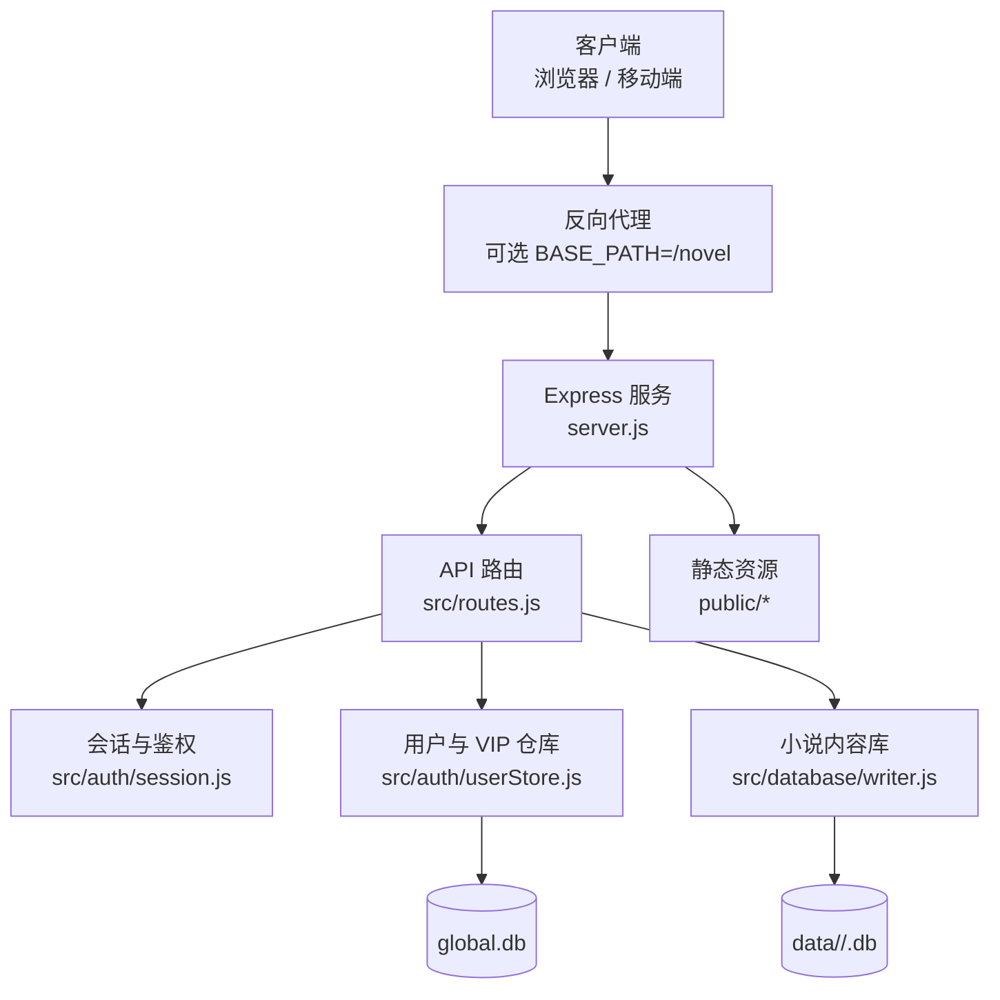
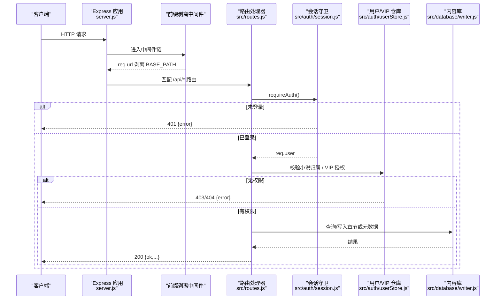
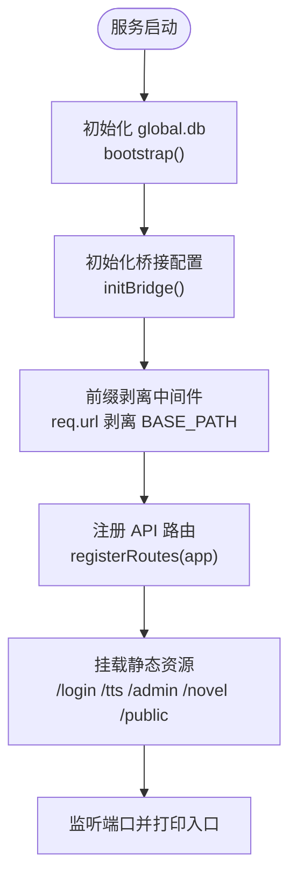
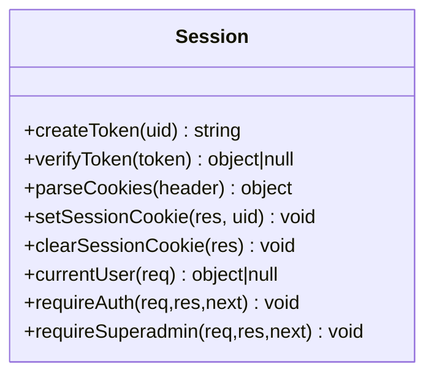
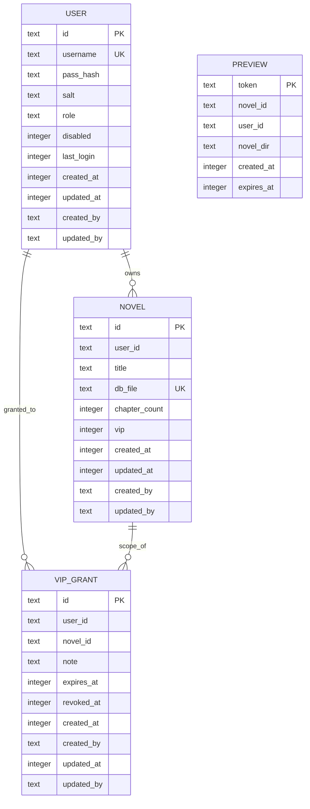
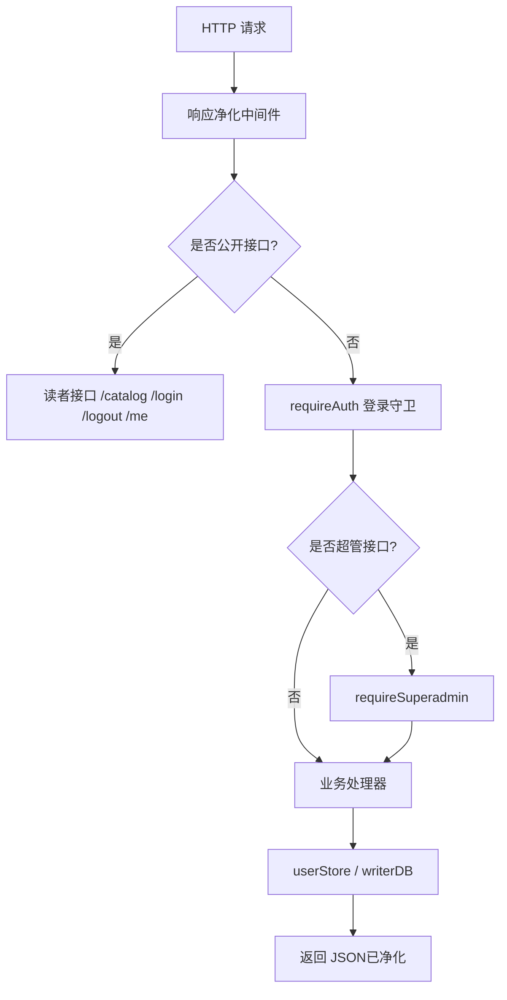
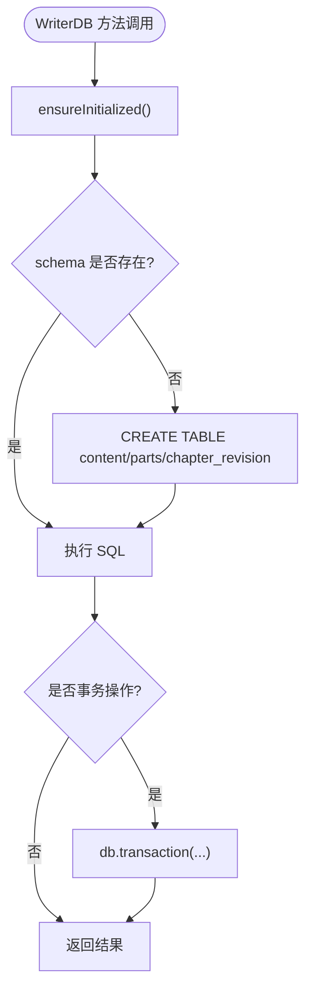
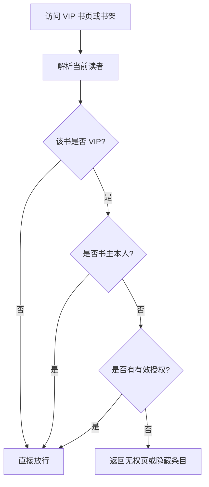
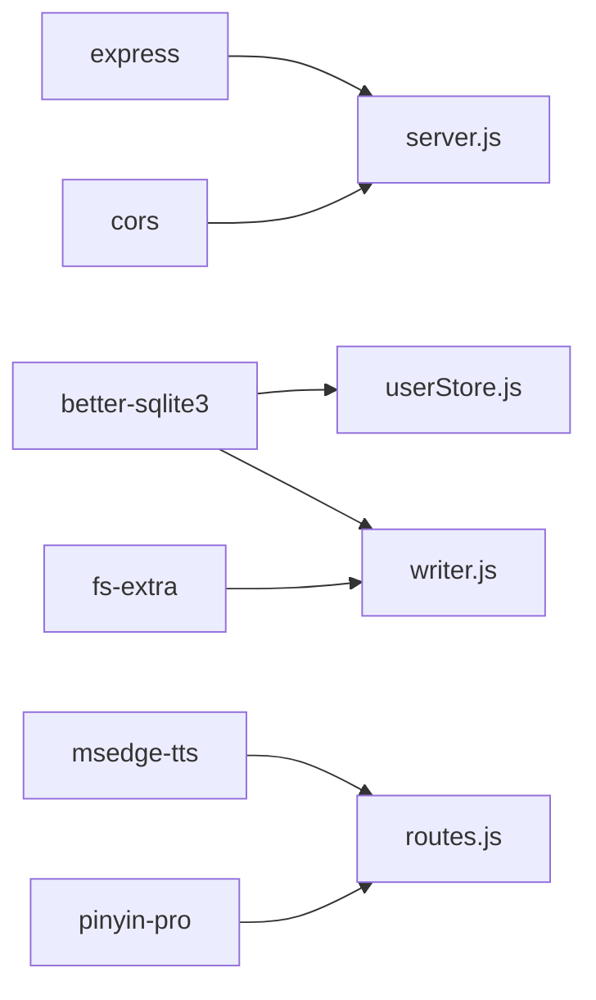

# 后端服务架构

<cite>
**本文引用的文件**   
- [server.js](file://server.js)
- [src/routes.js](file://src/routes.js)
- [src/base.js](file://src/base.js)
- [src/auth/session.js](file://src/auth/session.js)
- [src/auth/userStore.js](file://src/auth/userStore.js)
- [src/database/writer.js](file://src/database/writer.js)
- [package.json](file://package.json)
- [README.md](file://README.md)
- [config/users.json.example](file://config/users.json.example)
</cite>

## 目录
1. [简介](#简介)
2. [项目结构](#项目结构)
3. [核心组件](#核心组件)
4. [架构总览](#架构总览)
5. [详细组件分析](#详细组件分析)
6. [依赖关系分析](#依赖关系分析)
7. [性能与扩展性](#性能与扩展性)
8. [故障排查指南](#故障排查指南)
9. [结论](#结论)
10. [附录：扩展示例](#附录扩展示例)

## 简介
本项目是一个基于 Express.js 的 AI 小说平台后端，提供“阅读 + 管理 + 学习”一体化能力。它同时承担三类职责：
- Web API：登录鉴权、小说元数据、章节读写、发布预览、TTS、读者学习接口等。
- 静态资源服务：登录页、管理后台、阅读器前端、已发布书页。
- 多用户元数据与内容库持久化：使用 SQLite（better-sqlite3）维护用户、小说登记、VIP 授权、预览状态以及每本小说的内容库。

系统通过环境变量 `BASE_PATH` 支持以 `/novel` 为前缀部署，并配合 nginx 原样转发；内部路由统一在根路径下编写，由中间件剥离外部前缀后再匹配。认证采用零依赖的 HMAC-SHA256 httpOnly Cookie 会话，权限控制分为“登录态 → 角色 → 租户归属 → VIP 授权”四层。

## 项目结构
后端代码集中在 `server.js` 与 `src/` 下，按职责分层：
- `server.js`：Express 应用入口、全局中间件、静态资源挂载、启动日志。
- `src/routes.js`：API 路由注册、请求净化、限流、VIP 闸门、长任务进度 SSE、小说与章节业务逻辑。
- `src/base.js`：站点前缀 `BASE_PATH`、命名空间白名单、对外路径生成器。
- `src/auth/session.js`：会话 Cookie 创建、校验、当前用户解析、登录守卫。
- `src/auth/userStore.js`：全局元数据库 global.db 的用户、小说登记、VIP 授权、预览登记、初始化播种。
- `src/database/writer.js`：单本小说内容库 WriterDB，负责章节增删改、批量加章、分部、字数设定等。
- `config/`：种子用户配置与 writer 相关配置。
- `public/`：前端静态资源与管理页面。
- `data/`：运行时数据库与 TTS 音频等数据目录。

**图表来源**
- [server.js:9-53](file://server.js#L9-L53)
- [src/routes.js:331-560](file://src/routes.js#L331-L560)
- [src/auth/session.js:93-110](file://src/auth/session.js#L93-L110)
- [src/auth/userStore.js:47-114](file://src/auth/userStore.js#L47-L114)
- [src/database/writer.js:16-137](file://src/database/writer.js#L16-L137)

**章节来源**
- [server.js:1-64](file://server.js#L1-L64)
- [src/base.js:1-42](file://src/base.js#L1-L42)
- [package.json:1-29](file://package.json#L1-L29)
- [README.md:1-202](file://README.md#L1-L202)

## 核心组件
- **Express 应用与中间件链**：CORS、JSON 解析、BASE_PATH 前缀剥离、API 响应净化、静态资源挂载。
- **认证与会话**：HMAC-SHA256 签名 Cookie，7 天有效期，Path 限定到 `BASE_PATH`，避免同域其他子系统串 cookie。
- **权限控制**：`requireAuth` 拦截未登录请求，`requireSuperadmin` 限制超管操作；小说访问按 `user_id` 做租户隔离。
- **VIP 访问控制**：VIP 书标记 + `vip_grant` 表，按读者账号授予某本书或全站 VIP，支持到期与撤销，每次请求实时判定。
- **API 设计原则**：统一错误体 `{ ok, error, ... }`，公开接口与受保护接口分阶段挂载，敏感字段在服务端输出前脱敏。
- **数据库策略**：
  - `global.db`：用户、小说登记、VIP 授权、预览登记。
  - 每本小说一个 `.db`：WriterDB 管理章节、大纲、分部、字数设定、修订快照。
  - 事务用于删除章节、批量加章、编号平移等一致性操作。
- **长任务与进度**：SSE `/api/progress` 推送逐章进度，按书互斥锁防止并发生成互相覆盖正文。

**章节来源**
- [server.js:22-53](file://server.js#L22-L53)
- [src/auth/session.js:26-91](file://src/auth/session.js#L26-L91)
- [src/routes.js:331-350](file://src/routes.js#L331-L350)
- [src/auth/userStore.js:335-349](file://src/auth/userStore.js#L335-L349)
- [src/database/writer.js:408-438](file://src/database/writer.js#L408-L438)

## 架构总览
下图展示一次典型受保护 API 请求的处理流程：从 Express 中间件剥离前缀，到认证守卫、权限检查、业务处理、数据库访问，再到响应净化与返回。

**图表来源**
- [server.js:25-36](file://server.js#L25-L36)
- [src/routes.js:331-350](file://src/routes.js#L331-L350)
- [src/auth/session.js:93-110](file://src/auth/session.js#L93-L110)
- [src/auth/userStore.js:102-116](file://src/auth/userStore.js#L102-L116)
- [src/database/writer.js:355-377](file://src/database/writer.js#L355-L377)

## 详细组件分析

### Express 应用配置与前缀机制
- 启用 CORS 与 JSON 解析，限制请求体大小。
- 通过自定义中间件把 `BASE_PATH` 剥离到应用命名空间（`/api|/login|/tts|/tts-audio|/admin`），书页 `/novel/<uid>/...` 不走剥离逻辑，避免双前缀。
- 启动时执行 `bootstrap()` 初始化 global.db，并调用 `initBridge()` 加载推理桥接配置。
- 静态资源按 `/login`、`/tts`、`/tts-audio`、`/admin`、`/novel` 挂载，最后兜底 `public`。

**图表来源**
- [server.js:38-53](file://server.js#L38-L53)
- [src/base.js:17-39](file://src/base.js#L17-L39)

**章节来源**
- [server.js:9-64](file://server.js#L9-L64)
- [src/base.js:1-42](file://src/base.js#L1-L42)

### 认证与会话管理
- 会话 Token 结构：`base64url(JSON{uid,exp}) . hex(HMAC(payload, SECRET))`。
- Cookie 属性：`HttpOnly; SameSite=Lax; Path=BASE_PATH; Max-Age=7d`。
- `currentUser(req)` 解析 Cookie，反查用户并过滤禁用账号。
- `requireAuth` 对 `/api` 下除 `/login|/logout|/me` 外全部拦截。
- `requireSuperadmin` 要求 `req.user.role === 'superadmin'`。

**图表来源**
- [src/auth/session.js:42-110](file://src/auth/session.js#L42-L110)

**章节来源**
- [src/auth/session.js:1-118](file://src/auth/session.js#L1-L118)

### 用户存储与 VIP 授权
- `global.db` 包含 `user`、`novel`、`vip_grant`、`preview` 表。
- 密码使用 scrypt + 随机 salt 哈希，登录走 `login(username,password)`。
- 小说登记 `novel` 表维护 `user_id -> db_file`，Web 端列举与鉴权以该表为准。
- VIP 授权：
  - `novel.vip` 标记是否为 VIP 书。
  - `vip_grant` 记录读者账号可访问范围（某本书或全站），支持 `expires_at` 与 `revoked_at`。
  - `hasVipAccess(userId, novelId)` 是读者侧唯一口径：非 VIP 书恒允许；VIP 书需存在未撤销且未过期的授权。
- 初始化 `bootstrap()` 会从 `config/users.json` 播种首个超管，并把 `data/` 下的存量 `.db` 迁移登记。

**图表来源**
- [src/auth/userStore.js:47-114](file://src/auth/userStore.js#L47-L114)

**章节来源**
- [src/auth/userStore.js:1-501](file://src/auth/userStore.js#L1-L501)
- [config/users.json.example:1-4](file://config/users.json.example#L1-L4)

### 路由系统与 API 设计
- 所有 API 集中在 `src/routes.js`，通过 `registerRoutes(app)` 挂载。
- 公开接口：
  - `/api/login`、`/api/logout`、`/api/me`
  - `/api/reader/*`：读者学习接口，无需登录但有限流。
  - `/api/catalog`：公开书单，按磁盘已发布产物扫描，VIP 书仅对本人或已授权读者可见。
- 受保护接口：
  - 所有 `/api` 下其余路由经 `requireAuth`。
  - 超管接口如 `/api/novels/reconcile` 额外经 `requireSuperadmin`。
- 响应净化：对 `/api` 响应体进行敏感字段清洗，避免泄露绝对路径、密钥、服务器信息等。
- 限流：基于真实 IP 的滑动窗口限流，区分读者接口与 TTS 接口，不同上限。
- 长任务：
  - `/api/run` 类动作按书互斥。
  - `/api/progress` 使用 SSE 推送进度，带心跳与缓冲补发。

**图表来源**
- [src/routes.js:331-350](file://src/routes.js#L331-L350)
- [src/routes.js:559-564](file://src/routes.js#L559-L564)
- [src/routes.js:678-684](file://src/routes.js#L678-L684)

**章节来源**
- [src/routes.js:1-800](file://src/routes.js#L1-L800)

### 数据库连接管理与事务处理
- `userStore.openDb()` 单例打开 `global.db`，建表、迁移、索引。
- `WriterDB` 每个小说库独立实例，懒初始化，确保 schema 存在。
- 事务用于：
  - 删除章节后重新编号后续章节。
  - 批量加章：先整体平移后续章节，再连续插入新章，保证原子性。
  - 编号平移：正负方向分别从小到大或从大到小更新，避免冲突。
- 只读场景使用 `readonly: true` 打开内容库，避免误写。

**图表来源**
- [src/database/writer.js:25-50](file://src/database/writer.js#L25-L50)
- [src/database/writer.js:408-438](file://src/database/writer.js#L408-L438)
- [src/database/writer.js:645-724](file://src/database/writer.js#L645-L724)

**章节来源**
- [src/database/writer.js:1-800](file://src/database/writer.js#L1-L800)
- [src/auth/userStore.js:47-114](file://src/auth/userStore.js#L47-L114)

### VIP 访问控制流程
VIP 访问控制贯穿“书架列表”和“书页访问”两个层面：
- 书架列表 `/api/catalog`：扫描 `public/novel/<uid>/<书名>/index.html`，若命中 VIP 书则判断读者是否本人或有授权。
- 书页访问：未登录或无授权返回专用无权页，提示去登录或联系管理员。

**图表来源**
- [src/routes.js:144-179](file://src/routes.js#L144-L179)
- [src/routes.js:519-557](file://src/routes.js#L519-L557)
- [src/auth/userStore.js:335-349](file://src/auth/userStore.js#L335-L349)

**章节来源**
- [src/routes.js:144-261](file://src/routes.js#L144-L261)
- [src/auth/userStore.js:235-349](file://src/auth/userStore.js#L235-L349)

## 依赖关系分析
- Express 作为 Web 框架，承载中间件与路由。
- better-sqlite3 提供同步数据库访问，适合本项目的轻量级多用户元数据与内容库。
- cors 提供跨域支持。
- fs-extra 用于文件系统辅助操作。
- marked 用于 Markdown 渲染（可能在前端或工具中使用）。
- msedge-tts 用于 TTS 合成。
- pinyin-pro 用于拼音处理。

**图表来源**
- [package.json:19-27](file://package.json#L19-L27)
- [server.js:9-16](file://server.js#L9-L16)
- [src/auth/userStore.js:12-16](file://src/auth/userStore.js#L12-L16)
- [src/database/writer.js:6-11](file://src/database/writer.js#L6-L11)

**章节来源**
- [package.json:1-29](file://package.json#L1-L29)

## 性能与扩展性
- 数据库：
  - `global.db` 与每本小说 `.db` 分离，减少热点竞争。
  - 列表接口尽量不拉正文，改用 `LENGTH(content)` 计算字数，降低内存占用。
  - 批量加章使用单次事务与临时偏移量平移，避免 N×N 更新。
- 网络：
  - 读者接口与 TTS 接口分别限流，避免批量朗读压垮上游。
  - SSE 进度通道带心跳与缓冲补发，缓解先 publish 后 subscribe 的竞态。
- 安全：
  - 响应体净化避免泄露路径、密钥、服务器信息。
  - 章节 URL 解码后仍做路径穿越防护。
- 扩展建议：
  - 新增中间件：放在 `registerRoutes` 之前，遵循“前缀剥离 → 净化 → 鉴权 → 业务”的顺序。
  - 新增路由：在 `src/routes.js` 中按公开/受保护分组挂载，复用 `requireAuth`、`requireSuperadmin`。
  - 新增认证逻辑：扩展 `session.js` 的 `currentUser` 或增加新的守卫函数，并在路由中组合使用。

[本节为通用指导，不直接分析具体文件]

## 故障排查指南
- 登录失败：
  - 检查 `SESSION_SECRET` 是否配置，未配置会生成临时密钥，重启后旧会话失效。
  - 确认 `config/users.json` 种子用户是否正确，首次启动会播种。
- VIP 无法访问：
  - 确认小说是否标记为 VIP。
  - 检查 `vip_grant` 是否授予目标读者，是否过期或被撤销。
  - 书架列表与书页访问均实时判定授权，撤销后立即生效。
- 章节 404：
  - 检查章节 URL 是否经过正确解码与路径穿越校验。
  - 确认已发布产物存在于 `public/novel/<uid>/<书名>/chapter_x.html`。
- 生成任务慢或超时：
  - 查看推理链路状态 `/api/llm-status`，确认桥接服务可达与 Key 配置。
  - 注意按书互斥锁，同一本书并发提交会返回 409。
- 数据库异常：
  - 检查 `global.db` 与小说 `.db` 文件权限与完整性。
  - 批量操作失败会回滚事务，不会留下半套状态。

**章节来源**
- [src/auth/session.js:32-36](file://src/auth/session.js#L32-L36)
- [src/auth/userStore.js:391-422](file://src/auth/userStore.js#L391-L422)
- [src/routes.js:308-329](file://src/routes.js#L308-L329)
- [src/routes.js:568-571](file://src/routes.js#L568-L571)
- [src/database/writer.js:408-438](file://src/database/writer.js#L408-L438)

## 结论
本后端服务以 Express 为核心，结合 SQLite 实现多用户元数据与内容库管理。认证与会话采用零依赖方案，权限控制清晰分层：登录态 → 角色 → 租户归属 → VIP 授权。API 设计强调安全与可观测性：响应净化、限流、SSE 进度、按书互斥。数据库策略兼顾一致性与性能：事务保护关键写操作，只读优化列表接口。整体架构适合中小型团队快速迭代，同时保留扩展中间件、路由与认证逻辑的空间。

[本节为总结，不直接分析具体文件]

## 附录：扩展示例

### 添加新的中间件
推荐位置：在 `registerRoutes` 之前，遵循“前缀剥离 → 净化 → 鉴权 → 业务”顺序。例如新增一个日志中间件：
- 在 `src/middleware/log.js` 定义中间件函数。
- 在 `server.js` 中引入并 `app.use(logMiddleware)`。
- 确保不影响现有前缀剥离与静态资源。

参考点：
- [server.js:22-36](file://server.js#L22-L36)
- [src/routes.js:331-339](file://src/routes.js#L331-L339)

### 添加新的路由处理器
步骤：
1. 在 `src/routes.js` 中新增路由，例如 `app.post('/api/novels/:id/new-action', handler)`。
2. 若需要登录态，放在 `app.use('/api', requireAuth)` 之后。
3. 若需要超管，追加 `requireSuperadmin`。
4. 复用 `resolveNovelForUser` 做租户隔离，返回统一错误体。

参考点：
- [src/routes.js:559-564](file://src/routes.js#L559-L564)
- [src/routes.js:639-661](file://src/routes.js#L639-L661)

### 添加新的认证逻辑
步骤：
1. 在 `src/auth/session.js` 中扩展 `currentUser` 或新增守卫函数，例如 `requireReader`。
2. 在路由中组合使用：`app.get('/api/reader-only', requireReader, handler)`。
3. 如需 Cookie 属性调整，修改 `COOKIE_NAME`、`MAX_AGE`、`COOKIE_PATH`。

参考点：
- [src/auth/session.js:26-91](file://src/auth/session.js#L26-L91)
- [src/auth/session.js:93-110](file://src/auth/session.js#L93-L110)