# 数据库层架构

<cite>
**本文引用的文件**   
- [src/database/writer.js](file://src/database/writer.js)
- [src/auth/userStore.js](file://src/auth/userStore.js)
- [src/reader/explainStore.js](file://src/reader/explainStore.js)
- [src/reader/vocabStore.js](file://src/reader/vocabStore.js)
</cite>

## 目录
1. [引言](#引言)
2. [项目结构](#项目结构)
3. [核心组件](#核心组件)
4. [架构总览](#架构总览)
5. [详细组件分析](#详细组件分析)
6. [依赖关系分析](#依赖关系分析)
7. [性能与并发特性](#性能与并发特性)
8. [数据迁移与版本管理](#数据迁移与版本管理)
9. [多租户与数据隔离](#多租户与数据隔离)
10. [故障排查指南](#故障排查指南)
11. [结论](#结论)

## 引言
本文面向“数据库层架构”的技术文档目标，围绕 SQLite 连接管理、连接池配置、事务处理、持久化策略（表结构、索引、查询优化）、数据迁移机制、多租户隔离方案以及并发访问与性能调优进行系统化说明。代码级示例以“路径 + 行号”形式给出，避免直接粘贴源码，便于读者在仓库中快速定位实现。

## 项目结构
本项目使用 Node.js 后端，SQLite 通过 better-sqlite3 驱动。数据库相关逻辑分布在以下模块：
- 小说内容库：`src/database/writer.js`
- 全局元数据与用户授权：`src/auth/userStore.js`
- 阅读侧缓存（单词讲解、生词表）：`src/reader/explainStore.js`、`src/reader/vocabStore.js`

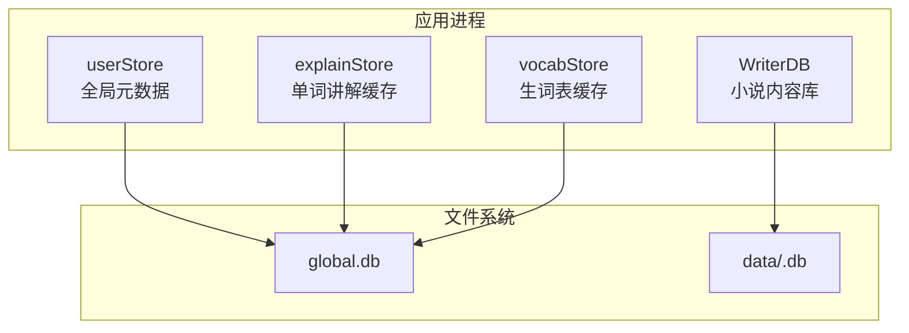

**图表来源**
- [src/database/writer.js:16-50](file://src/database/writer.js#L16-L50)
- [src/auth/userStore.js:47-114](file://src/auth/userStore.js#L47-L114)
- [src/reader/explainStore.js:24-47](file://src/reader/explainStore.js#L24-L47)
- [src/reader/vocabStore.js:23-46](file://src/reader/vocabStore.js#L23-L46)

**章节来源**
- [src/database/writer.js:16-50](file://src/database/writer.js#L16-L50)
- [src/auth/userStore.js:47-114](file://src/auth/userStore.js#L47-L114)
- [src/reader/explainStore.js:24-47](file://src/reader/explainStore.js#L24-L47)
- [src/reader/vocabStore.js:23-46](file://src/reader/vocabStore.js#L23-L46)

## 核心组件
- WriterDB：封装小说内容库的初始化、表结构创建、CRUD、批量操作、分部管理、修订快照等。
- userStore：维护 global.db，负责用户、小说注册表、VIP 授权、预览登记、存量迁移等。
- explainStore：基于 global.db 的单词讲解缓存表，带 LRU 式淘汰。
- vocabStore：基于 global.db 的生词表缓存表，带 LRU 式淘汰。

**章节来源**
- [src/database/writer.js:16-145](file://src/database/writer.js#L16-L145)
- [src/auth/userStore.js:1-114](file://src/auth/userStore.js#L1-L114)
- [src/reader/explainStore.js:1-47](file://src/reader/explainStore.js#L1-L47)
- [src/reader/vocabStore.js:1-46](file://src/reader/vocabStore.js#L1-L46)

## 架构总览
整体采用“单进程内多个 SQLite 连接”的模式：
- 每个 WriterDB 实例持有独立的新书内容库连接。
- userStore 持有全局元数据连接。
- explainStore 和 vocabStore 各自打开另一个到 global.db 的连接，用于读写缓存。

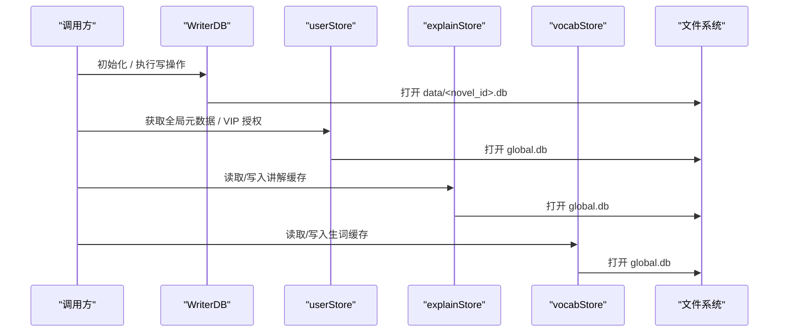

**图表来源**
- [src/database/writer.js:16-50](file://src/database/writer.js#L16-L50)
- [src/auth/userStore.js:47-114](file://src/auth/userStore.js#L47-L114)
- [src/reader/explainStore.js:24-47](file://src/reader/explainStore.js#L24-L47)
- [src/reader/vocabStore.js:23-46](file://src/reader/vocabStore.js#L23-L46)

## 详细组件分析

### WriterDB：小说内容库
WriterDB 是小说正文与大纲的核心数据层，提供从概要、章节、分部到修订快照的完整能力。

#### 类与方法概览
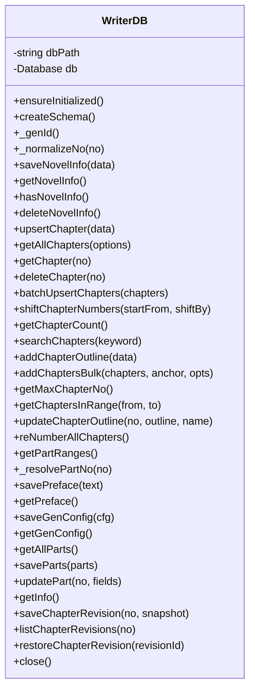

**图表来源**
- [src/database/writer.js:16-145](file://src/database/writer.js#L16-L145)
- [src/database/writer.js:169-228](file://src/database/writer.js#L169-L228)
- [src/database/writer.js:307-343](file://src/database/writer.js#L307-L343)
- [src/database/writer.js:355-377](file://src/database/writer.js#L355-L377)
- [src/database/writer.js:408-438](file://src/database/writer.js#L408-L438)
- [src/database/writer.js:445-470](file://src/database/writer.js#L445-L470)
- [src/database/writer.js:478-528](file://src/database/writer.js#L478-L528)
- [src/database/writer.js:581-626](file://src/database/writer.js#L581-L626)
- [src/database/writer.js:645-724](file://src/database/writer.js#L645-L724)
- [src/database/writer.js:746-757](file://src/database/writer.js#L746-L757)
- [src/database/writer.js:766-806](file://src/database/writer.js#L766-L806)
- [src/database/writer.js:812-851](file://src/database/writer.js#L812-L851)
- [src/database/writer.js:858-902](file://src/database/writer.js#L858-L902)
- [src/database/writer.js:910-947](file://src/database/writer.js#L910-L947)
- [src/database/writer.js:974-999](file://src/database/writer.js#L974-L999)
- [src/database/writer.js:1005-1031](file://src/database/writer.js#L1005-L1031)
- [src/database/writer.js:1039-1098](file://src/database/writer.js#L1039-L1098)
- [src/database/writer.js:1108-1135](file://src/database/writer.js#L1108-L1135)
- [src/database/writer.js:1137-1184](file://src/database/writer.js#L1137-L1184)
- [src/database/writer.js:1192-1259](file://src/database/writer.js#L1192-L1259)
- [src/database/writer.js:1264-1270](file://src/database/writer.js#L1264-L1270)

#### 关键流程：删除章节并重新编号
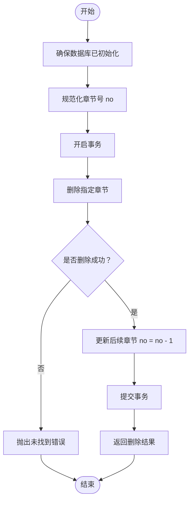

**图表来源**
- [src/database/writer.js:408-438](file://src/database/writer.js#L408-L438)

**章节来源**
- [src/database/writer.js:16-145](file://src/database/writer.js#L16-L145)
- [src/database/writer.js:408-438](file://src/database/writer.js#L408-L438)

### userStore：全局元数据与权限
userStore 维护 global.db，承担用户认证、小说注册表、VIP 授权、预览生命周期与存量迁移。

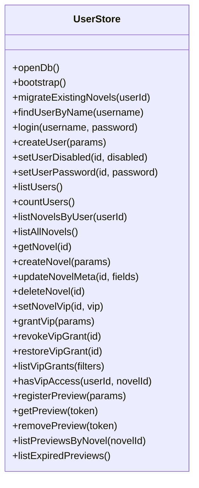

**图表来源**
- [src/auth/userStore.js:47-114](file://src/auth/userStore.js#L47-L114)
- [src/auth/userStore.js:127-188](file://src/auth/userStore.js#L127-L188)
- [src/auth/userStore.js:190-233](file://src/auth/userStore.js#L190-L233)
- [src/auth/userStore.js:235-349](file://src/auth/userStore.js#L235-L349)
- [src/auth/userStore.js:351-378](file://src/auth/userStore.js#L351-L378)
- [src/auth/userStore.js:380-481](file://src/auth/userStore.js#L380-L481)

**章节来源**
- [src/auth/userStore.js:1-114](file://src/auth/userStore.js#L1-L114)
- [src/auth/userStore.js:127-188](file://src/auth/userStore.js#L127-L188)
- [src/auth/userStore.js:190-233](file://src/auth/userStore.js#L190-L233)
- [src/auth/userStore.js:235-349](file://src/auth/userStore.js#L235-L349)
- [src/auth/userStore.js:351-378](file://src/auth/userStore.js#L351-L378)
- [src/auth/userStore.js:380-481](file://src/auth/userStore.js#L380-L481)

### explainStore 与 vocabStore：阅读侧缓存
两者均复用 global.db，分别维护单词讲解与生词表缓存，具备：
- 惰性建库与失败降级（不可用时回退为进程内缓存）。
- 基于 updated_at 的 LRU 淘汰，限制行数上限。
- 幂等的 upsert 写入。

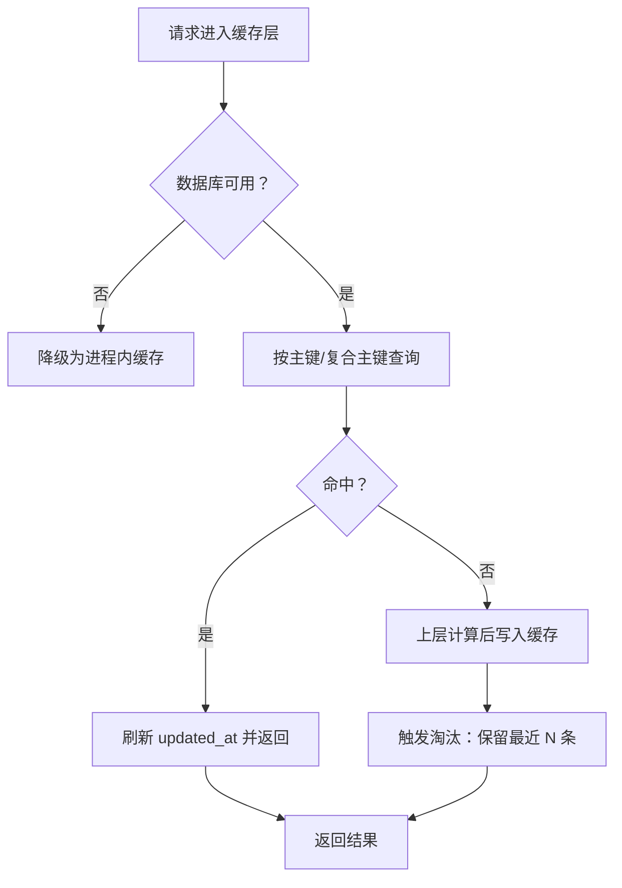

**图表来源**
- [src/reader/explainStore.js:24-47](file://src/reader/explainStore.js#L24-L47)
- [src/reader/explainStore.js:53-82](file://src/reader/explainStore.js#L53-L82)
- [src/reader/explainStore.js:104-112](file://src/reader/explainStore.js#L104-L112)
- [src/reader/vocabStore.js:23-46](file://src/reader/vocabStore.js#L23-L46)
- [src/reader/vocabStore.js:53-90](file://src/reader/vocabStore.js#L53-L90)
- [src/reader/vocabStore.js:92-100](file://src/reader/vocabStore.js#L92-L100)

**章节来源**
- [src/reader/explainStore.js:1-113](file://src/reader/explainStore.js#L1-L113)
- [src/reader/vocabStore.js:1-101](file://src/reader/vocabStore.js#L1-L101)

## 依赖关系分析
- better-sqlite3：同步阻塞型 SQLite 驱动，所有数据库操作均为同步 API。
- fs-extra：用于确保目录存在。
- crypto：生成稳定 ID 与密码哈希。
- path/os：路径与系统目录处理。

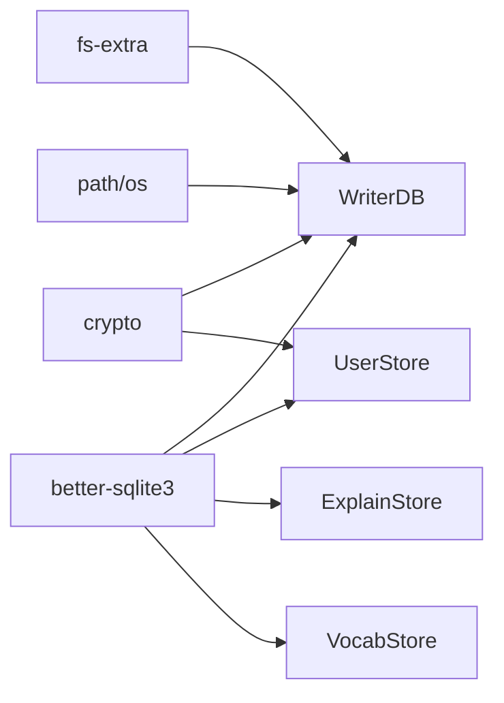

**图表来源**
- [src/database/writer.js:6-11](file://src/database/writer.js#L6-L11)
- [src/auth/userStore.js:12-16](file://src/auth/userStore.js#L12-L16)
- [src/reader/explainStore.js:16-17](file://src/reader/explainStore.js#L16-L17)
- [src/reader/vocabStore.js:15-16](file://src/reader/vocabStore.js#L15-L16)

**章节来源**
- [src/database/writer.js:6-11](file://src/database/writer.js#L6-L11)
- [src/auth/userStore.js:12-16](file://src/auth/userStore.js#L12-L16)
- [src/reader/explainStore.js:16-17](file://src/reader/explainStore.js#L16-L17)
- [src/reader/vocabStore.js:15-16](file://src/reader/vocabStore.js#L15-L16)

## 性能与并发特性

### 连接管理与连接池
- 当前实现为“每实例一个连接”，没有显式连接池。
- writer.js 中每个 WriterDB 实例持有自己的 SQLite 连接；userStore 使用模块级单例连接；explainStore 与 vocabStore 各自再打开一个到 global.db 的连接。
- 由于 better-sqlite3 是同步驱动，连接池并非典型异步连接池模式；在高并发场景下应谨慎评估锁竞争与序列化开销。

建议：
- 控制 WriterDB 实例数量，避免同一进程内过多 SQLite 连接。
- 对热点读路径优先走 explainStore/vocabStore 缓存，减少重复 LLM 调用与数据库压力。

**章节来源**
- [src/database/writer.js:16-50](file://src/database/writer.js#L16-L50)
- [src/auth/userStore.js:47-52](file://src/auth/userStore.js#L47-L52)
- [src/reader/explainStore.js:24-47](file://src/reader/explainStore.js#L24-L47)
- [src/reader/vocabStore.js:23-46](file://src/reader/vocabStore.js#L23-L46)

### 事务处理机制
- 删除章节、批量插入、重排编号、保存分部等操作均包裹在 `db.transaction()` 中，保证原子性。
- 批量加章采用“一次平移 + 连续 INSERT”的策略，避免逐章平移带来的 O(N^2) 风险。

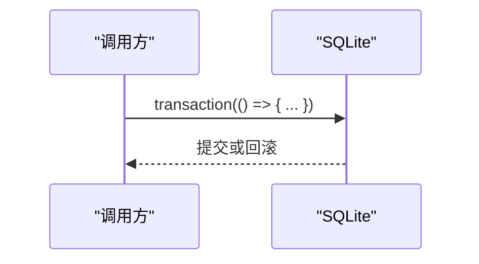

**图表来源**
- [src/database/writer.js:415-431](file://src/database/writer.js#L415-L431)
- [src/database/writer.js:450-459](file://src/database/writer.js#L450-L459)
- [src/database/writer.js:485-521](file://src/database/writer.js#L485-L521)
- [src/database/writer.js:589-619](file://src/database/writer.js#L589-L619)
- [src/database/writer.js:676-705](file://src/database/writer.js#L676-L705)
- [src/database/writer.js:817-845](file://src/database/writer.js#L817-L845)
- [src/database/writer.js:1046-1090](file://src/database/writer.js#L1046-L1090)

**章节来源**
- [src/database/writer.js:415-431](file://src/database/writer.js#L415-L431)
- [src/database/writer.js:450-459](file://src/database/writer.js#L450-L459)
- [src/database/writer.js:485-521](file://src/database/writer.js#L485-L521)
- [src/database/writer.js:589-619](file://src/database/writer.js#L589-L619)
- [src/database/writer.js:676-705](file://src/database/writer.js#L676-L705)
- [src/database/writer.js:817-845](file://src/database/writer.js#L817-L845)
- [src/database/writer.js:1046-1090](file://src/database/writer.js#L1046-L1090)

### 数据持久化策略

#### 表结构设计
- content：统一存储小说概要（no=0）与章节（no≥1），包含 type、name、outline、content、id、version、part_no、preface、gen_cfg 等字段。
- parts：存储“部”的结构信息（no、id、name、summary）。
- chapter_revision：章节改写前快照，支持回滚。
- global.db：user、novel、vip_grant、preview、reader_word_explain、reader_vocab 等表。

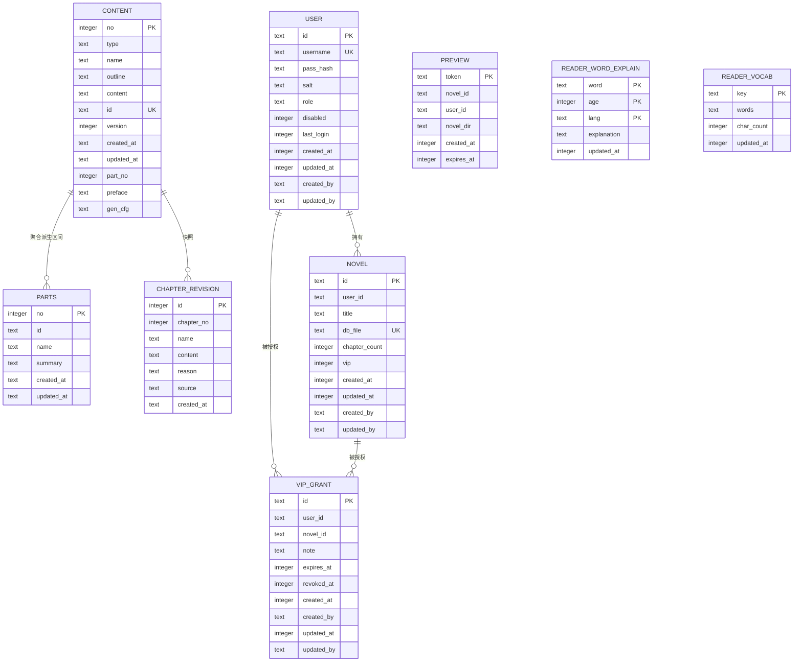

**图表来源**
- [src/database/writer.js:55-136](file://src/database/writer.js#L55-L136)
- [src/auth/userStore.js:53-102](file://src/auth/userStore.js#L53-L102)
- [src/reader/explainStore.js:30-39](file://src/reader/explainStore.js#L30-L39)
- [src/reader/vocabStore.js:31-38](file://src/reader/vocabStore.js#L31-L38)

**章节来源**
- [src/database/writer.js:55-136](file://src/database/writer.js#L55-L136)
- [src/auth/userStore.js:53-102](file://src/auth/userStore.js#L53-L102)
- [src/reader/explainStore.js:30-39](file://src/reader/explainStore.js#L30-L39)
- [src/reader/vocabStore.js:31-38](file://src/reader/vocabStore.js#L31-L38)

#### 索引优化
- content 表：
  - idx_content_no：按章节号查询。
  - idx_content_type：按类型过滤。
  - idx_content_name：按标题搜索。
  - idx_content_id：唯一索引，稳定 ID。
  - idx_content_part_no：按部归属查询。
- global.db：
  - novel.user_id、vip_grant.user_id、vip_grant.novel_id 索引。
  - reader_word_explain 复合主键 (word, age, lang)。
  - reader_vocab 主键 key。

**章节来源**
- [src/database/writer.js:123-130](file://src/database/writer.js#L123-L130)
- [src/auth/userStore.js:79-93](file://src/auth/userStore.js#L79-L93)
- [src/reader/explainStore.js:30-39](file://src/reader/explainStore.js#L30-L39)
- [src/reader/vocabStore.js:31-38](file://src/reader/vocabStore.js#L31-L38)

#### 查询性能调优
- 列表查询默认 LIMIT 1000，避免一次性加载整本正文；可选 includeContent=false 仅取 LENGTH(content) 作为长度指标。
- 区间扫描使用 getChaptersInRange，避免遗漏超长篇的大纲。
- 生词与讲解缓存通过 LRU 淘汰，限制行数，降低 IO 与解析成本。

**章节来源**
- [src/database/writer.js:355-377](file://src/database/writer.js#L355-L377)
- [src/database/writer.js:746-757](file://src/database/writer.js#L746-L757)
- [src/reader/explainStore.js:104-112](file://src/reader/explainStore.js#L104-L112)
- [src/reader/vocabStore.js:92-100](file://src/reader/vocabStore.js#L92-L100)

## 数据迁移与版本管理

### 表结构迁移
- writer.js 在 createSchema 中使用 PRAGMA table_info 检测列是否存在，按需 ALTER TABLE ADD COLUMN，并对历史数据回填缺失 id。
- userStore 在 openDb 中检测 novel.vip 列是否存在，若不存在则添加并迁移旧 vip_hash 行为。

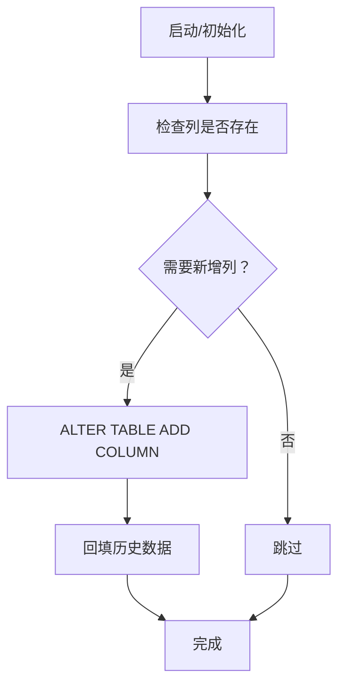

**图表来源**
- [src/database/writer.js:72-93](file://src/database/writer.js#L72-L93)
- [src/auth/userStore.js:103-112](file://src/auth/userStore.js#L103-L112)

**章节来源**
- [src/database/writer.js:72-93](file://src/database/writer.js#L72-L93)
- [src/auth/userStore.js:103-112](file://src/auth/userStore.js#L103-L112)

### 增量更新与回滚策略
- 章节改写前快照：saveChapterRevision 记录 name/content/reason/source，restoreChapterRevision 恢复时先备份当前内容，再写入快照内容，形成双向不丢。
- 章节修订列表：listChapterRevisions 按时间倒序列出，便于审计与回滚选择。

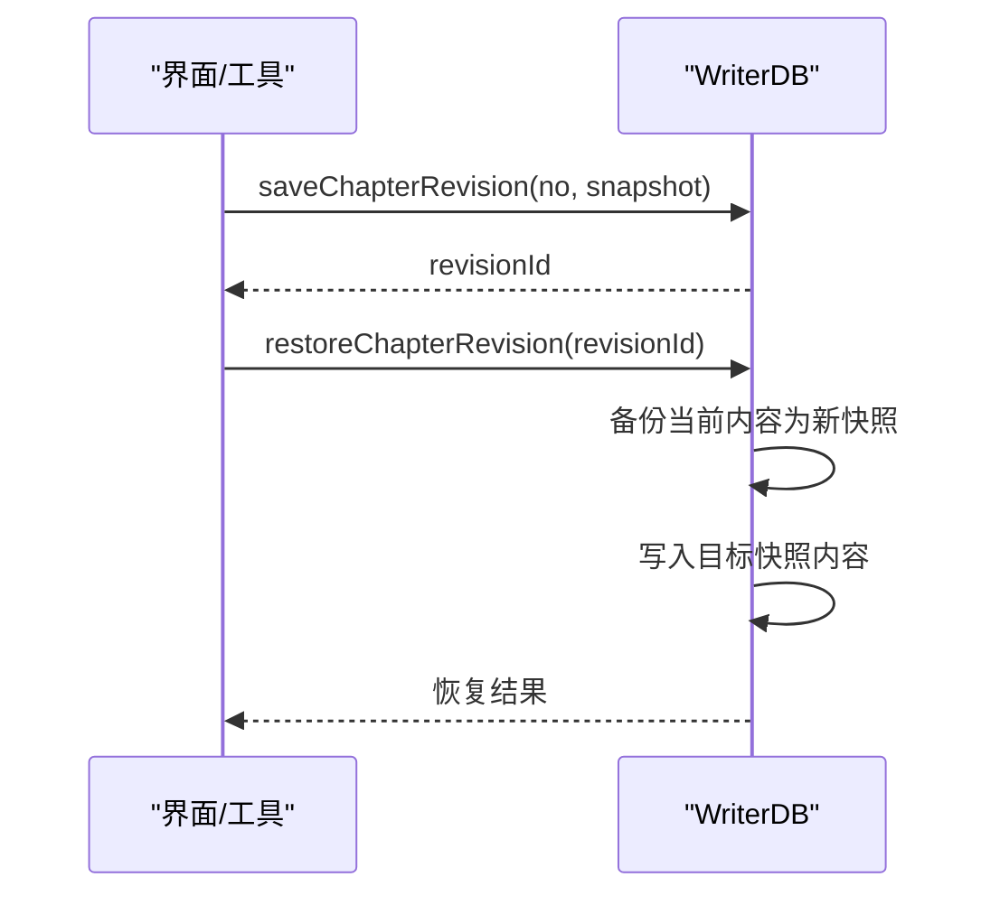

**图表来源**
- [src/database/writer.js:1192-1259](file://src/database/writer.js#L1192-L1259)

**章节来源**
- [src/database/writer.js:1192-1259](file://src/database/writer.js#L1192-L1259)

### 存量迁移
- userStore.migrateExistingNovels：将 data/ 根下的 *.db 归入 data/<user_id>/ 目录并登记到 novel 表；对已登记但路径扁平的历史行进行物理搬迁与路径更新。
- readNovelSummary：只读打开小说库，读取书名与正文章数，用于迁移时的元数据填充。

**章节来源**
- [src/auth/userStore.js:424-481](file://src/auth/userStore.js#L424-L481)

## 多租户与数据隔离

### 数据分区
- 每本小说的内容库位于 data/<novel_id>.db，由 WriterDB 管理。
- 全局元数据集中在 global.db，由 userStore 管理。
- 阅读侧缓存（explainStore、vocabStore）也复用 global.db，但与业务数据分离。

**章节来源**
- [src/database/writer.js:16-50](file://src/database/writer.js#L16-L50)
- [src/auth/userStore.js:18-24](file://src/auth/userStore.js#L18-L24)
- [src/reader/explainStore.js:16-17](file://src/reader/explainStore.js#L16-L17)
- [src/reader/vocabStore.js:15-16](file://src/reader/vocabStore.js#L15-L16)

### 访问控制
- userStore 提供 hasVipAccess：非 VIP 书恒允许；VIP 书要求存在未撤销、未到期且范围命中（全站或本书）的授权。
- 超管对站点不例外，读者侧权限只看授权名单，避免“忘记撤销”造成隐形权限。

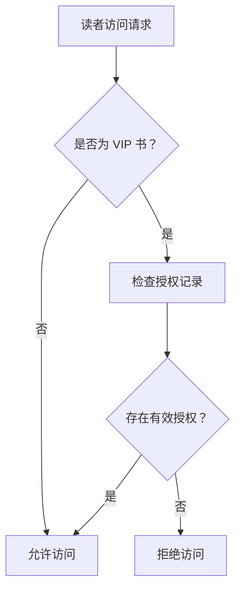

**图表来源**
- [src/auth/userStore.js:335-349](file://src/auth/userStore.js#L335-L349)

**章节来源**
- [src/auth/userStore.js:335-349](file://src/auth/userStore.js#L335-L349)

### 备份恢复
- 内容库与全局库均为 SQLite 文件，可直接拷贝备份。
- 章节修订快照提供细粒度回滚；全局库中的 preview 与 vip_grant 提供可审计的生命周期。

**章节来源**
- [src/database/writer.js:1192-1259](file://src/database/writer.js#L1192-L1259)
- [src/auth/userStore.js:351-378](file://src/auth/userStore.js#L351-L378)

## 故障排查指南

### 常见问题与定位
- 数据库初始化失败：检查 ensureInitialized 与 createSchema 的错误日志。
- 章节号类型错误：_normalizeNo 会校验整数类型，传入字符串需转换。
- 批量加章失败：检查 MAX_BULK 限制、anchor.mode/no 合法性、outline 必填校验。
- 分部归属异常：确认 _resolvePartNo 与 getPartRanges 的结果是否符合预期。
- 缓存不可用：explainStore/vocabStore 会在建库失败时降级为进程内缓存，关注警告日志。

**章节来源**
- [src/database/writer.js:25-50](file://src/database/writer.js#L25-L50)
- [src/database/writer.js:153-159](file://src/database/writer.js#L153-L159)
- [src/database/writer.js:645-660](file://src/database/writer.js#L645-L660)
- [src/database/writer.js:891-902](file://src/database/writer.js#L891-L902)
- [src/reader/explainStore.js:42-46](file://src/reader/explainStore.js#L42-L46)
- [src/reader/vocabStore.js:41-45](file://src/reader/vocabStore.js#L41-L45)

### 并发与锁问题
- better-sqlite3 同步执行，高并发写可能产生锁等待。
- 建议：
  - 合并写操作，尽量使用批量接口（batchUpsertChapters、addChaptersBulk）。
  - 控制 WriterDB 实例数量，避免过多连接争用。
  - 热点读优先走缓存（explainStore/vocabStore）。

**章节来源**
- [src/database/writer.js:445-470](file://src/database/writer.js#L445-L470)
- [src/database/writer.js:645-724](file://src/database/writer.js#L645-L724)
- [src/reader/explainStore.js:24-47](file://src/reader/explainStore.js#L24-L47)
- [src/reader/vocabStore.js:23-46](file://src/reader/vocabStore.js#L23-L46)

## 结论
本项目的数据库层以 SQLite 为核心，采用“内容库 per novel + 全局元数据 global.db”的分层设计。WriterDB 提供完整的小说内容管理能力，userStore 负责用户与权限，explainStore/vocabStore 提供高性能阅读侧缓存。通过事务、索引、区间扫描与 LRU 淘汰等手段，系统在正确性与性能之间取得平衡。未来可在连接池、读写分离与更细粒度的权限模型上继续演进，同时保持现有迁移与回滚机制的稳定与可审计。