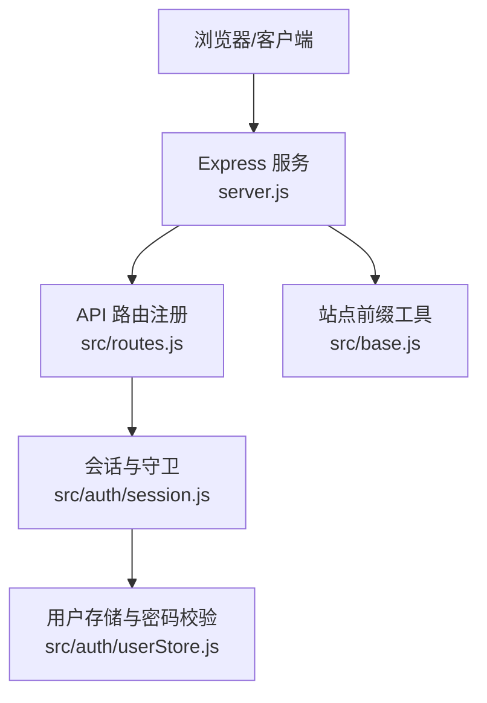
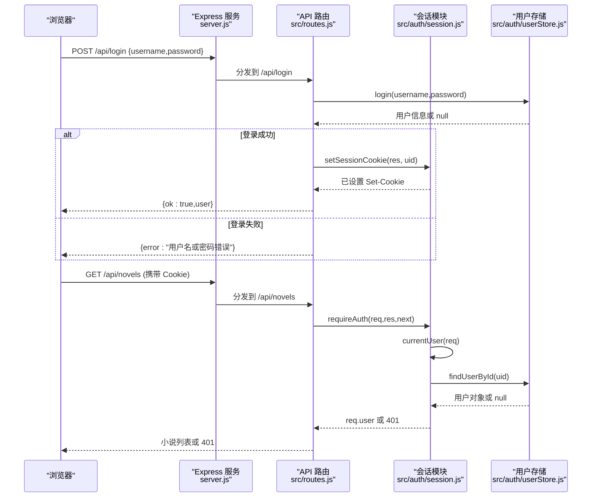
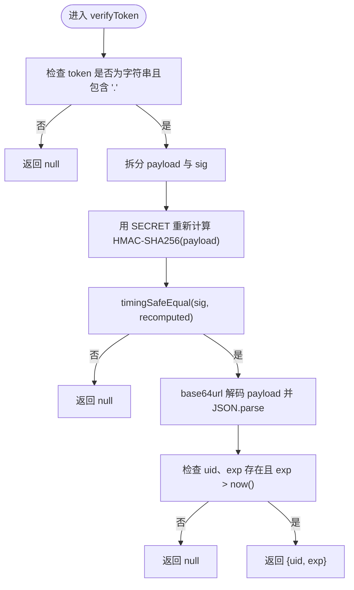
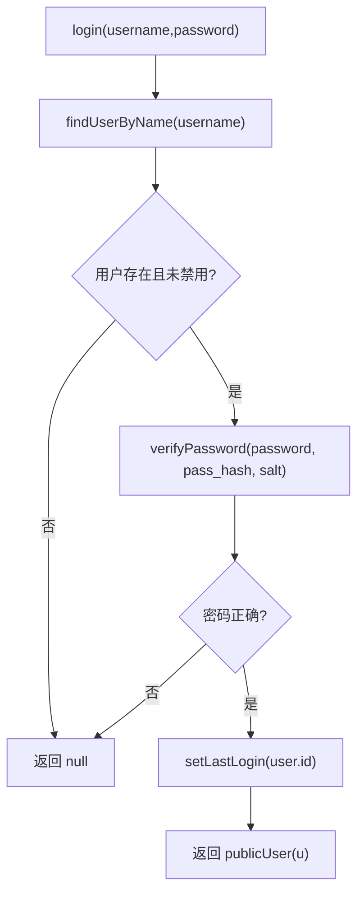
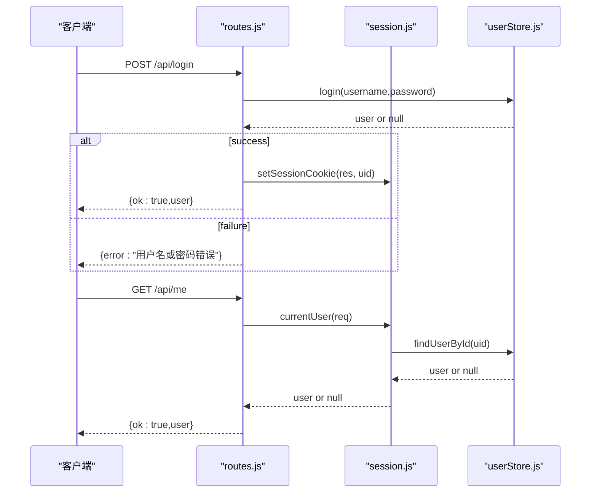
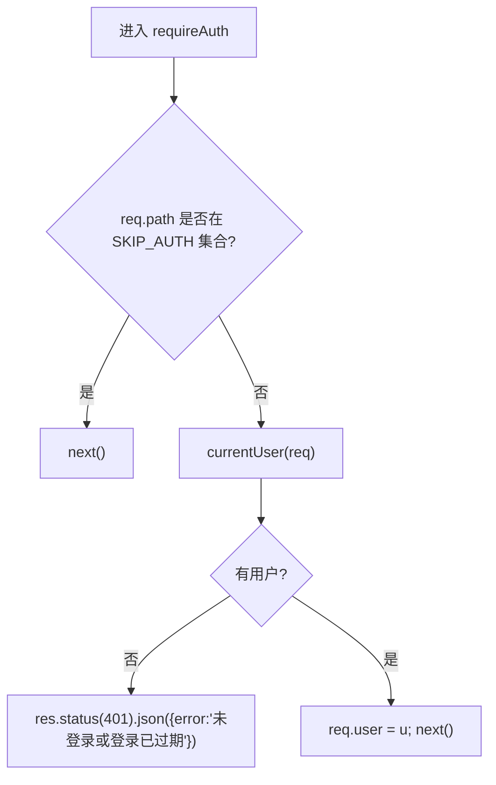
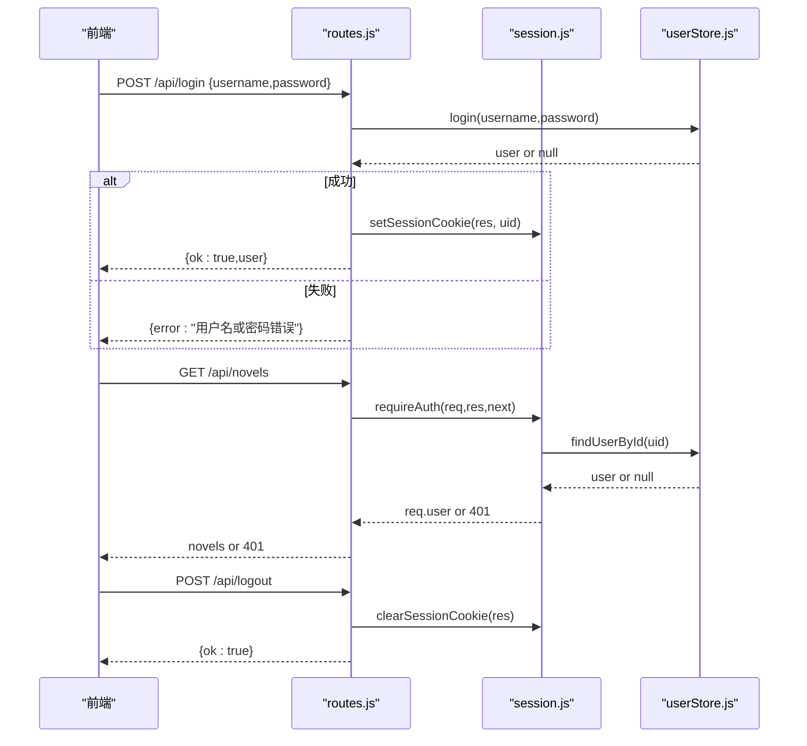
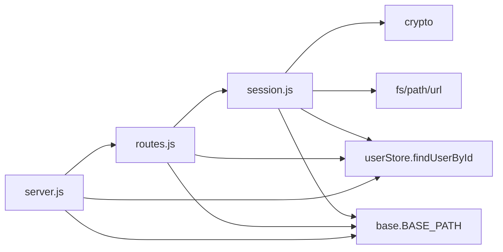

# 会话管理

<cite>
**本文引用的文件**   
- [src/auth/session.js](file://src/auth/session.js)
- [src/auth/userStore.js](file://src/auth/userStore.js)
- [src/routes.js](file://src/routes.js)
- [server.js](file://server.js)
- [src/base.js](file://src/base.js)
</cite>

## 目录
1. [简介](#简介)
2. [项目结构](#项目结构)
3. [核心组件](#核心组件)
4. [架构总览](#架构总览)
5. [详细组件分析](#详细组件分析)
6. [依赖关系分析](#依赖关系分析)
7. [性能与安全性考量](#性能与安全性考量)
8. [故障排查指南](#故障排查指南)
9. [结论](#结论)

## 简介
本技术文档聚焦于该项目的“零依赖”会话管理系统。系统使用基于 HMAC-SHA256 签名的 Cookie Token，不引入 cookie-parser、JWT 等第三方库；Token 由服务端生成并写入 HttpOnly Cookie，客户端仅携带 Cookie 完成鉴权。文档将深入解释：
- Token 生成与签名验证算法
- Cookie 安全属性（HttpOnly、SameSite、Path）配置
- 会话生命周期（创建、过期、自动续期策略）
- 中间件守卫机制（requireAuth、requireSuperadmin）
- 用户登录、登出、权限校验的完整流程示例

## 项目结构
与会话管理直接相关的代码集中在以下模块：
- 会话与守卫：`src/auth/session.js`
- 用户存储与密码哈希：`src/auth/userStore.js`
- API 路由与会话挂载点：`src/routes.js`
- 服务入口与前缀处理：`server.js`
- 站点前缀常量与路径工具：`src/base.js`

**图示来源**
- [server.js:1-64](file://server.js#L1-L64)
- [src/routes.js:1-30](file://src/routes.js#L1-L30)
- [src/auth/session.js:1-118](file://src/auth/session.js#L1-L118)
- [src/auth/userStore.js:1-50](file://src/auth/userStore.js#L1-L50)
- [src/base.js:1-42](file://src/base.js#L1-L42)

**章节来源**
- [server.js:1-64](file://server.js#L1-L64)
- [src/routes.js:1-30](file://src/routes.js#L1-L30)
- [src/auth/session.js:1-118](file://src/auth/session.js#L1-L118)
- [src/auth/userStore.js:1-50](file://src/auth/userStore.js#L1-L50)
- [src/base.js:1-42](file://src/base.js#L1-L42)

## 核心组件
- 会话模块（session.js）
  - 提供 Token 生成、验证、Cookie 设置/清除、当前用户解析、鉴权守卫。
  - 使用 HMAC-SHA256 对 payload 签名，采用 base64url 编码，避免引入 JWT 库。
- 用户存储模块（userStore.js）
  - 负责用户账号权威、密码 scrypt 哈希、最后登录时间更新、用户禁用状态。
  - 提供 login 接口供登录端点调用。
- 路由模块（routes.js）
  - 定义 /api/login、/api/logout、/api/me 等认证相关端点。
  - 在 /api 下挂载 requireAuth 守卫，并对超管接口挂载 requireSuperadmin。
- 服务入口（server.js）
  - 初始化 Express、CORS、JSON 解析、静态资源、路由注册。
  - 启动时执行 userStore.bootstrap，完成数据库建表与种子数据。
- 基础路径（base.js）
  - 定义 BASE_PATH、APP_NAMESPACES、sitePath，保证前后端路径一致性。

**章节来源**
- [src/auth/session.js:1-118](file://src/auth/session.js#L1-L118)
- [src/auth/userStore.js:1-50](file://src/auth/userStore.js#L1-L50)
- [src/routes.js:1-30](file://src/routes.js#L1-L30)
- [server.js:1-64](file://server.js#L1-L64)
- [src/base.js:1-42](file://src/base.js#L1-L42)

## 架构总览
下图展示从浏览器发起登录到服务端签发 Cookie、后续请求鉴权的整体流程。

**图示来源**
- [server.js:1-64](file://server.js#L1-L64)
- [src/routes.js:341-350](file://src/routes.js#L341-L350)
- [src/routes.js:559-564](file://src/routes.js#L559-L564)
- [src/auth/session.js:75-91](file://src/auth/session.js#L75-L91)
- [src/auth/session.js:93-110](file://src/auth/session.js#L93-L110)
- [src/auth/userStore.js:178-188](file://src/auth/userStore.js#L178-L188)

## 详细组件分析

### 会话模块（HMAC-SHA256 零依赖 Token）
- Token 结构
  - 格式：payload.base64url.sig
  - payload：包含用户 id 和过期时间戳的 JSON，经 base64url 编码。
  - sig：对 payload 使用 HMAC-SHA256 计算出的十六进制签名。
- 密钥来源
  - 优先读取环境变量 SESSION_SECRET；若未设置则尝试读取工程根 .env 中的 SESSION_SECRET。
  - 若仍为空，则生成随机临时密钥并输出警告日志。
- 生成与验证
  - createToken：构造 payload 并拼接签名。
  - verifyToken：校验签名（timingSafeEqual）、解析 payload、检查 uid/exp 是否有效且未过期。
- Cookie 设置
  - setSessionCookie：设置 Cookie 名称、值、HttpOnly、SameSite=Lax、Path=BASE_PATH、Max-Age=7天。
  - clearSessionCookie：清空 Cookie（Max-Age=0）。
- 当前用户解析
  - currentUser：从请求头解析 Cookie，验证 Token，查找用户并排除 disabled 用户。
- 守卫
  - requireAuth：跳过公开路径（/login、/logout、/me），否则要求有效会话；通过后将 req.user 注入。
  - requireSuperadmin：要求 req.user.role === 'superadmin'。

**图示来源**
- [src/auth/session.js:42-60](file://src/auth/session.js#L42-L60)

**章节来源**
- [src/auth/session.js:16-40](file://src/auth/session.js#L16-L40)
- [src/auth/session.js:42-60](file://src/auth/session.js#L42-L60)
- [src/auth/session.js:62-81](file://src/auth/session.js#L62-L81)
- [src/auth/session.js:83-110](file://src/auth/session.js#L83-L110)

### 用户存储与密码哈希
- 密码哈希
  - 使用 crypto.scryptSync，为每个用户生成随机 salt，存储 hash 与 salt。
  - 验证时使用 timingSafeEqual 比较，防止时序攻击。
- 登录流程
  - login：按用户名查找用户，检查 disabled 状态，验证密码，成功后更新 last_login 并返回脱敏用户信息。
- 用户查询
  - findUserById：根据 id 获取用户，供会话模块解析当前用户。

**图示来源**
- [src/auth/userStore.js:30-45](file://src/auth/userStore.js#L30-L45)
- [src/auth/userStore.js:178-188](file://src/auth/userStore.js#L178-L188)

**章节来源**
- [src/auth/userStore.js:30-45](file://src/auth/userStore.js#L30-L45)
- [src/auth/userStore.js:127-132](file://src/auth/userStore.js#L127-L132)
- [src/auth/userStore.js:178-188](file://src/auth/userStore.js#L178-L188)

### API 路由与会话挂载
- 认证端点
  - POST /api/login：调用 store.login，成功则 setSessionCookie，返回用户信息。
  - POST /api/logout：clearSessionCookie，返回成功。
  - GET /api/me：返回当前用户（currentUser）。
- 鉴权守卫挂载
  - 在 /api 下统一挂载 requireAuth，除公开端点外均需有效会话。
  - 超管接口额外挂载 requireSuperadmin。

**图示来源**
- [src/routes.js:341-350](file://src/routes.js#L341-L350)
- [src/auth/session.js:75-91](file://src/auth/session.js#L75-L91)
- [src/auth/userStore.js:178-188](file://src/auth/userStore.js#L178-L188)

**章节来源**
- [src/routes.js:341-350](file://src/routes.js#L341-L350)
- [src/routes.js:559-564](file://src/routes.js#L559-L564)

### Cookie 安全属性与路径配置
- 名称：ainovel_session
- 安全属性
  - HttpOnly：禁止 JavaScript 访问，降低 XSS 窃取风险。
  - SameSite=Lax：跨站请求默认不发送 Cookie，缓解 CSRF；允许顶级导航。
  - Path=BASE_PATH：限制 Cookie 仅在应用前缀路径下可见，避免与其他子系统串扰。
  - Max-Age=604800（7天）：会话有效期。
- 路径注意事项
  - BASE_PATH 默认 /novel；生产环境 nginx 原样转发前缀，因此 Cookie Path 必须与 BASE_PATH 一致。
  - 若 BASE_PATH 为空（根路径），则 Path=/。

**章节来源**
- [src/auth/session.js:26-31](file://src/auth/session.js#L26-L31)
- [src/auth/session.js:75-81](file://src/auth/session.js#L75-L81)
- [src/base.js:17-39](file://src/base.js#L17-L39)

### 会话生命周期与自动续期策略
- 创建
  - 登录成功时调用 setSessionCookie，生成新 Token 并写入 Cookie。
- 过期
  - Token 内 exp 字段表示过期时间；每次 verifyToken 会检查 exp < now()。
  - Cookie Max-Age 也为 7 天，双重保护。
- 自动续期
  - 当前实现未在每次请求中刷新 exp；即不会自动续期。
  - 如需自动续期，可在 requireAuth 通过后根据策略刷新 Cookie（例如距过期不足一定阈值时重新 setSessionCookie）。

**章节来源**
- [src/auth/session.js:27-31](file://src/auth/session.js#L27-L31)
- [src/auth/session.js:42-60](file://src/auth/session.js#L42-L60)
- [src/auth/session.js:75-81](file://src/auth/session.js#L75-L81)

### 中间件守卫机制
- requireAuth
  - 跳过公开路径：/login、/logout、/me。
  - 其他路径需有效会话；失败返回 401。
  - 成功时将 req.user 注入，供后续路由使用。
- requireSuperadmin
  - 要求 req.user.role === 'superadmin'；失败返回 403。
  - 通常用于管理员接口（如用户管理、VIP 授权、桥接密钥管理等）。

**图示来源**
- [src/auth/session.js:93-110](file://src/auth/session.js#L93-L110)

**章节来源**
- [src/auth/session.js:93-110](file://src/auth/session.js#L93-L110)

### 完整流程示例（登录、登出、权限验证）
- 用户登录
  - 前端 POST /api/login，携带 username/password。
  - 服务端调用 store.login，成功则 setSessionCookie，返回用户信息。
- 用户登出
  - 前端 POST /api/logout。
  - 服务端 clearSessionCookie，返回成功。
- 权限验证
  - 前端访问受保护接口（如 /api/novels）。
  - 服务端 requireAuth 校验 Cookie，解析 currentUser，失败返回 401。
  - 超管接口需额外 requireSuperadmin，失败返回 403。

**图示来源**
- [src/routes.js:341-350](file://src/routes.js#L341-L350)
- [src/routes.js:559-564](file://src/routes.js#L559-L564)
- [src/auth/session.js:75-110](file://src/auth/session.js#L75-L110)
- [src/auth/userStore.js:178-188](file://src/auth/userStore.js#L178-L188)

## 依赖关系分析
- session.js 依赖
  - crypto：HMAC-SHA256、randomBytes、timingSafeEqual。
  - fs/path/url：读取 .env、路径解析。
  - userStore.findUserById：解析当前用户。
  - base.BASE_PATH：确定 Cookie Path。
- routes.js 依赖
  - session.requireAuth、requireSuperadmin、currentUser、setSessionCookie、clearSessionCookie。
  - userStore：登录、用户列举、VIP 授权等。
  - base.BASE_PATH、sitePath：路径构建。
- server.js 依赖
  - express、cors、path、fileURLToPath。
  - routes.registerRoutes、userStore.bootstrap、bridgeStore.initBridge、base.BASE_PATH/APP_NAMESPACES。

**图示来源**
- [src/auth/session.js:1-12](file://src/auth/session.js#L1-L12)
- [src/routes.js:10-27](file://src/routes.js#L10-L27)
- [server.js:9-17](file://server.js#L9-L17)

**章节来源**
- [src/auth/session.js:1-12](file://src/auth/session.js#L1-L12)
- [src/routes.js:10-27](file://src/routes.js#L10-L27)
- [server.js:9-17](file://server.js#L9-L17)

## 性能与安全性考量
- 性能
  - Token 生成与验证使用 Node 内置 crypto，开销低。
  - Cookie 解析为轻量级字符串分割，无第三方库开销。
  - 用户查询为 SQLite 单行索引查询，延迟低。
- 安全性
  - HMAC-SHA256 签名 + timingSafeEqual 防篡改与时序攻击。
  - HttpOnly 防 XSS 窃取 Cookie。
  - SameSite=Lax 缓解 CSRF。
  - Path=BASE_PATH 避免跨子系统 Cookie 泄露。
  - 密码使用 scrypt + 随机 salt，提升暴力破解成本。
  - 用户禁用状态在会话解析阶段拒绝，避免被禁用户继续使用。

[本节为通用指导，无需特定文件引用]

## 故障排查指南
- 登录失败
  - 检查用户名/密码是否正确；确认用户未被禁用。
  - 查看 userStore.login 返回值与日志。
- 会话无效
  - 检查 Cookie 是否存在且未过期；确认 Path 与 BASE_PATH 一致。
  - 检查 SESSION_SECRET 是否稳定；若重启后临时密钥变化，既有会话将失效。
- 401 未登录
  - 确认请求携带 ainovel_session Cookie。
  - 确认 requireAuth 未被跳过路径误判。
- 403 需要超级管理员
  - 确认 req.user.role === 'superadmin'。
  - 检查 requireSuperadmin 是否正确使用。

**章节来源**
- [src/auth/userStore.js:178-188](file://src/auth/userStore.js#L178-L188)
- [src/auth/session.js:32-36](file://src/auth/session.js#L32-L36)
- [src/auth/session.js:75-81](file://src/auth/session.js#L75-L81)
- [src/auth/session.js:93-110](file://src/auth/session.js#L93-L110)

## 结论
该会话管理系统以最小依赖实现高安全性的身份鉴权：
- 使用 HMAC-SHA256 签名确保 Token 不可伪造。
- Cookie 安全属性（HttpOnly、SameSite、Path）有效降低 XSS/CSRF 风险。
- 会话生命周期清晰，支持创建与过期控制；当前未实现自动续期，可按需扩展。
- 中间件守卫机制简洁可靠，支持普通用户与超级管理员两级权限。
- 与用户存储模块解耦，便于扩展与维护。

建议在生产环境中：
- 固定 SESSION_SECRET，避免服务重启导致会话失效。
- 根据业务需求实现自动续期策略。
- 结合反向代理（nginx）确保 BASE_PATH 与 Cookie Path 一致。
- 定期审计用户权限与 VIP 授权记录。

[本节为总结性内容，无需特定文件引用]