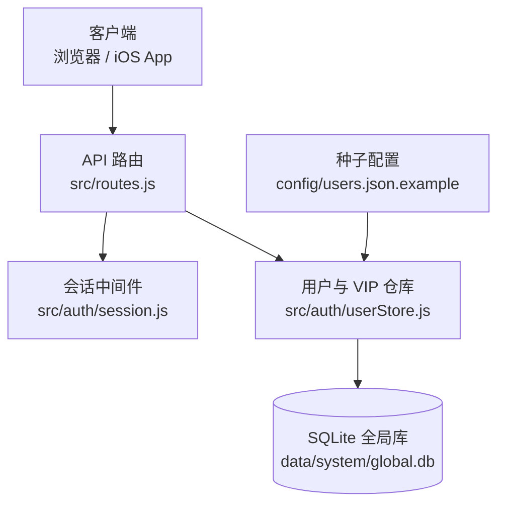
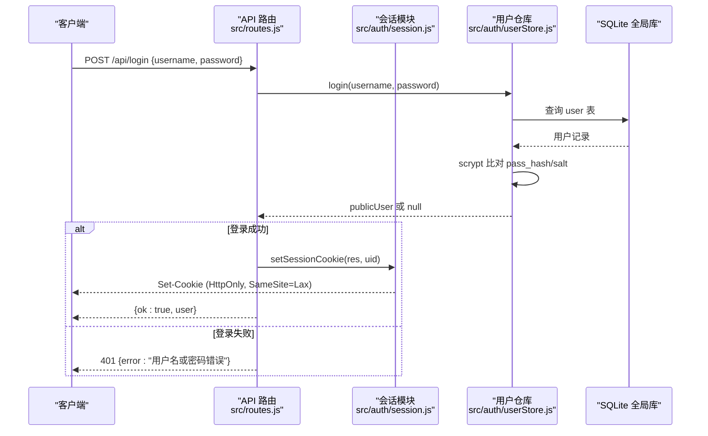
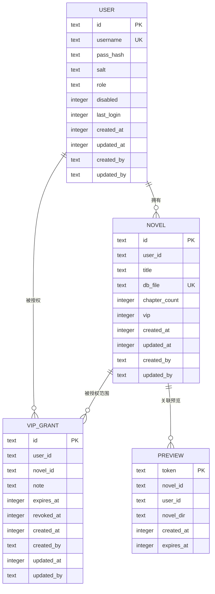
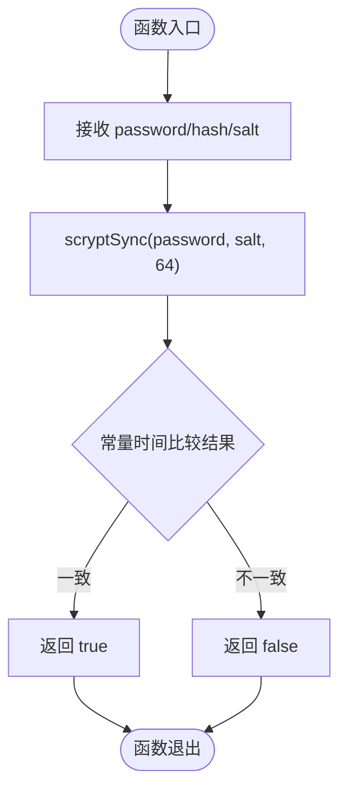
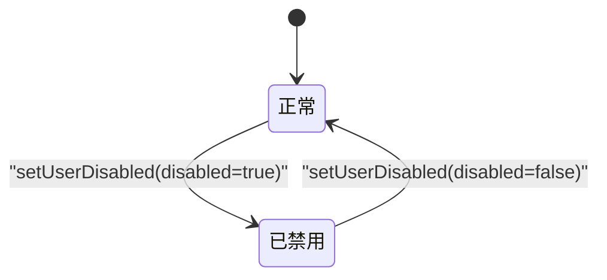
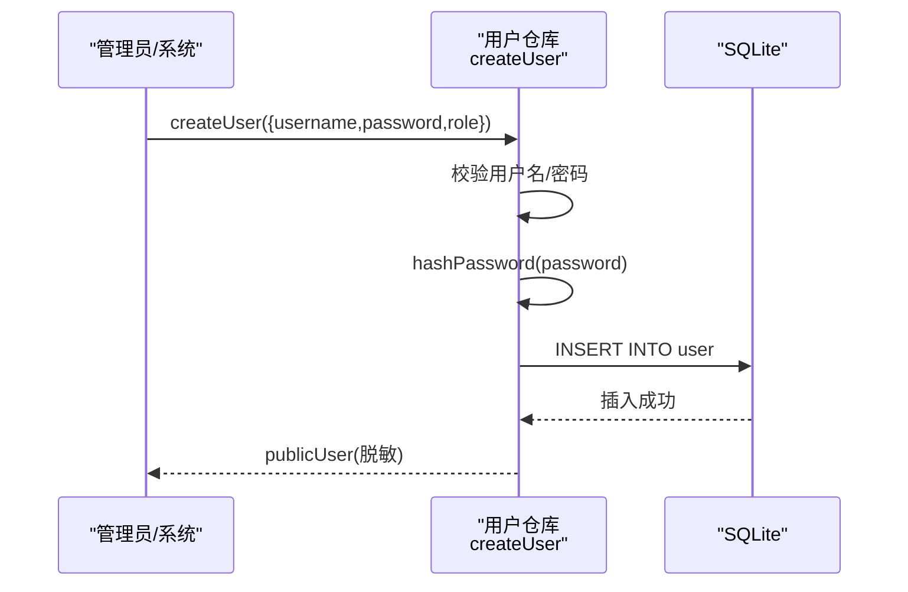
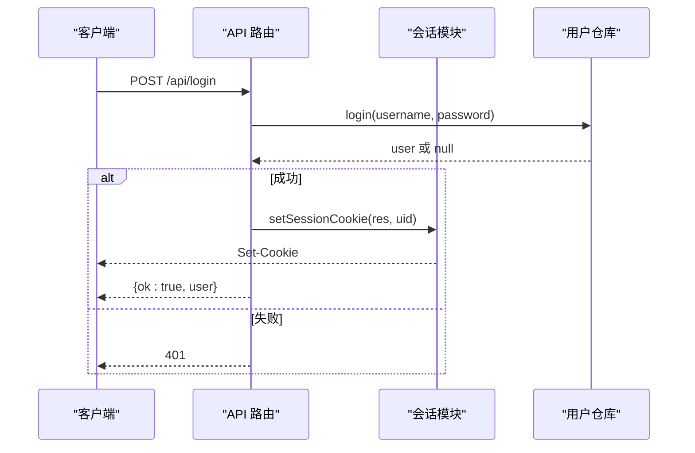
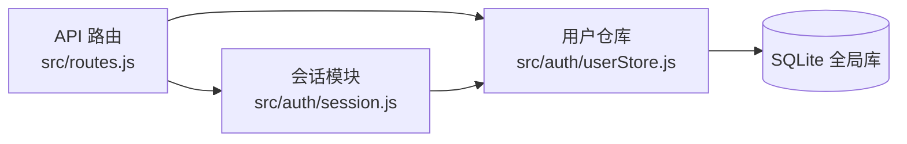

# 用户存储

<cite>
**本文引用的文件**   
- [src/auth/userStore.js](file://src/auth/userStore.js)
- [src/auth/session.js](file://src/auth/session.js)
- [src/routes.js](file://src/routes.js)
- [config/users.json.example](file://config/users.json.example)
</cite>

## 目录
1. [简介](#简介)
2. [项目结构](#项目结构)
3. [核心组件](#核心组件)
4. [架构总览](#架构总览)
5. [详细组件分析](#详细组件分析)
6. [依赖关系分析](#依赖关系分析)
7. [性能与安全性考量](#性能与安全性考量)
8. [故障排查指南](#故障排查指南)
9. [结论](#结论)

## 简介
本技术文档聚焦“用户存储系统”，围绕用户数据的持久化方案、密码加密策略、用户状态管理（启用/禁用、角色权限、VIP 标识）以及用户数据 CRUD 接口展开。该系统以 SQLite 作为元数据存储，结合 Node.js 的 `crypto.scrypt` 实现口令哈希，并通过会话 Cookie 完成登录态校验；同时提供基于读者账号授权的 VIP 访问控制机制。

## 项目结构
用户存储相关代码主要分布在以下位置：
- 用户与 VIP 元数据仓库：`src/auth/userStore.js`
- 会话与鉴权中间件：`src/auth/session.js`
- API 路由与登录流程：`src/routes.js`
- 初始种子用户示例：`config/users.json.example`

**图表来源**
- [src/routes.js:331-350](file://src/routes.js#L331-L350)
- [src/auth/session.js:83-110](file://src/auth/session.js#L83-L110)
- [src/auth/userStore.js:47-114](file://src/auth/userStore.js#L47-L114)
- [config/users.json.example:1-4](file://config/users.json.example#L1-L4)

**章节来源**
- [src/auth/userStore.js:1-114](file://src/auth/userStore.js#L1-L114)
- [src/auth/session.js:1-118](file://src/auth/session.js#L1-L118)
- [src/routes.js:331-350](file://src/routes.js#L331-L350)
- [config/users.json.example:1-4](file://config/users.json.example#L1-L4)

## 核心组件
- 用户与 VIP 元数据仓库：负责用户表、小说归属表、VIP 授权表的建库、迁移、CRUD 与访问判定。
- 会话模块：负责生成、验证签名 Cookie，解析当前用户，并提供登录态守卫。
- API 路由：暴露登录、登出、查询当前用户等公开接口，并在登录后调用仓库进行业务操作。
- 种子配置：服务启动时若用户表为空，会从配置文件播种初始用户。

**章节来源**
- [src/auth/userStore.js:1-114](file://src/auth/userStore.js#L1-L114)
- [src/auth/session.js:1-118](file://src/auth/session.js#L1-L118)
- [src/routes.js:331-350](file://src/routes.js#L331-L350)
- [config/users.json.example:1-4](file://config/users.json.example#L1-L4)

## 架构总览
下图展示从客户端发起登录到服务端返回会话 Cookie 的完整流程，并体现用户凭据校验、会话签发与后续请求的用户解析过程。

**图表来源**
- [src/routes.js:342-348](file://src/routes.js#L342-L348)
- [src/auth/session.js:75-78](file://src/auth/session.js#L75-L78)
- [src/auth/userStore.js:181-188](file://src/auth/userStore.js#L181-L188)

## 详细组件分析

### 用户数据持久化与存储结构
- 数据库位置：`data/system/global.db`，由仓库在首次打开时创建并按需初始化。
- 用户表字段：
  - id：主键，UUID
  - username：唯一用户名
  - pass_hash：scrypt 哈希值
  - salt：逐用户随机盐值
  - role：角色，user 或 superadmin
  - disabled：禁用标记（软删除）
  - last_login：最后登录时间戳
  - created_at / updated_at：创建与更新时间戳
  - created_by / updated_by：操作者标识
- 索引设计：
  - user.username 使用 UNIQUE 约束保证唯一性
  - novel.user_id 建立索引加速按用户列举小说
  - vip_grant.user_id、vip_grant.novel_id 建立索引加速授权查询
- 其他表：
  - novel：小说归属映射，包含 title、db_file、chapter_count、vip 标记
  - vip_grant：读者账号授权记录，支持全站或单书范围、到期与撤销
  - preview：预览站登记信息，用于临时站点生命周期管理

**图表来源**
- [src/auth/userStore.js:53-102](file://src/auth/userStore.js#L53-L102)

**章节来源**
- [src/auth/userStore.js:47-114](file://src/auth/userStore.js#L47-L114)

### 用户密码加密策略
- 算法选择：采用 `crypto.scryptSync` 进行口令哈希，具备抗暴力破解特性。
- 盐值生成：每个用户独立随机盐值（16 字节），避免彩虹表攻击。
- 安全比较：使用 `crypto.timingSafeEqual` 进行常量时间比较，防止时序侧信道泄露。
- 验证流程：
  - 输入明文密码与存储的 hash/salt
  - 用相同参数重新计算哈希
  - 通过常量时间比较判断是否一致

**图表来源**
- [src/auth/userStore.js:30-45](file://src/auth/userStore.js#L30-L45)

**章节来源**
- [src/auth/userStore.js:30-45](file://src/auth/userStore.js#L30-L45)

### 用户状态管理机制
- 启用/禁用：
  - 通过 `disabled` 字段控制，禁用后登录直接拒绝。
  - 提供 `setUserDisabled` 接口切换状态。
- 角色权限：
  - 角色包括 `user` 与 `superadmin`。
  - 超管可执行更多管理操作，如查看全部小说、对账、重置用户密码等。
- VIP 会员标识：
  - 小说表中的 `vip` 字段标记是否为 VIP 专属内容。
  - 读者访问 VIP 书需存在未撤销且未过期的授权记录（全站或指定书）。
  - 提供授予、撤销、恢复授权接口，并支持到期时间控制。

**图表来源**
- [src/auth/userStore.js:161-167](file://src/auth/userStore.js#L161-L167)

**章节来源**
- [src/auth/userStore.js:147-188](file://src/auth/userStore.js#L147-L188)
- [src/auth/userStore.js:235-349](file://src/auth/userStore.js#L235-L349)

### 用户数据 CRUD 接口
- 注册新用户：
  - 接口：POST `/api/novels`（注意：该接口用于新建小说；用户注册通过仓库 `createUser` 在种子或管理端触发）
  - 仓库方法：`createUser({ username, password, role })`
  - 行为：校验用户名与密码长度、生成 salt+hash、插入 user 表、返回脱敏用户对象
- 查询用户：
  - 接口：GET `/api/me` 返回当前登录用户
  - 仓库方法：`findUserByName`、`findUserById`、`listUsers`
- 更新用户信息：
  - 接口：无直接 REST 更新用户名的通用接口；可通过管理员工具或仓库方法 `setUserPassword` 重置密码
  - 仓库方法：`setUserPassword(id, password)`
- 删除用户：
  - 不物理删除，而是通过 `setUserDisabled` 禁用用户
  - 仓库方法：`setUserDisabled(id, disabled)`

**图表来源**
- [src/auth/userStore.js:147-160](file://src/auth/userStore.js#L147-L160)

**章节来源**
- [src/auth/userStore.js:126-188](file://src/auth/userStore.js#L126-L188)
- [src/routes.js:342-350](file://src/routes.js#L342-L350)

### 登录与鉴权流程
- 登录接口：
  - POST `/api/login`
  - 调用 `store.login` 校验用户名与密码
  - 成功后设置会话 Cookie
- 会话模块：
  - 使用 HMAC-SHA256 签名 Cookie，有效期 7 天
  - 提供 `currentUser` 解析当前用户并二次校验禁用状态
  - 提供 `requireAuth`、`requireSuperadmin` 守卫中间件

**图表来源**
- [src/routes.js:342-348](file://src/routes.js#L342-L348)
- [src/auth/session.js:75-78](file://src/auth/session.js#L75-L78)
- [src/auth/userStore.js:181-188](file://src/auth/userStore.js#L181-L188)

**章节来源**
- [src/routes.js:342-350](file://src/routes.js#L342-L350)
- [src/auth/session.js:75-110](file://src/auth/session.js#L75-L110)
- [src/auth/userStore.js:181-188](file://src/auth/userStore.js#L181-L188)

## 依赖关系分析
- API 路由依赖会话模块进行鉴权，并调用用户仓库进行用户与 VIP 相关操作。
- 会话模块依赖用户仓库获取用户详情以校验禁用状态。
- 用户仓库直接操作 SQLite 全局库，不触碰正文内容库。

**图表来源**
- [src/routes.js:24-26](file://src/routes.js#L24-L26)
- [src/auth/session.js:10-11](file://src/auth/session.js#L10-L11)
- [src/auth/userStore.js:12-16](file://src/auth/userStore.js#L12-L16)

**章节来源**
- [src/routes.js:24-26](file://src/routes.js#L24-L26)
- [src/auth/session.js:10-11](file://src/auth/session.js#L10-L11)
- [src/auth/userStore.js:12-16](file://src/auth/userStore.js#L12-L16)

## 性能与安全性考量
- 性能：
  - 用户列表与统计通过 SQL 聚合查询减少内存开销
  - 小说列举优先从全局注册表读取，避免逐库扫描
  - 预览与 VIP 授权查询使用索引优化
- 安全性：
  - 口令哈希使用 scrypt + 随机盐，避免彩虹表与时序攻击
  - 会话 Cookie 使用 HMAC-SHA256 签名，HttpOnly 与 SameSite=Lax 防护 XSS 与 CSRF
  - 对外响应净化敏感字段（如 pass_hash、salt、路径等）

**章节来源**
- [src/auth/userStore.js:133-143](file://src/auth/userStore.js#L133-L143)
- [src/auth/session.js:38-45](file://src/auth/session.js#L38-L45)
- [src/routes.js:67-95](file://src/routes.js#L67-L95)

## 故障排查指南
- 登录失败：
  - 检查用户名是否存在且未被禁用
  - 确认密码是否正确（scrypt 比对失败会返回 null）
- 用户无法登录但存在：
  - 检查 `disabled` 字段是否为 1
  - 检查会话 Cookie 是否有效（过期或被篡改）
- VIP 访问受限：
  - 检查用户是否有对应书的授权记录且未撤销、未过期
  - 检查小说是否标记为 VIP
- 用户注册失败：
  - 检查用户名是否已存在
  - 检查密码长度是否满足最小要求

**章节来源**
- [src/auth/userStore.js:147-160](file://src/auth/userStore.js#L147-L160)
- [src/auth/userStore.js:181-188](file://src/auth/userStore.js#L181-L188)
- [src/auth/userStore.js:341-349](file://src/auth/userStore.js#L341-L349)

## 结论
用户存储系统以 SQLite 为核心，结合 scrypt 口令哈希与会话 Cookie 实现安全的用户认证与状态管理。通过用户表、小说归属表与 VIP 授权表的结构设计，系统实现了多租户隔离、角色权限控制与细粒度访问授权。API 路由层提供清晰的登录、查询与更新接口，配合会话中间件确保请求级鉴权。整体架构清晰、职责分离，便于扩展与维护。