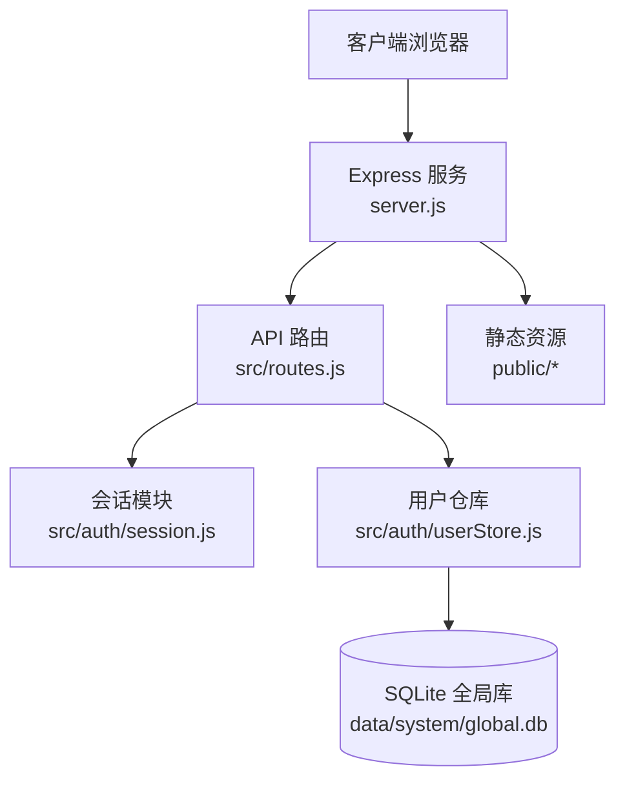
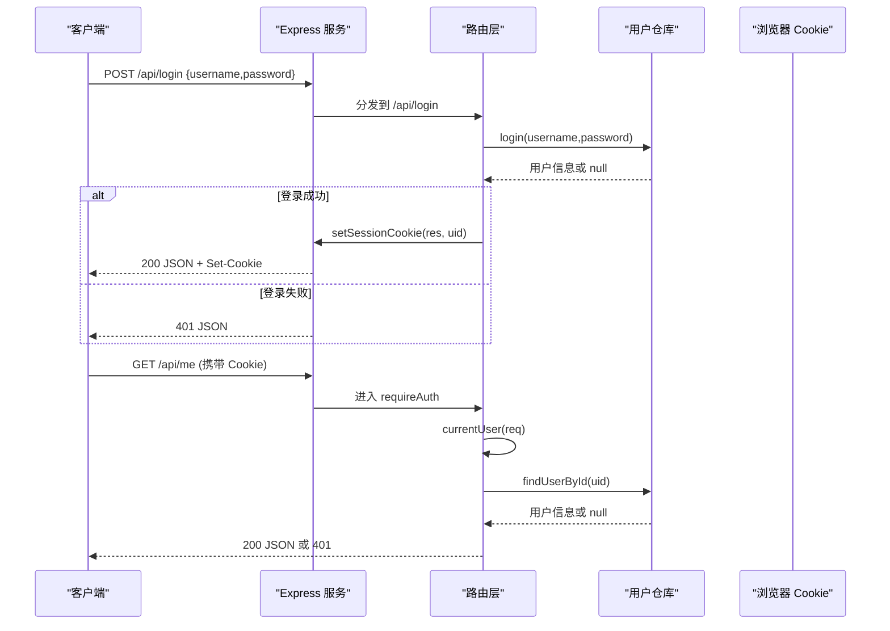
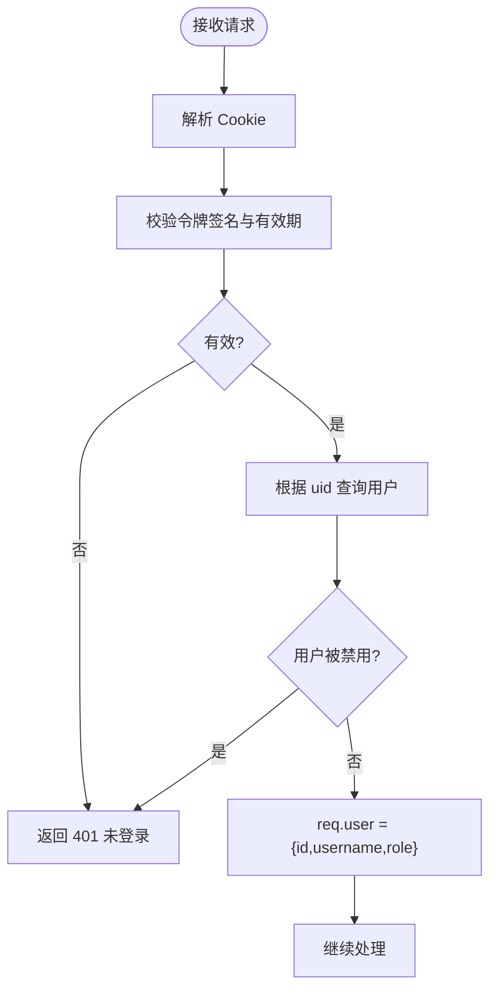
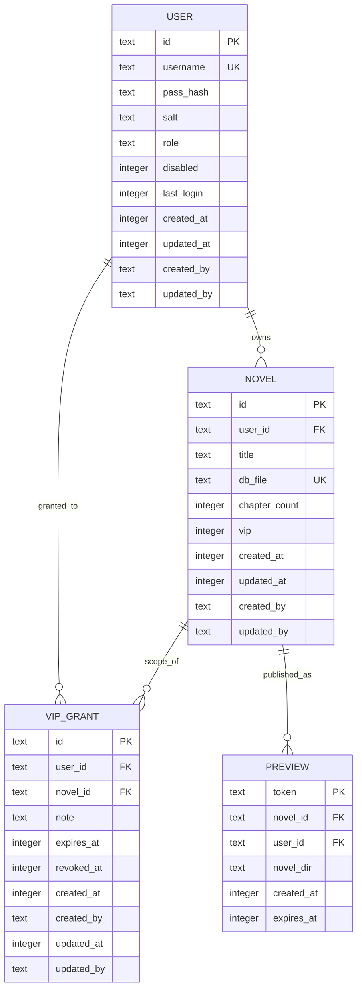
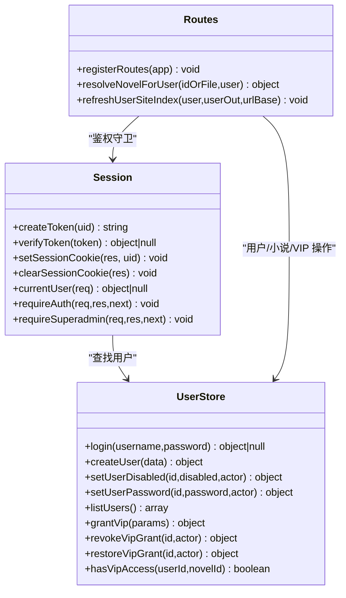
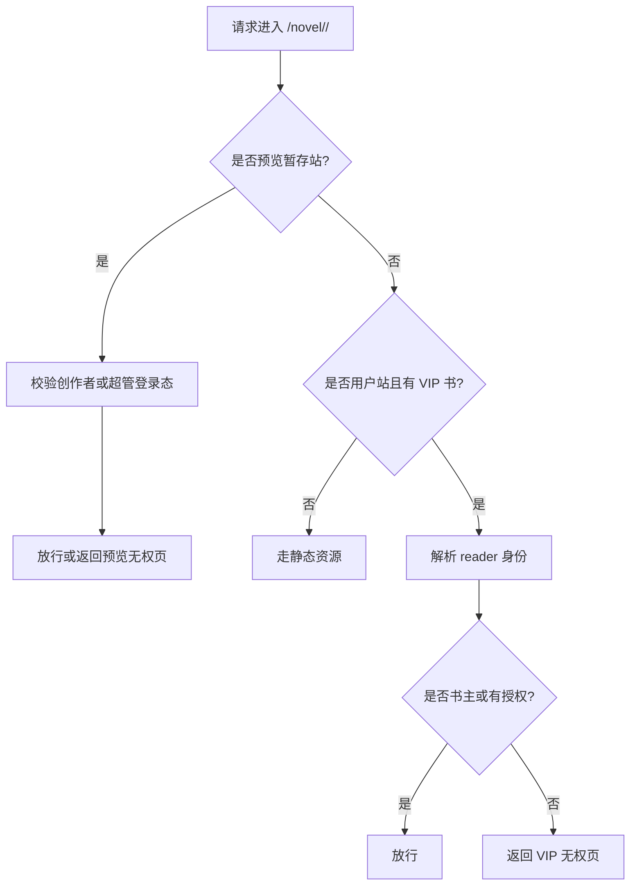
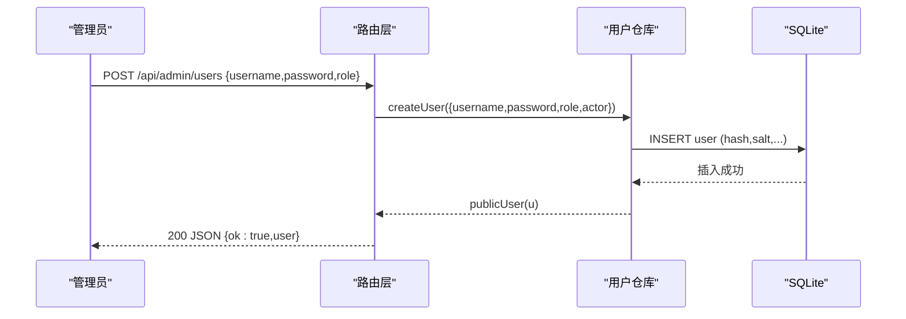
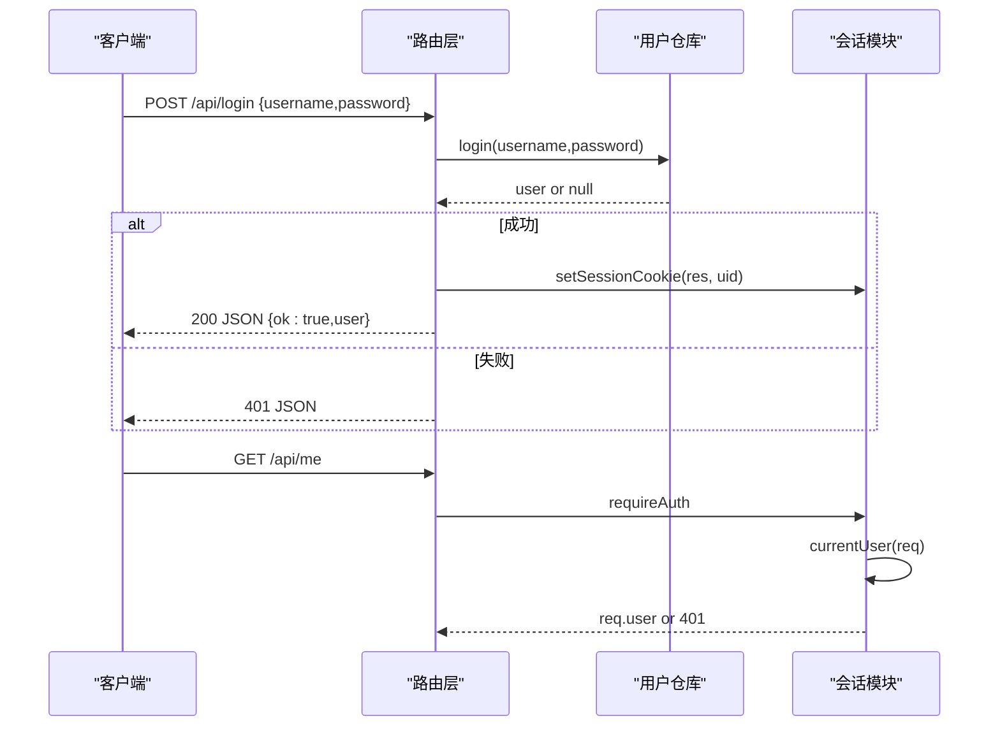
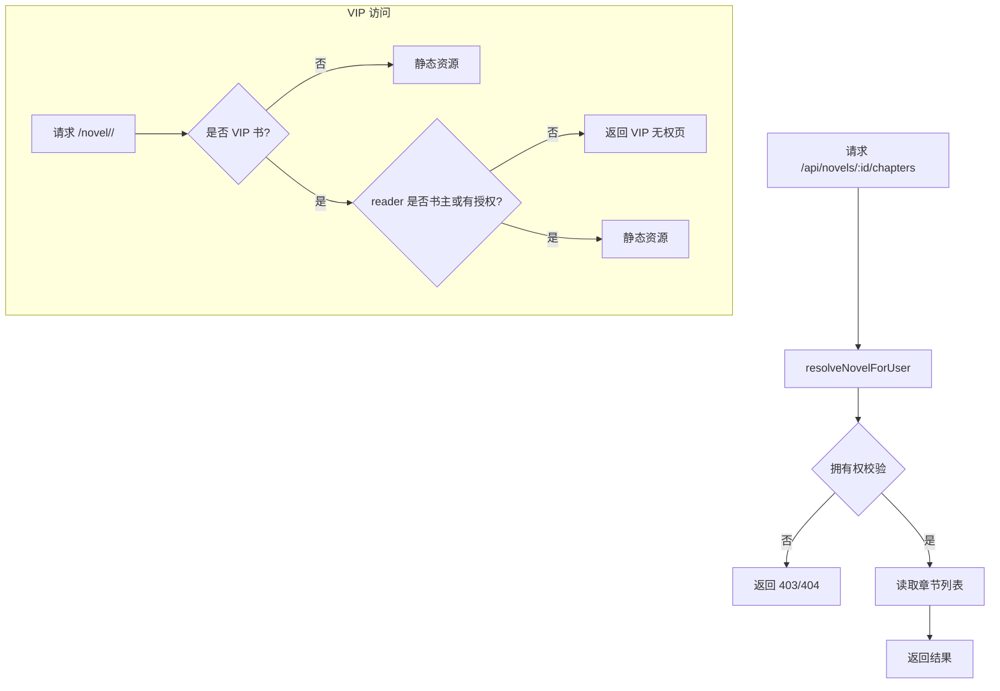
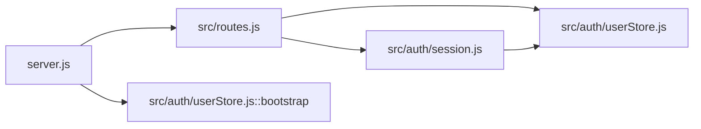

# 认证授权系统

<cite>
**本文引用的文件**   
- [server.js](file://server.js)
- [src/routes.js](file://src/routes.js)
- [src/auth/session.js](file://src/auth/session.js)
- [src/auth/userStore.js](file://src/auth/userStore.js)
- [config/users.json.example](file://config/users.json.example)
</cite>

## 目录
1. [引言](#引言)
2. [项目结构](#项目结构)
3. [核心组件](#核心组件)
4. [架构总览](#架构总览)
5. [详细组件分析](#详细组件分析)
6. [依赖关系分析](#依赖关系分析)
7. [性能与安全注意事项](#性能与安全注意事项)
8. [故障排查指南](#故障排查指南)
9. [结论](#结论)

## 引言
本技术文档聚焦于该项目的认证与授权子系统，覆盖以下关键主题：
- 用户会话机制：会话创建、存储、过期处理与守卫拦截。
- 用户数据存储与密码策略：SQLite 元数据表结构、scrypt 哈希与盐值管理、用户状态（启用/禁用）。
- 权限控制模型：角色定义、访问控制、管理员能力边界。
- VIP 内容保护机制：会员验证、内容分级、访问限制与授权生命周期。
- 典型流程示例：用户注册、登录验证、权限检查与会话管理的端到端说明。

## 项目结构
认证授权相关代码主要分布在以下位置：
- 服务入口：负责启动、初始化数据库、挂载路由与静态资源。
- 路由层：统一鉴权中间件、API 接口、VIP 闸门、读者公开接口。
- 会话模块：基于 HMAC-SHA256 的 httpOnly Cookie 会话实现。
- 用户仓库：多用户元数据持久化、密码哈希、VIP 授权与预览登记。
- 种子配置：初始超管账号模板。

**图表来源**
- [server.js:1-64](file://server.js#L1-L64)
- [src/routes.js:331-350](file://src/routes.js#L331-L350)
- [src/auth/session.js:1-118](file://src/auth/session.js#L1-L118)
- [src/auth/userStore.js:47-114](file://src/auth/userStore.js#L47-L114)

**章节来源**
- [server.js:1-64](file://server.js#L1-L64)
- [src/routes.js:1-10](file://src/routes.js#L1-L10)

## 核心组件
- 会话模块：提供令牌生成与校验、Cookie 设置与清理、当前用户解析、登录态守卫与超级管理员守卫。
- 用户仓库：维护 user/novel/vip_grant/preview 等表；提供用户 CRUD、小说注册表、VIP 授权与访问判定、预览登记与回收。
- 路由层：封装登录/登出/当前用户接口，统一 requireAuth 守卫，VIP 闸门拦截书页访问，公开书单与阅读器 AI 接口限流。
- 服务入口：启动时执行 bootstrap，完成建库、播种、存量迁移，并挂载 API 与静态资源。

**章节来源**
- [src/auth/session.js:1-118](file://src/auth/session.js#L1-L118)
- [src/auth/userStore.js:1-501](file://src/auth/userStore.js#L1-L501)
- [src/routes.js:331-350](file://src/routes.js#L331-L350)
- [server.js:38-45](file://server.js#L38-L45)

## 架构总览
认证授权的整体调用链如下：
- 客户端发起登录请求到 /api/login。
- 路由层调用用户仓库 login，成功后设置会话 Cookie。
- 后续受保护接口由 requireAuth 中间件校验 Cookie，解析当前用户。
- VIP 内容在 /novel 前缀下通过自定义中间件进行实时授权检查。

**图表来源**
- [src/routes.js:342-350](file://src/routes.js#L342-L350)
- [src/auth/session.js:83-102](file://src/auth/session.js#L83-L102)
- [src/auth/userStore.js:181-188](file://src/auth/userStore.js#L181-L188)

## 详细组件分析

### 会话管理机制
- 令牌格式：base64url(JSON{uid,exp}) + "." + hex(HMAC(payload, SECRET))。
- 密钥来源：优先环境变量 SESSION_SECRET，其次读取 .env 文件；未设置则生成临时随机密钥。
- Cookie 属性：HttpOnly、SameSite=Lax、Path=BASE_PATH、Max-Age=7 天。
- 校验流程：解析 Cookie → 校验签名 → 解析 payload → 校验 uid/exp → 查询用户是否存在且未被禁用。
- 守卫：requireAuth 对 /api 除 /login、/logout、/me 外强制登录；requireSuperadmin 要求 role=superadmin。

**图表来源**
- [src/auth/session.js:42-60](file://src/auth/session.js#L42-L60)
- [src/auth/session.js:75-91](file://src/auth/session.js#L75-L91)
- [src/auth/session.js:93-110](file://src/auth/session.js#L93-L110)

**章节来源**
- [src/auth/session.js:1-118](file://src/auth/session.js#L1-L118)

### 用户数据存储结构与密码加密策略
- 全局数据库：SQLite，路径 data/system/global.db。
- 用户表字段：id、username、pass_hash、salt、role、disabled、last_login、created_at、updated_at、created_by、updated_by。
- 密码哈希：scrypt，逐用户随机 salt；验证使用 timingSafeEqual 比较。
- 用户状态：disabled 为软禁用，不参与物理删除；登录时若 disabled 直接拒绝。
- 初始化：bootstrap 从 config/users.json 播种用户，缺失则跳过；支持将 data/ 下已有小说入库并迁移至用户目录。

**图表来源**
- [src/auth/userStore.js:47-114](file://src/auth/userStore.js#L47-L114)

**章节来源**
- [src/auth/userStore.js:30-45](file://src/auth/userStore.js#L30-L45)
- [src/auth/userStore.js:47-114](file://src/auth/userStore.js#L47-L114)
- [src/auth/userStore.js:126-188](file://src/auth/userStore.js#L126-L188)
- [src/auth/userStore.js:380-422](file://src/auth/userStore.js#L380-L422)
- [config/users.json.example:1-4](file://config/users.json.example#L1-L4)

### 权限控制模型
- 角色定义：user、superadmin。
- 访问控制：
  - 所有 /api 接口默认 requireAuth。
  - 管理员接口 requireSuperadmin。
  - 小说归属：非 superadmin 只能访问 own user_id 的小说。
  - VIP 访问：以 vip_grant 名单为准，支持全站或单书范围，带到期与撤销。
- 列表可见性：
  - /api/catalog 公开书单：VIP 书仅对书主或有授权的读者可见，匿名或未授权者整条隐藏。
  - 站点首页：动态过滤 VIP 条目。

**图表来源**
- [src/auth/session.js:42-110](file://src/auth/session.js#L42-L110)
- [src/auth/userStore.js:147-188](file://src/auth/userStore.js#L147-L188)
- [src/auth/userStore.js:285-349](file://src/auth/userStore.js#L285-L349)
- [src/routes.js:97-116](file://src/routes.js#L97-L116)
- [src/routes.js:150-179](file://src/routes.js#L150-L179)

**章节来源**
- [src/auth/session.js:93-110](file://src/auth/session.js#L93-L110)
- [src/routes.js:559-564](file://src/routes.js#L559-L564)
- [src/routes.js:639-644](file://src/routes.js#L639-L644)
- [src/routes.js:515-557](file://src/routes.js#L515-L557)

### VIP 内容保护机制
- 内容分级：novel.vip 标记是否为 VIP 专属。
- 访问控制：
  - 非 VIP 书恒允许。
  - VIP 书需存在一条未撤销、未到期且范围命中（全站或本书）的授权。
  - 书主本人不受自己设定的 VIP 限制。
- 授权管理：
  - grantVip：同一用户+范围只保留一条有效授权，重复授予视为续期/改备注。
  - revokeVipGrant：软删（置 revoked_at），历史可审。
  - restoreVipGrant：恢复已撤销授权。
- 页面展示：
  - 站点首页：VIP 条目对未授权者隐藏。
  - 子树访问：VIP 未授权返回“需要登录”或“无授权”提示页。

**图表来源**
- [src/routes.js:1035-1094](file://src/routes.js#L1035-L1094)
- [src/auth/userStore.js:335-349](file://src/auth/userStore.js#L335-L349)

**章节来源**
- [src/auth/userStore.js:235-349](file://src/auth/userStore.js#L235-L349)
- [src/routes.js:144-179](file://src/routes.js#L144-L179)
- [src/routes.js:1035-1094](file://src/routes.js#L1035-L1094)

### 典型流程示例

#### 用户注册
- 入口：POST /api/admin/users（需 superadmin）。
- 流程：用户名唯一性校验 → 密码长度校验 → scrypt 哈希 + salt → 写入 user 表 → 返回脱敏用户信息。
- 注意：首次启动可通过 config/users.json 播种超管。

**图表来源**
- [src/routes.js:1250-1255](file://src/routes.js#L1250-L1255)
- [src/auth/userStore.js:147-160](file://src/auth/userStore.js#L147-L160)

**章节来源**
- [src/routes.js:1250-1255](file://src/routes.js#L1250-L1255)
- [src/auth/userStore.js:147-160](file://src/auth/userStore.js#L147-L160)
- [config/users.json.example:1-4](file://config/users.json.example#L1-L4)

#### 登录验证与会话管理
- 入口：POST /api/login。
- 流程：用户名密码校验 → 成功则 setSessionCookie → 返回用户信息。
- 会话守卫：requireAuth 对所有 /api 除白名单外强制登录。
- 当前用户：currentUser 解析 Cookie 并加载用户对象。

**图表来源**
- [src/routes.js:342-350](file://src/routes.js#L342-L350)
- [src/auth/session.js:83-102](file://src/auth/session.js#L83-L102)
- [src/auth/userStore.js:181-188](file://src/auth/userStore.js#L181-L188)

**章节来源**
- [src/routes.js:342-350](file://src/routes.js#L342-L350)
- [src/auth/session.js:75-102](file://src/auth/session.js#L75-L102)
- [src/auth/userStore.js:181-188](file://src/auth/userStore.js#L181-L188)

#### 权限检查与 VIP 访问
- 小说拥有权：resolveNovelForUser 校验 user_id 或 superadmin。
- VIP 访问：hasVipAccess 判断是否满足授权条件。
- 页面级拦截：/novel 中间件对 VIP 书进行实时授权检查。

**图表来源**
- [src/routes.js:97-116](file://src/routes.js#L97-L116)
- [src/auth/userStore.js:335-349](file://src/auth/userStore.js#L335-L349)
- [src/routes.js:1035-1094](file://src/routes.js#L1035-L1094)

**章节来源**
- [src/routes.js:97-116](file://src/routes.js#L97-L116)
- [src/auth/userStore.js:335-349](file://src/auth/userStore.js#L335-L349)
- [src/routes.js:1035-1094](file://src/routes.js#L1035-L1094)

## 依赖关系分析
- server.js 依赖 routes.js 与 userStore.bootstrap。
- routes.js 依赖 session 与 userStore，以及 WriterTool、LLM、Preview 等扩展模块。
- session.js 依赖 userStore.findUserById 与 base.BASE_PATH。
- userStore.js 依赖 better-sqlite3 与 crypto，独立管理 global.db。

**图表来源**
- [server.js:13-15](file://server.js#L13-L15)
- [src/routes.js:24-26](file://src/routes.js#L24-L26)
- [src/auth/session.js:10-11](file://src/auth/session.js#L10-L11)

**章节来源**
- [server.js:1-64](file://server.js#L1-L64)
- [src/routes.js:1-29](file://src/routes.js#L1-L29)
- [src/auth/session.js:1-11](file://src/auth/session.js#L1-L11)

## 性能与安全注意事项
- 会话安全：
  - 使用 HttpOnly、SameSite=Lax 防止 XSS/CSRF 风险。
  - 固定 SESSION_SECRET 避免重启后失效；未设置会输出警告。
- 密码安全：
  - scrypt 加盐哈希，验证使用恒定时间比较。
  - 最小密码长度校验，避免弱口令。
- 访问控制：
  - 所有 /api 默认 requireAuth，减少未授权暴露面。
  - VIP 访问实时校验，撤销与到期即时生效。
- 输入净化：
  - API 响应 scrubValue 过滤敏感键与绝对路径。
  - 章节 URL 解码与穿越防护。
- 限流与并发：
  - 读者 AI 与 TTS 接口按 IP 定窗限流。
  - 长任务按书互斥锁，避免并发破坏正文。

**章节来源**
- [src/auth/session.js:26-36](file://src/auth/session.js#L26-L36)
- [src/auth/userStore.js:30-45](file://src/auth/userStore.js#L30-L45)
- [src/routes.js:67-95](file://src/routes.js#L67-L95)
- [src/routes.js:263-306](file://src/routes.js#L263-L306)
- [src/routes.js:914-973](file://src/routes.js#L914-L973)

## 故障排查指南
- 登录失败：
  - 检查用户名是否存在且未被禁用。
  - 确认密码长度与哈希匹配。
- 会话失效：
  - 检查 SESSION_SECRET 是否配置稳定。
  - 确认 Cookie Path 与 BASE_PATH 一致。
- VIP 无法访问：
  - 确认 novel.vip 开关与 vip_grant 授权记录。
  - 检查授权是否撤销或过期。
- 列表不显示 VIP 书：
  - 确认读者是否已登录且具有授权。
  - 检查站点首页过滤逻辑。

**章节来源**
- [src/auth/userStore.js:181-188](file://src/auth/userStore.js#L181-L188)
- [src/auth/session.js:32-36](file://src/auth/session.js#L32-L36)
- [src/auth/userStore.js:335-349](file://src/auth/userStore.js#L335-L349)
- [src/routes.js:515-557](file://src/routes.js#L515-L557)

## 结论
该认证授权系统采用轻量零依赖会话方案与 SQLite 元数据仓库，结合角色与 VIP 授权机制，实现了多租户隔离与内容分级访问。通过严格的输入净化、限流与并发控制，系统在安全性与可用性之间取得平衡。建议在生产环境固定 SESSION_SECRET、合理配置 BASE_PATH，并定期审计 VIP 授权与用户状态，确保系统长期稳定运行。