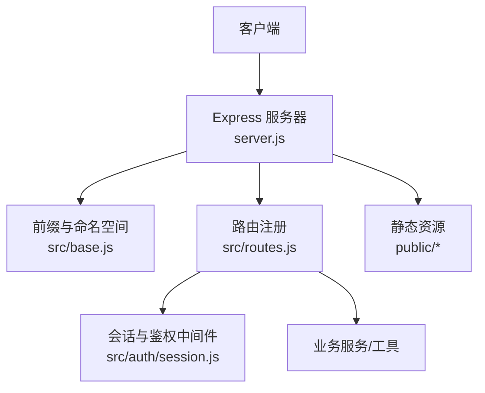
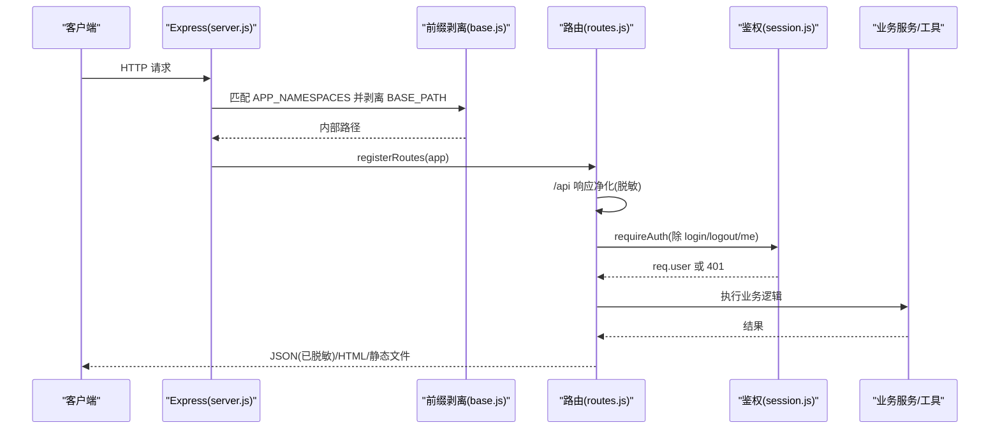
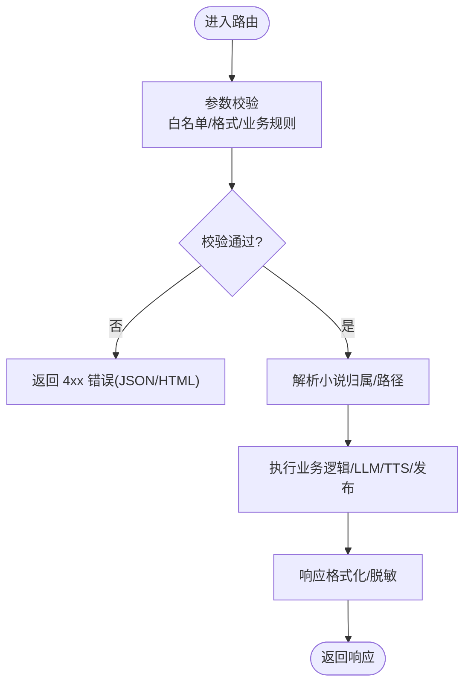
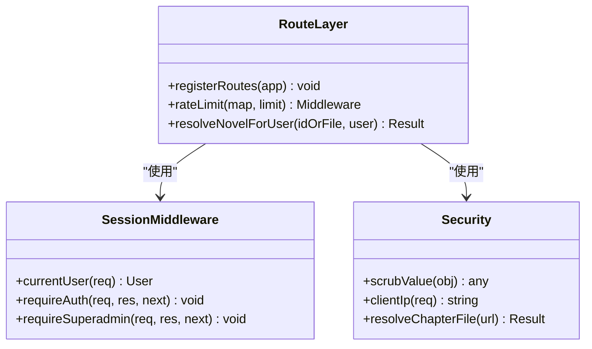
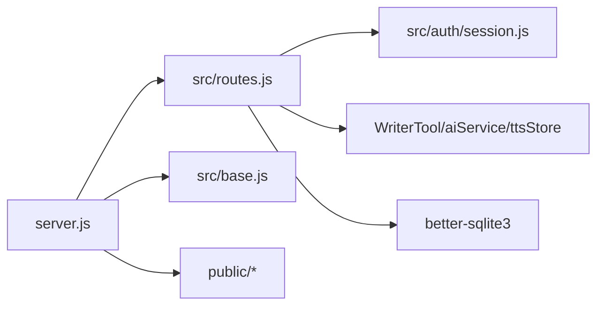

# 路由系统设计

<cite>
**本文引用的文件**   
- [server.js](file://server.js)
- [src/routes.js](file://src/routes.js)
- [src/auth/session.js](file://src/auth/session.js)
- [src/base.js](file://src/base.js)
- [package.json](file://package.json)
</cite>

## 目录
1. [引言](#引言)
2. [项目结构](#项目结构)
3. [核心组件](#核心组件)
4. [架构总览](#架构总览)
5. [详细组件分析](#详细组件分析)
6. [依赖关系分析](#依赖关系分析)
7. [性能与可扩展性](#性能与可扩展性)
8. [故障排查指南](#故障排查指南)
9. [结论](#结论)
10. [附录：新增 API 端点实践](#附录新增-api-端点实践)

## 引言
本技术文档聚焦于该项目的路由系统，围绕 RESTful API 设计原则、URL 模式定义、HTTP 方法映射、请求处理流程（参数校验、数据转换、响应格式化）、路由分组策略、版本控制机制、API 文档生成思路、中间件应用（认证、权限、限流、日志）进行系统化说明。同时给出“如何添加新 API 端点”“如何实现请求拦截器”“如何构建统一响应对象”的实践指引，帮助开发者在不破坏现有安全与租户隔离语义的前提下扩展系统能力。

## 项目结构
本项目采用 Node.js + Express 的服务端架构，入口为 `server.js`，负责初始化 Express、挂载全局中间件、启动服务并注册静态资源；具体业务路由集中在 `src/routes.js`，通过 `registerRoutes(app)` 注入到 Express 实例中。鉴权与会话逻辑位于 `src/auth/session.js`，站点前缀与路径工具在 `src/base.js` 中集中管理。

**图表来源**
- [server.js:18-53](file://server.js#L18-L53)
- [src/base.js:17-39](file://src/base.js#L17-L39)
- [src/routes.js:331-339](file://src/routes.js#L331-L339)

**章节来源**
- [server.js:1-64](file://server.js#L1-L64)
- [src/base.js:1-42](file://src/base.js#L1-L42)
- [package.json:1-29](file://package.json#L1-L29)

## 核心组件
- 服务器入口与中间件栈：`server.js` 提供 CORS、JSON 解析、BASE_PATH 前缀剥离、静态资源托管，并在启动时调用 `registerRoutes(app)`。
- 路由中心：`src/routes.js` 暴露 `registerRoutes(app)`，集中定义所有 RESTful 接口、页面访问闸门、SSE 进度通道、长任务互斥锁等。
- 鉴权与会话：`src/auth/session.js` 实现基于 HMAC-SHA256 的 httpOnly Cookie 会话，提供 `requireAuth`、`requireSuperadmin`、`currentUser` 等中间件。
- 站点前缀与路径工具：`src/base.js` 统一管理 BASE_PATH、APP_NAMESPACES、sitePath，保证前后端 URL 一致性。

**章节来源**
- [server.js:22-45](file://server.js#L22-L45)
- [src/routes.js:331-339](file://src/routes.js#L331-L339)
- [src/auth/session.js:93-110](file://src/auth/session.js#L93-L110)
- [src/base.js:17-39](file://src/base.js#L17-L39)

## 架构总览
下图展示从客户端请求到服务端处理的完整链路，包括前缀剥离、全局净化、鉴权、业务路由、响应净化与静态资源返回。

**图表来源**
- [server.js:25-36](file://server.js#L25-L36)
- [src/base.js:30-39](file://src/base.js#L30-L39)
- [src/routes.js:331-339](file://src/routes.js#L331-L339)
- [src/auth/session.js:93-110](file://src/auth/session.js#L93-L110)

## 详细组件分析

### RESTful API 设计与 URL 模式
- 资源模型
  - 小说：`/api/novels`（列表）、`/api/novels/:id`（详情/设置/删除等）。
  - 章节：`/api/novels/:id/chapters`、`/api/novels/:id/chapter/:no`、`/api/novels/:id/chapter/:no/outline`。
  - 部结构：`/api/novels/:id/parts`。
  - 通用动作：`/api/run`（action 驱动，复用 WriterTool）。
  - 阅读器 AI：`/api/reader/*`（公开，带独立限流）。
  - TTS：`/api/tts/sentence`、`/api/tts/explain`。
  - 发布与预览：`/api/novels/:id/publish`、`/api/novels/:id/preview`、`/api/novels/:id/preview/report`、`/api/novels/:id/preview/:token/diff`。
  - VIP 授权：`/api/novels/:id/vip`、`/api/admin/vip/*`。
  - 管理端：`/api/admin/users`、`/api/admin/bridge/*`、`/api/admin/tts/audio/*`。
  - 其他：`/api/login`、`/api/logout`、`/api/me`、`/api/catalog`、`/api/menu`、`/api/tools`、`/api/llm-status`、`/api/progress`、`/api/novels/:id/share`。

- HTTP 方法映射
  - GET：获取资源、状态、列表、分享链接、进度 SSE。
  - POST：创建资源、执行动作、发布、预览、AI 意图解析与执行。
  - PUT：更新设置、VIP 开关、桥接配置。
  - DELETE：删除小说、章节、预览、VIP 授权。

- URL 模式要点
  - 使用 RESTful 风格资源路径，避免动词化路径。
  - 对敏感操作（删除、批量修改）要求显式二次确认字段 `confirm:"OK"`。
  - 对长任务使用 `progressId` 关联 SSE 进度通道。

**章节来源**
- [src/routes.js:341-350](file://src/routes.js#L341-L350)
- [src/routes.js:359-390](file://src/routes.js#L359-L390)
- [src/routes.js:457-513](file://src/routes.js#L457-L513)
- [src/routes.js:519-557](file://src/routes.js#L519-L557)
- [src/routes.js:639-684](file://src/routes.js#L639-L684)
- [src/routes.js:686-775](file://src/routes.js#L686-L775)
- [src/routes.js:777-823](file://src/routes.js#L777-L823)
- [src/routes.js:825-912](file://src/routes.js#L825-L912)
- [src/routes.js:914-973](file://src/routes.js#L914-L973)
- [src/routes.js:991-1033](file://src/routes.js#L991-L1033)
- [src/routes.js:1109-1118](file://src/routes.js#L1109-L1118)
- [src/routes.js:1120-1184](file://src/routes.js#L1120-L1184)
- [src/routes.js:1186-1210](file://src/routes.js#L1186-L1210)
- [src/routes.js:1212-1248](file://src/routes.js#L1212-L1248)
- [src/routes.js:1250-1340](file://src/routes.js#L1250-L1340)
- [src/routes.js:1342-1360](file://src/routes.js#L1342-L1360)

### 请求处理流程
- 参数校验
  - 必填字段检查（如登录用户名密码、TTS 参数、章节号、novelId、progressId）。
  - 白名单校验（ALLOWED_ACTIONS、ALLOWED_VOICES、ALLOWED_RATES）。
  - 格式校验（正则校验 progressId、chapterUrl、file 参数）。
  - 业务规则校验（书名不能为空、故事概要缺失拒绝大纲草稿、VIP 过期时间解析）。

- 数据转换
  - 将前端传入的 chapterUrl 解码并校验后转为磁盘路径。
  - 将 genCfg 规范化为 effectiveBand 与 wordBandText。
  - 将 LLM 返回文本容错解析为 JSON。

- 响应格式化
  - 统一 JSON 响应结构，错误携带 error 字段，成功携带 ok/success/result。
  - `/api` 响应经 scrubValue 脱敏，剔除敏感键与绝对路径、IP、URL 等。
  - HTML 响应（VIP 无权页、预览无权页）内嵌样式与跳转链接。

**图表来源**
- [src/routes.js:331-339](file://src/routes.js#L331-L339)
- [src/routes.js:457-513](file://src/routes.js#L457-L513)
- [src/routes.js:914-973](file://src/routes.js#L914-L973)
- [src/routes.js:1434-1444](file://src/routes.js#L1434-L1444)

**章节来源**
- [src/routes.js:331-339](file://src/routes.js#L331-L339)
- [src/routes.js:457-513](file://src/routes.js#L457-L513)
- [src/routes.js:914-973](file://src/routes.js#L914-L973)
- [src/routes.js:1434-1444](file://src/routes.js#L1434-L1444)

### 路由分组策略
- 按功能域分组
  - 认证与会话：`/api/login`、`/api/logout`、`/api/me`。
  - 阅读器 AI：`/api/reader/*`（公开，独立限流）。
  - TTS：`/api/tts/*`（需登录，独立限流）。
  - 小说资源：`/api/novels/*`（需登录，租户隔离）。
  - 通用动作：`/api/run`（action 驱动）。
  - 发布与预览：`/api/novels/:id/publish`、`/api/novels/:id/preview*`。
  - VIP 授权：`/api/novels/:id/vip`、`/api/admin/vip/*`。
  - 管理端：`/api/admin/*`（超管）。
  - 页面闸门：`/novel`（VIP 与预览访问控制）。

- 前缀与命名空间
  - BASE_PATH 支持根路径或 `/novel`，APP_NAMESPACES 限定需要剥离前缀的路径族（api、login、tts、tts-audio、admin），书页路径保持原样以避免双前缀。

**章节来源**
- [src/routes.js:331-339](file://src/routes.js#L331-L339)
- [src/routes.js:341-350](file://src/routes.js#L341-L350)
- [src/routes.js:359-390](file://src/routes.js#L359-L390)
- [src/routes.js:457-513](file://src/routes.js#L457-L513)
- [src/routes.js:519-557](file://src/routes.js#L519-L557)
- [src/routes.js:639-684](file://src/routes.js#L639-L684)
- [src/routes.js:914-973](file://src/routes.js#L914-L973)
- [src/routes.js:991-1033](file://src/routes.js#L991-L1033)
- [src/routes.js:1035-1094](file://src/routes.js#L1035-L1094)
- [src/base.js:17-39](file://src/base.js#L17-L39)

### 版本控制机制
当前代码未实现显式的 API 版本前缀（如 `/v1/...`）。建议未来引入版本控制时：
- 在 BASE_PATH 之外增加版本段（例如 `/novel/v1/api/...`），并通过 APP_NAMESPACES 扩展匹配规则。
- 在路由层按版本分支组织 handler，旧版本保留兼容层，新版本逐步迁移。
- 在响应体中加入 `version` 字段便于客户端适配。

[本节为概念性建议，不直接分析具体文件]

### API 文档生成
当前仓库未包含自动化的 OpenAPI/Swagger 配置。建议：
- 以路由注释或 YAML 描述接口契约，结合脚本生成 OpenAPI 文档。
- 对关键端点（认证、小说 CRUD、发布、预览、VIP、管理端）维护统一的接口清单。
- 将文档部署至 `/api/docs` 或通过外部文档站点托管。

[本节为概念性建议，不直接分析具体文件]

### 中间件在路由中的应用
- 认证检查
  - `requireAuth`：除 `/login`、`/logout`、`/me` 外，所有 `/api` 必须携带有效会话 Cookie。
  - `currentUser`：解析 Cookie，校验签名与有效期，返回用户信息。
- 权限验证
  - `requireSuperadmin`：仅允许 superadmin 角色访问管理端接口。
  - 小说拥有权校验：`resolveNovelForUser` 确保当前用户为小说所有者或超管。
- 限流
  - 读者 AI 与 TTS 分别使用独立 Map 桶，按真实 IP 分桶，60s 窗口限制。
  - 长任务按小说 ID 互斥，防止并发生成压垮上游 LLM。
- 日志与安全
  - `/api` 响应经 scrubValue 脱敏，避免泄露路径、密钥、IP、URL 等。
  - 章节 URL 解码与路径穿越防护。
  - 真实 IP 提取考虑反向代理场景（X-Real-IP/X-Forwarded-For）。

**图表来源**
- [src/auth/session.js:83-110](file://src/auth/session.js#L83-L110)
- [src/routes.js:279-306](file://src/routes.js#L279-L306)
- [src/routes.js:331-339](file://src/routes.js#L331-L339)
- [src/routes.js:97-116](file://src/routes.js#L97-L116)

**章节来源**
- [src/auth/session.js:83-110](file://src/auth/session.js#L83-L110)
- [src/routes.js:279-306](file://src/routes.js#L279-L306)
- [src/routes.js:331-339](file://src/routes.js#L331-L339)
- [src/routes.js:97-116](file://src/routes.js#L97-L116)

## 依赖关系分析
- 模块耦合
  - `server.js` 依赖 `src/routes.js`、`src/auth/userStore.js`、`src/services/bridgeStore.js`、`src/base.js`。
  - `src/routes.js` 依赖 `WriterTool`、`createWriterDB`、`llm`、`bridgeStore`、`progressHub`、`auth/session.js`、`base.js`、`aiService`、`ttsStore`、`publish.js`、`preview.js`。
- 外部依赖
  - Express、CORS、better-sqlite3、fs-extra、marked、msedge-tts、pinyin-pro。

**图表来源**
- [server.js:9-16](file://server.js#L9-L16)
- [src/routes.js:10-28](file://src/routes.js#L10-L28)
- [package.json:19-27](file://package.json#L19-L27)

**章节来源**
- [server.js:9-16](file://server.js#L9-L16)
- [src/routes.js:10-28](file://src/routes.js#L10-L28)
- [package.json:19-27](file://package.json#L19-L27)

## 性能与可扩展性
- 限流与并发
  - 读者 AI 与 TTS 使用 Map 桶限流，避免瞬时洪峰。
  - 长任务按小说 ID 互斥，防止并发生成导致数据竞争与上游压力。
- 缓存与 IO
  - 章节列表查询优化为只读统计，避免全库加载正文。
  - TTS 音频静态托管并设置长期缓存头，减少重复合成。
- 可扩展性建议
  - 将限流策略抽象为可配置中间件（按 IP、用户、接口维度）。
  - 将响应脱敏逻辑封装为可插拔过滤器，支持按端点白名单放行。
  - 引入异步任务队列（如 BullMQ）替代内存 Map，提升水平扩展能力。

[本节为通用指导，不直接分析具体文件]

## 故障排查指南
- 401 未登录
  - 检查 Cookie 是否携带、是否过期、SESSION_SECRET 是否稳定。
  - 确认 BASE_PATH 与 Cookie Path 一致，避免跨子系统串味。
- 403 无权限
  - 确认用户角色是否为 superadmin（管理端接口）。
  - 确认小说归属权（非超管只能访问 own novels）。
- 429 请求频繁
  - 检查 readerRL/ttsRL 限流桶，确认真实 IP 提取是否正确（反向代理场景）。
- 404 章节不存在
  - 检查 chapterUrl 解码与路径穿越防护逻辑。
  - 确认已发布产物是否存在。
- 502/503 上游失败
  - 检查 LLM 可达性与 aibridge 连接配置。
  - 检查 TTS 音色与语速是否在白名单内。

**章节来源**
- [src/auth/session.js:32-36](file://src/auth/session.js#L32-L36)
- [src/auth/session.js:75-81](file://src/auth/session.js#L75-L81)
- [src/auth/session.js:83-110](file://src/auth/session.js#L83-L110)
- [src/routes.js:279-306](file://src/routes.js#L279-L306)
- [src/routes.js:313-329](file://src/routes.js#L313-L329)
- [src/routes.js:457-513](file://src/routes.js#L457-L513)
- [src/routes.js:402-428](file://src/routes.js#L402-L428)

## 结论
该路由系统以 Express 为核心，通过集中式路由注册、严格的鉴权与权限控制、细粒度的限流与互斥、以及全面的响应脱敏，构建了安全、可控且可扩展的 RESTful API 体系。未来可在版本控制、API 文档自动化、任务队列与限流策略方面进一步增强，以满足更大规模与更复杂的多租户场景。

[本节为总结性内容，不直接分析具体文件]

## 附录：新增 API 端点实践

### 添加新的 API 端点步骤
- 确定资源与 HTTP 方法
  - 遵循 RESTful 命名规范，避免动词化路径。
  - 明确是否需要认证、权限、限流。
- 在 `src/routes.js` 中注册路由
  - 若需认证，放在 `app.use('/api', requireAuth);` 之后。
  - 若需超管权限，使用 `requireSuperadmin`。
- 参数校验与数据转换
  - 校验必填字段、白名单、格式。
  - 将前端输入转换为内部数据结构。
- 执行业务逻辑
  - 调用 WriterTool、aiService、ttsStore 等服务。
  - 处理异常并返回统一错误格式。
- 响应格式化
  - 返回 `{ ok: true/false, ... }` 或 `{ success: true/false, ... }`。
  - 确保响应被 scrubValue 脱敏（除非在白名单）。

示例参考路径
- 认证相关：`/api/login`、`/api/logout`、`/api/me`
- 小说 CRUD：`/api/novels`、`/api/novels/:id`
- 章节管理：`/api/novels/:id/chapters`、`/api/novels/:id/chapter/:no`
- 通用动作：`/api/run`
- 发布与预览：`/api/novels/:id/publish`、`/api/novels/:id/preview`

**章节来源**
- [src/routes.js:341-350](file://src/routes.js#L341-L350)
- [src/routes.js:639-684](file://src/routes.js#L639-L684)
- [src/routes.js:686-775](file://src/routes.js#L686-L775)
- [src/routes.js:914-973](file://src/routes.js#L914-L973)
- [src/routes.js:991-1033](file://src/routes.js#L991-L1033)

### 实现请求拦截器（中间件）
- 认证拦截器
  - 使用 `requireAuth`，跳过公开端点（login/logout/me）。
- 权限拦截器
  - 使用 `requireSuperadmin` 保护管理端接口。
- 限流拦截器
  - 使用 `rateLimit(map, limit)` 按 IP 限流。
- 响应脱敏拦截器
  - 已在 `/api` 全局启用，必要时可按端点白名单放行。

示例参考路径
- 认证与权限：`src/auth/session.js`
- 限流：`src/routes.js`
- 响应脱敏：`src/routes.js`

**章节来源**
- [src/auth/session.js:93-110](file://src/auth/session.js#L93-L110)
- [src/routes.js:279-306](file://src/routes.js#L279-L306)
- [src/routes.js:331-339](file://src/routes.js#L331-L339)

### 构建响应对象
- 成功响应
  - 统一结构：`{ ok: true, ...data }` 或 `{ success: true, ...result }`。
- 错误响应
  - 统一结构：`{ error: '...' }`，附带 HTTP 状态码（400/401/403/404/409/429/500/502/503）。
- 脱敏处理
  - 使用 `scrubValue` 过滤敏感字段与路径。

示例参考路径
- 成功响应：`/api/novels`、`/api/novels/:id/settings`
- 错误响应：`/api/login`、`/api/novels/:id/chapter/:no`
- 脱敏处理：`src/routes.js`

**章节来源**
- [src/routes.js:341-350](file://src/routes.js#L341-L350)
- [src/routes.js:639-684](file://src/routes.js#L639-L684)
- [src/routes.js:710-725](file://src/routes.js#L710-L725)
- [src/routes.js:331-339](file://src/routes.js#L331-L339)