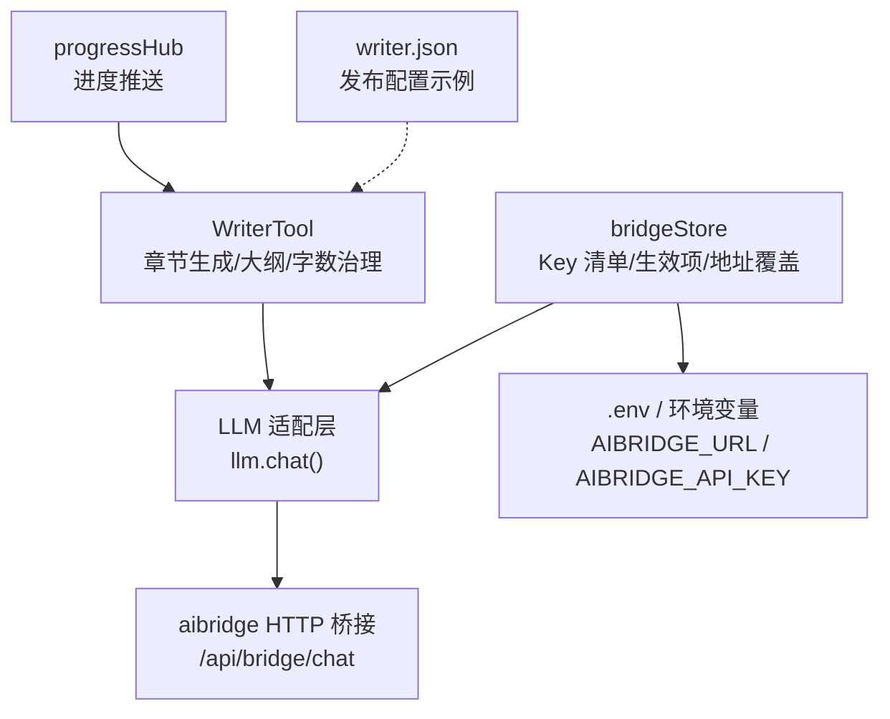
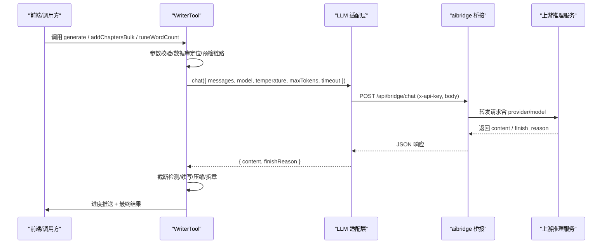
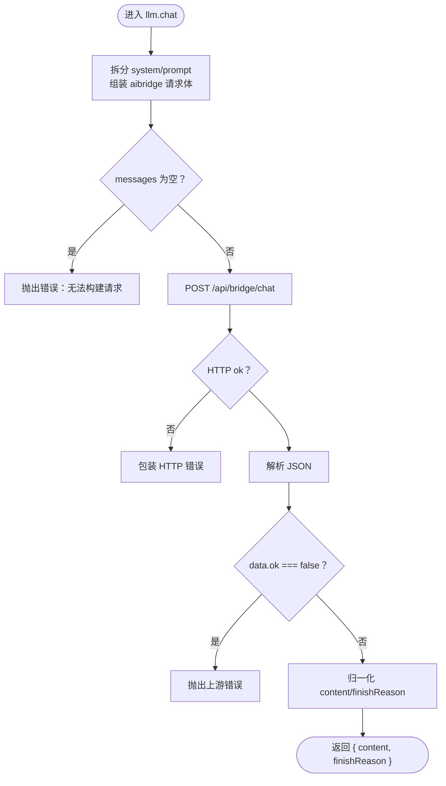
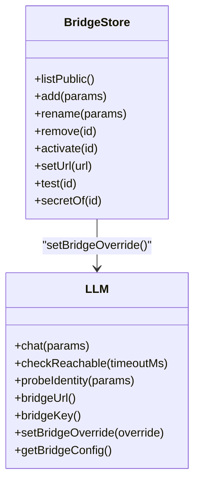
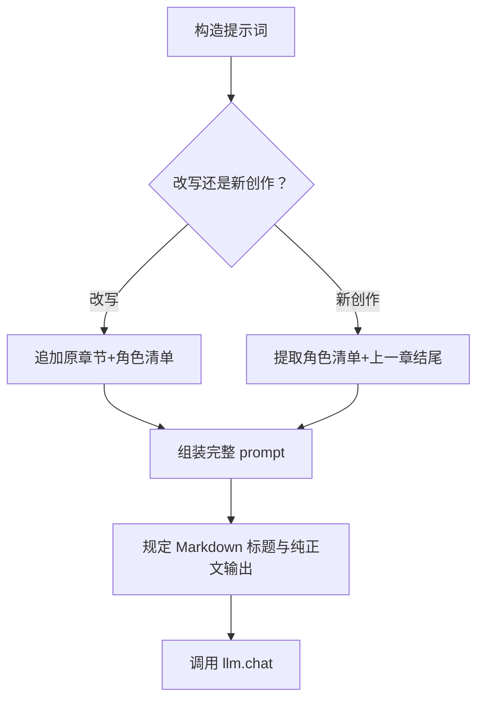
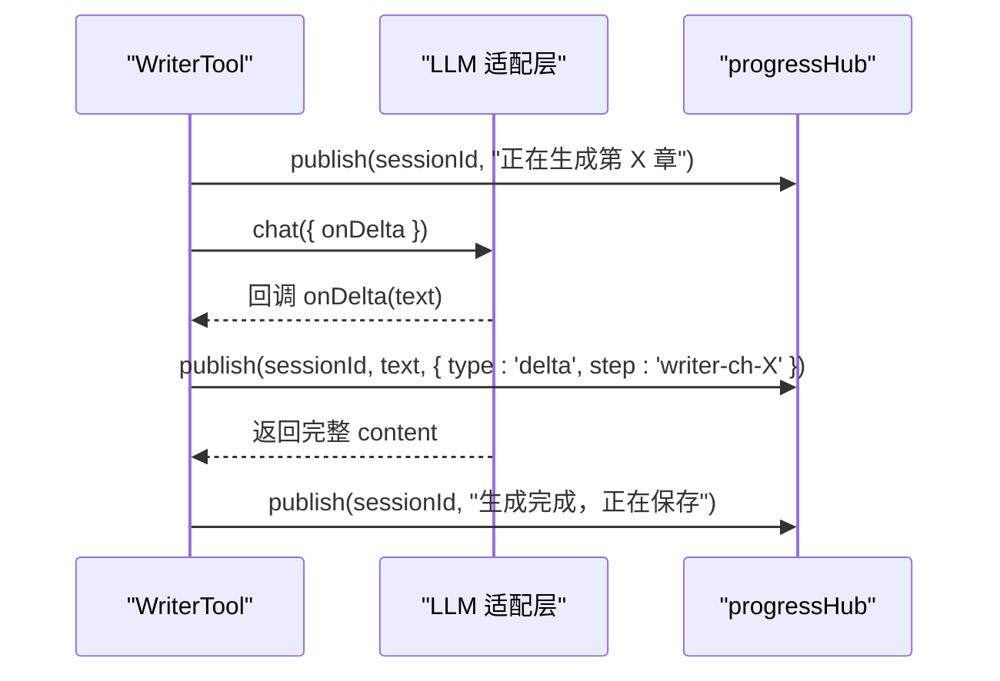
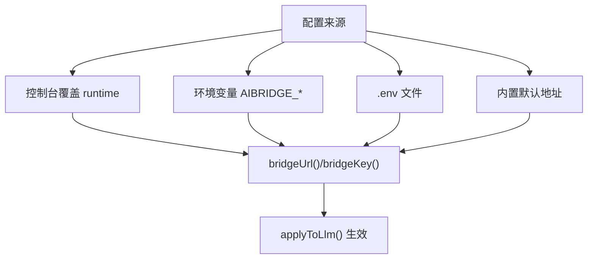
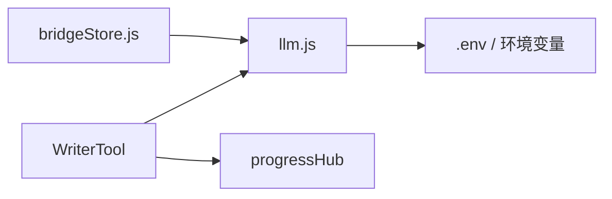
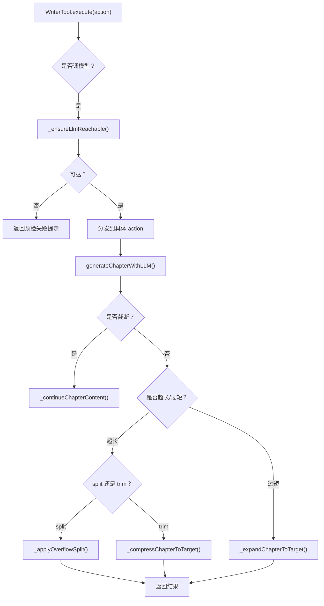

# AI 大语言模型集成

<cite>
**本文引用的文件**   
- [src/agent/llm.js](file://src/agent/llm.js)
- [src/services/bridgeStore.js](file://src/services/bridgeStore.js)
- [src/tools/common/writerTool.js](file://src/tools/common/writerTool.js)
- [config/writer.json](file://config/writer.json)
</cite>

## 目录
1. [引言](#引言)
2. [项目结构](#项目结构)
3. [核心组件](#核心组件)
4. [架构总览](#架构总览)
5. [详细组件分析](#详细组件分析)
6. [依赖关系分析](#依赖关系分析)
7. [性能与可靠性](#性能与可靠性)
8. [提示词工程实践](#提示词工程实践)
9. [流式响应与进度推送](#流式响应与进度推送)
10. [多提供商适配与密钥安全](#多提供商适配与密钥安全)
11. [与 WriterTool 的协作模式](#与-writertool-的协作模式)
12. [调试与排错指南](#调试与排错指南)
13. [结论](#结论)

## 引言
本技术文档面向需要理解并扩展本项目“AI 大语言模型集成”能力的开发者。系统通过一个轻量 LLM 适配层，把内部统一的 `chat` 调用桥接到外部推理服务；通过 `bridgeStore` 管理 API Key、连接地址和当前生效项；WriterTool 作为业务入口，负责章节大纲与正文生成、字数治理、拆章、续写等复杂流程，并通过进度中心向前端推送状态。

重点覆盖：
- LLM 接口抽象层：统一 `chat` 调用、错误包装、超时控制、上游参数映射。
- 桥接模式：`bridgeStore` 的连接管理、会话级配置注入、启动探测。
- 提示词工程：系统提示词模板、上下文构建、输出格式规范。
- 流式响应：增量回调、SSE 语义（由上层消费）、中断处理。
- 多提供商适配：配置优先级、密钥脱敏、whoami 探测。
- 与 WriterTool 协作：错误传播、熔断、重试与截断续写。

## 项目结构
与本次目标直接相关的代码集中在以下模块：
- `src/agent/llm.js`：LLM 适配层，封装对外 `chat`、健康检查、whoami 探测、桥接地址与密钥解析。
- `src/services/bridgeStore.js`：桥接连接配置存储，维护 Key 列表、当前生效项、地址覆盖，并在启动时应用。
- `src/tools/common/writerTool.js`：WriterTool 工具实现，负责小说规划、章节大纲、正文生成、字数治理、拆章、续写、进度推送。
- `config/writer.json`：Writer 相关静态配置示例（发布开关等）。

**图表来源**
- [src/agent/llm.js:1-205](file://src/agent/llm.js#L1-L205)
- [src/services/bridgeStore.js:1-221](file://src/services/bridgeStore.js#L1-L221)
- [src/tools/common/writerTool.js:3800-4200](file://src/tools/common/writerTool.js#L3800-L4200)
- [config/writer.json:1-8](file://config/writer.json#L1-L8)

**章节来源**
- [src/agent/llm.js:1-205](file://src/agent/llm.js#L1-L205)
- [src/services/bridgeStore.js:1-221](file://src/services/bridgeStore.js#L1-L221)
- [src/tools/common/writerTool.js:1-1200](file://src/tools/common/writerTool.js#L1-L1200)
- [config/writer.json:1-8](file://config/writer.json#L1-L8)

## 核心组件
- **LLM 适配层（`llm.js`）**
  - 提供 `llm.chat()` 统一接口，接收 `messages`、`model`、`temperature`、`maxTokens`、`timeout`、`think` 等参数。
  - 将内部消息拆为 `system` 与 `prompt`，映射到 aibridge 请求体。
  - 统一错误包装，标记 `connectionError`，支持超时、HTTP 非 200、上游 error 字段。
  - 暴露 `checkReachable`、`probeIdentity`、`bridgeUrl`、`bridgeKey`、`setBridgeOverride`、`getBridgeConfig`。
- **桥接连接存储（`bridgeStore.js`）**
  - 持久化 `data/system/bridge.json`，权限 0600，仅进程内持有明文 Key。
  - 维护 `keys[]`、`activeId`、`url` 覆盖，对外返回脱敏前缀。
  - 启动时 `initBridge()` 打印链路信息并异步探测 whoami。
  - 提供 `add/rename/remove/activate/setUrl/test/listPublic` 等管理方法。
- **WriterTool（`writerTool.js`）**
  - 以 action 路由组织功能：保存规划、生成/补全大纲、批量生成正文、字数治理、拆章、续写、部导言等。
  - 在动笔前对调模型的 action 做链路预检，失败不写库。
  - 使用 `progressHub.publish` 推送阶段进度与 delta 增量。
  - 内置截断检测、自动续写、超长压缩/自由扩展拆章、连续失败熔断。

**章节来源**
- [src/agent/llm.js:67-171](file://src/agent/llm.js#L67-L171)
- [src/services/bridgeStore.js:28-99](file://src/services/bridgeStore.js#L28-L99)
- [src/tools/common/writerTool.js:64-75](file://src/tools/common/writerTool.js#L64-L75)
- [src/tools/common/writerTool.js:3826-3969](file://src/tools/common/writerTool.js#L3826-L3969)

## 架构总览
整体数据流如下：

**图表来源**
- [src/tools/common/writerTool.js:3826-3969](file://src/tools/common/writerTool.js#L3826-L3969)
- [src/agent/llm.js:102-171](file://src/agent/llm.js#L102-L171)

## 详细组件分析

### LLM 适配层设计
- **统一 API 调用接口**
  - `chat` 接收内部消息数组，按 role 拆分 system 与 prompt，再映射到 aibridge 请求体。
  - 支持 `temperature`、`max_tokens`、`model`、`think`、`timeout` 透传。
  - 返回 `{ content, finishReason }`，兼容多种上游返回结构。
- **错误重试机制**
  - 网络异常被包装为 Error，并设置 `connectionError = true`，供调用方识别连接类故障。
  - 超时通过 `AbortSignal.timeout` 控制，区分客户端超时与上游硬顶。
  - 注意：当前 `chat` 未实现指数退避重试；重试策略应在调用方或 WriterTool 层面组合。
- **健康检查与身份探测**
  - `checkReachable` 调用 `/api/health`，快速判断桥接可达性与 Key 是否存在。
  - `probeIdentity` 调用 `/api/bridge/whoami`，返回 provider、providerType、model、keyName 等只读标识。

**图表来源**
- [src/agent/llm.js:102-171](file://src/agent/llm.js#L102-L171)

**章节来源**
- [src/agent/llm.js:16-65](file://src/agent/llm.js#L16-L65)
- [src/agent/llm.js:67-171](file://src/agent/llm.js#L67-L171)
- [src/agent/llm.js:174-201](file://src/agent/llm.js#L174-L201)

### bridgeStore 连接管理与负载均衡
- **连接管理**
  - 从 `data/system/bridge.json` 加载 `url`、`activeId`、`keys[]`。
  - 通过 `applyToLlm()` 调用 `setBridgeOverride`，把当前生效 Key 与可选地址覆盖推给 LLM 适配层。
  - 启动时必须显式调用 `initBridge()`，否则控制台选择的链路不会生效。
- **会话保持**
  - 当前实现以进程内 `runtime` 状态承载生效配置；若需跨进程/多实例共享，应引入分布式锁或集中配置源。
  - 每条 Key 可缓存一次 whoami 探测结果（`probe`），避免频繁网络往返。
- **负载均衡**
  - 当前未实现请求级负载均衡；可通过扩展 `bridgeStore` 增加多个 active Key 并按权重轮询。
  - 建议：在 LLM 适配层根据 `provider_id` 或 Key 哈希选择后端，同时保留失败回退。

**图表来源**
- [src/services/bridgeStore.js:126-218](file://src/services/bridgeStore.js#L126-L218)
- [src/agent/llm.js:37-56](file://src/agent/llm.js#L37-L56)

**章节来源**
- [src/services/bridgeStore.js:31-66](file://src/services/bridgeStore.js#L31-L66)
- [src/services/bridgeStore.js:85-99](file://src/services/bridgeStore.js#L85-L99)
- [src/services/bridgeStore.js:101-124](file://src/services/bridgeStore.js#L101-L124)

### 提示词工程实践
- **系统提示词模板**
  - 正文生成使用固定 system 角色提示：“你是一位专业的小说作家……”。
  - 用户 prompt 包含章节号、章节大纲、整体设定、改写/续写约束、字数要求、Markdown 标题格式。
- **上下文构建**
  - 改写模式：传入原文与角色清单，强制人物名一致。
  - 新创作模式：提取最近 3 章的角色清单与上一章结尾，保证连贯性。
- **输出格式规范**
  - 要求 Markdown 以 `# 第X章：标题` 开头。
  - 禁止解释说明，只返回正文内容。
  - 对超长/过短章节，结合 `wordBand` 判定后走压缩或扩写。

**图表来源**
- [src/tools/common/writerTool.js:3826-3919](file://src/tools/common/writerTool.js#L3826-L3919)

**章节来源**
- [src/tools/common/writerTool.js:3800-3919](file://src/tools/common/writerTool.js#L3800-L3919)

### 流式响应与 SSE 协议
- **当前实现**
  - LLM 适配层默认关闭流式（`stream: false`），返回完整 `content`。
  - WriterTool 通过 `onDelta` 回调接收增量文本，并使用 `progressHub.publish` 推送给前端。
- **SSE 语义**
  - 当前代码未直接实现 SSE 流式读取；增量通过回调传递，前端可按 `step` 分组刷新。
  - 若上游改为 SSE，需在 LLM 适配层接入 ReadableStream，逐块触发 `onDelta`。
- **中断处理**
  - 客户端超时通过 `AbortSignal.timeout` 中断 fetch。
  - WriterTool 在批量任务中通过进度推送与连续失败熔断提前停止。

**图表来源**
- [src/tools/common/writerTool.js:3891-3923](file://src/tools/common/writerTool.js#L3891-L3923)

**章节来源**
- [src/tools/common/writerTool.js:3891-3923](file://src/tools/common/writerTool.js#L3891-L3923)

### 多提供商适配机制与密钥安全
- **配置优先级**
  - 控制台覆盖（runtime） > 环境变量 > `.env` > 内置默认。
  - `bridgeUrl()` 与 `bridgeKey()` 分别解析地址与密钥。
- **密钥安全**
  - 明文 Key 仅在进程内与本地文件间流动；对外一律返回前缀。
  - `bridge.json` 写入权限 0600，降低泄露风险。
- **whoami 探测**
  - 启动时异步探测，确认 provider/model/keyName，不影响服务启动。
  - 列表页复用缓存结果，减少网络开销。

**图表来源**
- [src/agent/llm.js:16-42](file://src/agent/llm.js#L16-L42)
- [src/services/bridgeStore.js:56-66](file://src/services/bridgeStore.js#L56-L66)

**章节来源**
- [src/agent/llm.js:16-65](file://src/agent/llm.js#L16-L65)
- [src/services/bridgeStore.js:25-66](file://src/services/bridgeStore.js#L25-L66)
- [src/services/bridgeStore.js:85-99](file://src/services/bridgeStore.js#L85-L99)

## 依赖关系分析
- WriterTool 依赖 LLM 适配层进行所有模型调用。
- LLM 适配层依赖桥接地址与密钥解析，可能读取 `.env`。
- bridgeStore 依赖 LLM 适配层的 `setBridgeOverride` 与 `probeIdentity`。
- progressHub 用于 WriterTool 向调用方推送进度。

**图表来源**
- [src/tools/common/writerTool.js:1-19](file://src/tools/common/writerTool.js#L1-L19)
- [src/agent/llm.js:12-18](file://src/agent/llm.js#L12-L18)
- [src/services/bridgeStore.js:15-19](file://src/services/bridgeStore.js#L15-L19)

**章节来源**
- [src/tools/common/writerTool.js:1-19](file://src/tools/common/writerTool.js#L1-L19)
- [src/agent/llm.js:12-18](file://src/agent/llm.js#L12-L18)
- [src/services/bridgeStore.js:15-19](file://src/services/bridgeStore.js#L15-L19)

## 性能与可靠性
- **超时控制**
  - LLM 适配层根据调用方 `timeout` 设置 fetch 超时，并额外预留 15s，避免桥接侧先超时导致客户端误判。
  - WriterTool 根据目标字数估算 `_chapterCallMs`，让长文生成有合理预算。
- **熔断与重试**
  - WriterTool 在区间补大纲时统计连续失败次数，达到阈值提前停止，避免长时间挂起。
  - 当前未实现自动重试；可在调用方对 `connectionError` 标志进行有限次重试。
- **内存与 I/O**
  - 批量操作尽量使用数据库事务，避免半写状态。
  - 进度推送使用 sessionId 分组，避免不同章节增量互相污染。

[本节为通用指导，不直接分析具体文件]

## 提示词工程实践
- **系统提示词**
  - 正文生成使用稳定的人设提示，强调专业性与连贯性。
- **上下文构建**
  - 改写模式：锁定原文与角色名，防止改名漂移。
  - 新创作模式：提取最近 3 章角色清单与上一章结尾，增强连贯性。
- **输出格式**
  - 强制 Markdown 标题格式，禁止解释性文本。
  - 结合字数带（target/min/max）与溢出策略（split/trim）决定后续处理。

**章节来源**
- [src/tools/common/writerTool.js:3826-3919](file://src/tools/common/writerTool.js#L3826-L3919)

## 流式响应与进度推送
- **增量回调**
  - WriterTool 在生成正文时注册 `onDelta`，将增量文本通过 `progressHub.publish` 推送。
- **进度节点**
  - 开始生成、截断续写、完成保存、压缩/扩写、拆章等关键步骤均有进度消息。
- **中断与恢复**
  - 客户端超时中断 fetch；WriterTool 在批量任务中通过连续失败熔断提前退出。
  - 截断后自动续写，最多允许第二次续写，避免无限循环。

**章节来源**
- [src/tools/common/writerTool.js:3891-3923](file://src/tools/common/writerTool.js#L3891-L3923)
- [src/tools/common/writerTool.js:3928-4030](file://src/tools/common/writerTool.js#L3928-L4030)

## 多提供商适配与密钥安全
- **配置来源**
  - 控制台覆盖优先，其次环境变量与 `.env`，最后内置默认。
- **密钥脱敏**
  - 对外返回 keyPrefix，不暴露明文。
  - `bridge.json` 文件权限 0600。
- **whoami 探测**
  - 启动时异步探测，打印 provider/model/keyName。
  - 列表页复用缓存，减少网络往返。

**章节来源**
- [src/agent/llm.js:16-65](file://src/agent/llm.js#L16-L65)
- [src/services/bridgeStore.js:25-66](file://src/services/bridgeStore.js#L25-L66)
- [src/services/bridgeStore.js:85-99](file://src/services/bridgeStore.js#L85-L99)

## 与 WriterTool 的协作模式
- **动作路由**
  - WriterTool 根据 `action` 分发到不同逻辑：保存规划、生成大纲、批量生成正文、字数治理、拆章、续写、部导言等。
- **链路预检**
  - 对调模型的 action 在进入前执行 `_ensureLlmReachable`，失败则不写库，直接返回错误提示。
- **错误传播**
  - LLM 层抛出的 `connectionError` 会携带到 WriterTool 的错误记录中，便于前端提示“推理链路连不上”。
- **截断与续写**
  - 检测到 `finishReason === 'length'` 或长度不足时，自动续写；必要时二次续写。
- **字数治理**
  - 根据 `wordBand` 判定 short/long/split，分别走扩写、压缩或拆章。
  - 自由扩展模式下，超长不压缩而是拆章，后续统一校正编号与引用。

**图表来源**
- [src/tools/common/writerTool.js:254-262](file://src/tools/common/writerTool.js#L254-L262)
- [src/tools/common/writerTool.js:3826-3969](file://src/tools/common/writerTool.js#L3826-L3969)
- [src/tools/common/writerTool.js:3971-4030](file://src/tools/common/writerTool.js#L3971-L4030)

**章节来源**
- [src/tools/common/writerTool.js:254-262](file://src/tools/common/writerTool.js#L254-L262)
- [src/tools/common/writerTool.js:3826-4030](file://src/tools/common/writerTool.js#L3826-L4030)

## 调试与排错指南
- **常见问题**
  - 无可用 Key：控制台添加或在 `.env` 填写 `AIBRIDGE_API_KEY`。
  - 桥接不可达：确认 aibridge 已启动且端口可达；`checkReachable` 会给出明确原因。
  - 上游 5xx：LLM 层会抛出 HTTP 错误，查看响应体前 300 字符。
  - 连续失败熔断：区间补大纲遇到连续失败会提前停止，需先修复上游再重跑。
- **调试技巧**
  - 使用 `probeIdentity` 验证 Key 对应的 provider/model。
  - 查看 `getBridgeConfig()` 返回的 `source` 与 `keyPrefix`，确认生效配置。
  - 在 WriterTool 中关注进度推送消息，定位卡点章节。
- **日志位置**
  - bridgeStore 启动日志打印链路来源与上游模型。
  - LLM 层在网络异常时打印 connectionError 详情。
  - WriterTool 在截断、续写、压缩、拆章处有明确日志。

**章节来源**
- [src/agent/llm.js:63-65](file://src/agent/llm.js#L63-L65)
- [src/agent/llm.js:75-100](file://src/agent/llm.js#L75-L100)
- [src/agent/llm.js:143-159](file://src/agent/llm.js#L143-L159)
- [src/services/bridgeStore.js:85-99](file://src/services/bridgeStore.js#L85-L99)
- [src/tools/common/writerTool.js:593-604](file://src/tools/common/writerTool.js#L593-L604)

## 结论
本项目的 AI 大语言模型集成通过清晰的分层设计实现了高内聚、低耦合：
- LLM 适配层屏蔽上游差异，提供统一 `chat` 接口与健壮的错误处理。
- bridgeStore 管理密钥与连接，支持运行时切换与启动探测。
- WriterTool 将业务逻辑与 LLM 调用解耦，内置提示词工程、进度推送、截断续写、字数治理与熔断机制。
未来可扩展方向包括：SSE 流式原生支持、请求级负载均衡、指数退避重试、分布式配置同步。

[本节为总结性内容，不直接分析具体文件]