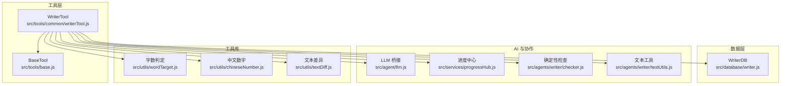
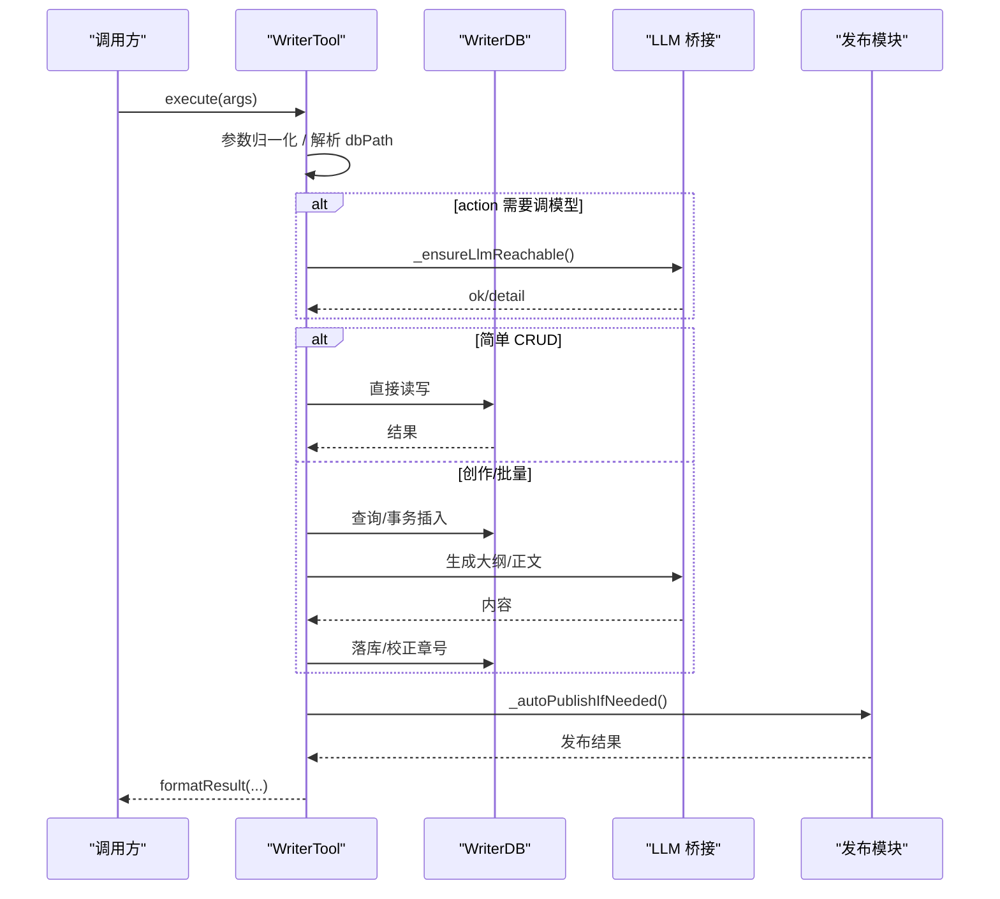
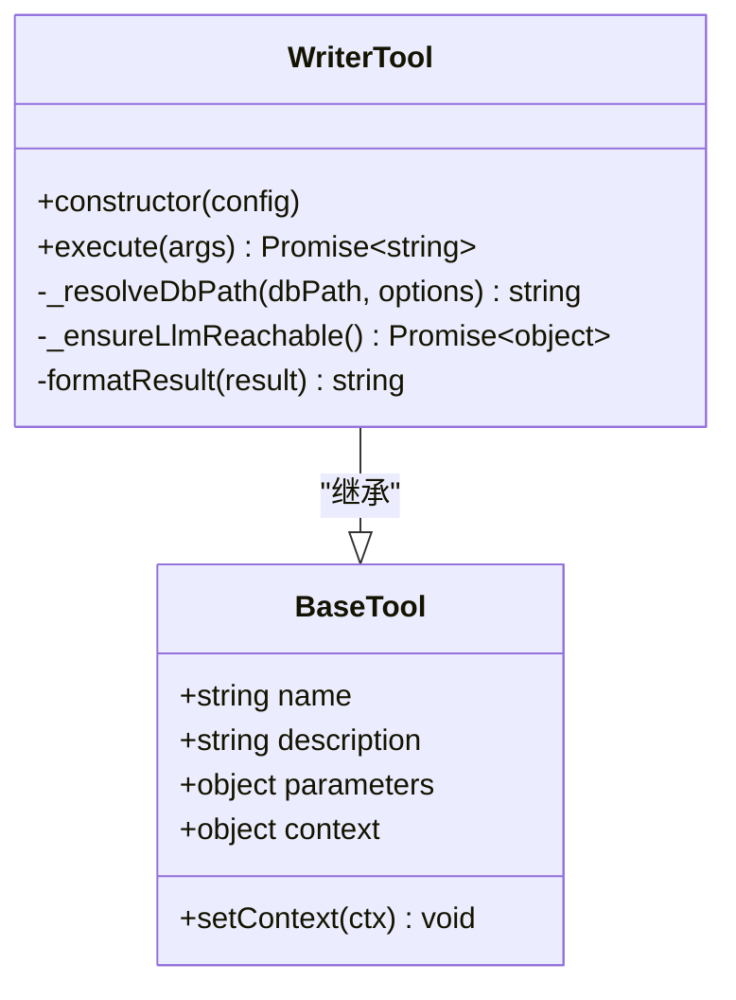
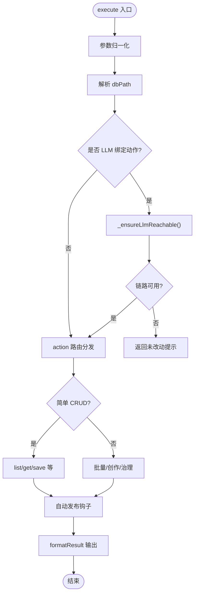
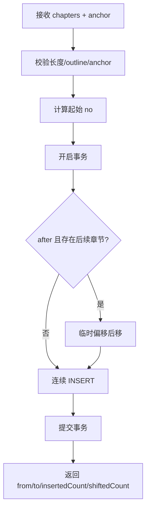
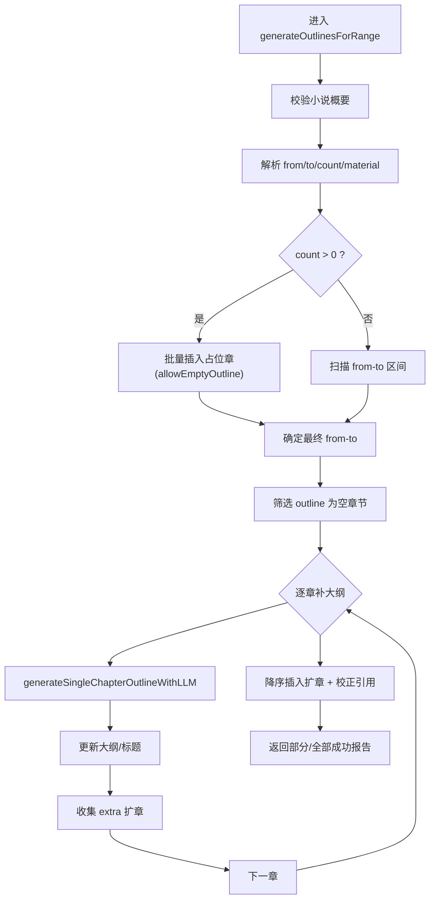
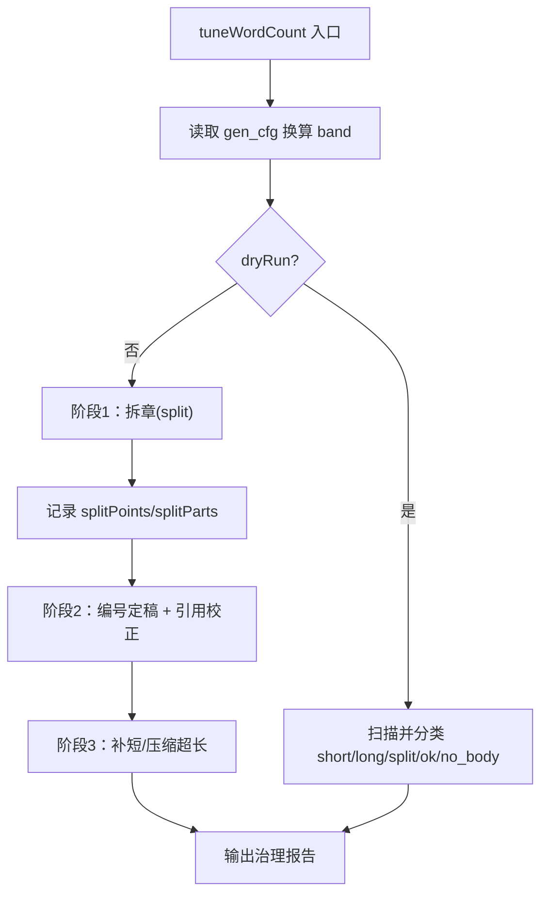
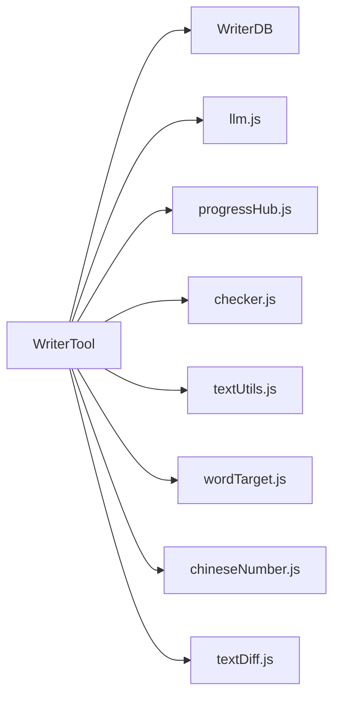

# WriterTool 核心工具类

<cite>
**本文引用的文件**   
- [writerTool.js](file://src/tools/common/writerTool.js)
- [base.js](file://src/tools/base.js)
- [writer.js](file://src/database/writer.js)
- [llm.js](file://src/agent/llm.js)
- [progressHub.js](file://src/services/progressHub.js)
- [checker.js](file://src/agents/writer/checker.js)
- [textUtils.js](file://src/agents/writer/textUtils.js)
- [wordTarget.js](file://src/utils/wordTarget.js)
- [chineseNumber.js](file://src/utils/chineseNumber.js)
- [textDiff.js](file://src/utils/textDiff.js)
</cite>

## 目录
1. [简介](#简介)
2. [项目结构](#项目结构)
3. [核心组件](#核心组件)
4. [架构总览](#架构总览)
5. [详细组件分析](#详细组件分析)
6. [依赖关系分析](#依赖关系分析)
7. [性能与并发特性](#性能与并发特性)
8. [故障排查指南](#故障排查指南)
9. [结论](#结论)
10. [附录：常用调用模式](#附录常用调用模式)

## 简介
WriterTool 是小说创作工作流中的“写作工具”核心，负责根据大纲与设定生成、添加、修改、删除章节，以及批量补大纲、字数治理、分部管理、发布配置等。它继承 BaseTool，通过 execute 方法完成参数归一化、数据库路径解析、LLM 链路预检、操作路由分发，并协调 WriterDB、LLM 桥接层、进度中心与发布模块，形成从“规划 → 大纲 → 正文 → 体检 → 发布”的完整闭环。

## 项目结构
WriterTool 位于 tools/common 下，属于工具层；数据持久化在 database/writer.js；LLM 能力由 agent/llm.js 提供；辅助能力分布在 agents/writer、utils、services 等目录。

**图表来源** 
- [writerTool.js:7-18](file://src/tools/common/writerTool.js#L7-L18)
- [base.js:8-14](file://src/tools/base.js#L8-L14)
- [writer.js:16-20](file://src/database/writer.js#L16-L20)

**章节来源**
- [writerTool.js:1-18](file://src/tools/common/writerTool.js#L1-L18)
- [base.js:1-23](file://src/tools/base.js#L1-L23)

## 核心组件
- WriterTool：对外暴露 action 路由与创作流程控制，内部封装 LLM 调用、事务性落库、区间补大纲、字数治理、发布联动等。
- BaseTool：最小基类，提供 name/description/parameters/context 注入能力，使 WriterTool 可被统一工具调度器加载。
- WriterDB：SQLite 数据访问层，维护 content/parts/chapter_revision 表，提供 addChaptersBulk、updateChapterOutline、saveParts、getChaptersInRange 等原子或组合操作。
- LLM 桥接：统一模型调用、超时预算、进度推送。
- 进度中心：向会话前端推送长任务进度。
- 检查与文本工具：确定性校验、角色抽取、章节引用识别等。

**章节来源**
- [writerTool.js:76-206](file://src/tools/common/writerTool.js#L76-L206)
- [base.js:8-20](file://src/tools/base.js#L8-L20)
- [writer.js:16-20](file://src/database/writer.js#L16-L20)

## 架构总览
WriterTool.execute 是单一入口，按以下顺序执行：
1. 参数归一化（chapter/totalChapters/info.no 转整数）。
2. 数据库路径解析（相对名落到 data 目录、模糊匹配既有库、防空库误建）。
3. LLM 链路预检（对 LLM_BOUND_ACTIONS 先探 aibridge，失败则零写入）。
4. 简单 CRUD 分支（listNovels/getPublishConfig/setPublishConfig/getNovelInfo/saveNovelPlan/add/update/reNumber 等）。
5. 复杂创作分支（generateOutlinesForRange/generatePreface/generatePartIntros/tuneWordCount/setParts 等）。
6. 通用章节操作（executeChapterOperation），并在成功后触发自动发布。

**图表来源**
- [writerTool.js:217-295](file://src/tools/common/writerTool.js#L217-L295)
- [writerTool.js:1774-1780](file://src/tools/common/writerTool.js#L1774-L1780)
- [writerTool.js:1865-1907](file://src/tools/common/writerTool.js#L1865-L1907)

**章节来源**
- [writerTool.js:217-295](file://src/tools/common/writerTool.js#L217-L295)
- [writerTool.js:1774-1780](file://src/tools/common/writerTool.js#L1774-L1780)
- [writerTool.js:1865-1907](file://src/tools/common/writerTool.js#L1865-L1907)

## 详细组件分析

### 继承机制与参数系统
- 继承 BaseTool：构造时设置 name=writer、description，并声明 parameters.schema，供上层工具注册与参数校验使用。
- context 注入：model/temperature/maxTokens/sessionId/requestConfirmation 等运行时上下文由宿主注入，WriterTool 在 LLM 调用与确认卡片中使用。

**图表来源**
- [base.js:8-20](file://src/tools/base.js#L8-L20)
- [writerTool.js:76-206](file://src/tools/common/writerTool.js#L76-L206)

**章节来源**
- [base.js:1-23](file://src/tools/base.js#L1-L23)
- [writerTool.js:76-206](file://src/tools/common/writerTool.js#L76-L206)

### 操作路由分发
execute 中按 action 分派到不同处理块：
- 列表/配置：listNovels、getPublishConfig、setPublishConfig。
- 小说信息：getNovelInfo、saveNovelPlan、updateNovelPlan。
- 章节大纲：addChapterOutline、updateChapterOutline、addChaptersBulk、reNumberChapters、generateChapterOutlines、generateOutlinesForRange。
- 设定说明与部：savePreface、generatePreface、setParts、generatePartIntros、listParts。
- 全书生成设定与字数治理：setGenConfig、tuneWordCount。
- 通用章节操作：generate/add/modify/delete 走 executeChapterOperation。

**图表来源**
- [writerTool.js:217-295](file://src/tools/common/writerTool.js#L217-L295)
- [writerTool.js:1774-1780](file://src/tools/common/writerTool.js#L1774-L1780)

**章节来源**
- [writerTool.js:217-295](file://src/tools/common/writerTool.js#L217-L295)

### LLM 链路预检与事务保护
- LLM_BOUND_ACTIONS：包含 generate/gen/g、modify/mod/m、generateChapterOutlines、generateOutlinesForRange、generatePreface、generatePartIntros、tuneWordCount。
- _ensureLlmReachable：缓存 60s 内成功结果，避免重复探测；失败不缓存，下次立即重试。
- 关键保护：在“插占位章/清正文”之前做预检，若不可达则直接中止，保证零写入。

**章节来源**
- [writerTool.js:64-74](file://src/tools/common/writerTool.js#L64-L74)
- [writerTool.js:254-262](file://src/tools/common/writerTool.js#L254-L262)
- [writerTool.js:1774-1780](file://src/tools/common/writerTool.js#L1774-L1780)

### 数据库路径解析与防错
_resolveDbPath 支持：
- 绝对路径/~ 展开。
- 相对文件名落到 workspace/data。
- 兼容旧 session 目录。
- 空库视为不存在，避免误命中。
- 模糊匹配：最长公共子串相似度 ≥0.5，唯一命中自动重定向，多命中报错枚举候选。
- 泛化描述词黑名单拦截（如“目标小说”“示例”等）。

**章节来源**
- [writerTool.js:1321-1413](file://src/tools/common/writerTool.js#L1321-L1413)
- [writerTool.js:1448-1519](file://src/tools/common/writerTool.js#L1448-L1519)
- [writerTool.js:1524-1546](file://src/tools/common/writerTool.js#L1524-L1546)

### 批量加章 addChaptersBulk（单事务、只插不改）
- 单次上限 50 章，outline 必填（allowEmptyOutline 仅用于占位回填场景）。
- anchor 支持 tail 与 after(no)。
- 实现策略：一次平移后续章节（临时偏移法避免主键冲突），然后连续 INSERT；任何一项非法或主键冲突，整个事务回滚。
- 返回值含 from/to/insertedCount/shiftedCount/chapters/warning。

**图表来源**
- [writer.js:645-724](file://src/database/writer.js#L645-L724)

**章节来源**
- [writer.js:628-724](file://src/database/writer.js#L628-L724)
- [writerTool.js:444-463](file://src/tools/common/writerTool.js#L444-L463)

### 区间补大纲 generateOutlinesForRange
- 只补 outline 为空的章节，绝不改已有大纲与正文。
- 两种用法互斥：count（先插占位章再回填）与 from/to（回填已有空章）。
- 逐章调用 LLM，带前后章上下文；每章失败不影响其它章；连续失败熔断（默认 3 次）。
- 自由扩展：模型可能返回 extra 多份大纲，循环结束后降序一次性插入，并校正标题与「第X章」引用。
- 报告字段丰富：scanned/skipped/filled/remaining/errors/stoppedEarly/deferred/expanded...

**图表来源**
- [writerTool.js:471-672](file://src/tools/common/writerTool.js#L471-L672)
- [writerTool.js:2539-2652](file://src/tools/common/writerTool.js#L2539-L2652)
- [writerTool.js:2862-2896](file://src/tools/common/writerTool.js#L2862-L2896)

**章节来源**
- [writerTool.js:471-672](file://src/tools/common/writerTool.js#L471-L672)
- [writerTool.js:2539-2652](file://src/tools/common/writerTool.js#L2539-L2652)
- [writerTool.js:2862-2896](file://src/tools/common/writerTool.js#L2862-L2896)

### 整本重建大纲 generateChapterOutlines
- 先过 _confirmOutlineRebuild：若已有正文且 totalChapters 覆盖已有章节，默认拦截，指引改用 addChaptersBulk。
- 若只有小说概要，自动生成；否则按 totalChapters 重建。
- trim 模式下会丢弃模型多给的超额章节；split 模式保留。
- 对将被 upsert 清空正文的章节，先存 chapter_revision 快照。

**章节来源**
- [writerTool.js:1227-1258](file://src/tools/common/writerTool.js#L1227-L1258)
- [writerTool.js:1717-1767](file://src/tools/common/writerTool.js#L1717-L1767)
- [writerTool.js:2326-2410](file://src/tools/common/writerTool.js#L2326-L2410)

### 字数治理 tuneWordCount
- 读全书生成设定 gen_cfg，若无 targetWords 则拒绝。
- dryRun=true 默认只出报告；false 才写库。
- 阶段 1：拆章（split 模式），按 overflowParts 拆分，记录 splitPoints。
- 阶段 2：编号定稿，统一校正标题与「第X章」引用。
- 阶段 3：按新编号补短章/压缩超长章（trim 模式），或标记 split 不再递归拆。
- 报告含 band/items/appliedCount/splitCount/headingFixed/xrefFixed/xrefUnresolved/errors/note。

**图表来源**
- [writerTool.js:760-965](file://src/tools/common/writerTool.js#L760-L965)

**章节来源**
- [writerTool.js:760-965](file://src/tools/common/writerTool.js#L760-L965)

### 设定说明与部导言
- savePreface/generatePreface：no=0 行 preface 列存储；已存在时 force 才可覆盖。
- setParts：人工指定部区间，必须从第 1 章起连续覆盖到最后一章；保存后按 part_no 聚合派生起止章。
- generatePartIntros：按部生成导言，默认补缺，force 可重写。

**章节来源**
- [writerTool.js:674-719](file://src/tools/common/writerTool.js#L674-L719)
- [writerTool.js:967-1077](file://src/tools/common/writerTool.js#L967-L1077)
- [writer.js:904-947](file://src/database/writer.js#L904-L947)
- [writer.js:1039-1098](file://src/database/writer.js#L1039-L1098)

### 通用章节操作（generate/add/modify/delete）
- 批量 generate（不带 chapter）触发 HITL：重复内容处理确认、发布策略事前确认。
- 生成/改写后自动体检（确定性层 + L1/L2/L3）。
- 成功后触发自动发布（若 autoPublish=true）。

**章节来源**
- [writerTool.js:1260-1293](file://src/tools/common/writerTool.js#L1260-L1293)
- [writerTool.js:1641-1701](file://src/tools/common/writerTool.js#L1641-L1701)
- [writerTool.js:1802-1835](file://src/tools/common/writerTool.js#L1802-L1835)
- [writerTool.js:1865-1907](file://src/tools/common/writerTool.js#L1865-L1907)

## 依赖关系分析
- WriterTool 强依赖 WriterDB 进行结构化持久化；弱依赖 llm.js 进行模型调用；通过 progressHub 向前端推送进度。
- 文本处理依赖 textUtils（角色抽取、章节引用）、checker（确定性检查）、wordTarget（字数判定）、chineseNumber（中文序数）、textDiff（句子切分/规范化 key）。

**图表来源**
- [writerTool.js:6-18](file://src/tools/common/writerTool.js#L6-L18)

**章节来源**
- [writerTool.js:6-18](file://src/tools/common/writerTool.js#L6-L18)

## 性能与并发特性
- 区间补大纲逐章串行调用 LLM，避免并发互相踩推理服务；单次上限 50 章，剩余继续下一次同一区间。
- 连续失败熔断：连续 N 章失败即停止，避免长时间挂起。
- 批量加章使用 SQLite 事务与一次平移，避免 O(N×M) 多次平移。
- 字数治理拆章后统一校正引用，避免二次偏移。
- LLM 预检缓存 60s，减少重复健康检查开销。

[本节为通用性能讨论，不直接分析具体文件]

## 故障排查指南
- LLM 链路不可达：
  - 现象：generate/outlines 等动作直接返回“LLM 链路预检未通过”。
  - 处理：启动 aibridge/推理服务后重试；必要时清理缓存让下一次请求立即重试。
- 数据库路径错误：
  - 现象：报“无效 dbPath/目标库不存在/多个相似库歧义”。
  - 处理：用 listNovels 获取真实文件名；避免传“目标小说”等描述词。
- 批量加章失败：
  - 现象：抛出“批量加章：第 N 项缺少大纲/超出上限/位置不存在”。
  - 处理：补齐 outline、控制数量 ≤50、核对 anchor.no。
- 区间补大纲部分失败：
  - 现象：返回 partial=true，列出失败章节与未尝试章节。
  - 处理：修复推理服务后重跑同一区间；已补章节会自动跳过。
- 整本重建大纲被拦截：
  - 现象：返回“已中止大纲重建”，提示改用 addChaptersBulk。
  - 处理：新增章节用 addChaptersBulk；确实要清空正文再传 force:true。
- 字数治理无效果：
  - 现象：dryRun=false 仍无变化。
  - 处理：先 setGenConfig 设置 targetWords；再次运行 tuneWordCount。

**章节来源**
- [writerTool.js:254-262](file://src/tools/common/writerTool.js#L254-L262)
- [writerTool.js:1345-1413](file://src/tools/common/writerTool.js#L1345-L1413)
- [writer.js:645-724](file://src/database/writer.js#L645-L724)
- [writerTool.js:471-672](file://src/tools/common/writerTool.js#L471-L672)
- [writerTool.js:1717-1767](file://src/tools/common/writerTool.js#L1717-L1767)
- [writerTool.js:760-965](file://src/tools/common/writerTool.js#L760-L965)

## 结论
WriterTool 以 execute 为统一入口，将“参数校验 → 路径解析 → LLM 预检 → 路由分发 → 数据事务 → 正文生成 → 体检 → 发布”串联成稳定可靠的创作流水线。其关键设计在于：
- 对危险操作（整本重建、批量覆盖）前置硬关卡与确认卡片。
- 对批量写库采用单事务与一次平移，确保原子性与一致性。
- 对 LLM 调用进行链路预检、超时预算、进度推送与熔断保护。
- 对“超长处理方式”提供 split/trim 两套语义，并通过 tuneWordCount 统一治理。
- 对历史脏数据与模型不稳定输出提供格式清洗、占位语兜底与修订快照。

[本节为总结性内容，不直接分析具体文件]

## 附录：常用调用模式
- 新建小说并自动生成大纲：
  - action=saveNovelPlan，info={name,outline,content}，可选 targetWordCount；若库内无章节大纲，会自动调用 generateAllChapterOutlines。
- 追加新章：
  - action=addChaptersBulk，chapters=[{name,outline,content}], anchor={mode:'tail'|'after', no:N}；随后用 generate（不带 chapter）补写新章正文。
- 给空白大纲补内容：
  - action=generateOutlinesForRange，from/to 或 count+material；只补 outline，不动正文。
- 字数治理：
  - action=setGenConfig 设置 targetWords；action=tuneWordCount dryRun=true 预览，dryRun=false 执行。
- 生成设定说明与部导言：
  - action=generatePreface；action=setParts 划分部；action=generatePartIntros 生成各部导言。

**章节来源**
- [writerTool.js:327-408](file://src/tools/common/writerTool.js#L327-L408)
- [writerTool.js:444-463](file://src/tools/common/writerTool.js#L444-L463)
- [writerTool.js:471-672](file://src/tools/common/writerTool.js#L471-L672)
- [writerTool.js:721-965](file://src/tools/common/writerTool.js#L721-L965)
- [writerTool.js:674-719](file://src/tools/common/writerTool.js#L674-L719)
- [writerTool.js:967-1077](file://src/tools/common/writerTool.js#L967-L1077)