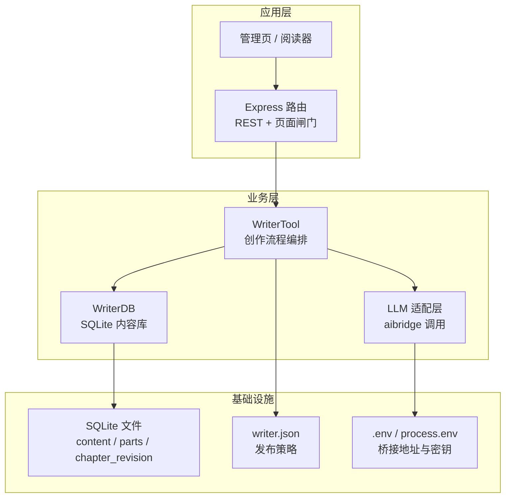
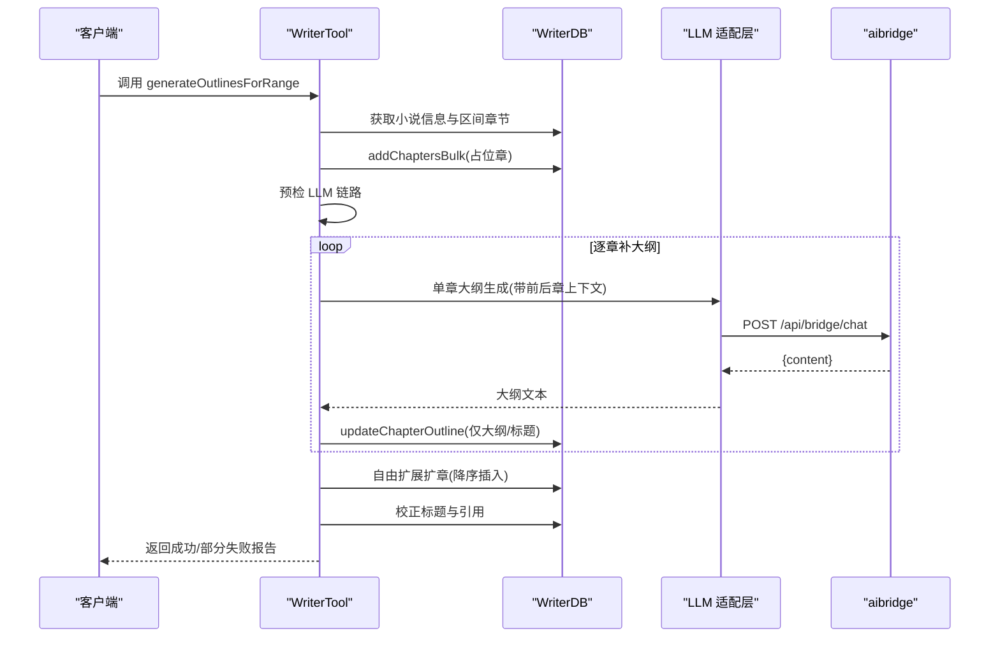
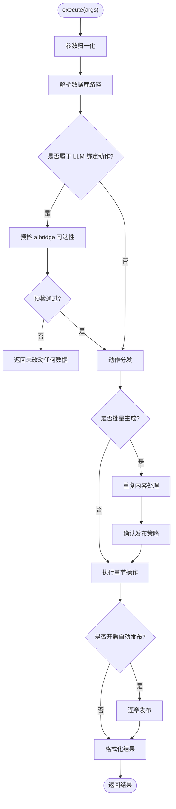
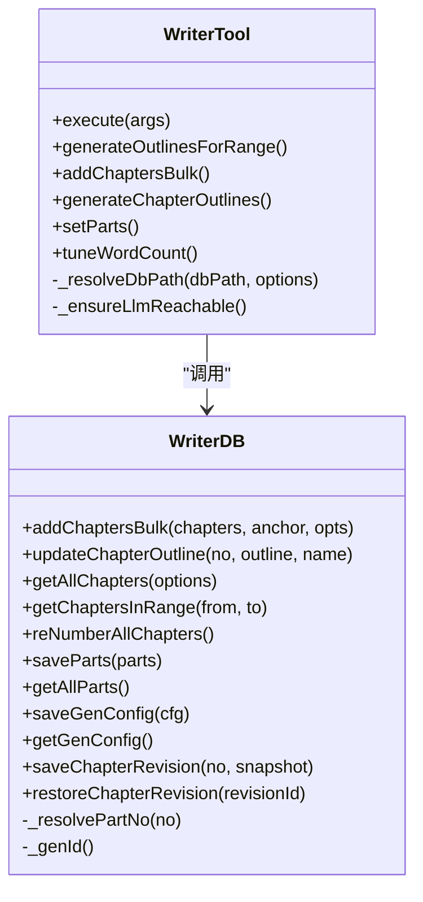
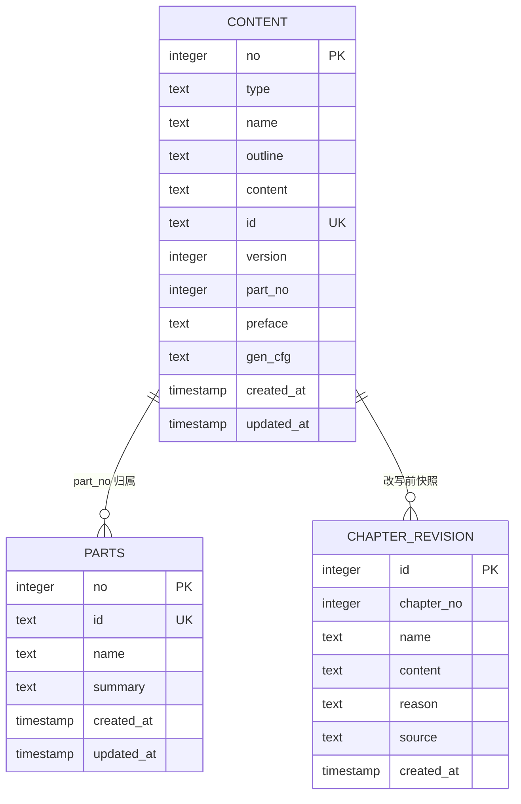
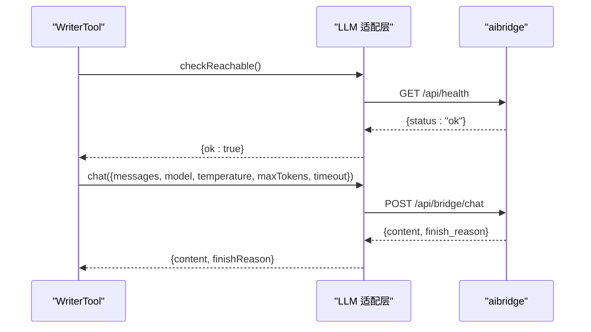
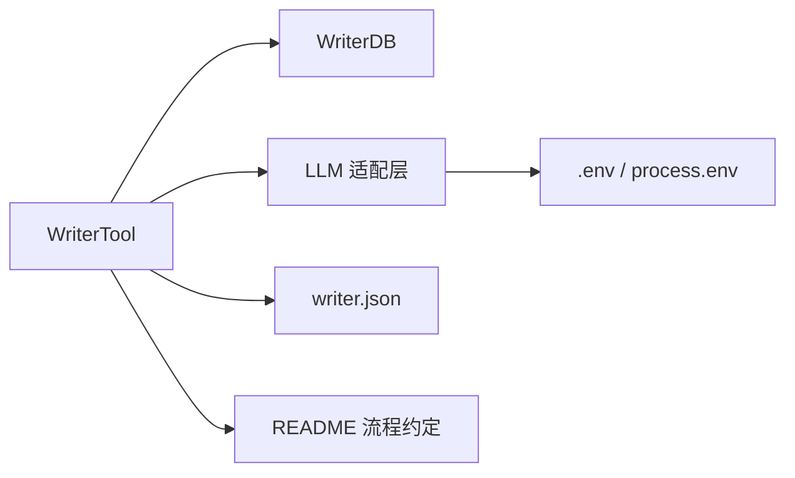

# 小说创作引擎

<cite>
**本文引用的文件**   
- [README.md](file://README.md)
- [writerTool.js](file://src/tools/common/writerTool.js)
- [writer.js](file://src/database/writer.js)
- [llm.js](file://src/agent/llm.js)
- [writer.json](file://config/writer.json)
</cite>

## 目录
1. [引言](#引言)
2. [项目结构](#项目结构)
3. [核心组件](#核心组件)
4. [架构总览](#架构总览)
5. [详细组件分析](#详细组件分析)
6. [依赖关系分析](#依赖关系分析)
7. [性能与可靠性](#性能与可靠性)
8. [故障排查指南](#故障排查指南)
9. [结论](#结论)
10. [附录：使用示例与最佳实践](#附录使用示例与最佳实践)

## 引言
本技术文档面向“小说创作引擎”的实现与维护者，聚焦以下目标：
- 解释 WriterTool 核心工具类的设计、职责边界与完整创作流程控制。
- 说明 AI 大语言模型集成方式：LLM 接口抽象、提示词工程、流式与非流式响应处理、链路预检与超时策略。
- 梳理章节管理功能：批量加章、区间补大纲、整本重建大纲、分部划分、字数治理、修订快照与回滚。
- 文档化数据库表结构设计，尤其是 content 表与 parts 表的关系、约束与迁移策略。
- 给出具体使用路径与最佳实践，帮助读者在不直接阅读源码的情况下也能正确调用系统能力。

## 项目结构
仓库采用 Node.js + Express 后端，SQLite 作为内容库存储，前端包含管理页、阅读器与 TTS 资源。核心代码集中在 `src` 下：
- `src/tools/common/writerTool.js`：WriterTool 工具类，统一编排生成、增删改、批量操作、AI 调用与发布联动。
- `src/database/writer.js`：WriterDB 数据访问层，封装 SQLite 表结构、事务、批量平移、分部归属等。
- `src/agent/llm.js`：aibridge 适配层，负责健康检查、身份探测、非流式聊天请求与错误包装。
- `config/writer.json`：Agent 级发布策略（自动发布开关、远程目录等）。
- `README.md`：平台功能说明、章节增补流程、VIP 授权、推理服务连接、字数治理与发布预览机制。

图表来源
- [writerTool.js:76-205](file://src/tools/common/writerTool.js#L76-L205)
- [writer.js:16-137](file://src/database/writer.js#L16-L137)
- [llm.js:67-171](file://src/agent/llm.js#L67-L171)
- [writer.json:1-8](file://config/writer.json#L1-L8)

章节来源
- [README.md:166-202](file://README.md#L166-L202)

## 核心组件
本节从职责角度拆解三个关键组件：WriterTool、WriterDB、LLM 适配层。

### WriterTool：创作流程编排器
WriterTool 是“根据大纲生成、添加、删除、修改小说章节”的统一入口。它承担：
- 参数归一化与动作分发。
- 数据库路径解析与模糊定位。
- 动笔前的 LLM 链路预检。
- 批量加章、区间补大纲、整本大纲重建、分部划分、字数治理、设定说明与部导言生成。
- 发布策略确认、自动发布联动、结果格式化与提示补充。

关键设计点：
- 所有可调用的 action 在构造时声明为 JSON Schema，便于上层工具注册与 LLM 理解。
- 对需要调模型的 action 做白名单拦截，并在执行前探活 aibridge，失败则“本次未改动任何数据”。
- 对破坏性操作（如整本重建大纲）设置硬关卡，默认阻止覆盖已有正文。
- 批量操作一律走 WriterDB 的事务与平移逻辑，避免半插状态。

章节来源
- [writerTool.js:76-205](file://src/tools/common/writerTool.js#L76-L205)
- [writerTool.js:217-295](file://src/tools/common/writerTool.js#L217-L295)
- [writerTool.js:1227-1295](file://src/tools/common/writerTool.js#L1227-L1295)

### WriterDB：内容库访问层
WriterDB 基于 better-sqlite3，提供：
- 统一的 content 表：no=0 表示小说概要，no≥1 表示章节；type 区分 novel/chapter。
- parts 表：记录“部”的元信息（稳定 id、名称、导言），章节归属通过 content.part_no 聚合派生。
- chapter_revision 表：改写前快照，支持列出与恢复。
- 批量插入、编号平移、区间查询、分部归属推断、全书生成设定读写。

关键设计点：
- 新增列通过 PRAGMA 检测后 ALTER TABLE 补齐，保证旧库平滑迁移。
- 批量加章用“临时偏移 + 整体落回”的两步法，一次事务内完成平移与插入，绝不覆盖已有正文。
- 分部归属不存区间副本，只存 part_no，由 getAllParts 与 getPartRanges 派生起止范围，避免删章/重编号后区间说谎。

章节来源
- [writer.js:16-137](file://src/database/writer.js#L16-L137)
- [writer.js:645-724](file://src/database/writer.js#L645-L724)
- [writer.js:853-902](file://src/database/writer.js#L853-L902)
- [writer.js:1001-1098](file://src/database/writer.js#L1001-L1098)

### LLM 适配层：aibridge 调用封装
LLM 适配层对外暴露 chat、checkReachable、probeIdentity 等方法，对内把 messages 拆成 system 与 prompt，并转发到 aibridge `/api/bridge/chat`。

关键设计点：
- 配置优先级：控制台运行时覆盖 > process.env > .env > 内置默认。
- 健康检查 GET `/api/health`，不计费，用于动笔前预检。
- whoami 探测返回 providerType、model 等标识，用于界面显示“现在连的是哪个模型”。
- 非流式响应为主；思考链可关闭；超时由调用方传入，同时发给桥接侧以对齐上游默认 120s 限制。

章节来源
- [llm.js:1-10](file://src/agent/llm.js#L1-L10)
- [llm.js:37-56](file://src/agent/llm.js#L37-L56)
- [llm.js:75-100](file://src/agent/llm.js#L75-L100)
- [llm.js:102-171](file://src/agent/llm.js#L102-L171)
- [llm.js:179-201](file://src/agent/llm.js#L179-L201)

## 架构总览
下图展示一次“区间补大纲”的典型调用链：前端或管理端触发 → WriterTool 校验参数 → 解析数据库路径 → 若需调模型则预检 aibridge → 按 anchor 插入占位章 → 逐章串行调用 LLM 写大纲 → 自由扩展扩章 → 校正标题与引用 → 返回报告。

图表来源
- [writerTool.js:471-672](file://src/tools/common/writerTool.js#L471-L672)
- [writer.js:645-724](file://src/database/writer.js#L645-L724)
- [llm.js:102-171](file://src/agent/llm.js#L102-L171)

## 详细组件分析

### WriterTool 创作流程控制
WriterTool.execute 是统一入口，主要阶段如下：
1. 参数归一化：chapter、totalChapters、info.no 等字符串转整数。
2. 数据库路径解析：相对名落到 data 目录，绝对路径原样使用；不存在时尝试模糊匹配既有库；必要时拒绝静默新建空库。
3. LLM 预检：对 LLM_BOUND_ACTIONS 白名单中的 action 先探活 aibridge，失败直接返回“未改动任何数据”。
4. 动作分发：listNovels、getPublishConfig、setPublishConfig、getNovelInfo、saveNovelPlan、addChapterOutline、updateChapterOutline、addChaptersBulk、reNumberChapters、generateOutlinesForRange、savePreface、generatePreface、setGenConfig、tuneWordCount、setParts、listParts、generatePartIntros、checkChapters、listRevisions、restoreChapter、updateNovelPlan、generateChapterOutlines、executeChapterOperation。
5. 批量生成前置关卡：重复内容处理、发布策略确认。
6. 写入成功后自动发布：若开启 autoPublish，则逐章发布。

图表来源
- [writerTool.js:217-295](file://src/tools/common/writerTool.js#L217-L295)
- [writerTool.js:1260-1295](file://src/tools/common/writerTool.js#L1260-L1295)

章节来源
- [writerTool.js:217-295](file://src/tools/common/writerTool.js#L217-L295)
- [writerTool.js:1308-1413](file://src/tools/common/writerTool.js#L1308-L1413)
- [writerTool.js:1548-1599](file://src/tools/common/writerTool.js#L1548-L1599)

### 章节管理与批量操作
WriterTool 与 WriterDB 共同实现以下章节管理能力：
- 单章大纲添加/更新：addChapterOutline、updateChapterOutline。
- 批量加章：addChaptersBulk，支持末尾追加或锚点后插入；单次上限 50 章；事务内一次平移、连续 INSERT；主键冲突会整体回滚。
- 区间补大纲：generateOutlinesForRange，先插占位章再回填；每章一次 LLM 调用，串行推进；连续失败熔断；自由扩展可将一章情节切多章。
- 整本大纲重建：generateChapterOutlines，默认拦截覆盖已有正文；force=true 才允许重写并清空正文。
- 重编号：reNumberAllChapters，按当前顺序重新从 1 开始编号。
- 分部划分：setParts，要求从第 1 章起连续覆盖到末章；parts 表只存元信息，起止范围由 content.part_no 聚合派生。
- 字数治理：tuneWordCount，dryRun 默认只出报告；分三阶段：拆章、编号校正、扩写/压缩；超长处理方式 split 或 trim。

图表来源
- [writerTool.js:444-463](file://src/tools/common/writerTool.js#L444-L463)
- [writerTool.js:471-672](file://src/tools/common/writerTool.js#L471-L672)
- [writerTool.js:760-965](file://src/tools/common/writerTool.js#L760-L965)
- [writer.js:645-724](file://src/database/writer.js#L645-L724)
- [writer.js:808-851](file://src/database/writer.js#L808-L851)
- [writer.js:1039-1098](file://src/database/writer.js#L1039-L1098)

章节来源
- [writerTool.js:444-463](file://src/tools/common/writerTool.js#L444-L463)
- [writerTool.js:471-672](file://src/tools/common/writerTool.js#L471-L672)
- [writerTool.js:760-965](file://src/tools/common/writerTool.js#L760-L965)
- [writer.js:645-724](file://src/database/writer.js#L645-L724)
- [writer.js:808-851](file://src/database/writer.js#L808-L851)
- [writer.js:1039-1098](file://src/database/writer.js#L1039-L1098)

### 数据库表结构与关系
content 表是统一内容表：
- no=0：小说概要（novel），含 name、outline、content、preface、gen_cfg、version、id。
- no≥1：章节（chapter），含 name、outline、content、part_no、version、id。
- type 区分 novel/chapter。
- id 是稳定章节 ID，发布文件名依据，不随重排变化。
- part_no 表示章节所属“部”，0 表示不属于任何部。

parts 表：
- no：部序号。
- id：稳定部 ID，导言页文件名依据。
- name：部名（可为空）。
- summary：本部导言正文。
- created_at/updated_at：时间戳。

chapter_revision 表：
- 记录章节改写前的快照，支持列出与恢复。

图表来源
- [writer.js:55-137](file://src/database/writer.js#L55-L137)
- [writer.js:904-947](file://src/database/writer.js#L904-L947)
- [writer.js:1186-1259](file://src/database/writer.js#L1186-L1259)

章节来源
- [writer.js:55-137](file://src/database/writer.js#L55-L137)
- [writer.js:904-947](file://src/database/writer.js#L904-L947)
- [writer.js:1186-1259](file://src/database/writer.js#L1186-L1259)

### AI 大语言模型集成
LLM 适配层将 WriterTool 的 messages 拆分为 system 与 prompt，并调用 aibridge `/api/bridge/chat`。关键行为：
- checkReachable：GET `/api/health`，快速判断桥接服务可达性与 Key 是否存在。
- chat：POST `/api/bridge/chat`，返回 content 与 finishReason；支持 temperature、max_tokens、model、timeout、think=false。
- probeIdentity：GET `/api/bridge/whoami`，返回 keyName、provider、providerType、model，用于界面显示“连到哪个模型”。

WriterTool 对 LLM 的使用包括：
- 生成章节大纲：generateSingleChapterOutlineWithLLM。
- 生成全书大纲：generateAllChapterOutlines。
- 生成“本书设定”说明：generatePrefaceWithLLM。
- 生成部导言：generatePartIntroWithLLM。
- 字数治理中的扩写与压缩：_expandChapterToTarget、_compressChapterToTarget。

图表来源
- [llm.js:75-100](file://src/agent/llm.js#L75-L100)
- [llm.js:102-171](file://src/agent/llm.js#L102-L171)
- [llm.js:179-201](file://src/agent/llm.js#L179-L201)

章节来源
- [llm.js:75-100](file://src/agent/llm.js#L75-L100)
- [llm.js:102-171](file://src/agent/llm.js#L102-L171)
- [llm.js:179-201](file://src/agent/llm.js#L179-L201)

### 提示词工程与流式响应
- 提示词工程：WriterTool 在生成大纲、设定说明、部导言、扩写/压缩时，会把小说概要、前后章大纲、素材、字数目标区间等信息组织成 system/prompt 传给 LLM。例如区间补大纲会为“本次是紧接某章新写的一段剧情”注入上下文，使模型输出具备连续性。
- 流式响应：当前 LLM 适配层默认 stream=false，返回完整 content；如需流式，可在上层扩展 chat 方法并处理 SSE/ReadableStream。仓库中未见显式流式消费逻辑，因此“流式响应处理”在当前实现中以非流式为主。

章节来源
- [writerTool.js:549-558](file://src/tools/common/writerTool.js#L549-L558)
- [llm.js:102-171](file://src/agent/llm.js#L102-L171)

## 依赖关系分析
WriterTool 依赖 WriterDB 进行数据持久化，依赖 LLM 适配层进行 AI 调用，依赖 writer.json 读取发布策略，依赖 README 中描述的管理流程与用户交互。

图表来源
- [writerTool.js:76-205](file://src/tools/common/writerTool.js#L76-L205)
- [writer.js:16-137](file://src/database/writer.js#L16-L137)
- [llm.js:37-56](file://src/agent/llm.js#L37-L56)
- [writer.json:1-8](file://config/writer.json#L1-L8)
- [README.md:43-53](file://README.md#L43-L53)

章节来源
- [writerTool.js:76-205](file://src/tools/common/writerTool.js#L76-L205)
- [writer.js:16-137](file://src/database/writer.js#L16-L137)
- [llm.js:37-56](file://src/agent/llm.js#L37-L56)
- [writer.json:1-8](file://config/writer.json#L1-L8)
- [README.md:43-53](file://README.md#L43-L53)

## 性能与可靠性
- 批量加章：一次事务内完成平移与插入，避免 N×M 次更新；主键冲突整体回滚，不留半插状态。
- 区间补大纲：逐章串行调用 LLM，连续失败熔断（默认 3 次），已写章节保留，未尝试章节明确告知。
- 字数治理：dryRun 默认只出报告；拆章后编号定稿再扩写/压缩，避免二次偏移；扩写有内容级闸门，压缩允许重试一次。
- LLM 超时：调用方传入 timeout，同时发给桥接侧，避免客户端 600s 与上游 120s 不一致导致的 502。
- 发布策略：autoPublish 开启后逐章发布；预览与正式发布分离，暂存产物可作废。

章节来源
- [writer.js:645-724](file://src/database/writer.js#L645-L724)
- [writerTool.js:526-605](file://src/tools/common/writerTool.js#L526-L605)
- [writerTool.js:760-965](file://src/tools/common/writerTool.js#L760-L965)
- [llm.js:125-131](file://src/agent/llm.js#L125-L131)
- [README.md:63-70](file://README.md#L63-L70)

## 故障排查指南
常见问题与定位建议：
- LLM 链路不可达：检查 aibridge 是否启动、API Key 是否配置、控制台启用项是否生效；使用 checkReachable 与 probeIdentity 诊断。
- 批量加章失败：确认 chapters 数组每项都有 outline；anchor.no 必须存在；单次不超过 50 章。
- 区间补大纲全部失败：查看 errors 中 connectionError 标记；连续失败会熔断，剩余章节“未尝试”不等于失败。
- 字数治理无效：确认 setGenConfig 已设置 targetWords；dryRun 默认只出报告，需传 false 执行。
- 分部划分报错：确保 from/to 连续覆盖 1 到末章，无缺口重叠；最后一部结束章可留空。
- 发布后内容与库不一致：发布只渲染有正文的章；预览与正式发布分离；线上核对磁盘文件而非 publish_state。

章节来源
- [llm.js:75-100](file://src/agent/llm.js#L75-L100)
- [llm.js:179-201](file://src/agent/llm.js#L179-L201)
- [writer.js:645-724](file://src/database/writer.js#L645-L724)
- [writerTool.js:526-605](file://src/tools/common/writerTool.js#L526-L605)
- [writerTool.js:760-965](file://src/tools/common/writerTool.js#L760-L965)
- [writerTool.js:967-1024](file://src/tools/common/writerTool.js#L967-L1024)
- [README.md:41-42](file://README.md#L41-L42)

## 结论
WriterTool 作为小说创作引擎的核心编排器，将创作流程、AI 集成、章节管理与发布策略统一在一个可控、可观测、可回滚的体系中。WriterDB 通过统一 content 表与 parts 表，结合 chapter_revision 快照，保障了数据一致性与可恢复性。LLM 适配层屏蔽了 aibridge 细节，提供健康检查、身份探测与超时对齐。批量操作、区间补大纲、字数治理等复杂场景均通过事务、熔断、dryRun 与内容级闸门提升可靠性。对于使用者而言，遵循 README 的流程约定与 WriterTool 的参数语义，即可安全高效地完成小说创作与管理。

## 附录：使用示例与最佳实践

### 创建小说规划
- 使用 saveNovelPlan 保存小说概要、角色设定与世界观；可选 targetWordCount 设置每章目标字数。
- 若数据库中尚无章节大纲，系统会自动生成；否则仅保存规划。

参考路径
- [writerTool.js:327-408](file://src/tools/common/writerTool.js#L327-L408)
- [writer.js:169-202](file://src/database/writer.js#L169-L202)

### 批量加章
- 使用 addChaptersBulk，传入 chapters 数组（每项含 outline），anchor.mode 为 tail 或 after。
- 单次最多 50 章；事务内一次平移、连续 INSERT；主键冲突整体回滚。

参考路径
- [writerTool.js:444-463](file://src/tools/common/writerTool.js#L444-L463)
- [writer.js:645-724](file://src/database/writer.js#L645-L724)

### 区间补大纲
- 使用 generateOutlinesForRange，可先插占位章（count）再回填，或直接回填已有空章（from/to）。
- 每章一次 LLM 调用，串行推进；连续失败熔断；自由扩展可扩章。

参考路径
- [writerTool.js:471-672](file://src/tools/common/writerTool.js#L471-L672)

### 整本大纲重建
- 使用 generateChapterOutlines；默认拦截覆盖已有正文；force=true 才允许重写并清空正文。

参考路径
- [writerTool.js:1227-1258](file://src/tools/common/writerTool.js#L1227-L1258)

### 分部划分
- 使用 setParts，传入 parts 数组（每项含 from/to，name 可选）；要求从第 1 章起连续覆盖到末章。
- 使用 listParts 查看部结构；generatePartIntros 生成部导言。

参考路径
- [writerTool.js:967-1077](file://src/tools/common/writerTool.js#L967-L1077)
- [writer.js:1039-1098](file://src/database/writer.js#L1039-L1098)

### 字数治理
- 使用 setGenConfig 设置 targetWords、tolerancePct、splitPct。
- 使用 tuneWordCount，dryRun 默认只出报告；确认后传 false 执行；分三阶段：拆章、编号校正、扩写/压缩。

参考路径
- [writerTool.js:721-758](file://src/tools/common/writerTool.js#L721-L758)
- [writerTool.js:760-965](file://src/tools/common/writerTool.js#L760-L965)
- [writer.js:965-999](file://src/database/writer.js#L965-L999)

### LLM 集成与调试
- 使用 llm.checkReachable 预检桥接服务；llm.probeIdentity 查看当前 Key 对应的 provider/model。
- 注意 timeout 传递，避免客户端与上游超时不一致。

参考路径
- [llm.js:75-100](file://src/agent/llm.js#L75-L100)
- [llm.js:179-201](file://src/agent/llm.js#L179-L201)
- [llm.js:125-131](file://src/agent/llm.js#L125-L131)