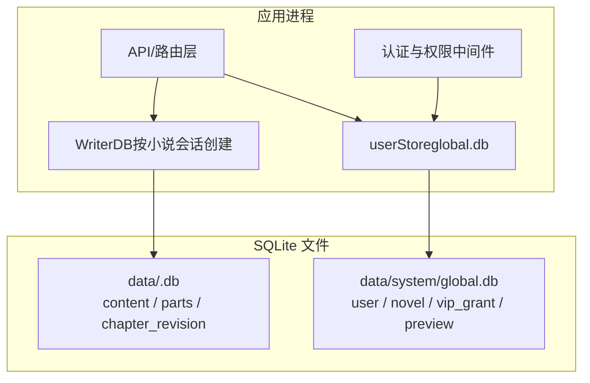
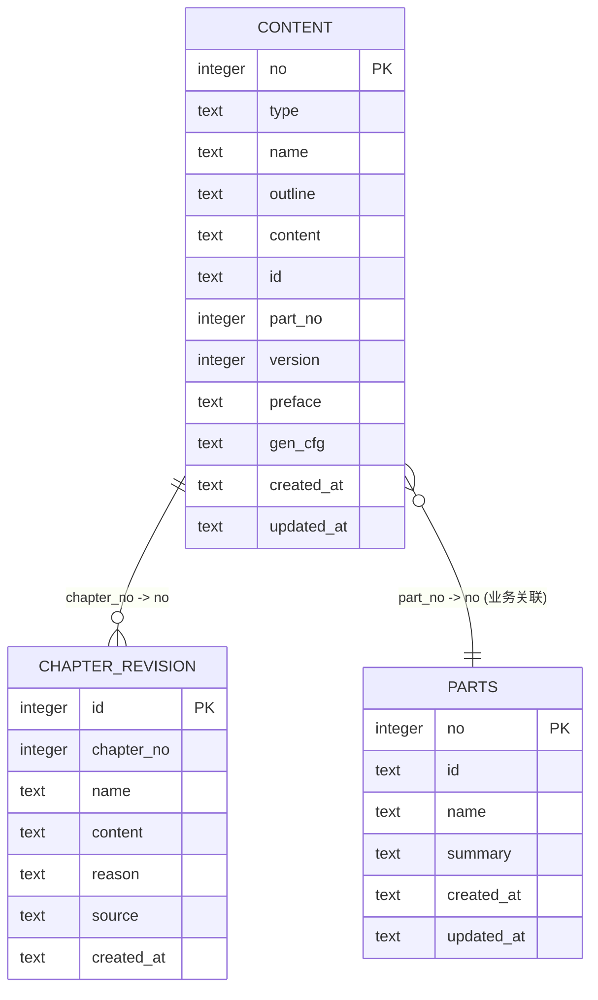
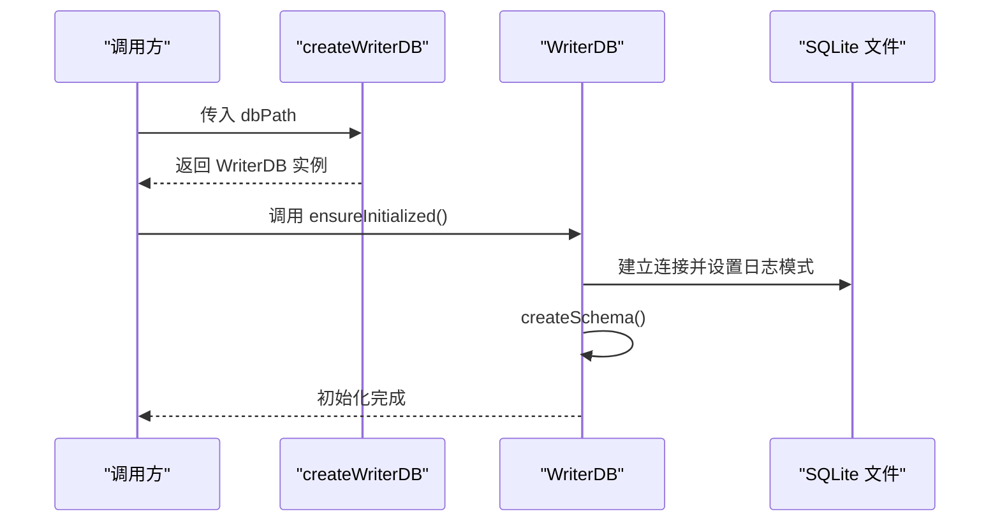
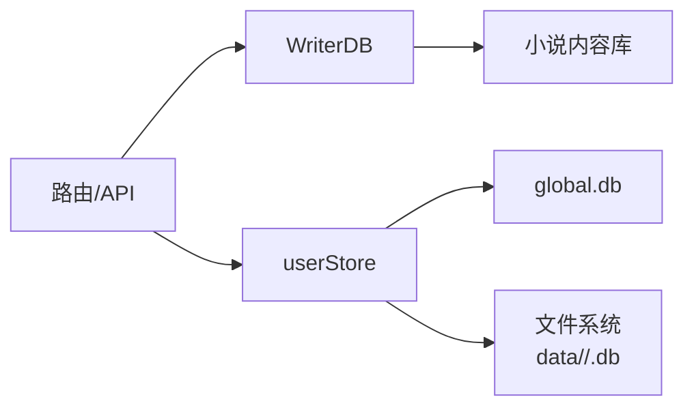
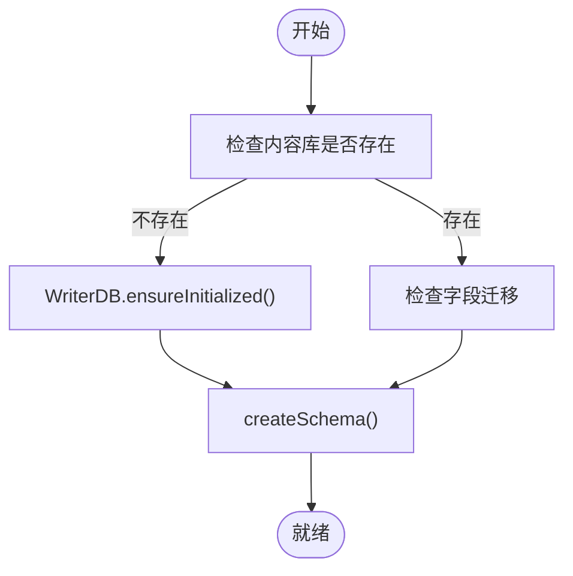
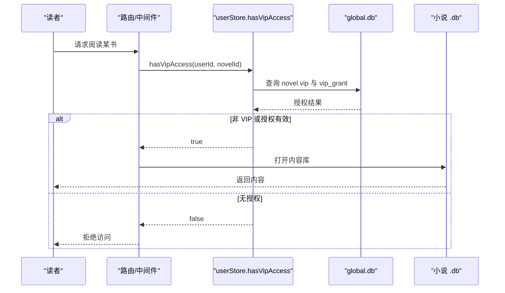

# 数据库设计与持久化

<cite>
**本文引用的文件**   
- [src/database/writer.js](file://src/database/writer.js)
- [src/auth/userStore.js](file://src/auth/userStore.js)
</cite>

## 目录
1. [引言](#引言)
2. [项目结构](#项目结构)
3. [核心组件](#核心组件)
4. [架构总览](#架构总览)
5. [详细组件分析](#详细组件分析)
6. [依赖关系分析](#依赖关系分析)
7. [性能与索引优化](#性能与索引优化)
8. [迁移、备份与恢复](#迁移备份与恢复)
9. [VIP 内容保护与多租户隔离](#vip-内容保护与多租户隔离)
10. [故障排查指南](#故障排查指南)
11. [结论](#结论)

## 引言
本文面向小说创作引擎的数据库设计与持久化实现，聚焦 SQLite 数据模型、WriterDB 数据访问层、VIP 授权与多租户隔离机制。文档覆盖以下目标：
- 说明 content、parts、chapter_revision 等表的结构、字段、约束与索引策略。
- 解释 WriterDB 工厂函数 createWriterDB、CRUD 方法、事务封装与一致性保障。
- 梳理数据迁移策略、版本管理、备份恢复建议。
- 说明 VIP 内容保护的数据隔离机制与多租户支持。
- 给出查询优化建议与可观测性指标。

## 项目结构
本项目使用两个 SQLite 数据库承担不同职责：
- 每本小说的内容库 data/<id>.db：由 WriterDB 管理，存储小说概要、章节正文、分部导言、生成设定与改写快照。
- 全局元数据库 data/system/global.db：由 userStore 管理，存储用户、小说注册表、VIP 授权与预览登记。



**图表来源**
- [src/database/writer.js:16-50](file://src/database/writer.js#L16-L50)
- [src/auth/userStore.js:47-114](file://src/auth/userStore.js#L47-L114)

**章节来源**
- [src/database/writer.js:16-50](file://src/database/writer.js#L16-L50)
- [src/auth/userStore.js:47-114](file://src/auth/userStore.js#L47-L114)

## 核心组件
- WriterDB：负责单本小说内容的初始化、建表、CRUD、批量操作、分部归属、生成设定与章节改写回滚。
- userStore：负责全局用户、小说注册表、VIP 授权、预览生命周期与存量迁移。

关键职责边界：
- writer.js 不触碰 global.db；userStore 不直接写小说正文库，只通过 WriterTool 间接更新正文。
- VIP 开关在 global.db 中，正文隔离通过“是否允许该读者访问对应 .db”的网关控制。

**章节来源**
- [src/database/writer.js:16-50](file://src/database/writer.js#L16-L50)
- [src/auth/userStore.js:1-11](file://src/auth/userStore.js#L1-L11)

## 架构总览
WriterDB 以类方式暴露接口，并通过 createWriterDB(dbPath) 工厂为每个小说会话创建独立实例；userStore 以模块内单例打开 global.db，提供用户、小说、VIP 授权等能力。

```mermaid
classDiagram
class WriterDB {
+constructor(dbPath)
+ensureInitialized()
+createSchema()
+saveNovelInfo(data)
+getNovelInfo()
+upsertChapter(data)
+getAllChapters(options)
+getChapter(no)
+deleteChapter(no)
+batchUpsertChapters(chapters)
+shiftChapterNumbers(startFrom, shiftBy)
+addChapterOutline(data)
+addChaptersBulk(chapters, anchor, opts)
+getPartRanges()
+saveParts(parts)
+getAllParts()
+updatePart(no, fields)
+savePreface(text)
+getPreface()
+saveGenConfig(cfg)
+getGenConfig()
+saveChapterRevision(no, snapshot)
+listChapterRevisions(no)
+restoreChapterRevision(revisionId)
+close()
}
class UserStore {
+openDb()
+bootstrap()
+createUser(...)
+login(...)
+createNovel(...)
+setNovelVip(id, vip)
+grantVip(...)
+revokeVipGrant(id)
+hasVipAccess(userId, novelId)
}
WriterDB --> "better-sqlite3" : "连接小说库"
UserStore --> "better-sqlite3" : "连接 global.db"
```

**图表来源**
- [src/database/writer.js:16-1277](file://src/database/writer.js#L16-L1277)
- [src/auth/userStore.js:47-501](file://src/auth/userStore.js#L47-L501)

## 详细组件分析

### WriterDB 数据模型与表结构

#### content 表
用于统一存储小说概要（no=0）与章节（no≥1），并承载分部归属、稳定 ID、生成设定与“本书设定”说明。

| 字段 | 类型 | 约束/默认值 | 含义 |
|---|---|---|---|
| no | INTEGER | PRIMARY KEY | 0=小说概要；1..N=章节号 |
| type | TEXT | NOT NULL DEFAULT 'chapter' | 'novel' 或 'chapter' |
| name | TEXT | 可为空 | 小说名称（no=0）或章节标题（no≥1） |
| outline | TEXT | 可为空 | 小说简介（no=0）或章节大纲（no≥1） |
| content | TEXT | 可为空 | 其他信息（no=0）或章节正文（no≥1） |
| id | TEXT | 唯一索引 | 稳定章节/概要 ID，用于发布文件名 |
| part_no | INTEGER | 默认 0 | 归属部序号；0 表示未归部 |
| version | INTEGER | 默认 1 | 概要/章节版本号 |
| preface | TEXT | 可为空 | “本书设定”说明正文，仅写入 no=0 |
| gen_cfg | TEXT | 可为空 | 全书生成设定 JSON，仅写入 no=0 |
| created_at | TEXT | CURRENT_TIMESTAMP | 创建时间 |
| updated_at | TEXT | CURRENT_TIMESTAMP | 更新时间 |

主键设计：
- no 作为主键，保证概要行固定为 0，章节从 1 开始连续编号。
- id 通过唯一索引保证稳定标识，避免重排导致外部引用漂移。

索引策略：
- idx_content_no：加速按章节号查询。
- idx_content_type：加速按类型过滤（如只查章节）。
- idx_content_name：加速按标题搜索。
- idx_content_id：唯一索引，保证稳定 ID 不重复。
- idx_content_part_no：加速按部聚合与归属推断。

**章节来源**
- [src/database/writer.js:55-137](file://src/database/writer.js#L55-L137)
- [src/database/writer.js:169-228](file://src/database/writer.js#L169-L228)
- [src/database/writer.js:307-343](file://src/database/writer.js#L307-L343)
- [src/database/writer.js:355-401](file://src/database/writer.js#L355-L401)
- [src/database/writer.js:904-947](file://src/database/writer.js#L904-L947)
- [src/database/writer.js:965-999](file://src/database/writer.js#L965-L999)

#### parts 表
用于维护“部”的元数据（部名、导言摘要、稳定 ID），但部的起止章范围不在本表冗余存储，而是由 content.part_no 派生计算，避免删章/重编号后区间失真。

| 字段 | 类型 | 约束/默认值 | 含义 |
|---|---|---|---|
| no | INTEGER | PRIMARY KEY | 部序号（对应 content.part_no） |
| id | TEXT | 可为空 | 稳定部 ID，用于导言页文件名 |
| name | TEXT | 可为空 | 部名；为空时展示为“第 N 部” |
| summary | TEXT | 可为空 | 本部主要设定与故事概要 |
| created_at | TEXT | CURRENT_TIMESTAMP | 创建时间 |
| updated_at | TEXT | CURRENT_TIMESTAMP | 更新时间 |

派生逻辑：
- getPartRanges 基于 content.part_no 聚合得到各部的 from_no、to_no、chapters。
- _resolvePartNo 根据新章节 no 自动推断归属部，尾部追加归最后一部，首部异常归 0。

**章节来源**
- [src/database/writer.js:95-108](file://src/database/writer.js#L95-L108)
- [src/database/writer.js:853-902](file://src/database/writer.js#L853-L902)
- [src/database/writer.js:1001-1098](file://src/database/writer.js#L1001-L1098)

#### chapter_revision 表
用于保存章节改写前的快照，支持回滚。

| 字段 | 类型 | 约束/默认值 | 含义 |
|---|---|---|---|
| id | INTEGER | AUTOINCREMENT PK | 快照自增 ID |
| chapter_no | INTEGER | NOT NULL | 被改写的章节号 |
| name | TEXT | 可为空 | 快照时的章节标题 |
| content | TEXT | NOT NULL | 快照时的正文 |
| reason | TEXT | 可为空 | 改写原因 |
| source | TEXT | 可为空 | 来源（manual/auto 等） |
| created_at | TEXT | CURRENT_TIMESTAMP | 快照时间 |

**章节来源**
- [src/database/writer.js:110-121](file://src/database/writer.js#L110-L121)
- [src/database/writer.js:1186-1259](file://src/database/writer.js#L1186-L1259)

#### 表关系与外键约束
- content.part_no 与 parts.no 存在业务关联，但代码未定义外键约束，属于应用层强一致。
- 删除章节会触发后续章节 renumber；批量加章采用两步平移避免主键冲突。
- 分部归属变更通过 saveParts 原子地清空旧归属并重新赋值，同时更新 parts 表。



**图表来源**
- [src/database/writer.js:55-137](file://src/database/writer.js#L55-L137)
- [src/database/writer.js:110-121](file://src/database/writer.js#L110-L121)
- [src/database/writer.js:853-902](file://src/database/writer.js#L853-L902)

### WriterDB 数据访问层

#### 工厂函数 createWriterDB
- 返回 WriterDB 实例，调用方传入 dbPath（通常为 data/<novel_id>.db）。
- ensureInitialized 负责懒加载数据库连接、设置 journal_mode、执行 createSchema。



**图表来源**
- [src/database/writer.js:16-50](file://src/database/writer.js#L16-L50)
- [src/database/writer.js:1273-1277](file://src/database/writer.js#L1273-L1277)

**章节来源**
- [src/database/writer.js:16-50](file://src/database/writer.js#L16-L50)
- [src/database/writer.js:1273-1277](file://src/database/writer.js#L1273-L1277)

#### CRUD 操作方法
- 概要：saveNovelInfo、getNovelInfo、hasNovelInfo、deleteNovelInfo。
- 章节：upsertChapter、getChapter、getAllChapters、deleteChapter、searchChapters。
- 批量：batchUpsertChapters、addChaptersBulk。
- 编号：shiftChapterNumbers、reNumberAllChapters。
- 分部：getPartRanges、saveParts、getAllParts、updatePart。
- 设定：savePreface、getPreface、saveGenConfig、getGenConfig。
- 回滚：saveChapterRevision、listChapterRevisions、restoreChapterRevision。

事务机制：
- 删除章节、批量插入、重排编号、分部覆盖保存均包裹在 this.db.transaction 中，确保原子性。
- addChaptersBulk 内部先整体平移再连续 INSERT，避免循环调用带来的半套状态。

错误处理：
- 所有方法在 catch 中记录错误并抛出或返回结构化结果。
- _normalizeNo 对非整数 no 抛错，防止 SQLite 数据类型不匹配。

**章节来源**
- [src/database/writer.js:169-267](file://src/database/writer.js#L169-L267)
- [src/database/writer.js:307-401](file://src/database/writer.js#L307-L401)
- [src/database/writer.js:408-528](file://src/database/writer.js#L408-L528)
- [src/database/writer.js:547-626](file://src/database/writer.js#L547-L626)
- [src/database/writer.js:645-724](file://src/database/writer.js#L645-L724)
- [src/database/writer.js:812-851](file://src/database/writer.js#L812-L851)
- [src/database/writer.js:1039-1098](file://src/database/writer.js#L1039-L1098)
- [src/database/writer.js:1186-1259](file://src/database/writer.js#L1186-L1259)

### userStore 全局元数据模型

#### 核心表
- user：账号权威，scrypt 哈希 + salt，disabled 软禁用。
- novel：user_id -> 小说 -> db_file 映射，vip 标记是否为 VIP 专属。
- vip_grant：读者账号授权，支持全站或单书授权，带到期与撤销。
- preview：预览站暂存目录登记，含过期回收。

| 表 | 关键字段 | 用途 |
|---|---|---|
| user | id, username, pass_hash, salt, role, disabled | 登录与角色 |
| novel | id, user_id, title, db_file, vip, chapter_count | 小说注册与 VIP 开关 |
| vip_grant | id, user_id, novel_id, expires_at, revoked_at | 读者授权 |
| preview | token, novel_id, user_id, expires_at | 预览生命周期 |

**章节来源**
- [src/auth/userStore.js:47-114](file://src/auth/userStore.js#L47-L114)
- [src/auth/userStore.js:126-228](file://src/auth/userStore.js#L126-L228)
- [src/auth/userStore.js:235-349](file://src/auth/userStore.js#L235-L349)
- [src/auth/userStore.js:351-378](file://src/auth/userStore.js#L351-L378)

## 依赖关系分析



耦合与内聚：
- WriterDB 与 better-sqlite3 紧耦合，但对外暴露稳定的方法契约。
- userStore 与文件系统路径约定耦合（data/system/global.db、data/<uid>/...），通过 openDb 与 bootstrap 集中管理。
- 两库职责清晰：内容 vs 元数据，降低跨域风险。

潜在循环依赖：
- 当前未见循环导入；WriterDB 不依赖 userStore，userStore 不直接写内容库。

外部依赖：
- better-sqlite3：同步 SQLite 驱动。
- fs-extra：文件目录与复制工具。
- crypto：稳定 ID 与口令哈希。

**章节来源**
- [src/database/writer.js:6-11](file://src/database/writer.js#L6-L11)
- [src/auth/userStore.js:12-23](file://src/auth/userStore.js#L12-L23)

## 性能与索引优化

### 已实现的优化
- 列表查询可选 includeContent=false，仅取 LENGTH(content) 减少内存占用。
- 批量加章一次事务内平移+连续 INSERT，避免 N×M 次 UPDATE。
- 分区归属派生而非冗余存储，避免区间不一致导致的额外校验成本。
- 使用唯一索引 idx_content_id 保证稳定 ID，避免发布侧二次去重。

### 建议优化
- 全文检索：LIKE '%keyword%' 无法利用 B-tree 索引，建议引入 FTS5 扩展或分词索引。
- 大文本分页：对 content 列进行分页读取，避免一次性拉取整本正文。
- 统计视图：为 chapter_count、part_chapter_count 等常用统计建立物化视图或缓存表。
- WAL 模式：若并发写入较多，可考虑切换 journal_mode=WAL，但需评估 -wal/-shm 文件管理。

### 监控指标
- 章节总数、有正文章节数、平均字数、最大字数。
- 分部覆盖率（part_no>0 的章节占比）。
- 生成设定解析失败次数（gen_cfg 解析异常告警）。
- 章节改写快照数量与恢复次数。

**章节来源**
- [src/database/writer.js:355-377](file://src/database/writer.js#L355-L377)
- [src/database/writer.js:645-724](file://src/database/writer.js#L645-L724)
- [src/database/writer.js:950-963](file://src/database/writer.js#L950-L963)

## 迁移、备份与恢复

### 迁移策略
- WriterDB.createSchema 使用 CREATE TABLE IF NOT EXISTS 与 ALTER TABLE ADD COLUMN 做增量迁移。
- 历史数据兜底：为缺失 id 的行回填随机稳定 ID。
- userStore.bootstrap 负责全局库播种与存量小说迁移，将扁平 data/*.db 归入 data/<uid>/ 并登记。

### 版本管理
- content.version 跟踪概要/章节版本。
- sqlite_version() 可用于运行时诊断。
- 建议为 schema 增加显式版本号列或单独 schema_version 表，便于灰度与回滚。

### 备份恢复
- 内容库：直接拷贝 data/<novel_id>.db 即可；建议在写入间隙或事务完成后备份。
- 全局库：备份 data/system/global.db。
- 恢复流程：停止服务 -> 替换 .db -> 启动服务 -> 运行 bootstrap/migrateExistingNovels 校验。



**图表来源**
- [src/database/writer.js:25-50](file://src/database/writer.js#L25-L50)
- [src/database/writer.js:55-137](file://src/database/writer.js#L55-L137)
- [src/auth/userStore.js:380-481](file://src/auth/userStore.js#L380-L481)

**章节来源**
- [src/database/writer.js:25-50](file://src/database/writer.js#L25-L50)
- [src/database/writer.js:55-137](file://src/database/writer.js#L55-L137)
- [src/auth/userStore.js:380-481](file://src/auth/userStore.js#L380-L481)

## VIP 内容保护与多租户隔离

### 数据隔离机制
- 每本小说一个 .db 文件，物理隔离。
- global.db.novel.vip 标记书籍是否 VIP 专属。
- hasVipAccess 是读者访问闸门的唯一口径：非 VIP 书恒放行；VIP 书要求存在未撤销、未到期且命中（全站或本书）的授权。



**图表来源**
- [src/auth/userStore.js:235-349](file://src/auth/userStore.js#L235-L349)

### 多租户支持
- user_id 区分作者/管理员，novel.user_id 绑定小说归属。
- vip_grant 支持全站授权（novel_id=NULL）或单书授权。
- 删除小说时级联清理 vip_grant 与 preview 登记，避免悬挂引用。

**章节来源**
- [src/auth/userStore.js:67-94](file://src/auth/userStore.js#L67-L94)
- [src/auth/userStore.js:235-349](file://src/auth/userStore.js#L235-L349)
- [src/auth/userStore.js:220-228](file://src/auth/userStore.js#L220-L228)

## 故障排查指南

常见问题与定位：
- 章节号非整数：_normalizeNo 会抛错，检查调用方传入 no 类型。
- 批量加章警告：当章号不连续时提示建议重排编号，但不阻断本次插入。
- 概要缺失：savePreface/saveGenConfig 要求 no=0 存在，否则抛错。
- VIP 不可读：检查 novel.vip 与 vip_grant 是否有效（未撤销、未到期、范围命中）。
- 分部归属异常：确认 saveParts 是否成功，检查 getPartRanges 派生结果。

调试入口：
- WriterDB.getInfo 输出数据库路径、表存在性、章节数、分部数与 SQLite 版本。
- userStore.listVipGrants/publicGrant 输出授权详情与有效性。

**章节来源**
- [src/database/writer.js:147-159](file://src/database/writer.js#L147-L159)
- [src/database/writer.js:707-724](file://src/database/writer.js#L707-L724)
- [src/database/writer.js:904-947](file://src/database/writer.js#L904-L947)
- [src/database/writer.js:965-999](file://src/database/writer.js#L965-L999)
- [src/database/writer.js:1137-1184](file://src/database/writer.js#L1137-L1184)
- [src/auth/userStore.js:270-349](file://src/auth/userStore.js#L270-L349)

## 结论
WriterDB 与 userStore 共同构成小说创作引擎的持久化基座：前者以 content/parts/chapter_revision 三表支撑内容建模与修订回滚，后者以 user/novel/vip_grant/preview 四表支撑多租户与 VIP 授权。通过工厂函数、事务封装与派生归属，系统在易用性与一致性之间取得平衡。未来可在全文检索、统计视图、WAL 模式与显式 schema 版本上继续演进，以提升大规模长篇创作场景下的性能与可运维性。